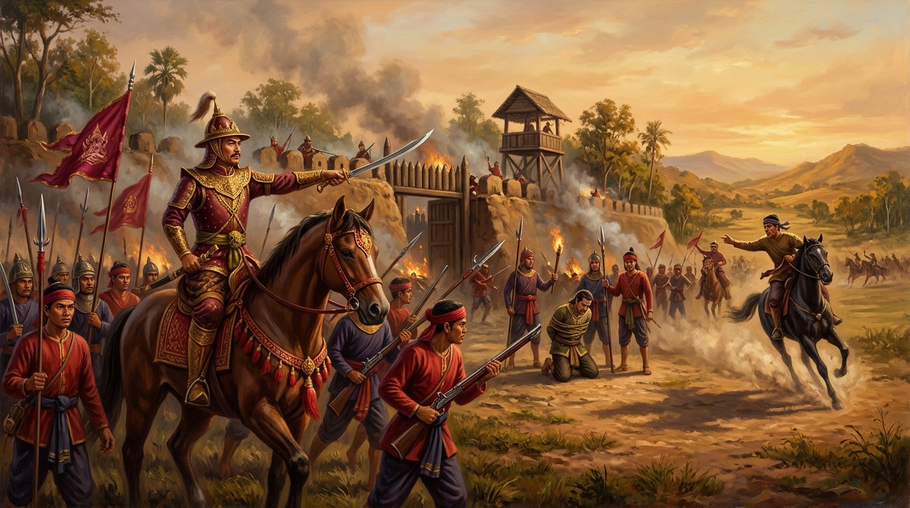
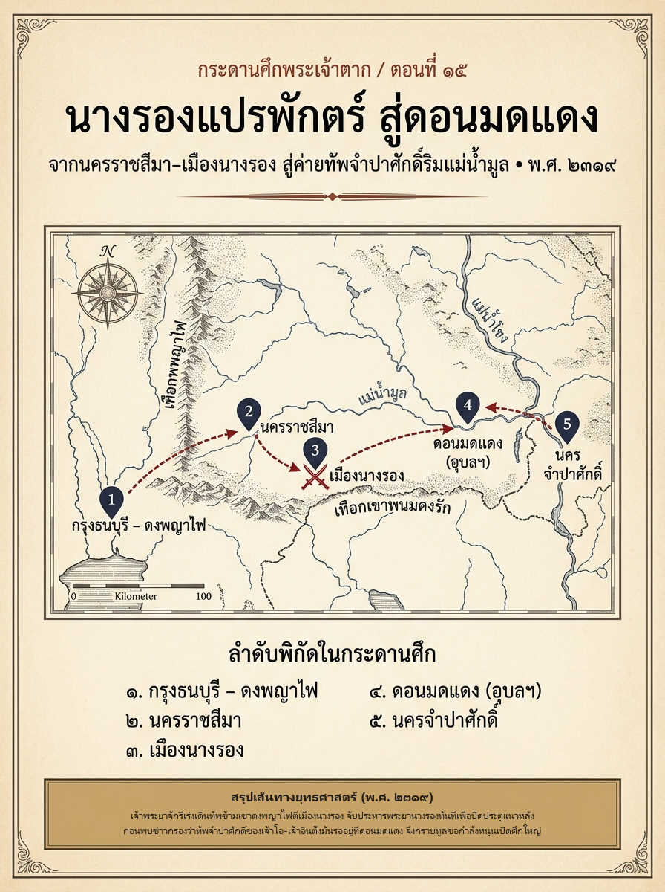

# ภาคที่ 4: เส้นทางสู่แม่น้ำโขง และฉากสุดท้ายแห่งกรุงธนบุรี (พ.ศ. 2319 – 2325)
## ตอนที่ 15: นางรองแปรพักตร์ เมื่อสองเมืองทะเลาะกันแต่สะเทือนถึงแม่น้ำโขง

---

### องก์ที่ 1: จุดชนวนและเดิมพัน (The Cold Open & The Stakes)

ม้าเร็วจากเมืองนครราชสีมาควบฝ่าประตูดินเข้ามาในเขตพระราชวังธนบุรีด้วยสภาพที่ทั้งคนทั้งม้าเปียกโชกไปด้วยเหงื่อและฝุ่นแดง

ปลายปี พ.ศ. 2319 (ปีวอก จุลศักราช 1138) เพียงไม่กี่เดือนหลังจากกองทัพพม่าของอะแซหวุ่นกี้ถอยพ้นแผ่นดินสยามไปได้ไม่นาน แผ่นดินริมแม่น้ำเจ้าพระยาเพิ่งจะได้หายใจหายคอจากการศึกใหญ่

แต่ใบบอกราชการที่อาลักษณ์อ่านถวายกลางท้องพระโรงในวันนั้น กลับเป็นเรื่องที่ฟังดูเหมือนคดีทะเลาะเบาะแว้งเล็กน้อยของขุนนางหัวเมืองชายขอบ—**พระยานางรอง** เจ้าเมืองเล็กๆ ในเขตอีสานใต้ เกิดผิดใจกับ **พระยานครราชสีมา** ผู้เป็นเจ้าเมืองเอก

ทว่าบรรทัดสุดท้ายของใบบอกฉบับนั้นทำให้ทั้งท้องพระโรงเงียบกริบลงในพริบตา

*"...บัดนี้พระยานางรองมิยอมฟังบังคับบัญชาเมืองนครราชสีมา กลับลอบส่งทูตไปสวามิภักดิ์ขึ้นต่อเจ้าเมืองนครจำปาศักดิ์..."*

ขุนนางบางคนในท้องพระโรงอาจมองว่าเป็นเพียงเรื่องวิวาทแย่งผลประโยชน์ของเจ้าเมืองบ้านนอก

แต่สายพระเนตรของ **สมเด็จพระเจ้าตากสิน** มองทะลุไปไกลกว่าแนวกำแพงเมืองนางรองนับร้อยกิโลเมตร—ไปจนถึงลำน้ำโขง!

เพราะ **เมืองนางรอง** ตั้งอยู่บนจุดยุทธศาสตร์สำคัญเชิงเขาพนมดงรัก เชื่อมระหว่างทุ่งราบอีสานใต้ กัมพูชา และเส้นทางเข้าสู่เมืองนครราชสีมา หากปล่อยให้เจ้าเมืองนางรองชักศึกเข้าบ้าน นำกำลังของ **นครจำปาศักดิ์** ข้ามแม่น้ำมูลมาตั้งมั่นอยู่ที่นี่ได้ ประตูหลังบ้านของราชอาณาจักรสยามก็จะเปิดอ้าออกทันที

*"ส่งเจ้าพระยาจักรีขึ้นไปจัดการให้เด็ดขาด"*

ไม่มีการส่งทูตไปไกล่เกลี่ย และไม่มีการรอให้เจ้าเมืองทั้งสองมาชี้แจง—คำสั่งเดียวจากกรุงธนบุรีในบ่ายวันนั้น กำลังจะจุดชนวนสงครามครั้งใหญ่ที่สุดที่พากองทัพไทยเดินเท้าข้ามลุ่มน้ำมูลไปจนถึง **แม่น้ำโขง**!

---

### องก์ที่ 2: อ่านกระดานศึกและปมที่ซ่อนอยู่ (The Map & The Hidden Truth)

หากกางแผนที่ภาคตะวันออกเฉียงเหนือและลุ่มน้ำมูล–แม่น้ำโขงใน พ.ศ. 2319 ออกดู แล้วอ่านประกอบกับ **พระราชพงศาวดารกรุงธนบุรี ฉบับพันจันทนุมาศ (เจิม)** และ **การเมืองไทยสมัยพระเจ้ากรุงธนบุรี** ของ **นิธิ เอียวศรีวงศ์** เราจะเข้าใจเหตุผลว่าทำไมเหตุการณ์ที่เมืองนางรองจึงลุกลามใหญ่โตเกินกว่าที่ใครคาดคิด

#### 1. สุญญากาศอำนาจในอีสานใต้และลุ่มน้ำมูล

หลังกรุงศรีอยุธยาแตกใน พ.ศ. 2310 อำนาจการปกครองของสยามในแถบอีสานใต้ (เลยเมืองนครราชสีมาออกไปทางทิศตะวันออก) แทบจะสูญสลายไปชั่วคราว

พื้นที่ลุ่มน้ำมูลตั้งแต่บุรีรัมย์ สุรินทร์ ศรีสะเกษ ไปจนถึงอุบลราชธานีในปัจจุบัน เป็นเขตแดนกึ่งอิสระที่ขุนนางท้องถิ่นและกลุ่มชาติพันธุ์ต่างๆ (ทั้งลาว เขมรป่าดง และส่วย) ต่างต้องเลือกข้างระหว่างมหาอำนาจ 2 ฝั่ง:
- **ฝั่งตะวันตก:** กรุงธนบุรี ซึ่งเพิ่งปราบกรมหมื่นเทพพิพิธที่พิมายไปเมื่อ พ.ศ. 2311 แต่ยังต้องทุ่มกำลังหลักรับศึกพม่าอยู่ทางเหนือและตะวันตกตลอดหลายปีที่ผ่านมา
- **ฝั่งตะวันออก:** **ราชอาณาจักรจำปาศักดิ์** (ภายใต้การปกครองของ **เจ้าองค์หลวงไชยกุมาร** โดยมีกลุ่มของ **เจ้าโอ** และ **เจ้าอิน** มีบทบาททางอำนาจในสายตระกูลจำปาศักดิ์–อัตตะปือ) ซึ่งตั้งราชธานีอยู่ริมฝั่งแม่น้ำโขง และกำลังพยายามแผ่อิทธิพลข้ามเทือกเขาพนมดงรักและแม่น้ำโขงเข้ามาครอบครองหัวเมืองลุ่มน้ำมูล!

#### 2. ทำไม "พระยานางรอง" จึงกล้าแปรพักตร์?

ในมุมมองของ **พระยานางรอง** ท่านอาจประเมินว่ากรุงธนบุรีกำลังบอบช้ำอย่างหนักจากศึกอะแซหวุ่นกี้ที่พิษณุโลก (พ.ศ. 2318–2319) คงไม่มีกำลังเหลือที่จะยกทัพข้ามเขาดงพญาไฟเข้ามาจัดการปัญหาชายแดนอีสานได้ง่ายๆ

เมื่อเกิดความขัดแย้งกับ **พระยานครราชสีมา** พระยานางรองจึงตัดสินใจเล่นไพ่เสี่ยงตาย—ดึง **นครจำปาศักดิ์** เข้ามาเป็นเกราะคุ้มกัน!

แต่สิ่งที่พระยานางรองไม่รู้ก็คือ **กรุงธนบุรีในปี พ.ศ. 2319 ไม่ใช่กรุงธนบุรีที่กำลังตั้งไข่เหมือนเมื่อแปดปีก่อน** เมื่อพม่าถอยทัพกลับอังวะไปแล้ว กองทัพหลักของกรุงธนบุรีที่เพิ่งผ่านศึกใหญ่กับอะแซหวุ่นกี้กำลังว่างมือและพร้อมรบอย่างเต็มที่!

---

### องก์ที่ 3: คมดาบและกลศึก (The Clash & Tactical Turning Point)

#### ความเด็ดขาดที่เมืองนางรอง: ทำไมต้องประหารทันที?

สมเด็จพระเจ้าตากสินทรงมอบหมายให้ **เจ้าพระยาจักรี (ทองด้วง)** คุมกองทัพจากกรุงธนบุรีและหัวเมืองใกล้เคียงเร่งเดินทัพข้ามเขาดงพญาไฟมุ่งหน้าสู่เมืองนครราชสีมาและเมืองนางรอง

การเคลื่อนพลเป็นไปอย่างรวดเร็วและเงียบเชียบ

เมื่อกองทัพของเจ้าพระยาจักรีมาถึง **เมืองนางรอง** กองกำลังเล็กๆ ของพระยานางรองไม่อาจต้านทานแสนยานุภาพของกองทัพหลวงที่เพิ่งผ่านศึกพิษณุโลกมาได้ เมืองนางรองถูกตีแตกและ **พระยานางรอง** ถูกจับตัวได้ในเวลาอันสั้น!

และสิ่งที่เกิดขึ้นต่อมาคือบทเรียนเชิงรัฐศาสตร์อันเย็นเยียบ: **เจ้าพระยาจักรีมีคำสั่งประหารชีวิตพระยานางรองทันที** (ตามพระราชพงศาวดารระบุว่าทรงให้ประหารเสียเพื่อไม่ให้เป็นเยี่ยงอย่างแก่หัวเมืองอื่น)

ทำไมจึงไม่จับส่งตัวลงไปไต่สวนที่กรุงธนบุรีเหมือนเจ้าเมืองอื่นๆ ในอดีต?

คำตอบซ่อนอยู่ใน **"สภาพการณ์ทางทหารที่เพิ่งถูกเปิดเผย"** หลังเข้ายึดเมืองนางรองได้สำเร็จ!

#### ข่าวกรองที่สั่นสะเทือน: กองทัพจำปาศักดิ์ที่ดอนมดแดง!

ทันทีที่เจ้าพระยาจักรีสอบสวนกรมการเมืองนางรองและส่งหน่วยสอดแนมม้าเร็วล่วงหน้าออกไปตามลำน้ำมูล ข่าวกรองชิ้นสำคัญที่สุดก็ถูกส่งกลับมาถึงค่ายหลวง:

**การแปรพักตร์ของพระยานางรองไม่ใช่เพียงการส่งหนังสือลับไปมา—แต่กองทัพใหญ่ของนครจำปาศักดิ์ได้ยกข้ามแม่น้ำโขงเข้ามาตั้งค่ายรอรับอยู่แล้ว!**

ภายใต้การนำของ **เจ้าโอ** และ **เจ้าอิน** (ซึ่งเป็นคนละบุคคลกับ *เจ้าองค์หลวงไชยกุมาร* เจ้านครจำปาศักดิ์) กองกำลังฝ่ายจำปาศักดิ์และอัตตะปือได้เคลื่อนพลเข้ามาหนุนแนวรบทางฝั่ง **ดอนมดแดง** (เขตจังหวัดอุบลราชธานีในปัจจุบัน) จุดยุทธศาสตร์ริมแม่น้ำมูลที่สามารถควบคุมเส้นทางเข้าสู่เมืองพิมายและนครราชสีมาได้ทั้งหมด!

ในเสี้ยววินาทีนั้น เจ้าพระยาจักรีตระหนักได้ทันทีว่า หากท่านชักช้าหรือไว้ชีวิตพระยานางรองไว้เป็นตัวประกัน ทหารฝ่ายจำปาศักดิ์และแนวร่วมท้องถิ่นอาจลุกฮือขึ้นตีขนาบจากด้านใน—การประหารพระยานางรองทันทีคือการ **"ปิดประตูการกบฏในแนวหลัง"** อย่างสมบูรณ์ ก่อนที่จะต้องหันหน้าไปเผชิญศึกใหญ่ที่กำลังรออยู่ทางทิศตะวันออก!

เจ้าพระยาจักรีจึงเร่งส่งใบบอกด่วนลงมากราบบังคมทูลสมเด็จพระเจ้าตากสินที่กรุงธนบุรีทันทีว่า ศัตรูไม่ได้มีเพียงเมืองนางรอง แต่มี **กองทัพใหญ่ของนครจำปาศักดิ์** ตั้งซุ่มรออยู่ที่ดอนมดแดงแล้ว!

---

### องก์ที่ 4: ผลลัพธ์และเงาของศึกถัดไป (The Aftermath & Cliffhanger)

#### คำสั่งระดมพลครั้งใหญ่ข้ามลุ่มน้ำมูล

ทันทีที่ได้รับใบบอกของเจ้าพระยาจักรี สมเด็จพระเจ้าตากสินทรงเห็นประจักษ์ว่า ศึกครั้งนี้คือโอกาสทองในการจัดระเบียบชายแดนอีสานและแผ่อำนาจของกรุงธนบุรีออกไปให้ถึง **แม่น้ำโขง** อย่างถาวร!

พระองค์จึงมีพระราชโองการให้ **เจ้าพระยาสุรสีห์ (บุญมา)** ยกทัพใหญ่จากเมืองพิษณุโลกและหัวเมืองเหนือลงมาสมทบกับ **เจ้าพระยาจักรี (ทองด้วง)** ที่เมืองนครราชสีมา พร้อมระดมกำลังพลจากหัวเมืองรายทางรวมนับหมื่นนาย เพื่อเปิดฉากรุกใหญ่ข้ามลุ่มน้ำมูลไปตีค่ายจำปาศักดิ์ที่ดอนมดแดง!

และในขณะที่สองพี่น้องตระกูลนักรบกำลังรวมพลอยู่ที่นครราชสีมา ข่าวสารจากลุ่มน้ำมูลตอนล่างก็รายงานความเคลื่อนไหวที่พลิกกระดานเข้าข้างฝ่ายไทยอย่างคาดไม่ถึง:

1. **สามหัวเมืองเขมรป่าดง** ได้แก่ เมืองสุรินทร์ เมืองสังขะ และเมืองขุขันธ์ ต่างส่งทูตมาสวามิภักดิ์และพร้อมส่งกำลังช้างม้าไพร่พลร่วมรบกับกองทัพกรุงธนบุรี
2. ที่ดอนมดแดงและอุบลราชธานี ยังมีขุนพลผู้ทรงอิทธิพลอีกผู้หนึ่งชื่อว่า **พระวอ**—อดีตเสนาบดีผู้ยิ่งใหญ่จากเวียงจันทน์ที่แตกคอกับพระเจ้าสิริบุญสาร—กำลังถูกทั้งเวียงจันทน์และจำปาศักดิ์บีบคั้น และตัดสินใจหันมาขอพึ่งใบบุญของกรุงธนบุรี!

แต่ท่ามกลางชัยชนะที่กำลังรออยู่ปลายแม่น้ำมูล เหตุการณ์ประหลาดอันเป็นมงคลสูงสุดก็กำลังจะเกิดขึ้นในกองทัพหลวง—เหตุการณ์ **"ช้างเผือกแตกโรง"** และชัยชนะที่บุกทะลวงไปไกลถึง **จำปาศักดิ์ เมืองโขง (สี่พันดอน) และอัตตะปือ** ซึ่งกำลังจะส่งให้เจ้าพระยาจักรีได้รับพระราชทานบรรดาศักดิ์สูงสุดในแผ่นดินเป็น **สมเด็จเจ้าพระยามหากษัตริย์ศึก**!

---
**จบตอนที่ 15**
*(ติดตามต่อใน ตอนที่ 16: ช้างเผือกแตกโรง และทัพใหญ่เลียบลำน้ำมูล)*
