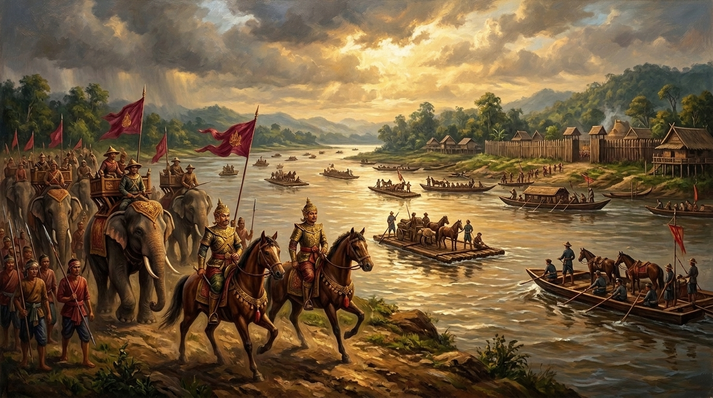
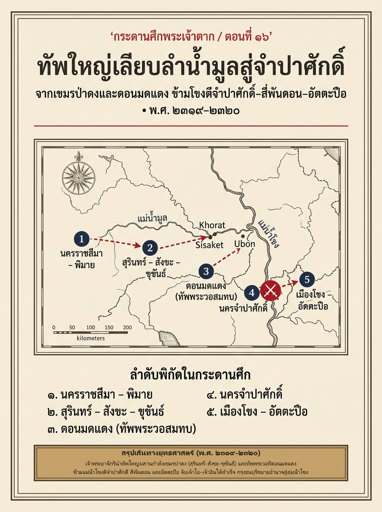

# ภาคที่ 4: เส้นทางสู่แม่น้ำโขง และฉากสุดท้ายแห่งกรุงธนบุรี (พ.ศ. 2319 – 2325)
## ตอนที่ 16: ช้างเผือกแตกโรง และทัพใหญ่เลียบลำน้ำมูล

---

### องก์ที่ 1: จุดชนวนและเดิมพัน (The Cold Open & The Stakes)

เสียงแปร๋นของช้างพลายดังสะท้านค่ายหลวงริมแม่น้ำมูลในยามใกล้รุ่ง ก่อนที่เสาตะลุงไม้เต็งจะหักโค่นลงท่ามกลางความโกลาหลของควาญช้างและทหารยาม

ต้นปี พ.ศ. 2320 (ปลายปีวอกต่อปีระกา จุลศักราช 1138–1139) กองทัพผสมขนาดมหึมากว่า **10,000 นาย** ภายใต้การบัญชาการร่วมของ **เจ้าพระยาจักรี (ทองด้วง)** และ **เจ้าพระยาสุรสีห์ (บุญมา)** กำลังเคลื่อนขบวนเลียบ **ลำน้ำมูล** มุ่งหน้าไปทางทิศตะวันออก

ในตำราพิชัยสงครามและคติความเชื่อของคนโบราณ การที่ **"ช้างเผือกแตกโรง"** หรือช้างสำคัญคู่บารมีเกิดอาการตื่นตระหนกพังโรงช้างหนีหายไปก่อนออกศึก ถือเป็นลางสังหรณ์ที่ชวนให้ไพร่พลหวั่นไหว

แต่สำหรับสองพี่น้องตระกูลนักรบที่ผ่านสมรภูมิมาแล้วตั้งแต่บางกุ้ง พิมาย เชียงใหม่ จนถึงพิษณุโลก พวกเขารู้ดีว่าชะตาของศึกนี้ไม่ได้ตัดสินด้วยลางบอกเหตุในโรงช้าง—หากตัดสินด้วย **ขบวนช้างศึกและกำลังพลนับหมื่นที่กำลังมุ่งหน้าสู่ดอนมดแดงและแม่น้ำโขง**!

เบื้องหน้าขบวนทัพไปตามลำน้ำมูล กองทัพใหญ่ของ **เจ้าโอ (เจ้าไชยกุมาร)** และ **เจ้าอิน** แห่งนครจำปาศักดิ์กำลังตั้งค่ายมั่นขวางทางน้ำอยู่

นี่คือครั้งแรกในประวัติศาสตร์กรุงธนบุรีที่กองทัพสยามจะบุกทะลวงข้ามลุ่มน้ำมูล ข้ามแม่น้ำโขง และเดินทัพลึกเข้าไปในดินแดนลาวตอนใต้ไกลเกินกว่าที่กองทัพใดในรอบหลายสิบปีเคยไปถึง—เดิมพันไม่ได้อยู่ที่เมืองนางรองอีกต่อไป แต่อยู่ที่ว่า **ใครจะได้เป็นผู้ถือบังเหียนแห่งลุ่มน้ำโขงตอนล่างทั้งหมด!**

---

### องก์ที่ 2: อ่านกระดานศึกและปมที่ซ่อนอยู่ (The Map & The Hidden Truth)

หากกางแผนที่ลุ่มน้ำมูล–แม่น้ำโขงตอนล่างใน พ.ศ. 2319–2320 ออกดู แล้วเปิดอ่าน **พระราชพงศาวดารกรุงธนบุรี ฉบับพันจันทนุมาศ (เจิม)** คู่กับ **ฉบับพระราชหัตถเลขา** เราจะเห็นว่าความสำเร็จของการเดินทัพไกลนับหลายร้อยกิโลเมตรในครั้งนี้ เกิดจาก **"การทูตเชิงยุทธศาสตร์"** 2 ชั้นที่ประสานกันอย่างลงตัว

#### 1. พันธมิตรใหม่: "สามหัวเมืองเขมรป่าดง" ดินแดนแห่งกองช้างศึก

จุดอ่อนของการเดินทัพไกลจากภาคกลางข้ามอีสานไปถึงแม่น้ำโขง คือปัญหา **การขนส่งเสบียงและสัตว์พาหนะ**

แต่เมื่อกองทัพของเจ้าพระยาจักรีและเจ้าพระยาสุรสีห์เคลื่อนทัพพ้นเมืองพิมายเข้าสู่เขมรป่าดง เหตุการณ์ทางการเมืองที่สำคัญอย่างยิ่งก็เกิดขึ้น: เจ้าเมืองทั้งสามแห่ง **"เขมรป่าดง"**—ได้แก่ **เมืองสุรินทร์**, **เมืองสังขะ**, และ **เมืองขุขันธ์**—ต่างพร้อมใจกันนำช้าง ม้า เสบียงอาหาร และไพร่พลออกมาสวามิภักดิ์ต่อกรุงธนบุรี!

การได้สามหัวเมืองนี้มาเป็นแนวร่วมพลิกเกมทั้งกระดานทันที:
- กองทัพธนบุรีได้ **กองช้างศึกและช้างลำเลียง** จากสุรินทร์–สังขะ–ขุขันธ์ (ซึ่งขึ้นชื่อว่าเป็นผู้เชี่ยวชาญการคล้องและฝึกช้างที่สุดในภูมิภาค) มาทดแทนความเหน็ดเหนื่อยของการเดินเท้า
- ได้ **ฐานเสบียงส่วนหน้า** ที่อยู่ห่างจากดอนมดแดงและแม่น้ำโขงเพียงไม่กี่วันเดินทัพ โดยไม่ต้องรอส่งข้าวสารข้ามเขาดงพญาไฟมาจากภาคกลาง!

#### 2. ไพ่ลับที่ดอนมดแดง: "พระวอ" อดีตเสนาบดีผู้แค้นเวียงจันทน์

ในเวลาเดียวกัน ที่ **ดอนมดแดง** (เขตจังหวัดอุบลราชธานีในปัจจุบัน) มีตัวละครสำคัญอีกคนหนึ่งที่กลายเป็นกุญแจเปิดประตูสู่แม่น้ำโขง

ท่านผู้นั้นคือ **พระวอ (พระวรราชภักดี)** อดีตเสนาบดีผู้ทรงอิทธิพลแห่งกรุงเวียงจันทน์ ซึ่งเคยขัดแย้งกับ **พระเจ้าสิริบุญสาร** แห่งเวียงจันทน์จนต้องอพยพไพร่พลหนีลงมาทางใต้ แล้วมาขออาศัยตั้งบ้านเมืองอยู่ใต้ร่มเงาของนครจำปาศักดิ์ที่ **ดอนมดแดง**

ทว่าต่อมาพระวอก็เกิดความบาดหมางกับเจ้าโอแห่งจำปาศักดิ์ด้วยเช่นกัน ทำให้พระวอตกอยู่ในสภาพ **"ถูกบีบทั้งจากเหนือ (เวียงจันทน์) และใต้ (จำปาศักดิ์)"**

ทันทีที่เห็นธงรบของเจ้าพระยาจักรีและเจ้าพระยาสุรสีห์เคลื่อนเลียบลำน้ำมูลเข้ามา พระวอจึงตัดสินใจเด็ดขาด—**หันมาสวามิภักดิ์เป็นพันธมิตรกับกรุงธนบุรี!**

---

### องก์ที่ 3: คมดาบและกลศึก (The Clash & Tactical Turning Point)

#### บดขยี้ดอนมดแดง ข้ามโขงยึดจำปาศักดิ์

เมื่อกองทัพผสมของกรุงธนบุรี, กองทัพหัวเมืองเหนือ, กองช้างศึกเขมรป่าดง, และกำลังท้องถิ่นของพระวอมาบรรจบกันที่ลุ่มน้ำมูลตอนล่าง อำนาจการรบก็เหนือกว่าฝ่ายจำปาศักดิ์อย่างเทียบไม่ติด

**เจ้าพระยาจักรี** และ **เจ้าพระยาสุรสีห์** เปิดฉากบุกเข้าตีค่ายของ **เจ้าโอ** และ **เจ้าอิน** ที่ตำบลดอนมดแดงอย่างดุดัน

ทัพจำปาศักดิ์ที่เคยหวังจะใช้ดอนมดแดงเป็นปราการขวางทัพสยามไม่อาจต้านทานการรุกประสานของทหารราบนับหมื่นและกองช้างศึกได้ ค่ายดอนมดแดงแตกพ่ายยับเยิน เจ้าโอและเจ้าอินจำต้องถอยทัพข้ามแม่น้ำโขงกลับไปยัง **นครจำปาศักดิ์**

แต่สองขุนพลแห่งกรุงธนบุรีไม่ยอมหยุดอยู่ที่ฝั่งตะวันตกของแม่น้ำโขง

กองทัพไทยต่อแพและใช้เรือท้องถิ่นเร่งระดมพลข้าม **แม่น้ำโขง** ตามตีกระชั้นชิดเข้ายึด **เมืองนครจำปาศักดิ์** ได้สำเร็จ!

#### ไล่ล่าถึงเมืองโขง (สี่พันดอน) และอัตตะปือ

เมื่อเมืองจำปาศักดิ์แตก **เจ้าโอ** และ **เจ้าอิน** พาครอบครัวและไพร่พลที่เหลือล่องเรือหนีลงใต้ไปตามลำน้ำโขง หวังจะใช้เกาะแก่งอันซับซ้อนของ **เมืองโขง (สีทันดร / สี่พันดอน)** และป่าเขาอันทุรกันดารของ **เมืองอัตตะปือ** (ทางตอนใต้ของลาวใกล้ชายแดนเวียดนาม–กัมพูชา) เป็นที่หลบซ่อน

แต่ **เจ้าพระยาสุรสีห์ (บุญมา)** ไม่ปล่อยให้เหยื่อหลุดมือ!

กองทัพไทยจัดกำลังรุกไล่ติดตามลงไปตามแก่งหินแห่งสี่พันดอน เข้าตี **เมืองโขง** แตกพ่าย แล้วส่งกำลังบุกฝ่าป่าเขาลึกเข้าไปจนถึง **เมืองอัตตะปือ**—จับตัว **เจ้าโอ (เจ้าไชยกุมาร)**, **เจ้าอิน**, พร้อมเจ้านายและขุนนางจำปาศักดิ์ทั้งหมดกลับมาได้สำเร็จ!

และท่ามกลางชัยชนะที่บุกไปไกลถึงสุดขอบลุ่มน้ำโขงตอนใต้นั้น กองทัพไทยยังได้ **ช้างสำคัญ** และทรัพย์ศฤงคารจำนวนมหาศาล—รวมถึงการกวาดต้อนและจัดระเบียบหัวเมืองลาวใต้และเขมรป่าดงให้เข้ามาอยู่ในขอบขัณฑสีมาของกรุงธนบุรีอย่างเป็นทางการ!

---

### องก์ที่ 4: ผลลัพธ์และเงาของศึกถัดไป (The Aftermath & Cliffhanger)

#### กำเนิด "สมเด็จเจ้าพระยามหากษัตริย์ศึก" และนโยบายไว้ชีวิตเจ้าโอ

เมื่อเจ้าพระยาจักรีและเจ้าพระยาสุรสีห์นำทัพใหญ่ พร้อมตัว **เจ้าโอ** และ **เจ้าอิน** กลับลงมาถึงกรุงธนบุรีใน พ.ศ. 2320 ความสำเร็จครั้งนี้ยิ่งใหญ่เกินกว่าศึกใดในภาคตะวันออกเฉียงเหนือ—ราชอาณาจักรสยามขยายขอบขัณฑสีมาข้ามแม่น้ำโขงไปจดสี่พันดอนและอัตตะปือเป็นครั้งแรกในยุคธนบุรี!

สมเด็จพระเจ้าตากสินทรงพระโสมนัสอย่างยิ่ง และทรงปูนบำเหน็จความชอบให้แก่ขุนพลคู่ใจด้วยบรรดาศักดิ์ที่สูงที่สุดเท่าที่เคยมีมาในสมัยกรุงธนบุรี:

พระองค์ทรงสถาปนา **เจ้าพระยาจักรี (ทองด้วง)** ขึ้นเป็น **"สมเด็จเจ้าพระยามหากษัตริย์ศึก พิฤกมหิมา ทุกนัคราระอาเดช นเรศราชสุริยวงศ์ องค์อัครบาทมุลิกากร บวรรัตนบรินายก"**—ตำแหน่งเจ้าพระยาชั้นพิเศษที่มีศักดิ์เสมอเจ้าต่างกรม และทรงมอบอำนาจสิทธิ์ขาดทางการทหารสูงสุดในราชอาณาจักรให้แก่ท่าน!

ส่วน **เจ้าโอ (เจ้าไชยกุมาร)** แห่งจำปาศักดิ์ สมเด็จพระเจ้าตากสินทรงใช้รัฐประศาสโนบายแบบเดียวกับที่ทรงใช้กับเจ้านครศรีธรรมราช (หนู)—ทรง **ไว้ชีวิต** และในเวลาต่อมาทรงโปรดให้เจ้าโอกลับไปครองนครจำปาศักดิ์ดังเดิมในฐานะเมืองประเทศราชที่ส่งต้นไม้เงินต้นไม้ทองถวายกรุงธนบุรี

#### เลือดที่ดอนมดแดง: พายุลูกใหม่จากเวียงจันทน์

ทว่าเมื่อทัพใหญ่ของสมเด็จเจ้าพระยามหากษัตริย์ศึกและเจ้าพระยาสุรสีห์ถอนกำลังกลับลงมากรุงธนบุรีแล้ว **พระวอ** ผู้สวามิภักดิ์อยู่ที่ดอนมดแดงก็กลายเป็นเป้าสังหารที่ไร้เกราะกำบัง!

**พระเจ้าสิริบุญสาร** แห่งกรุงเวียงจันทน์ ผู้ไม่เคยลืมความแค้นต่อพระวอ เห็นว่ากองทัพไทยถอนตัวกลับไปแล้ว จึงส่งกองทัพเวียงจันทน์ยกข้ามโขงลงมาปิดล้อมค่าย **ดอนมดแดง** อย่างฉับพลัน!

แม้พระวอจะพยายามส่งคนไปขอความช่วยเหลือจากกรุงธนบุรี แต่กองทัพเวียงจันทน์ตีค่ายดอนมดแดงแตกเสียก่อน และ **สังหารพระวอสิ้นชีพคาค่าย**!

การสังหารพันธมิตรของกรุงธนบุรีอย่างอุกอาจในครั้งนี้ ไม่ใช่เพียงการหยามพระเกียรติสมเด็จพระเจ้าตากสิน—แต่มันกำลังจะจุดชนวน **"การเดินทัพครั้งประวัติศาสตร์สู่กรุงเวียงจันทน์"** ที่เจ้าพระยาสุรสีห์ต้องเกณฑ์ทัพเรือจากกัมพูชา **ขุดคลองอ้อมแก่งหลี่ผี** เพื่อบุกขึ้นไปพิชิตเวียงจันทน์ และอัญเชิญพระพุทธรูปศักดิ์สิทธิ์คู่บ้านคู่เมืองอย่าง **"พระแก้วมรกต"** กลับคืนสู่แผ่นดินสยาม!

---
**จบตอนที่ 16**
*(ติดตามต่อใน ตอนที่ 17: เลือดล้างดอนมดแดง กองทัพเรือข้ามแก่งหลี่ผีสู่เวียงจันทน์)*
