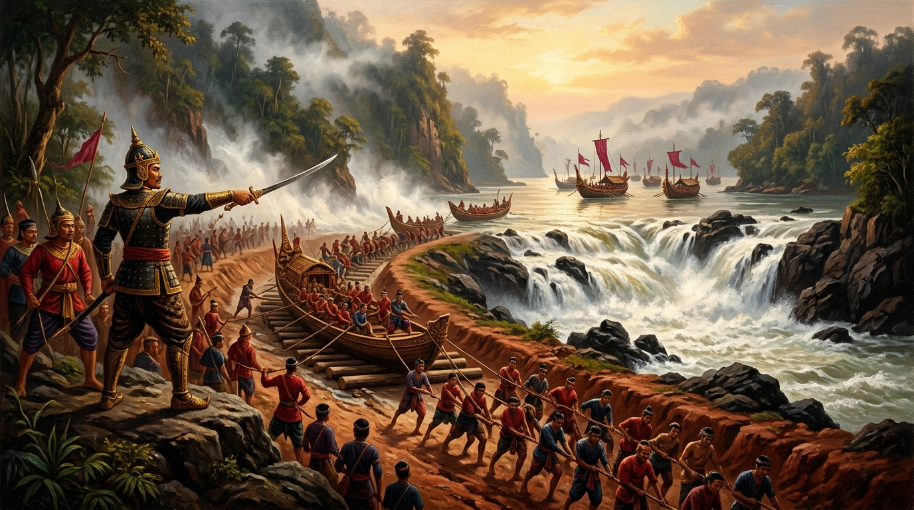
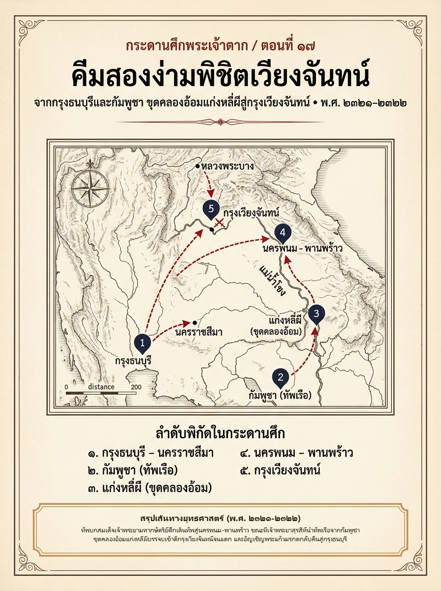

# ภาคที่ 4: เส้นทางสู่แม่น้ำโขง และฉากสุดท้ายแห่งกรุงธนบุรี (พ.ศ. 2319 – 2325)
## ตอนที่ 17: เลือดล้างดอนมดแดง กองทัพเรือข้ามแก่งหลี่ผีสู่เวียงจันทน์

---

### องก์ที่ 1: จุดชนวนและเดิมพัน (The Cold Open & The Stakes)

ข่าวร้ายจากริมฝั่งแม่น้ำมูลเดินทางมาถึงกรุงธนบุรีพร้อมคราบเลือดและความอัปยศ

ภายหลังทัพใหญ่ของ **สมเด็จเจ้าพระยามหากษัตริย์ศึก** และ **เจ้าพระยาสุรสีห์** ยกกลับจากศึกจำปาศักดิ์ใน พ.ศ. 2320 ได้ไม่นาน **พระเจ้าสิริบุญสาร** แห่งกรุงเวียงจันทน์ ซึ่งเฝ้าจับตาความเคลื่อนไหวอยู่ทางตอนเหนือ ก็ฉวยโอกาสทองในจังหวะที่ทัพหลวงของไทยถอนตัวกลับไปแล้ว ส่งกองทัพเวียงจันทน์ยกข้ามโขงลงมาปิดล้อมค่าย **ดอนมดแดง** อย่างฉับพลัน!

เป้าหมายของเวียงจันทน์มีเพียงหนึ่งเดียว—**พระวอ** อดีตเสนาบดีผู้แตกคอกับกรุงเวียงจันทน์และเพิ่งหันมาถวายตัวสวามิภักดิ์ต่อกรุงธนบุรี

แม้พระวอจะพยายามตั้งค่ายต้านทานและส่งคนลงมาขอความช่วยเหลือจากกรุงธนบุรี แต่ระยะทางนับร้อยกิโลเมตรไม่อาจส่งทัพหนุนไปถึงได้ทันเวลา ค่ายดอนมดแดงถูกตีแตกยับเยิน **พระวอถูกสังหารสิ้นชีพคาค่าย** ส่วนบุตรหลานและไพร่พลที่เหลือ (รวมถึง **ท้าวคำผง** บุตรพระตา) ต้องพากันหนีตายลงมาพึ่งใบบุญกรุงธนบุรี

สำหรับ **สมเด็จพระเจ้าตากสินมหาราช** เหตุการณ์ที่ดอนมดแดงไม่ใช่เพียงการแก้แค้นส่วนตัวของพระเจ้าสิริบุญสาร—แต่มันคือ **"การตบหน้ามหาอำนาจ"** อย่างอุกอาจที่สุด!

เพราะหากกรุงธนบุรีปล่อยให้ประเทศราชหน้าด่านที่เพิ่งสวามิภักดิ์ถูกฆ่าล้างค่ายโดยไม่ลงโทษ หัวเมืองลาว เขมร และเขมรป่าดงทั้งหมดริมฝั่งโขงย่อมเสื่อมศรัทธา และมองว่าอำนาจของกรุงธนบุรีเอื้อมไปไม่ถึง

ใน พ.ศ. 2321 คำสั่งราชการสงครามครั้งยิ่งใหญ่ที่สุดในรัชสมัยกรุงธนบุรีจึงถูกประกาศก้องทั่วท้องพระโรง—กรุงธนบุรีจะไม่รบเพียงแค่ชายแดนอีสานใต้อีกต่อไป **แต่จะบุกทวนลำน้ำโขงขึ้นไปพิชิต "กรุงเวียงจันทน์" ให้ราบคาบ!**

---

### องก์ที่ 2: อ่านกระดานศึกและปมที่ซ่อนอยู่ (The Map & The Hidden Truth)

เมื่อกางแผนที่ยุทธศาสตร์ลุ่มน้ำโขงใน พ.ศ. 2321 ออกพิจารณาตาม **พระราชพงศาวดารกรุงธนบุรี ฉบับพันจันทนุมาศ (เจิม)** และ **พระราชพงศาวดาร ฉบับพระราชหัตถเลขา** เราจะเห็นชัดทันทีว่าเหตุใดกรุงเวียงจันทน์จึงเชื่อมั่นว่าทัพไทยไม่มีวันบุกขึ้นไปถึงราชธานีของตนได้

#### 1. ปราการธรรมชาติ: ป่าดงดิบและ "แก่งหลี่ผี"

กรุงเวียงจันทน์ได้รับการคุ้มครองจากธรรมชาติถึง 2 ชั้น:
- **เส้นทางบก:** จากกรุงธนบุรีผ่านนครราชสีมาขึ้นไปถึงริมฝั่งโขงตรงข้ามเวียงจันทน์ (พานพร้าว) ต้องเดินทัพผ่านเทือกเขาสูง ป่าดงดิบ และทุ่งราบอันแห้งแล้งเป็นระยะทางกว่า 600 กิโลเมตร กองทัพบกขนาดใหญ่ 20,000 นายไม่สามารถแบกเสบียงและปืนใหญ่ไปได้ครบถ้วนโดยไม่ขาดแคลนกลางทาง
- **เส้นทางน้ำ (แม่น้ำโขง):** หากจะลำเลียงทัพเรือและเสบียงจากกัมพูชาทวนแม่น้ำโขงขึ้นไปทางเหนือ เรือรบทุกลำจะต้องติดแหง็กอยู่ที่ **"แก่งหลี่ผี"** (เขตสี่พันดอน–น้ำตกคอนพะเพ็ง ทางตอนใต้ของจำปาศักดิ์) ซึ่งเป็นแนวผาหินและน้ำตกเชี่ยวกรากที่เรือใหญ่ไม่อาจแล่นทวนน้ำผ่านไปได้เลยในประวัติศาสตร์!

#### 2. ยุทธศาสตร์คีมสองง่าม และแนวร่วมจากหลวงพระบาง

สมเด็จพระเจ้าตากสินและ **สมเด็จเจ้าพระยามหากษัตริย์ศึก** จึงทรงวางหมาก **"คีมสองง่าม" (Amphibious Pincer)** ที่ท้าทายขีดจำกัดทางภูมิศาสตร์มากที่สุดครั้งหนึ่ง:
1. **ทัพบก (ปีกซ้าย):** **สมเด็จเจ้าพระยามหากษัตริย์ศึก** คุมทัพหลวง 20,000 นาย เดินทัพจากกรุงธนบุรีผ่านนครราชสีมา มุ่งขึ้นเหนือตรงไปยัง **ค่ายพานพร้าว** (เขตอำเภอศรีเชียงใหม่ จังหวัดหนองคายในปัจจุบัน) ริมฝั่งขวาแม่น้ำโขง ตรงข้ามกรุงเวียงจันทน์
2. **ทัพเรือ (ปีกขวาและสายส่งกำลังบำรุง):** **เจ้าพระยาสุรสีห์** ลงไปเกณฑ์กำลังพลและกองเรือรบจาก **กัมพูชา** 10,000 นาย พร้อมเสบียงอาหารและปืนใหญ่ ให้ล่องทวนแม่น้ำโขงขึ้นไปทางเหนือ เพื่อทำลายเมืองหน้าด่านริมโขงแล้วขึ้นไปบรรจบกับทัพบกที่เวียงจันทน์!
3. **แนวร่วมทางเหนือ:** **อาณาจักรล้านช้างหลวงพระบาง** ภายใต้การนำของ **เจ้าสุริยวงศ์** ซึ่งเป็นคู่ปรับเก่าของเวียงจันทน์ ได้ส่งทูตมาขอสวามิภักดิ์ต่อกรุงธนบุรีและอาสายกทัพลงมาช่วยตีกระหนาบเวียงจันทน์จากด้านเหนือ ปิดทางหนีของพระเจ้าสิริบุญสารอย่างสมบูรณ์!

---

### องก์ที่ 3: คมดาบและกลศึก (The Clash & Tactical Turning Point)

#### ปาฏิหาริย์วิศวกรรมสงคราม: ขุดคลองอ้อมแก่งหลี่ผี!

บททดสอบแรกและโหดหินที่สุดของศึกครั้งนี้ไม่ได้อยู่ที่กำแพงเมืองเวียงจันทน์—แต่อยู่ที่ **แก่งหลี่ผี**!

เมื่อกองเรือรบและเรือลำเลียงเสบียงขนาดมหึมาของ **เจ้าพระยาสุรสีห์** พร้อมทัพเขมร 10,000 นาย ล่องทวนแม่น้ำโขงขึ้นมาถึงเขตสี่พันดอน เสียงคำรามของสายน้ำที่ถาโถมลงมาจากแนวผาหินแก่งหลี่ผีก็ปรากฏอยู่ตรงหน้า กองเรือทั้งหมดไม่อาจแล่นฝ่ากระแสน้ำเชี่ยวกรากขึ้นไปได้แม้แต่ลำเดียว

หากเป็นแม่ทัพทั่วไป อาจสั่งจอดเรือทิ้งไว้แล้วเดินเท้าไปมือเปล่า—แต่ **เจ้าพระยาสุรสีห์** รู้ดีว่าหากไม่มีเรือรบและเสบียงตามขึ้นไป ทัพบกที่อยู่ไกลถึงพานพร้าวอาจต้องอดตายหรือขาดแคลนอาวุธหนัก!

ท่านจึงตัดสินใจใช้ **"พลังแรงงานมนุษย์เอาชนะภูมิศาสตร์"**: เจ้าพระยาสุรสีห์สั่งระดมไพร่พลนับหมื่นคนลงขุดดินและถากถางร่องน้ำ **ขุดคลองลัดอ้อมแก่งหลี่ผี** ผ่านเกาะแก่งริมฝั่ง พร้อมทั้งวางหมอนไม้และชักลากเรือรบข้ามแนวสันดอนขึ้นไปทีละลำ!

เมื่อกองเรือรบไทยและกัมพูชาสามารถทะลุผ่านแก่งหลี่ผีขึ้นสู่แม่น้ำโขงตอนกลางได้สำเร็จ ข่าวความอัศจรรย์นี้ก็สร้างความตื่นตะลึงไปตลอดลำน้ำโขง เมืองหน้าด่านริมโขงของเวียงจันทน์ตั้งแต่ **นครพนม (ศรีโคตรบูรณ์)** ไล่เรียงขึ้นไปจนถึงเวียงคุกและหนองคาย ต่างพ่ายแพ้แตกพ่ายต่อทัพเรือของเจ้าพระยาสุรสีห์อย่างรวดเร็ว

#### ปิดล้อมกรุงเวียงจันทน์ 4 เดือน และชัยชนะเด็ดขาด

ต้นปี พ.ศ. 2322 ทัพบกของ **สมเด็จเจ้าพระยามหากษัตริย์ศึก** และทัพเรือของ **เจ้าพระยาสุรสีห์** เข้าบรรจบกันที่ **ค่ายพานพร้าว** ฝั่งตรงข้ามกรุงเวียงจันทน์อย่างพร้อมเพรียง

**พระเจ้าสิริบุญสาร** เห็นทัพไทยทั้งบกทั้งเรือมาประชิดริมโขง จึงสั่งปิดประตูกรุงเวียงจันทน์และเกณฑ์ไพร่พลขึ้นรักษาเชิงเทิน โดยมีแม่น้ำโขงอันกว้างใหญ่เป็นคูเมืองธรรมชาติขวางกั้น

กองทัพกรุงธนบุรีวางกำลังปิดล้อมและระดมยิงปืนใหญ่ข้ามแม่น้ำโขงเข้าใส่ค่ายริมน้ำของเวียงจันทน์อยู่นานกว่า **4 เดือน** ทั้งยังมีทัพจากหลวงพระบางลงมาตีกระหนาบจากทางเหนือ กระทั่งสมเด็จเจ้าพระยามหากษัตริย์ศึกและเจ้าพระยาสุรสีห์สั่งระดมพลข้ามโขงเข้าตีค่ายนอกเมืองสำคัญอย่าง **บ้านสิงห์** และ **บ้านพะโค** แตกพ่ายยับเยิน

เมื่อปราการด่านสุดท้ายพังทลายลง พระเจ้าสิริบุญสารเห็นว่าไม่อาจรักษาราชธานีไว้ได้อีกต่อไป จึงลอบลงเรือพระที่นั่งตีฝ่าวงล้อมหลบหนีออกจากกรุงเวียงจันทน์มุ่งหน้าไปยังเมืองคำเกิด ทิ้งราชธานีไว้เบื้องหลัง—**กรุงเวียงจันทน์จึงตกอยู่ในเงื้อมมือของกองทัพกรุงธนบุรีอย่างสมบูรณ์!**

---

### องก์ที่ 4: ผลลัพธ์และเงาของศึกถัดไป (The Aftermath & Cliffhanger)

#### อัญเชิญ "พระแก้วมรกต" กลับคืนสู่แผ่นดินสยาม

ชัยชนะเหนือกรุงเวียงจันทน์ใน พ.ศ. 2322 ไม่เพียงแต่ล้างแค้นให้แก่พระวอและสถาปนาอำนาจของกรุงธนบุรีขึ้นเหนือ **อาณาจักรล้านช้างทั้ง 3 แห่ง** (เวียงจันทน์ หลวงพระบาง และจำปาศักดิ์) ให้ยอมส่งต้นไม้เงินต้นไม้ทองเป็นประเทศราชพร้อมกันเป็นครั้งแรกในประวัติศาสตร์

แต่ผลลัพธ์ทางจิตวิญญาณที่ยิ่งใหญ่ที่สุดก็คือ การที่ **สมเด็จเจ้าพระยามหากษัตริย์ศึก** ได้ทรงอัญเชิญ **"พระพุทธมหามณีรัตนปฏิมากร" (พระแก้วมรกต)** พร้อมทั้ง **พระบาง** ซึ่งประดิษฐานอยู่ที่กรุงเวียงจันทน์มานานกว่าสองศตวรรษ ลงเรือพระที่นั่งอัญเชิญกลับคืนสู่กรุงธนบุรี!

เมื่อขบวนเรืออัญเชิญพระแก้วมรกตเดินทางมาถึงเมืองสระบุรี **สมเด็จพระเจ้าตากสินมหาราช** ทรงพระโสมนัสอย่างหาที่สุดมิได้ เสด็จพระราชดำเนินขึ้นไปทรงรับเสด็จด้วยพระองค์เอง แล้วอัญเชิญมาประดิษฐานไว้ ณ โรงพระแก้วภายใน **วัดแจ้ง (วัดอรุณราชวราราม)** ข้างพระราชวังกรุงธนบุรี ท่ามกลางความปลื้มปีติของราษฎรทั่วทั้งแผ่นดิน

#### เงาของพายุลูกสุดท้ายในพระราชวัง

ในสายตาของคนทั้งโลก **ปี พ.ศ. 2322** คือจุดสูงสุดอันรุ่งโรจน์ที่สุดของกรุงธนบุรี—อาณาจักรที่เคยแตกสลายเมื่อสิบสองปีก่อน บัดนี้แผ่แสนยานุภาพครอบคลุมตั้งแต่ล้านนา ไทยใหญ่บางส่วน กัมพูชา ไปจนถึงหลวงพระบาง เวียงจันทน์ และจำปาศักดิ์

ทว่าภายใต้ฉากหน้าอันเกรียงไกรนั้น **รอยร้าวภายในราชสำนักธนบุรี** กำลังขยายตัวขึ้นอย่างเงียบงัน...

ความเครียดสะสมจากการศึกหนักต่อเนื่องนานกว่าสิบปี ปัญหาเศรษฐกิจและข้าวยากหมากแพง รวมถึงความขัดแย้งทางความเชื่อและศาสนาในพระราชวัง กำลังเริ่มสั่นคลอนเสถียรภาพของแผ่นดินจากภายใน

และในจังหวะที่เปราะบางที่สุดนั้นเอง เปลวไฟจลาจลครั้งใหม่ก็ปะทุขึ้นที่ **กัมพูชา** บีบให้ **สมเด็จเจ้าพระยามหากษัตริย์ศึก** และ **เจ้าพระยาสุรสีห์** ต้องนำทัพใหญ่ออกจากพระนครไปไกลถึงฝั่งเขมร—เปิดช่องว่างทางอำนาจครั้งใหญ่ที่สุดในกรุงธนบุรี ซึ่งกำลังจะนำไปสู่ **มรสุมแห่ง พ.ศ. 2325** และฉากสุดท้ายของแผ่นดินกรุงธนบุรี!

---
**จบตอนที่ 17**
*(ติดตามต่อใน ตอนที่ 18: ศึกกัมพูชาและพายุในพระราชวัง จุดเปลี่ยนสุดท้ายแห่งกรุงธนบุรี)*
