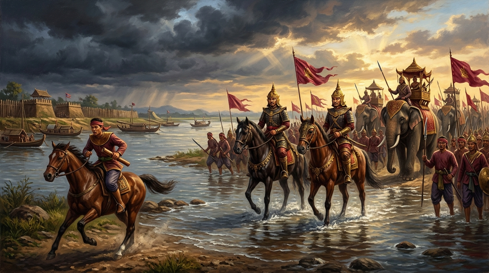
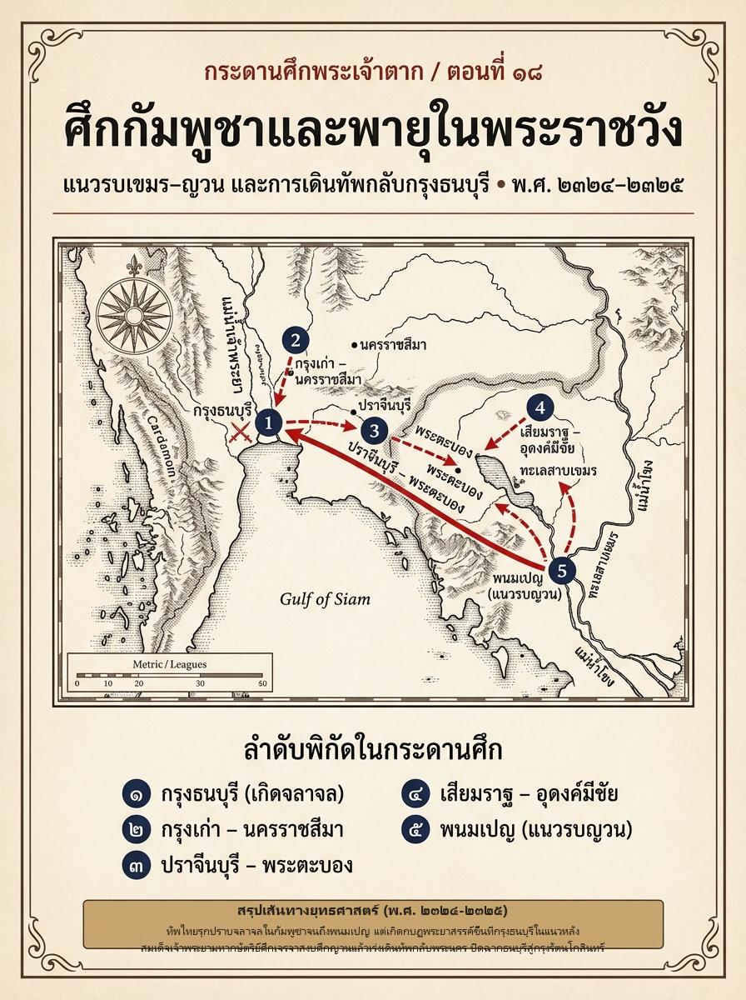

# ภาคที่ 4: เส้นทางสู่แม่น้ำโขง และฉากสุดท้ายแห่งกรุงธนบุรี (พ.ศ. 2319 – 2325)
## ตอนที่ 18: พายุตั้งเค้าในกรุงกัมพูชา

---

### องก์ที่ 1: จุดชนวนและเดิมพัน (The Cold Open & The Stakes)

พ.ศ. 2324 — ท้องฟ้าเหนือลุ่มน้ำทะเลสาบเขมรกำลังคลุ้งไปด้วยควันไฟแห่งการทรยศ

เพิ่งจะผ่านพ้นชัยชนะอันยิ่งใหญ่เหนือกรุงเวียงจันทน์และการอัญเชิญพระแก้วมรกตกลับคืนสู่กรุงธนบุรีได้ไม่ถึงสองปี ใบบอกด่วนจากแนวรบตะวันออกก็พุ่งตรงเข้าสู่พระราชวังธนบุรีพร้อมข่าวร้ายที่สั่นสะเทือนดุลอำนาจในอุษาคเนย์:

**สมเด็จพระรามราชา (นักองค์โนน)** กษัตริย์กัมพูชาที่กรุงธนบุรีให้การสนับสนุนและตั้งไว้ในราชสมบัติ ถูกกลุ่มขุนนางเขมรนำโดย **เจ้าฟ้าทะละหะ (มู)** ก่อการรัฐประหาร จับกุม และ **ลอบปลงพระชนม์** อย่างโหดเหี้ยม! มิหนำซ้ำ ฝ่ายกบฏเขมรยังหันไปสมคบกับ **ตระกูลเหงียน (ญวน)** เพื่อดึงกองทัพเวียดนามเข้ามาเป็นเกราะกำบัง!

สำหรับ **สมเด็จพระเจ้าตากสินมหาราช** กัมพูชาไม่ใช่เพียงเมืองประเทศราชที่ส่งต้นไม้เงินต้นไม้ทอง—แต่มันคือ **"กันชนทางตะวันออกและอู่ข้าวสำรอง"** ของกรุงธนบุรี หากปล่อยให้กัมพูชาตกอยู่ในอิทธิพลของญวน ชายแดนตั้งแต่ปราจีนบุรี จันทบุรี จนถึงอีสานใต้จะถูกคุกคามทันที

คำสั่งระดมพลครั้งใหญ่ที่สุดอีกครั้งหนึ่งจึงถูกประกาศขึ้นใน พ.ศ. 2324: **สมเด็จเจ้าพระยามหากษัตริย์ศึก** และ **เจ้าพระยาสุรสีห์** ต้องคุมทัพใหญ่กว่า 20,000 นาย (พร้อมด้วย **กรมขุนอินทรพิทักษ์** พระราชโอรส) ยกข้ามแดนเข้าสู่กัมพูชา—โดยไม่มีใครล่วงรู้เลยว่า การเดินทัพออกจากพระนครในครั้งนี้ กำลังเปิดช่องว่างทางอำนาจครั้งใหญ่ที่สุดไว้เบื้องหลัง!

---

### องก์ที่ 2: อ่านกระดานศึกและปมที่ซ่อนอยู่ (The Map & The Hidden Truth)

เมื่อกางแผนที่ยุทธศาสตร์กัมพูชาใน พ.ศ. 2324 ออกดูควบคู่กับ **พระราชพงศาวดารกรุงธนบุรี ฉบับพันจันทนุมาศ (เจิม)** และ **การเมืองไทยสมัยพระเจ้ากรุงธนบุรี** ของ **นิธิ เอียวศรีวงศ์** เราจะเห็นว่าเหตุใดศึกกัมพูชาครั้งนี้จึงไม่ใช่สงครามสายฟ้าแลบเหมือนที่ผ่านมา

#### 1. สมรภูมิสามเส้า: ไทย – เขมร – ญวน

ต่างจากศึกจำปาศักดิ์หรือเวียงจันทน์ที่กรุงธนบุรีเป็นฝ่ายรุกฝ่ายเดียว ในกัมพูชา พ.ศ. 2324 ฝ่ายเจ้าฟ้าทะละหะ (มู) มี **กองทัพญวนของตระกูลเหงียน** (องเชียงสือ / เหงียนอั๊ญ) ส่งกำลังพลและกองเรือรบเข้ามาหนุนหลังถึงพนมเปญและลุ่มน้ำโขงตอนล่าง ทำให้สมรภูมินี้กลายเป็นการปะทะกันของมหาอำนาจระดับภูมิภาค

#### 2. กับดักระยะทางและเวลา

กองทัพของสมเด็จเจ้าพระยามหากษัตริย์ศึกและเจ้าพระยาสุรสีห์ต้องจัดรูปขบวนรุกเข้ากัมพูชาเป็นหลายเส้นทาง:
- ปีกซ้ายรุกผ่าน **ปราจีนบุรี – พระตะบอง – เสียมราฐ** เลียบตอนเหนือของทะเลสาบเขมร
- ปีกขวาและทัพหลวงมุ่งตรงสู่ **อุดงค์มีชัย** (ราชธานีของกัมพูชา) และ **พนมเปญ**
- เป้าหมายคือการสถาปนา **นักองค์เอง** (โอรสของกษัตริย์เขมรพระองค์ก่อน) ขึ้นครองราชย์ภายใต้การอารักขาของไทย และผลักดันอิทธิพลญวนออกไป

ทว่าการส่งกำลังพลถึง 20,000 นาย—ซึ่งเป็น **"กระดูกสันหลังทางการทหาร"** แทบทั้งหมดของกรุงธนบุรี—เข้าไปติดพันการรบยืดเยื้อในดินแดนกัมพูชา ย่อมหมายความว่า **พระนครธนบุรีแทบจะไร้กำลังทหารหลักคอยคุ้มกัน!**

---

### องก์ที่ 3: คมดาบและกลศึก (The Clash & Tactical Turning Point)

#### บุกทะลวงพระตะบอง-อุดงค์มีชัย สู่แนวประจันหน้าพนมเปญ

ปลายปี พ.ศ. 2324 กองทัพใหญ่ของ **สมเด็จเจ้าพระยามหากษัตริย์ศึก** และ **เจ้าพระยาสุรสีห์** เคลื่อนพลเข้าสู่เขตแดนกัมพูชาอย่างเกรียงไกร

หัวเมืองด่านหน้าตั้งแต่ **พระตะบอง** **โพธิสัตว์** และ **เสียมราฐ** ไม่อาจต้านทานแสนยานุภาพของกองทัพไทยที่ผ่านศึกอะแซหวุ่นกี้และเวียงจันทน์มาได้ ทัพกรุงธนบุรีรุกคืบเข้ายึดพื้นที่รอบทะเลสาบเขมรได้อย่างรวดเร็ว และมุ่งหน้ากดดันเข้าสู่ **อุดงค์มีชัย** และ **พนมเปญ**

ฝ่าย **เจ้าฟ้าทะละหะ (มู)** เห็นว่าลำพังกำลังเขมรไม่อาจรับมือทัพใหญ่ของสมเด็จเจ้าพระยามหากษัตริย์ศึกได้ จึงถอยร่นลงไปสมทบกับกองทัพเรือและทัพบกของ **ญวน** ที่ตั้งค่ายรอรับอยู่ในเขตลุ่มน้ำโขงตอนล่างและพนมเปญ

#### เกมคุมเชิงกลางลุ่มน้ำโขง-ทะเลสาบเขมร

เมื่อทั้งสองฝ่าย—ทัพไทย 20,000 นาย กับทัพผสมเขมร–ญวน—เข้าประจันหน้ากันในดินแดนกัมพูชา สมรภูมิก็เข้าสู่ภาวะ **"คุมเชิงและชิงจังหวะ"**

**สมเด็จเจ้าพระยามหากษัตริย์ศึก** ทรงส่งกองทัพหน้าเข้ากดดันแนวป้องกันของเขมรและญวน พร้อมเตรียมแผนตีกระหนาบเพื่อชิงความได้เปรียบเด็ดขาด ทว่าในขณะที่สองขุนพลผู้ยิ่งใหญ่กำลังจดจ่ออยู่กับแนวรบเบื้องหน้าในดินแดนกัมพูชานั้นเอง **ม้าเร็วจากแนวหลัง** ก็ควบฝ่าดงระเบิดข่าวอันน่าตระหนกที่สุดเข้ามาถึงค่ายหลวง...

---

### องก์ที่ 4: ผลลัพธ์และเงาของศึกถัดไป (The Aftermath & Cliffhanger)

#### ข่าวร้ายจากกรุงธนบุรี: เมื่อบ้านเกิดลุกเป็นไฟ!

ข่าวสารลับจากพระนครรายงานว่า ความตึงเครียดภายในราชสำนักกรุงธนบุรี—ทั้งปัญหาเศรษฐกิจ ข้าวยากหมากแพง ความขัดแย้งในพระราชวัง และการลงทัณฑ์ขุนนางราษฎรอย่างหนัก—ได้สุกงอมจนระเบิดออกเป็น **"กบฏพระยาสรรค์"** ที่กรุงเก่า (อยุธยา) แล้ว!

ในจังหวะที่แม่ทัพนายกองและไพร่พลกว่า 20,000 นายยังติดพันแนวรบเขมร–ญวนอยู่ในกัมพูชา กองกำลังกบฏกำลังเคลื่อนพลจากกรุงเก่าลงมาปิดล้อมพระราชวังกรุงธนบุรีโดยไม่มีทัพหลวงคอยต้านทาน!

พายุที่ตั้งเค้าในกัมพูชาจึงเป็นเพียงบทโหมโรง—เพราะพายุลูกจริงที่กำลังจะเปลี่ยนชะตาแผ่นดินสยาม กำลังโหมกระหน่ำอยู่บนกำแพง **พระราชวังกรุงธนบุรี** ในวินาทีนี้เอง!

---
**จบตอนที่ 18**
*(ติดตามต่อใน ตอนที่ 19: กบฏพระยาสรรค์ และไฟจลาจลในพระนคร)*
