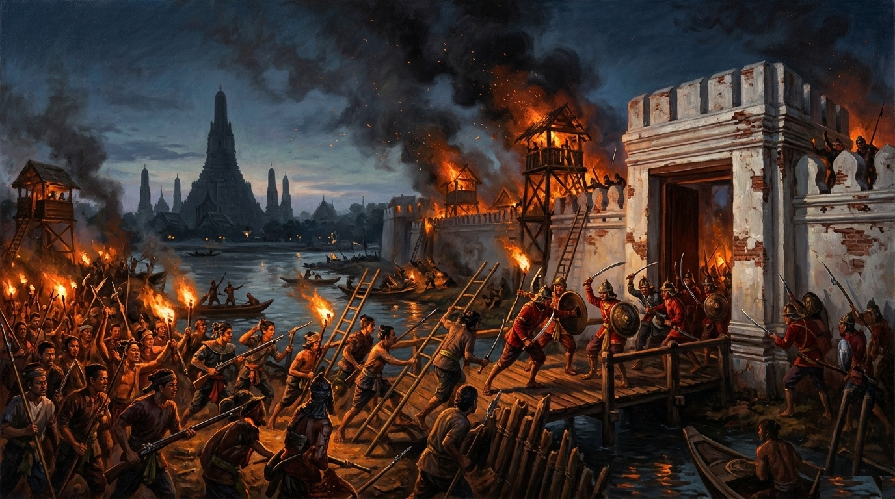
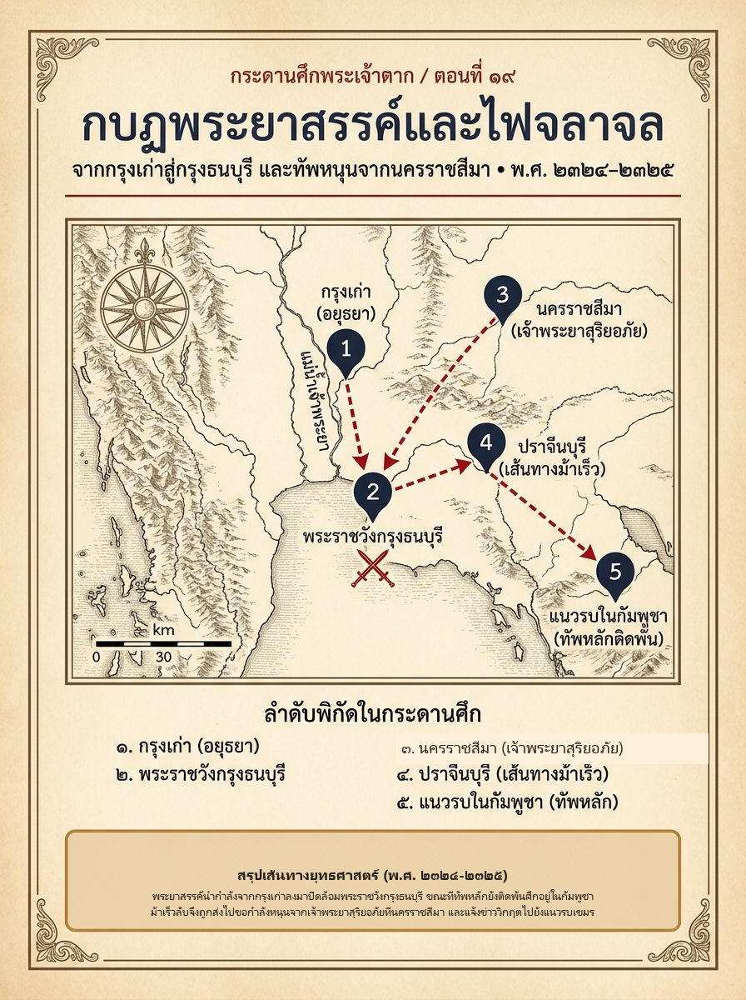

# ภาคที่ 4: เส้นทางสู่แม่น้ำโขง และฉากสุดท้ายแห่งกรุงธนบุรี (พ.ศ. 2319 – 2325)
## ตอนที่ 19: กบฏพระยาสรรค์ และไฟจลาจลในพระนคร

---

### องก์ที่ 1: จุดชนวนและเดิมพัน (The Cold Open & The Stakes)

คืนเดือนมืดในเดือนมีนาคม พ.ศ. 2324 (นับอย่างปัจจุบันคือต้นปี พ.ศ. 2325) เสียงโห่ร้องและแสงคบเพลิงนับพันดวงสว่างวาบขึ้นรอบกำแพง **พระราชวังกรุงธนบุรี**

ผู้ที่นำทัพมาปิดล้อมพระราชวังในค่ำคืนนั้นไม่ใช่พม่าจากอังวะ และไม่ใช่ทัพญวนจากพนมเปญ—แต่เป็นกองกำลังจาก **กรุงเก่า (พระนครศรีอยุธยา)** ภายใต้การนำของ **พระยาสรรค์** ขุนนางที่สมเด็จพระเจ้าตากสินทรงแต่งตั้งขึ้นไปสืบสวนเหตุความวุ่นวายในกรุงเก่า แต่กลับพลิกขั้วไปเข้ากับกลุ่มผู้ก่อการและนำกำลังย้อนกลับมาบุกพระนครเสียเอง!

ในพระราชวังกรุงธนบุรีเวลานั้น แทบไม่เหลือกองทัพประจำการขนาดใหญ่คอยต้านทาน เพราะกำลังรบหลักกว่า 20,000 นายของ **สมเด็จเจ้าพระยามหากษัตริย์ศึก** และ **เจ้าพระยาสุรสีห์** ยังติดพันศึกเขมร–ญวนอยู่ในกัมพูชา

การปะทะหน้าประตูพระราชวังจึงกลายเป็นการต่อสู้อันสิ้นหวังของทหารรักษาพระองค์จำนวนหยิบมือ ท่ามกลางความแตกแยกของขุนนางภายในพระนครที่ต่างคนต่างเอาตัวรอด—**วิกฤตการณ์ทางการเมืองที่รุนแรงที่สุดในรอบ 15 ปีของกรุงธนบุรีได้ปะทุขึ้นแล้ว!**

---

### องก์ที่ 2: อ่านกระดานศึกและปมที่ซ่อนอยู่ (The Map & The Hidden Truth)

หากถอยออกมามองกระดานการเมืองของกรุงธนบุรีในช่วงปลายรัชกาล (พ.ศ. 2324–2325) ตามบันทึกใน **พระราชพงศาวดารกรุงธนบุรี ฉบับพันจันทนุมาศ (เจิม)** **จดหมายเหตุบาทหลวงฝรั่งเศส** และบทวิเคราะห์ของ **นิธิ เอียวศรีวงศ์** ใน *การเมืองไทยสมัยพระเจ้ากรุงธนบุรี* เราจะเข้าใจได้ว่าเหตุใดพระนครจึงพังทลายลงอย่างรวดเร็วเช่นนี้

#### 1. รอยร้าวสะสม 3 ประการก่อนเกิดกบฏ
- **ความบอบช้ำทางเศรษฐกิจ:** สงครามต่อเนื่องยาวนานถึง 14–15 ปี ประกอบกับทุพภิกขภัย (ข้าวยากหมากแพง) ทำให้ราษฎรและไพร่พลเกิดความเหนื่อยล้าอย่างหนัก
- **ความตึงเครียดในราชสำนักและศาสนา:** ช่วงปลายรัชกาลเกิดความขัดแย้งทางความเชื่อและคำสอนทางศาสนา รวมถึงการลงทัณฑ์ขุนนาง พ่อค้า และราษฎรอย่างเฉียบขาดรุนแรง ทำให้เกิดความหวาดระแวงไปทั่วทั้งในวังและนอกวัง
- **สุญญากาศทางทหาร:** การส่ง **สมเด็จเจ้าพระยามหากษัตริย์ศึก** และ **เจ้าพระยาสุรสีห์** พร้อมทัพใหญ่ 20,000 นายออกไปรบในกัมพูชา ทำให้กรุงธนบุรีปราศจากแม่ทัพที่สามารถควบคุมความสงบภายในได้

#### 2. จาก "นายบุนนาคบ้านแม่ลา" สู่ "กบฏพระยาสรรค์"

จุดเริ่มต้นเกิดจากกลุ่มราษฎรและขุนนางที่ไม่พอใจในเขต **กรุงเก่า (อยุธยา)** นำโดย **นายบุนนาค บ้านแม่ลา** และ **ขุนแก้ว** ร่วมกันปล้นจวนผู้รักษากรุงเก่าจนแตกพ่าย สมเด็จพระเจ้าตากสินจึงโปรดให้ **พระยาสรรค์** ขึ้นไปปราบปราม แต่พระยาสรรค์กลับแปรพักตร์ไปร่วมมือกับฝ่ายกบฏ รวบรวมไพร่พลจากหัวเมืองเหนือและกรุงเก่าล่องเรือลงมาตีกรุงธนบุรีอย่างสายฟ้าแลบ!

---

### องก์ที่ 3: คมดาบและกลศึก (The Clash & Tactical Turning Point)

#### คืนยึดพระราชวังและการทรงผนวช

เมื่อกองกำลังของ **พระยาสรรค์** ยกมาถึงกรุงธนบุรีและเข้าล้อมพระราชวัง ฝ่ายพระยาสรรค์ใช้ทั้งกำลังอาวุธและการเกลี้ยกล่อมขุนนางภายในบางส่วนที่กำลังหวาดหวั่นภัยในราชสำนัก

ในคืนที่การสู้รบหน้าประตูวังดุเดือดจนยากจะต้านทาน **สมเด็จพระเจ้าตากสินมหาราช** ทรงตัดสินพระทัยยุติการนองเลือดภายในพระนคร ทรงเจรจากับฝ่ายพระยาสรรค์และทรงยินยอม **เสด็จออกทรงผนวช** ณ วัดแจ้ง (วัดอรุณราชวราราม) เพื่อลดความตึงเครียดและทรงหวังให้บ้านเมืองสงบลง

ทว่าอำนาจในกรุงธนบุรีกลับไม่ได้สงบอย่างที่คิด—**พระยาสรรค์** ก้าวขึ้นกุมอำนาจในพระนครแทน แต่กลับไม่สามารถควบคุมขุนนางระดับสูงและหัวเมืองต่างๆ ได้ เกิดการชิงอำนาจ แย่งชิงทรัพย์สมบัติ และความระส่ำระสายไปทั่วทั้งเมืองหลวง!

#### ข่าวด่วนสู่นครราชสีมาและกัมพูชา

ในท่ามกลางความโกลาหลนั้นเอง กลุ่มขุนนางที่ยังจงรักภักดีต่อบ้านเมืองและตระกูลขุนพลใหญ่ได้ลอบส่ง **ม้าเร็วลับ 2 สาย** ออกจากกรุงธนบุรีทันที:
1. **สายที่ 1 มุ่งสู่เมืองนครราชสีมา:** แจ้งข่าวด่วนแก่ **เจ้าพระยาสุริยอภัย** (หลานของสมเด็จเจ้าพระยามหากษัตริย์ศึก) ให้รีบระดมพลจากหัวเมืองอีสานลงมาปราบจลาจลในพระนครก่อนที่บ้านเมืองจะแตกสลาย
2. **สายที่ 2 มุ่งสู่แนวรบในกัมพูชา:** แจ้งข่าววิกฤตถึง **สมเด็จเจ้าพระยามหากษัตริย์ศึก** และ **เจ้าพระยาสุรสีห์** ให้รีบหาทางถอนทัพจากศึกเขมร–ญวนกลับมากอบกู้ราชธานีโดยด่วน!

---

### องก์ที่ 4: ผลลัพธ์และเงาของศึกถัดไป (The Aftermath & Cliffhanger)

#### กองทัพนครราชสีมาบุกทวงคืนพระนคร

ไม่นานนัก กองทัพของ **เจ้าพระยาสุริยอภัย** จากเมืองนครราชสีมาก็เดินทัพลงมาถึงกรุงธนบุรีและเปิดฉากสู้รบกับฝ่ายพระยาสรรค์กลางพระนครอย่างดุเดือด!

แม้พระยาสรรค์จะพยายามปล่อยนักโทษและเกณฑ์ไพร่พลออกมาต้านทาน แต่ไม่อาจสู้กำลังรบที่มีวินัยของเจ้าพระยาสุริยอภัยได้ ในที่สุดฝ่ายพระยาสรรค์ก็พ่ายแพ้และถูกจับกุมตัว

ทว่ากรุงธนบุรียังคงอยู่ในสภาวะ **"ไร้ประมุขที่แท้จริง"** และเต็มไปด้วยบาดแผลจากไฟจลาจล ทุกสายตาในพระนครต่างเฝ้ารอการเสด็จกลับมาของบุรุษเพียงผู้เดียวที่ถืออำนาจสิทธิ์ขาดสูงสุดในแผ่นดิน—**สมเด็จเจ้าพระยามหากษัตริย์ศึก** ผู้กำลังนำทัพใหญ่ 20,000 นายฝ่าวงล้อมญวน–เขมรเดินทางกลับมาจากกัมพูชา!

---
**จบตอนที่ 19**
*(ติดตามต่อใน ตอนที่ 20 (ตอนจบ): ปิดฉากกรุงธนบุรี สู่รุ่งอรุณแห่งรัตนโกสินทร์)*
