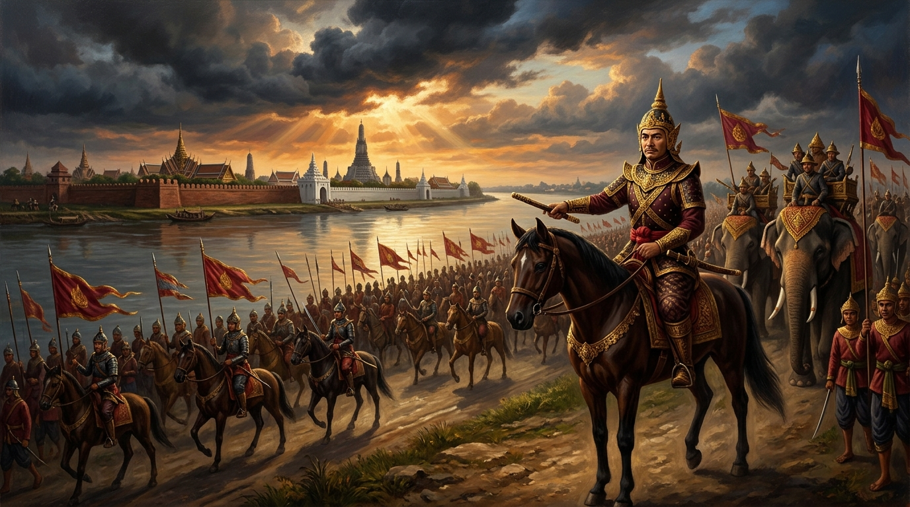
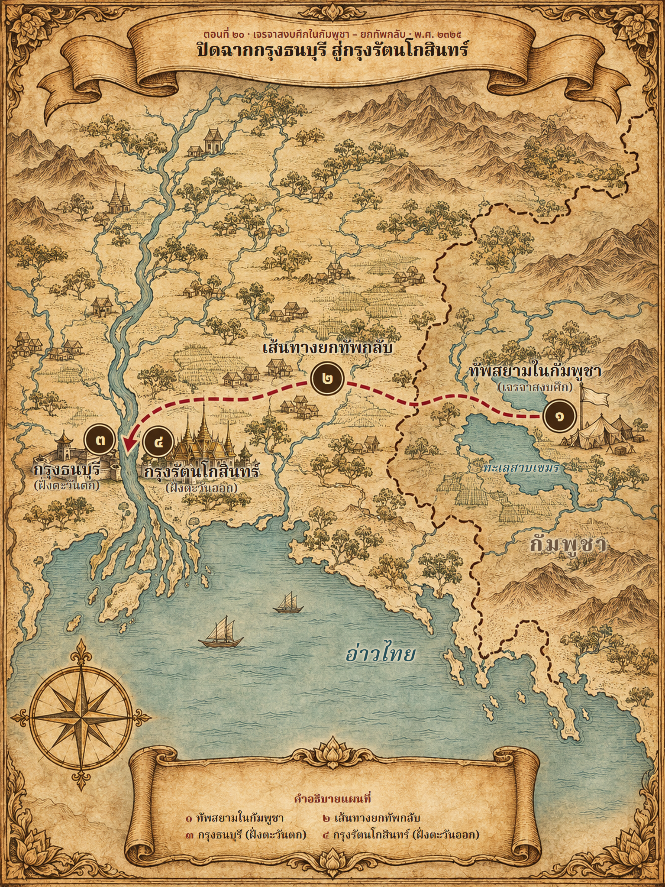

# ภาคที่ 4: เส้นทางสู่แม่น้ำโขง และฉากสุดท้ายแห่งกรุงธนบุรี (พ.ศ. 2319 – 2325)
## ตอนที่ 20 (ตอนจบ): ปิดฉากกรุงธนบุรี สู่รุ่งอรุณแห่งรัตนโกสินทร์

---

### องก์ที่ 1: จุดชนวนและเดิมพัน (The Cold Open & The Stakes)

ต้นเดือนเมษายน พ.ศ. 2325 — ลมแล้งพัดผ่านทุ่งราบจากกัมพูชาเข้าสู่ลุ่มน้ำเจ้าพระยา

ท่ามกลางเสียงกลองศึกและฝุ่นตลบ กองทัพใหญ่กว่า 20,000 นายของ **สมเด็จเจ้าพระยามหากษัตริย์ศึก** และ **เจ้าพระยาสุรสีห์** กำลังเดินทัพมุ่งหน้ากลับสู่ **กรุงธนบุรี** ด้วยความเร็วสูงสุดเท่าที่กองทัพขนาดใหญ่จะทำได้

ในชั่วโมงวิกฤตที่สุดของแผ่นดินสยาม การนำทัพกลับพระนครครั้งนี้ไม่ได้เป็นเพียงการถอนกำลังทางทหาร—แต่มันคือ **"การตัดสินชะตากรรมของราชอาณาจักรทั้งมวล"**

หากก้าวพลาดเพียงก้าวเดียว ทัพญวนในกัมพูชาอาจไล่ตีกระหนาบหลัง ขณะที่กรุงธนบุรีเบื้องหน้าอาจแตกสลายลงด้วยไฟสงครามกลางเมืองซ้ำรอย พ.ศ. 2310 ทว่าด้วยปัญญาและบารมีของยอดขุนพลผู้ผ่านสมรภูมิมาตลอด 15 ปี ท่านกำลังจะปิดฉากวิกฤตครั้งนี้อย่างเด็ดขาด และเปิดหน้าประวัติศาสตร์บทใหม่ของชาติไทย!

---

### องก์ที่ 2: อ่านกระดานศึกและปมที่ซ่อนอยู่ (The Map & The Hidden Truth)

เมื่อวิเคราะห์การเคลื่อนหมากครั้งสุดท้ายใน **เดือนมีนาคม–เมษายน พ.ศ. 2325** ตาม **พระราชพงศาวดารกรุงธนบุรี ฉบับพันจันทนุมาศ (เจิม)** และ **พระราชพงศาวดาร ฉบับพระราชหัตถเลขา** เราจะเห็นการตัดสินใจเชิงยุทธศาสตร์ที่เฉียบขาด 2 ชั้น:

#### 1. การทูตเหนือคมดาบกลางสมรภูมิกัมพูชา
ทันทีที่ได้รับใบบอกเรื่องกบฏพระยาสรรค์ในกรุงธนบุรี **สมเด็จเจ้าพระยามหากษัตริย์ศึก** ทรงตระหนักดีว่า หากถอนทัพกลับดื้อๆ ฝ่ายญวนและเขมรย่อมฉวยโอกาสตีตลบหลังจนทัพไทยเสียหายยับเยิน

ท่านจึงทรงใช้ **การทูตเชิงรุก**: ส่งทูตไปเจรจากับแม่ทัพญวนโดยตรง ทำข้อตกลงสงบศึกและแบ่งเขตอิทธิพลชั่วคราวอย่างมีศักดิ์ศรี จนฝ่ายญวนยอมตกลงเลิกรบและปล่อยให้ทัพใหญ่ของไทยถอนกำลังกลับพระนครได้อย่างปลอดภัยโดยไม่เสียไพร่พลแม้แต่คนเดียว!

#### 2. ยุทธศาสตร์ย้ายราชธานีข้ามแม่น้ำเจ้าพระยา
นอกจากปัญหาการเมืองในพระนครแล้ว สมเด็จเจ้าพระยามหากษัตริย์ศึกยังทรงมองเห็นข้อจำกัดทางภูมิศาสตร์ของ **พระราชวังกรุงธนบุรี** ฝั่งตะวันตกมาช้านาน:
- พระราชวังเดิมตั้งอยู่ติดแม่น้ำและถูกขนาบด้วย **วัดแจ้ง** และ **วัดท้ายตลาด** ทำให้พื้นที่คับแคบ ขยายพระนครได้ยาก
- ฝั่งตะวันตกเป็นพื้นที่ลุ่มและอยู่ด้านนอกโค้งน้ำที่ถูกน้ำกัดเซาะ ขณะที่ **ฝั่งตะวันออก (บางกอก)** เป็นหัวแหลมที่มีแม่น้ำเจ้าพระยาโอบล้อมเป็นปราการธรรมชาติถึง 3 ด้าน ป้องกันข้าศึกได้ดีกว่ามาก!

---

### องก์ที่ 3: คมดาบและกลศึก (The Clash & Tactical Turning Point)

#### วันที่ 6 เมษายน พ.ศ. 2325: ปิดฉากความวุ่นวายและผลัดแผ่นดิน

เมื่อ **เจ้าพระยาสุริยอภัย** ปราบปรามฝ่ายพระยาสรรค์จนสงบลงได้ในเบื้องต้นแล้ว วันที่ **6 เมษายน พ.ศ. 2325** **สมเด็จเจ้าพระยามหากษัตริย์ศึก** ก็นำทัพใหญ่เสด็จกลับเข้าสู่กรุงธนบุรีท่ามกลางการต้อนรับของขุนนางและราษฎรที่เฝ้ารอคอยความสงบสุข

ท่านทรงสั่งไต่สวนเหตุการณ์จลาจลทั้งหมดอย่างละเอียด ทรงลงโทษผู้ก่อความไม่สงบทั้งฝ่ายพระยาสรรค์และผู้เกี่ยวข้องเพื่อฟื้นฟูขื่อแปของบ้านเมือง จากนั้นคณะขุนนางผู้ใหญ่และเสนาบดีจึงได้อัญเชิญสมเด็จเจ้าพระยามหากษัตริย์ศึกขึ้นเป็นพระมหากษัตริย์เพื่อยุติความแตกแยกและรักษาเอกราชของแผ่นดิน

ด้วยความจำเป็นทางการเมืองอันเด็ดขาดในยามวิกฤต—เพื่อไม่ให้เกิดการชิงอำนาจซ้ำซ้อนขึ้นอีกในอนาคต—จึงทรงตัดสินพระทัยยุติบทบาทของราชสำนักเดิม **ปิดฉากรัชสมัยกรุงธนบุรีอันยาวนาน 15 ปีลงอย่างเป็นทางการ**

#### ปราบดาภิเษกและสถาปนากรุงรัตนโกสินทร์

ในวันเดียวกันนั้นเอง สมเด็จเจ้าพระยามหากษัตริย์ศึกทรงรับอัญเชิญขึ้นปราบดาภิเษกเป็นปฐมกษัตริย์แห่งพระบรมราชจักรีวงศ์ ทรงพระนามว่า **พระบาทสมเด็จพระพุทธยอดฟ้าจุฬาโลกมหาราช** และทรงมีพระราชดำริให้ย้ายราชธานีข้ามแม่น้ำเจ้าพระยามาสู่ฝั่งตะวันออก—สถาปนา **"กรุงรัตนโกสินทร์"** ขึ้นเป็นศูนย์กลางอำนาจแห่งใหม่ของราชอาณาจักรสยาม!

---

### องก์ที่ 4: ผลลัพธ์และบทสรุปแห่งกระดานศึก (The Aftermath & Epilogue)

#### มรดก 15 ปีบน "กระดานศึกพระเจ้าตาก"

เมื่อมองย้อนกลับไปตลอด 20 ตอนของซีรีส์ **"กระดานศึกพระเจ้าตาก: 15 ปีแห่งกลยุทธ์ คมดาบ และการสร้างแผ่นดินใหม่"** นับจากค่ำคืนเดือนมืดที่พระยาวชิรปราการนำทหารกล้าเพียง 500 คนตีฝ่าวงล้อมค่ายโพธิ์สามต้นใน พ.ศ. 2309 จนถึงรุ่งอรุณแห่งกรุงรัตนโกสินทร์ใน พ.ศ. 2325 ประวัติศาสตร์ได้จารึกความจริงอันยิ่งใหญ่ไว้ 3 ประการ:

1. **ผู้กอบกู้จากเถ้าถ่าน:** **สมเด็จพระเจ้าตากสินมหาราช** ทรงพลิกฟื้นอาณาจักรที่แตกสลาย ใช้เวลาเพียง 7 เดือนเศษกอบกู้กรุงศรีอยุธยากลับคืน และรวม 5 ชุมนุมที่แตกแยกให้กลับมาเป็นปึกแผ่นได้ภายในเวลาเพียง 3 ปี
2. **นักยุทธศาสตร์ผู้กล้าเปลี่ยนกระดาน:** พระองค์ทรงกล้าย้ายราชธานีจากอยุธยามาสู่ธนบุรีริมทะเล เชื่อมการค้าสำเภากับยุทธศาสตร์ทางเรือ และทรงกล้าใช้วิธีการรบนอกตำรา—ตั้งแต่การทุบหม้อข้าวที่จันทบูร การล้อม 3 ชั้นที่บางแก้ว ไปจนถึงการขุดคลองอ้อมแก่งหลี่ผี
3. **รากฐานสู่ยุครัตนโกสินทร์:** ภายใต้กระดานศึก 15 ปีนี้ เหล่ายอดขุนพลอย่าง **สมเด็จเจ้าพระยามหากษัตริย์ศึก (รัชกาลที่ 1)**, **เจ้าพระยาสุรสีห์ (กรมพระราชวังบวรมหาสุรสิงหนาท)**, และ **พระยาพิชัยดาบหัก** ได้ผ่านการเคี่ยวกรำจากสงครามนับสิบครั้ง จนสามารถขยายขอบขัณฑสีมาครอบคลุมล้านนา กัมพูชา และล้านช้างทั้ง 3 อาณาจักร—ส่งต่อแผ่นดินสยามอันเข้มแข็งและเป็นเอกราชให้สืบสานต่อไปยังยุคกรุงรัตนโกสินทร์จนถึงปัจจุบัน!

**กาลเวลาอาจเปลี่ยนชื่อราชธานี จากอยุธยา สู่ธนบุรี และรัตนโกสินทร์... แต่ความกล้าหาญ ปัญญา และการเสียสละของบรรพบุรุษไทยบนกระดานศึกตลอด 15 ปีนั้น จะยังคงส่องสว่างอยู่ในความทรงจำของคนไทยตราบนานเท่านาน**

---
**จบบริบูรณ์**
*(ขอบคุณที่ร่วมเดินทางบน "กระดานศึกพระเจ้าตาก" ทั้ง 20 ตอนตลอด 4 ภาคครับ)*
