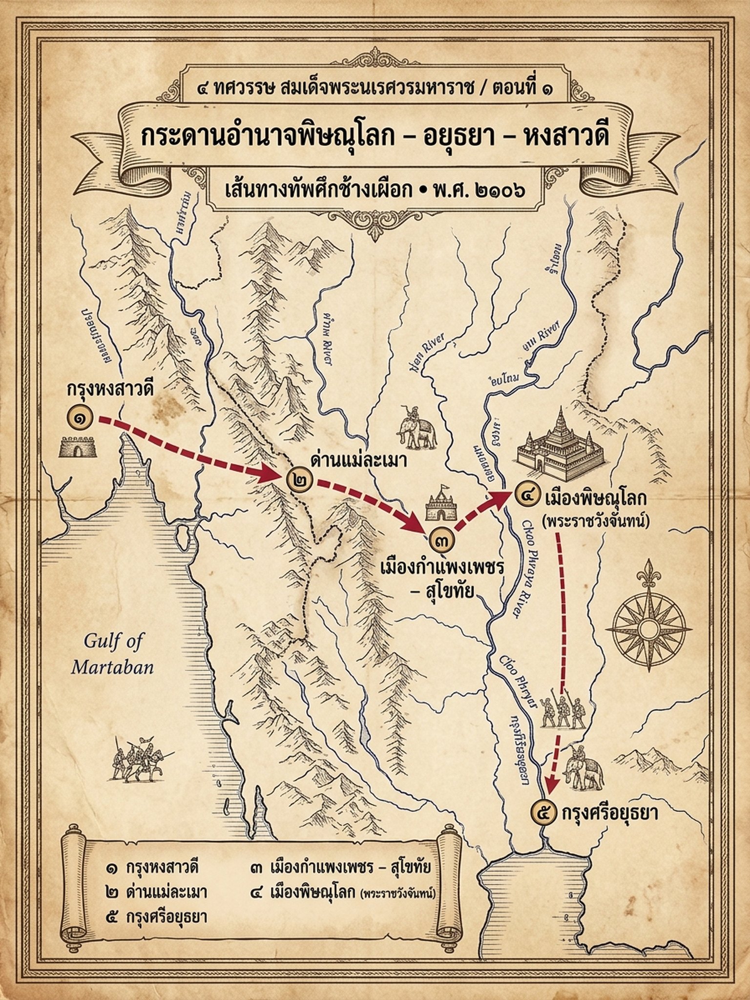

# ภาคที่ 1: องค์ประกันแดนหงสา (พ.ศ. 2098 – 2124)
## ตอนที่ 1: กำเนิดพระองค์ดำ บนกระดานศึกสองราชวงศ์

---

### องก์ที่ 1: เสียงกลองย่ำค่ำเหนือลำน้ำน่าน

สายลมเย็นจากทิวเขาเพชรบูรณ์พัดผ่านผิวน้ำสีขุ่นของแม่น้ำน่านเข้ามากระทบกำแพงอิฐแดงแห่ง **พระราชวังจันทน์** เมืองพิษณุโลก ในยามย่ำค่ำของปี พ.ศ. 2098 แสงคบเพลิงตามเชิงเทินและป้อมปราการฝั่งตะวันตกส่องสะท้อนเงาหลังคาเรือนหลวงไม้สักที่เรียงรายอยู่ภายในเขตพระราชฐาน เสียงกลองย่ำค่ำจากหอกลองประจำเมืองดังกังวานเป็นจังหวะหนักแน่น ประสานกับเสียงฝีเท้าทหารยามผลัดเวรที่เดินตรวจตราแนวคูเมืองอย่างเคร่งครัด

ภายในพระตำหนักใหญ่ริมน้ำ บรรยากาศเต็มไปด้วยความเงียบงันปนความคาดหวังของเหล่านางกำนัลและหมอหลวง ขณะที่ **สมเด็จพระมหาธรรมราชาธิราช** ผู้ครองเมืองพิษณุโลกและหัวเมืองฝ่ายเหนือ ทรงประทับรอฟังข่าวอยู่ไม่ห่างจากห้องพระประสูติ บนพระแท่นข้างพระวรกายมีแผนที่หนังสัตว์และสารตราเมืองขึ้นจากสุโขทัย กำแพงเพชร สวรรคโลก และพิชัยวางเรียงราย—หัวเมืองทั้งหมดนี้ล้วนขึ้นตรงต่อพระองค์ในฐานะเจ้าผู้ครองนครลูกหลวงฝ่ายเหนือที่ทรงอำนาจทางทหารมากที่สุดในแผ่นดินอโยธยา

ไม่นานนัก เสียงร้องไห้แรกของทารกชายก็ดังแว่วออกมาจากห้องบรรทมของ **พระวิสุทธิกษัตรีย์** พระอัครมเหสีผู้เป็นพระราชธิดาใน **สมเด็จพระมหาจักรพรรดิ** แห่งกรุงศรีอยุธยา และพระสุริโยทัยผู้สละพระชนม์บนคอช้างเมื่อปี พ.ศ. 2091 ทารกน้อยพระองค์นั้นได้รับพระนามว่า **พระนเรศ** หรือที่ผู้คนในวังจันทน์และเรื่องเล่าต่อมาขนานพระนามอย่างคุ้นปากว่า **พระองค์ดำ** และอีกไม่กี่ปีต่อมา พระราชอนุชาร่วมพระครรภ์คือ **พระเอกาทศรถ** (หรือพระองค์ขาว) ก็ประสูติตามมาเป็นคู่พระทัย

ทว่าในสายตาของขุนนางผู้เฒ่าทั้งในพิษณุโลกและกรุงศรีอยุธยา การประสูติของพระองค์ดำมิใช่เพียงข่าวดีของราชสกุลขัตติยะเท่านั้น เพราะพระโอรสพระองค์นี้ทรงถือกำเนิดขึ้นบนจุดตัดอันเปราะบางที่สุดของสองราชวงศ์—สายสุโขทัยของพระราชบิดา และสายสุพรรณภูมิของพระอัยกา—ในห้วงเวลาที่พายุสงครามจากฟากตะวันตกกำลังตั้งเค้ามืดทะมึนเหนือเทือกเขาตะนาวศรี เพียงรอวันที่สายฟ้าจะฟาดลงมากลางลุ่มน้ำเจ้าพระยา

---

### องก์ที่ 2: กระดานการเมืองสองขั้วและหลักฐานที่ต้องสอบทาน

หากเราสวมบทบาทเป็น **นักสืบประวัติศาสตร์** และหยิบ *พระราชพงศาวดารกรุงศรีอยุธยา ฉบับหลวงประเสริฐอักษรนิติ์* (ซึ่งเรียบเรียงขึ้นในรัชกาลสมเด็จพระนารายณ์มหาราช พ.ศ. 2223 และถือเป็นหลักฐานไทยที่แม่นยำด้านศักราชมากที่สุด) มาเปิดอ่านตั้งแต่ต้นรัชกาลสมเด็จพระมหาจักรพรรดิ เราจะพบข้อเท็จจริงสำคัญที่ช่วยแยก "หลักฐานชั้นต้น" ออกจาก "ข้อสันนิษฐานทางประวัติศาสตร์"

**ประการแรก:** *ฉบับหลวงประเสริฐอักษรนิติ์* **มิได้ระบุปีประสูติ พ.ศ. 2098 ของสมเด็จพระนเรศวรไว้โดยตรง** ตัวเลข พ.ศ. 2098 (ปีเถาะ) ที่ปรากฏในตำราเรียนและงานประวัติศาสตร์ปัจจุบัน เป็น **ข้อสันนิษฐานทางวิชาการ** ที่คำนวณย้อนหลังจากหลักฐานการเสด็จสวรรคตใน พ.ศ. 2148 ขณะทรงมีพระชนมพรรษา 50 พรรษา ประกอบกับคำบอกเล่าใน *คำให้การชาวกรุงเก่า* และบันทึกของชาวต่างชาติอย่าง *พงศาวดารกรุงศรีอยุธยา ฉบับวันวลิต* ที่กล่าวถึงพระชนมายุในช่วงเหตุการณ์ต่างๆ

**ประการที่สอง:** เหตุใดเมืองพิษณุโลกจึงเป็นหมากตัวสำคัญที่สุดบนกระดานอำนาจในทศวรรษนั้น? คำตอบซ่อนอยู่ในประวัติศาสตร์การเมืองก่อนหน้าพระประสูติกาลเพียง 7 ปี

- **มรดกการชิงอำนาจ พ.ศ. 2091:** เมื่อครั้ง **ขุนวรวงศาธิราช** ก่อการยึดราชบัลลังก์กรุงศรีอยุธยา ผู้ที่นำทัพหัวเมืองเหนือลงมาปราบดาภิเษกเชิญสมเด็จพระมหาจักรพรรดิขึ้นครองราชย์คือ **ขุนพิเรนทรเทพ** (เชื้อสายราชวงศ์พระร่วงแห่งสุโขทัย) หลังเสร็จศึก สมเด็จพระมหาจักรพรรดิจึงทรงปูนบำเหน็จสถาปนาขุนพิเรนทรเทพขึ้นเป็น **สมเด็จพระมหาธรรมราชาธิราช** เสด็จไปครองเมืองพิษณุโลก พร้อมพระราชทานพระวิสุทธิกษัตรีย์ให้เป็นพระอัครมเหสี เพื่อผูกความสัมพันธ์ระหว่างสองราชวงศ์ให้แน่นแฟ้น
- **ดุลอำนาจสองศูนย์กลาง:** ในทางนิตินัย กรุงศรีอยุธยาคือราชธานีใหญ่ แต่ในทางพฤตินัย พิษณุโลกคือศูนย์อำนาจทางทหารที่คุมหัวเมืองเหนือทั้งหมด ตั้งแต่สุโขทัย กำแพงเพชร สวรรคโลก ไปจนถึงพิชัย ความเข้มแข็งของสมเด็จพระมหาธรรมราชาธิราช—ทั้งจำนวนไพร่พล ช้างศึก และความจงรักภักดีของขุนนางฝ่ายเหนือ—ทำให้ขุนนางสายอยุธยาในราชสำนักหลวงเริ่มมองพิษณุโลกด้วยความหวาดระแวงว่าวันหนึ่งหัวเมืองเหนืออาจแข็งอำนาจเกินควบคุม
- **ภัยคุกคามจากหงสาวดี:** ขณะที่อยุธยากับพิษณุโลกกำลังถ่วงดุลอำนาจกันเองอยู่นั้น ที่ฟากตะวันตก **พระเจ้าบุเรงนอง** แห่งราชวงศ์ตองอูได้ทรงรวบรวมแผ่นดินพม่า มอญ รัฐฉาน (ไทใหญ่) และล้านนาเข้าเป็นจักรวรรดิหงสาวดีอันเกรียงไกร และใน พ.ศ. 2101 พระเจ้าบุเรงนองทรงยึดเมืองเชียงใหม่ได้สำเร็จ นั่นหมายความว่าแนวกันชนทางเหนือของอยุธยาได้พังทลายลงแล้ว พรมแดนของจักรวรรดิหงสาวดีได้เคลื่อนมาประชิดหัวเมืองเหนือของพิษณุโลกโดยตรง
- **ภูมิศาสตร์ที่เป็นดาบสองคม:** แม่น้ำน่านและแม่น้ำยมที่ไหลจากเหนือลงใต้ทำให้พิษณุโลกเป็นจุดรวมพลและคลังเสบียงชั้นยอด แต่ในทางกลับกัน เมื่อข้าศึกยกทัพข้ามเทือกเขาตะนาวศรีมาทางด่านแม่ละเมาหรือยกลงมาจากเชียงใหม่ พิษณุโลกย่อมต้องรับแรงกระแทกก่อนกรุงศรีอยุธยาเสมอ หากราชธานีไม่ส่งทัพขึ้นมาหนุนได้ทันเวลา พิษณุโลกก็ตกอยู่ในสภาพถูกโดดเดี่ยวกลางวงล้อม

เมื่อทรงพระเยาว์ พระองค์ดำจึงทรงเติบโตท่ามกลางเสียงพูดคุยเรื่องทัพพม่าและข่าวสารการเมืองที่ส่งขึ้นล่องตามลำน้ำน่านและลำน้ำเจ้าพระยา เมืองพิษณุโลกในเวลานั้นเปรียบเสมือนป้อมปราการด่านหน้าที่มีกำลังทหารน้อยกว่าหงสาวดีหลายเท่า และไม่อาจแน่ใจได้เลยว่าเมื่อพายุมาถึง กรุงศรีอยุธยาจะส่งทัพขึ้นมาช่วยทันเวลาหรือไม่

---

### องก์ที่ 3: ศึกช้างเผือก พ.ศ. 2106 และวันที่พิษณุโลกต้องยอมจำนน

คำตอบของคำถามนั้นมาถึงใน **จุลศักราช 925 ปีกุน** (ตรงกับ พ.ศ. 2106) เมื่อพระเจ้าบุเรงนองทรงส่งคณะทูตเชิญพระราชสาส์นมายังกรุงศรีอยุธยาเพื่อขอ **ช้างเผือก 2 เชือก** จากสมเด็จพระมหาจักรพรรดิ เหตุการณ์นี้ได้รับการบันทึกตรงกันทั้งใน *พระราชพงศาวดาร ฉบับหลวงประเสริฐอักษรนิติ์* และ *มหาราชวงษ์ พงษาวดารพม่า* (แปลจาก *Hmannan Yazawin* หรือพงศาวดารฉบับหอแก้ว)

ในทางการเมืองอุษาคเนย์สมัยนั้น การขอช้างเผือกมิใช่เรื่องสัตว์มงคลธรรมดา หากแต่คือ **"การทดสอบสถานะประเทศราช"** ในท้องพระโรงกรุงศรีอยุธยา ขุนนางแตกออกเป็นสองฝ่ายอย่างรุนแรง ฝ่ายหนึ่งเห็นว่าควรยอมถวายช้างเผือกเพื่อซื้อเวลาและเลี่ยงสงครามกับจักรวรรดิที่เพิ่งพิชิตล้านนา แต่อีกฝ่ายหนึ่ง (รวมถึงพระราเมศวรและขุนนางสายแข็งกร้าว) เห็นว่าการส่งช้างเผือกให้หงสาวดีคือการยอมศิโรราบโดยไม่ทันได้ชักดาบ และจะทำลายศักดิ์ศรีของกรุงศรีอยุธยาลงอย่างยับเยิน

เมื่อราชสำนักกรุงศรีอยุธยาปฏิเสธคำขอ พระเจ้าบุเรงนองจึงทรงเคลื่อนทัพมหึมาข้ามเทือกเขาตะนาวศรีผ่าน **ด่านแม่ละเมา** เข้าสู่หัวเมืองเหนือในปลายฤดูฝนต่อต้นฤดูแล้งของ พ.ศ. 2106 เป้าหมายแรกของพระองค์มิใช่การมุ่งตรงลงสู่กรุงศรีอยุธยา หากแต่เป็นการตัดแขนขวาของอโยธยาเสียก่อน ฉากการรุกคืบของหงสาวดีจึงดำเนินไปอย่างเป็นขั้นเป็นตอน:

1. **ด่านแรกแตกพ่าย (กำแพงเพชร – สุโขทัย – สวรรคโลก):** กองทัพหงสาวดีที่มีกำลังพลมหาศาลจากทั้งพม่า มอญ ไทใหญ่ และล้านนา เคลื่อนพลเข้าตีหัวเมืองบริวารทางเหนืออย่างรวดเร็ว เมืองกำแพงเพชรและสุโขทัยไม่อาจต้านทานได้ ต้องยอมอ่อนน้อมหรือถอยร่น กำลังรบและยุ้งฉางเสบียงทางเหนือถูกยึดครองหรือเผาทำลาย เส้นทางติดต่อระหว่างพิษณุโลกกับภาคเหนือถูกตัดขาดโดยสิ้นเชิง
2. **การล้อมเมืองพิษณุโลก:** กองทัพหลวงของพระเจ้าบุเรงนองเคลื่อนเข้าประชิดกำแพงเมืองพิษณุโลก ล้อมพระราชวังจันทน์และตัวเมืองไว้ทุกด้าน ปืนใหญ่และค่ายประชิดถูกตั้งขึ้นรอบคูเมือง สมเด็จพระมหาธรรมราชาธิราชทรงสั่งปิดประตูเมืองตั้งรับอย่างสุดกำลัง ทรงวางกำลังรักษาเชิงเทินทั้งฝั่งตะวันออกและตะวันตกของแม่น้ำน่าน พร้อมทรงส่งม้าเร็วและใบบอกด่วนฝ่าวงล้อมลงไปยังกรุงศรีอยุธยาเพื่อขอกำลังหนุน
3. **ความอดอยากและไข้ทรพิษในกำแพงเมือง:** เมื่อการปิดล้อมยืดเยื้อ ข้าวปลาอาหารภายในเมืองพิษณุโลกเริ่มร่อยหรอ ราคาข้าวพุ่งสูงขึ้นจนราษฎรที่อพยพเข้ามาหลบภัยภายในกำแพงเมืองต้องอดอยาก ซ้ำร้ายยังเกิดโรคระบาดร้ายแรงคือ **ไข้ทรพิษ** ลุกลามไปทั่วค่ายทหารและบ้านเรือน กำลังรบที่เคยเข้มแข็งเริ่มล้มป่วยและอ่อนล้าลงทุกวัน ขณะที่แม่ทัพหงสาวดีก็ส่งสาส์นเกลี้ยกล่อมให้ยอมจำนนเพื่อแลกกับการไว้ชีวิตพลเมือง
4. **ทัพช่วยจากกรุงศรีอยุธยาที่มาไม่ถึง:** *พระราชพงศาวดาร ฉบับพันจันทนุมาศ (เจิม)* และพงศาวดารฉบับชำระชั้นหลังเล่าว่า กรุงศรีอยุธยาส่งกองทัพของ **พระยาราชภักดี** และขุนนางฝ่ายใต้ยกขึ้นมาช่วยพิษณุโลก แต่กองทัพหงสาวดีได้ส่งกำลังลงมาสกัดไว้กลางทางจนทัพกรุงแตกพ่ายถอยกลับไป ปล่อยให้พิษณุโลกต้องเผชิญชะตากรรมตามลำพังในวงล้อม

เมื่อไม่มีทั้งเสบียง กำลังเสริม และผู้คนกำลังล้มตายด้วยโรคระบาด สมเด็จพระมหาธรรมราชาธิราชจึงทรงตัดสินพระทัยเจรจายอมอ่อนน้อมต่อพระเจ้าบุเรงนองเพื่อรักษาชีวิตไพร่พลและบ้านเมืองไว้ พระเจ้าบุเรงนองทรงรับเมืองพิษณุโลกเข้าเป็นเมืองในอาณัติ และทรงแสดงพระมหาเมตตาในฐานะจักรพรรดิราชด้วยการแต่งตั้งสมเด็จพระมหาธรรมราชาธิราชให้คงครองเมืองพิษณุโลกต่อไป

หากเราลองเทียบมุมมองของหลักฐานสองฝั่งในเหตุการณ์นี้ จะเห็นความต่างที่น่าสนใจ: *มหาราชวงษ์ พงษาวดารพม่า* (แปลจาก *Hmannan Yazawin*) เล่าถึงการศึกครั้งนี้ในฐานะชัยชนะอันชอบธรรมของพระเจ้าบุเรงนองที่ทรงปราบหัวเมืองฝ่ายเหนือได้อย่างรวดเร็วและทรงชุบเลี้ยงเจ้าเมืองพิษณุโลกให้ภักดีต่อหงสาวดี ขณะที่ *ฉบับพันจันทนุมาศ (เจิม)* และ *ฉบับพระราชหัตถเลขา* ของไทยเน้นย้ำถึงความบีบคั้นของโรคระบาด ความอดอยาก และความล่าช้าของกองทัพช่วยเหลือจากกรุงศรีอยุธยา ราวกับจะอธิบายต่อคนรุ่นหลังว่าเหตุใดเจ้าเมืองพิษณุโลกจึงจำต้องยอมจำนนต่อหงสาวดี

ทว่าราคาของความอยู่รอดนั้นสูงลิ่ว กองทัพเมืองพิษณุโลกถูกเกณฑ์ให้ร่วมเดินทัพลงใต้เคียงข้างกองทัพหงสาวดีเข้าประชิดกรุงศรีอยุธยา การเจรจาสงบศึกที่ทุ่งภูเขาทอง–คลองสระบัวบีบให้สมเด็จพระมหาจักรพรรดิจำต้องยอมถวายช้างเผือกถึง **4 เชือก** (มากกว่าที่ขอไว้เดิมเท่าตัว) พร้อมส่งตัวพระราเมศวรและขุนนางฝ่ายต่อต้านอย่างพระยารามและพระยาจักรีไปกับกองทัพหงสาวดี นอกจากนี้กรุงศรีอยุธยายังต้องยอมให้หงสาวดีมีสิทธิ์เรียกเก็บส่วยและเกณฑ์กำลังพลจากหัวเมืองเหนืออย่างเปิดเผย

---

### องก์ที่ 4: รอยร้าวที่ประสานไม่ติด และเดิมพันที่ชื่อ "องค์ประกัน"

เมื่อเสียงกลองศึกสงบลงในปี พ.ศ. 2106–2107 แผ่นดินลุ่มน้ำเจ้าพระยาก็มิได้กลับไปเป็นเหมือนเดิมอีกต่อไป

ในทางภูมิรัฐศาสตร์ พิษณุโลกได้แปรสภาพจากเมืองลูกหลวงของอโยธยา มาเป็น **"เมืองหน้าด่านกึ่งประเทศราช"** ที่ต้องคอยรายงานตรงต่อกรุงหงสาวดี ขณะเดียวกัน รอยร้าวระหว่างสมเด็จพระมหาธรรมราชาธิราชกับราชสำนักกรุงศรีอยุธยาก็ลึกเกินกว่าจะประสาน ฝ่ายอยุธยาเริ่มมองว่าพิษณุโลกเอาใจออกห่างไปเข้ากับพม่าถึงขั้นนำทัพพม่าลงมาล้อมราชธานี ส่วนฝ่ายพิษณุโลกก็ฝังใจว่าในยามวิกฤตที่สุด กรุงศรีอยุธยามิได้ทุ่มเทกำลังขึ้นมาช่วยอย่างแท้จริง ความบาดหมางนี้เองที่จะปะทุขึ้นเป็นสงครามกลางเมืองและนำไปสู่การเสียกรุงศรีอยุธยาครั้งที่ 1 ในอีกไม่กี่ปีข้างหน้า

ท่ามกลางความไม่ไว้วางใจระหว่างสามราชสำนัก—พิษณุโลก อยุธยา และหงสาวดี—พระนเรศวรทรงเจริญพระชันษาขึ้นราว 8–9 พรรษา ในพระราชวังจันทน์ที่ยังคงมีกลิ่นอายของควันไฟและรอยช้ำจากโรคระบาด พระองค์ทรงเฝ้ามองพระราชบิดาเดินหมากทางการเมืองบนเส้นด้ายอันบางเฉียบ ทุกพระราชสาส์นที่ส่งลงใต้ไปอยุธยาและส่งตะวันตกไปหงสาวดีล้วนแฝงไว้ด้วยความระมัดระวัง ทั้งในห้องบรรทมของพระวิสุทธิกษัตรีย์ผู้ทรงเป็นทั้งพระธิดาของกษัตริย์อยุธยาและพระมเหสีของเจ้าเมืองพิษณุโลก ความตึงเครียดระหว่างสองแผ่นดินย่อมสะท้อนผ่านสายพระเนตรของเจ้าชายน้อยอยู่ทุกเมื่อเชื่อวัน

เพราะในระบบจักรวรรดิราชของอุษาคเนย์ คำสาบานและสนธิสัญญาไมตรีมิอาจรับประกันความจงรักภักดีได้ตลอดไป สิ่งเดียวที่จะทำให้พระเจ้าบุเรงนองทรงวางพระทัยได้ว่าเจ้าเมืองพิษณุโลกจะไม่หันคมดาบกลับมาแทงข้างหลัง คือการยึด **"ชีวิตของพระราชโอรส"** เอาไว้ในราชสำนักหงสาวดี

และในไม่ช้า ขบวนเสด็จอันเงียบงันก็จะเคลื่อนออกจากประตูพระราชวังจันทน์ มุ่งหน้าข้ามเทือกเขาตะนาวศรีไปทางทิศตะวันตก—เพื่อส่งเจ้าชายน้อยพระองค์ดำเข้าสู่ใจกลางจักรวรรดิของศัตรู

**จบตอนที่ 1**

*(ติดตามต่อใน ตอนที่ 2: องค์ประกันในราชสำนักหงสาวดี)*
