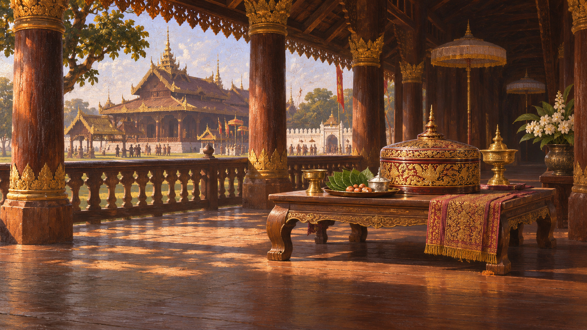
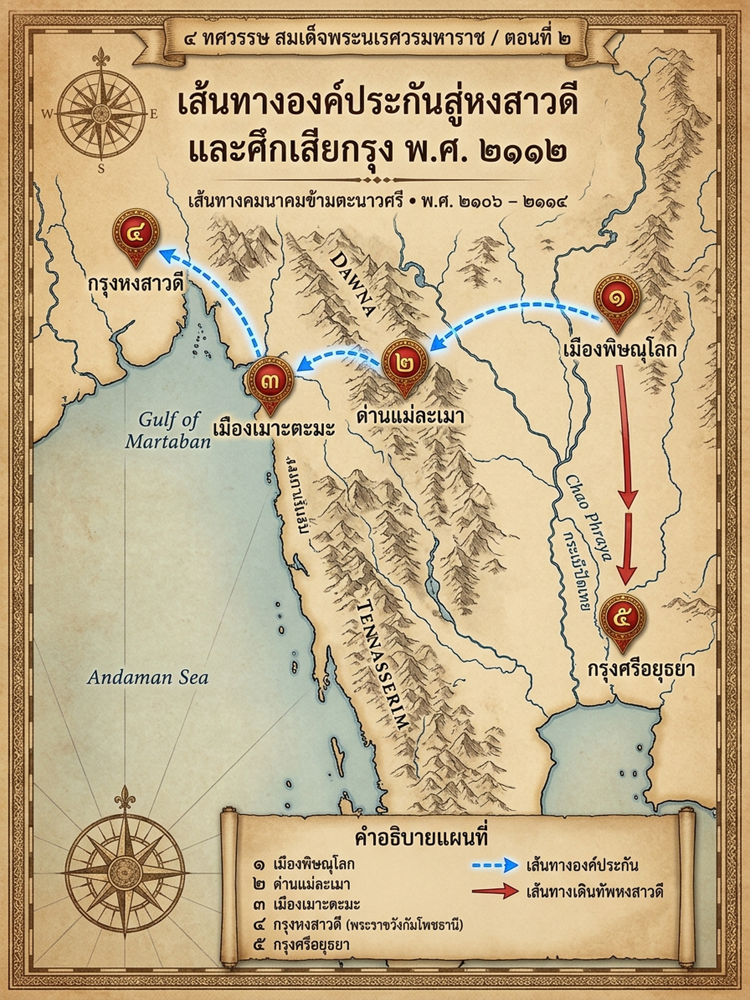

# ภาคที่ 1: องค์ประกันแดนหงสา (พ.ศ. 2098 – 2124)
## ตอนที่ 2: องค์ประกันในราชสำนักหงสาวดี

---

### องก์ที่ 1: ราชกุมารต่างแดนในพระราชวังกัมโพชธานี

ภายใต้หลังคาซ้อนชั้นปิดทองอร่ามของพระราชวังกัมโพชธานีแห่งกรุงหงสาวดี บรรยากาศในท้องพระโรงของพระเจ้าบุเรงนองเต็มไปด้วยภาษาที่หลากหลาย ทั้งพม่า มอญ ไทใหญ่ ล้านนา ล้านช้าง และอโยธยา นี่คือศูนย์กลางจักรวรรดิที่ยิ่งใหญ่ที่สุดในอุษาคเนย์ขณะนั้น และท่ามกลางบุตรหลานเจ้าประเทศราชที่ถูกส่งตัวมาพำนักในราชสำนักหงสาวดี มีเจ้าชายหนุ่มจากพิษณุโลกพระองค์หนึ่งประทับอยู่ด้วย

พระนเรศวรทรงมิได้ประทับในฐานะเชลยศึกในกรงขัง หากแต่ทรงประทับในฐานะ **"องค์ประกันทางการเมือง"** (พระเจ้าลูกยาเธอของเจ้าประเทศราชที่พระเจ้าจักรพรรดิราชทรงรับไว้ในอุปการะ) ทรงได้เรียนรู้ทั้งภาษา ศาสนา ระบบการปกครอง และที่สำคัญที่สุดคือ **วิธีคิดทางยุทธศาสตร์ของกองทัพหงสาวดี** จากภายในโดยตรง

---

### องก์ที่ 2: ปมปีที่เสด็จไปหงสาวดี และรอยแยกของหลักฐาน

เมื่อเราเปิดหลักฐานหลายฉบับมาวางเทียบกันจะพบคำถามสำคัญประการหนึ่งที่นักประวัติศาสตร์ถกเถียงกันมาตลอด: **สมเด็จพระนเรศวรเสด็จไปประทับ ณ กรุงหงสาวดีในปีใดกันแน่?**

- **กระแสที่ 1 (พ.ศ. 2106–2107 หลังศึกช้างเผือก):** ใน *พระราชพงศาวดาร ฉบับพันจันทนุมาศ (เจิม)* และพงศาวดารฉบับชำระชั้นหลังบางสำนวน รวมถึงข้อสันนิษฐานของนักประวัติศาสตร์รุ่นครู ระบุว่าหลังศึกช้างเผือก จ.ศ. 925 (พ.ศ. 2106) สมเด็จพระมหาธรรมราชาธิราชทรงถวายพระนเรศวร (ขณะพระชันษาราว 9 พรรษา) ไปเป็นองค์ประกันที่หงสาวดี เพื่อให้พระเจ้าบุเรงนองทรงไว้วางพระราชหฤทัยว่าพิษณุโลกจะไม่แปรพักตร์
- **กระแสที่ 2 (หลังเสียกรุงศรีอยุธยาครั้งที่ 1 พ.ศ. 2112):** หากตรวจสอบใน *พระราชพงศาวดาร ฉบับหลวงประเสริฐอักษรนิติ์* จะพบว่าบันทึกศักราชในช่วง พ.ศ. 2106 กล่าวถึงเพียงการยอมอ่อนน้อมและถวายช้างเผือก โดยมิได้ระบุชัดเจนว่าพระนเรศวรเสด็จไปหงสาวดีในปีนั้น แต่มาปรากฏบทบาทของสมเด็จพระมหาธรรมราชาฯ ที่ได้รับการสถาปนาจากพระเจ้าบุเรงนองให้ครองกรุงศรีอยุธยาหลังเสียกรุงในวันอาทิตย์ เดือน 9 แรม 11 ค่ำ จ.ศ. 931 (ตรงกับเดือนสิงหาคม พ.ศ. 2112) จึงมีนักวิชาการจำนวนหนึ่งสันนิษฐานว่าพระองค์อาจเสด็จไปประทับหงสาวดีราว พ.ศ. 2107 หรือหลัง พ.ศ. 2112 (ขณะพระชันษาราว 14 พรรษา)

ไม่ว่าจะเสด็จไปในปี พ.ศ. 2107 หรือ พ.ศ. 2112 สิ่งที่หลักฐานทั้งฝ่ายไทยและ *มหาราชวงษ์ พงษาวดารพม่า* (แปลจาก *Hmannan Yazawin*) ยืนยันตรงกันคือ พระเจ้าบุเรงนองทรงรับเจ้านายจากพิษณุโลกเข้าไปเลี้ยงดูในราชสำนักหงสาวดีจริง เพื่อใช้เป็นหมากคุมเกมการเมืองลุ่มน้ำเจ้าพระยา

---

### องก์ที่ 3: เสียกรุงครั้งที่ 1 และเส้นแบ่งระหว่าง "หลักฐาน" กับ "ตำนาน"

จุดเปลี่ยนใหญ่เกิดขึ้นใน พ.ศ. 2112 เมื่อความขัดแย้งระหว่างสมเด็จพระมหาธรรมราชาธิราชกับราชสำนักกรุงศรีอยุธยา (แผ่นดินสมเด็จพระมหินทราธิราช) ลุกลามจนพระเจ้าบุเรงนองยกทัพใหญ่มาล้อมพระนครนานถึง 9 เดือน และตีกรุงศรีอยุธยาแตกในเดือนสิงหาคม พ.ศ. 2112 (จ.ศ. 931) ตาม *ฉบับหลวงประเสริฐอักษรนิติ์* พระเจ้าบุเรงนองโปรดให้สมเด็จพระมหาธรรมราชาฯ เสด็จขึ้นครองราชสมบัติกรุงศรีอยุธยาในฐานะประเทศราชของหงสาวดี

ท่ามกลางยุคสมัยที่ราชธานีตกเป็นเมืองขึ้น เกิดเรื่องเล่าอันโด่งดัง 2 เรื่องที่คนไทยจดจำสืบต่อกันมา แต่เมื่อสวมแว่นนักสืบประวัติศาสตร์ เราต้องแยกแยะให้ชัดเจน:

- **เรื่องเล่าที่ 1 — เกร็ดชนไก่กับพระมหาอุปราชา:** เรื่องที่พระนเรศวรทรงนำไก่ชนจากพิษณุโลกไปชนชนะไก่ของพระมหาอุปราชา และตรัสโต้ตอบเรื่อง *"ไก่เชลยตัวนี้เก่งจริง"* **ไม่ปรากฏในพระราชพงศาวดารฉบับหลวงประเสริฐอักษรนิติ์** และไม่ปรากฏใน *มหาราชวงษ์ พงษาวดารพม่า* เรื่องนี้มาจาก **คำให้การชาวกรุงเก่า** และเรื่องเล่ามุขปาฐะชั้นหลัง ซึ่งสะท้อนความทรงจำร่วมของชาวสยามถึงความขัดแย้งทางศักดิ์ศรีระหว่างเจ้านายสองแผ่นดิน
- **เรื่องเล่าที่ 2 — บทบาทของพระสุพรรณกัลยา:** พระนามและเรื่องราวของ **พระสุพรรณกัลยา** (พระพี่นางในสมเด็จพระนเรศวร) มิได้ปรากฏใน *ฉบับหลวงประเสริฐอักษรนิติ์* เลย หากแต่ปรากฏหลักฐานครั้งแรกในฝั่งพม่า (*Hmannan Yazawin*) ในฐานะพระมเหสี/บาทบริจาริกาชาวไทยของพระเจ้าบุเรงนอง และถูกถ่ายทอดเข้าสู่เอกสารไทยใน *คำให้การชาวกรุงเก่า* และ *คำให้การขุนหลวงหาวัด* ในสมัยหลัง ส่วนรายละเอียดเรื่องการทรงเสียสละพระองค์เป็นตัวประกันแลกการเสด็จกลับของพระนเรศวรเป็นงานเรียบเรียงและขยายความทางประวัติศาสตร์ในยุคต่อมา

---

### องก์ที่ 4: เจ้าชายที่รู้ไส้พุงจักรวรรดิ

เมื่อพระเจ้าบุเรงนองทรงรับพระพี่นางสุพรรณกัลยาเข้าสู่ราชสำนักหงสาวดีราว พ.ศ. 2114 และทรงเห็นว่าสมเด็จพระมหาธรรมราชาธิราชทรงภักดีต่อหงสาวดีอย่างมั่นคงแล้ว พระองค์จึงพระราชทานอนุญาตให้ **สมเด็จพระนเรศวร** (ขณะพระชันษาราว 16 พรรษา) เสด็จนิวัตกลับสู่กรุงศรีอยุธยาและเมืองพิษณุโลก

หงสาวดีคิดว่าตนได้ส่ง "เจ้าชายผู้ภักดี" กลับไปช่วยปกครองหัวเมืองเหนือ ทว่าในความเป็นจริง พระเจ้าบุเรงนองได้ทรงปลดปล่อย **"นักเรียนยุทธศาสตร์ที่รู้จักจุดแข็งและจุดอ่อนของจักรวรรดิตองอูดีที่สุด"** ให้กลับคืนสู่พระราชวังจันทน์แล้ว

**จบตอนที่ 2**

*(ติดตามต่อใน ตอนที่ 3: วังจันทน์คืนถิ่น และบทเรียนที่เวียงจันทน์)*
