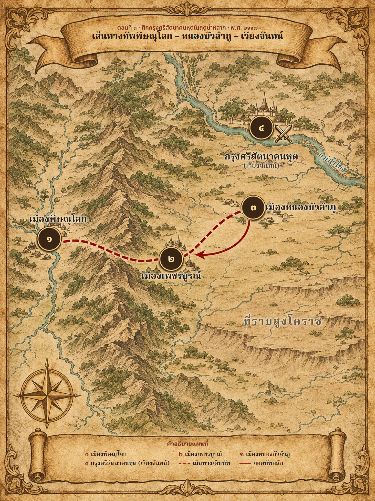

# ภาคที่ 1: องค์ประกันแดนหงสา (พ.ศ. 2098 – 2124)
## ตอนที่ 3: วังจันทน์คืนถิ่น และบทเรียนที่เวียงจันทน์

---

### องก์ที่ 1: ราชกุมารบนซากเมืองเหนือ

สายน้ำน่านในฤดูแล้งปี พ.ศ. 2114 ไหลเอื่อยผ่านหน้ากำแพง **พระราชวังจันทน์** เมืองพิษณุโลก ตรงข้ามฝั่งตะวันออกของลำน้ำคือพระปรางค์วัดพระศรีรัตนมหาธาตุที่ยังคงตั้งตระหง่านเหนือยอดไม้ ทว่าเมืองลูกหลวงฝ่ายเหนือที่เคยคึกคักไปด้วยเรือสินค้าและขบวนไพร่พลในอดีต กลับตกอยู่ในความเงียบงันอย่างน่าใจหาย บ้านเรือนราษฎรจำนวนมากยังร้างผู้คน ไร่นารอบเมืองถูกทิ้งร้างหลังจากสงครามเสียกรุงครั้งที่ 1 ใน พ.ศ. 2112 และสงครามต่อเนื่องได้กวาดต้อนผู้คน ช้าง ม้า และเสบียงลงไปทางหงสาวดีจนแทบหมดสิ้น

ท่ามกลางสภาพบ้านเมืองที่บอบช้ำเช่นนั้น ขบวนเสด็จของ **สมเด็จพระนเรศวร** ในวัยเพียง 16 พรรษาก็เคลื่อนกลับคืนสู่พระราชวังจันทน์ สมเด็จพระมหาธรรมราชาธิราช—ผู้ทรงย้ายลงไปประทับเป็นพระเจ้าแผ่นดิน ณ กรุงศรีอยุธยาในฐานะประเทศราชของหงสาวดี—ทรงสถาปนาพระราชโอรสองค์โตขึ้นเป็น **พระมหาอุปราชครองเมืองพิษณุโลก** เพื่อทรงดูแลหัวเมืองฝ่ายเหนือทั้งหมดแทนพระองค์ ขณะที่สมเด็จพระเอกาทศรถ พระราชอนุชา ทรงอยู่เคียงข้างพระราชบิดาในราชธานี

บนพระที่นั่งในท้องพระโรงวังจันทน์ ขุนนางผู้เฒ่าที่รอดชีวิตจากสงครามพากันจับตามองเจ้าชายหนุ่มที่เพิ่งเสด็จกลับมาจากราชสำนักหงสาวดีด้วยสายตาทั้งคาดหวังและระมัดระวัง คำถามที่ลอยอยู่ในอากาศคือ เจ้าชายที่เติบโตในเมืองศัตรูมานานหลายปีจะทรงฟื้นฟูเมืองพิษณุโลกขึ้นมาใหม่ได้อย่างไร—ในเมื่อหงสาวดีคอยจับตาดูทุกความเคลื่อนไหว ข้าหลวงและสายสืบของหงสาวดียังคงเดินปะปนอยู่ในเมืองหน้าด่าน และกรุงศรีอยุธยาเองก็กำลังอ่อนแอจนไม่อาจคุ้มครองหัวเมืองเหนือได้

สมเด็จพระนเรศวรทรงเริ่มต้นภารกิจโดยไม่รอช้า ทรงออกประกาศเกลี้ยกล่อมรวบรวมไพร่พลที่หลบหนีเข้าป่าให้กลับคืนสู่ภูมิลำเนา จัดระบบการทำนาสะสมเสบียงในเขตลุ่มน้ำยม–น่าน ซ่อมแซมกำแพงเมือง ป้อมปราการ และคูเมืองพิษณุโลกให้กลับมามั่นคง และทรงฝึกฝนกองกำลังหนุ่มรุ่นใหม่ในบังคับบัญชาของพระองค์เองอย่างเงียบเชียบ ข้าหลวงเดิมและทหารหนุ่มฝีมือดีจากหัวเมืองเหนือเริ่มรวมตัวกันรอบพระองค์ ทั้งในตำแหน่งเจ้าเมืองบริวารและแม่ทัพนายกองรุ่นใหม่ที่จะกลายเป็นกำลังหลักในการกอบกู้แผ่นดินในอีกสิบปีข้างหน้า

นอกจากด้านการทหารแล้ว พระองค์ยังทรงวางรากฐานการปกครองหัวเมืองเหนือทั้ง 7 เมือง—พิษณุโลก สุโขทัย สวรรคโลก กำแพงเพชร พิจิตร พิชัย และนครสวรรค์—ให้กลับมาเชื่อมโยงกับพระราชวังจันทน์เป็นเอกภาพ การเสด็จประทับ ณ พิษณุโลกครั้งนี้จึงเปรียบเสมือนการสร้าง **"ขุมกำลังสำรอง"** ที่อยู่นอกสายตาอันใกล้ชิดของข้าหลวงพม่าในกรุงศรีอยุธยา ทว่ายังไม่ทันที่หัวเมืองเหนือจะฟื้นตัวเต็มที่ คำสั่งเกณฑ์ทัพจากกรุงหงสาวดีก็เดินทางมาถึง

---

### องก์ที่ 2: ใบบอกจากหงสาวดี และประโยคเดียวในฉบับหลวงประเสริฐฯ

สามปีหลังเสด็จกลับพิษณุโลก ใน **จุลศักราช 936 ปีจอ** (ตรงกับ พ.ศ. 2117) จักรวรรดิหงสาวดีของพระเจ้าบุเรงนองต้องเผชิญกับการแข็งเมืองของ **กรุงศรีสัตนาคนหุต (เวียงจันทน์)** แห่งอาณาจักรล้านช้าง เมื่อพระเจ้าไชยเชษฐาธิราชเสด็จสวรรคตลง บ้านเมืองล้านช้างเกิดความวุ่นวายชิงอำนาจ พระยาแสนสุรินทรลือชัยขึ้นครองราชย์และปฏิเสธการส่งบรรณาการให้หงสาวดี พระเจ้าบุเรงนองจึงทรงกรีฑาทัพใหญ่จากหงสาวดีผ่านเชียงใหม่มุ่งตรงสู่เวียงจันทน์ พร้อมมีพระราชโองการเกณฑ์กองทัพกรุงศรีอยุธยาและพิษณุโลกให้ยกขึ้นไปสมทบเป็นทัพกระหนาบทางใต้

การที่พระเจ้าบุเรงนองต้องทรงยกทัพไกลถึงลุ่มน้ำโขงด้วยพระองค์เอง สะท้อนภาพความเปราะบางของจักรวรรดิตองอูได้อย่างชัดเจน แม้หงสาวดีจะมีอำนาจสูงสุดในแผ่นดินใหญ่เอเชียตะวันออกเฉียงใต้ แต่การควบคุมอาณาจักรประเทศราชที่อยู่ห่างไกลตั้งแต่ยะไข่ รัฐฉาน ล้านนา อยุธยา ไปจนถึงล้านช้าง ต้องอาศัยการเดินทัพปราบปรามซ้ำแล้วซ้ำเล่าทุกครั้งที่เปลี่ยนแผ่นดินหรือเกิดกบฏ

หากเราเปิดอ่านหลักฐานชั้นต้นอย่าง *พระราชพงศาวดารกรุงศรีอยุธยา ฉบับหลวงประเสริฐอักษรนิติ์* ในศักราช 936 จะพบข้อความสั้นกระชับตรงตามต้นฉบับเพียงบรรทัดเดียวว่า:

*"ศักราช 936 จอศก น้ำมากนัก ครั้งนั้น สมเด็จพระเจ้าลูกเธอทรงพระประชวรทรพิศม์"*

เพียงประโยคสั้นๆ ไม่กี่คำนี้กลับซ่อนข้อมูลทางประวัติศาสตร์ไว้หลายชั้น เมื่อนำไปสอบทานกับ *พระราชพงศาวดาร ฉบับพันจันทนุมาศ (เจิม)*, *ฉบับพระราชหัตถเลขา*, *มหาราชวงษ์ พงษาวดารพม่า* (แปลจาก *Hmannan Yazawin*) และ *พงศาวดารล้านช้าง* เราจะเห็นภาพกระดานศึกครั้งนี้อย่างชัดเจน:

- **ภาระจำยอมของเมืองประเทศราช:** ในฐานะเมืองขึ้นของหงสาวดี สมเด็จพระมหาธรรมราชาธิราชและสมเด็จพระนเรศวรไม่มีทางเลือกอื่นนอกจากต้องระดมไพร่พลจากอยุธยาและหัวเมืองเหนือยกขึ้นไปร่วมรบตามรับสั่งของพระเจ้าบุเรงนอง หากบิดพลิ้ว หงสาวดีอาจถือเป็นกบฏและยกทัพกลับมาขยี้กรุงศรีอยุธยาที่ยังไร้กำแพงแข็งแกร่งได้ทันที การส่งทัพครั้งนี้จึงเป็นการซื้อความไว้วางใจจากหงสาวดีโดยตรง
- **ความขัดแย้งทางผลประโยชน์ในภูมิภาค:** ในทางภูมิรัฐศาสตร์ อาณาจักรล้านช้างคือรัฐกันชนสำคัญทางทิศตะวันออกเฉียงเหนือ การที่อยุธยาต้องยกทัพไปช่วยหงสาวดีทำลายเวียงจันทน์ย่อมเท่ากับช่วยศัตรูขจัดแนวต้านทานสุดท้ายในลุ่มน้ำโขงให้หมดไป ยิ่งหงสาวดีพิชิตล้านช้างได้เร็วเท่าใด แรงกดดันรอบด้านที่มีต่ออยุธยาก็จะยิ่งทวีคูณขึ้นเท่านั้น
- **มุมมองจากหลักฐานพม่าและล้านช้าง:** *มหาราชวงษ์ พงษาวดารพม่า* (*Hmannan Yazawin*) บันทึกการยกทัพของพระเจ้าบุเรงนองไปตีเวียงจันทน์ใน พ.ศ. 2117 ว่าแม้หงสาวดีจะยึดเมืองเวียงจันทน์ได้ในที่สุด แต่การเดินทัพข้ามป่าเขาและลำน้ำโขงในฤดูน้ำหลากสร้างความสูญเสียแก่กำลังพลหงสาวดีไม่น้อย ขณะที่ *พงศาวดารล้านช้าง* สะท้อนภาพความแตกแยกภายในราชสำนักเวียงจันทน์ที่เปิดช่องให้หงสาวดีเข้าแทรกแซง
- **สภาพอากาศวิปริต ("น้ำมากนัก"):** คำบันทึกสั้นๆ ใน *ฉบับหลวงประเสริฐอักษรนิติ์* ที่ว่า **"น้ำมากนัก"** สะท้อนสภาพภูมิอากาศใน พ.ศ. 2117 ที่เกิดอุทกภัยและฝนตกหนักผิดปกติ ทำให้เส้นทางเดินทัพข้ามที่ราบสูงเต็มไปด้วยโคลนตม น้ำป่า และโรคระบาดที่แฝงมากับความชื้น

---

### องก์ที่ 3: ฝ่าดงพญาไฟสู่หนองบัวลำภู และมัจจุราชในค่ายพักแรม

ขบวนทัพของสมเด็จพระมหาธรรมราชาธิราชและสมเด็จพระนเรศวรเคลื่อนออกจากพิษณุโลกและหัวเมืองเหนือ มุ่งหน้าไปทางทิศตะวันออกผ่านเมืองเพชรบูรณ์ ข้ามแนวเทือกเขาอันรกทึบของ **ดงพญาไฟ** ขึ้นสู่ที่ราบสูงอีสาน ภายใต้สายฝนที่เทกระหน่ำลงมาไม่ขาดสาย ลำธารทุกสายเอ่อล้นตลิ่งจนทางเกวียนจมอยู่ใต้น้ำโคลน ช้างศึกและม้าศึกต้องเดินย่ำน้ำอย่างยากลำบาก เสบียงข้าวสารและดินปืนจำนวนมากเปียกชื้นเสียหายระหว่างทาง ทหารราบจำนวนไม่น้อยเริ่มล้มป่วยด้วยไข้ป่าและโรคทางเดินอาหาร

เมื่อกองทัพไทยเดินทางมาถึงบริเวณ **เมืองหนองบัวลำภู** (ซึ่งพงศาวดารฉบับชำระชั้นหลังอย่าง *ฉบับพันจันทนุมาศ (เจิม)* และ *ฉบับพระราชหัตถเลขา* ระบุว่าเป็นจุดตั้งทัพหน้าก่อนข้ามแม่น้ำโขงเข้าสู่เวียงจันทน์) ศัตรูที่น่ากลัวยิ่งกว่ากองทัพล้านช้างก็จู่โจมเข้าใส่ค่ายหลวงอย่างไม่ทันตั้งตัว

ภายในค่ายพักแรมที่ชื้นแฉะและแออัด ไพร่พลเริ่มล้มป่วยด้วยโรคระบาด และแล้วพระอาการร้ายแรงก็ปรากฏขึ้นกับองค์แม่ทัพหนุ่ม—**สมเด็จพระนเรศวรทรงพระประชวรหนักด้วยพระโรคทรพิษ (ไข้ทรพิษ)**

อาการของไข้ทรพิษในยุคก่อนการแพทย์สมัยใหม่นั้นทารุณและเสี่ยงต่อการสิ้นพระชนม์อย่างยิ่ง ไข้สูงจัดพุ่งขึ้นอย่างรวดเร็ว ตามด้วยผื่นตุ่มหนองที่ลุกลามไปทั่วพระวรกาย ค่ายหลวงที่หนองบัวลำภูตกอยู่ในความตึงเครียด ขุนนางและหมอหลวงต่างระดมยารักษาอย่างสุดความสามารถ ขณะที่สมเด็จพระมหาธรรมราชาธิราชทรงตระหนักดีว่าหากฝืนเดินทัพต่อไปกลางฝนและน้ำหลากเช่นนี้ พระโอรสย่อมไม่อาจรอดพระชนมชีพได้

ในทางการเมือง นี่คือการตัดสินพระทัยที่เสี่ยงอย่างยิ่งยวด เพราะหากพระเจ้าบุเรงนองทรงสงสัยว่าอยุธยาแสร้งอ้างเหตุประชวรเพื่อหลีกเลี่ยงการรบ ความโกรธเกรี้ยวของจักรพรรดิหงสาวดีย่อมย้อนกลับมาทำลายกรุงศรีอยุธยาได้ทันที สมเด็จพระมหาธรรมราชาธิราชจึงทรงตัดสินพระทัยมีใบบอกด่วนกราบทูลพระเจ้าบุเรงนองซึ่งกำลังล้อมเวียงจันทน์อยู่ พร้อมทั้งหลักฐานยืนยันสภาพน้ำหลากและพระอาการประชวรจริงของสมเด็จพระเจ้าลูกเธอ เพื่อขอพระราชทานพระบรมราชานุญาตถอนทัพอยุธยากลับลงมา

พระเจ้าบุเรงนองทรงทราบความจริงเรื่องสภาพน้ำหลากและโรคระบาดในเขตลุ่มน้ำโขงอยู่แล้ว จึงทรงอนุญาตให้ทัพอยุธยาถอยกลับได้ การถอนทัพที่หนองบัวลำภูครั้งนี้จึงเป็นจังหวะทางการทูตที่ลงตัวอย่างเหลือเชื่อ อยุธยาแสดงให้เห็นว่าได้ยกทัพมาถึงด่านหน้าแล้วตามคำสั่ง มิได้ขัดขืนพระราชโองการ ขณะเดียวกันก็ **มิต้องรบพุ่งแตกหักกับชาวล้านช้าง** และไม่เสียกำลังพลไปในสงครามที่ไม่ใช่ผลประโยชน์ของตน

และในมุมมองของนักยุทธศาสตร์ การเดินทัพครั้งนี้ได้มอบ **"ห้องเรียนภาคสนาม"** ที่มีค่ามหาศาลให้แก่สมเด็จพระนเรศวร:

1. **ความเปราะบางของการส่งกำลังบำรุง:** พระองค์ทรงเห็นด้วยพระเนตรตนเองว่า จักรวรรดิตองอูแม้จะมีกำลังพลเรือนแสน แต่เมื่อต้องเดินทัพไกลข้ามภูมิประเทศในฤดูฝน กองทัพขนาดใหญ่กลับเคลื่อนตัวเชื่องช้าและพ่ายแพ้ต่อธรรมชาติและโรคระบาดได้ง่าย
2. **ขีดจำกัดของกองทัพเกณฑ์:** กองทัพของหงสาวดีประกอบขึ้นจากกำลังพลของเมืองประเทศราชที่ถูกบังคับมารบ ขวัญกำลังใจและความคล่องตัวจึงสู้กองทัพขนาดกะทัดรัดที่มีความจงรักภักดีเป็นหนึ่งเดียวกันไม่ได้
3. **การใช้ภูมิประเทศและฤดูกาลเป็นอาวุธ:** บทเรียนคำว่า *"น้ำมากนัก"* ใน พ.ศ. 2117 จะกลายเป็นหลักคิดสำคัญที่พระองค์ทรงนำมาใช้จริงในอีกสิบกว่าปีต่อมา เมื่อต้องรับมือกองทัพหงสาวดีในฤดูน้ำหลากแห่งลุ่มน้ำเจ้าพระยา

---

### องก์ที่ 4: รอยแผลเป็นและสายตาที่มองข้ามฟ้าตะวันออก

สมเด็จพระนเรศวรทรงหายจากพระโรคทรพิษอย่างปาฏิหาริย์ และเสด็จกลับคืนสู่พระราชวังจันทน์ เมืองพิษณุโลก พระองค์ทรงผ่านพ้นความตายจากทั้งคมหอกในฐานะองค์ประกันและโรคระบาดในสนามเดินทัพมาได้ ทรงเปลี่ยนจากเจ้าชายวัยรุ่นมาเป็นพระมหาอุปราชผู้สุขุม เด็ดเดี่ยว และมองเห็นโครงสร้างจุดอ่อนของจักรวรรดิหงสาวดีอย่างทะลุปรุโปร่ง

ในห้วงปี พ.ศ. 2117–2120 ขณะที่พระเจ้าบุเรงนองต้องทรงใช้เวลาและกำลังพลไปกับการปราบปรามความไม่สงบในล้านช้างและหัวเมืองไทใหญ่ทางตอนเหนือ เมืองพิษณุโลกและกรุงศรีอยุธยาจึงได้ช่วงเวลาหายใจอันมีค่า สมเด็จพระนเรศวรทรงเร่งสะสมอาวุธ ช้างศึก และฝึกไพร่พลหัวเมืองเหนือให้พร้อมรบอยู่เสมอ โดยที่หงสาวดีไม่อาจเพ่งเล็งได้เต็มที่

ทว่าขณะที่พระองค์กำลังเร่งสร้างกองกำลังพิษณุโลกให้แข็งแกร่งอยู่นั้น เสียงกลองศึกไม่ได้ดังขึ้นจากทิศตะวันตก หากแต่กำลังดังใกล้เข้ามาจากทิศตะวันออก

ในกรุงศรีอยุธยาที่เพิ่งฟื้นไข้ อาณาจักร **กัมพูชา (กรุงละแวก)** ภายใต้กษัตริย์นักรบองค์ใหม่กำลังมองเห็นโอกาสทองจากความอ่อนแอของอโยธยา และกำลังส่งกองทัพบุกเข้ามาปล้นสะดมหัวเมืองตะวันออก—บังคับให้พระมหาอุปราชหนุ่มแห่งพิษณุโลกต้องชักดาบออกรบจริงเป็นครั้งแรกเพื่อปกป้องราชธานีของพระราชบิดา

**จบตอนที่ 3**

*(ติดตามต่อใน ตอนที่ 4: ศึกละแวกและพระยาจีนจันตุ ดาบแรกแห่งอโยธยา)*
