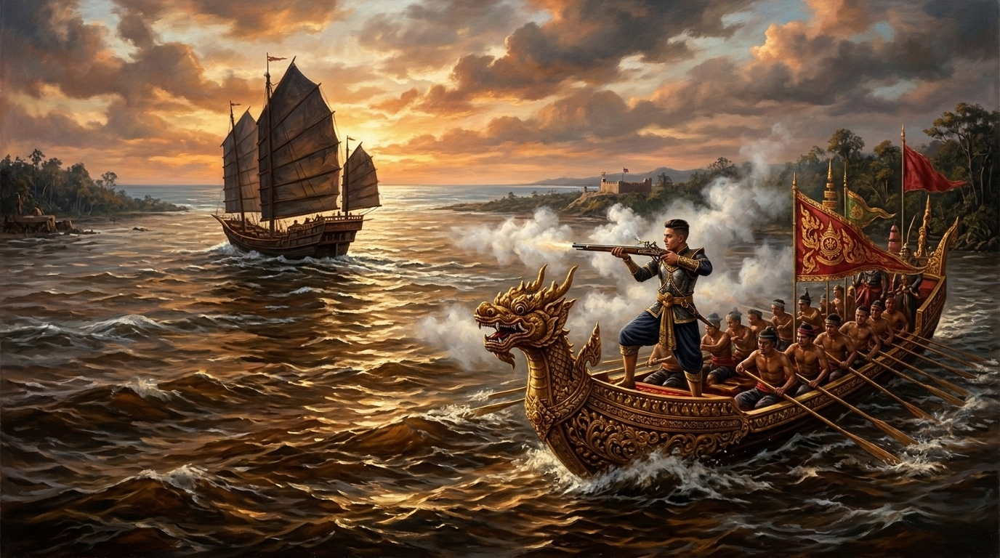

# ภาคที่ 1: องค์ประกันแดนหงสา (พ.ศ. 2098 – 2124)
## ตอนที่ 4: ศึกละแวกและพระยาจีนจันตุ ดาบแรกแห่งอโยธยา

---

### องก์ที่ 1: เสียงปืนกลางเจ้าพระยา

คลื่นแม่น้ำเจ้าพระยาแตกกระจายเป็นฟองขาวใต้ฝีพายของเรือกราบหลวงที่พุ่งทะยานลงสู่ปากอ่าว ท่ามกลางเสียงปืนไฟที่ยิงโต้ตอบกันสนั่นคุ้งน้ำ เบื้องหน้าคือเรือสำเภาขนาดใหญ่ที่กำลังกางใบเต็มกำลังเพื่อหลบหนีออกสู่ทะเลเปิด บนหัวเรือพระที่นั่งลำหน้า สมเด็จพระนเรศวรในวัย 23 พรรษาทรงประทับยืนบัญชาการด้วยพระองค์เอง พร้อมทรงพระแสงปืนเล็งยิงสกัดข้าศึกบนเรือสำเภาอย่างไม่ลดละ

ผู้ที่กำลังหลบหนีอยู่ในเรือสำเภาลำนั้นคือ **พระยาจีนจันตุ** ขุนนางชาวจีนจากราชสำนักกรุงละแวกผู้แปรพักตร์เข้ามาสวามิภักดิ์ต่อกรุงศรีอยุธยา ก่อนจะถูกจับพิรุธว่าลักลอบสืบความลับทางทหาร เหตุการณ์ไล่ล่ากลางลำน้ำเจ้าพระยาครั้งนี้มิได้เป็นเพียงการจับกุมสายลับ หากแต่เป็นการประกาศต่อทั้งราชสำนักอยุธยาและเพื่อนบ้านว่า บัดนี้กรุงศรีอยุธยามีแม่ทัพหนุ่มผู้พร้อมรุกโต้กลับทุกทิศทางแล้ว

---

### องก์ที่ 2: แนวรบด้านตะวันออกในวันที่หงสาไม่ช่วย

หลังเสียกรุงศรีอยุธยาครั้งที่ 1 ใน พ.ศ. 2112 กรุงศรีอยุธยาตกอยู่ในสภาพอ่อนแอและต้องส่งไพร่พลไปช่วยงานศึกของหงสาวดี อาณาจักร **กัมพูชา (กรุงละแวก)** ภายใต้การนำของ **นักพระสัตถา** (พระบรมราชาที่ 4) จึงฉวยโอกาสช่วงชิงความได้เปรียบทางยุทธศาสตร์ด้วยการส่งกองทัพมารุกรานหัวเมืองตะวันออกและกวาดต้อนผู้คนในเขตอยุธยาอย่างต่อเนื่องตั้งแต่ พ.ศ. 2113 เป็นต้นมา

เมื่อตรวจสอบหลักฐานทางประวัติศาสตร์จะเห็นการแบ่งน้ำหนักระหว่างเอกสารแต่ละฉบับอย่างชัดเจน:

- **บันทึกในฉบับหลวงประเสริฐอักษรนิติ์:** ระบุเหตุการณ์ จ.ศ. 940 (พ.ศ. 2121) ไว้แบบสั้นกระชับถึงการที่ **พระยาละแวก** ยกทัพมาตีเมืองเพชรบุรีแต่ไม่สามารถยึดเมืองได้จึงถอยกลับไป โดยมิได้เล่าเกร็ดเรื่องพระยาจีนจันตุหรือการซุ่มโจมตีที่ชัยบาดาลไว้อย่างละเอียด
- **รายละเอียดในฉบับพันจันทนุมาศ (เจิม) และฉบับพระราชหัตถเลขา:** พงศาวดารฉบับชำระชั้นหลังได้บันทึกเหตุการณ์ช่วง พ.ศ. 2121–2124 ไว้อย่างมีสีสัน ทั้งกรณีที่พระยาจีนจันตุอาสากษัตริย์กัมพูชามาตีเพชรบุรีไม่สำเร็จแล้วหนีมาสวามิภักดิ์ต่ออยุธยา ก่อนจะลักลอบหนีกลับละแวกจนเกิดศึกไล่ยิงกลางแม่น้ำเจ้าพระยา รวมถึงศึกใหญ่เมื่อกัมพูชาส่ง **พระทศราชา** ยกทัพเข้ามากวาดต้อนผู้คนทางหัวเมืองตะวันออกและดงพระยากลาง

---

### องก์ที่ 3: ยุทธวิธีซุ่มตีที่ชัยบาดาล และการสร้างกองกำลังอิสระ

นอกจากเหตุการณ์ไล่ล่าพระยาจีนจันตุกลางแม่น้ำเจ้าพระยา (ซึ่งพงศาวดารชั้นหลังเล่าว่าสมเด็จพระนเรศวรทรงยิงพระแสงปืนโต้ตอบจน **รางพระแสงปืนแตก** ก่อนเรือสำเภาจะอาศัยลมส่งออกปากอ่าวไปได้) บทเรียนสำคัญที่เกิดขึ้นในห้วงเวลาเดียวกันคือ **ยุทธการซุ่มตีทัพกัมพูชาที่เมืองชัยบาดาล**

ตามบันทึกใน *ฉบับพันจันทนุมาศ (เจิม)* และ *ฉบับพระราชหัตถเลขา* เมื่อพระทศราชาคุมทัพกัมพูชาบุกเข้ามาทางหัวเมืองชายแดนด้านตะวันออก สมเด็จพระนเรศวรทรงวางหมากให้ขุนนางผู้ภักดีจากหัวเมืองเหนือ ได้แก่ **พระชัยบุรี** (เจ้าเมืองชัยบาดาล) และ **พระศรีถมอรัตน์** (เจ้าเมืองศรีเทพ) นำกองกำลังขนาดเล็กไปซุ่มดักรอในชัยภูมิป่าเขาแถบเมืองชัยบาดาล–ดงพระยากลาง

กลยุทธ์ **"ใช้กำลังน้อยซุ่มโจมตีจุดคอขวด"** ประสบผลสำเร็จอย่างงดงาม กองทัพกัมพูชาแตกพ่ายยับเยินและต้องถอยร่นกลับไป ชัยชนะที่ชัยบาดาลและเพชรบุรีมิได้เพียงหยุดยั้งการรุกรานของกรุงละแวกเท่านั้น แต่ยังสร้างชื่อเสียงของสมเด็จพระนเรศวรในฐานะแม่ทัพผู้เก่งกล้าจนขุนนางอยุธยาเริ่มหันมาฝากความหวังไว้กับพระองค์

ทว่าสิ่งที่สำคัญยิ่งกว่าชัยชนะในสนามรบ คือเหตุผลทางการเมืองที่ซ่อนอยู่เบื้องหลัง: อยุธยาได้พิสูจน์แล้วว่า **หงสาวดีไม่อาจคุ้มครองอยุธยาจากภัยคุกคามทางตะวันออกได้** อยุธยาจึงมีข้ออ้างอันชอบธรรมในการสะสมอาวุธ ฝึกไพร่พล และสร้างกำแพงเมืองให้แข็งแกร่งขึ้นโดยที่หงสาวดีไม่อาจทักท้วงได้ถนัดนัก

---

### องก์ที่ 4: จุดเปลี่ยนในหงสาวดีที่กำลังมาถึง

เมื่อย่างเข้าสู่ พ.ศ. 2124 สมเด็จพระนเรศวรทรงมีพระชันษา 26 พรรษา พระองค์มิได้เป็นเจ้าชายองค์ประกันผู้ไร้อำนาจอีกต่อไป หากแต่ทรงกุมทั้งกำลังพลหัวเมืองเหนือจากพิษณุโลก เครือข่ายขุนศึกหนุ่มอย่างพระชัยบุรี–พระศรีถมอรัตน์ และเกียรติยศจากการปกป้องราชธานี

และในปี พ.ศ. 2124 นั่นเอง ข่าวใหญ่จากทิศตะวันตกก็เดินทางมาถึงกรุงศรีอยุธยา—**พระเจ้าบุเรงนองเสด็จสวรรคตแล้ว** จักรวรรดิหงสาวดีที่เคยแข็งแกร่งดุจภูผากำลังจะเข้าสู่ยุคผลัดแผ่นดินอันเปราะบาง และกระดานศึกแห่งอุษาคเนย์กำลังจะพลิกคว่ำลงในไม่ช้า

**จบตอนที่ 4 (จบภาคที่ 1: องค์ประกันแดนหงสา)**

*(ติดตามต่อใน ภาคที่ 2: อิสรภาพ ณ เมืองแครง — ตอนที่ 5: สิ้นบุเรงนอง แผ่นดินหงสาแตกร้าว)*
