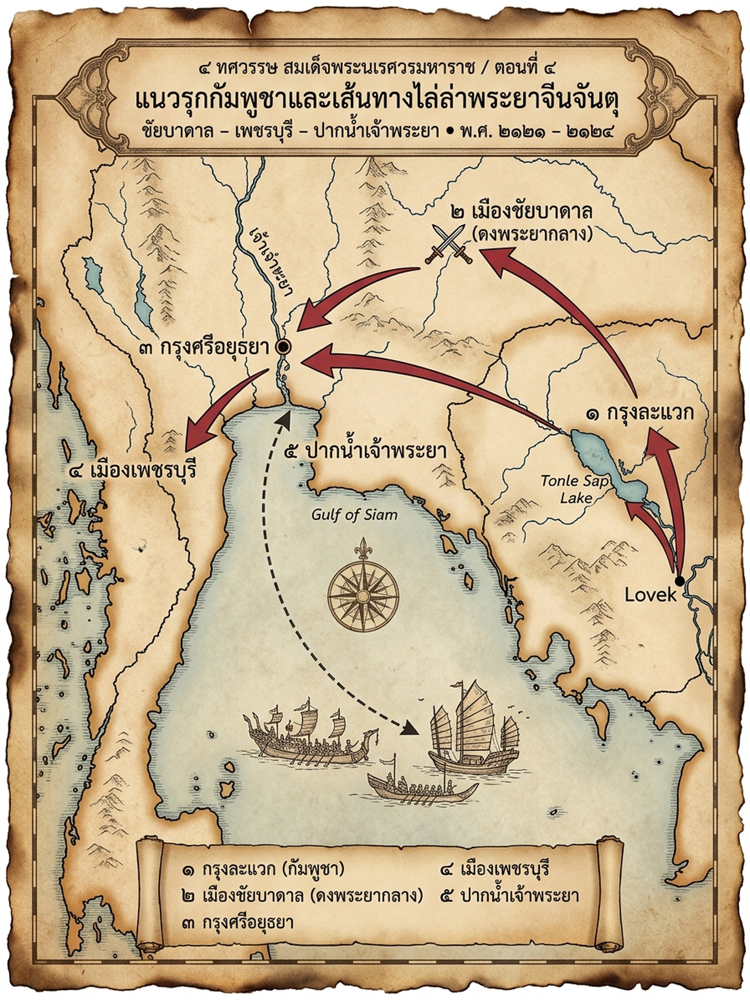

# ภาคที่ 1: องค์ประกันแดนหงสา (พ.ศ. 2098 – 2124)
## ตอนที่ 4: ศึกละแวกและพระยาจีนจันตุ ดาบแรกแห่งอโยธยา

---

### องก์ที่ 1: เสียงปืนกลางเจ้าพระยา

คลื่นแม่น้ำเจ้าพระยาแตกกระจายเป็นฟองขาวใต้ฝีพายของเรือกราบหลวงที่พุ่งทะยานลงสู่ปากอ่าว ท่ามกลางลมมรสุมที่พัดแรงจนสายน้ำขุ่นคลั่กเป็นสีโคลน เสียงกลองศึกบนเรือหลวงตีรัวเป็นจังหวะเร่งฝีพายประสานกับเสียงปืนไฟที่ดังกึกก้องสะท้อนคุ้งน้ำ กลุ่มควันดินปืนสีเทาลอยคละคลุ้งเหนือผิวน้ำที่กระเพื่อมแรง เบื้องหน้าห่างออกไปไม่กี่ช่วงลำเรือ คือเรือสำเภาขนาดใหญ่ที่กำลังกางใบผ้าดิบเต็มเสากระโดงเพื่ออาศัยแรงลมมุ่งหน้าออกสู่ทะเลเปิด

บนหัวเรือพระที่นั่งลำหน้า **สมเด็จพระนเรศวร** ในวัย 23 พรรษา ทรงประทับยืนบัญชาการอยู่ท่ามกลางห่ากระสุนของข้าศึกที่ระดมยิงลงมาจากกราบเรือสำเภาสูง เหล่าฝีพายและทหารรักษาพระองค์ต่างหมอบต่ำก้มหลบลูกกระสุนและลูกธนูที่พุ่งตกลงมารอบกราบเรือ ทว่าองค์แม่ทัพหนุ่มกลับทรงยกพระแสงปืนนกสับยาวขึ้นประทับบ่า ทรงเล็งยิงสกัดข้าศึกบนดาดฟ้าเรือสำเภาด้วยพระองค์เองอย่างไม่ลดละ ขณะที่เรือพระที่นั่งของ **สมเด็จพระเอกาทศรถ** พระราชอนุชา ทรงเร่งฝีพายตามติดมาเคียงข้างเพื่อโอบตีกระหนาบอีกฟากหนึ่งของลำน้ำ

ผู้ที่กำลังหลบหนีอยู่ในเรือสำเภาลำนั้นคือ **พระยาจีนจันตุ** ขุนนางชาวจีนจากราชสำนักกรุงละแวกผู้แปรพักตร์เข้ามาสวามิภักดิ์ต่อกรุงศรีอยุธยา ก่อนจะลักลอบสืบความลับทางทหารและชิงลงเรือหนีกลางดึก การไล่ล่ากลางลำน้ำเจ้าพระยาครั้งนี้มิได้เป็นเพียงการจับกุมสายลับ หากแต่เป็นการประกาศต่อทั้งราชสำนักอยุธยาและอาณาจักรเพื่อนบ้านว่า บัดนี้กรุงศรีอยุธยาที่เคยบอบช้ำจากสงครามเมื่อทศวรรษก่อน ได้มีแม่ทัพหนุ่มผู้พร้อมรุกโต้กลับทุกทิศทางแล้ว

---

### องก์ที่ 2: แนวรบด้านตะวันออกในวันที่หงสาวดีไม่ช่วย

หลังเสียกรุงศรีอยุธยาครั้งที่ 1 ใน พ.ศ. 2112 กรุงศรีอยุธยาตกอยู่ในสภาพอ่อนแอที่สุดในรอบสองร้อยปี กำแพงเมืองฝั่งตะวันออกถูกหงสาวดีรื้อถอน ไพร่พลถูกกวาดต้อนไปจนเหลือน้อย อาวุธปืนใหญ่และเรือรบถูกยึดริบไปเป็นจำนวนมาก และอยุธยายังต้องส่งกำลังพลไปช่วยงานศึกของหงสาวดีอย่างต่อเนื่อง อาณาจักร **กัมพูชา (กรุงละแวก)** จึงฉวยโอกาสช่วงชิงความได้เปรียบทางภูมิรัฐศาสตร์ โดยเริ่มตั้งแต่รัชกาล **สมเด็จพระบรมราชาที่ 3** (ใน พ.ศ. 2113) ต่อเนื่องมาจนถึงรัชกาล **นักพระสัตถา** (สมเด็จพระบรมราชาที่ 4) ซึ่งเสด็จขึ้นครองราชย์ราว พ.ศ. 2119 กัมพูชาได้ส่งกองทัพเรือและกองทัพบกเข้ามารุกรานหัวเมืองตะวันออกและชายฝั่งอ่าวไทยของอยุธยาอย่างต่อเนื่อง เพื่อกวาดต้อนผู้คนไปเสริมกำลังให้กรุงละแวก

ในสายตาของราชสำนักละแวก กรุงศรีอยุธยาในเวลานั้นไม่ต่างจากเหยื่อที่ไร้เขี้ยวเล็บ—และที่สำคัญ หงสาวดีซึ่งเป็นเจ้าประเทศราชของอยุธยาก็อยู่ไกลเกินกว่าจะยกทัพข้ามเทือกเขาตะนาวศรีมาคุ้มครองพรมแดนด้านตะวันออกให้ได้ทันท่วงที ฝ่ายกัมพูชาจึงส่งกองกำลังเข้ามาปล้นสะดมหัวเมืองชายฝั่งตั้งแต่จันทบูร ระยอง ชลบุรี เรื่อยไปจนถึงปากน้ำเจ้าพระยาและเพชรบุรี รวมถึงหัวเมืองด่านทางทิศตะวันออกเฉียงเหนืออย่างนครราชสีมาและสระบุรี

เมื่อเราสวมบทบาทนักสืบประวัติศาสตร์และเปิดเทียบหลักฐานแต่ละฉบับในเหตุการณ์ช่วง พ.ศ. 2121–2124 จะเห็นความแตกต่างของน้ำหนักการบันทึกอย่างชัดเจน:

- **บันทึกในฉบับหลวงประเสริฐอักษรนิติ์:** ระบุเหตุการณ์ **จ.ศ. 940 ปีขาล** (ตรงกับ พ.ศ. 2121) ไว้แบบสั้นกระชับถึงการที่ **พระยาละแวก** ยกทัพมาตีเมืองเพชรบุรีแต่ไม่สามารถยึดเมืองได้จึงต้องถอยทัพกลับไป โดย *ฉบับหลวงประเสริฐอักษรนิติ์* มิได้เล่าเกร็ดเรื่องพระยาจีนจันตุ หรือรายละเอียดการรบที่เมืองชัยบาดาลไว้แต่อย่างใด
- **รายละเอียดในฉบับพันจันทนุมาศ (เจิม) และฉบับพระราชหัตถเลขา:** พงศาวดารฉบับชำระชั้นหลังทั้งสองฉบับได้บันทึกเหตุการณ์ช่วงนี้ไว้อย่างมีสีสันและละเอียดลออ ทั้งกรณีพระยาจีนจันตุที่อาสากษัตริย์กัมพูชามาตีเมืองเพชรบุรีไม่สำเร็จจึงหนีมาสวามิภักดิ์ต่อสมเด็จพระมหาธรรมราชาธิราชที่อยุธยา ก่อนจะลักลอบหนีกลับกรุงละแวกจนเกิดการไล่ล่ากลางแม่น้ำเจ้าพระยา รวมถึงศึกใหญ่เมื่อกัมพูชาส่ง **พระทศราชา** ยกทัพเข้ามากวาดต้อนผู้คนทางหัวเมืองตะวันออกและดงพระยากลาง (ทั้งนี้ ศักราชในพงศาวดารฉบับความพิสดารมักคลาดเคลื่อนจากฉบับหลวงประเสริฐฯ ราว 1–3 ปี จึงต้องอ่านเทียบเคียงในกรอบเวลารวม พ.ศ. 2121–2124)
- **หลักฐานฝ่ายกัมพูชาและต่างชาติ:** *พงศาวดารเขมร* และ *พงศาวดารกรุงศรีอยุธยา ฉบับวันวลิต* สะท้อนภาพตรงกันว่าในทศวรรษนี้ กัมพูชาเป็นฝ่ายรุกทางตะวันออกอย่างหนักหน่วง จนทำให้อยุธยาต้องเผชิญศึกสองด้าน—ทั้งแรงกดดันจากหงสาวดีทางตะวันตก และการปล้นสะดมจากละแวกทางตะวันออก

---

### องก์ที่ 3: สองสมรภูมิชี้ขาด — เจ้าพระยา และ ชัยบาดาล

เหตุการณ์สำคัญที่พลิกขวัญกำลังใจของชาวกรุงศรีอยุธยาในห้วงเวลาดังกล่าวเกิดขึ้นใน 2 สมรภูมิต่อเนื่องกัน ตามคำบอกเล่าใน *พระราชพงศาวดาร ฉบับพันจันทนุมาศ (เจิม)* และ *ฉบับพระราชหัตถเลขา*:

#### ฉากที่ 1: ไล่ล่าพระยาจีนจันตุกลางลำน้ำเจ้าพระยา
เมื่อพระยาจีนจันตุอาสาพระยาละแวกมาตีเมืองเพชรบุรีไม่สำเร็จ เกรงจะถูกลงโทษจึงพาพรรคพวกหนีเข้ามาขอพึ่งพระบรมโพธิสมภารสมเด็จพระมหาธรรมราชาธิราช ณ กรุงศรีอยุธยา ราชสำนักอยุธยารับไว้ด้วยความปรานีเพราะต้องการข่าวสารภายในกรุงละแวก ทว่าในสายตาของสมเด็จพระนเรศวรซึ่งเสด็จลงมาจากพิษณุโลก การเข้ามาของขุนนางจีนผู้นี้เต็มไปด้วยพิรุธ และในที่สุดพระยาจีนจันตุก็แอบขนทรัพย์สินและพรรคพวกลงเรือสำเภาขนาดใหญ่ล่องหนีลงใต้ในยามวิกาล

ทันทีที่ทรงทราบข่าว สมเด็จพระนเรศวรทรงมิได้รอช้า ทรงนำเรือกราบหลวงพร้อมเรือพระที่นั่งของสมเด็จพระเอกาทศรถไล่ติดตามลงไปตามลำน้ำเจ้าพระยาทันที เรือกราบซึ่งเพรียวและคล่องตัวกว่าฝ่ากระแสน้ำลงมาทันเรือสำเภาใหญ่ในเขตลุ่มน้ำตอนล่าง ฝ่ายพระยาจีนจันตุอาศัยความได้เปรียบที่กราบเรือสำเภาสูงกว่ามาก ระดมยิงปืนไฟและหน้าไม้ลงมาสกัดอย่างหนาแน่น ทหารเรือหลวงและฝีพายหลายคนถูกยิงล้มลงจนเรือรบไทยไม่อาจเข้าเทียบประชิดได้ง่าย

ทว่าสมเด็จพระนเรศวร **มิได้ทรงเกรงกลัว** ทรงสั่งให้เรือพระที่นั่งพุ่งเข้าไปชิดกราบเรือสำเภา แล้วทรงใช้พระแสงปืนยาวระดมยิงโต้ตอบขึ้นไปบนดาดฟ้าเรือข้าศึกด้วยพระองค์เอง พงศาวดารฉบับชำระชั้นหลังเล่าว่าพระองค์ทรงยิงพระแสงปืนต่อเนื่องอย่างดุเดือดจน **รางพระแสงปืนแตก** ขณะที่ **สมเด็จพระเอกาทศรถ** ทรงเกรงว่าพระเชษฐาจะเป็นอันตรายจึงทรงเร่งเรือพระที่นั่งเข้ามาบังเบื้องหน้าไว้ ทว่าด้วยลมทะเลที่พัดส่งท้ายและขนาดเรือสำเภาที่ฝ่าคลื่นใหญ่ได้ดีกว่า เรือของพระยาจีนจันตุจึงแล่นฝ่าปากน้ำออกสู่ทะเลอ่าวไทยไปได้ในที่สุด แม้จะจับตัวพระยาจีนจันตุไม่ได้ แต่ภาพของพระมหาอุปราชหนุ่มที่นำเรือไล่ล่าข้าศึกกลางห่ากระสุนด้วยพระองค์เอง ได้กลายเป็นเรื่องเล่าขานไปทั่วพระนคร

#### ฉากที่ 2: กลยุทธ์ซุ่มตีทัพพระทศราชาที่เมืองชัยบาดาล
ไม่นานหลังจากนั้น ราชสำนักกรุงละแวกส่งกองทัพใหญ่ภายใต้การนำของ **พระทศราชา** บุกเข้ามากวาดต้อนราษฎรทางหัวเมืองชายแดนด้านตะวันออกแถบเมืองนครราชสีมา สระบุรี และลุ่มน้ำป่าสัก–ดงพระยากลาง ในเวลานั้น *ฉบับพันจันทนุมาศ (เจิม)* และ *ฉบับพระราชหัตถเลขา* บันทึกว่า **พระชัยบุรี** และ **พระศรีถมอรัตน์** (ซึ่งต่อมาได้รับแต่งตั้งเป็นเจ้าเมืองชัยบาดาลและเจ้าเมืองศรีเทพ) เป็นผู้นำกองกำลังทหารม้าและทหารราบจำนวนน้อยกว่าฝ่ายข้าศึกหลายเท่ายกออกไปสกัดกั้น (ทั้งนี้ พงศาวดารมิได้ระบุรายละเอียดชัดเจนว่าทั้งสองท่านเป็นขุนศึกที่สมเด็จพระนเรศวรทรงปลุกปั้นมาโดยตรงหรือไม่ หากแต่ในงานศึกษาประวัติศาสตร์ยุคหลังมักสันนิษฐานว่าขุนศึกทั้งสองอาจอยู่ในสายกำลังหัวเมืองเหนือและร่วมงานกับพระองค์อย่างใกล้ชิดในเวลาต่อมา)

แทนที่จะนำกำลังที่น้อยกว่าไปตั้งรับในทุ่งโล่ง พระชัยบุรีและพระศรีถมอรัตน์เลือกใช้ภูมิประเทศป่าเขาและทางเดินทัพอันคับแคบแถบ **เมืองชัยบาดาล** (บริเวณชายขอบดงพระยากลาง) เป็นจุดซุ่มโจมตี เมื่อทัพหน้าของพระทศราชาเคลื่อนเข้ามาในแนวซุ่มซึ่งขบวนทัพต้องยืดยาวไปตามช่องเขาและป่าทึบ กองกำลังไทยก็จู่โจมเข้าตีขนาบจากสองข้างทางอย่างเฉียบพลัน จนทัพเขมรไม่ทันตั้งตัว แตกพ่ายระส่ำระสายและต้องถอยร่นกลับไปโดยไม่อาจกวาดต้อนผู้คนไปได้

ชัยชนะที่ชัยบาดาลและเพชรบุรีมิได้เพียงหยุดยั้งการรุกรานของกรุงละแวกเท่านั้น แต่ยังพิสูจน์ให้เห็นศักยภาพของแม่ทัพนายกองรุ่นใหม่ของอยุธยาและหัวเมืองเหนือ—กองกำลังที่คล่องตัว รู้จักใช้ชัยภูมิ และกล้าเข้าตีข้าศึกที่มีกำลังพลเหนือกว่าโดยไม่ลังเล

---

### องก์ที่ 4: ข้ออ้างอันชอบธรรมในการสร้างป้อมปราการ และข่าวใหญ่จากหงสาวดี

ผลลัพธ์ทางการเมืองที่สำคัญที่สุดจากศึกกัมพูชาและกรณีพระยาจีนจันตุ มิได้อยู่ที่จำนวนเชลยหรือชัยชนะเฉพาะหน้า หากแต่อยู่ที่ **"ข้ออ้างอันชอบธรรมในการฟื้นฟูกำลังทหารของกรุงศรีอยุธยา"**

ตลอดทศวรรษหลังเสียกรุง พ.ศ. 2112 กรุงศรีอยุธยาไม่อาจซ่อมแซมกำแพงเมืองหรือสะสมอาวุธได้อย่างเปิดเผย เพราะเกรงกรุงหงสาวดีจะระแวงว่าคิดกบฏ ข้าหลวงและผู้ตรวจการณ์ของหงสาวดียังคงจับตาดูความเคลื่อนไหวในพระนครอย่างใกล้ชิด ทว่าเมื่อกัมพูชาส่งทัพมารุกรานอย่างต่อเนื่องถึงเมืองเพชรบุรี ปากน้ำเจ้าพระยา และดงพระยากลาง โดยที่หงสาวดีเองก็ไม่ได้ส่งทัพลงมาช่วยป้องกัน ราชสำนักอยุธยาจึงสามารถอ้างเหตุภัยคุกคามจากกรุงละแวกในการ **ซ่อมแซมกำแพงพระนคร ขุดลอกคูเมือง ระดมฝึกไพร่พล และจัดหาอาวุธปืนไฟจากพ่อค้าต่างชาติ** ได้อย่างเปิดเผยโดยที่หงสาวดีไม่อาจทักท้วงได้ถนัดนัก

ความจำเป็นทางยุทธศาสตร์ครั้งนี้ได้เปลี่ยนกรุงศรีอยุธยาจากเมืองร้างที่พังทลายให้กลับมามีเขี้ยวเล็บพร้อมรับศึกใหญ่อีกครั้ง โดยเฉพาะใน พ.ศ. 2123 ที่กำแพงกรุงศรีอยุธยาด้านตะวันออกและป้อมปราการสำคัญได้รับการบูรณะให้มั่นคงขึ้นอย่างเห็นได้ชัด

เมื่อย่างเข้าสู่ พ.ศ. 2124 สมเด็จพระนเรศวรทรงมีพระชันษา 26 พรรษา พระองค์ทรงมิใช่เจ้าชายองค์ประกันในวันวานอีกต่อไป ทรงกุมทั้งกำลังพลหัวเมืองเหนือจากพิษณุโลก เครือข่ายขุนนางฝ่ายทหารที่ร่วมศึกมาด้วยกันอย่างพระชัยบุรีและพระศรีถมอรัตน์ พันธมิตรในราชสำนักอยุธยา และเกียรติยศในฐานะผู้นำทางทหารที่ประชาชนและขุนนางเริ่มฝากความหวังไว้สูงสุด

และในปี พ.ศ. 2124 นั่นเอง ข่าวใหญ่ที่สั่นสะเทือนทั้งอุษาคเนย์ก็เดินทางมาถึงกรุงศรีอยุธยา—**พระเจ้าบุเรงนอง ผู้ชนะสิบทิศ เสด็จสวรรคตแล้ว** จักรวรรดิหงสาวดีที่เคยแข็งแกร่งดุจภูผากำลังจะเข้าสู่ยุคผลัดแผ่นดินอันเปราะบางภายใต้ **พระเจ้านันทบุเรง** ราชโอรสที่ทรงขึ้นครองราชย์ท่ามกลางความหวาดระแวงของเจ้าประเทศราชรอบทิศ และเวลาที่สมเด็จพระนเรศวรทรงรอคอยมานานนับสิบปีกำลังจะเริ่มต้นขึ้นในไม่ช้า

**จบตอนที่ 4 (จบภาคที่ 1: องค์ประกันแดนหงสา)**

*(ติดตามต่อใน ภาคที่ 2: อิสรภาพ ณ เมืองแครง — ตอนที่ 5: สิ้นบุเรงนอง แผ่นดินหงสาแตกร้าว)*
