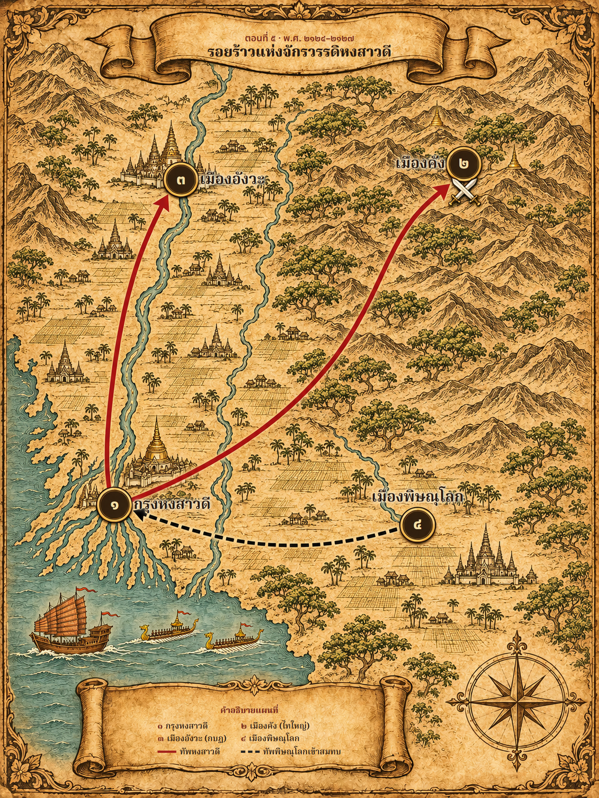

# ภาคที่ 2: อิสรภาพ ณ เมืองแครง (พ.ศ. 2124 – 2133)
## ตอนที่ 5: สิ้นบุเรงนอง แผ่นดินหงสาแตกร้าว

---

### องก์ที่ 1: เสาหลักแห่งหงสาวดีล้มลง

เดือนตุลาคม พ.ศ. 2124 — ข่าวการเสด็จสวรรคตของ **พระเจ้าบุเรงนอง** แห่งกรุงหงสาวดีแพร่สะพัดจากลุ่มน้ำอิรวดีข้ามเทือกเขาตะนาวศรีมาถึงกรุงศรีอยุธยาและเมืองพิษณุโลกดุจเสียงฟ้าผ่ากลางฤดูแล้ง

ตามหลักฐานฝ่ายพม่า พระเจ้าบุเรงนองเสด็จสวรรคตในเดือนตุลาคม ค.ศ. 1581 (พ.ศ. 2124) ขณะทรงมีพระชนมพรรษา 65 พรรษา ท่ามกลางการเตรียมกรีฑาทัพใหญ่ไปตีเมืองยะไข่ การจากไปของจักรพรรดิผู้ทรงได้รับสมัญญานามว่า "ผู้ชนะสิบทิศ" มิใช่เพียงการสิ้นสุดรัชกาลหนึ่ง หากคือการพังทลายของแกนกลางที่ยึดโยงแผ่นดินมอญ พม่า รัฐฉาน ล้านนา ล้านช้าง และลุ่มน้ำเจ้าพระยาเข้าไว้ด้วยกันตลอดสามทศวรรษ

ตลอดรัชกาลอันยาวนาน จักรวรรดิตองอูมิได้ตั้งอยู่ได้ด้วยระบบราชการรวมศูนย์ที่มั่นคง หากแต่อยู่ด้วยพระเดชานุภาพและสายสัมพันธ์ส่วนตัวของพระเจ้าบุเรงนองกับบรรดาเจ้าประเทศราช เมื่อพระองค์สิ้นพระชนม์ ราชบัลลังก์กรุงหงสาวดีจึงตกแก่ **พระเจ้านันทบุเรง** (มังชัยสิงห์) พระราชโอรสซึ่งทรงดำรงตำแหน่งพระมหาอุปราชามาก่อน ทว่าบารมีและกุศโลบายในการครองใจเจ้าประเทศราชของพระเจ้านันทบุเรงกลับไม่อาจเทียบเคียงพระราชบิดาได้

ทันทีที่ข่าวผลัดแผ่นดินมาถึง **สมเด็จพระมหาธรรมราชาธิราช** แห่งกรุงศรีอยุธยาทรงมีพระบรมราชโองการให้ **สมเด็จพระนเรศวร** ในพระชันษา 26 พรรษา ซึ่งทรงครองเมืองพิษณุโลกในฐานะพระมหาอุปราช เสด็จเป็นตัวแทนราชสำนักอยุธยาเดินทางข้ามด่านตะวันตกไปร่วมพระราชพิธีถวายพระเพลิงพระบรมศพและถวายบังคมพระเจ้าแผ่นดินหงสาวดีองค์ใหม่

สำหรับสมเด็จพระนเรศวร การเสด็จกรุงหงสาวดีในปลาย พ.ศ. 2124 ต่อเนื่องถึง พ.ศ. 2125 นี้ มิใช่เพียงภารกิจตามราชประเพณีเมืองขึ้น หากเป็นโอกาสทองในการเสด็จกลับไปทอดพระเนตรพระราชวังกัมโพชธานีที่เคยทรงประทับในวัยเยาว์ เพื่อทรงหยั่งเชิงเอกภาพภายในของราชวงศ์ตองอูด้วยพระเนตรตนเองว่า เหล่าพระเจ้าอาและเจ้าเมืองใหญ่ทั้งตองอู แปร อังวะ และเชียงใหม่ ยังคงจงรักภักดีต่อพระเจ้านันทบุเรงจริงหรือไม่

และสิ่งที่พระองค์ทรงพบเมื่อเสด็จถึงกรุงหงสาวดี ก็คือรอยร้าวที่เริ่มปริแยกตั้งแต่ยังไม่ทันดับไฟพระบรมศพ

---

### องก์ที่ 2: รอยร้าวในจักรวรรดิและปริศนาศึกเมืองคัง

เมื่อเราสวมบทบาทนักสืบประวัติศาสตร์และกางหลักฐานหลายแผ่นดินเทียบเคียงกันในช่วงผลัดแผ่นดินหงสาวดี พ.ศ. 2124–2127 จะเห็นลำดับเหตุการณ์และน้ำหนักของการบันทึกที่แตกต่างกันอย่างน่าสนใจ:

- **บันทึกในฉบับหลวงประเสริฐอักษรนิติ์:** พงศาวดารฉบับที่แม่นยำด้านศักราชมากที่สุดของฝ่ายไทยบันทึกเหตุการณ์ใน **จ.ศ. 943 ปีมะเส็ง** (พ.ศ. 2124) โดยมุ่งเน้นเหตุการณ์ภายในลุ่มน้ำเจ้าพระยา ได้แก่ กบฏ **ญาณประเชียร** ที่ยกพวกมาจากเมืองลพบุรีแล้วถูกยิงเสียชีวิตบนคอช้าง การกำหนดเดือนอธิกมาส (เดือนแปดสองหน) และการที่พระยาละแวกยกทัพมาตีเมืองเพชรบุรีเป็นครั้งที่สอง (ต่อเนื่องจากครั้งแรกเมื่อ **จ.ศ. 940 ปีขาล / พ.ศ. 2121** ที่พระยาละแวกยกมาตีเมืองเพชรบุรีแต่ตีไม่สำเร็จดังที่กล่าวไว้ในตอนที่ 4) จากนั้นจึงบันทึกเหตุการณ์สำคัญของจักรวรรดิหงสาวดีใน **จ.ศ. 946** ว่าพระเจ้าหงสาวดีกับพระเจ้าอังวะผิดใจและทำสงครามกัน ทั้งนี้ *ฉบับหลวงประเสริฐอักษรนิติ์* มิได้ลงรายละเอียดเกร็ดเรื่องสมเด็จพระนเรศวรเสด็จไปช่วยถวายพระเพลิงพระเจ้าบุเรงนอง หรือการทำศึกที่เมืองรุมเมืองคังไว้แต่อย่างใด
- **รายละเอียดในฉบับพันจันทนุมาศ (เจิม), ฉบับพระราชหัตถเลขา, และไทยรบพม่า:** พงศาวดารฉบับชำระชั้นหลังและพระนิพนธ์ *ไทยรบพม่า* ของสมเด็จฯ กรมพระยาดำรงราชานุภาพ ได้เล่าเชื่อมโยงช่วงเวลา พ.ศ. 2124–2125 ไว้อย่างละเอียดว่า เมื่อสมเด็จพระนเรศวรเสด็จไปกรุงหงสาวดีนั้น เกิดเหตุเจ้าฟ้า **เมืองรุม** และ **เมืองคัง** (เมืองไทใหญ่ทางตอนเหนือของรัฐฉาน) แข็งเมืองไม่ยอมส่งบรรณาการมายังพระเจ้านันทบุเรง พระเจ้านันทบุเรงจึงทรงส่งกองทัพ 3 สาย—คือทัพ **พระมหาอุปราชา (มังกยอชวา)**, ทัพ **พระสังขทัต** (โอรสพระเจ้าตองอู), และทัพ **สมเด็จพระนเรศวร**—ผลัดกันขึ้นไปตีเมืองคัง จนกลายเป็นการประลองฝีมือที่เผยให้เห็นพระปรีชาสามารถของสมเด็จพระนเรศวรอย่างโดดเด่นเหนือเจ้านายตองอูทุกพระองค์
- **หลักฐานฝ่ายพม่าและบันทึกพ่อค้ายุโรป:** *มหาราชวงษ์ พงษาวดารพม่า* (*Hmannan Yazawin*) ยืนยันชัดเจนว่าหลังพระเจ้าบุเรงนองเสด็จสวรรคตในเดือนตุลาคม ค.ศ. 1581 (พ.ศ. 2124) พระเจ้านันทบุเรงต้องเผชิญแรงสั่นสะเทือนจากการแข็งข้อของเมืองประเทศราชและพระญาติวงศ์อาวุโส โดยเฉพาะ **พระเจ้าอังวะ (ตะโดเมงสอ)** ส่วนบันทึกของ **กัสปาโร บัลบี (Gasparo Balbi)** พ่อค้าอัญมณีชาวเวนิสที่เดินทางเข้ามาถึงกรุงหงสาวดีใน พ.ศ. 2126 (ค.ศ. 1583) ได้เล่าถึงความมั่งคั่งอลังการของพระราชวังและกองทัพช้างของหงสาวดี ควบคู่ไปกับความตึงเครียดของสงครามใหญ่ระหว่างพระเจ้านันทบุเรงกับพระเจ้าอังวะ เช่นเดียวกับบันทึกของ **ราล์ฟ ฟิตช์ (Ralph Fitch)** พ่อค้าชาวอังกฤษที่เดินทางเข้ามาในอีกไม่กี่ปีถัดมา ซึ่งสะท้อนให้เห็นบรรยากาศของจักรวรรดิอันกว้างใหญ่ที่กำลังแบกรับศึกภายในและภายนอกอย่างหนักหน่วง

---

### องก์ที่ 3: บททดสอบที่เมืองคัง และชนวนกบฏอังวะ

#### ศึกเมืองรุมเมืองคัง: กลยุทธ์ล่อเสือในยามวิกาล

ตามความใน *พระราชพงศาวดาร ฉบับพันจันทนุมาศ (เจิม)*, *ฉบับพระราชหัตถเลขา*, และ *ไทยรบพม่า* ชัยภูมิของ **เมืองคัง** นั้นตั้งอยู่บนยอดเขาสูงชัน มีเทือกเขาสลับซับซ้อนและทางขึ้นลงเพียงด้านเดียวที่แคบและลาดชัน เมื่อเจ้าฟ้าเมืองคังแข็งข้อไม่ยอมลงมาถวายบังคมพระเจ้านันทบุเรง พระองค์จึงทรงมีรับสั่งให้เจ้านายหนุ่ม 3 พระองค์ คือ **พระมหาอุปราชา (มังกยอชวา)** พระราชโอรสผู้เป็นรัชทายาท **พระสังขทัต** พระนัดดาจากตองอู และ **สมเด็จพระนเรศวร** ยกกองทัพไปปราบเมืองคัง โดยตกลงนัดหมายให้ผลัดกันเข้าตีเมืองคังวันละทัพเพื่อวัดฝีมือกันอย่างเปิดเผย

1. **วันแรก — ทัพพระมหาอุปราชา (มังกยอชวา):** ทัพหลวงของรัชทายาทหงสาวดียกกำลังพลจำนวนมากเดินแถวขึ้นตามช่องทางเดินเขาในเวลากลางวัน ทว่าชาวเมืองคังบนยอดเขาได้เตรียมก้อนหิน ท่อนซุง และอาวุธซัดไว้เต็มหน้าผา เมื่อทัพพม่าไต่ขึ้นมาถึงกลางทางก็กลิ้งหินและระดมยิงลงมาอย่างหนาแน่น ทัพพระมหาอุปราชาไม่อาจตั้งขบวนหรือหลบหลีกบนทางแคบได้ จึงต้องแตกพ่ายถอยกลับลงมาด้วยความสูญเสียหนัก
2. **วันที่สอง — ทัพพระสังขทัต:** โอรสพระเจ้าตองอูนำทัพเข้าตีในเส้นทางเดิมและเวลาเดิม แต่ก็ประสบชะตากรรมไม่ต่างจากทัพแรก ฝ่ายเมืองคังอาศัยความได้เปรียบจากที่สูงต้านทานไว้ได้ตลอดทั้งวัน จนทัพพระสังขทัตจำต้องถอยทัพลงมาเมื่อพลบค่ำ
3. **วันที่สาม — ทัพสมเด็จพระนเรศวร:** เมื่อถึงคราวทัพพิษณุโลก พระองค์ทรงมิได้รีบส่งไพร่พลขึ้นไปสังเวยชีวิตบนช่องเขาในเวลากลางวัน ทรงนำทหารออกลาดตระเวนสำรวจภูมิประเทศรอบภูเขาอย่างถี่ถ้วนจนพบช่องทางเล็กๆ ทางด้านหลังเมืองคังซึ่งสูงชันจนข้าศึกคาดไม่ถึงว่าจะไต่ขึ้นมาได้

ในคืนก่อนวันเข้าตี พระองค์ทรงแบ่งกำลังออกเป็นสองกอง กองหนึ่งให้แสร้งยกขึ้นไปตีล่อความสนใจทางหน้าด่านหลักในยามดึกเพื่อตรึงกำลังชาวเมืองคังไว้ด้านหน้า ส่วนพระองค์ทรงนำกำลังหลักลอบปีนป่ายทางลาดชันด้านหลังท่ามกลางความมืดและสายหมอก ครั้นถึงยามรุ่งสางของวันเข้าตีตามกำหนด กองทัพพิษณุโลกก็บุกจู่โจมเข้าประชิดเชิงเทินด้านหลังพร้อมโห่ร้องกึกก้อง ชาวเมืองคังที่พะวงอยู่กับแนวรบด้านหน้าต่างตกตะลึงแตกตื่นไม่ทันตั้งตัว ทัพสมเด็จพระนเรศวรจึงตีหักเข้ายึดเมืองคังได้สำเร็จในวันเดียว และจับตัวเจ้าเมืองคังลงมาถวายพระเจ้านันทบุเรงได้ตามกำหนด

แม้เกร็ดการประลอง 3 ทัพนี้จะเป็นเรื่องเล่าจากพงศาวดารฉบับชำระชั้นหลัง แต่มันอธิบายแรงขับเคลื่อนทางการเมืองในราชสำนักหงสาวดีได้อย่างชัดเจน—นับแต่วันนั้น **พระมหาอุปราชา (มังกยอชวา)** ยิ่งทรงขุ่นเคืองและริษยาสมเด็จพระนเรศวร ขณะที่ **พระเจ้านันทบุเรง** ทรงเริ่มมองว่าเจ้านายหนุ่มจากพิษณุโลกพระองค์นี้เฉลียวฉลาดและอันตรายเกินกว่าจะปล่อยให้มีอำนาจทางทหารเติบโตต่อไป

#### กบฏพระเจ้าอังวะ: รอยร้าวสายเลือดกลางราชวงศ์ตองอู

หลังสมเด็จพระนเรศวรเสด็จนิวัตพิษณุโลกได้ไม่นาน วิกฤตการณ์ที่สั่นคลอนบัลลังก์หงสาวดีหนักที่สุดก็ปะทุขึ้นจากทางเหนือในปี พ.ศ. 2126–2127 ผู้ที่ลุกขึ้นท้าทายอำนาจของพระเจ้านันทบุเรงมิใช่เจ้านายต่างชาติพันธุ์ หากคือ **พระเจ้าอังวะ (ตะโดเมงสอ)** ซึ่งมีสายสัมพันธ์ทางเครือญาติซ้อนกันหลายชั้นในราชวงศ์ตองอู

ตามพงศาวดารพม่า **ตะโดเมงสอ** ทรงเป็น **พระอนุชาต่างพระมารดาของพระเจ้าบุเรงนอง** จึงทรงมีศักดิ์เป็น **พระเจ้าอาของพระเจ้านันทบุเรง** และยังทรงอภิเษกสมรสกับพระราชธิดาของพระเจ้าบุเรงนอง (พระภคินีต่างพระมารดาของพระเจ้านันทบุเรง) อีกด้วย ยิ่งไปกว่านั้น ตะโดเมงสอยังทรงมีศักดิ์เป็น **พ่อตา (พระสัสสุระ) ของพระมหาอุปราชา (มังกยอชวา)** (มิใช่พ่อตาของพระเจ้านันทบุเรง) เพราะพระราชธิดาของพระเจ้าอังวะได้อภิเษกสมรสเป็นพระชายาของมังกยอชวา

ชนวนความแตกหักปะทุขึ้นจากความขัดแย้งทั้งในครอบครัวและการเมืองระดับจักรวรรดิ เมื่อพระราชธิดาของพระเจ้าอังวะซึ่งเป็นพระชายาของมังกยอชวาถูกกระทำการรุนแรงจนต้องลอบส่งข่าวไปฟ้องพระราชบิดาที่เมืองอังวะ ประกอบกับพระเจ้าอังวะตะโดเมงสอทรงถือพระองค์ว่าเป็นพระเจ้าอาผู้มีอาวุโสและมีบทบาทสำคัญในการสร้างจักรวรรดิมาตั้งแต่รัชกาลพระเจ้าบุเรงนอง จึงทรงไม่ยอมก้มศีรษะให้พระเจ้านันทบุเรงผู้เป็นพระราชนัดดา พระเจ้าอังวะทรงตัดสัมพันธ์กับหงสาวดี จับกุมขุนนางฝ่ายหงสาวดี และทรงมีพระราชสาส์นชักชวนพระเจ้าตองอู พระเจ้าแปร และพระเจ้าเชียงใหม่ให้ร่วมมือกันแข็งเมือง

สำหรับพระเจ้านันทบุเรง การกบฏของพระเจ้าอังวะคือภัยคุกคามต่อราชบัลลังก์โดยตรง พระองค์จึงทรงมีพระราชโองการเกณฑ์ทัพประเทศราชทุกทิศานุทิศ รวมทั้งสั่งให้ **กรุงศรีอยุธยาและเมืองพิษณุโลก** ส่งกองทัพยกขึ้นไปสมทบที่กรุงหงสาวดีในต้น พ.ศ. 2127 เพื่อร่วมทัพใหญ่ขึ้นไปปราบเมืองอังวะ

---

### องก์ที่ 4: คำสั่งเกณฑ์ทัพที่มีกับดักซ่อนอยู่

ข่าวการเกณฑ์ทัพเพื่อไปปราบอังวะที่ส่งมาถึงเมืองพิษณุโลกในต้น พ.ศ. 2127 ทำให้กระดานการเมืองของสยามเข้าสู่จุดหัวเลี้ยวหัวต่อที่อันตรายที่สุดนับตั้งแต่เสียกรุงศรีอยุธยาเมื่อ 15 ปีก่อน

ตลอดช่วง พ.ศ. 2121–2126 ที่ผ่านมา หงสาวดีไม่อาจเพ่งเล็งอยุธยาได้อย่างเต็มที่ แต่กรุงศรีอยุธยากับพิษณุโลกได้ใช้ข้ออ้างเรื่องศึกกัมพูชาและพระยาจีนจันตุในการซ่อมแซมกำแพงพระนคร ฝึกไพร่พล และสะสมอาวุธปืนไฟจนเริ่มกลับมามีเขี้ยวเล็บ ทว่ากำลังรบของสยามในเวลานั้นยังไม่พร้อมที่จะเปิดศึกแตกหักกับหงสาวดีกลางทุ่งโล่งหากหงสาวดียังมีกำลังพันธมิตรครบมือ

ดังนั้น คำสั่งเกณฑ์ทัพของพระเจ้านันทบุเรงจึงเป็นกับดักสองคม หากสมเด็จพระนเรศวรทรงปฏิเสธไม่เสด็จไปช่วยราชการศึก หงสาวดีย่อมถือเป็นข้ออ้างชอบธรรมในการระดมทัพทุกหัวเมืองลงมาขยี้พิษณุโลกและกรุงศรีอยุธยาในทันที แต่หากเสด็จยกทัพเข้าไปในเขตรอบกรุงหงสาวดีตามคำสั่ง พระองค์และไพร่พลหัวเมืองเหนือก็ต้องเดินเข้าไปอยู่ในวงล้อมของกองทัพพม่าที่กำลังหวาดระแวงพระองค์อยู่อย่างเต็มอก

สมเด็จพระนเรศวรจึงทรงเลือกเดินหมากที่ซับซ้อนกว่านั้น—พระองค์ทรงรับคำสั่งเกณฑ์ทัพและทรงเตรียมระดมพลเมืองพิษณุโลกออกเดินทางมุ่งหน้าสู่กรุงหงสาวดีตามกำหนดการเดิม ทว่าทรงจงใจจัดเตรียมไพร่พลและเคลื่อนทัพอย่างระมัดระวัง เพื่อเฝ้าสังเกตข่าวคราวความเคลื่อนไหวของศึกอังวะที่อยู่เบื้องหน้า

โดยไม่มีใครในราชสำนักหงสาวดีคาดคิดเลยว่า ในขณะที่พระเจ้านันทบุเรงทรงนำทัพหลวงมุ่งหน้าขึ้นเหนือสู่ลุ่มน้ำอิรวดีเพื่อปราบพระเจ้าอังวะ จอมทัพหนุ่มแห่งพิษณุโลกที่กำลังเดินทัพข้ามเทือกเขาตะนาวศรีเข้าไปถึง **เมืองแครง** กำลังจะทรงฉีกพันธนาการ 15 ปีทิ้งไปตลอดกาล

**จบตอนที่ 5**

*(ติดตามต่อใน ตอนที่ 6: ทักษิโณทกที่เมืองแครง และพระแสงปืนข้ามแม่น้ำสะโตง)*
