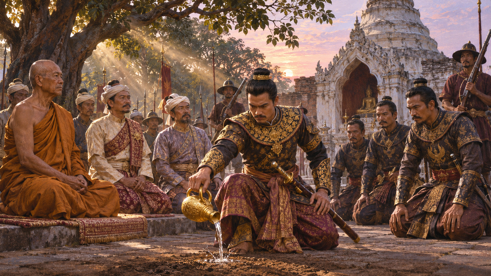
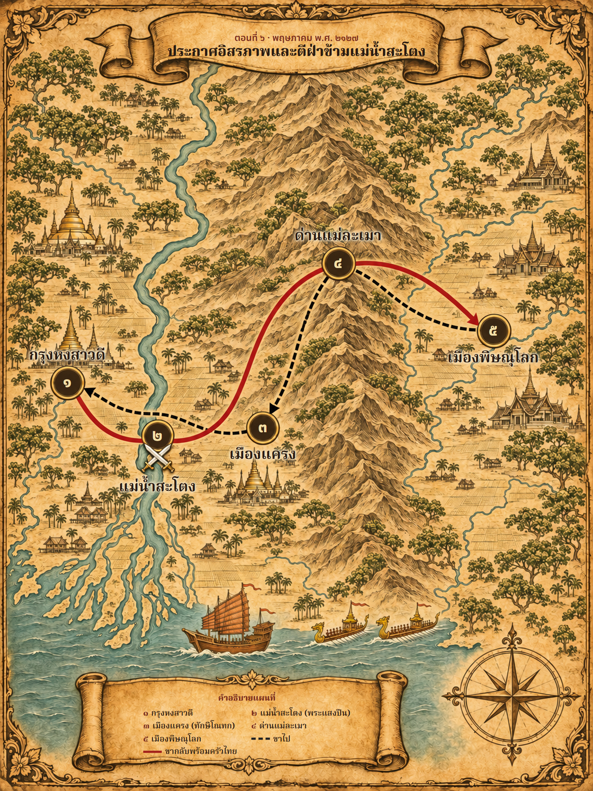

# ภาคที่ 2: อิสรภาพ ณ เมืองแครง (พ.ศ. 2124 – 2133)
## ตอนที่ 6: ทักษิโณทกที่เมืองแครง และพระแสงปืนข้ามแม่น้ำสะโตง

---

### องก์ที่ 1: ลางบอกเหตุระหว่างทางสู่เมืองแครง

ต้น พ.ศ. 2127 — กองทัพหัวเมืองเหนือจำนวนนับหมื่นนายเคลื่อนออกจากเมืองพิษณุโลกมุ่งหน้าสู่ทิศตะวันตกตามคำสั่งเกณฑ์ทัพของกรุงหงสาวดี เพื่อไปช่วยปราบกบฏพระเจ้าอังวะ (ตะโดเมงสอ)

ตามบันทึกใน *พระราชพงศาวดาร ฉบับหลวงประเสริฐอักษรนิติ์* การยาตราทัพครั้งประวัติศาสตร์ใน **จ.ศ. 946 ปีวอก** เปิดฉากขึ้นท่ามกลางลางบอกเหตุประหลาดตั้งแต่วันแรกๆ ของการเดินทัพ ใน **วันพฤหัสบดี ขึ้น 3 ค่ำ เดือน 5** ช้างพระที่นั่งสองเชือกคือ **พลายสวัสดิมงคล** และ **พลายแก้วจักรรัตน์** เกิดเข้าชนกันจนงาซ้ายของพลายสวัสดิมงคลลุ่ยหลุดออกมา เหล่าโหรหลวงต่างกราบทูลทัดทานขอให้ชะลอการยาตราทัพ ทว่า **สมเด็จพระนเรศวร** มีพระราชโองการตรัสตอบอย่างเด็ดเดี่ยวว่า *"ได้ตกแต่งการนั้นสรรพแล้ว"* แล้วทรงนำกองทัพเคลื่อนพลต่อไปโดยไม่หันหลังกลับ

ครั้นเสด็จมาถึงเมืองกำแพงเพชรใน **วันพุธ แรม 9 ค่ำ เดือน 5** ขณะทรงตั้งทัพชัยอยู่ที่ **ตำบลวัดยม** ท้ายเมืองกำแพงเพชร แผ่นดินก็เกิดสั่นสะเทือนเลื่อนลั่นอย่างรุนแรง ถึงกระนั้น กองทัพพิษณุโลกก็ยังคงเดินหน้าข้ามด่านแม่ละเมาผ่านเทือกเขาตะนาวศรีเข้าสู่ดินแดนมอญ จนกระทั่งเสด็จมาถึง **เมืองแครง** (เมืองแกรง) ในเดือน 6 (ตรงกับเดือนพฤษภาคม พ.ศ. 2127 ตามปฏิทินสากล)

เหตุที่สมเด็จพระนเรศวรทรงจงใจเดินทัพอย่างไม่เร่งรีบจนมาถึงเมืองแครงในจังหวะที่ **พระเจ้านันทบุเรง** ทรงเคลื่อนทัพหลวงออกจากกรุงหงสาวดีขึ้นไปทางเมืองอังวะแล้วนั้น มิใช่เรื่องบังเอิญ หากแต่เป็นการอ่านจังหวะเวลาทางการเมืองเพื่อให้พระเจ้านันทบุเรงต้องทรงแยกกำลังไปติดพันศึกใหญ่ทางตอนเหนือเสียก่อน

ทว่าเมื่อทัพพิษณุโลกตั้งค่ายพักอยู่ชานเมืองแครง บรรยากาศในเมืองหน้าด่านแห่งนี้กลับผิดปกติอย่างยิ่ง ขุนนางมอญสองพี่น้องผู้ดูแลเมืองแครงคือ **พระยาเกียรติ** และ **พระยาราม** มิได้แสดงท่าทีต้อนรับตามธรรมเนียม หากแต่แอบเข้าเฝ้า **พระมหาเถรคันฉ่อง** พระเถระชาวมอญผู้เป็นที่นับถืออย่างสูงของสมเด็จพระนเรศวร เพื่อเปิดเผยแผนการลับจากกรุงหงสาวดี

ความลับนั้นคือ พระเจ้านันทบุเรงทรงระแวงว่าสมเด็จพระนเรศวรจะทรงฉวยโอกาสแข็งเมืองระหว่างศึกอังวะ จึงทรงมีรับสั่งลับให้พระมหาอุปราชา (มังกยอชวา) ซึ่งอยู่รักษาพระนครหงสาวดีประสานกับพระยาเกียรติและพระยาราม เพื่อดักลอบปลงพระชนม์สมเด็จพระนเรศวรเสียที่เมืองแครงก่อนที่ทัพไทยจะเข้าใกล้กรุงหงสาวดี!

---

### องก์ที่ 2: กางไพ่หลักฐาน — เมืองแครงและแม่น้ำสะโตง

เหตุการณ์ ณ เมืองแครงและแม่น้ำสะโตงในเดือนพฤษภาคม พ.ศ. 2127 เป็นจุดหักเหที่สำคัญที่สุดของประวัติศาสตร์ไทยสมัยอยุธยา ทว่าเมื่อสวมแว่นนักสืบประวัติศาสตร์เทียบหลักฐานทั้งฝ่ายไทยและฝ่ายพม่า จะพบโครงสร้างข้อเท็จจริงและจุดที่แตกต่างกันอย่างชัดเจน:

- **บันทึกในฉบับหลวงประเสริฐอักษรนิติ์:** พงศาวดารฉบับที่แม่นยำด้านศักราชบันทึกเหตุการณ์ **จ.ศ. 946 ปีวอก** ไว้ตามลำดับวันอย่างกระชับว่า สมเด็จพระนเรศวรทรงทราบว่าพระเจ้าหงสาวดีกับพระเจ้าอังวะผิดกัน จึงเสด็จไปช่วยราชการศึก มีลางบอกเหตุช้างต้นพลายสวัสดิมงคลชนกับช้างต้นพลายแก้วจักรรัตน์ในวันขึ้น 3 ค่ำ เดือน 5 เกิดแผ่นดินไหวขณะตั้งทัพชัย ณ ตำบลวัดยม ท้ายเมืองกำแพงเพชร ในวันพุธ แรม 9 ค่ำ เดือน 5 จากนั้นเสด็จยกทัพหลวงไปถึง **เมืองแครง (เมืองแกรง)** แล้วจึงเสด็จกลับคืนมาพระนครศรีอยุธยา ทั้งนี้ *ฉบับหลวงประเสริฐอักษรนิติ์* มิได้เล่าฉากแผนลอบปลงพระชนม์ พิธีหลั่งทักษิโณทก การกวาดต้อนครัวไทยจากหงสาวดี หรือเหตุการณ์ยิงปืนข้ามแม่น้ำสะโตงไว้เลย
- **รายละเอียดในฉบับพันจันทนุมาศ (เจิม) และฉบับพระราชหัตถเลขา:** พงศาวดารฉบับชำระชั้นหลังทั้งสองฉบับได้ถ่ายทอดฉากประวัติศาสตร์ไว้อย่างละเอียดลออ ตั้งแต่การที่พระยาเกียรติ–พระยารามนำความลับมาเปิดเผยผ่านพระมหาเถรคันฉ่อง พิธี **หลั่งทักษิโณทกประกาศอิสรภาพ** ตัดขาดไมตรีกับหงสาวดี ณ เมืองแครง การยกทัพเข้าใกล้กรุงหงสาวดีเพื่อกวาดต้อนครอบครัวชาวไทยที่ถูกกวาดต้อนไปตั้งแต่ พ.ศ. 2112 กลับคืนสู่มาตุภูมิ ไปจนถึงฉากการไล่ติดตามของ **สุรกรรมา** แม่ทัพหน้าหงสาวดี และวีรกรรม **พระแสงปืนต้นข้ามแม่น้ำสะโตง**
- **มุมมองในมหาราชวงษ์ พงษาวดารพม่า (Hmannan Yazawin):** หลักฐานฝ่ายพม่าบันทึกเหตุการณ์นี้ในมุมการเมืองจักรวรรดิว่า ระหว่างที่พระเจ้านันทบุเรงเสด็จนำทัพหลวงขึ้นไปปราบกบฏพระเจ้าอังวะ (ตะโดเมงสอ) อยู่นั้น สมเด็จพระนเรศวรทรงฉวยโอกาสที่กรุงหงสาวดีว่างกำลังพล **แข็งเมืองและกวาดต้อนครัวไทย** บริเวณชานเมืองหงสาวดีอพยพกลับกรุงศรีอยุธยา โดยพระมหาอุปราชาได้ทรงส่งกองทัพไล่ติดตามทัพสมเด็จพระนเรศวรมาถึงแม่น้ำสะโตง แต่ไม่อาจข้ามลำน้ำไปตีหักได้จึงต้องถอยทัพกลับ ทั้งนี้หลักฐานพม่า **มิได้กล่าวถึงแผนลอบปลงพระชนม์ พิธีหลั่งทักษิโณทก หรือระบุชื่อแม่ทัพหน้าว่าสุรกรรมาถูกยิงข้ามแม่น้ำเสียชีวิตที่นั่น** แต่อย่างใด

---

### องก์ที่ 3: หลั่งทักษิโณทก และห่ากระสุนริมฝั่งสะโตง

#### ฉากที่ 1: ประกาศตัดขาดแผ่นดินหงสา ณ เมืองแครง

ตามความใน *พระราชพงศาวดาร ฉบับพันจันทนุมาศ (เจิม)*, *ฉบับพระราชหัตถเลขา*, และ *ไทยรบพม่า* เมื่อ **พระมหาเถรคันฉ่อง** พา **พระยาเกียรติ** และ **พระยาราม** เข้าเฝ้ากราบทูลความจริงเรื่องคำสั่งลับของพระเจ้านันทบุเรงให้กำจัดพระองค์ สมเด็จพระนเรศวรทรงตัดสินพระทัยพลิกสถานการณ์จากผู้ถูกล่าเป็นผู้เปิดฉากรุกทันที

พระองค์ทรงตรัสเรียกขุนศึกแม่ทัพนายกองชาวไทย พร้อมด้วยพระยาเกียรติ พระยาราม และขุนนางมอญมาประชุมพร้อมเพรียงกันเฉพาะพระพักตร์ โดยมี **พระมหาเถรคันฉ่อง** และพระสงฆ์ชาวมอญร่วมเป็นสักขีพยาน ในวันขึ้น 3 ค่ำ เดือน 6 จ.ศ. 946 (พฤษภาคม พ.ศ. 2127) สมเด็จพระนเรศวรทรงยกพระเต้าสุวรรณภิงคารหลั่งน้ำลงสู่แผ่นดิน (พิธีทักษิโณทก) แล้วตรัสประกาศก้องว่า นับแต่วันนี้เป็นต้นไป กรุงศรีอยุธยากับกรุงหงสาวดีขอตัดขาดไมตรีไม่เป็นมิตรสหายต่อกันอีกต่อไป พร้อมทั้งทรงชักชวนให้พระมหาเถรคันฉ่องและครอบครัวขุนนางมอญอพยพลงไปพึ่งพระบรมโพธิสมภาร ณ กรุงศรีอยุธยาด้วยกัน

จากเมืองแครง สมเด็จพระนเรศวรทรงนำทัพพิษณุโลกมุ่งหน้าเข้าสู่เขตชานเมืองหงสาวดีทันที เพื่อรวบรวมครอบครัวชาวไทยที่ถูกกวาดต้อนไปเป็นเชลยตั้งแต่ครั้งเสียกรุง พ.ศ. 2112 อพยพลงมาพร้อมกัน ครั้นทรงทราบข่าวว่าพระเจ้านันทบุเรงทรงมีชัยเหนือพระเจ้าอังวะและกำลังจะเสด็จกลับลงมา พระองค์จึงทรงสั่งถอนทัพออกจากชานเมืองหงสาวดี มุ่งหน้าอพยพผู้คนนับหมื่นลงมาทางตะวันออกเพื่อข้าม **แม่น้ำสะโตง**

#### ฉากที่ 2: ข้ามแม่น้ำสะโตงและปริศนาทางกายภาพ

เมื่อ **พระมหาอุปราชา (มังกยอชวา)** ทรงทราบว่าสมเด็จพระนเรศวรทรงแข็งเมืองและกวาดต้อนครัวไทยหลบหนีออกจากเขตหงสาวดีไปแล้ว จึงทรงมีรับสั่งให้ **สุรกรรมา** (ตามนามที่ปรากฏในพงศาวดารไทยฉบับชำระชั้นหลัง) คุมทัพหน้าเร่งรุดไล่ติดตามมาอย่างกระชั้นชิด

สมเด็จพระนเรศวรทรงวางแผนสกัดกั้นข้าศึกอย่างเป็นระบบ ทรงจัดกำลังกองหลังคอยยิงสกัดทัพไล่ติดตามอยู่ตลอดทาง และทรงสั่งให้ครอบครัวราษฎรกับขบวนเกวียนเร่งข้ามแพและเรือข้ามฟาก **แม่น้ำสะโตง** ไปยังฝั่งตะวันออกจนหมดสิ้น เมื่อทหารไทยชุดสุดท้ายข้ามฟากสำเร็จ พระองค์จึงทรงสั่งให้เผาทำลายเรือและแพข้ามฟากทั้งหมดทิ้ง เพื่อมิให้ทัพหงสาวดีใช้ข้ามตามมาได้

ไม่นานนัก ทัพหน้าของสุรกรรมาที่ขี่ช้างศึกนำหน้าก็มาถึงริมตลิ่งฝั่งตรงข้าม ท่ามกลางเสียงโห่ร้องของทั้งสองฝ่ายที่ยืนประจันหน้ากันอยู่คนละฟากน้ำ *ฉบับพันจันทนุมาศ (เจิม)* และ *ฉบับพระราชหัตถเลขา* เล่าว่า สมเด็จพระนเรศวรทรงหยิบ **พระแสงปืนนกสับยาว** (ซึ่งต่อมาขนานนามว่า **"พระแสงปืนต้นข้ามแม่น้ำสะโตง"**) ขึ้นประทับบ่า ทรงเล็งยิงข้ามลำน้ำอันกว้างใหญ่ไปต้องสุรกรรมาตกคอช้างสิ้นชีวิต ทำให้ไพร่พลหงสาวดีเสียขวัญไม่กล้าต่อแพข้ามฟากและจำต้องถอยทัพกลับกรุงหงสาวดีไป

เมื่อวิเคราะห์ฉากนี้ด้วยมุมมองนักสืบประวัติศาสตร์ โดยเทียบความสามารถของอาวุธและภูมิศาสตร์จริงในยุคคริสต์ศตวรรษที่ 16 จะเห็นความจริงสองระดับซ้อนกันอยู่:

1. **ข้อเท็จจริงด้านอาวุธและฤดูกาล:** อาวุธปืนยาวในยุคนั้นคือ **ปืนคาบชุด (matchlock)** (ยังมิใช่ปืนคาบศิลาหรือ flintlock ซึ่งเกิดขึ้นในยุคหลัง) ที่มีระยะหวังผลแม่นยำราว 100–150 เมตร ส่วนแม่น้ำสะโตงในช่วงปากน้ำมีความกว้างหลายร้อยเมตรถึงกว่าหนึ่งกิโลเมตร ทว่าเหตุการณ์เกิดขึ้นใน **เดือนพฤษภาคมซึ่งเป็นช่วงรอยต่อปลายฤดูแล้ง ก่อนที่น้ำหลากใหญ่ในฤดูมรสุมจะไหลบ่าลงมาท่วมเต็มลำน้ำ** ประกอบกับหากจุดข้ามทัพอยู่บริเวณตอนบนของแม่น้ำสะโตงหรือช่วงคุ้งน้ำที่มีหาดทรายตื้นเขิน ร่องน้ำลึกที่กั้นระหว่างสองฝั่งย่อมแคบกว่าช่วงฤดูน้ำหลากมาก ทำให้ระยะห่างระหว่างแนวตลิ่งสองฟากอยู่ในวิสัยที่ปืนคาบชุดลำกล้องยาวจะยิงข้ามไปตกในกลุ่มข้าศึกได้จริง
2. **แกนประวัติศาสตร์กับสำนวนเฉลิมพระเกียรติ:** สิ่งที่ทุกหลักฐานทั้งไทยและพม่ายอมรับตรงกันคือ ทัพไทยตีฝ่าข้ามแม่น้ำสะโตงและสกัดทัพไล่ติดตามของหงสาวดีจนต้องถอยกลับไปได้จริง ส่วนเรื่องการทรงยิงกระสุนนัดเดียวข้ามแม่น้ำกว้างสุดสายตาสังหารแม่ทัพหน้าบนคอช้างในทันที เป็นสำนวนการเล่าของพงศาวดารฉบับชำระชั้นหลังที่มุ่งเฉลิมพระบุญญาธิการและแสดงพระเดชานุภาพของสมเด็จพระนเรศวรเหนือขุนศึกหงสาวดี

---

### องก์ที่ 4: ประตูสู่อิสรภาพที่ปิดไม่ลงอีกต่อไป

หลังทัพหงสาวดีถอยร่นกลับไป สมเด็จพระนเรศวรทรงนำทัพพิษณุโลกพร้อมขบวนอพยพครัวไทยและครัวมอญข้ามเทือกเขาผ่าน **ด่านแม่ละเมา** กลับมาถึงเมืองกำแพงเพชรและเมืองพิษณุโลกได้อย่างปลอดภัย

เมื่อเสด็จนิวัตถึงพระนครแล้ว พระองค์ทรงมีพระราชโองการปูนบำเหน็จความชอบแก่ผู้มีพระคุณในยามวิกฤตอย่างสมเกียรติ ทรงอาราธนา **พระมหาเถรคันฉ่อง** ขึ้นทรงสมณศักดิ์เป็นพระราชาคณะชั้นผู้ใหญ่ (ในพงศาวดารชั้นหลังระบุว่าทรงสถาปนาเป็น **สมเด็จพระพนรัตน์** และจัดให้พำนัก ณ วัดมหาธาตุ/วัดแก้วฟ้าตามแต่ละฉบับ) และทรงแต่งตั้ง **พระยาเกียรติ** กับ **พระยาราม** ให้รับราชการในตำแหน่งขุนนางสำคัญของกรุงศรีอยุธยา พร้อมทั้งพระราชทานที่ดินให้ชาวมอญที่อพยพติดตามมาได้ตั้งถิ่นฐานทำกินอย่างสงบสุข

ทว่าในเชิงภูมิรัฐศาสตร์ ชัยชนะที่เมืองแครงและแม่น้ำสะโตงมิใช่บทสรุปของความสงบสุข หากคือเสียงระฆังเปิดฉาก **"มหาสงครามกอบกู้เอกราชเต็มรูปแบบ"**

สมเด็จพระนเรศวรทรงตระหนักดีว่าทันทีที่พระเจ้านันทบุเรงทรงปราบกบฏพระเจ้าอังวะเสร็จสิ้น หงสาวดีจะต้องระดมกำลังพลจากทั่วจักรวรรดิลงมาลงโทษกรุงศรีอยุธยาอย่างหนักหน่วงกว่าครั้งใดในประวัติศาสตร์

และปัญหาเฉพาะหน้าที่ใหญ่ที่สุดในเวลานั้นคือ **หัวเมืองเหนือ** ตั้งแต่พิษณุโลก สุโขทัย สวรรคโลก ไปจนถึงกำแพงเพชร ที่ยังเต็มไปด้วยความแตกแยกและกำลังพลหงสาวดีที่คอยซุ่มซ่อนอยู่—ก่อนที่ทัพใหญ่จากหงสาวดีจะข้ามด่านเข้ามา สมเด็จพระนเรศวรทรงต้องตัดสินพระทัยผ่าตัดกระดานศึกครั้งใหญ่ที่สุดในแผ่นดิน

**จบตอนที่ 6**

*(ติดตามต่อใน ตอนที่ 7: กวาดต้อนหัวเมืองเหนือ และศึกนันทสู-พระยาพะสิม)*
