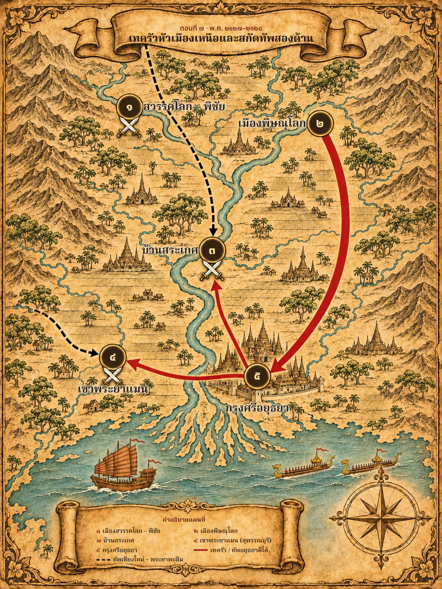

# ภาคที่ 2: อิสรภาพ ณ เมืองแครง (พ.ศ. 2124 – 2133)
## ตอนที่ 7: กวาดต้อนหัวเมืองเหนือ และศึกนันทสู-พระยาพะสิม

---

### องก์ที่ 1: ทิ้งเมืองเกิดเพื่อรักษาแผ่นดิน

กลาง พ.ศ. 2127 — เมืองพิษณุโลกที่เคยรุ่งเรืองในฐานะราชธานีฝ่ายเหนือ บัดนี้เต็มไปด้วยเสียงเกวียน เสียงต้อนฝูงโคกระบือ และขบวนราษฎรนับหมื่นนับแสนที่กำลังเร่งรัดจัดเตรียมข้าวของอพยพลงสู่ทิศใต้

นี่คือการตัดสินพระทัยที่โหดหินที่สุดครั้งหนึ่งในพระชนมชีพของ **สมเด็จพระนเรศวร** พระองค์ทรงประสูติ ณ พระราชวังจันทน์ และเสด็จกลับมา **ครองเมืองพิษณุโลกในฐานะพระมหาอุปราช** มาตั้งแต่ พ.ศ. 2114 ทรงสร้างฐานกำลังพลและสายสัมพันธ์กับขุนศึกหัวเมืองเหนือไว้ที่นี่นานกว่าสิบสามปี ทว่าในวันที่ทรงประกาศอิสรภาพที่เมืองแครงและตีฝ่าแม่น้ำสะโตงกลับมาได้แล้ว พระองค์กลับทรงเลือกที่จะ **"สละหัวเมืองเหนือทั้งหมด"**

คำสั่งของพระองค์คือ **"เทครัวหัวเมืองเหนือ"**—กวาดต้อนผู้คน ช้างม้า เสบียงอาหาร ยุ้งฉาง และอาวุธยุทโธปกรณ์จากพิษณุโลก สุโขทัย สวรรคโลก พิชัย และกำแพงเพชรลงมารวมไว้ที่กรุงศรีอยุธยาเพียงจุดเดียว

เหตุผลเชิงยุทธศาสตร์นั้นเด็ดขาดและเฉียบคม ในสงครามเสียกรุงครั้งที่ 1 เมื่อ พ.ศ. 2112 หงสาวดีสามารถใช้หัวเมืองเหนือเป็นฐานสะสมเสบียงอาหารและเกณฑ์กำลังพลก่อนลงมาล้อมกรุงศรีอยุธยาได้โดยง่าย หากวันนี้กรุงศรีอยุธยายังคงกระจายกำลังไว้ตามเมืองเหนือที่กำแพงเมืองทรุดโทรม ย่อมเสี่ยงที่จะถูกกองทัพขนาดมหึมาของหงสาวดีตีแตกทีละเมืองและยึดไพร่พลไปเป็นกำลังหนุน

ทว่าหากทรงเปลี่ยนหัวเมืองเหนือให้กลายเป็น **"แผ่นดินว่างเปล่าที่ไร้เสบียงและไร้กำลังคน"** เมื่อกองทัพพระเจ้านันทบุเรงยกข้ามเทือกเขาเข้ามา กองทัพนับแสนของหงสาวดีจะไม่มีข้าวปลาอาหารให้เก็บเกี่ยวในพื้นที่ และต้องแบกรับภาระส่งเสบียงข้ามเขาอันยาวไกลตั้งแต่วันแรกที่เหยียบลุ่มน้ำเจ้าพระยา

อย่างไรก็ตาม การสั่งให้เจ้าเมืองและราษฎรทิ้งถิ่นฐานบ้านเกิดมิใช่เรื่องที่ทุกคนจะยอมรับได้โดยง่าย ขณะเดียวกันที่เมืองกำแพงเพชรก็มีกองกำลังพม่าของ **นันทสู** และ **ราชสังครำ** ตั้งมั่นอยู่แล้ว—ยุทธศาสตร์เทครัวจึงต้องเริ่มต้นด้วยคมดาบทั้งต่อขุนนางกบฏภายในและข้าศึกที่คุมเชิงอยู่เบื้องหน้า

---

### องก์ที่ 2: รอยแยกในหัวเมืองเหนือและลำดับศึกตามหลักฐานต่างฉบับ

เมื่อเราสวมบทบาทนักสืบประวัติศาสตร์และกางหลักฐานหลายฉบับเทียบเคียงกันในช่วง พ.ศ. 2127–2128 จะพบความแตกต่างสำคัญในการจัดลำดับศึกหลังการประกาศอิสรภาพ ซึ่งต้องแยกแยะให้ชัดเจนดังนี้:

- **บันทึกในฉบับหลวงประเสริฐอักษรนิติ์ (แยกศึกตามศักราช จ.ศ. 946 และ จ.ศ. 947 คนละปีกัน):** พงศาวดารฉบับที่แม่นยำด้านศักราชบันทึกแยกการรบออกเป็นคนละปีอย่างชัดเจน กล่าวคือ ใน **จ.ศ. 946 ปีวอก** (พ.ศ. 2127) บันทึกเหตุอัศจรรย์ในแม่น้ำพิษณุโลกแล้วทรงให้เทครัวหัวเมืองเหนือลงมายังกรุงศรีอยุธยา จากนั้นในเดือนยี่ของ **จ.ศ. 946** (ตรงกับเดือนมกราคม พ.ศ. 2128 ตามปฏิทินสากล) **พระเจ้าสาวถี** (พระเจ้าเชียงใหม่) และ **พระยาพะสิม** ยกพลลงมาตีกรุงศรีอยุธยา สมเด็จพระนเรศวรเสด็จออกตั้งทัพชัย ณ **ตำบลสามขนอน** และตีทัพข้าศึกแตกพ่ายไปใน **วันพุธ ขึ้น 2 ค่ำ เดือน 2 จ.ศ. 946** ต่อมาเมื่อขึ้นศักราชใหม่ใน **จ.ศ. 947 ปีระกา** (พ.ศ. 2128) **พระเจ้าสาวถี** จึงยกพลลงมาอีกครั้งหนึ่ง ตั้งทัพอยู่ที่ **ตำบลสะเกษ** (บ้านสระเกศ) ตั้งแต่เดือนยี่ถึงเดือน 4 และสมเด็จพระนเรศวรเสด็จขึ้นไปตีทัพพระเจ้าสาวถีที่ตำบลสะเกษแตกพ่ายไปใน **วันพฤหัสบดี แรม 14 ค่ำ เดือน 5 จ.ศ. 947**
- **การเรียงลำดับในฉบับพันจันทนุมาศ (เจิม), ฉบับพระราชหัตถเลขา, และไทยรบพม่า:** พงศาวดารฉบับชำระชั้นหลังและพระนิพนธ์ *ไทยรบพม่า* ของสมเด็จฯ กรมพระยาดำรงราชานุภาพ เรียงลำดับต่างจาก *ฉบับหลวงประเสริฐอักษรนิติ์* โดยแบ่งเป็น 2 ช่วง คือ ช่วงแรกเป็นการปราบกบฏสวรรคโลก–พิชัย และขับไล่ทัพ **นันทสู–ราชสังครำ** ที่เมืองกำแพงเพชรในคราวเทครัวหัวเมืองเหนือ (พ.ศ. 2127) ส่วนช่วงที่สองได้รวบเอาศึก **พระยาพะสิม** (ซึ่ง *ไทยรบพม่า* สันนิษฐานว่าเป็นพระเจ้าอาของพระเจ้านันทบุเรง แม้ในตัวบทพงศาวดารจะเรียกเพียงตำแหน่งเจ้าเมืองพะสิม) กับศึก **พระเจ้าเชียงใหม่ (นรธาเมงสอ)** ที่บ้านสระเกศเข้าเป็นยุทธการตีกระหนาบสองทางในคราวเดียวกัน โดยเล่าว่าทัพพระยาพะสิมยกล่วงหน้าเข้ามาทางสุพรรณบุรีแล้วถูกตีแตกที่เขาพระยาแมนก่อน จากนั้นสมเด็จพระนเรศวรจึงเสด็จขึ้นไปตีทัพหน้าพระเจ้าเชียงใหม่ที่บ้านสระเกศต่อเนื่องกัน
- **หลักฐานฝ่ายพม่า (*มหาราชวงษ์ พงษาวดารพม่า* / *Hmannan Yazawin*):** ยืนยันความพยายามของพระเจ้านันทบุเรงในการส่งกองทัพหัวเมืองมอญ–พม่าและกำลังพลจากเชียงใหม่ลงมาปราบปรามกรุงศรีอยุธยาหลังการแข็งเมือง โดยสะท้อนอุปสรรคสำคัญประการเดียวกันคือการขาดแคลนเสบียงอย่างหนักในลุ่มน้ำเจ้าพระยาตอนบน

---

### องก์ที่ 3: สามฉากรบตัดสินชะตาแผ่นดิน (จ.ศ. 946 – 947)

เมื่อยึดโครงสร้างศักราชตาม *พระราชพงศาวดาร ฉบับหลวงประเสริฐอักษรนิติ์* เป็นแกนหลัก และนำรายละเอียดการรบจากพงศาวดารฉบับชำระชั้นหลังมาประกอบตามปีที่เกิดเหตุการณ์จริง จะเห็นลำดับสมรภูมิหลังการประกาศอิสรภาพออกเป็น 3 ฉากรบตามลำดับปีดังนี้:

#### ฉากรบที่ 1 (จ.ศ. 946 / พ.ศ. 2127): ปราบกบฏสวรรคโลก–พิชัย และขับไล่นันทสู–ราชสังครำ

ตามความใน *พระราชพงศาวดาร ฉบับพันจันทนุมาศ (เจิม)*, *ฉบับพระราชหัตถเลขา*, และ *ไทยรบพม่า* ทันทีที่ทรงประกาศอิสรภาพและเสด็จกลับถึงหัวเมืองเหนือใน **จ.ศ. 946 (พ.ศ. 2127)** สมเด็จพระนเรศวรต้องทรงจัดการปัญหาแนวรบด้านในควบคู่ไปกับการเทครัวหัวเมืองเหนือ (*ฉบับหลวงประเสริฐฯ* บันทึกการเทครัวเมืองเหนือไว้ใน จ.ศ. 946 นี้เช่นกัน)

ในเวลานั้น **นันทสู** และ **ราชสังครำ** แม่ทัพฝ่ายหงสาวดีซึ่งคุมกำลังมาตั้งรักษาการอยู่ที่ **เมืองกำแพงเพชร** ได้พยายามชักชวนให้เจ้าเมืองฝ่ายเหนือแข็งข้อต่ออยุธยา ปรากฏว่า **พระยาพิชัย** และ **พระยาสวรรคโลก** ตัดสินใจแปรพักตร์ ไม่ยอมอพยพไพร่พลลงมาตามคำสั่งและรวบรวมกำลังเตรียมต่อต้านอยู่ที่เมืองสวรรคโลก พร้อมทั้งส่งคนไปติดต่อขอความช่วยเหลือจากทัพหงสาวดีที่ตั้งมั่นอยู่ทางทิศตะวันตก

สมเด็จพระนเรศวรทรงนำทัพเข้าปราบปรามอย่างเฉียบขาดเพื่อตัดไฟแต่ต้นลม พระองค์เสด็จยกทัพขึ้นไปปิดล้อม **เมืองสวรรคโลก** ทรงมีรับสั่งให้เจรจาเกลี้ยกล่อมแต่เจ้าเมืองกบฏยังดื้อดึงต่อสู้ จึงทรงบัญชาการให้ตั้งค่ายประชิดและส่งกำลังเข้าตีหักกำแพงเมืองจนยึดเมืองสวรรคโลกได้สำเร็จ ทรงจับตัวพระยาสวรรคโลกและพระยาพิชัยมาประหารชีวิต จากนั้นจึงทรงจัดกองทัพหน้าภายใต้การนำของ **พระราชมนู** และขุนศึกหัวเมืองเหนือยกออกไปตีทัพ **นันทสู** และ **ราชสังครำ** ที่ตั้งมั่นอยู่ ณ เมืองกำแพงเพชรจนแตกพ่ายถอยหนีออกไปทาง **ตำบลแม่ระกา** เมื่อขจัดภัยคุกคามในหัวเมืองเหนือได้เด็ดขาดแล้ว พระองค์จึงโปรดให้เทครัวผู้คน ช้างม้า และเสบียงจากพิษณุโลก สุโขทัย สวรรคโลก พิชัย และกำแพงเพชรลงมาตั้งมั่นรวมกำลังที่กรุงศรีอยุธยาได้โดยสมบูรณ์

#### ฉากรบที่ 2 (จ.ศ. 946 เดือนยี่ / มกราคม พ.ศ. 2128): ศึกพระยาพะสิมและสมรภูมิสามขนอน

เมื่อข่าวการเทครัวหัวเมืองเหนือไปถึงกรุงหงสาวดี กองทัพระลอกแรกของฝ่ายหงสาวดีได้ยกเข้ามาในปลาย **จ.ศ. 946 ปีวอก** ตามบันทึกของ *ฉบับหลวงประเสริฐอักษรนิติ์* ระบุว่าในครั้งนั้น **พระเจ้าสาวถี** และ **พระยาพะสิม** (แม่ทัพผู้ครองเมืองพะสิม) ยกพลลงมาหมายจะตีกรุงศรีอยุธยา

ในศึก **จ.ศ. 946** นี้ ทัพของ **พระยาพะสิม** ซึ่งยกเข้ามาทางด่านพระเจดีย์สามองค์ผ่านเมืองกาญจนบุรีได้รุกคืบเข้าสู่เขตเมืองสุพรรณบุรี สมเด็จพระนเรศวรและ **สมเด็จพระเอกาทศรถ** จึงเสด็จยกกำลังพลออกจากพระนครใน **วันพุธ ขึ้น 2 ค่ำ เดือน 2 จ.ศ. 946** ไปตั้งทัพชัยรับศึก ณ **ตำบลสามขนอน** แล้วทรงโปรดให้ **เจ้าพระยาสุโขทัย** และ **พระยาจักรี** นำทัพบกและทัพเรือเข้าตีสกัดทัพหน้าของพระยาพะสิมที่บริเวณ **เขาพระยาแมน** แขวงเมืองสุพรรณบุรี ฝ่ายพระยาพะสิมมิคาดคิดว่าอยุธยาจะกล้ายกทัพออกมารุกตีกลางทุ่ง จึงตั้งขบวนไม่ติดและถูกตีแตกพ่ายยับเยินถอยหนีกลับออกไปทางด่านกาญจนบุรี ส่งผลให้การรุกใน **จ.ศ. 946** ของฝ่ายหงสาวดีต้องยุติลงและถอยทัพกลับไป

#### ฉากรบที่ 3 (จ.ศ. 947 เดือน 2 ถึงเดือน 5 / พ.ศ. 2128): ศึกพระเจ้าสาวถี (พระเจ้าเชียงใหม่) ณ บ้านสระเกศ

ครั้นล่วงเข้าสู่ปีถัดมาใน **จ.ศ. 947 ปีระกา (พ.ศ. 2128)** ตามบันทึกของ *ฉบับหลวงประเสริฐอักษรนิติ์* **พระเจ้าสาวถี** (พระเจ้าเชียงใหม่ นรธาเมงสอ) ได้ยกกองทัพใหญ่ลงมาทางหัวเมืองเหนืออีกครั้งหนึ่ง โดยครั้งนี้ตั้งค่ายหลวงอยู่ที่เมืองชัยนาทและส่งทัพหน้าลงมาตั้งมั่นอยู่ที่ **ตำบลสะเกษ** (หรือ **บ้านสระเกศ** ในเขตป่าโมก–วิเศษชัยชาญ จ.อ่างทอง) ตั้งแต่เดือนยี่จนถึงเดือน 4 จ.ศ. 947

สมเด็จพระนเรศวรทรงวางยุทธวิธีบั่นทอนกำลังข้าศึกก่อนเปิดศึกใหญ่ โดยทรงส่งกองทัพหน้าของ **พระราชมนู** ออกซุ่มตีตัดกองลาดตระเวนและขบวนเสบียงของฝ่ายเชียงใหม่เป็นระยะ จากนั้นพระองค์พร้อมด้วยสมเด็จพระเอกาทศรถจึงเสด็จพยุหยาตราทางชลมารคจากกรุงศรีอยุธยาขึ้นไปทาง **ป่าโมก** ครั้นถึง **วันพฤหัสบดี แรม 14 ค่ำ เดือน 5 จ.ศ. 947** สมเด็จพระนเรศวรทรงประทับช้างพระที่นั่ง **พลายมงคลทวีป** เสด็จออกรบ ท่ามกลางสมรภูมิเกิดปรากฏการณ์ **พระอาทิตย์ทรงกลด** มีรัศมีส่องลงมาต้องช้างพระที่นั่งดั่งเงากลดกั้นช้าง สร้างขวัญกำลังใจให้ไพร่พลไทยอย่างยิ่งยวด กองทัพอยุธยาเข้าตีทัพพระเจ้าสาวถีที่ตำบลสะเกษ (บ้านสระเกศ) จนแตกพ่ายยับเยิน แล้วรุกไล่ขึ้นไปตีค่ายหลวงที่เมืองชัยนาทแตกพ่ายหนีกลับขึ้นเหนือไปในเดือน 5 จ.ศ. 947 นั้นเอง

---

### องก์ที่ 4: บทเรียนราคาแพงของหงสาวดี

ชัยชนะต่อเนื่องเหนือทัพนันทสู–ราชสังครำ ทัพพระยาพะสิม และทัพพระเจ้าเชียงใหม่ใน พ.ศ. 2127–2128 ได้พิสูจน์ให้เห็นว่า **"ยุทธศาสตร์เทครัวหัวเมืองเหนือ"** คือหมากกลที่พลิกดุลสงครามในลุ่มน้ำเจ้าพระยาอย่างแท้จริง

กรุงศรีอยุธยาสามารถรวบรวมกำลังไพร่พลทั้งจากหัวเมืองเหนือและลุ่มน้ำเจ้าพระยาตอนล่างเข้ามาอยู่ใต้การบังคับบัญชาที่เป็นเอกภาพเพียงศูนย์กลางเดียว ไม่ต้องสูญเสียกำลังพลไปกับการรักษาเมืองที่แตกกระสานซ่านเซ็น และสามารถใช้กลยุทธ์รวมกำลังโจมตีแยกทำลายทัพข้าศึกที่ยกเข้ามาทีละด้านได้อย่างเด็ดขาด

สำหรับฝ่ายหงสาวดี ความพ่ายแพ้ของพระยาพะสิมและพระเจ้าเชียงใหม่ทำให้ราชสำนักตองอูตระหนักถึงจุดอ่อนร้ายแรงประการใหม่—การที่หัวเมืองเหนือของไทยกลายเป็นแผ่นดินว่างเปล่า หมายความว่ากองทัพหงสาวดีไม่สามารถหาเสบียงกินกลางทางได้อีกต่อไป

หลักฐานความตระหนักข้อนี้ปรากฏชัดเจนในบันทึกของ *ฉบับหลวงประเสริฐอักษรนิติ์* ช่วงปลาย จ.ศ. 947 (พ.ศ. 2128) ที่ระบุว่า **พระมหาอุปราชา (มังกยอชวา)** ต้องเสด็จนำกำลังพลมาตั้งอยู่ที่เมืองกำแพงเพชรเพื่อ **"ตั้งทำนา"** สะสมข้าวเสบียงไว้กลางทุ่งหัวเมืองเหนือเป็นการล่วงหน้า

ทั้งหมดนั้นคือสัญญาณเตือนภัยว่า การรบกับทัพหน้าหัวเมืองได้จบลงแล้ว และในฤดูแล้งปีถัดไป **พระเจ้านันทบุเรง** พระเจ้าแผ่นดินแห่งกรุงหงสาวดีกำลังจะเสด็จกรีฑาทัพหลวงลงมาปิดล้อมกำแพงกรุงศรีอยุธยาด้วยพระองค์เอง!

**จบตอนที่ 7**

*(ติดตามต่อใน ตอนที่ 8: ปิดล้อมพระนคร 5 เดือน และยุทธศาสตร์คลองสระบัว)*
