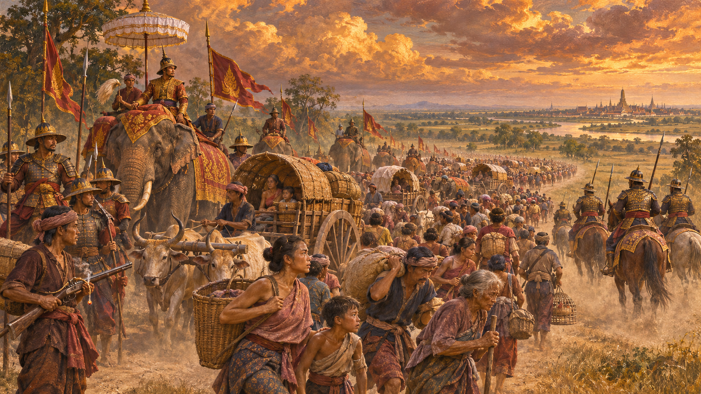

# ภาคที่ 2: อิสรภาพ ณ เมืองแครง (พ.ศ. 2124 – 2133)
## ตอนที่ 7: กวาดต้อนหัวเมืองเหนือ และศึกนันทสู-พระยาพะสิม

---

### องก์ที่ 1: ทิ้งเมืองเกิดเพื่อรักษาแผ่นดิน

กลาง พ.ศ. 2127 — เมืองพิษณุโลกที่เคยรุ่งเรืองในฐานะราชธานีฝ่ายเหนือ บัดนี้เต็มไปด้วยเสียงเกวียน เสียงต้อนฝูงโคกระบือ และขบวนราษฎรนับหมื่นนับแสนที่กำลังเร่งรัดจัดเตรียมข้าวของอพยพลงสู่ทิศใต้

นี่คือการตัดสินพระทัยที่โหดหินที่สุดครั้งหนึ่งในพระชนมชีพของ **สมเด็จพระนเรศวร** พระองค์ทรงประสูติ ณ พระราชวังจันทน์ และเสด็จกลับมา **ครองเมืองพิษณุโลกในฐานะพระมหาอุปราช** มาตั้งแต่ พ.ศ. 2114 ทรงสร้างฐานกำลังพลและสายสัมพันธ์กับขุนศึกหัวเมืองเหนือไว้ที่นี่นานกว่าสิบสามปี ทว่าในวันที่ทรงประกาศอิสรภาพที่เมืองแครงและตีฝ่าแม่น้ำสะโตงกลับมาได้แล้ว พระองค์กลับทรงเลือกที่จะ **"สละหัวเมืองเหนือทั้งหมด"**

คำสั่งของพระองค์คือ **"เทครัวหัวเมืองเหนือ"**—กวาดต้อนผู้คน ช้างม้า เสบียงอาหาร ยุ้งฉาง และอาวุธยุทโธปกรณ์จากพิษณุโลก สุโขทัย สวรรคโลก พิชัย และกำแพงเพชรลงมารวมไว้ที่กรุงศรีอยุธยาเพียงจุดเดียว

เหตุผลเชิงยุทธศาสตร์นั้นเด็ดขาดและเฉียบคม ในสงครามเสียกรุงครั้งที่ 1 เมื่อ พ.ศ. 2112 หงสาวดีสามารถใช้หัวเมืองเหนือเป็นฐานสะสมเสบียงอาหารและเกณฑ์กำลังพลก่อนลงมาล้อมกรุงศรีอยุธยาได้โดยง่าย หากวันนี้กรุงศรีอยุธยายังคงกระจายกำลังไว้ตามเมืองเหนือที่กำแพงเมืองทรุดโทรม ย่อมเสี่ยงที่จะถูกกองทัพขนาดมหึมาของหงสาวดีตีแตกทีละเมืองและยึดไพร่พลไปเป็นกำลังหนุน

ทว่าหากทรงเปลี่ยนหัวเมืองเหนือให้กลายเป็น **"แผ่นดินว่างเปล่าที่ไร้เสบียงและไร้กำลังคน"** เมื่อกองทัพพระเจ้านันทบุเรงยกข้ามเทือกเขาเข้ามา กองทัพนับแสนของหงสาวดีจะไม่มีข้าวปลาอาหารให้เก็บเกี่ยวในพื้นที่ และต้องแบกรับภาระส่งเสบียงข้ามเขาอันยาวไกลตั้งแต่วันแรกที่เหยียบลุ่มน้ำเจ้าพระยา

อย่างไรก็ตาม การสั่งให้เจ้าเมืองและราษฎรทิ้งถิ่นฐานบ้านเกิดมิใช่เรื่องที่ทุกคนจะยอมรับได้โดยง่าย ขณะเดียวกันที่เมืองกำแพงเพชรก็มีกองกำลังพม่าของ **นันทสู** และ **ราชสังครำ** ตั้งมั่นอยู่แล้ว—ยุทธศาสตร์เทครัวจึงต้องเริ่มต้นด้วยคมดาบทั้งต่อขุนนางกบฏภายในและข้าศึกที่คุมเชิงอยู่เบื้องหน้า

---

### องก์ที่ 2: รอยแยกในหัวเมืองเหนือและลำดับศึกสองระลอก

เมื่อเราสวมบทบาทนักสืบประวัติศาสตร์และกางหลักฐานหลายฉบับเทียบเคียงกันในช่วง พ.ศ. 2127–2128 จะเห็นชัดเจนว่าการรบหลังประกาศอิสรภาพมิได้เกิดขึ้นเพียงครั้งเดียว หากแต่แยกออกเป็น **ศึกปราบหัวเมืองเหนือ (นันทสู–ราชสังครำ)** และ **ศึกตีกระหนาบของพระยาพะสิม–พระเจ้าเชียงใหม่** โดยมีลำดับเหตุการณ์ในหลักฐานแต่ละสายดังนี้:

- **บันทึกในฉบับหลวงประเสริฐอักษรนิติ์ (จ.ศ. 946 และ จ.ศ. 947):** ใน **จ.ศ. 946 ปีวอก** (พ.ศ. 2127) บันทึกเหตุอัศจรรย์ในแม่น้ำพิษณุโลกแล้วทรงให้เทครัวหัวเมืองเหนือลงมายังกรุงศรีอยุธยา จากนั้นปลายปีเดียวกัน (ตรงกับต้น พ.ศ. 2128 ตามปฏิทินสากล) **พระเจ้าสาวถี** (พระเจ้าเชียงใหม่) และ **พระยาพะสิม** ยกพลลงมาตีกรุงศรีอยุธยา สมเด็จพระนเรศวรเสด็จออกตั้งทัพชัย ณ **ตำบลสามขนอน** และตีทัพหงสาวดีแตกพ่ายไปใน **วันพุธ ขึ้น 2 ค่ำ เดือน 2** ต่อมาใน **จ.ศ. 947 ปีระกา** (พ.ศ. 2128) **พระเจ้าสาวถี** ยกพลลงมาอีกครั้งหนึ่ง ตั้งทัพอยู่ที่ **ตำบลสะเกษ** (บ้านสระเกศ) ตั้งแต่เดือนยี่ถึงเดือน 4 สมเด็จพระนเรศวรจึงเสด็จไปรบตีทัพพระเจ้าสาวถีแตกพ่ายไปในเดือน 5 ปีระกา
- **รายละเอียดในฉบับพันจันทนุมาศ (เจิม), ฉบับพระราชหัตถเลขา, และไทยรบพม่า:** พงศาวดารฉบับชำระชั้นหลังและพระนิพนธ์ *ไทยรบพม่า* ของสมเด็จฯ กรมพระยาดำรงราชานุภาพ แยกเหตุการณ์ออกเป็น 2 ศึกใหญ่ตามลำดับเวลาอย่างชัดเจน ศึกแรกคือ **ศึกปราบกบฏสวรรคโลก–พิชัย และขับไล่ทัพนันทสู–ราชสังครำที่เมืองกำแพงเพชร (พ.ศ. 2127)** ก่อนจะเสร็จสิ้นการเทครัวลงมาอยุธยา ส่วนศึกที่สองคือ **ศึกพระยาพะสิมและพระเจ้าเชียงใหม่ (นรธาเมงสอ) ยกเข้ามา 2 ทาง (ปลาย พ.ศ. 2127–2128)** โดย *ไทยรบพม่า* อธิบายว่าทัพพระยาพะสิมยกล่วงหน้าเข้ามาทางกาญจนบุรี–สุพรรณบุรีก่อน สมเด็จพระนเรศวรจึงทรงตีทัพพระยาพะสิมแตกพ่ายที่เขาพระยาแมนก่อน แล้วจึงเสด็จขึ้นไปตีทัพหน้าพระเจ้าเชียงใหม่ที่ **บ้านสระเกศ** และรุกไล่ขึ้นไปตีค่ายหลวงที่เมืองชัยนาทตามลำดับ
- **หลักฐานฝ่ายพม่า (*มหาราชวงษ์ พงษาวดารพม่า* / *Hmannan Yazawin*):** ยืนยันความพยายามของพระเจ้านันทบุเรงในการส่งกองทัพหัวเมืองประเทศราชและกำลังพลจากเชียงใหม่ลงมาปราบปรามกรุงศรีอยุธยาหลังการแข็งเมือง โดยสะท้อนอุปสรรคสำคัญประการเดียวกันคือการขาดแคลนเสบียงอย่างหนักในลุ่มน้ำเจ้าพระยาตอนบน

---

### องก์ที่ 3: สองศึกตัดสินชะตาแผ่นดินหลังประกาศอิสรภาพ

#### ศึกที่ 1: ปราบกบฏสวรรคโลก–พิชัย และขับไล่นันทสู–ราชสังครำ

ตามความใน *พระราชพงศาวดาร ฉบับพันจันทนุมาศ (เจิม)*, *ฉบับพระราชหัตถเลขา*, และ *ไทยรบพม่า* ทันทีที่ทรงประกาศอิสรภาพและเสด็จกลับถึงหัวเมืองเหนือ สมเด็จพระนเรศวรต้องทรงจัดการปัญหาแนวรบด้านในก่อนที่ทัพหงสาวดีชุดใหญ่จะตามมา

ในเวลานั้น **นันทสู** และ **ราชสังครำ** แม่ทัพฝ่ายหงสาวดีซึ่งคุมกำลังมาตั้งรักษาการอยู่ที่ **เมืองกำแพงเพชร** ได้พยายามชักชวนให้เจ้าเมืองฝ่ายเหนือแข็งข้อต่ออยุธยา ปรากฏว่า **พระยาพิชัย** และ **พระยาสวรรคโลก** ตัดสินใจแปรพักตร์ ไม่ยอมอพยพไพร่พลลงมาตามคำสั่งและรวบรวมกำลังเตรียมต่อต้านอยู่ที่เมืองสวรรคโลก พร้อมทั้งส่งคนไปติดต่อขอความช่วยเหลือจากทัพหงสาวดีที่ตั้งมั่นอยู่ทางทิศตะวันตก

สมเด็จพระนเรศวรทรงนำทัพเข้าปราบปรามอย่างเฉียบขาด เพื่อตัดไฟแต่ต้นลมมิให้หัวเมืองเหนือกลายเป็นฐานที่มั่นของข้าศึก พระองค์เสด็จยกทัพขึ้นไปปิดล้อม **เมืองสวรรคโลก** ทรงมีรับสั่งให้เจรจาเกลี้ยกล่อมแต่เจ้าเมืองกบฏยังดื้อดึงต่อสู้ จึงทรงบัญชาการให้ตั้งค่ายประชิดและส่งกำลังเข้าตีหักกำแพงเมืองจนยึดเมืองสวรรคโลกได้สำเร็จ ทรงจับตัวพระยาสวรรคโลกและพระยาพิชัยมาประหารชีวิตเพื่อมิให้เป็นเยี่ยงอย่าง จากนั้นจึงทรงจัดกองทัพหน้าภายใต้การนำของ **พระราชมนู** และขุนศึกหัวเมืองเหนือยกออกไปตีทัพ **นันทสู** และ **ราชสังครำ** ที่ตั้งมั่นอยู่ ณ เมืองกำแพงเพชรจนแตกพ่ายถอยหนีออกไปทาง **ตำบลแม่ระกา** เมื่อขจัดภัยคุกคามในหัวเมืองเหนือได้เด็ดขาดแล้ว พระองค์จึงโปรดให้เทครัวผู้คน ช้างม้า และเสบียงจากพิษณุโลก สุโขทัย สวรรคโลก พิชัย และกำแพงเพชรลงมาตั้งมั่นรวมกำลังที่กรุงศรีอยุธยาได้โดยสมบูรณ์

#### ศึกที่ 2: ศึกพระยาพะสิมที่เขาพระยาแมน และศึกพระเจ้าเชียงใหม่ที่บ้านสระเกศ

เมื่อข่าวการเทครัวหัวเมืองเหนือไปถึงกรุงหงสาวดี พระเจ้านันทบุเรงทรงมีรับสั่งให้จัดทัพเข้าตีกระหนาบกรุงศรีอยุธยาทันที โดยแบ่งเป็นสองสายหลัก คือ ทัพของ **พระยาพะสิม** (พระเจ้าอาของพระเจ้านันทบุเรง) ยกเข้ามาทางด่านพระเจดีย์สามองค์–กาญจนบุรี–สุพรรณบุรี และทัพของ **พระเจ้าเชียงใหม่ (นรธาเมงสอ)**—ซึ่งใน *ฉบับหลวงประเสริฐอักษรนิติ์* ออกพระนามว่า **"พระเจ้าสาวถี"**—ยกกำลังพลจากล้านนาล่วงลงมาทางหัวเมืองเหนือ

การปะทะในศึกนี้เกิดขึ้นตามลำดับความเร็วของการเดินทัพสองปีก:

1. **ตีทัพพระยาพะสิมแตกพ่ายที่เขาพระยาแมนและสามขนอน:** เนื่องจากเส้นทางจากด่านพระเจดีย์สามองค์สั้นกว่า ทัพของ **พระยาพะสิม** จึงยกเข้ามาถึงเขตเมืองสุพรรณบุรีก่อนที่ทัพพระเจ้าเชียงใหม่จะลงมาถึงภาคกลาง สมเด็จพระนเรศวรและ **สมเด็จพระเอกาทศรถ** ทรงนำกำลังพลออกจากพระนครไปตั้งทัพชัยรับศึกที่ **ตำบลสามขนอน** (ตาม *ฉบับหลวงประเสริฐฯ* บันทึกเหตุการณ์วันพุธ ขึ้น 2 ค่ำ เดือน 2 จ.ศ. 946) แล้วทรงโปรดให้ **เจ้าพระยาสุโขทัย** และ **พระยาจักรี** นำทัพบกและทัพเรือเข้าตีสกัดทัพพระยาพะสิมที่บริเวณ **เขาพระยาแมน** แขวงเมืองสุพรรณบุรี ฝ่ายพระยาพะสิมมิคาดคิดว่าอยุธยาจะกล้ายกทัพออกมารุกตีกลางทุ่ง จึงตั้งขบวนไม่ติดและแตกพ่ายยับเยินถอยหนีกลับออกไปทางด่านกาญจนบุรี
2. **ยุทธการบ้านสระเกศ (ตำบลสะเกษ) และชัยนาท:** เมื่อทรงปราบทัพตะวันตกพ้นเขตแดนแล้ว สมเด็จพระนเรศวรจึงทรงหันคมหอกขึ้นเหนือไปรับมือกับ **พระเจ้าเชียงใหม่** (พระเจ้าสาวถี) ซึ่งยกลงมาตั้งค่ายหลวงอยู่ที่เมืองชัยนาทและส่งทัพหน้าลงมาตั้งประชิดอยู่ที่ **บ้านสระเกศ** (หรือ **ตำบลสะเกษ** ในเขตป่าโมก–วิเศษชัยชาญ จ.อ่างทอง) โดยพระองค์ทรงส่งกองทัพหน้าของ **พระราชมนู** ออกซุ่มตีตัดกองลาดตระเวนและขบวนเสบียงของฝ่ายเชียงใหม่เสียก่อนเพื่อบั่นทอนกำลังข้าศึก

ตามความใน *ฉบับหลวงประเสริฐอักษรนิติ์* ใน จ.ศ. 947 (พ.ศ. 2128) พระเจ้าสาวถีตั้งทัพอยู่ที่ตำบลสะเกษตั้งแต่เดือนยี่ถึงเดือน 4 สมเด็จพระนเรศวรเสด็จพยุหยาตราทางชลมารคขึ้นไปทาง **ป่าโมก** ครั้นถึง **วันพฤหัสบดี แรม 14 ค่ำ เดือน 5** ทรงประทับช้างพระที่นั่ง **พลายมงคลทวีป** เสด็จออกรบ ท่ามกลางสมรภูมิเกิดปรากฏการณ์ **พระอาทิตย์ทรงกลด** มีรัศมีส่องลงมาต้องช้างพระที่นั่งดั่งเงากลดกั้นช้าง สร้างขวัญกำลังใจให้ไพร่พลไทยอย่างยิ่งยวด กองทัพอยุธยาเข้าตีทัพหน้าเชียงใหม่ที่บ้านสระเกศจนแตกพ่ายยับเยิน แล้วรุกไล่ขึ้นไปตีค่ายหลวงของพระเจ้าเชียงใหม่ที่เมืองชัยนาทแตกพ่ายหนีกลับขึ้นเหนือไป

---

### องก์ที่ 4: บทเรียนราคาแพงของหงสาวดี

ชัยชนะต่อเนื่องเหนือทัพนันทสู–ราชสังครำ ทัพพระยาพะสิม และทัพพระเจ้าเชียงใหม่ใน พ.ศ. 2127–2128 ได้พิสูจน์ให้เห็นว่า **"ยุทธศาสตร์เทครัวหัวเมืองเหนือ"** คือหมากกลที่พลิกดุลสงครามในลุ่มน้ำเจ้าพระยาอย่างแท้จริง

กรุงศรีอยุธยาสามารถรวบรวมกำลังไพร่พลทั้งจากหัวเมืองเหนือและลุ่มน้ำเจ้าพระยาตอนล่างเข้ามาอยู่ใต้การบังคับบัญชาที่เป็นเอกภาพเพียงศูนย์กลางเดียว ไม่ต้องสูญเสียกำลังพลไปกับการรักษาเมืองที่แตกกระสานซ่านเซ็น และสามารถใช้กลยุทธ์รวมกำลังโจมตีแยกทำลายทัพข้าศึกที่ยกเข้ามาทีละด้านได้อย่างเด็ดขาด

สำหรับฝ่ายหงสาวดี ความพ่ายแพ้ของพระยาพะสิมและพระเจ้าเชียงใหม่ทำให้ราชสำนักตองอูตระหนักถึงจุดอ่อนร้ายแรงประการใหม่—การที่หัวเมืองเหนือของไทยกลายเป็นแผ่นดินว่างเปล่า หมายความว่ากองทัพหงสาวดีไม่สามารถหาเสบียงกินกลางทางได้อีกต่อไป

หลักฐานความตระหนักข้อนี้ปรากฏชัดเจนในบันทึกของ *ฉบับหลวงประเสริฐอักษรนิติ์* ช่วงปลาย จ.ศ. 947 (พ.ศ. 2128) ที่ระบุว่า **พระมหาอุปราชา (มังกยอชวา)** ต้องเสด็จนำกำลังพลมาตั้งอยู่ที่เมืองกำแพงเพชรเพื่อ **"ตั้งทำนา"** สะสมข้าวเสบียงไว้กลางทุ่งหัวเมืองเหนือเป็นการล่วงหน้า

ทั้งหมดนั้นคือสัญญาณเตือนภัยว่า การรบกับทัพหน้าหัวเมืองได้จบลงแล้ว และในฤดูแล้งปีถัดไป **พระเจ้านันทบุเรง** พระเจ้าแผ่นดินแห่งกรุงหงสาวดีกำลังจะเสด็จกรีฑาทัพหลวงลงมาปิดล้อมกำแพงกรุงศรีอยุธยาด้วยพระองค์เอง!

**จบตอนที่ 7**

*(ติดตามต่อใน ตอนที่ 8: ปิดล้อมพระนคร 5 เดือน และยุทธศาสตร์คลองสระบัว)*
