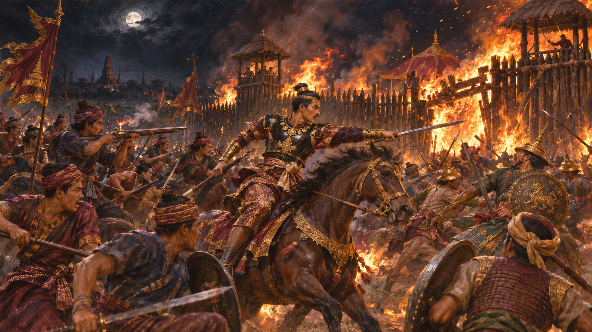
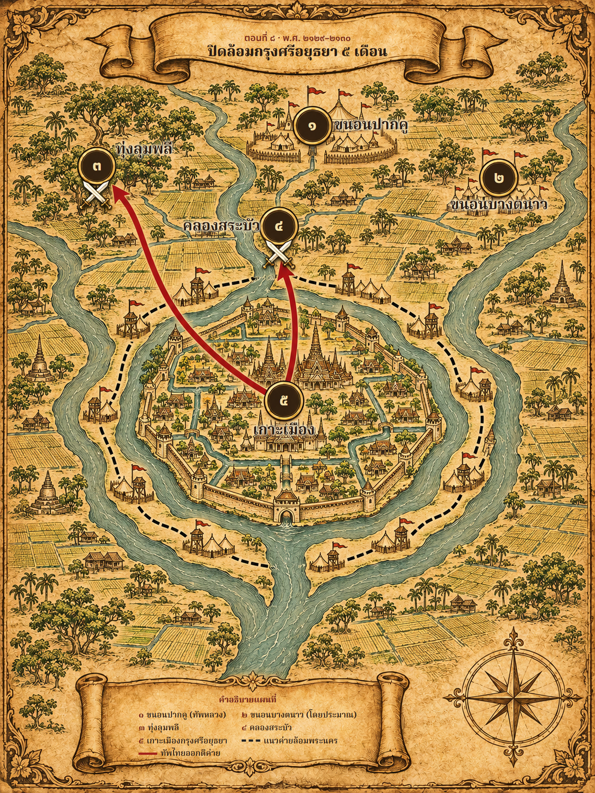

# ภาคที่ 2: อิสรภาพ ณ เมืองแครง (พ.ศ. 2124 – 2133)
## ตอนที่ 8: ปิดล้อมพระนคร 5 เดือน และยุทธศาสตร์คลองสระบัว

---

### องก์ที่ 1: มหาทัพหงสาวดีประชิดกำแพงกรุง

ปลาย พ.ศ. 2129 — ทุ่งนารอบเกาะเมืองกรุงศรีอยุธยาเต็มไปด้วยธงทิวและแสงคบเพลิงของกองทัพหงสาวดีสุดลูกหูลูกตา

หลังจากส่งทัพหัวเมืองและแม่ทัพชั้นผู้ใหญ่เข้ามาพ่ายแพ้ติดๆ กันถึงสองปีซ้อน **พระเจ้านันทบุเรง** (หรือที่เอกสารไทยเรียกพระนามว่า **งาจีสยาง**) ทรงตระหนักว่าหากไม่ทรงเสด็จนำทัพหลวงมาปราบปรามด้วยพระองค์เอง เกียรติภูมิของจักรวรรดิตองอูอาจพังทลายลงอย่างไม่อาจกอบกู้ได้อีก พระองค์จึงทรงระดมกำลังพลจากหงสาวดี ตองอู แปร เชียงใหม่ และหัวเมืองมอญ–ไทใหญ่ เตรียมเสบียงจากที่พระมหาอุปราชาทรงลงมาตั้งทำนาไว้ที่กำแพงเพชร แล้วกรีฑาทัพมหึมามุ่งหน้าลงสู่ลุ่มน้ำเจ้าพระยา

ตามบันทึกศักราชอันแม่นยำของ *พระราชพงศาวดาร ฉบับหลวงประเสริฐอักษรนิติ์* ใน **จ.ศ. 948 ปีจอ** พระเจ้านันทบุเรงทรงเคลื่อนทัพลงมาใน **วันจันทร์ แรม 8 ค่ำ เดือน 12** (พฤศจิกายน พ.ศ. 2129) และทัพหลวงเสด็จมาถึงชานกรุงศรีอยุธยาเข้าล้อมพระนครใน **วันพฤหัสบดี ขึ้น 2 ค่ำ เดือน 2** (ธันวาคม พ.ศ. 2129 ต่อเดือนมกราคม พ.ศ. 2130 ตามปฏิทินสากล)

กองทัพหงสาวดีวางแนวปิดล้อมเกาะเมืองกรุงศรีอยุธยาไว้ทุกด้าน โดยค่ายหลวงของ **พระเจ้านันทบุเรง** ตั้งอยู่ที่ **ตำบลขนอนปากคู** ทางตอนเหนือของเกาะเมือง ส่วนทัพหน้าของ **พระมหาอุปราชา (มังกยอชวา)** ตั้งอยู่ที่ **ขนอนบางตนาว** และมีกองทัพประเทศราชรายล้อมรอบแนวแม่น้ำและทุ่งนาทุกทิศ

เป้าหมายของพระเจ้านันทบุเรงคือการใช้ยุทธวิธีเดิมที่พระเจ้าบุเรงนองเคยใช้ตีกรุงศรีอยุธยาแตกใน พ.ศ. 2112 นั่นคือ "ล้อมให้นาน ตัดขาดการส่งกำลังบำรุง แล้วถมลำน้ำเข้าตีหักเอาพระนคร"

ทว่าพระเจ้านันทบุเรงทรงลืมความจริงสำคัญข้อหนึ่ง—กรุงศรีอยุธยาใน พ.ศ. 2129 มิใช่เมืองที่ไร้เอกภาพและกำแพงเมืองชำรุดเหมือนเมื่อสิบเจ็ดปีก่อน หากคือป้อมปราการกลางน้ำที่ซ่อมแซมกำแพงและขุดลอกคูเมืองอย่างแข็งแกร่ง สะสมเสบียงอาหารและกระสุนดินดำไว้พร้อมสรรพ และมี **สมเด็จพระนเรศวร** ผู้ไม่เคยยอมนั่งรอให้ข้าศึกบีบรัดอยู่หลังกำแพงเป็นแม่ทัพใหญ่

---

### องก์ที่ 2: อ่านกระดานล้อมกรุงและหลักฐานต่างแผ่นดิน

เมื่อกางหลักฐานหลายแผ่นดินเทียบเคียงกันในมหาศึกปิดล้อมกรุงศรีอยุธยา พ.ศ. 2129–2130 เราจะเห็นโครงสร้างของเหตุการณ์และสีสันทางประวัติศาสตร์ที่เสริมรับกันอย่างชัดเจน:

- **บันทึกในฉบับหลวงประเสริฐอักษรนิติ์ (จ.ศ. 948–949):** ให้กรอบวันเวลาที่แน่นอนที่สุดของการศึกครั้งนี้ โดยระบุว่าใน **จ.ศ. 948 ปีจอ** พระเจ้านันทบุเรงยกพลลงมาใน **วันจันทร์ แรม 8 ค่ำ เดือน 12** และเสด็จมาถึงเข้าล้อมพระนครศรีอยุธยาใน **วันพฤหัสบดี ขึ้น 2 ค่ำ เดือน 2** โดยพระองค์ตั้งทัพที่ **ขนอนปากคู** และพระมหาอุปราชาตั้งทัพที่ **ขนอนบางตนาว** ต่อมาใน **จ.ศ. 949 ปีกุน** (พ.ศ. 2130) สมเด็จพระนเรศวรเสด็จออกไปตีทัพพระมหาอุปราชาที่ **ขนอนบางตนาว** และตีค่ายข้าศึกที่ **บางกระดาน** แตกพ่ายถอยร่นไป ก่อนที่พระเจ้านันทบุเรงจะไม่อาจตีหักเอาพระนครได้และจำต้องเลิกทัพกลับไปหลังการปิดล้อมราว 5–6 เดือน
- **รายละเอียดในฉบับพันจันทนุมาศ (เจิม), ฉบับพระราชหัตถเลขา, และไทยรบพม่า:** พงศาวดารฉบับชำระชั้นหลังได้เล่าถึงการสู้รบเชิงรุกอย่างดุเดือดรอบแนวเหนือของเกาะเมือง ทั้งสมรภูมิ **ทุ่งลุมพลี**, ยุทธการ **คลองสระบัว**, **ทุ่งชายเคือง**, การดวลตัวต่อตัวกับนายทัพพม่าชื่อ **ลักไวทำมู**, และวีรกรรมอันเลื่องชื่อเมื่อสมเด็จพระนเรศวรทรงนำทหารออกปล้นค่ายหงสาวดียามวิกาลจนทรง **คาบพระแสงดาบปีนระเนียดค่ายหลวงของพระเจ้าหงสาวดี**
- **หลักฐานฝ่ายพม่าและยุโรป:** *มหาราชวงษ์ พงษาวดารพม่า* (*Hmannan Yazawin*) ยืนยันตรงกันว่าพระเจ้านันทบุเรงทรงกรีฑาทัพหลวงมาปิดล้อมกรุงศรีอยุธยาจริง ทว่ากองทัพหงสาวดีกลับประสบความยากลำบากอย่างแสนสาหัสในการตีหักข้ามลำน้ำ ประกอบกับขาดแคลนเสบียงอาหารและการต่อต้านอันเข้มแข็งของฝ่ายอยุธยา จนเมื่อเข้าสู่ฤดูฝนไพร่พลล้มป่วยด้วยโรคภัยไข้เจ็บจึงต้องถอยทัพกลับไป เช่นเดียวกับ *พงศาวดารกรุงศรีอยุธยา ฉบับวันวลิต* ที่สะท้อนภาพรวมตรงกันว่าในรัชสมัยสมเด็จพระนเรศวร กองทัพหงสาวดีที่ยกมาตีกรุงศรีอยุธยาต้องพ่ายแพ้และสูญเสียไพร่พลอย่างหนัก

---

### องก์ที่ 3: สงครามนอกกำแพง — ทุ่งลุมพลี คลองสระบัว และพระแสงดาบคาบค่าย

#### พลิกเกมจากผู้ถูกล้อมเป็นผู้ล่า

ตลอดห้าเดือนของการปิดล้อม สมเด็จพระนเรศวรทรงเปลี่ยนรูปแบบการรบจากการตั้งรับบนเชิงเทินมาเป็น **"การรุกปั่นป่วนข้าศึกทุกทิศทาง"** กองทัพหงสาวดีวางกำลังปิดล้อมเกาะเมืองไว้รอบด้าน—ค่ายหลวงของ **พระเจ้านันทบุเรง** ตั้งอยู่ที่ **ขนอนปากคู** ทางทิศเหนือ, ค่ายของ **พระมหาอุปราชา (มังกยอชวา)** ตั้งที่ **ขนอนบางตนาว** เชื่อมต่อลงมายัง **ทุ่งชายเคือง** ส่วนทัพของพระเจ้าตองอู พระเจ้าแปร และพระเจ้าเชียงใหม่ตั้งรายล้อมอยู่ตามแนวทุ่งนาและลำน้ำฝั่งตะวันออกและตะวันตก

พระองค์ทรงใช้ลำน้ำเจ้าพระยา ลำน้ำป่าสัก และลำน้ำลพบุรีที่โอบล้อมเกาะเมืองเป็นคูน้ำธรรมชาติ ทรงสั่งให้ตั้งปืนใหญ่ขนาดหนักประจำป้อมรอบพระนครและนำปืนใหญ่ลงเรือสำเภาแล่นเลียบริมฝั่งระดมยิงค่ายหงสาวดีที่พยายามขุดสนามเพลาะและสร้างป้อมไม้ประชิดตลิ่ง จนค่ายข้าศึกไม่อาจถมคูเมืองข้ามเข้ามาได้และจำต้องถอยร่นแนวตั้งค่ายให้ห่างระยะปืนใหญ่ของกรุงศรีอยุธยาออกไป

ยิ่งไปกว่านั้น ในพื้นที่ทุ่งนาทางทิศเหนือของเกาะเมือง ได้แก่ **ทุ่งลุมพลี**, **คลองสระบัว**, และ **ทุ่งชายเคือง** สมเด็จพระนเรศวรทรงจัดหน่วยรบเคลื่อนที่เร็ว—ทั้งทหารม้าและทหารราบอาสา—ออกลอบโจมตีค่ายหน้าของหงสาวดีทั้งกลางวันและกลางคืนอย่างต่อเนื่อง พร้อมกับส่งกองกำลังทางน้ำออกดักปล้นและทำลายขบวนเรือลำเลียงเสบียงของข้าศึกที่ส่งลงมาจากเมืองกำแพงเพชร ทำให้กองทัพมหึมาของหงสาวดีเริ่มตกเป็นฝ่ายตั้งรับและต้องคอยระแวดระวังรอบค่ายอยู่ตลอดเวลา

#### ฉาก "พระแสงดาบคาบค่าย" และศึกดวลลักไวทำมู

ตามความใน *พระราชพงศาวดาร ฉบับพันจันทนุมาศ (เจิม)*, *ฉบับพระราชหัตถเลขา*, และ *ไทยรบพม่า* การออกปล้นค่ายยามวิกาลครั้งที่โด่งดังที่สุดเกิดขึ้นในคืนหนึ่งเมื่อสมเด็จพระนเรศวรทรงนำทหารคู่พระทัยบุกเข้าตีค่ายหน้าของหงสาวดีแตกพ่ายแล้วทรงไล่ติดตามเข้าไปจนประชิดแนวระเนียด **ค่ายหลวงของพระเจ้าหงสาวดี (พระเจ้านันทบุเรง)**

ด้วยพระทัยอันห้าวหาญ พระองค์เสด็จลงจากม้าพระที่นั่ง ทรงถือหอกหรือทรง **คาบพระแสงดาบไว้ในพระโอษฐ์** เพื่อใช้สองพระหัตถ์ไต่บันไดปีนป่ายข้ามเสาระเนียดค่ายหลวงของพระเจ้าหงสาวดีขึ้นไป ทว่าทหารยามพม่าบนค่ายรู้ตัวทันและระดมแทงหอกสวนลงมาจนพระองค์พลัดตกลงมายังพื้นเบื้องล่าง เหล่าทหารรักษาพระองค์จึงรีบกรูเข้าไปป้องกันและนำเสด็จฝ่าวงล้อมกลับเข้าพระนครได้ทันเวลา (หมายเหตุทางหลักฐาน: ฉากวีรกรรมพระแสงดาบคาบค่ายนี้เป็นเรื่องเล่าสำคัญในพงศาวดารฉบับชำระชั้นหลัง มิได้มีรายละเอียดปรากฏใน *ฉบับหลวงประเสริฐอักษรนิติ์*)

เมื่อพระเจ้านันทบุเรงทรงทราบว่าผู้ที่นำทหารบุกปีนค่ายหลวงเข้ามาคือสมเด็จพระนเรศวรด้วยพระองค์เอง ถึงกับตรัสตำหนิเชิงหวั่นเกรงต่อขุนนางว่า *"พระนเรศวรออกมาทำการดังนี้ เหมือนเอาพิมเสนมาแลกกับเกลือ"* แล้วจึงทรงคัดเลือก **ลักไวทำมู** นายทหารม้าฝีมือเอกให้คุมกองกำลังทหารม้าอาสาคอยดักซุ่มหมายจะจับเป็นสมเด็จพระนเรศวรให้ได้ในการออกรบครั้งต่อไป

โอกาสของทั้งสองฝ่ายมาถึงในการรบที่ **ทุ่งลุมพลี** เมื่อสมเด็จพระนเรศวรเสด็จนำทหารม้าออกตีค่ายข้าศึก ลักไวทำมูนำทหารม้าหงสาวดีกรูเข้าโอบล้อมหมายจะจับพระองค์ตามรับสั่ง ทว่าสมเด็จพระนเรศวรทรงควบม้าพระที่นั่งพุ่งเข้าปะทะโดยไม่หวั่นเกรง ทรงหลบอาวุธและใช้พระแสงทวนแทงถูก **ลักไวทำมู** สิ้นชีวิตกลางสนามรบ ทำให้กองม้าพม่าแตกกระเจิงหนีกลับเข้าค่าย ขณะเดียวกันที่แนวรบ **คลองสระบัว** และ **ทุ่งชายเคือง** กองทัพอยุธยาก็ยังคงผลัดกันออกตีปะทะค่ายหงสาวดีจนฝ่ายข้าศึกไม่อาจรุกคืบเข้ามาใกล้พระนครได้แม้แต่ก้าวเดียว

ครั้นล่วงเข้าสู่ จ.ศ. 949 (ราวเดือนเมษายน–พฤษภาคม พ.ศ. 2130) ตาม *ฉบับหลวงประเสริฐอักษรนิติ์* สมเด็จพระนเรศวรทรงรุกหนักยิ่งขึ้น เสด็จนำทัพออกตีทัพ **พระมหาอุปราชา** ที่ตั้งอยู่ ณ **ขนอนบางตนาว** และตีค่ายข้าศึกที่ **บางกระดาน** แตกพ่ายถอยร่นไป ประกอบกับฝนต้นฤดูเริ่มเทลงมาจนทุ่งนาเจิ่งนองไปด้วยน้ำและโคลนตม กองทัพหงสาวดีที่ขาดเสบียงและล้มป่วยด้วยโรคระบาดจึงไม่อาจตั้งค่ายล้อมกรุงต่อไปได้ **พระเจ้านันทบุเรง** จึงจำต้องทรงมีรับสั่งให้เลิกทัพและถอยกลับสู่กรุงหงสาวดีในที่สุด

---

### องก์ที่ 4: สู่ราชบัลลังก์อโยธยา

การที่กรุงศรีอยุธยาสามารถยืนหยัดต้านทานทัพหลวงของพระมหากษัตริย์หงสาวดีได้ตลอด 5–6 เดือน และบังคับให้พระเจ้านันทบุเรงต้องยกทัพกลับไปมือเปล่าใน พ.ศ. 2130 ถือเป็นหมุดหมายทางประวัติศาสตร์ที่ยืนยันว่า อิสรภาพที่ประกาศไว้ ณ เมืองแครงได้หยั่งรากลงอย่างมั่นคงถาวรแล้ว

นับแต่วันนั้น สมดุลอำนาจในอุษาคเนย์ได้เปลี่ยนโฉมหน้าไปตลอดกาล กรุงศรีอยุธยามิใช่เมืองประเทศราชที่รอรับคำสั่งอีกต่อไป หากคือราชอาณาจักรเอกราชที่พร้อมเผชิญหน้ากับจักรวรรดิตองอูอย่างทัดเทียม

สามปีต่อมา ใน **จ.ศ. 952 ปีขาล** (พ.ศ. 2133) ตามบันทึกของ *พระราชพงศาวดาร ฉบับหลวงประเสริฐอักษรนิติ์* เมื่อถึง **วันอาทิตย์ แรม 13 ค่ำ เดือน 8** (ตรงกับเดือนกรกฎาคม พ.ศ. 2133) **สมเด็จพระพุทธเจ้าหลวงพระพฤฒาราช** (สมเด็จพระมหาธรรมราชาธิราช) เสด็จสวรรคตลงด้วยพระชนมายุ 75 พรรษา

**สมเด็จพระนเรศวร** ในพระชันษา 35 พรรษา จึงเสด็จขึ้นเถลิงถวัลยราชสมบัติเป็นพระมหากษัตริย์พระองค์ที่ 18 แห่งกรุงศรีอยุธยา ทรงพระนามว่า **สมเด็จพระสรรเพชญ์ที่ 2** (พระนามที่นิยมเรียกขานในยุคหลังว่าสมเด็จพระนเรศวรมหาราช) และในคราวเดียวกันนั้น ตามความใน *ฉบับพันจันทนุมาศ (เจิม)* และ *ฉบับพระราชหัตถเลขา* พระองค์ทรงพระกรุณาโปรดเกล้าฯ **"อุปราชาภิเษก"** **สมเด็จพระเอกาทศรถ** พระราชอนุชาผู้ทรงร่วมเป็นร่วมตายเคียงบ่าเคียงไหล่มาในทุกสมรภูมิ ให้ขึ้นเสวยราชสมบัติ **"มีพระเกียรติยศเสมอด้วยพระเจ้าแผ่นดิน"** ทรงครอบครองราชสมบัติและว่าราชการแผ่นดินร่วมกันดั่งพระมหากษัตริย์สองพระองค์—ซึ่งพงศาวดารมักออกพระนามคู่กันว่า *"สมเด็จพระพุทธเจ้าอยู่หัวทั้งสองพระองค์"*

ทว่าบนราชบัลลังก์ใหม่นี้ยังมีเวลาไม่ถึงครึ่งปีก่อนที่ไฟสงครามครั้งใหม่จะปะทุขึ้นอีก—เพราะความพ่ายแพ้เมื่อ พ.ศ. 2130 ทำให้ราชสำนักหงสาวดีกำลังเตรียมส่งกองทัพใหญ่ภายใต้การนำของ **พระมหาอุปราชา (มังกยอชวา)** ข้ามด่านพระเจดีย์สามองค์กลับมาล้างอายในแผ่นดินสยามเป็นคำรบแรกในรัชกาลใหม่!

**จบตอนที่ 8 (จบภาคที่ 2: อิสรภาพ ณ เมืองแครง)**

*(ติดตามต่อใน ภาคที่ 3: มหายุทธหัตถีเปลี่ยนแผ่นดิน — ตอนที่ 9: ปราบทัพพระมหาอุปราชาครั้งที่ 1 ที่ตำบลตะเข้สามพัน)*
