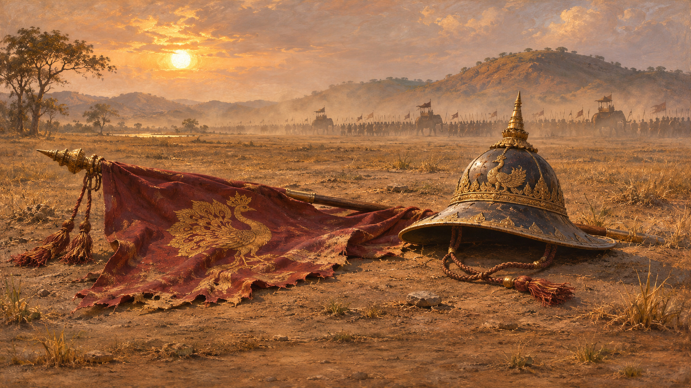
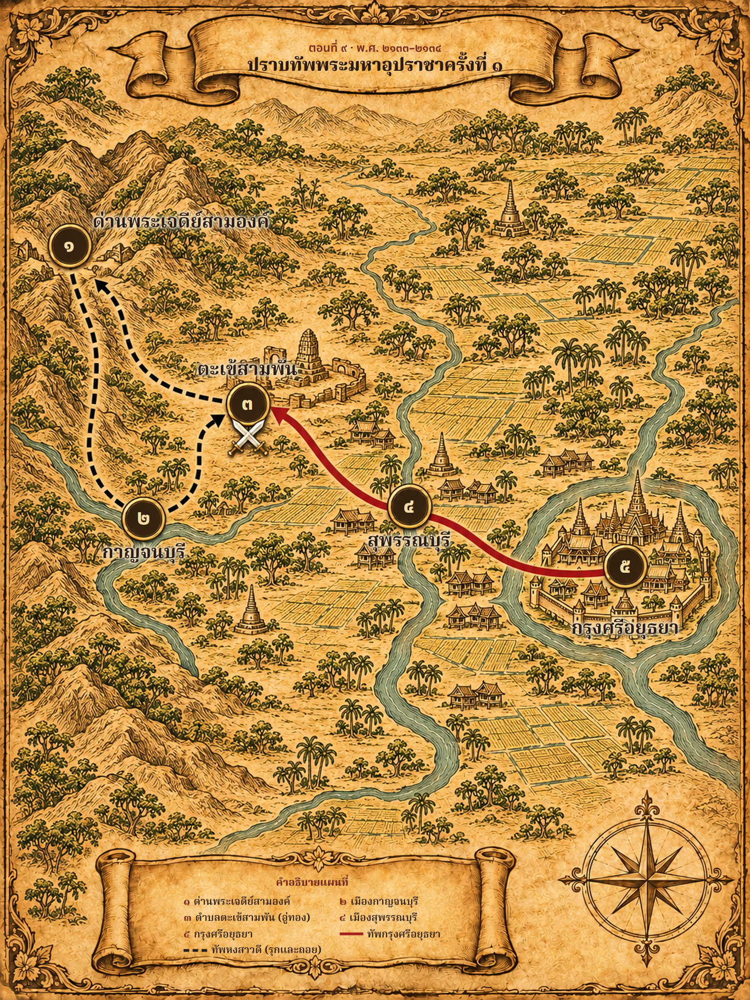

# ภาคที่ 3: มหายุทธหัตถีเปลี่ยนแผ่นดิน (พ.ศ. 2133 – 2137)
## ตอนที่ 9: ปราบทัพพระมหาอุปราชาครั้งที่ 1 ที่ตำบลตะเข้สามพัน

---

### องก์ที่ 1: บัลลังก์ใหม่ในเงาพายุหงสาวดี

ปลาย พ.ศ. 2133 — กลิ่นธูปควันเทียนจากงานพระบรมศพในกรุงศรีอยุธยายังไม่ทันจางหาย เสียงกลองศึกจากด่านตะวันตกก็ดังกึกก้องขึ้นอีกครั้ง

เพียงไม่กี่เดือนหลังจาก **สมเด็จพระพุทธเจ้าหลวงพระพฤฒาราช** (สมเด็จพระมหาธรรมราชาธิราช) เสด็จสวรรคตในเดือนกรกฎาคม พ.ศ. 2133 **สมเด็จพระนเรศวร** ในพระชันษา 35 พรรษา เสด็จขึ้นเถลิงถวัลยราชสมบัติเป็นพระมหากษัตริย์แห่งกรุงศรีอยุธยา ทรงพระนามว่า **สมเด็จพระสรรเพชญ์ที่ 2** และทรงสถาปนา **สมเด็จพระเอกาทศรถ** พระราชอนุชาขึ้นเสวยราชสมบัติมีพระเกียรติยศเสมอด้วยพระเจ้าแผ่นดิน เพื่อเป็นหลักชัยคู่แผ่นดินในยามศึกสงคราม การจัดวางอำนาจแบบ "กษัตริย์สองพระองค์" นี้มิใช่เพียงเรื่องของความรักใคร่ฉันพี่น้อง หากคือการออกแบบโครงสร้างบริหารราชการแผ่นดินที่เฉียบขาด—ยามใดที่สมเด็จพระนเรศวรเสด็จกรีฑาทัพออกไปบัญชาการรบแนวหน้า ก็มีสมเด็จพระเอกาทศรถทรงคุมกำลังหนุนหรือรักษาพระนครอยู่เคียงข้างโดยไม่มีช่องว่างให้ขุนนางฝ่ายใดก่อความกระด้างกระเดื่องได้

ข่าวการผลัดแผ่นดินในกรุงศรีอยุธยาเดินทางข้ามเทือกเขาตะนาวศรีไปถึงกรุงหงสาวดีอย่างรวดเร็ว สำหรับ **พระเจ้านันทบุเรง** ผู้ทรงอัปยศอดสูจากการต้องถอยทัพกลับมือเปล่าหลังปิดล้อมกรุงศรีอยุธยาเมื่อ พ.ศ. 2130 นี่คือจังหวะที่ราชสำนักตองอูรอคอยมานาน พระองค์ทรงประเมินว่ากรุงศรีอยุธยาในยามเปลี่ยนรัชกาลย่อมยังมีรอยต่อทางอำนาจ พระราชพิธีพระบรมศพและการจัดระเบียบขุนนางใหม่ย่อมดึงความสนใจของราชสำนักอโยธยาไปจากชายแดน หากชิงลงมือก่อนที่กษัตริย์พระองค์ใหม่จะจัดระเบียบราชสำนักได้ลงตัว หงสาวดีอาจพลิกกลับมาสยบอโยธยาได้อีกครั้ง และยังเป็นการกู้หน้าต่อบรรดาเจ้าประเทศราชอย่างล้านนาและไทใหญ่ที่เริ่มคลอนแคลนความยำเกรงต่อหงสาวดี

ดังนั้น ใน **จ.ศ. 952 ปีขาล** (ปลาย พ.ศ. 2133) พระเจ้านันทบุเรงจึงทรงมีรับสั่งให้ **พระมหาอุปราชา (มังกยอชวา)** พระราชโอรสองค์โต เป็นจอมทัพใหญ่ พร้อมด้วย **พระยาพะสิม**—แม่ทัพมอญผู้เจนศึก—และแม่ทัพนายกองอีกหลายหมื่นคน กรีฑาทัพใหญ่จากกรุงหงสาวดีข้าม **ด่านพระเจดีย์สามองค์** เข้ามาทาง **เมืองกาญจนบุรี** มุ่งตรงสู่ใจกลางลุ่มน้ำเจ้าพระยา โดยหวังจะจู่โจมกรุงศรีอยุธยาให้ไม่ทันตั้งตัว

ทว่าพระเจ้านันทบุเรงทรงคำนวณผิดพลาดมหันต์—พระมหากษัตริย์พระองค์ใหม่ของกรุงศรีอยุธยามิใช่ผู้ที่เพิ่งเรียนรู้การปกครอง หากคือจอมทัพผู้บัญชาการรบจริงมาแล้วกว่าสิบห้าปี และไม่เคยคิดที่จะนั่งรอรับศึกอยู่หลังกำแพงพระนคร

---

### องก์ที่ 2: อ่านกระดานการเมืองและหลักฐานต่างแผ่นดิน

เมื่อกางหลักฐานจากหลายแหล่งเทียบเคียงกันในศึกครั้งแรกของรัชกาลใหม่ พ.ศ. 2133–2134 เราจะเห็นภาพความเปลี่ยนแปลงเชิงโครงสร้างของกรุงศรีอยุธยาอย่างชัดเจน:

- **บันทึกในฉบับหลวงประเสริฐอักษรนิติ์ (จ.ศ. 952):** แม้จะบันทึกอย่างกระชับตามแบบฉบับเอกสารโหรหลวง แต่ให้หมุดหมายสถานที่และผลลัพธ์ที่แม่นยำที่สุด โดยระบุไว้ชัดเจนว่าใน **จ.ศ. 952 ปีขาล วันอังคาร แรม 2 ค่ำ เดือน 12** (ปลาย พ.ศ. 2133) พระมหาอุปราชายกทัพเข้ามาทางเมืองกาญจนบุรี ฝ่ายอยุธยาสามารถสกัดตีทัพพม่าแตกพ่ายยับเยิน และ **"ครั้งนั้น ได้ตัวพระญาพสิมตำบลตะเข้สามพัน"** (ปัจจุบันอยู่ในเขตอำเภออู่ทอง จังหวัดสุพรรณบุรี)
- **การเรียบเรียงในฉบับพันจันทนุมาศ (เจิม) และฉบับพระราชหัตถเลขา:** พงศาวดารฉบับชำระชั้นหลังทั้งสองฉบับนี้ไม่ได้แยกศึกพระมหาอุปราชาครั้งที่ 1 (จ.ศ. 952) ออกมาเล่าเป็นศึกเอกเทศอย่าง *ฉบับหลวงประเสริฐอักษรนิติ์* (เนื่องจากในฉบับชำระชั้นหลังได้รวบเรื่องการรบกับพระยาพะสิมที่เมืองสุพรรณบุรีไว้ในคราวศึกหลังประกาศอิสรภาพ และข้ามไปเล่าศึกใหญ่คราวชนช้างที่หนองสาหร่ายในภายหลัง) ต่อมาในงานศึกษาประวัติศาสตร์ยุคหลังอย่าง *ไทยรบพม่า* ของสมเด็จฯ กรมพระยาดำรงราชานุภาพ จึงได้นำบันทึกจาก *ฉบับหลวงประเสริฐอักษรนิติ์* มาสอบทานกับพงศาวดารพม่า ขยายภาพการจัดทัพของฝ่ายหงสาวดีที่พระมหาอุปราชายกมาพร้อมด้วยเจ้าเมืองพะสิมและเจ้าเมืองพุกาม และการที่สมเด็จพระนเรศวรทรงนำทัพหลวงออกไปตีปีกขวาของข้าศึกที่เมืองสุพรรณบุรีจนแตกพ่ายและไล่จับตัวแม่ทัพได้ที่บ้านจระเข้สามพัน (ตะเข้สามพัน)
- **หลักฐานฝ่ายพม่าและต่างชาติ:** *มหาราชวงษ์ พงษาวดารพม่า* (*Hmannan Yazawin*) ยอมรับว่ากองทัพของพระมหาอุปราชาที่ยกเข้ามาปราบกรุงศรีอยุธยาในคราวนี้ประสบความพ่ายแพ้และต้องถอยทัพกลับไป ทว่าบันทึกฝ่ายพม่ามักอธิบายเหตุแห่งความปราชัยว่าเกิดจากความผิดพลาดในการจัดแนวรบและปัญหาการส่งเสบียง ส่วน *พงศาวดารกรุงศรีอยุธยา ฉบับวันวลิต* เรียบเรียงจากคำบอกเล่าในกรุงศรีอยุธยาราว 46 ปีหลังเหตุการณ์ (พ.ศ. 2182) จึงเป็นภาพจำของชาวอยุธยาชั้นหลังที่ยกย่องว่าสมเด็จพระนเรศวรทรงทำให้กองทัพอยุธยาแข็งแกร่งพอจะรับมือหงสาวดีได้ มากกว่าจะเป็นหลักฐานร่วมสมัยของศึกครั้งนี้โดยตรง

---

### องก์ที่ 3: ยุทธศาสตร์ต้านนอกกรุงและสมรภูมิตะเข้สามพัน

#### ผลพวงจากการรวมศูนย์อำนาจสู่พระนคร

ความลับที่ทำให้กรุงศรีอยุธยาตอบโต้ทัพพระมหาอุปราชาได้อย่างรวดเร็วและรุนแรงผิดหูผิดตาใน พ.ศ. 2133 ไม่ได้อยู่ที่โชคช่วย แต่อยู่ที่การปฏิรูปโครงสร้างกำลังพลที่สมเด็จพระนเรศวรทรงวางรากฐานไว้ตั้งแต่หลังประกาศอิสรภาพเมื่อ พ.ศ. 2127

จำได้หรือไม่ว่าเมื่อหกปีก่อน (พ.ศ. 2127) พระองค์ทรงตัดสินพระทัยใช้ยุทธศาสตร์ **"เทครัวหัวเมืองเหนือ"** อพยพผู้คนและทรัพยากรจากพิษณุโลก สุโขทัย และสวรรคโลกลงมายังลุ่มน้ำเจ้าพระยาตอนล่าง แม้ในเวลานั้นจะมีเสียงทัดทานว่าการทิ้งหัวเมืองเหนืออาจทำให้เสียพื้นที่กันชน ทว่าเมื่อถึง พ.ศ. 2133 ผลลัพธ์ของยุทธศาสตร์นั้นก็ปรากฏชัดเจน—กรุงศรีอยุธยามีประชากรและกำลังพลรวมศูนย์อยู่รอบพระนครอย่างหนาแน่น สามารถระดมพลขนาดใหญ่ได้ภายในไม่กี่วัน และในทางกลับกัน กองทัพหงสาวดีที่เคยใช้หัวเมืองเหนือเป็นแหล่งปลูกข้าวและเกณฑ์คนก็ไม่มีฐานสนับสนุนอีกต่อไป ต้องขนเสบียงฝ่าเทือกเขาอันทุรกันดารเข้ามาเองทั้งหมด

เมื่อทรงทราบข่าวว่าทัพพระมหาอุปราชาล่วงเข้าด่านพระเจดีย์สามองค์มาทางเมืองกาญจนบุรี สมเด็จพระนเรศวรและสมเด็จพระเอกาทศรถจึงทรงมีพระบรมราชโองการให้ระดมพลทันที โดยไม่ปล่อยให้ข้าศึกเดินทัพข้ามทุ่งมาประชิดกำแพงพระนครเหมือนในอดีต

#### กับดักที่ตำบลตะเข้สามพัน

เส้นทางเดินทัพจากกาญจนบุรีเข้าสู่สุพรรณบุรีและอยุธยาต้องผ่านพื้นที่รอยต่อระหว่างที่ราบเชิงเขากับทุ่งน้ำท่วมถึงปลายฤดูฝน **ตำบลตะเข้สามพัน** ซึ่งเป็นเมืองโบราณและทางแยกสำคัญบนเส้นทางอู่ทอง–สุพรรณบุรี จึงเป็นจุดคอขวดทางยุทธศาสตร์ที่ทัพใหญ่ของหงสาวดีหลีกเลี่ยงไม่ได้

เมื่อประมวลความจาก *พระราชพงศาวดาร ฉบับหลวงประเสริฐอักษรนิติ์* เทียบกับพงศาวดารพม่าและงานศึกษาใน *ไทยรบพม่า* สมเด็จพระนเรศวรและสมเด็จพระเอกาทศรถได้เสด็จยกกองทัพหลวงออกไปรับศึกที่แขวงเมืองสุพรรณบุรี ฝ่ายพระมหาอุปราชาเห็นว่ากองทัพอยุธยาที่ยกออกมามีกำลังน้อยกว่า จึงจัดกระบวนทัพตั้งรับเป็นแนวหน้ากระดาน หมายจะโอบล้อมทัพไทยเมื่อบุกเข้าปะทะ ทว่าสมเด็จพระนเรศวรทรงอ่านท่วงทีของข้าศึกออก จึงไม่ทรงเข้าตีตรงหน้าตามที่ฝ่ายหงสาวดีคาดการณ์ไว้ แต่ทรงรวมกำลังเข้าทุ่มเทเจาะตีปีกขวาของข้าศึกซึ่งมีกำลังอ่อนกว่าอย่างหนักหน่วง

**พระยาพะสิม** แม่ทัพคนสำคัญของหงสาวดี—ผู้ซึ่งเคยพ่ายแพ้ให้แก่สมเด็จพระนเรศวรมาแล้วครั้งหนึ่งที่สุพรรณบุรีเมื่อ พ.ศ. 2128—พยายามคุมกำลังต้านทานการรุกของทัพไทยบริเวณแนวรบเมืองสุพรรณบุรีและเส้นทางสู่ตำบลตะเข้สามพัน แต่เมื่อปีกขวาของทัพหงสาวดีถูกตีพังทลายลงอย่างรวดเร็ว แนวรบส่วนกลางก็เสียขบวนและไม่อาจตั้งรับอยู่ได้

ทันใดนั้น กองทัพหลวงของสมเด็จพระนเรศวรและสมเด็จพระเอกาทศรถก็เปิดฉากโหมตีกระหนาบซ้ำเข้าใส่ขบวนทัพหงสาวดีที่กำลังรวนเร เสียงปืนใหญ่ปืนคาบชุด เสียงกลองศึก และเสียงโห่ร้องของทหารอยุธยาดังสนั่นหวั่นไหวไปทั่วทุ่งอู่ทอง ทหารม้าและช้างศึกอยุธยาพุ่งเข้าตัดขบวนทัพหน้าของหงสาวดีออกเป็นส่วนๆ ไพร่พลของพระยาพะสิมที่กำลังเหน็ดเหนื่อยจากการเดินทัพไกลไม่อาจต้านทานได้ จึงแตกพ่ายกระจัดกระจายไปคนละทิศละทาง

ในความชุลมุนของการไล่ติดตามจับเชลย ทหารอยุธยาสามารถตีโอบล้อมและ **จับตัวพระยาพะสิมได้ที่ตำบลตะเข้สามพัน** พร้อมด้วยช้างม้าศาสตราวุธจำนวนมาก ตามที่ *ฉบับหลวงประเสริฐอักษรนิติ์* ยืนยันไว้ชัดเจนในบันทึกศักราช 952 การจับกุมแม่ทัพคนสำคัญระดับพระยาพะสิมได้กลางสมรภูมิตะเข้สามพัน ไม่เพียงแต่ตัดกำลังบังคับบัญชาของฝ่ายหงสาวดีลงทันที แต่ยังสร้างความตื่นตระหนกไปถึงกองทัพหลวงอีกด้วย

ส่วน **พระมหาอุปราชา (มังกยอชวา)** ที่นำทัพหลวงตามมาด้านหลัง เมื่อทรงเห็นทัพหน้าพังทลายและแม่ทัพคนสำคัญถูกจับเป็นเชลย ขวัญกำลังใจของไพร่พลหงสาวดีก็พังครืนลงจนไม่อาจฝ่าด่านสุพรรณบุรีเข้ามาได้อีก พงศาวดารชั้นหลังยังบรรยายถึงความโกลาหลของการถอยทัพที่ไพร่พลหงสาวดีต่างแย่งชิงเส้นทางหนีกลับข้ามเทือกเขาตะนาวศรี ท่ามกลางการไล่ตีตัดหลังของทหารอยุธยาจนพระมหาอุปราชาจำต้องทรงมีรับสั่งให้ถอยทัพกลับข้ามด่านพระเจดีย์สามองค์คืนสู่กรุงหงสาวดีอย่างบอบช้ำในต้น พ.ศ. 2134

---

### องก์ที่ 4: รอยแผลแห่งศักดิ์ศรีและชนวนมหาศึก

ชัยชนะที่ตำบลตะเข้สามพันใน พ.ศ. 2133–2134 มีความหมายทางยุทธศาสตร์ยิ่งใหญ่กว่าเพียงการขับไล่ผู้รุกราน นี่คือบทพิสูจน์แรกหลังการเสด็จขึ้นครองราชย์ว่า **สมเด็จพระนเรศวรมหาราช** และ **สมเด็จพระเอกาทศรถ** ทรงควบคุมกลไกรัฐและการทหารของกรุงศรีอยุธยาได้อย่างเบ็ดเสร็จเด็ดขาด และกองทัพอยุธยาในยุคใหม่พร้อมแล้วที่จะรบแตกหักกับทัพหลวงของหงสาวดีในสนามรบเปิด ไม่ใช่เพียงการตั้งรับหลังคูเมืองเหมือนในอดีต การจับเป็นแม่ทัพใหญ่ระดับพระยาพะสิมยังแสดงให้บรรดาหัวเมืองรอบข้างเห็นว่า อำนาจของราชสำนักอยุธยาในรัชกาลใหม่เข้มแข็งเกินกว่าที่ผู้ใดจะประมาทได้

ทว่าในอีกฟากหนึ่งของเทือกเขาตะนาวศรี ความพ่ายแพ้ครั้งนี้กลับจุดไฟแห่งความอัปยศให้ลุกโชนขึ้นในราชสำนักตองอู

เมื่อพระมหาอุปราชาเสด็จกลับถึงกรุงหงสาวดีโดยสูญเสียทั้งกำลังพลและแม่ทัพคนสำคัญอย่างพระยาพะสิม **พระเจ้านันทบุเรง** ทรงพระพิโรธอย่างหนัก ด้วยทรงเห็นว่าหากปล่อยให้กรุงศรีอยุธยาเหิมเกริมต่อไป จักรวรรดิหงสาวดีที่พระเจ้าบุเรงนองทรงสร้างสมไว้จะพังทลายลงต่อหน้าต่อตา บรรดาเมืองประเทศราชทั้งล้านนา ไทใหญ่ และหัวเมืองมอญต่างกำลังจับตามองอยู่ว่าบัลลังก์หงสาวดีจะยังรักษาอำนาจบารมีไว้ได้หรือไม่ ซ้ำร้ายความสัมพันธ์ระหว่างพระเจ้านันทบุเรงกับพระมหาอุปราชาและเจ้าเมืองประเทศราชในตระกูลตองอูก็เริ่มร้าวฉานหนักขึ้นทุกที

ความพ่ายแพ้ที่ตะเข้สามพันจึงมิได้ปิดฉากสงคราม หากกลายเป็นชนวนบังคับให้พระเจ้านันทบุเรงต้องเดิมพันครั้งสุดท้ายด้วยทรัพยากรทั้งหมดที่มีอยู่—ระดมทัพใหญ่ที่สุดเท่าที่หงสาวดีเคยรวบรวมได้ในรอบทศวรรษ พร้อมบังคับให้พระมหาอุปราชาต้องเสด็จกลับมาล้างอายในแผ่นดินสยามอีกครั้งในอีกสองปีข้างหน้า!

**จบตอนที่ 9**

*(ติดตามต่อใน ตอนที่ 10: ทัพหลวงหงสามุ่งสู่อโยธยา)*
