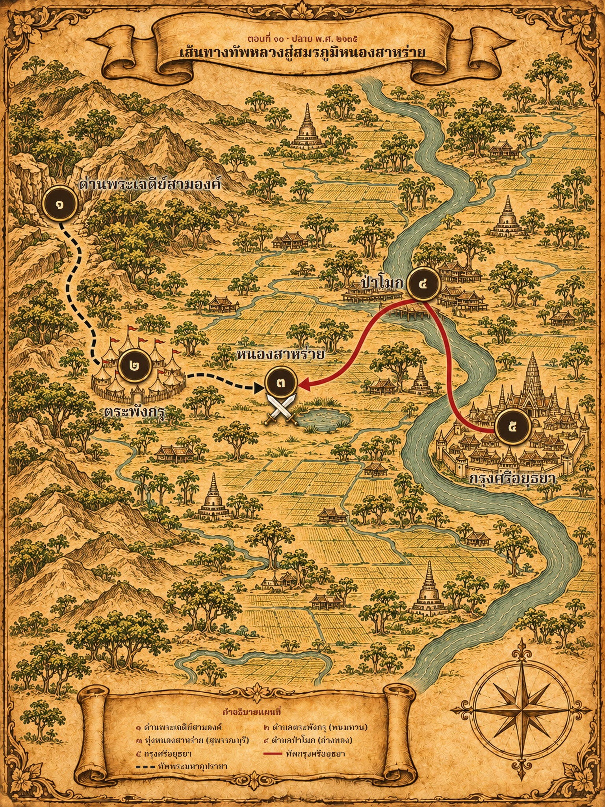

# ภาคที่ 3: มหายุทธหัตถีเปลี่ยนแผ่นดิน (พ.ศ. 2133 – 2137)
## ตอนที่ 10: ทัพหลวงหงสามุ่งสู่อโยธยา

---

### องก์ที่ 1: เดิมพันสุดท้ายของจักรวรรดิตองอู

ปลาย พ.ศ. 2135 — สายลมหนาวเดือนสิบสองพัดผ่านทุ่งรวงข้าวในลุ่มน้ำเจ้าพระยา ทว่าในท้องพระโรงกรุงหงสาวดีกลับอบอวลไปด้วยบรรยากาศอันตึงเครียดราวกับพายุที่กำลังก่อตัว

นับตั้งแต่ความพ่ายแพ้ที่ตำบลตะเข้สามพันเมื่อสองปีก่อน เกียรติภูมิของจักรวรรดิตองอูก็เสื่อมถอยลงอย่างหนัก ในสายตาของ **พระเจ้านันทบุเรง** กรุงศรีอยุธยาไม่ได้เป็นเพียงเมืองประเทศราชที่แข็งข้ออีกต่อไป หากกลายเป็นคู่แข่งที่กำลังสั่นคลอนอำนาจการปกครองเหนือหัวเมืองมอญ ล้านนา และไทใหญ่ทั้งหมด ดังนั้นใน **จ.ศ. 954 ปีมะโรง** (ปลาย พ.ศ. 2135) พระองค์จึงทรงตัดสินพระทัยทุ่มเทกำลังพลและทรัพยากรครั้งใหญ่ที่สุดเท่าที่หงสาวดีจะระดมได้ เพื่อปิดบัญชีแค้นกับอโยธยาให้จบสิ้นในคราวเดียว

กองทัพผสมของจักรวรรดิหงสาวดีถูกเรียกเกณฑ์จากทุกหัวเมืองสำคัญ ทั้งทัพหลวงกรุงหงสาวดี ทัพเมืองตองอู ทัพเมืองแปร และทัพเมืองเชียงใหม่ โดยพระเจ้านันทบุเรงทรงมอบหมายให้ **พระมหาอุปราชา (มังกยอชวา)** เป็นจอมทัพใหญ่ พร้อมด้วย **พระเจ้าแปร**, **เจ้าเมืองจาปะโร (มังจาชโร)** และแม่ทัพชั้นผู้ใหญ่อีกหลายนาย ตามความในพงศาวดารไทยและพม่า การระดมพลครั้งนี้กินเวลาเตรียมการนานหลายเดือน มีการเกณฑ์ไพร่พล ช้างศึก ม้าศึก และขบวนลำเลียงเสบียงขนาดมหึมาจากลุ่มน้ำอิรวดี–สะโตง–สาละวิน หมายจะใช้ความได้เปรียบด้านจำนวนพลบดขยี้กรุงศรีอยุธยาให้ราบคาบ

เมื่อล่วงเข้าสู่ปลายปี พ.ศ. 2135 กองทัพมหึมาของหงสาวดีก็เคลื่อนขบวนข้าม **ด่านพระเจดีย์สามองค์** เข้าสู่แผ่นดินสยามทางเมืองกาญจนบุรี เส้นทางเดินทัพผ่านหุบเขาและป่าทึบจากด่านพระเจดีย์สามองค์สู่ลุ่มน้ำแควน้อย–แควใหญ่ เป็นเส้นทางที่ต้องใช้ความอดทนสูง ทว่าเมื่อพ้นแนวเขาเข้าสู่ที่ราบเมืองกาญจนบุรีแล้ว ทัพพระมหาอุปราชาก็มาตั้งค่ายประชุมพลอยู่ที่ **ตำบลตระพังกรุ** (ปัจจุบันอยู่ในเขตอำเภอพนมทวน จังหวัดกาญจนบุรี) เพื่อรวบรวมกำลังพลจากทุกกองพันให้พร้อมเพรียง รอจังหวะรุกเข้าสู่ใจกลางลุ่มน้ำเจ้าพระยา

ทว่าคราวนี้ สมเด็จพระนเรศวรมหาราชไม่ได้ทรงรอให้ข้าศึกเดินทัพมาถึงชานพระนคร—แต่ทรงตัดสินพระทัยเคลื่อนทัพหลวงออกไปชิงสมรภูมิกลางทุ่งกว้างด้วยพระองค์เอง โดยทรงส่งหน่วยสอดแนมและกองกำลังลาดตระเวนล่วงหน้าไปจับตาความเคลื่อนไหวของทัพหงสาวดีตั้งแต่ชายแดนกาญจนบุรีทุกฝีก้าว

---

### องก์ที่ 2: อ่านกระดานการเมืองและหลักฐานซ่อนเงื่อน

เหตุการณ์ช่วงก่อนการปะทะใหญ่ที่หนองสาหร่ายเป็นอีกช่วงเวลาหนึ่งที่หลักฐานไทย พม่า และวรรณคดีเฉลิมพระเกียรติมีรายละเอียดซ้อนทับกันอยู่มาก นักสืบประวัติศาสตร์จึงต้องแยกแยะให้ชัดเจน:

- **บันทึกในฉบับหลวงประเสริฐอักษรนิติ์ (จ.ศ. 954):** ให้แกนข้อเท็จจริงและเส้นทางเดินทัพที่รัดกุมที่สุด โดยระบุว่าใน **จ.ศ. 954 ปีมะโรง เดือน 12** (พฤศจิกายน–ธันวาคม พ.ศ. 2135) พระมหาอุปราชายกทัพเข้ามาทางเมืองกาญจนบุรี มาตั้งทัพอยู่ที่ **ตำบลตระพังกรุ** ส่วน **สมเด็จพระนเรศวรมหาราช** และ **สมเด็จพระเอกาทศรถ** เสด็จยกทัพหลวงออกจากพระนครไปตั้งทัพชัยที่ **ตำบลป่าโมก** (ปัจจุบันอยู่ในเขตจังหวัดอ่างทอง) ก่อนจะเคลื่อนทัพต่อไปยัง **ทุ่งหนองสาหร่าย** เมืองสุพรรณบุรี เพื่อสกัดทัพข้าศึก
- **รายละเอียดในฉบับพันจันทนุมาศ (เจิม), ฉบับพระราชหัตถเลขา, คำให้การชาวกรุงเก่า และลิลิตตะเลงพ่าย:** พงศาวดารฉบับชำระชั้นหลังและวรรณคดีเฉลิมพระเกียรติได้เพิ่มเรื่องราวเชิงจิตวิทยาและลางสังหรณ์เข้ามาอย่างเข้มข้น เช่น เรื่องพระเจ้านันทบุเรงทรงตรัสเสียดสีพระมหาอุปราชาจนจำพระทัยยกทัพมา เรื่อง **ลางร้ายฉัตรหัก** และ **พระสุบิน** ของพระมหาอุปราชาในระหว่างเดินทัพ รวมถึงเรื่อง **พระบรมราชสารีริกธาตุเสด็จปาฏิหาริย์** เหนือทัพหลวงอยุธยาที่ตำบลป่าโมก (ทั้งนี้ พึงตระหนักว่าฉากลางสังหรณ์และปาฏิหาริย์เหล่านี้เป็นกลวิธีเล่าเรื่องเพื่อเสริมพระบารมีและสร้างอารมณ์โศกนาฏกรรมในพงศาวดารชั้นหลังและวรรณคดี มิได้ปรากฏใน *ฉบับหลวงประเสริฐอักษรนิติ์*)
- **หลักฐานฝ่ายพม่า (*มหาราชวงษ์ พงษาวดารพม่า* / *Hmannan Yazawin*):** บันทึกว่าการยกทัพในคราวนี้พระมหาอุปราชาทรงนำกำลังพลขนาดมหึมาจากหงสาวดีและเมืองประเทศราชเข้าสู่สยามด้วยความมุ่งมั่นที่จะตีกรุงศรีอยุธยาให้แตก โดยไม่ปรากฏเรื่องลางร้ายหรือการถูกพระบิดาบังคับขู่เข็ญอย่างในวรรณคดีไทย แต่สะท้อนถึงความมั่นใจของฝ่ายหงสาวดีในกำลังพลที่เหนือกว่า

---

### องก์ที่ 3: กลยุทธ์ชิงพื้นที่เปิดและกับดักบนทุ่งสุพรรณบุรี

#### ทำไมต้องออกไปรบที่หนองสาหร่าย?

คำถามสำคัญทางยุทธศาสตร์สำหรับผู้อ่านประวัติศาสตร์คือ เหตุใดสมเด็จพระนเรศวรมหาราชจึงไม่ทรงใช้ยุทธศาสตร์ตั้งรับในเกาะเมืองกรุงศรีอยุธยาเหมือนเมื่อ พ.ศ. 2129 ทั้งที่เกาะเมืองมีคูน้ำธรรมชาติและปืนใหญ่ป้องกันอย่างแข็งแกร่ง?

คำตอบซ่อนอยู่ในประสบการณ์อันขมขื่นของสงครามครั้งก่อน

แม้ใน พ.ศ. 2129–2130 กรุงศรีอยุธยาจะต้านทานการปิดล้อมของพระเจ้านันทบุเรงไว้ได้สำเร็จ แต่ราคาที่ต้องจ่ายคือ **พื้นที่เกษตรกรรมและทุ่งนาชานพระนครถูกเหยียบย่ำเสียหายอย่างหนัก** ไพร่พลและราษฎรต้องอัดแน่นอยู่ในเกาะเมืองนานครึ่งปี ข้าวปลาอาหารและเสบียงสำรองร่อยหรอลงอย่างรวดเร็ว หากปล่อยให้ทัพใหญ่ของพระมหาอุปราชาเดินทัพเข้ามาถึงชานพระนครได้อีก ชัยภูมิของอยุธยาก็จะตกอยู่ในภาวะตั้งรับยืดเยื้อทันที และอาจเปิดช่องให้หัวเมืองตะวันออกอย่างกัมพูชาฉวยโอกาสลอบตีซ้ำเติมจากด้านหลัง

ยิ่งไปกว่านั้น ในปลาย พ.ศ. 2135 กองทัพอยุธยามีความพร้อมมากกว่าเมื่อหกปีก่อนหลายเท่าทั้งด้านกำลังพล อาวุธปืนใหญ่ ปืนคาบชุดที่จัดหาเพิ่มเติมจากการค้าทางทะเล และโดยเฉพาะอย่างยิ่ง **กองช้างศึกและม้าศึก** ซึ่งต้องการพื้นที่ราบเปิดโล่งในการจัดขบวนทัพและพุ่งเข้าชน หากตั้งรับในเกาะเมืองที่มีลำน้ำล้อมรอบ กองช้างศึกและม้าศึกจะไม่สามารถสำแดงอานุภาพได้อย่างเต็มที่

เมื่อทรงทราบจากสายข่าวว่าทัพพระมหาอุปราชาข้ามด่านพระเจดีย์สามองค์มาตั้งประชุมพลที่ **ตำบลตระพังกรุ** (พนมทวน) สมเด็จพระนเรศวรมหาราชจึงทรงอ่านกระดานล่วงหน้าได้ทันทีว่า ข้าศึกมีสองทางเลือก คือเดินทัพตรงผ่านสุพรรณบุรีเข้าสู่อยุธยา หรือเลียบอ้อมขึ้นทางอ่างทองเพื่อตัดกำลัง สมเด็จพระนเรศวรจึงทรงตั้งค่ายหลวงรวมพลที่ **ตำบลป่าโมก** (ริมแม่น้ำเจ้าพระยาในเขตอ่างทอง) ซึ่งเป็นจุดยุทธศาสตร์ที่สามารถเคลื่อนพลไปทางตะวันตกเข้าสู่สุพรรณบุรีได้อย่างรวดเร็ว และยังคงรักษาเส้นทางลำเลียงทางน้ำจากอยุธยาไว้ได้ ทั้งยังสามารถเรียกกำลังหนุนจากหัวเมืองภาคกลางมาสมทบได้ทันท่วงที

#### เส้นทางสู่หนองสาหร่าย และการปะทะเบื้องต้น

จากตำบลป่าโมก กองทัพหลวงของสมเด็จพระนเรศวรและสมเด็จพระเอกาทศรถเคลื่อนพลมุ่งหน้าไปทางทิศตะวันตก ตัดข้ามแม่น้ำน้อยและทุ่งนาเข้าสู่แขวงเมืองสุพรรณบุรี ไปตั้งค่ายมั่นอยู่ที่ **ตำบลหนองสาหร่าย** (ปัจจุบันอยู่ในเขตอำเภอดอนเจดีย์ จังหวัดสุพรรณบุรี)

ภูมิประเทศของทุ่งหนองสาหร่ายในเดือนมกราคม—กลางฤดูแล้ง—คือที่ราบกว้างใหญ่ที่น้ำท่วมขังลดลงหมดแล้ว พื้นดินแห้งแข็งเหมาะแก่การเคลื่อนขบวนช้างศึก ม้าศึก และทหารราบจำนวนหลายหมื่นคน มีหนองน้ำธรรมชาติสำหรับหล่อเลี้ยงกำลังพลและช้างม้า ทั้งยังเป็นด่านธรรมชาติที่บีบให้ทัพพระมหาอุปราชาซึ่งเคลื่อนพลมาจากตระพังกรุต้องเผชิญหน้ากันซึ่งๆ หน้า การที่สมเด็จพระนเรศวรมหาราชทรงเลือกสมรภูมิเปิดโล่งแทนการตั้งรับหลังกำแพงเมือง สะท้อนถึงความเชื่อมั่นในประสิทธิภาพของกองทัพอยุธยาที่ทรงฝึกฝนและจัดระเบียบใหม่มาตลอดสิบปี ทั้งในด้านวินัยของทหารราบ การประสานงานระหว่างหน่วยปืนคาบชุดกับกองม้า และความคล่องตัวของกองช้างศึก

นอกจากนี้ การเดินทัพออกมาตั้งรับที่หนองสาหร่ายยังเป็นการบีบให้ฝ่ายหงสาวดีต้องรบในสภาพที่เส้นทางส่งกำลังบำรุงยืดยาวที่สุด กองทัพของพระมหาอุปราชาต้องลำเลียงเสบียงข้ามเทือกเขาตะนาวศรีมาไกลหลายร้อยกิโลเมตร ยิ่งการรบยืดเยื้อออกไปเพียงใด ฝ่ายหงสาวดีก็ยิ่งประสบปัญหาขาดแคลนเสบียงและน้ำดื่มมากเพียงนั้น

ตามความใน *ฉบับพันจันทนุมาศ (เจิม)* และ *ฉบับพระราชหัตถเลขา* ก่อนที่ทัพหลวงทั้งสองฝ่ายจะประจันหน้ากัน สมเด็จพระนเรศวรทรงส่ง **พระยาศรีไสยณรงค์** และ **พระยาราชฤทธานนท์** คุมกองทัพหน้าออกไปลาดตระเวนและปะทะหยั่งเชิงกับทัพหน้าของหงสาวดีที่เคลื่อนเข้ามาทางตำบลดอนเผาข้าว ผลของการปะทะเบื้องต้นเป็นไปอย่างดุเดือด ทหารม้าและทหารราบของทั้งสองฝ่ายเข้าตะลุมบอนกันกลางทุ่งโล่ง กองทัพหน้าของอยุธยาต้องเผชิญหน้ากับกำลังพลจำนวนมหาศาลของหงสาวดีที่ดาหน้าเข้ามาอย่างไม่ขาดสายจนเริ่มเสียเปรียบและต้องถอยร่นลงมาทางทัพหลวง

เสียงปืนใหญ่และเสียงโห่ร้องจากการปะทะของทัพหน้าดังแว่วมาถึงค่ายหลวงที่หนองสาหร่าย สมเด็จพระนเรศวรทรงประเมินสถานการณ์ได้ทันทีว่า กองทัพใหญ่ของพระมหาอุปราชาได้เคลื่อนขบวนเข้ามาประชิดเต็มอัตราศึกแล้ว และหากปล่อยให้ทัพหน้าแตกพ่ายถอยมาปะทะกับทัพหลวง ขบวนทัพทั้งหมดอาจเสียขวัญและพังทลายลงได้ พระองค์จึงทรงมีรับสั่งให้เตรียมกองทัพหลวงทั้งหมดให้พร้อมรบตั้งแต่ก่อนรุ่งสาง โดยทรงวางแผนจะทรงช้างพระที่นั่งนำทัพหลวงออกต้านทานและตีโต้กลับด้วยพระองค์เองทันทีที่ข้าศึกเคลื่อนเข้าสู่แนวปะทะ

---

### องก์ที่ 4: คืนก่อนวันชี้ชะตาแผ่นดิน

ค่ำคืนกลางเดือนมกราคม พ.ศ. 2136 (ตรงกับเดือนยี่ จ.ศ. 954 ตามปฏิทินจันทรคติโบราณ) เหนือทุ่งหนองสาหร่ายเต็มไปด้วยแสงคบเพลิงของกองทัพสองแผ่นดินที่ตั้งประจันหน้ากันอยู่ไม่ไกล

ฝั่งหนึ่งคือ **ทัพหลวงแห่งกรุงหงสาวดี** ภายใต้การนำของพระมหาอุปราชา มังกยอชวา ที่แบกรับเกียรติภูมิของจักรวรรดิตองอูและความกริ้วของพระราชบิดาไว้บนบ่า พร้อมด้วยกองทัพจากหลายหัวเมืองประเทศราชที่มีจำนวนไพร่พลเหนือกว่า

อีกฝั่งหนึ่งคือ **ทัพหลวงแห่งกรุงศรีอยุธยา** ภายใต้การนำของ **สมเด็จพระนเรศวรมหาราช** และ **สมเด็จพระเอกาทศรถ** กษัตริย์สองพระองค์ที่เติบโตมากับไฟสงครามและไม่เคยยอมถอยหลังให้ผู้รุกรานแม้แต่ก้าวเดียว

ไม่มีใครในคืนนั้นคาดคิดว่า รุ่งเช้าของ **วันจันทร์ แรม 2 ค่ำ เดือนยี่ จ.ศ. 954** ฝุ่นตลบเหนือทุ่งหนองสาหร่ายจะกลายเป็นฉากหลังของหนึ่งในเหตุการณ์ที่ถูกเล่าขานและถกเถียงมากที่สุดในประวัติศาสตร์เอเชียตะวันออกเฉียงใต้—วันที่ช้างทรงของพระมหากษัตริย์ไทยสองพระองค์จะบุกทะลวงฝ่าเข้าไปกลางวงล้อมของกองทัพหงสาวดีเพียงลำพัง และเปลี่ยนแปลงดุลอำนาจของทั้งภูมิภาคไปตลอดกาล!

**จบตอนที่ 10**

*(ติดตามต่อใน ตอนที่ 11: ยุทธหัตถีที่หนองสาหร่าย กลางฝุ่นควันสองหลักฐาน)*
