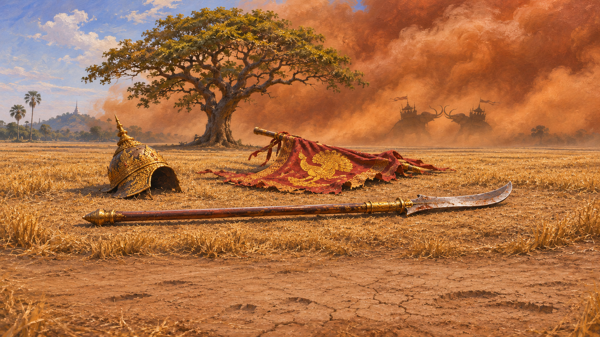
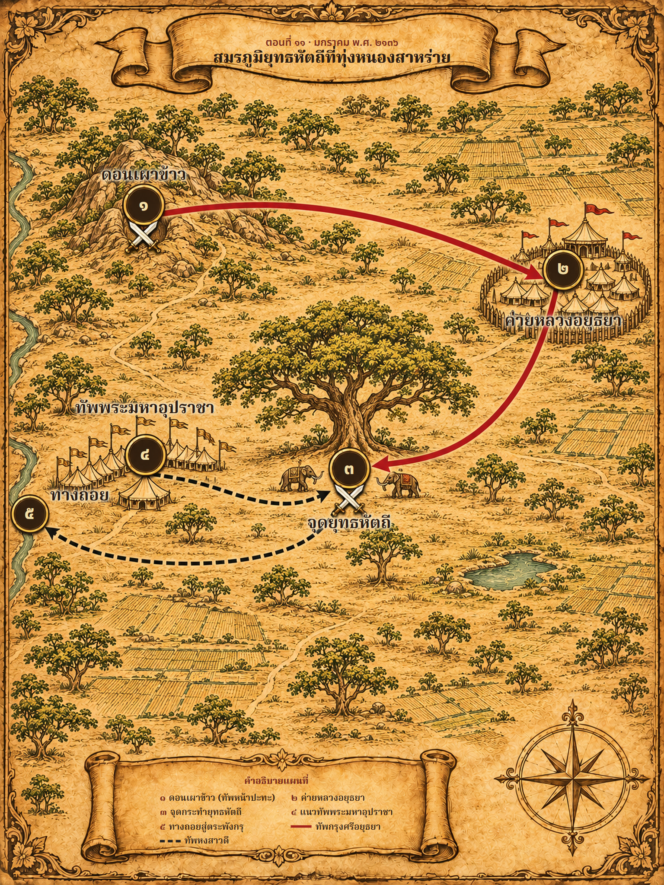

# ภาคที่ 3: มหายุทธหัตถีเปลี่ยนแผ่นดิน (พ.ศ. 2133 – 2137)
## ตอนที่ 11: ยุทธหัตถีที่หนองสาหร่าย กลางฝุ่นควันสองหลักฐาน

---

### องก์ที่ 1: ฝุ่นตลบเหนือทุ่งหนองสาหร่าย

**วันจันทร์ แรม 2 ค่ำ เดือนยี่ จ.ศ. 954** — ตรงกับเดือน **มกราคม พ.ศ. 2136 ตามปฏิทินสากล** (หรือ พ.ศ. 2135 ตามการนับปีแบบโบราณ และตรงกับเดือนมกราคม ค.ศ. 1593)

แสงแดดยามสายสาดส่องลงบนผืนดินแห้งผากของ **ทุ่งหนองสาหร่าย** แขวงเมืองสุพรรณบุรี เสียงกลองศึก เสียงแตรสังข์ และเสียงคำรามของช้างศึกหลายร้อยเชือกดังประสานกันจนแผ่นดินสะเทือน ฝุ่นดินสีแดงคลุ้งตลบขึ้นสู่ท้องฟ้าจนบดบังทัศนวิสัยไปทั่วทั้งสมรภูมิ

เมื่อกองทัพหน้าของอยุธยาภายใต้การนำของพระยาศรีไสยณรงค์และพระยาราชฤทธานนท์ถอยร่นลงมาจากการปะทะกับทัพหน้าหงสาวดี แรงกดดันมหาศาลก็ถาโถมเข้าใส่แนวรบของทัพหลวงทันที ทว่าแทนที่จะถอยขบวนเพื่อจัดแนวตั้งรับใหม่ **สมเด็จพระนเรศวรมหาราช** และ **สมเด็จพระเอกาทศรถ** กลับทรงตัดสินพระทัยเคลื่อนช้างพระที่นั่งรุดขึ้นไปหนุนแนวหน้า เพื่อรับทัพหน้าที่ถอยร่นและหยุดยั้งแรงกระแทกของข้าศึก

ทว่าเหตุการณ์หลังจากนั้นกลับเกินกว่าที่ผู้ใดวางแผนไว้ ตามความในพงศาวดารไทย ในห้วงเวลาอันชุลมุนนั้นเอง ช้างทรงของทั้งสองพระองค์—ซึ่งพงศาวดารไทยออกนามว่า **เจ้าพระยาไชยานุภาพ** (พลายภูเขาทอง) ของสมเด็จพระนเรศวร และ **เจ้าพระยาปราบไตรจักร** ของสมเด็จพระเอกาทศรถ—เกิดอาการตกมันและตื่นเสียงปืนเสียงกลองศึก ทั้งสองเชือกวิ่งโผนฝ่าฝุ่นควันทะลวงเข้าไปกลางวงล้อมของกองทัพหงสาวดีอย่างรวดเร็ว ทิ้งให้ไพร่พลและแม่ทัพนายกองของอยุธยาตามเสด็จไม่ทัน

เมื่อฝุ่นควันค่อยๆ จางลง เบื้องหน้าของพระเจ้าอยู่หัวทั้งสองพระองค์มิใช่แนวรบของฝ่ายตน หากคือป่าหอกปืนและวงล้อมของทัพหลวงหงสาวดี ภายใต้ร่ม **ต้นข่อย** หรือร่มไม้ใหญ่กลางทุ่งหนองสาหร่าย—ที่ซึ่งพระมหาอุปราชา มังกยอชวา ทรงช้างพลายพัทธกอประทับบัญชาการรบอยู่ท่ามกลางเหล่าแม่ทัพนายกอง!

---

### องก์ที่ 2: กางไพ่หลักฐาน 3 ฝ่าย — ความขัดแย้งใหญ่ที่สุดในประวัติศาสตร์

เหตุการณ์ที่ทุ่งหนองสาหร่ายในเดือนมกราคม พ.ศ. 2136 คือจุดที่หลักฐานฝ่ายไทย ฝ่ายพม่า และบันทึกชาวต่างชาติมีความขัดแย้งกันมากที่สุดในประวัติศาสตร์เอเชียตะวันออกเฉียงใต้ ในฐานะนักสืบประวัติศาสตร์ เราจะกางไพ่หลักฐานทั้ง 3 ฝ่ายวางเทียบกันอย่างตรงไปตรงมาใน 4 ประเด็นสำคัญ:

#### 1. ประเด็นศักราชและวันเวลา

- **ฝ่ายไทย (*พระราชพงศาวดาร ฉบับหลวงประเสริฐอักษรนิติ์*):** ระบุวันเวลาไว้อย่างชัดเจนที่สุดคือ **วันจันทร์ แรม 2 ค่ำ เดือนยี่ จ.ศ. 954** (เมื่อคำนวณเทียบปฏิทินสากลคือเดือน **มกราคม พ.ศ. 2136** หรือ ค.ศ. 1593 ซึ่งตรงกับ พ.ศ. 2135 ตามระบบนับปีเปลี่ยนศักราชในเดือนเมษายนแบบโบราณ) ทั้งนี้ *ฉบับพันจันทนุมาศ (เจิม)* และ *ฉบับพระราชหัตถเลขา* มีความคลาดเคลื่อนเรื่องวันข้างแรมเล็กน้อย แต่นักประวัติศาสตร์ส่วนใหญ่ยึดถือศักราชจาก *ฉบับหลวงประเสริฐฯ* เป็นหลัก
- **ฝ่ายพม่าและยุโรป:** *มหาราชวงษ์ พงษาวดารพม่า* (*Hmannan Yazawin*) รวมถึงบันทึกชาวยุโรปอย่าง *พงศาวดารกรุงศรีอยุธยา ฉบับวันวลิต* และเอกสารโปรตุเกส–สเปนรุ่นหลัง มีวันเดือนและปีที่คลาดเคลื่อนกันบ้างตามระบบปฏิทินและระยะเวลาการรับข่าวสาร ทว่าทั้งหมดยืนยันตรงกันว่ามหาศึกชี้ชะตาครั้งนี้เกิดขึ้นในราว ค.ศ. 1592–1593

#### 2. ประเด็นเหตุการณ์ก่อนการปะทะ

- **ฝ่ายไทย:** *พระราชพงศาวดาร ฉบับหลวงประเสริฐอักษรนิติ์* บันทึกอย่างกระชับเพียงว่า สมเด็จพระนเรศวรทรงช้างต้นพระยาไชยานุภาพเสด็จออกรบพระมหาอุปราชา ณ ตำบลหนองสาหร่าย โดย "ครั้งนั้นมิได้ตามฤกษ์ แลฝ่าฤกษ์หน่อยหนึ่ง" ส่วนรายละเอียดที่ว่าช้างทรงของสมเด็จพระนเรศวรและสมเด็จพระเอกาทศรถตกมันและวิ่งฝ่าเข้าไปกลางวงล้อมข้าศึกเพียงสองช้าง โดยไม่มีกองทหารราบหรือแม่ทัพนายกองตามเสด็จเข้าไปด้วยนั้น มาจาก *ฉบับพันจันทนุมาศ (เจิม)* และ *ฉบับพระราชหัตถเลขา*
- **ฝ่ายพม่า (*มหาราชวงษ์ พงษาวดารพม่า* / *Hmannan Yazawin*):** ไม่ได้เล่าเรื่องช้างทรงตกมันวิ่งหลงเข้าไป แต่ระบุว่าทัพหน้าของอยุธยาแตกพ่ายถอยร่นลงมา จากนั้นกองทัพใหญ่ของทั้งสองฝ่ายจึงเข้าปะทะตะลุมบอนกันอย่างดุเดือดท่ามกลางฝุ่นควันที่หนาทึบจนไม่อาจมองเห็นขบวนทัพได้ชัดเจน

#### 3. ประเด็นสาเหตุการสิ้นพระชนม์ของพระมหาอุปราชา (มังกยอชวา)

นี่คือจุดที่บันทึกของสองแผ่นดินแตกต่างกันอย่างสิ้นเชิง:

- **ฝ่ายไทย (*ฉบับหลวงประเสริฐฯ*, *ฉบับพันจันทนุมาศ (เจิม)*, *ฉบับพระราชหัตถเลขา*):** *พระราชพงศาวดาร ฉบับหลวงประเสริฐอักษรนิติ์* บันทึกข้อเท็จจริงของการชนช้างไว้อย่างกระชับว่า เมื่อได้ชนช้างด้วยพระมหาอุปราชานั้น สมเด็จพระนเรศวรต้องปืน ณ พระหัตถ์ข้างขวาหน่อยหนึ่ง และเมื่อพระมหาอุปราชาขี่ช้างออกมายืนอยู่นั้น หมวกที่พระมหาอุปราชาทรงใส่อยู่ตกลงถึงดินแล้วเอาคืนขึ้นใส่เล่า ครั้งนั้นพระมหาอุปราชาขาดคอช้างตายในที่นั้น และพระราชทานนามช้างต้นพระยาไชยานุภาพว่า "เจ้าพระยาปราบหงสา" ส่วนรายละเอียดที่ว่าเมื่อสมเด็จพระนเรศวรทรงเห็นพระมหาอุปราชาประทับบนคอช้างอยู่ใต้ร่มไม้ จึงทรงขับช้างพระที่นั่งเข้าไปใกล้และตรัสท้าให้เสด็จออกมา **"กระทำยุทธหัตถี"** เพื่อเป็นเกียรติยศแก่กษัตริย์สองแผ่นดิน พระมหาอุปราชาทรงรับคำท้าและไสช้างเข้าชนกันอย่างดุเดือด ในจังหวะแรกช้างทรงของสมเด็จพระนเรศวรเสียเปรียบเบนขวาง แต่ทรงแก้สถานการณ์ได้ทันและทรงฟันพระมหาอุปราชาด้วย **พระแสงของ้าวเจ้าพระยาแสนพลพ่าย** สิ้นพระชนม์บนคอช้างนั้น มาจาก *ฉบับพันจันทนุมาศ (เจิม)* และ *ฉบับพระราชหัตถเลขา*
- **ฝ่ายพม่า (*มหาราชวงษ์ พงษาวดารพม่า* / *Hmannan Yazawin*):** บันทึกต่างออกไปอย่างสิ้นเชิงว่า ในระหว่างการรบตะลุมบอนกลางฝุ่นควัน ช้างศึกของแม่ทัพพม่าผู้หนึ่งเกิดอาการตกมันพุ่งเข้าปะทะจนขบวนช้างของพระมหาอุปราชาเสียหลักและเปิดช่อง ทหารฝ่ายอยุธยาจึงระดมยิงปืนเข้าใส่ในระยะใกล้ และ **กระสุนปืนได้พุ่งเข้าถูกพระมหาอุปราชา** พร้อมด้วยควาญหน้าสิ้นพระชนม์บนคอช้าง มิได้ทรงพ่ายแพ้ในการชนช้างตัวต่อตัว จากนั้น **ตุลิพะละ** (พันท้ายช้าง) จึงช่วยประคองพระศพให้พิงอานช้างไว้เพื่อไม่ให้ไพร่พลเสียขวัญแล้วพาถอยทัพกลับ
- **เอกสารต่างชาติ (ยุโรป):** บันทึกของชาวตะวันตกรุ่นหลังก็มีรายละเอียดแตกต่างกันไป เช่น **เยเรเมียส วันวลิต** พ่อค้าชาวดัตช์ที่เข้ามาพำนักในกรุงศรีอยุธยาสมัยพระเจ้าปราสาททอง ราว 46 ปีหลังเหตุการณ์ (พ.ศ. 2182) ได้บันทึกคำบอกเล่าที่สืบต่อกันมาในอยุธยาที่ยืนยันถึงการเผชิญหน้าบนหลังช้างและการสิ้นพระชนม์ของอุปราชพม่ากลางสมรภูมิ ขณะที่บันทึกของชาวโปรตุเกสและสเปนบางกระแสในช่วงปลายคริสต์ศตวรรษที่ 16–17 กล่าวถึงความชุลมุนของการรบและการใช้อาวุธปืนในสนามรบด้วยเช่นกัน

#### 4. ประเด็นเหตุการณ์หลังศึก

- **การลงโทษแม่ทัพและสมเด็จพระพนรัตน์ วัดป่าแก้ว:** เรื่องราวที่สมเด็จพระนเรศวรทรงพระพิโรธแม่ทัพนายกองที่ตามเสด็จไม่ทันจนมีรับสั่งให้ประหารชีวิต แต่ **สมเด็จพระพนรัตน์ วัดป่าแก้ว** พร้อมพระสงฆ์ราชาคณะได้เข้าเฝ้าทูลขอพระราชทานอภัยโทษโดยเปรียบเทียบกับการเสด็จออกปราบมารของพระพุทธเจ้า (และเสนอให้ส่งแม่ทัพเหล่านั้นไปตีเมืองทวาย–ตะนาวศรีเป็นการไถ่โทษ) ปรากฏอย่างละเอียดใน *ฉบับพันจันทนุมาศ (เจิม)*, *ฉบับพระราชหัตถเลขา* และ *ลิลิตตะเลงพ่าย* ทว่า **ไม่ปรากฏเรื่องราวนี้ในพระราชพงศาวดาร ฉบับหลวงประเสริฐอักษรนิติ์** แต่อย่างใด

---

### องก์ที่ 3: นาทีต่อนาทีกลางสมรภูมิ — จากความจริงร่วมสมัยสู่ยุทธศาสตร์พลิกแผ่นดิน

เมื่อวางหลักฐานทั้งหมดไว้บนโต๊ะแล้ว สิ่งที่หลักฐานทุกฝ่ายยืนยันตรงกันเป็นแกนข้อเท็จจริงคือ—ในเดือนมกราคม พ.ศ. 2136 (ตามปฏิทินสากล) กองทัพอยุธยาและกองทัพหงสาวดีได้ปะทะกันอย่างดุเดือด ณ ทุ่งหนองสาหร่าย จน **พระมหาอุปราชา (มังกยอชวา) สิ้นพระชนม์บนคอช้างกลางสมรภูมิ** และทำให้ทัพใหญ่ของหงสาวดีต้องแตกพ่ายถอยกลับไป ส่วนรายละเอียดว่าเหตุการณ์ในเสี้ยววินาทีสุดท้ายเป็นการดวลช้างตัวต่อตัวด้วยพระแสงของ้าวตามพงศาวดารไทย หรือเป็นการถูกกระสุนปืนในความชุลมุนตามพงศาวดารพม่านั้น เป็นจุดที่หลักฐานแต่ละแผ่นดินบันทึกไว้ต่างกันอย่างไม่อาจสรุปชี้ขาดแทนหลักฐานได้

#### กลยุทธ์การรบและความเป็นความตายในวงล้อม

ในบริบทของพงศาวดารไทย เหตุการณ์ที่เกิดขึ้นในวงล้อมทหารหงสาวดีคือจุดสูงสุดของ **"สงครามจิตวิทยาส่วนบุคคล"** หากพิจารณาตามหลักยุทธวิธี การที่ช้างทรงสองเชือกตกอยู่ในวงล้อมของข้าศึกนับหมื่นถือเป็นความหายนะที่แทบไม่มีทางรอด ทางรอดเดียวที่มีอยู่คือต้องพุ่งเข้าหา **"หัวใจของกองทัพข้าศึก"** โดยตรง

เมื่อสมเด็จพระนเรศวรทรงเห็นพระมหาอุปราชาประทับอยู่บนคอช้างภายใต้ร่มไม้ การตรัสท้าประลองยุทธหัตถีตามขัตติยราชประเพณีจึงมิใช่เพียงเรื่องของศักดิ์ศรีนักรบ หากคือกลยุทธ์ที่ฉลาดหลักแหลมที่สุดในสถานการณ์วิกฤต เพราะหากทหารหงสาวดีรุมสังหารกษัตริย์อยุธยาในขณะนั้น พระมหาอุปราชาก็จะทรงถูกครหาว่าขลาดเขลาไม่กล้าสู้ตัวต่อตัว ท้ายที่สุดพระมหาอุปราชาจึงจำต้องไสช้างพลายพัทธกอออกมาเผชิญหน้า

แม้ในจังหวะแรก ช้างเจ้าพระยาไชยานุภาพจะเสียหลักเบนข้างให้ช้างข้าศึกจนต้องรับแรงปะทะอย่างหนัก (และตามพงศาวดารไทย กลางควันปืนและความโกลาหลนั้น **นายมหานุภาพ** ควาญช้างท้ายของสมเด็จพระนเรศวรก็ถูกกระสุนปืนของข้าศึกเสียชีวิตบนคอช้าง รวมถึงทหาร **จาตุรงคบาท** ที่คอยอารักขาเท้าช้างทั้งสี่ด้านต้องต่อสู้ต้านทานทหารหงสาวดีอย่างสุดกำลังท่ามกลางห่ากระสุนและหอกดาบ) แต่เมื่อเจ้าพระยาไชยานุภาพได้จังหวะถอยยันและสะบัดช้างพลายพัทธกอของพระมหาอุปราชาให้เบนข้างออกได้ สมเด็จพระนเรศวรก็ทรงเงื้อ **พระแสงของ้าว** ฟันฉับเข้าที่พระอังสาของพระมหาอุปราชาจนขาดสะพายแล่ง สิ้นพระชนม์ซบลงบนคอช้าง

ในเวลาเดียวกัน **สมเด็จพระเอกาทศรถ** ซึ่งทรงช้างเจ้าพระยาปราบไตรจักรอยู่เคียงข้าง ก็ทรงชนช้างปะทะกับ **เจ้าเมืองจาปะโร (มังจาชโร)** และทรงฟันเจ้าเมืองจาปะโรสิ้นชีวิตบนคอช้างเช่นกัน (ส่วนพระเจ้าแปรนั้นเป็นคนละองค์กัน ยังทรงมีพระชนมชีพอยู่และต่อมาได้แข็งเมืองต่อหงสาวดีในภายหลัง) ขณะที่ **หมื่นภักดีศวร** ควาญช้างท้ายของสมเด็จพระเอกาทศรถก็ถูกอาวุธข้าศึกเสียชีวิตในการรบประชิดตัวครั้งนี้ด้วย

ไม่ว่าในเสี้ยววินาทีสุดท้าย พระมหาอุปราชาจะสิ้นพระชนม์ด้วยคมพระแสงของ้าวตามบันทึกฝ่ายไทย หรือด้วยกระสุนปืนในความชุลมุนตามบันทึกฝ่ายพม่า ผลลัพธ์ในสนามรบก็ชัดเจนอย่างไม่อาจโต้แย้งได้—เมื่อจอมทัพและองค์รัชทายาทแห่งกรุงหงสาวดีสิ้นพระชนม์ลงต่อหน้าต่อตา ไพร่พลหงสาวดีที่กำลังโอบล้อมอยู่ก็ขวัญกระเจิงและพังทลายลงทันที การที่แม่ทัพสูงสุดสองคนของหงสาวดีล้มลงพร้อมกันกลางสมรภูมิ ทำให้สายการบังคับบัญชาของกองทัพผสมจากหงสาวดี ตองอู แปร และเชียงใหม่ขาดสะบั้นลงในพริบตา

กองทัพอยุธยาที่ตามเสด็จมาทันเวลาเปิดฉากระดมยิงปืนและไล่ตีทัพหงสาวดีจนแตกพ่ายยับเยิน ทหารหงสาวดีล้มตายและถูกจับเป็นเชลยจำนวนมหาศาล ส่วนที่เหลือต่างทิ้งอาวุธและเสบียงหนีตายกลับข้ามด่านพระเจดีย์สามองค์อย่างไม่เป็นขบวน ตามความใน *ฉบับหลวงประเสริฐอักษรนิติ์* และ *ฉบับพันจันทนุมาศ (เจิม)* ช้างม้าศาสตราวุธของข้าศึกถูกยึดได้เป็นอันมาก ก่อนที่สมเด็จพระนเรศวรจะทรงนำทัพหลวงเสด็จกลับคืนสู่พระนครอย่างผู้มีชัยเด็ดขาด

---

### องก์ที่ 4: แรงสะเทือนข้ามอุษาคเนย์ และจุดจบของภัยคุกคามตะวันตก

ชัยชนะที่ทุ่งหนองสาหร่ายในเดือนมกราคม พ.ศ. 2136 (ตามปฏิทินสากล) มิใช่เพียงชัยชนะในสมรภูมิหนึ่ง หากคือ **จุดเปลี่ยนทางประวัติศาสตร์ที่พลิกดุลอำนาจของอุษาคเนย์ไปตลอดกาล**

นับตั้งแต่วันที่พระมหาอุปราชาสิ้นพระชนม์กลางทุ่งสุพรรณบุรี **จักรวรรดิตองอูแห่งกรุงหงสาวดีไม่เคยสามารถระดมทัพใหญ่เข้ามาเหยียบแผ่นดินกรุงศรีอยุธยาได้อีกเลยตลอดรัชสมัยของพระเจ้านันทบุเรง**

ความสูญเสียองค์รัชทายาทและแม่ทัพนายกองชั้นผู้ใหญ่ทำให้ราชสำนักหงสาวดีเข้าสู่ภาวะระส่ำระสายอย่างหนัก พระเจ้านันทบุเรงทรงสูญเสียความชอบธรรมและอำนาจควบคุมเหนือหัวเมืองประเทศราชไปเกือบสิ้นเชิง ทั้งตองอู แปร อังวะ และเชียงใหม่ต่างเริ่มตีตัวออกห่าง เตรียมพร้อมสำหรับสงครามแย่งชิงอำนาจภายในของพม่าเอง

ในทางตรงกันข้าม กรุงศรีอยุธยาในรัชสมัยของ **สมเด็จพระนเรศวรมหาราช** และ **สมเด็จพระเอกาทศรถ** ได้ก้าวขึ้นมาเป็นมหาอำนาจทางทหารอันดับหนึ่งของภูมิภาคอย่างเต็มภาคภูมิ ชื่อเสียงพระบรมเดชานุภาพของกษัตริย์นักรบแห่งอโยธยาเลื่องลือไปไกลถึงราชสำนักหมิงในกรุงปักกิ่งและหมู่เกาะฟิลิปปินส์ของสเปน

และเมื่อแนวรบด้านตะวันตกสงบลงอย่างถาวร สมเด็จพระนเรศวรมหาราชก็ทรงหันพระพักตร์ไปทางทิศตะวันออก—เพื่อเดินหมากการทูตระดับนานาชาติและปิดบัญชีแค้นกับอาณาจักรกัมพูชาที่คอยลอบโจมตีแนวหลังของอยุธยามาตลอดสิบปี!

**จบตอนที่ 11**

*(ติดตามต่อใน ตอนที่ 12: แผนรุกตะวันออกสู่หมิง และพิธีปฐมกรรมที่กรุงละแวก)*
