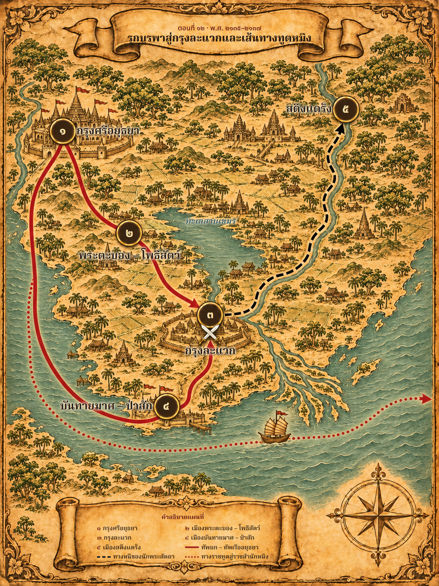

# ภาคที่ 3: มหายุทธหัตถีเปลี่ยนแผ่นดิน (พ.ศ. 2133 – 2137)
## ตอนที่ 12: แผนรุกตะวันออกสู่หมิง และพิธีปฐมกรรมที่กรุงละแวก

---

### องก์ที่ 1: เมื่อผู้ตั้งรับหันหัวเรือรบสู่บูรพา

พ.ศ. 2135–2136 — ตั้งแต่ก่อนศึกหนองสาหร่ายจนถึงวันที่ควันปืนเหนือทุ่งจางหาย กรุงศรีอยุธยาได้ขยับหมากบนกระดานภูมิรัฐศาสตร์ครั้งใหญ่ที่สุดครั้งหนึ่งในประวัติศาสตร์ไทย

ตลอดเกือบสองทศวรรษที่ผ่านมา ยุทธศาสตร์ของกรุงศรีอยุธยามีเป้าหมายหลักอยู่ที่การเอาตัวรอดจากภัยคุกคามทางทิศตะวันตก ทว่าในยามที่อยุธยาต้องทุ่มเทกำลังทั้งหมดรับศึกหงสาวดี ราชอาณาจักรเพื่อนบ้านทางทิศตะวันออกอย่าง **กัมพูชา** ภายใต้การปกครองของ **นักพระสัตถา** (หรือพระยาละแวก) กลับฉวยโอกาสส่งกองทัพเข้ามารุกรานหัวเมืองชายแดนด้านตะวันออก—ตั้งแต่ปราจีนบุรี นครนายก ฉะเชิงเทรา ไปจนถึงเพชรบุรี—เพื่อกวาดต้อนผู้คนและทรัพย์สินอยู่เนืองๆ

บัดนี้ เมื่อทัพใหญ่ของหงสาวดีพ่ายแพ้หมดรูปที่หนองสาหร่าย แนวรบด้านตะวันตกก็สงบลงอย่างถาวร **สมเด็จพระนเรศวรมหาราช** จึงทรงมีเสรีภาพทางยุทธศาสตร์อย่างเต็มเปี่ยมที่จะหันไปสะสางปัญหาแนวรบด้านตะวันออกให้เด็ดขาด

ทว่าความน่าทึ่งของสมเด็จพระนเรศวรในห้วงเวลานี้ไม่ได้จำกัดอยู่แค่การกรีฑาทัพบุกกรุงละแวกเท่านั้น—แม้ในขณะที่ศึกหงสาวดียังคุกรุ่นอยู่ทางตะวันตก พระองค์ก็ทรงมองเกมการเมืองไกลไปถึงเอเชียตะวันออก เมื่อมหาอำนาจทางทะเลอย่าง **ญี่ปุ่น** ภายใต้การนำของ **โทโยโตมิ ฮิเดโยชิ** กำลังยกทัพบุกคาบสมุทรเกาหลีเพื่อกรุยทางสู่ **จักรวรรดิต้าหมิง** ใน **สงครามอิมจิน** (เริ่ม พ.ศ. 2135 และยืดเยื้อไปจนราว พ.ศ. 2141) พระมหากษัตริย์แห่งอโยธยาก็ทรงมีพระราชสาส์นข้ามทะเลไปถึงกรุงปักกิ่ง เสนอตัวช่วยราชสำนักหมิงรบกับญี่ปุ่นอย่างเหนือความคาดหมาย!

---

### องก์ที่ 2: อ่านกระดานการทูตหมิงและปมขัดแย้งศึกกรุงละแวก

เมื่อกางหลักฐานข้ามแผ่นดินในเหตุการณ์ช่วง พ.ศ. 2135–2137 เราจะพบข้อมูลอันล้ำค่าจากทั้งเอกสารจีน สเปน–โปรตุเกส กัมพูชา และไทย ที่เผยให้เห็นความซับซ้อนของประวัติศาสตร์มากกว่าที่เคยรับรู้กัน:

- **บันทึกในจดหมายเหตุราชวงศ์หมิง (*Ming Shilu* พ.ศ. 2135–2136):** เอกสารราชการจีนบันทึกไว้อย่างชัดเจนว่า ในปี ค.ศ. 1592–1593 (พ.ศ. 2135–2136 ตรงกับรัชศกว่านลี่ปีที่ 20–21) ราชสำนักกรุงศรีอยุธยา (เสียนหลัว) ได้ส่งคณะทูตนำพระราชสาส์นไปถวาย **จักรพรรดิว่านลี่** แห่งราชวงศ์หมิง เสนอที่จะส่งกองทัพเรือและกำลังพลไปช่วยราชสำนักหมิงโจมตีญี่ปุ่นที่กำลังรุกรานเกาหลี ซึ่งในชั้นแรก **กรมกลาโหม** ของหมิงเป็นฝ่ายเสนอให้สยามยกทัพไปตีญี่ปุ่นตามข้อเสนอนั้น ทว่าในเดือน 1 ของรัชศกว่านลี่ปีที่ 21 (ต้น ค.ศ. 1593) **เซียวเยี่ยน (萧彦)** ผู้ว่าการมณฑลกวางตุ้ง–กวางสี ได้ถวายฎีกาคัดค้านโดยชี้ถึงปัญหาความห่างไกลทางภูมิศาสตร์และความไม่แน่นอนของการใช้กำลังต่างชาติ ซึ่งราชสำนักหมิงเห็นด้วยกับการคัดค้านของเซียวเยี่ยนจึงระงับแผนการดังกล่าวไป หลักฐานชิ้นนี้สะท้อนว่าราชสำนักอยุธยาติดตามสถานการณ์ในเอเชียตะวันออกอย่างใกล้ชิด และพร้อมจะวางตำแหน่งกรุงศรีอยุธยาเป็นพันธมิตรของจีน แม้ขณะที่ศึกหงสาวดียังไม่จบลง
- **ศึกกรุงละแวกในฉบับหลวงประเสริฐอักษรนิติ์ (จ.ศ. 955):** ในส่วนของสงครามกัมพูชา *ฉบับหลวงประเสริฐฯ* บันทึกเหตุการณ์ปี **จ.ศ. 955 ปีมะเส็ง** (พ.ศ. 2136) อย่างสั้นกระชับว่า สมเด็จพระนเรศวรเสด็จกรีฑาทัพไปตีเมืองละแวกแตกในเดือน 4 (ต้น พ.ศ. 2137 ตามปฏิทินสากล) โดยระบุเพียงว่าทรง **จับตัว "พญาศรีพรรณ"** (อนุชาของพระยาละแวก) ได้เท่านั้น มิได้กล่าวถึงการจับตัวนักพระสัตถาหรือพิธีปฐมกรรมแต่อย่างใด
- **ฉบับพันจันทนุมาศ (เจิม) และฉบับพระราชหัตถเลขา:** พงศาวดารฉบับชำระชั้นหลังเล่าขยายความไว้อย่างดุเดือดว่า กองทัพอยุธยาจับตัว **นักพระสัตถา (พระยาละแวก)** พร้อมครอบครัวได้ในเมืองละแวก แล้วสมเด็จพระนเรศวรทรงมีรับสั่งให้ทำ **"พิธีปฐมกรรม"** ประหารชีวิตพระยาละแวกและนำพระโลหิตมาล้างพระบาทเพื่อแก้แค้นที่เคยลอบซ้ำเติมอยุธยาในยามคับขัน
- **พงศาวดารเขมรและเอกสารสเปน–ฟิลิปปินส์:** บันทึกของ **บลาส รุยซ์ (Blas Ruiz)** ชาวสเปน และ **ดีโอโก เวโลโซ (Diego Veloso)** ชาวโปรตุเกส—ผู้ซึ่งอยู่ในราชสำนักละแวกและเป็นทหารอาสาร่วมสมัยเหตุการณ์—รวมถึง *พงศาวดารเขมร* ระบุตรงกันว่า ก่อนที่ทัพอยุธยาจะตีกรุงละแวกแตก **นักพระสัตถา** และโอรสได้เสด็จหนีออกจากราชธานีไปทางเมือง **สตึงแตร็ง** และลี้ภัยต่อไปยังอาณาจักรล้านช้างจนเสด็จสวรรคตที่นั่นในเวลาต่อมา ส่วนผู้ที่ถูกทัพอยุธยาจับได้และนำกลับมาคือ **พญาศรีพรรณ** (พระศรีสุพรรณมาธิราช) พระอนุชาของนักพระสัตถา ซึ่งสอดคล้องกับข้อความใน *ฉบับหลวงประเสริฐอักษรนิติ์* อย่างน่าทึ่ง!

---

### องก์ที่ 3: ยุทธการตีกรุงละแวก — ปิดฉากภัยคุกคามบูรพา

#### เกมการทูตก่อนเปิดศึก

การส่งพระราชสาส์นถึงราชสำนักหมิงในช่วง พ.ศ. 2135–2136—คู่ขนานไปกับศึกหงสาวดีและก่อนทัพใหญ่จะเคลื่อนพลไปกัมพูชา—สะท้อนชั้นเชิงทางการทูตอันเหนือชั้นของสมเด็จพระนเรศวร ในเวลานั้นชาวจีนโพ้นทะเลและสำเภาการค้าจากอยุธยาเป็นเส้นเลือดใหญ่ของเศรษฐกิจท้องพระคลัง ขณะเดียวกันสงครามอิมจินในคาบสมุทรเกาหลีทำให้ราชสำนักหมิงต้องทุ่มเทกำลังทหารและงบประมาณมหาศาลเพื่อต้านทานทัพญี่ปุ่นของโทโยโตมิ ฮิเดโยชิ การที่อยุธยาเสนอตัวส่งกองทัพเรือไปช่วยตีกระหนาบญี่ปุ่นจากทางทะเล จึงเป็นการแสดงให้กรุงปักกิ่งเห็นว่าอยุธยามีแสนยานุภาพทางเรือระดับภูมิภาค ส่วนจะมีเป้าหมายแฝงด้านการค้าบรรณาการ (จิ้มก้อง) หรือการเสริมความชอบธรรมในฐานะมิตรของจักรวรรดิต้าหมิงด้วยหรือไม่ เป็นการตีความของนักประวัติศาสตร์รุ่นหลัง เพราะเอกสารหมิงไม่ได้บันทึกเจตนาของฝ่ายอยุธยาไว้

แม้สุดท้ายราชสำนักหมิงจะเห็นด้วยกับคำคัดค้านของเซียวเยี่ยน ผู้ว่าการกวางตุ้ง–กวางสี และระงับแผนการให้สยามยกทัพไปตีญี่ปุ่นด้วยความกังวลเรื่องระยะทางและความไม่แน่นอนของการใช้กองทัพต่างชาติ ทว่าการเดินหมากครั้งนี้ก็ส่งผลทางอ้อมในการวางตำแหน่งกรุงศรีอยุธยาให้โดดเด่นเหนืออาณาจักรเพื่อนบ้านในภูมิภาคเอเชียตะวันออกเฉียงใต้ และเป็นการส่งสัญญาณเตือนไปยังกัมพูชาว่า กรุงศรีอยุธยากำลังได้รับการยอมรับในฐานะมหาอำนาจใหม่แห่งอุษาคเนย์

เมื่อทรงจัดระเบียบชายแดนตะวันตกและทรงเตรียมเสบียงอาวุธพร้อมสรรพแล้ว ใน **จ.ศ. 955 ปีมะเส็ง** (ปลาย พ.ศ. 2136) สมเด็จพระนเรศวรมหาราชจึงทรงมีพระบรมราชโองการให้ระดมทัพใหญ่ เพื่อบุกเข้าไปทำลายฐานอำนาจของ **กรุงละแวก** ให้สิ้นซาก โดยโปรดให้เกณฑ์ไพร่พลทั้งจากกรุงศรีอยุธยา หัวเมืองตะวันออก และหัวเมืองภาคกลาง พร้อมเรือรบและปืนใหญ่จำนวนมากเพื่อปิดล้อมราชธานีกัมพูชาอย่างเบ็ดเสร็จ

#### ทัพหลายทิศทางสู่ใจกลางกัมพูชา

ยุทธศาสตร์การบุกกัมพูชาในครั้งนี้ทรงวางแผนให้เป็นการรุกประสานงานทั้งทางบกและทางทะเล เพื่อไม่ให้กองทัพละแวกมีเวลาตั้งตัวหรือรวบรวมกำลังจากหัวเมืองมาช่วยกันได้ทัน:

1. **ทัพหลวงทางบก:** สมเด็จพระนเรศวรมหาราชและสมเด็จพระเอกาทศรถทรงนำทัพใหญ่เดินทัพผ่านด่านเมืองปราจีนบุรี มุ่งหน้าเข้าสู่ **เมืองพระตะบอง** และ **เมืองโพธิสัตว์** ตามแนวที่ราบริมทะเลสาบเขมร
2. **ทัพเรือทางอ่าวไทย:** โปรดให้ทัพเรือรบแล่นเลียบชายฝั่งตะวันออกเข้ายึด **เมืองป่าสัก (บาสัก)** และ **เมืองบันทายมาศ** ตัดเส้นทางค้าขายทางทะเลและสกัดกั้นการหนีออกสู่ทะเลจีนใต้ของราชสำนักละแวก

กองทัพหน้าของอยุธยารุกคืบเข้าสู่แดนกัมพูชา เมืองหน้าด่านสำคัญอย่างพระตะบองและโพธิสัตว์ไม่อาจต้านทานแสนยานุภาพของกองทัพอยุธยาที่เพิ่งผ่านมหาศึกหนองสาหร่ายมาหมาดๆ ได้ จึงพากันแตกพ่ายหรือยอมสวามิภักดิ์ จนกองทัพหลวงของสมเด็จพระนเรศวรเคลื่อนพลประชิดกำแพง **กรุงละแวก** ได้

#### กรุงละแวกแตก และข้อเท็จจริงเรื่องพิธีปฐมกรรม

กรุงละแวกในสมัยนั้นมีค่ายคูประตูหอรบที่แข็งแกร่งและมีทหารอาสาชาวสเปน–โปรตุเกสนำโดย **บลาส รุยซ์** และ **ดีโอโก เวโลโซ** ช่วยวางปืนใหญ่ป้องกันกำแพงเมืองอยู่ด้วย ทว่าความแตกต่างด้านกำลังพลและขวัญกำลังใจนั้นห่างชั้นกันเกินไป

กองทัพอยุธยาเข้าโอบล้อมกรุงละแวกทุกด้านและตั้งค่ายประชิดคูเมือง ก่อนจะเปิดฉากระดมยิงปืนใหญ่และส่งทหารป่ายปีนเข้าตีหักเอาพระนครได้สำเร็จในเดือน **กุมภาพันธ์–มีนาคม พ.ศ. 2137** (ตามปฏิทินสากล หรือเดือน 4 จ.ศ. 955 ตาม *ฉบับหลวงประเสริฐอักษรนิติ์*)

เมื่อกรุงละแวกแตกพ่าย ทหารอยุธยาเข้ายึดคลังแสง คลังสมบัติ และกวาดต้อนผู้คนจำนวนมากกลับมายังกรุงศรีอยุธยาเพื่อเพิ่มกำลังแรงงานและพลรบ รวมถึงจับตัว **พญาศรีพรรณ** (พระศรีสุพรรณมาธิราช) พระอนุชาของนักพระสัตถากลับมาเป็นองค์ประกันที่กรุงศรีอยุธยา ยิ่งไปกว่านั้น การล่มสลายของกรุงละแวกยังทำให้โครงสร้างอำนาจเดิมของกัมพูชาแตกสลายลง ราชสำนักเขมรต้องย้ายศูนย์กลางอำนาจหนีห่างจากแนวชายแดนสยามและตกอยู่ในภาวะอ่อนแอยาวนาน จนไม่สามารถส่งทัพมารุกรานหัวเมืองตะวันออกของอยุธยาได้อีกตลอดรัชสมัย

ส่วน **พิธีปฐมกรรม** ที่พงศาวดารไทยฉบับชำระชั้นหลังเล่าไว้อย่างน่าสะพรึงกลัวนั้น เมื่อสอบทานกับ *ฉบับหลวงประเสริฐฯ* พงศาวดารเขมร และบันทึกของชาวสเปน–โปรตุเกสที่อยู่ในเหตุการณ์จริง นักประวัติศาสตร์ส่วนใหญ่จึงเห็นพ้องกันว่า นักพระสัตถาน่าจะเสด็จหนีไปได้ทันก่อนเมืองแตก โดยเสด็จลี้ภัยผ่านเมืองสตึงแตร็งขึ้นไปยังกรุงศรีสัตนาคนหุต (ล้านช้าง) และสวรรคตในต่างแดน ส่วนเรื่องพิธีปฐมกรรมอาจเป็นเรื่องเล่าที่แต่งเติมขึ้นในยุคหลังเพื่อสะท้อนความโกรธแค้นของชาวอยุธยาต่อการรุกรานของละแวก หรืออาจเป็นการลงโทษขุนนางเขมรชั้นผู้ใหญ่คนอื่นที่ถูกจับได้ในสมรภูมิแทน การแยกแยะระหว่างตำนานแห่งความแค้นกับหลักฐานร่วมสมัยเช่นนี้ช่วยให้เราเห็นภาพความจริงของสงครามได้อย่างชัดเจนยิ่งขึ้นโดยไม่ลดทอนความสำคัญทางยุทธศาสตร์ของการพิชิตกรุงละแวกเลยแม้แต่น้อย

---

### องก์ที่ 4: จบภาคที่ 3 — จากผู้พิชิตบูรพาสู่ผู้บุกรุกหงสาวดี

ชัยชนะเหนือกัมพูชาในต้น พ.ศ. 2137 เป็นการปิดฉากภารกิจทางยุทธศาสตร์ของ **ภาคที่ 3** อย่างสมบูรณ์แบบ

ภายในเวลาเพียงสี่ปีนับตั้งแต่เสด็จขึ้นครองราชย์ใน พ.ศ. 2133 **สมเด็จพระนเรศวรมหาราช** และ **สมเด็จพระเอกาทศรถ** ทรงพลิกโฉมหน้าสถานะของกรุงศรีอยุธยาจากอาณาจักรที่เพิ่งฟื้นตัวจากสงครามกู้อิสรภาพ ให้กลายเป็นมหาอำนาจไร้เทียมทานแห่งอุษาคเนย์

- **แนวรบด้านตะวันตก:** กองทัพหงสาวดีถูกบดขยี้ที่ตำบลตะเข้สามพันและพังทลายอย่างถาวรที่ทุ่งหนองสาหร่าย พระมหาอุปราชาสิ้นพระชนม์ และจักรวรรดิตองอูตกอยู่ในภาวะอ่อนแอที่สุดในรอบครึ่งศตวรรษ
- **แนวรบด้านตะวันออก:** กรุงละแวกถูกตีแตกและตกอยู่ภายใต้อิทธิพลของกรุงศรีอยุธยาอย่างสิ้นเชิง ปราศจากภัยคุกคามจากแนวหลังอีกต่อไป
- **เวทีการทูตสากล:** พระราชสาส์นถึงราชสำนักหมิงได้ปักหมุดชื่อเสียงของกรุงศรีอยุธยาลงในหน้าประวัติศาสตร์เอเชียตะวันออก

เมื่อหลังบ้านมั่นคงและขุนศึกไพร่พลเปี่ยมด้วยความฮึกเหิม สายพระเนตรของกษัตริย์นักรบแห่งอโยธยาก็ทอดยาวข้ามเทือกเขาตะนาวศรีกลับไปทางทิศตะวันตกอีกครั้ง—คราวนี้ไม่ใช่เพื่อตั้งรับการรุกราน แต่เพื่อ **กรีฑาทัพหลวงไปปิดล้อมกรุงหงสาวดีถึงหน้าประตูเมืองของศัตรู!**

**จบตอนที่ 12 (จบภาคที่ 3: มหายุทธหัตถีเปลี่ยนแผ่นดิน)**

*(ติดตามต่อใน ภาคที่ 4: เหนือบัลลังก์หงสาวดี สู่ทุ่งแก้วเมืองหาง — ตอนที่ 13: ล้อมหงสาวดีครั้งแรก และสงครามแย่งชิงหัวเมืองมอญ)*
