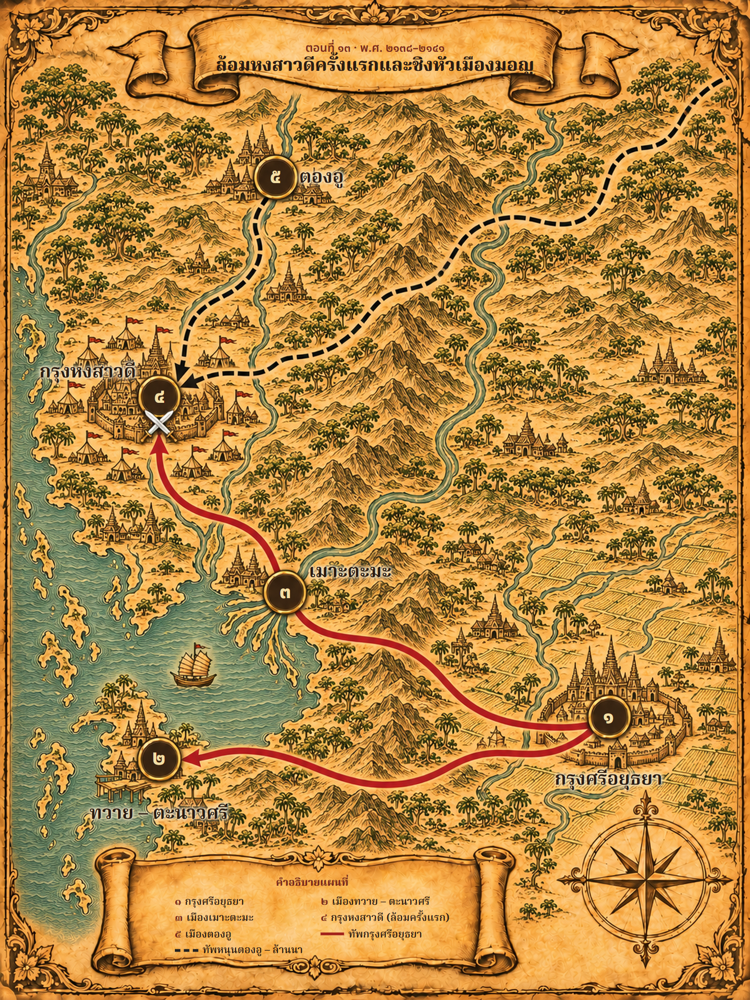

# ภาคที่ 4: เหนือบัลลังก์หงสาวดี สู่ทุ่งแก้วเมืองหาง (พ.ศ. 2138 – 2148)
## ตอนที่ 13: ล้อมหงสาวดีครั้งแรก และสงครามแย่งชิงหัวเมืองมอญ

---

### องก์ที่ 1: เมื่อผู้ถูกล่ายกทัพถึงหน้าประตูเมืองผู้ล่า

ปลาย พ.ศ. 2138 — เสียงปืนใหญ่และเสียงกลองศึกดังสะท้อนกึกก้องอยู่บนกำแพงอิฐอันสูงตระหง่านของ **กรุงหงสาวดี** เมืองหลวงแห่งจักรวรรดิตองอูที่เคยแผ่อำนาจครอบงำแผ่นดินอุษาคเนย์มาเกือบครึ่งศตวรรษ

ทว่าภาพที่ปรากฏเบื้องหน้าพระเนตรของ **พระเจ้านันทบุเรง** บนปราสาทราชวังกัมโพชธานีในฤดูแล้งปีนั้น กลับมิใช่ขบวนทัพประเทศราชที่นำบรรณาการมาถวายดังยุคสมัยของพระเจ้าบุเรงนอง หากคือป่าธงชัยและค่ายล้อมทัพนับร้อยแห่งของ **สมเด็จพระนเรศวรมหาราช** ที่เคลื่อนพลข้ามเทือกเขาตะนาวศรีเข้ามาตั้งประชิดพระนครหงสาวดีเป็นครั้งแรกในประวัติศาสตร์!

ตลอดเวลากว่าสามสิบปีนับตั้งแต่ศึกช้างเผือก พ.ศ. 2106 และคราวเสียกรุงศรีอยุธยา พ.ศ. 2112 กรุงศรีอยุธยาอยู่ในฐานะฝ่ายตั้งรับและต้องคอยรับมือการรุกรานจากตะวันตกอยู่ร่ำไป แม้หลังการประกาศอิสรภาพที่เมืองแครง พ.ศ. 2127 และการเอาชนะพระมหาอุปราชาที่ทุ่งหนองสาหร่ายในเดือนมกราคม พ.ศ. 2136 (ตามปฏิทินสากล) อยุธยาจะสลัดพันธนาการได้สำเร็จ แต่ศูนย์กลางอำนาจของหงสาวดีก็ยังตั้งตระหง่านอยู่อีกฟากหนึ่งของขุนเขา

เมื่อทรงปราบปรามกรุงละแวกทางตะวันออกจนราบคาบในต้น พ.ศ. 2137 และทรงเห็นว่าราชสำนักตองอูในกรุงหงสาวดีกำลังระส่ำระสายหนักจากการสูญเสียองค์รัชทายาทและขุนพลชั้นผู้ใหญ่ สมเด็จพระนเรศวรมหาราชจึงทรงตัดสินพระทัยเปลี่ยนโฉมหน้าประวัติศาสตร์ภูมิภาคอย่างสิ้นเชิง—กรุงศรีอยุธยาจะไม่รอให้หงสาวดีฟื้นตัวกลับมาตีอีกเป็นครั้งที่สาม หากแต่จะยกทัพหลวงไปตีถึงใจกลางราชธานีของศัตรู!

---

### องก์ที่ 2: กระดานหัวเมืองมอญและหลักฐานต่างแผ่นดิน

ก่อนที่กองทัพหลวงของกรุงศรีอยุธยาจะเคลื่อนขบวนผ่านด่านเจดีย์สามองค์หรือด่านแม่ละเมาไปถึงชานกรุงหงสาวดีได้นั้น หมากสำคัญบนกระดานยุทธศาสตร์ที่ต้องช่วงชิงกันเสียก่อนคือ **หัวเมืองมอญ** และเมืองท่าริมทะเลอันดามัน ได้แก่ **เมืองตะนาวศรี เมืองทวาย และเมืองเมาะตะมะ** เมื่อกางหลักฐานหลายแผ่นดินเทียบเคียงกันในช่วง พ.ศ. 2136–2141 จะเห็นลำดับเหตุการณ์และมุมมองที่ซ่อนอยู่ดังนี้:

- **บันทึกในฉบับหลวงประเสริฐอักษรนิติ์ (จ.ศ. 954–960):** เอกสารโหรหลวงฉบับนี้วางหมุดหมายเหตุการณ์ทางฝั่งตะวันตกไว้เป็นลำดับขั้นชัดเจน เริ่มจากใน **จ.ศ. 954** (พ.ศ. 2135/2136 หลังศึกยุทธหัตถี) โปรดให้ **เจ้าพระยาจักรี** ยกไปตี **เมืองตะนาวศรี** และให้ **พระยาพระคลัง** ยกไปตี **เมืองทวาย** จนได้หัวเมืองท่าสำคัญทั้งสองกลับมาเป็นฐานกำลังบำรุง จากนั้นใน **จ.ศ. 956** (พ.ศ. 2137–2138) เกิดความวุ่นวายขึ้นเมื่อชาวมอญที่ **เมืองเมาะตะมะ** แข็งเมืองต่อหงสาวดีและหันมาพึ่งพระบรมโพธิสมภารอยุธยา เปิดประตูเส้นทางเดินทัพจากชายแดนสู่ลุ่มน้ำสาละวินและอิรวดี ต่อมาใน **จ.ศ. 957 ปีมะแม** (วันอาทิตย์ ขึ้น 3 ค่ำ เดือนอ้าย ตรงกับปลาย พ.ศ. 2138) สมเด็จพระนเรศวรจึงเสด็จกรีฑาทัพหลวงไปตี **กรุงหงสาวดี** เข้าตั้งค่ายล้อมพระนครไว้จนถึงต้น พ.ศ. 2139 ก่อนจะทรงถอยทัพกลับเมื่อมีข่าวว่ากองทัพเมืองแปร เมืองตองอู และเมืองเชียงใหม่ยกมาช่วยกรุงหงสาวดี และใน **จ.ศ. 959–960** (พ.ศ. 2140–2141) บันทึกยังกล่าวถึงเหตุการณ์กบฏของ **พระยาศรีไสยณรงค์** ที่เมืองตะนาวศรี จนสมเด็จพระเอกาทศรถต้องเสด็จไปปราบปราม
- **รายละเอียดในฉบับพันจันทนุมาศ (เจิม) และฉบับพระราชหัตถเลขา:** พงศาวดารฉบับชำระชั้นหลังผูกเรื่องการส่งแม่ทัพไปตีทวายและตะนาวศรีเข้ากับเหตุการณ์หลังศึกหนองสาหร่าย (ในฐานะการไถ่โทษของขุนนางที่ตามเสด็จไม่ทัน) พร้อมเล่าฉากการล้อมกรุงหงสาวดีครั้งที่ 1 อย่างละเอียดว่า ทหารอยุธยาตั้งค่ายประชิดคูเมืองและเข้าปล้นกำแพงเมืองหงสาวดีในยามวิกาลจนเกิดการสู้รบดุเดือดบนเชิงเทิน ก่อนจะต้องถอยลงมาเมื่อทัพพันธมิตรของหงสาวดีจากเมืองแปร ตองอู และเชียงใหม่รุดเข้าช่วยเมืองหลวง รวมถึงขยายความเหตุกบฏของพระยาศรีไสยณรงค์ที่เกิดความหวาดระแวงในราชสำนักหลังถูกส่งไปรั้งเมืองตะนาวศรี
- **มุมมองจากมหาราชวงษ์ พงษาวดารพม่า (*Hmannan Yazawin*):** หลักฐานฝ่ายพม่ายืนยันตรงกันว่า หลังจากพระมหาอุปราชาสิ้นพระชนม์ที่หนองสาหร่าย อำนาจของพระเจ้านันทบุเรงเหนือหัวเมืองมอญเสื่อมถอยอย่างรวดเร็ว ขุนนางและชาวมอญพากันหนีการเกณฑ์ทัพหรือก่อกบฏในเมาะตะมะและพื้นที่ใกล้เคียง เมื่อทัพสยามยกมาล้อมกรุงหงสาวดีใน พ.ศ. 2138–2139 กองทัพหงสาวดีที่อ่อนกำลังไม่อาจออกมาตีโต้ได้โดยลำพัง ต้องอาศัยกองทัพของเจ้านายเครือญาติจากเมืองแปร ตองอู และเชียงใหม่ยกมาช่วยกดดันจนฝ่ายสยามถอยกลับไป
- **บันทึกบาดหลวงและชาวยุโรปร่วมสมัย:** รายงานของคณะมิชชันนารีและพ่อค้าโปรตุเกส–ยุโรปที่เคลื่อนไหวอยู่ในแถบพะโค (หงสาวดี) และเมาะตะมะช่วงปลายคริสต์ศตวรรษที่ 16 สะท้อนภาพเบื้องหลังที่พงศาวดารไทยไม่ได้บรรยาย—นั่นคือสภาพความอดอยากแร้นแค้นอย่างหนักในลุ่มน้ำอิรวดีตอนล่าง ทุ่งนาที่ถูกทิ้งร้างเพราะสงครามต่อเนื่องนานนับสิบปี และนโยบายเกณฑ์ไพร่พลอย่างทารุณของพระเจ้านันทบุเรง ทำให้ชาวมอญจำนวนมากสิ้นศรัทธาในราชสำนักตองอูและพร้อมจะเปิดทางให้กองทัพอยุธยาเข้ามาในแผ่นดินมอญ

---

### องก์ที่ 3: ยุทธการข้ามตะนาวศรี ล้อมหงสา และแนวรบหัวเมืองมอญ

#### ชิงหัวเมืองท่าและฐานที่มั่นเมาะตะมะ

การส่ง **เจ้าพระยาจักรี** และ **พระยาพระคลัง** ไปยึด **เมืองตะนาวศรี** และ **เมืองทวาย** ตั้งแต่หลังศึกหนองสาหร่าย มิใช่เพียงการลงทัณฑ์ขุนนางตามที่เรื่องเล่าชั้นหลังเน้นย้ำ หากคือการวางหมากด้านส่งกำลังบำรุงอย่างชาญฉลาดที่สุด

ด้วยภูมิประเทศของคาบสมุทรตะวันตก เมืองทวายและตะนาวศรีเป็นประตูออกสู่อ่าวเบงกอลและทะเลอันดามัน การควบคุมเมืองทั้งสองทำให้กรุงศรีอยุธยาสามารถลำเลียงเสบียง อาวุธ และปืนใหญ่จากพ่อค้าต่างชาติทางทะเลขึ้นมาสนับสนุนทัพบกได้โดยไม่ต้องแบกหามข้ามสันเขาตะนาวศรีที่ทุรกันดารทั้งหมด นอกจากนี้ เมื่อขุนนางและชาวมอญที่ **เมืองเมาะตะมะ** ก่อการแข็งเมืองต่อพระเจ้านันทบุเรงใน จ.ศ. 956 (พ.ศ. 2137–2138) สมเด็จพระนเรศวรก็ทรงส่งกำลังไปคุ้มครองเมาะตะมะทันที เปลี่ยนเมืองปากแม่น้ำสาละวินแห่งนี้ให้กลายเป็น **"ฐานทัพหน้า"** ที่มั่นคงที่สุดของอยุธยานอกเขตลุ่มน้ำเจ้าพระยา

#### กรีฑาทัพข้ามขุนเขา ล้อมกรุงหงสาวดี (พ.ศ. 2138–2139)

เมื่อแนวรบด้านกัมพูชาสงบเรียบร้อยและเมาะตะมะอยู่ในมือฝ่ายอยุธยาแล้ว ในเดือน **ธันวาคม พ.ศ. 2138** (วันอาทิตย์ ขึ้น 3 ค่ำ เดือนอ้าย จ.ศ. 957) **สมเด็จพระนเรศวรมหาราช** พร้อมด้วย **สมเด็จพระเอกาทศรถ** จึงเสด็จกรีฑาทัพหลวงออกจากกรุงศรีอยุธยา ข้ามด่านตะวันตกมุ่งสู่เมืองเมาะตะมะ สมทบกับกองกำลังชาวมอญ แล้วเดินทัพข้ามแม่น้ำสะโตงตรงเข้าสู่ชาน **กรุงหงสาวดี**

ภาพของกองทัพอยุธยาที่มาตั้งค่ายเรียงรายอยู่รอบกำแพงเมืองหงสาวดีในต้น พ.ศ. 2139 เป็นสิ่งที่ไม่มีผู้ใดในราชสำนักตองอูคาดคิดมาก่อนว่าจะมีวันเกิดขึ้นจริง กองทัพอยุธยาเข้าโอบล้อมพระนครหงสาวดีไว้หลายเดือน ทหารไทยตั้งป้อมค่ายและระดมยิงปืนใหญ่เข้าใส่เชิงเทินเมืองหลวงอย่างต่อเนื่อง พงศาวดารไทยฉบับชำระชั้นหลังเล่าว่า ถึงขั้นมีรับสั่งให้ทหารเข้าปล้นตีกำแพงเมืองในเวลากลางคืน โดยแม่ทัพนายกองอย่าง **พระยาศรีไสยณรงค์** และขุนพลหน่วยหน้าพาดบันไดปีนขึ้นไปบนเชิงเทินได้สำเร็จชั่วขณะหนึ่ง ทว่าทหารหงสาวดีบนกำแพงเมืองต้านทานอย่างสุดชีวิตและระดมยิงสกัดจนฝ่ายอยุธยาต้องถอยร่นลงมา

ในขณะที่การปิดล้อมกำลังยืดเยื้อ ข่าวกรองจากแนวลาดตระเวนก็รายงานเข้ามาว่า กองทัพหนุนของราชวงศ์ตองอูจากสามทิศทาง—ทั้ง **พระเจ้าแปร** (พระอนุชา/พระราชนัดดาในสายราชวงศ์) **พระเจ้าตองอู** และ **พระเจ้าเชียงใหม่ (นรธาเมงสอ)**—กำลังเคลื่อนพลลงมาสมทบเพื่อตีกระหนาบทัพอยุธยาจากด้านนอก

สมเด็จพระนเรศวรมหาราชทรงชั่งน้ำหนักสถานการณ์อย่างเยือกเย็น การบุกหักเอากรุงหงสาวดีซึ่งมีกำแพงอิฐหนาและคูเมืองกว้างท่ามกลางวงล้อมของทัพหนุนสามหัวเมืองย่อมเสี่ยงต่อการถูกตัดเส้นทางลำเลียงกลับข้ามแม่น้ำสะโตงและเทือกเขาตะนาวศรี แม้จะยังไม่สามารถตีหักเอาราชธานีหงสาวดีได้ในคราวเดียว แต่เป้าหมายทางยุทธศาสตร์ข้อสำคัญได้บรรลุผลแล้ว—นั่นคือการพิสูจน์ให้ทุกประเทศราชเห็นว่า หงสาวดีไม่อาจปกป้องแม้แต่ประตูเมืองหลวงของตนเองได้อีกต่อไป

พระองค์จึงทรงมีรับสั่งให้ **ถอยทัพกลับ** อย่างเป็นระเบียบใน พ.ศ. 2139 โดยกวาดต้อนผู้คน ช้างม้า และทรัพย์สินจากหัวเมืองมอญลงมาทางเมาะตะมะและด่านเจดีย์สามองค์คืนสู่กรุงศรีอยุธยาอย่างปลอดภัย โดยที่ทัพหงสาวดีและทัพหนุนไม่อาจไล่ตีซ้ำเติมได้อย่างที่เคยทำในอดีต

#### รอยร้าวในแนวหลัง: กบฏพระยาศรีไสยณรงค์

ทว่าการขยายแนวรบข้ามเทือกเขาไปไกลถึงชายฝั่งทะเลมอญก็สร้างโจทย์ด้านการควบคุมขุนนางระดับสูงตามมา หลังเสร็จศึกหงสาวดีครั้งที่ 1 ในช่วง **จ.ศ. 959–960 (พ.ศ. 2140–2141)** สมเด็จพระนเรศวรทรงแต่งตั้ง **พระยาศรีไสยณรงค์** แม่ทัพคู่พระทัยผู้เคยรบแนวหน้าในศึกหนองสาหร่ายและศึกหงสาวดี ให้ไปรั้ง **เมืองตะนาวศรี** ทว่าด้วยความขัดแย้งและความหวาดระแวงทางการเมืองภายใน พระยาศรีไสยณรงค์กลับคิดแข็งเมืองขึ้นที่ตะนาวศรี (พงศาวดารฉบับชำระชั้นหลังเล่าว่าเกิดจากความน้อยเนื้อต่ำใจและระแวงพระอาญา) สมเด็จพระนเรศวรจึงโปรดให้ **สมเด็จพระเอกาทศรถ** เสด็จคุมทัพออกไปปราบปรามจนจับตัวพระยาศรีไสยณรงค์ได้และประหารชีวิตลงอย่างเด็ดขาด เป็นการขจัดเสี้ยนหนามที่ประตูเมืองท่าฝั่งตะวันตกก่อนที่จะเปิดศึกใหญ่รอบใหม่

---

### องก์ที่ 4: จักรวรรดิหงสาวดีสู่ทางตันและการล่มสลายที่รออยู่

แม้การล้อมกรุงหงสาวดีครั้งแรกใน พ.ศ. 2138–2139 จะจบลงด้วยการถอยทัพกลับของฝ่ายอยุธยา ทว่าในทางภูมิรัฐศาสตร์ ศึกครั้งนี้คือ **"รอยร้าวสุดท้ายที่ทำให้ตึกใหญ่ของจักรวรรดิตองอูไม่อาจยืนต้นอยู่ได้อีกต่อไป"**

- **ความเสื่อมศรัทธาในกรุงหงสาวดี:** พระเจ้านันทบุเรงทรงตระหนักว่า ชัยชนะในการรักษาเมืองหลวงไว้ได้นั้นมิได้เกิดจากกำลังของหงสาวดีเอง หากเกิดจากการมาช่วยของตองอู แปร และเชียงใหม่ แต่ในยามที่สงครามจบลง บรรดาเจ้าเมืองเครือญาติเหล่านั้นกลับไม่ได้เห็นพระเจ้านันทบุเรงเป็นผู้ปกครองอันทรงธรรมอีกต่อไป หากมองเห็นเพียงราชสำนักที่กำลังรอวันพังทลาย
- **หัวเมืองมอญหลุดจากอำนาจตองอู:** แนวชายฝั่งตั้งแต่มะริด ตะนาวศรี ทวาย เรื่อยไปจนถึงเมาะตะมะ ตกอยู่ภายใต้อิทธิพลหรือการแทรกซึมของกรุงศรีอยุธยา ชาวมอญจำนวนมากอพยพหนีภัยสงครามและภาระเกณฑ์ไพร่พลเข้ามาพึ่งพิงสยาม ทำให้หงสาวดีขาดทั้งกำลังคน ข้าวปลาอาหาร และรายได้จากเมืองท่า
- **ความแตกแยกของเจ้าเมืองพม่า:** เพียงไม่นานหลังทัพอยุธยาถอยกลับ เจ้าเมืองเครือญาติในแผ่นดินพม่าเองก็เริ่มหันปลายหอกเข้าหากันเอง ทั้งพระเจ้าเชียงใหม่ที่หันมาพึ่งพระบรมโพธิสมภารอยุธยา และ **พระเจ้าตองอู** ที่เริ่มวางแผนสมคบกับ **กษัตริย์ยะไข่** เพื่อชิงราชสมบัติและทรัพย์สมบัติของกรุงหงสาวดีเสียเอง!

เมื่อความขัดแย้งภายในแผ่นดินพม่าสุกงอมถึงขีดสุด สมเด็จพระนเรศวรมหาราชจึงทรงเตรียมกรีฑาทัพหลวงข้ามเทือกเขาตะนาวศรีเป็นครั้งที่ 2 ใน พ.ศ. 2142—โดยไม่ทรงคาดคิดว่าเมื่อเสด็จไปถึงคราวนี้ จะไม่มีกำแพงกรุงหงสาวดีให้พระองค์ทรงปิดล้อมอีกต่อไปแล้ว

**จบตอนที่ 13**

*(ติดตามต่อใน ตอนที่ 14: กรุงหงสาวดีล่มสลาย และศึกชิงองค์พระเจ้านันทบุเรงที่ตองอู)*
