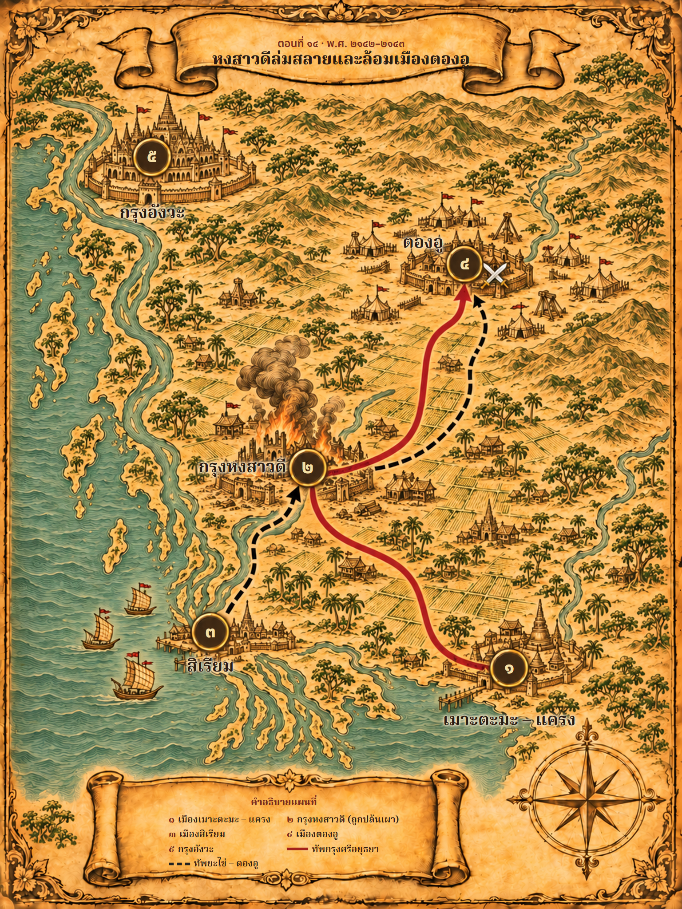

# ภาคที่ 4: เหนือบัลลังก์หงสาวดี สู่ทุ่งแก้วเมืองหาง (พ.ศ. 2138 – 2148)
## ตอนที่ 14: กรุงหงสาวดีล่มสลาย และศึกชิงองค์พระเจ้านันทบุเรงที่ตองอู

---

### องก์ที่ 1: เถ้าถ่านแห่งราชธานีจักรวรรดิ

ต้น พ.ศ. 2143 — เมื่อกองทัพหลวงของ **สมเด็จพระนเรศวรมหาราช** เดินทัพฝ่าทุ่งนาอันร้างผู้คนของดินแดนมอญเข้ามาจนถึงชาน **กรุงหงสาวดี** เป็นครั้งที่ 2 ภาพที่ปรากฏเบื้องหน้ากลับทำให้ทั้งกองทัพต้องตกตะลึง

ไม่มีธงชัยแห่งราชวงศ์ตองอูปลิวไสวบนหอคอย ไม่มีเสียงแตรสังข์ท้าทายจากเชิงเทิน และไม่มีแม้แต่ประตูเมืองที่ปิดต้านรับข้าศึก

สิ่งที่ตั้งอยู่เบื้องหน้ามีเพียงซากกำแพงอิฐดำเป็นตอตะโก ปราสาทราชมนเทียรอันวิจิตรของพระเจ้าบุเรงนองและพระเจ้านันทบุเรงพังทลายกลายเป็นกองขี้เถ้า ชาวเมืองนับหมื่นที่เคยอาศัยอยู่ในมหานครที่มั่งคั่งที่สุดแห่งอุษาคเนย์หายสาบสูญไปจนแทบไร้เงาผู้คน

กรุงหงสาวดีมิได้ล่มสลายลงด้วยคมดาบของกรุงศรีอยุธยา หากแต่ **ถูกคนในราชวงศ์และพันธมิตรของพม่าเองชิงเผาทำลายไปต่อหน้าต่อตา** ก่อนที่ทัพไทยจะเสด็จมาถึงเพียงไม่กี่สัปดาห์! และองค์ **พระเจ้านันทบุเรง** อดีตจักรพรรดิผู้ยิ่งใหญ่แห่งหงสาวดี ก็ถูกเชิญ—หรือถูกกวาดต้อน—หนีขึ้นไปซ่อนพระองค์อยู่บนป้อมปราการที่ราบสูงทางเหนือ ณ **เมืองตองอู** แล้ว

---

### องก์ที่ 2: เทียบหลักฐานสี่แผ่นดินเบื้องหลังโศกนาฏกรรมหงสาวดี

เหตุการณ์การล่มสลายของกรุงหงสาวดีใน พ.ศ. 2142–2143 เป็นเหตุการณ์ที่มีบันทึกหลากหลายชาติตรงกันมากที่สุดเหตุการณ์หนึ่งในประวัติศาสตร์เอเชียตะวันออกเฉียงใต้ เมื่อวางหลักฐานไทย พม่า และยุโรปเทียบเคียงกัน จะเห็นภาพการหักหลังซ้อนหักหลังที่เกิดขึ้นอย่างชัดเจน:

- **บันทึกในฉบับหลวงประเสริฐอักษรนิติ์ (จ.ศ. 961–962):** ระบุเส้นเวลาอย่างแม่นยำว่า ใน **จ.ศ. 961 ปีกุน** (วันอาทิตย์ ขึ้น 11 ค่ำ เดือน 11 ตรงกับราวเดือนตุลาคม พ.ศ. 2142) สมเด็จพระนเรศวรเสด็จกรีฑาทัพหลวงออกจากพระนครไปตีกรุงหงสาวดีอีกครั้ง ทว่าก่อนหน้านั้น **พระเจ้าตองอู** ได้พาตัวพระเจ้านันทบุเรงและทรัพย์สินหนีขึ้นไปเมืองตองอูแล้ว เมื่อสมเด็จพระนเรศวรเสด็จถึงเมืองหงสาวดีจึงเสด็จติดตามขึ้นไปตี **เมืองตองอู** ต่อในปลายปี จ.ศ. 961 ถึงต้น จ.ศ. 962 (ต้น พ.ศ. 2143 ตามปฏิทินสากล) ทรงตั้งล้อมเมืองตองอูไว้ประมาณสองเดือน ท้ายที่สุดเกิดภาวะ **ขาดแคลนเสบียงอาหาร** อย่างหนักจึงเสด็จถอยทัพกลับคืนสู่พระนครในเดือน 6 จ.ศ. 962 (พ.ศ. 2143)
- **รายละเอียดในฉบับพันจันทนุมาศ (เจิม) และฉบับพระราชหัตถเลขา:** พงศาวดารฉบับชำระชั้นหลังเล่าว่า ก่อนยกทัพใหญ่ สมเด็จพระนเรศวรทรงมีพระราชสาส์นชวนพระเจ้าตองอูให้มาสวามิภักดิ์เพื่อร่วมกันปราบหงสาวดี แต่พระเจ้าตองอูกลับชิงร่วมมือกับทัพยะไข่เข้ายึดกรุงหงสาวดีเสียก่อน แล้วเชิญพระเจ้านันทบุเรงพร้อมเครื่องราชกกุธภัณฑ์หนีขึ้นเมืองตองอู เมื่อทัพอยุธยาตามไปล้อมเมืองตองอู จึงทรงมีรับสั่งให้ทหาร **ขุดคลองไขน้ำระบายออกจากคูเมืองตองอู** เพื่อเข้าตีหักเมือง แต่เมื่อขาดเสบียงและไพร่พลล้มป่วยอดอยาก จึงต้องทรงเลิกทัพกลับโดยเสด็จมาพักจัดระเบียบทัพที่เมืองเมาะตะมะและเมืองแครง
- **บันทึกจากมหาราชวงษ์ พงษาวดารพม่า (*Hmannan Yazawin*):** ฝ่ายพม่าบันทึกเหตุการณ์ความแตกแยกภายในไว้อย่างตรงไปตรงมาว่า **เมงเยสีหตู** เจ้าเมืองตองอูผู้เป็นพระญาติสนิทในราชวงศ์ได้สมคบกับ **มังราชายี** กษัตริย์แห่ง **ยะไข่ (อาระกัน)** ยกทัพเรือและทัพบกเข้ามาปิดล้อมกรุงหงสาวดีในปี ค.ศ. 1599 (พ.ศ. 2142) เมื่อพระเจ้านันทบุเรงทรงเห็นว่าหมดหนทางสู้จึงเสด็จออกยอมจำนน ฝ่ายตองอูจึงอัญเชิญองค์พระเจ้านันทบุเรง พระไตรปิฎก และราชวงศ์กลับเมืองตองอู ส่วนกองทัพยะไข่เข้าปล้นชิงทรัพย์สิน ช้างเผือก และปืนใหญ่ ก่อนจุดไฟเผากรุงหงสาวดีจนวอดวาย ต่อมาเมื่อทัพสยามตามมาล้อมตองอู ทัพยะไข่และฝ่ายตองอูได้ออกดักปล้นทำลายขบวนเสบียงของสยามจนทัพไทยขาดอาหารต้องถอยทัพกลับ และหลังจากนั้นไม่นาน **นัดชินหน่อง** โอรสของเจ้าเมืองตองอู ก็ลอบปลงพระชนม์พระเจ้านันทบุเรงเสียในเมืองตองอู (พ.ศ. 2143)
- **จดหมายเหตุคณะเยซูอิต (Nicolas Pimenta และ André Boves):** หลักฐานร่วมสมัยที่ทรงคุณค่าที่สุดชุดหนึ่งคือรายงานของบาทหลวง **นิโกลาส์ ปิเมนตา (Nicolas Pimenta)** ที่รวบรวมจดหมายจากผู้เห็นเหตุการณ์จริงอย่าง **อันเดร โบเวส (André Boves)** ซึ่งเดินทางมากับกองทัพยะไข่สู่เมืองพะโค (หงสาวดี) ใน ค.ศ. 1599–1600 เอกสารยุโรประบุตรงกันถึงความพินาศสุดประมาณของหงสาวดี—ราชธานีที่เคยรุ่งเรืองถูกปล้นสดมภ์และเผาทำลายจนเหลือแต่เถ้าถ่านและซากปรักหักพัง กษัตริย์สยามเสด็จมาถึงในเวลาที่เมืองร้างผู้คนไปแล้ว ก่อนจะทรงไล่ติดตามขึ้นไปยังเมืองตองอูแต่ต้องพ่ายแพ้ต่อความกันดารและปัญหาเสบียงอาหารกลางทาง

---

### องก์ที่ 3: การไล่ล่าที่ตองอู — เมื่อระยะทางกลายเป็นศัตรูตัวจริง

#### กลหมากรอบกรุงหงสาวดีและเส้นทางเมืองแครง

ความจริงเบื้องหลังความล่มสลายของกรุงหงสาวดีใน พ.ศ. 2142 มิได้เกิดขึ้นโดยบังเอิญ หากเป็นผลพวงโดยตรงจากการล้อมเมืองของสมเด็จพระนเรศวรมหาราชเมื่อ พ.ศ. 2138–2139 และเกมการทูตที่ราชสำนักอยุธยาเดินไว้ล่วงหน้า

ก่อนหน้าจะยกทัพหลวงครั้งที่ 2 ในเดือนตุลาคม พ.ศ. 2142 สมเด็จพระนเรศวรทรงดำเนินนโยบายแยกสลายพันธมิตรของหงสาวดีอย่างต่อเนื่อง **พระเจ้าเชียงใหม่ (นรธาเมงสอ)** ซึ่งเคยยกทัพมาช่วยหงสาวดีในปี พ.ศ. 2139 บัดนี้เริ่มหันมาอ่อนน้อมขอพึ่งกรุงศรีอยุธยา ขณะเดียวกันหัวเมืองมอญตั้งแต่เมาะตะมะถึง **เมืองแครง** ก็ตกอยู่ในอิทธิพลของอยุธยาหรือว่างเปล่าไร้การต่อต้าน ทำให้เส้นทางเดินทัพของสมเด็จพระนเรศวรผ่านด่านเจดีย์สามองค์ เมืองเมาะตะมะ และเมืองแครงเปิดโล่งกว่าครั้งก่อนมาก

ทว่าความชะล่าใจของพระเจ้านันทบุเรงได้เปิดช่องให้ผู้ที่อยู่ใกล้ตัวที่สุดลงมือก่อน—**เมงเยสีหตูแห่งตองอู** ตระหนักว่าหากรอให้ทัพอยุธยาลงมาถึงหงสาวดี ราชสมบัติและทรัพย์มหาศาลที่พระเจ้าบุเรงนองสะสมไว้ย่อมตกเป็นของกษัตริย์สยามทั้งหมด การชิงสมคบกับ **มังราชายี กษัตริย์ยะไข่** (ซึ่งมีกองเรือรบและทหารรับจ้างโปรตุเกสนำโดย **ฟิลิเป เดอ บริโต อี นิโกเต** คอยคุมปากน้ำเมืองสิเรียมและเส้นทางเดินเรืออ่าวเบงกอล) จึงเป็นการปิดล้อมตัดขาดหงสาวดีทั้งทางบกและทางน้ำ แล้วปล้นชิงมรดกจักรวรรดิตองอูตัดหน้าอยุธยาอย่างเลือดเย็น

หลังการปล้นเผาพระนครหงสาวดี ทัพยะไข่ได้นำทรัพย์สมบัติ ช้างเผือก และพระธิดาของพระเจ้านันทบุเรงลงเรือกลับไป พร้อมมอบหมายให้ฟิลิเป เดอ บริโต เข้าดูแลเมืองท่า **สิเรียม** (ต่อมาได้ตั้งตนเป็นใหญ่ในลุ่มน้ำอิรวดีตอนล่าง) ทิ้งไว้เพียงซากเมืองร้างให้กองทัพอยุธยาเดินเข้ามาพบในต้น พ.ศ. 2143

#### ปิดล้อมเมืองตองอูและวิกฤตสายส่งกำลังบำรุง

เมื่อสมเด็จพระนเรศวรมหาราชและสมเด็จพระเอกาทศรถเสด็จถึงซากเถ้าถ่านของกรุงหงสาวดีในต้น พ.ศ. 2143 พระองค์ทรงตัดสินพระทัยทันทีว่าจะไม่เสด็จกลับมือเปล่า ตราบใดที่ **พระเจ้านันทบุเรง** ยังมีพระชนมชีพอยู่ภายใต้การควบคุมของพระเจ้าตองอู ชื่อเสียงและความชอบธรรมของจักรวรรดิตองอูก็อาจถูกนำไปชูธงรวบรวมแผ่นดินพม่ากลับมาสู้กับอยุธยาได้อีก

กองทัพหลวงของอยุธยาจึงเคลื่อนพลทวนขึ้นไปทางเหนือตามแนวลุ่มน้ำสะโตงตอนบน ผ่านภูมิประเทศที่เริ่มแห้งแล้งและห่างไกลจากฐานเสบียงทางทะเล มุ่งตรงสู่ **เมืองตองอู** ป้อมปราการบรรพบุรุษของราชวงศ์ตองอูที่ตั้งอยู่ท่ามกลางหุบเขาสลับซับซ้อน

การล้อมเมืองตองอูในต้น พ.ศ. 2143 แตกต่างจากการล้อมหงสาวดีโดยสิ้นเชิง:

1. **การเตรียมพร้อมของฝ่ายรับ:** พระเจ้าตองอูขนถ่ายเสบียง ข้าวสาร ปืนใหญ่ และกำลังพลเข้าเมืองตองอูไว้ล่วงหน้าอย่างเต็มที่ พร้อมกำแพงเมืองแข็งแกร่งและคูน้ำลึกกว้างขวางเป็นปราการธรรมชาติที่ยากแก่การข้ามตีหัก
2. **กลยุทธ์ขุดคลองไขน้ำ:** พงศาวดารไทยฉบับชำระชั้นหลังเล่าว่า สมเด็จพระนเรศวรทรงพยายามแก้ชัยภูมิคูเมืองตองอูด้วยการเกณฑ์ไพร่พลขุดคลองระบายน้ำออกจากคูเมืองเพื่อให้ทหารบุกเข้าประชิดเชิงเทินได้ ทว่าความแข็งแกร่งของแนวป้องกันและกระสุนปืนใหญ่จากบนกำแพงเมืองตองอูทำให้การเข้าหักเอาเมืองยังไม่สำเร็จโดยเร็ว
3. **กับดักเส้นทางลำเลียง:** ยิ่งการล้อมยืดเยื้อเข้าสู่ฤดูแล้งจัด เส้นทางลำเลียงเสบียงของฝ่ายอยุธยาที่ทอดยาวหลายร้อยกิโลเมตรจากด่านชายแดนผ่านดินแดนมอญที่ถูกเผาทำลายจนรกร้างก็กลายเป็นจุดตาย กองกำลังของยะไข่และทหารม้าตองอูคอยซุ่มโจมตีขบวนลำเลียงเสบียงที่ส่งตามหลังมาจนขาดสะบั้น ไพร่พลในค่ายล้อมเมืองของอยุธยาเริ่มขาดข้าวปลาอาหารและล้มป่วยลงทุกวัน จนจำต้องขุดรากไม้และแบ่งปันเสบียงอันน้อยนิดเพื่อประทังชีวิต

ในภาวะที่การดื้อดึงล้อมเมืองต่อไปอาจนำไปสู่ความพินาศของทั้งกองทัพ สมเด็จพระนเรศวรมหาราชจึงทรงแสดงความเด็ดขาดของจอมทัพผู้ไม่ยอมแพ้ต่ออารมณ์—ทรงมีรับสั่งให้เลิกการปิดล้อมและนำทัพหลวงถอยกลับลงมาทางเมืองแครงและเมาะตะมะในเดือนพฤษภาคม พ.ศ. 2143 (*ฉบับหลวงประเสริฐฯ* ระบุเดือน 6 จ.ศ. 962) รักษากำลังหลักของกองทัพอยุธยากลับคืนสู่พระนครได้โดยสวัสดิภาพ

---

### องก์ที่ 4: สุญญากาศหลังหงสาและขั้วอำนาจใหม่ที่อังวะ

แม้ในสายตาของศึกเฉพาะหน้า การไม่ได้ตัวพระเจ้านันทบุเรงและไม่อาจหักเมืองตองอูได้จะดูเหมือนการพลาดเป้าหมาย ทว่าในภาพรวมของประวัติศาสตร์อุษาคเนย์ **เหตุการณ์ พ.ศ. 2142–2143 คือจุดสิ้นสุดอย่างถาวรของจักรวรรดิตองอูแห่งกรุงหงสาวดี**

กรุงหงสาวดีที่เคยเป็นฝันร้ายของอยุธยาตลอดครึ่งศตวรรษไม่ฟื้นคืนเป็นมหานครเอกราชอีกเลย องค์พระเจ้านันทบุเรงเองก็ถูกนัดชินหน่องลอบปลงพระชนม์ในเมืองตองอูภายในปีเดียวกันนั้นเอง ดินแดนพม่าและมอญที่เคยรวมเป็นหนึ่งภายใต้พระเจ้าบุเรงนองแตกออกเป็นเสี่ยงๆ—เมืองตองอู เมืองแปร อาณาจักรยะไข่ และเมืองท่าสิเรียมภายใต้การควบคุมของฟิลิเป เดอ บริโต ต่างตั้งตนเป็นขั้วอำนาจย่อยแข่งกันในลุ่มน้ำอิรวดีตอนล่างโดยไม่มีผู้ใดมีกำลังมากพอจะยกทัพข้ามเทือกเขาตะนาวศรีมาตีกรุงศรีอยุธยาได้อีกต่อไป

ทว่าเมื่อศูนย์อำนาจหนึ่งล่มสลาย สุญญากาศทางอำนาจย่อมดึงดูดผู้ท้าชิงรายใหม่ขึ้นมาเสมอ

ทางตอนเหนือของลุ่มน้ำอิรวดี **พระเจ้าญองยัน** (พระอนุชาต่างพระมารดาของพระเจ้านันทบุเรง) กำลังรวบรวมหัวเมืองพม่าตอนบนตั้งศูนย์กลางอำนาจใหม่ขึ้นที่ **กรุงอังวะ** (ราชวงศ์ตองอูยุคฟื้นฟูหรือราชวงศ์ญองยัน) และเริ่มแผ่อิทธิพลเข้าคุกคามรัฐไทใหญ่และล้านนาเพื่อชิงความได้เปรียบก่อนจะหันกลับมารวมพม่าตอนล่าง!

เมื่อทรงตระหนักว่าสมรภูมิตะวันตกกำลังจะเปลี่ยนฉากจากหงสาวดีขึ้นไปทางเหนือ สมเด็จพระนเรศวรมหาราชจึงทรงปรับยุทธศาสตร์จากสงครามบุกเมืองหลวงมาเป็นการสร้างเครือข่ายอำนาจระยะยาว—ด้านหนึ่งทรงเชื่อมพันธมิตรการค้าทางทะเลในอ่าวไทยเพื่อสะสมทุนและอาวุธสมัยใหม่ และอีกด้านหนึ่งทรงจัดระเบียบหัวเมือง **ล้านนาและไทใหญ่** เพื่อปิดล้อมและรับมือพายุลูกใหม่จากอังวะ!

**จบตอนที่ 14**

*(ติดตามต่อใน ตอนที่ 15: พันธมิตรทางทะเล และการทูตจัดระเบียบล้านนา-ไทใหญ่)*
