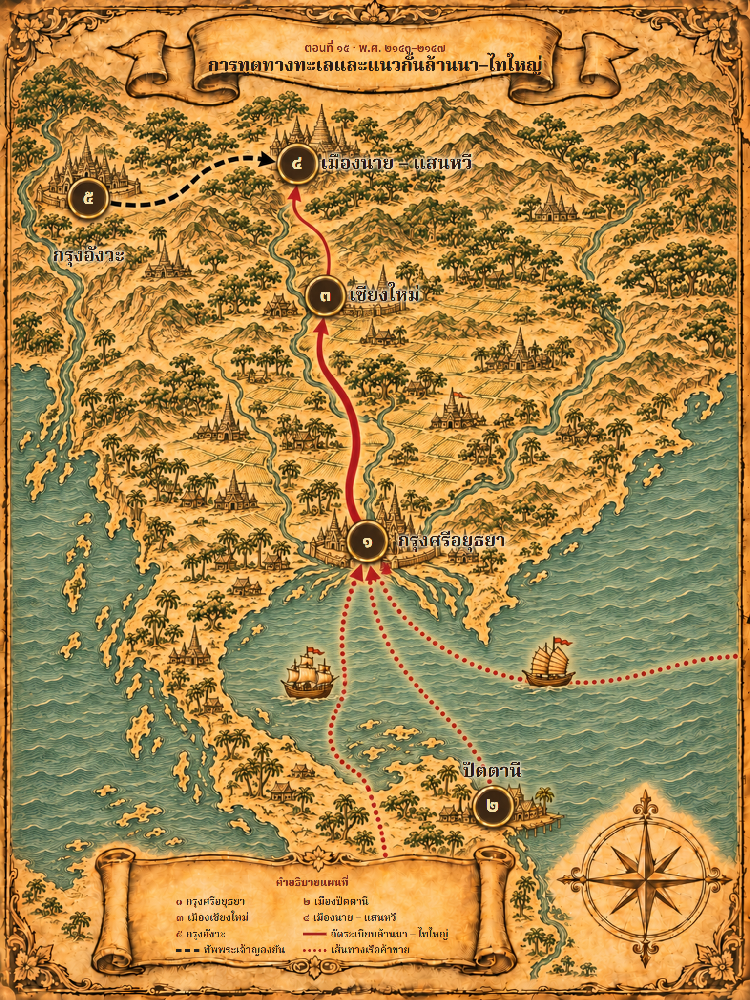

# ภาคที่ 4: เหนือบัลลังก์หงสาวดี สู่ทุ่งแก้วเมืองหาง (พ.ศ. 2138 – 2148)
## ตอนที่ 15: พันธมิตรทางทะเล และการทูตจัดระเบียบล้านนา-ไทใหญ่

---

### องก์ที่ 1: ห้าปีแห่งสันติภาพที่ไม่เคยหยุดเคลื่อนหมาก

พ.ศ. 2143–2147 — เป็นครั้งแรกในรอบเกือบสี่ทศวรรษที่ลุ่มน้ำเจ้าพระยาปราศจากเสียงกลองศึกของกองทัพหงสาวดี

หลังเสด็จกลับจากการปิดล้อมเมืองตองอูในกลาง พ.ศ. 2143 กองเรือสินค้าจากนานาประเทศก็หลั่งไหลเข้ามาจอดเทียบท่าตลอดลำน้ำเจ้าพระยาตั้งแต่ปากน้ำจนถึงเกาะเมือง **กรุงศรีอยุธยา** เรือสำเภาจีน เรือสเปนจากมะนิลาบางคราว เรือการค้าโปรตุเกส และเรือสินค้าจากหมู่เกาะญี่ปุ่นต่างบรรทุกผ้าไหม เครื่องเคลือบ เงินแท่ง และอาวุธปืนคาบชุดเข้ามาแลกเปลี่ยนกับหนังกวาง ไม้ฝาง ดีบุก และเครื่องเทศ

ทว่าเบื้องหลังความรุ่งเรืองทางการค้าในอ่าวไทย พระเนตรของ **สมเด็จพระนเรศวรมหาราช** ซึ่งในต้น พ.ศ. 2143 ทรงมีพระชันษาราว 45 พรรษา กลับมิได้ทอดมองเพียงปากอ่าวทางทิศใต้เท่านั้น หากยังทรงจับจ้องไปยังแนวขุนเขาสลับซับซ้อนทางทิศเหนือ—ที่ซึ่ง **พระเจ้าญองยัน** แห่งกรุงอังวะกำลังแผ่แสนยานุภาพเข้ามาประชิดพรมแดน **ล้านนา** และรัฐ **ไทใหญ่**

ห้วงเวลา พ.ศ. 2143–2147 จึงมิใช่ช่วงเวลาแห่งการวางดาบพักผ่อน หากคือทศวรรษแห่ง **"สงครามการทูตและภูมิรัฐศาสตร์สองแนวรบ"** ที่เชื่อมโยงมหาสมุทรเข้ากับขุนเขาอย่างแนบเนียนที่สุดในรัชสมัยของพระองค์

---

### องก์ที่ 2: กระดานการค้าโลกและเอกสารข้ามขอบฟ้า

เมื่อกางหลักฐานประวัติศาสตร์ในช่วง พ.ศ. 2143–2147 จากทั้งเอกสารไทย ล้านนา พม่า และเอกสารต่างชาติในเอเชีย–ยุโรป เราจะเห็นภาพกรุงศรีอยุธยาที่ก้าวขึ้นสู่เวทีการเมืองระดับภูมิภาคอย่างเต็มภาคภูมิ พร้อมทั้งแยกแยะช่วงเวลาทางประวัติศาสตร์ได้อย่างแม่นยำไม่คลาดเคลื่อน:

- **บันทึกในฉบับหลวงประเสริฐอักษรนิติ์ (จ.ศ. 961–966):** เอกสารโหรหลวงฉบับนี้มิได้บันทึกเหตุการณ์ใน จ.ศ. 959, 960 และ 962 รวมถึงมิได้กล่าวถึงการที่พระเจ้าเชียงใหม่ส่งทูตลงมาสวามิภักดิ์ใน จ.ศ. 960–961 แต่อย่างใด ข้อความที่ปรากฏจริงในช่วงท้ายรัชกาลเป็นบันทึกสั้นกระชับตามลำดับปี คือ **จ.ศ. 961** *"เสด็จพยุหบาตราไปเมืองตองอู"*, **จ.ศ. 963** สุริยุปราคาในเดือน 7 และพิธีรับพระอิศวรและพระนารายณ์, **จ.ศ. 964** *"เสด็จไปประพาสลพบุรี"*, **จ.ศ. 965** *"ทัพพระเจ้าฝ่ายหน้าเสด็จไปเอาเมืองขอมได้"*, จนถึง **จ.ศ. 966** ที่บันทึกการเสด็จกรีฑาทัพหลวงทางชลมารคจากป่าโมกไปถึงทุ่งดอนแก้ว ส่วนรายละเอียดการเมืองล้านนาและการที่ **พระเจ้าเชียงใหม่ (นรธาเมงสอ)** ส่งทูตและพระมหาเถรลงมาขอพึ่งพระบรมโพธิสมภารอยุธยานั้น มาจาก **ฉบับพันจันทนุมาศ (เจิม)** และ **ฉบับพระราชหัตถเลขา** (ซึ่งจัดเหตุการณ์ไว้ในช่วงหลังการล้อมตองอูและช่วงจัดระเบียบหัวเมืองเหนือ)
- **พงศาวดารโยนกและตำนานพื้นเมืองเชียงใหม่:** เอกสารฝ่ายล้านนาและพงศาวดารฉบับชำระชั้นหลังให้รายละเอียดเบื้องลึกของการเมืองภายในอาณาจักรล้านนาหลังการล่มสลายของหงสาวดี ทั้งความขัดแย้งระหว่างพระโอรสของนรธาเมงสอ การแทรกแซงจากอาณาจักรล้านช้าง และบทบาทของ **พระยารามเดโช** ที่สมเด็จพระนเรศวรทรงส่งขึ้นไปประจำการกำกับราชการเมืองเชียงใหม่เพื่อรักษาเสถียรภาพของล้านนาให้อยู่ใต้ร่มเงาอยุธยา
- **เอกสารสเปนแห่งมะนิลา (*The Philippine Islands, 1493–1898* และบันทึกของ Antonio de Morga):** เอกสารราชการสเปนบันทึกการติดต่อทางการทูตและการค้าทางทะเลระหว่างกรุงศรีอยุธยากับข้าหลวงใหญ่สเปนแห่งกรุงมะนิลาในช่วงรอยต่อ พ.ศ. 2141–2143 หลังวิกฤตการณ์กัมพูชา เพื่อฟื้นฟูเส้นทางเดินเรือค้าขายและรับรองความปลอดภัยของพ่อค้า–มิชชันนารีในน่านน้ำอุษาคเนย์
- **หลักฐานการค้าโปรตุเกส ดัตช์ และญี่ปุ่น:** พ่อค้าและทหารอาสาโปรตุเกสยังคงมีบทบาทสำคัญในฐานะคู่ค้าและช่างอาวุธในอยุธยา ขณะเดียวกันในปลายรัชสมัยราว **พ.ศ. 2147 (ค.ศ. 1604)** กองเรือบริษัทอินเดียตะวันออกของดัตช์ (**VOC**) เริ่มเข้ามาติดต่อกับฝ่ายสยามที่ปัตตานีและส่งตัวแทนเดินทางสู่กรุงศรีอยุธยา (ก่อนที่สถานีการค้าดัตช์ในอยุธยาจะเปิดอย่างเป็นทางการในรัชกาลสมเด็จพระเอกาทศรถราว พ.ศ. 2151) ส่วนในด้านความสัมพันธ์กับ **ญี่ปุ่น** นั้น ช่วงปลายรัชกาลสมเด็จพระนเรศวรเป็นยุคเริ่มต้นของการเข้ามาค้าขายของเรือสินค้าญี่ปุ่น (เรือตราแดง) และชาวญี่ปุ่นอาสาในอ่าวไทย—โดยต้องระบุให้ชัดตามหลักฐานญี่ปุ่นว่า **ความสัมพันธ์ทางการทูตระดับรัฐอย่างเป็นทางการระหว่างราชสำนักอยุธยากับรัฐบาลโชกุนโทกุงาวะ อิเอยาสุ เพิ่งเริ่มต้นในราว พ.ศ. 2149 (ค.ศ. 1606) ซึ่งเป็นรัชกาลของสมเด็จพระเอกาทศรถแล้ว**
- **มหาราชวงษ์ พงษาวดารพม่า (*Hmannan Yazawin*):** หลักฐานฝ่ายพม่ายืนยันความเคลื่อนไหวสำคัญทางตอนบนของลุ่มน้ำอิรวดี เมื่อ **พระเจ้าญองยัน** สถาปนาฐานอำนาจที่ **กรุงอังวะ** แล้วทรงกรีฑาทัพเข้าปราบปรามหัวเมือง **ไทใหญ่ (รัฐฉาน)** ที่กระด้างกระเดื่องทีละเมืองระหว่าง พ.ศ. 2144–2147 บีบให้เจ้าฟ้าไทใหญ่หลายเมืองหันมาขอความช่วยเหลือจากกรุงศรีอยุธยา

---

### องก์ที่ 3: เชื่อมคลื่นทะเลใต้ ขึงแนวกันชนเหนือ

#### การค้าทางทะเล: เส้นเลือดใหญ่ของแสนยานุภาพ

เหตุใดกษัตริย์นักรบอย่างสมเด็จพระนเรศวรมหาราชจึงทรงให้ความสำคัญกับการทูตทางทะเลกับสเปน โปรตุเกส ฮอลันดา และชุมชนพ่อค้าญี่ปุ่นมากเป็นพิเศษในช่วงหลังสงครามหงสาวดี? คำตอบอยู่ที่ **"ต้นทุนของสงครามสมัยใหม่"**

ตลอดเวลาสี่สิบปีที่ผ่านมา การรบในอุษาคเนย์เปลี่ยนแปลงไปอย่างสิ้นเชิง ปืนคาบชุด ปืนใหญ่สำริด กระสุนตะกั่ว และดินปืนคุณภาพสูงกลายเป็นอาวุธชี้ขาดในสมรภูมิ—ไม่ว่าจะเป็นยุทธการลำน้ำสะโตง การยิงต้านบนเชิงเทินพระนคร หรือการล้อมเมืองหงสาวดีและตองอู ทรัพยากรเหล่านี้ส่วนใหญ่ไม่ได้ผลิตขึ้นเองทั้งหมดในแผ่นดิน หากต้องแลกเปลี่ยนผ่านการค้าทางทะเลกับพ่อค้ายุโรป จีน และญี่ปุ่น

การเปิดประตูอ่าวไทยต้อนรับเรือสินค้าต่างชาติ—ทั้งการส่งคณะทูตไปเจรจาไมตรีกับข้าหลวงใหญ่สเปนที่กรุงมะนิลาในช่วง พ.ศ. 2141–2143 เพื่อยุติความบาดหมางจากสมรภูมิละแวกและรับรองความปลอดภัยของเรือสินค้า การรักษาสมดุลกับพ่อค้าโปรตุเกส การเปิดโอกาสให้บริษัท **VOC** ของฮอลันดาภายใต้กองเรือของพลเรือเอกไวบรันด์ ฟาน วาร์วิก (Wybrand van Warwijck) เริ่มเข้ามาติดต่อกับฝ่ายสยามที่เมืองปัตตานีและส่ง **กอร์เนลิส สเปกซ์ (Cornelis Specx)** เดินทางเข้ามาพำนักเพื่อปูทางสู่การค้าในกรุงศรีอยุธยาเมื่อ พ.ศ. 2147 รวมถึงการอนุญาตให้พ่อค้า **เรือตราแดง (Shuinsen)** และนักรบชาวญี่ปุ่นเข้ามาตั้งถิ่นฐานริมแม่น้ำเจ้าพระยาทางตอนใต้ของเกาะเมืองเพื่อค้าขายแลกเปลี่ยนแร่เงิน ดาบญี่ปุ่น และเครื่องเขินกับหนังกวางและไม้ฝางของสยาม—จึงเป็นทั้งเครื่องจักรทางเศรษฐกิจที่หล่อเลี้ยงท้องพระคลัง และเป็นแหล่งจัดหา **"อาวุธปืนและทหารอาสาต่างชาติ"** ที่ช่วยเสริมเขี้ยวเล็บให้กองทัพอยุธยาเหนือกว่าคู่แข่งบนภาคพื้นทวีป

#### จัดระเบียบล้านนา: เปลี่ยนกันชนให้เป็นปราการ

ในขณะที่อ่าวไทยกำลังเชื่อมโยงเข้ากับการค้าโลก แนวรบด้านเหนือกลับต้องการการจัดการทางการเมืองที่ละเอียดอ่อนยิ่งกว่าเดิม

หลังการล่มสลายของกรุงหงสาวดีใน พ.ศ. 2142 อาณาจักร **ล้านนา** ซึ่งเคยเป็นฐานกำลังบำรุงสำคัญของพม่าต้องเผชิญกับสุญญากาศทางอำนาจและแรงกดดันจากทั้งกรุงศรีอยุธยาและอาณาจักรล้านช้าง **พระเจ้าเชียงใหม่ (นรธาเมงสอ)** จึงตัดสินใจหันมาสวามิภักดิ์ต่อกรุงศรีอยุธยา ทว่าภายในราชสำนักเชียงใหม่และหัวเมืองล้านนายังคงมีความขัดแย้งแย่งชิงอำนาจระหว่างกลุ่มพระโอรสและขุนนางท้องถิ่น รวมถึงแรงแทรกแซงจากล้านช้างที่ต้องการแผ่อิทธิพลเข้าสู่เชียงแสนและเชียงใหม่

สมเด็จพระนเรศวรมหาราชทรงแก้โจทย์นี้ด้วยการผสมผสาน **"การทูตกับอำนาจทหาร"** เมื่อความวุ่นวายในเชียงใหม่ปะทุขึ้น พระองค์ไม่ทรงปล่อยให้ล้านนาแยกตัวเป็นอิสระหรือตกเป็นของล้านช้าง หากแต่โปรดให้ส่ง **พระยารามเดโช** พร้อมกองกำลังจากอยุธยาขึ้นไปช่วยจัดระเบียบราชการเมืองเชียงใหม่ ให้เจ้านายฝ่ายล้านนาที่ยอมรับอำนาจของกรุงศรีอยุธยาขึ้นปกครองเมืองภายใต้การกำกับดูแลของอยุธยา การตรึงหัวเมืองล้านนาไว้ได้สำเร็จเช่นนี้ ทำให้กรุงศรีอยุธยาขยับพรมแดนยุทธศาสตร์จากพิษณุโลกขึ้นไปถึงแนวเทือกเขาแดนลาวและลุ่มน้ำปิง ทั้งยังควบคุมเส้นทางเดินทัพสำคัญระหว่างหุบเขาเมืองฝางกับรัฐฉานตอนใต้ได้โดยตรง

#### แนวร่วมไทใหญ่: กำแพงด่านสุดท้ายก่อนอังวะ

เมื่อล้านนามั่นคงแล้ว หมากตัวต่อไปบนกระดานทางเหนือคือหัวเมือง **ไทใหญ่ (รัฐฉาน)** ที่ตั้งเรียงรายอยู่บนที่ราบสูงระหว่างแม่น้ำสาละวินกับลุ่มน้ำอิรวดีตอนบน

ในเวลานั้น **พระเจ้าญองยัน** แห่งกรุงอังวะกำลังเร่งฟื้นฟูจักรวรรดิพม่าขึ้นมาใหม่จากซากปรักหักพังของหงสาวดี พระองค์ทรงรู้ดีว่าหากจะรวบรวมแผ่นดินพม่าให้เป็นปึกแผ่นและคุกคามสยามได้อีกครั้ง จะต้องสยบเจ้าฟ้าไทใหญ่ที่มีกำลังพลและชัยภูมิบนที่ราบสูงรัฐฉานเสียก่อน ตั้งแต่ พ.ศ. 2144 เป็นต้นมา กองทัพอังวะจึงเปิดฉากรุกคืบเข้าปราบปรามหัวเมืองไทใหญ่อย่างต่อเนื่อง

เพื่อสกัดกั้นไม่ให้พระเจ้าญองยันรวมกำลังไทใหญ่มาประชิดชายแดนล้านนาได้ สมเด็จพระนเรศวรมหาราชจึงทรงดำเนินนโยบายสานสัมพันธ์เป็นพันธมิตรกับบรรดาเจ้าฟ้าไทใหญ่ตามที่ปรากฏในหลักฐานไทย–พม่า โดยเฉพาะ **เมืองแสนหวี (Hsenwi)** และ **เมืองนาย (Mone)** ซึ่งทรงให้คำมั่นว่ากรุงศรีอยุธยาจะส่งกำลังขึ้นไปช่วยเหลือหากถูกอังวะรุกราน นโยบายนี้เปลี่ยนหัวเมืองไทใหญ่ให้กลายเป็น **"แนวกั้นทางยุทธศาสตร์"** ที่ช่วยตรึงกำลังของอังวะไว้นอกเขตล้านนาตลอดหลายปี และรักษาสมดุลอำนาจบนแผ่นดินใหญ่ไว้ได้จนถึงช่วงปลายรัชกาล

---

### องก์ที่ 4: สัญญาณเตือนจากรัฐฉานและมหาศึกครั้งสุดท้าย

ตลอดสี่ปีระหว่าง พ.ศ. 2143–2147 ยุทธศาสตร์สองด้านของสมเด็จพระนเรศวรมหาราชดำเนินไปอย่างได้ผล—อ่าวไทยมั่งคั่งและมั่นคงด้วยเครือข่ายการค้านานาชาติ ขณะที่ล้านนาและไทใหญ่ทำหน้าที่เป็นปราการขวางกั้นการขยายตัวของอังวะได้อย่างเหนียวแน่น

ทว่าความสงบนั้นกำลังจะสิ้นสุดลงใน พ.ศ. 2147

เมื่อ **พระเจ้าญองยัน** แห่งกรุงอังวะทรงรวบรวมกำลังพลทางตอนบนของพม่าได้พร้อมสรรพ พระองค์ทรงตัดสินพระทัยเปิดฉากสงครามใหญ่บุกเข้าปราบปราม **เมืองนาย** และรุกคืบเข้าคุกคาม **เมืองแสนหวี** พันธมิตรสำคัญของกรุงศรีอยุธยาอย่างรุนแรง ใบบอกขอความช่วยเหลือเร่งด่วนจากเจ้าฟ้าไทใหญ่ถูกส่งข้ามขุนเขาผ่านเชียงใหม่ลงมาถึงพระราชวังหลวงกรุงศรีอยุธยา

สมเด็จพระนเรศวรมหาราชทรงตระหนักดีว่า หากปล่อยให้เมืองนายและเมืองแสนหวีแตกพ่ายไปต่อหน้าต่อตา พันธมิตรไทใหญ่ทั้งหมดจะล่มสลาย และเป้าหมายถัดไปของกองทัพอังวะย่อมเป็นเมืองเชียงใหม่และล้านนาอย่างหลีกเลี่ยงไม่ได้!

แม้พระชนมพรรษาจะย่างเข้าสู่ **49–50 พรรษา** และทรงตรากตรำในสนามรบมาตลอดพระชนมชีพ พระมหากษัตริย์นักรบแห่งอโยธยาจึงทรงมีพระบรมราชโองการระดมทัพหลวงครั้งยิ่งใหญ่อีกครั้ง—โดยไม่มีผู้ใดล่วงรู้เลยว่า การเสด็จกรีฑาทัพข้ามขุนเขาแดนเหนือในปลาย พ.ศ. 2147 นั้น จะเป็นการเสด็จพระราชดำเนินออกจากกรุงศรีอยุธยาครั้งสุดท้ายในพระชนมชีพของพระองค์!

**จบตอนที่ 15**

*(ติดตามต่อใน ตอนที่ 16: อวสานกษัตริย์นักรบ ณ ทุ่งแก้ว เมืองหาง)*
