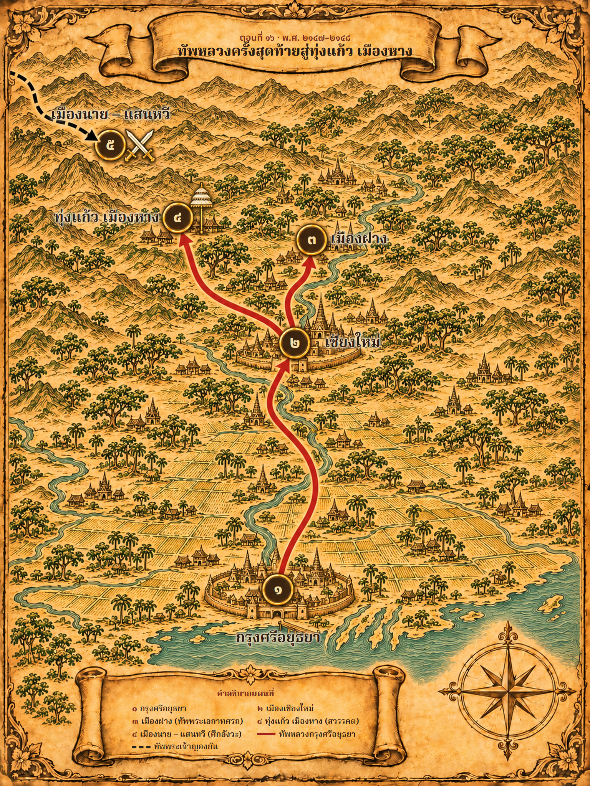

# ภาคที่ 4: เหนือบัลลังก์หงสาวดี สู่ทุ่งแก้วเมืองหาง (พ.ศ. 2138 – 2148)
## ตอนที่ 16: อวสานกษัตริย์นักรบ ณ ทุ่งแก้ว เมืองหาง

---

### องก์ที่ 1: ค่ายหลวงกลางขุนเขาและวาระสุดท้ายของจอมทัพ

**วันจันทร์ ขึ้น 8 ค่ำ เดือน 6 จ.ศ. 967** — ตรงกับวันที่ **25 เมษายน พ.ศ. 2148** (ค.ศ. 1605)

กลางฤดูร้อนอันอบอ้าวบนที่ราบสูง **ทุ่งแก้ว เมืองหาง** ในเขตรัฐฉาน ท่ามกลางวงล้อมของขุนเขาสูงตระหง่านและสายลมแห้งแล้งจากแดนเหนือ บรรยากาศภายในค่ายหลวงของกองทัพกรุงศรีอยุธยากลับเงียบสงัดจนได้ยินเพียงเสียงลมพัดยอดไม้

ไม่มีเสียงกลองศึกปลุกขวัญพล ไม่มีเสียงโห่ร้องเตรียมออกตีค่ายข้าศึก และไม่มีแม่ทัพนายกองคนใดกล้าเอ่ยถ้อยคำใดดังเกินกว่าเสียงกระซิบ

ภายในพลับพลาที่ประทับกลางค่ายหลวง **สมเด็จพระนเรศวรมหาราช** ในพระชนมพรรษา 50 พรรษา—กษัตริย์นักรบผู้ทรงตรากตรำในสมรภูมิมานับตั้งแต่ทรงพระเยาว์—กำลังบรรทมประชวรหนักด้วย **พระโรคฝีระรอก** ซึ่งปะทุขึ้นเป็นพิษไข้รุนแรงจนไม่อาจทรงพระคชาธารออกบัญชาการรบได้อีกต่อไป เคียงข้างพระแท่นบรรทมคือ **สมเด็จพระเอกาทศรถ** พระราชอนุชาคู่พระทัยผู้ทรงร่วมเป็นร่วมตายมาตั้งแต่เมืองพิษณุโลกจนถึงทุ่งหนองสาหร่าย

และในวันจันทร์อันเงียบงันกลางทุ่งแก้วนั้นเอง พระเจ้าแผ่นดินผู้ทรงเปลี่ยนชะตากรรมของอาณาจักรอยุธยาและอุษาคเนย์ทั้งภูมิภาคก็เสด็จสวรรคตลงกลางสนามเดินทัพ—ปิดฉากพระชนมชีพ 4 ทศวรรษในแผ่นดินที่ทรงพิทักษ์ด้วยคมดาบและพระสติปัญญาจนลมหายใจสุดท้าย

---

### องก์ที่ 2: สอบทานหลักฐานต่างแผ่นดินในวาระสุดท้าย

เมื่อกางหลักฐานประวัติศาสตร์จากฝ่ายไทย พม่า ล้านนา และชาวยุโรปมาเทียบเคียงกันในช่วง พ.ศ. 2147–2148 จะเห็นทั้งข้อเท็จจริงร่วมสมัยที่ทุกฝ่ายยืนยันตรงกัน และรายละเอียดปลีกย่อยที่สะท้อนมุมมองของแต่ละแผ่นดิน:

- **บันทึกในฉบับหลวงประเสริฐอักษรนิติ์ (จ.ศ. 966–967):** เอกสารโหรหลวงฉบับนี้ระบุลำดับเวลาได้อย่างแม่นยำที่สุด โดยบันทึกว่าใน **จ.ศ. 966 ปีมะโรง** (ปลาย พ.ศ. 2147 ตามการนับแบบโบราณ หรือต้น พ.ศ. 2148 ตามปฏิทินสากล) สมเด็จพระนเรศวรเสด็จกรีฑาทัพหลวงขึ้นไปตีเมืองอังวะทางเมืองหาง ครั้นเสด็จถึง **ตำบลทุ่งแก้ว เมืองหาง** ทรงพระประชวรหนักและเสด็จสวรรคตใน **วันจันทร์ ขึ้น 8 ค่ำ เดือน 6 จ.ศ. 967** ซึ่งทางราชการไทยคำนวณเทียบตรงกับ **วันที่ 25 เมษายน พ.ศ. 2148** (ค.ศ. 1605) โดยระบุสาเหตุไว้ชัดเจนว่าเป็นพระโรคฝีระรอกที่พระพักตร์
- **รายละเอียดในฉบับพันจันทนุมาศ (เจิม) และฉบับพระราชหัตถเลขา:** พงศาวดารฉบับชำระชั้นหลังขยายภาพการเดินทัพขึ้นเหนือว่า สมเด็จพระนเรศวรมหาราชและสมเด็จพระเอกาทศรถเสด็จยกทัพหลวงไปพักจัดระเบียบที่เมืองเชียงใหม่ ก่อนจะแยกเส้นทางเดินทัพโดยโปรดให้สมเด็จพระเอกาทศรถเสด็จไปตั้งค่ายทาง **เมืองฝาง** ส่วนพระองค์เสด็จล่วงหน้าขึ้นไปยัง **ทุ่งแก้ว เมืองหาง** เมื่อทรงพระประชวรหนักจึงมีรับสั่งให้ข้าหลวงรีบม้าเร็วไปทูลเชิญสมเด็จพระเอกาทศรถจากเมืองฝางเสด็จมาเฝ้าทันก่อนเสด็จสวรรคต เพื่อทรงมอบหมายราชการแผ่นดิน จากนั้นสมเด็จพระเอกาทศรถจึงทรงเลิกทัพและอัญเชิญพระบรมศพเสด็จคืนสู่กรุงศรีอยุธยา
- **พงศาวดารล้านนาและมหาราชวงษ์ พงษาวดารพม่า (*Hmannan Yazawin*):** เอกสารฝ่ายล้านนาอย่าง *ตำนานพื้นเมืองเชียงใหม่* และ *พงศาวดารโยนก* ยืนยันการเสด็จยกทัพใหญ่ของอยุธยาผ่านเชียงใหม่–เมืองฝางขึ้นไปรับมือศึกอังวะและการถอยทัพกลับหลังสวรรคต ขณะที่ *มหาราชวงษ์ พงษาวดารพม่า* บันทึกในมุมของราชสำนักอังวะว่า ขณะที่ **พระเจ้าญองยัน** เสด็จยกทัพปราบปรามหัวเมืองไทใหญ่ (เมืองนายและเมืองแสนหวี) และทรงเตรียมรับมือทัพสยามที่ยกขึ้นมา กษัตริย์อยุธยากลับทรงพระประชวรและเสด็จสวรรคตลงกลางทางเสียก่อน—ที่น่าทึ่งยิ่งกว่านั้นคือหลักฐานพม่าบันทึกตรงกันว่า ในปีเดียวกันนั้นเอง **พระเจ้าญองยัน** ก็ทรงพระประชวรและเสด็จสวรรคตระหว่างเสด็จกลับจากศึกไทใหญ่เช่นเดียวกัน ทำให้สงครามตัดสินระหว่างอยุธยากับอังวะไม่เคยเกิดขึ้นจริง!
- **จดหมายเหตุวันวลิตและข้อสันนิษฐานทางการแพทย์:** **เยเรเมียส วันวลิต** พ่อค้าชาวดัตช์ซึ่งเข้ามาเขียน *พงศาวดารกรุงศรีอยุธยา* ใน พ.ศ. 2182 (ราว 34 ปีหลังเหตุการณ์) บันทึกความทรงจำของชาวอยุธยาว่าสมเด็จพระนเรศวรสวรรคตระหว่างเดินทัพจากอาการประชวรฉับพลัน ส่วนเอกสารและนักวิชาการตะวันตกบางกระแสตั้งข้อสังเกตถึงโรคติดเชื้อรุนแรงอย่างไข้ทรพิษหรือพิษฝีแทรกซ้อนจากฝีอักเสบ (ซึ่งสอดคล้องกับคำว่า "ฝีระรอก" ในพงศาวดารไทย) โดยไม่มีหลักฐานร่วมสมัยใดระบุว่าเป็นการลอบปลงพระชนม์แต่อย่างใด

---

### องก์ที่ 3: เส้นทางทัพหลวงครั้งสุดท้าย จากอยุธยาสู่รัฐฉาน

#### โจทย์เชิงยุทธศาสตร์บนเส้นทางเชียงใหม่–เมืองฝาง–เมืองหาง

การกรีฑาทัพหลวงขึ้นเหนือใน จ.ศ. 966 (ปลาย พ.ศ. 2147 – ต้น พ.ศ. 2148) เป็นปฏิบัติการทางทหารที่ท้าทายขีดจำกัดด้านภูมิประเทศและการส่งกำลังบำรุงมากที่สุดครั้งหนึ่งในรัชกาล

ในเวลานั้น **พระเจ้าญองยัน** แห่งกรุงอังวะได้ยกทัพข้ามลุ่มน้ำอิรวดีขึ้นมาตีหัวเมืองไทใหญ่ทั้งเมืองนายและเมืองแสนหวีจนสั่นคลอน สมเด็จพระนเรศวรมหาราชทรงประเมินว่า หากตั้งรับอยู่ที่อยุธยาหรือพิษณุโลกก็เท่ากับปล่อยให้อังวะรวบรวมกำลังพลไทใหญ่และล้านช้าง–ล้านนามาปิดล้อมหัวเมืองเหนือได้เหมือนสมัยพระเจ้าบุเรงนอง ทางเดียวที่จะสกัดกั้นจักรวรรดิพม่ายุคใหม่ได้ตั้งแต่ต้นลมคือต้อง **ยกทัพขึ้นไปปะทะกับพระเจ้าญองยันในดินแดนไทใหญ่โดยตรง**

กองทัพหลวงของกรุงศรีอยุธยาเคลื่อนขบวนขึ้นเหนือจากลุ่มน้ำเจ้าพระยา ผ่านเมืองกำแพงเพชร เข้าสู่เขตลุ่มน้ำปิงที่ **เมืองเชียงใหม่** เมื่อเสด็จถึงเชียงใหม่ พระองค์ทรงใช้เวลาจัดระเบียบกำลังพลหัวเมืองล้านนาและรวบรวมเสบียงเพิ่มเติม ก่อนจะทรงวางแผนแยกขบวนทัพเพื่อโอบล้อมและหนุนช่วยกันในพื้นที่ภูเขาสูง:

1. **ปีกทัพของสมเด็จพระเอกาทศรถ:** โปรดให้เคลื่อนพลขึ้นเหนือไปทาง **เมืองฝาง** เพื่อเตรียมรุกเข้าสู่แนวเมืองนายและประสานกับเจ้าฟ้าไทใหญ่ในการตีโอบปีกทัพอังวะ
2. **ทัพหลวงของสมเด็จพระนเรศวรมหาราช:** เสด็จนำทัพหลักมุ่งตรงข้ามแนวเทือกเขาสู่ **เมืองหาง** (ในเขตรัฐฉานตอนใต้) เพื่อตั้งมั่นที่ **ทุ่งแก้ว** รอสมทบกับกองกำลังพันธมิตรก่อนรุกเข้าประชิดแนวรบของพระเจ้าญองยัน

#### วินาทีพลิกผันใต้ร่มพลับพลาที่ทุ่งแก้ว

ทว่าการเดินทัพทางไกลผ่านหุบเขา ป่าดงดิบ และสภาพอากาศที่แปรปรวนจากลมหนาวปลายเดือนมกราคมสู่ความร้อนอบอ้าวของฤดูร้อนเดือนเมษายน ได้บั่นทอนพระพลานามัยของกษัตริย์นักรบวัย 50 พรรษาอย่างหนักหน่วง ตลอดระยะทางหลายร้อยกิโลเมตรจากลุ่มน้ำเจ้าพระยาสู่ที่ราบสูงรัฐฉาน พระองค์ทรงบัญชาการรบและจัดระเบียบหัวเมืองด้วยพระองค์เองโดยแทบไม่ทรงหยุดพัก

เมื่อขบวนทัพหลวงเสด็จมาถึง **ทุ่งแก้ว เมืองหาง** พระอาการประชวรด้วย **พระโรคฝีระรอก** ที่พระพักตร์ก็ทวีความรุนแรงขึ้นอย่างรวดเร็ว แพทย์หลวงพยายามถวายการรักษาเต็มความสามารถ ทว่าในยุคก่อนมียาปฏิชีวนะ การติดเชื้อในกระแสเลือดจากฝีอักเสบรุนแรงกลางค่ายสนามย่อมยากเกินกำลังเยียวยา

ตามความใน *ฉบับพันจันทนุมาศ (เจิม)* และ *ฉบับพระราชหัตถเลขา* เมื่อทรงตระหนักว่าวาระสุดท้ายมาถึงแล้ว สมเด็จพระนเรศวรทรงมีพระสติมั่นคง ทรงโปรดให้เร่งเชิญ **สมเด็จพระเอกาทศรถ** จากเมืองฝางเสด็จมาเฝ้าที่ค่ายหลวงทุ่งแก้ว ทั้งสองพระองค์ทรงสนทนาสั่งเสียราชการบ้านเมืองเป็นครั้งสุดท้าย—ราชบัลลังก์อยุธยาที่ทั้งสองพระองค์ทรงร่วมฝ่าฟันสร้างขึ้นมาจากเถ้าถ่านกำลังจะถูกส่งมอบให้พระราชอนุชาผู้คู่ควรที่สุดสืบสานต่อไป

วันจันทร์ ขึ้น 8 ค่ำ เดือน 6 จ.ศ. 967 ตรงกับ **วันที่ 25 เมษายน พ.ศ. 2148** สมเด็จพระนเรศวรมหาราชเสด็จสวรรคตลงอย่างสงบท่ามกลางขุนศึกและไพร่พลนับหมื่นที่เมืองหาง

เมื่อสมเด็จพระเอกาทศรถทรงจัดการอัญเชิญพระบรมศพเสด็จถอยทัพกลับลงมาทางเมืองฝาง เชียงใหม่ และลุ่มน้ำเจ้าพระยา ขบวนทัพที่เคยยาตราขึ้นเหนือด้วยความฮึกเหิมกลับกลายเป็นขบวนไว้ทุกข์อันเงียบงันท่ามกลางความโศกเศร้าของราษฎรตลอดสองฟากฝั่ง และประจวบกับที่ฝ่ายอังวะเองก็สูญเสียพระเจ้าญองยันระหว่างศึกไทใหญ่ในปีเดียวกัน (ส่งผลให้ราชสมบัติอังวะตกแก่พระเจ้าอนอเพตลุนและทัพอังวะต้องถอยกลับไปจัดการภายในเช่นกัน) สงครามใหญ่ระหว่างอยุธยากับอังวะจึงยุติลงโดยปริยาย ก่อนที่สมเด็จพระเอกาทศรถจะเสด็จขึ้นครองราชย์เป็นพระมหากษัตริย์พระองค์ใหม่แห่งกรุงศรีอยุธยา ทรงจัดพระราชพิธีถวายพระเพลิงพระบรมศพอย่างสมพระเกียรติ และสืบสานนโยบายการค้าทางทะเลกับฮอลันดาและญี่ปุ่นให้รุ่งเรืองสืบต่อมา

---

### องก์ที่ 4: มรดก 4 ทศวรรษ — จากองค์ประกันสู่สถาปนิกแห่งอโยธยา

หากมองย้อนกลับไปตลอด **4 ทศวรรษ (พ.ศ. 2098–2148)** นับจากวันที่ทรงถือกำเนิดในฐานะ **"พระองค์ดำ"** แห่งพระราชวังจันทน์ เมืองพิษณุโลก ผ่านวัยเยาว์ในฐานะองค์ประกัน ณ ราชสำนักหงสาวดี จนถึงวันที่เสด็จสวรรคตบนที่ราบสูงทุ่งแก้ว เมืองหาง เรื่องราวของ **สมเด็จพระนเรศวรมหาราช** มิใช่เพียงตำนานของนักรบผู้กล้าหาญในสนามรบเท่านั้น หากคือบทเรียนอันล้ำค่าของผู้นำที่เปลี่ยนโครงสร้างประวัติศาสตร์อุษาคเนย์ด้วยยุทธศาสตร์ 4 ประการ:

1. **ความอดทนและรู้จักศัตรูจากภายใน:** การประทับเป็นองค์ประกันในราชสำนักหงสาวดีทำให้ทรงเรียนรู้ทั้งจุดแข็งและจุดอ่อนของระบบจักรวรรดิตองอูตั้งแต่ทรงพระเยาว์—ความรู้ที่เปลี่ยนเป็นอาวุธสำคัญในวันที่ทรงหลั่งทักษิโณทกประกาศอิสรภาพ ณ เมืองแครงใน พ.ศ. 2127 และตีฝ่าข้ามแม่น้ำสะโตง
2. **การปฏิรูประบบกำลังพลและสงครามรุก:** ทรงกล้าตัดสินพระทัยใช้ยุทธศาสตร์เทครัวหัวเมืองเหนือมารวมศูนย์อำนาจรอบพระนคร และเปลี่ยนกรุงศรีอยุธยาจากเมืองที่คอยอุดประตูตั้งรับหลังกำแพงให้กลายเป็นกองทัพเคลื่อนที่เร็วที่กล้าบุกไปท้ารบในสนามเปิดที่ทุ่งหนองสาหร่ายใน พ.ศ. 2136 และข้ามเขาตะนาวศรีไปปิดล้อมถึงกรุงหงสาวดี
3. **การใช้การทูตหลายขั้วถ่วงดุลอำนาจ:** ตั้งแต่การส่งพระราชสาส์นถึงราชสำนักหมิงในยามสงครามอิมจิน การปราบปรามกรุงละแวกเพื่อปิดแนวรบตะวันออก ไปจนถึงการเชื่อมการค้าทางทะเลกับสเปน โปรตุเกส ดัตช์ และญี่ปุ่น ควบคู่กับการจัดระเบียบล้านนาและไทใหญ่เป็นแนวกั้นทางเหนือ
4. **ความมั่นคงยาวนานนับศตวรรษ:** ผลจากแสนยานุภาพและเกียรติภูมิที่ทรงวางรากฐานไว้ ทำให้หลังจากรัชสมัยของพระองค์ **กรุงศรีอยุธยาปราศจากทัพใหญ่พม่าเข้ามาประชิดกำแพงพระนครยาวนานถึงกว่าหนึ่งร้อยห้าสิบปี** เปิดทางให้ราชอาณาจักรอโยธยาเข้าสู่ยุคทองแห่งการค้า การทูต ศิลปวัฒนธรรม และความมั่งคั่งสูงสุดในเอเชียตะวันออกเฉียงใต้

**แสงอาทิตย์ยามอัสดงอาจลับขอบฟ้าเหนือทุ่งแก้ว เมืองหาง ในวันที่ 25 เมษายน พ.ศ. 2148 ทว่าพระเกียรติยศและบทเรียนแห่งการกอบกู้และสร้างแผ่นดินของ "สมเด็จพระนเรศวรมหาราช" จะยังคงส่องสว่างอยู่บนหน้าประวัติศาสตร์ไทยตราบนานเท่านาน**

**จบตอนที่ 16 (จบภาคที่ 4: เหนือบัลลังก์หงสาวดี สู่ทุ่งแก้วเมืองหาง)**

*(จบบริบูรณ์ "4 ทศวรรษ สมเด็จพระนเรศวรมหาราช" ทั้ง 16 ตอน ตลอด 4 ภาค)*
