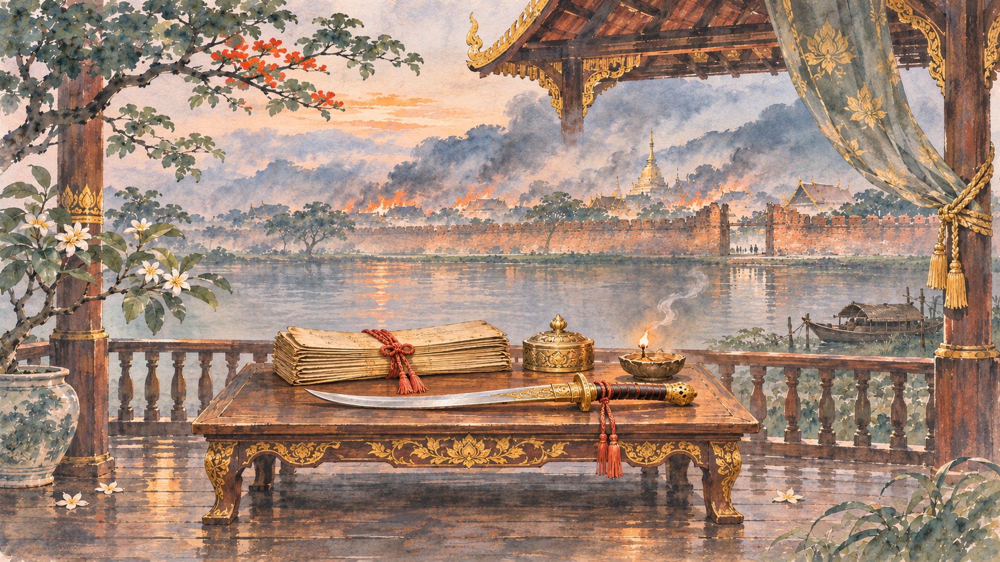
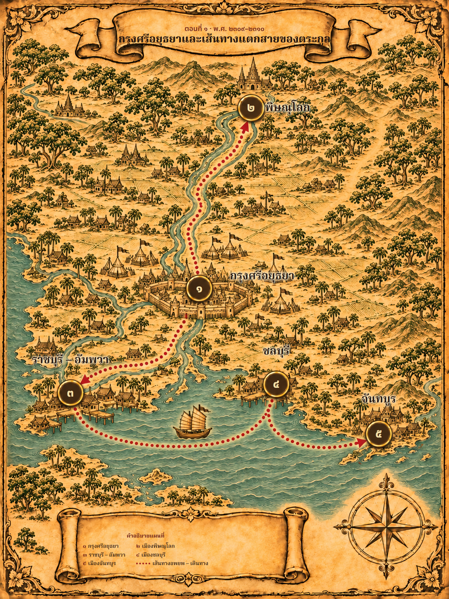

# ภาคที่ 1: จากนายสุดจินดาสู่ขุนศึกกรุงธนบุรี (พ.ศ. 2286 – 2318)
## ตอนที่ 1: บุตรคนเล็กแห่งตระกูลขุนนางกรุงเก่า จากนายสุดจินดาสู่คืนกรุงแตก

---

### องก์ที่ 1: เปิดฉากม่านควันเหนือคลองสะแกกรังและป้อมเพชร

ควันจากค่ายล้อมพระนครลอยต่ำมาตามสายน้ำเจ้าพระยาตั้งแต่ยังไม่สิ้นฤดูหนาวของปีจอ จุลศักราช 1128

ภายใน **กรุงศรีอยุธยา** ช่วงปลายรัชกาลสมเด็จพระเจ้าเอกทัศ เสียงปืนใหญ่จากแนวค่ายพม่าของเนเมียวสีหบดีทางทิศเหนือและมังมหานรธาทางทิศใต้ไม่ได้ดังเป็นครั้งคราวอีกต่อไป หากดังถี่ขึ้นเหมือนจังหวะกลองที่บีบเข้าหากำแพงอิฐทีละคืบ ชาวบ้านแถบวัดสุวรรณดารารามและป้อมเพชรทางทิศตะวันออกเฉียงใต้ของเกาะเมืองต่างเก็บข้าวสารใส่ไหฝังดิน ตระเตรียมเรือพายขนาดเล็กผูกไว้ที่ท่าน้ำหลังบ้าน เผื่อวันที่กำแพงกรุงทานกระสุนปืนใหญ่ไม่ไหว

ในยามวิกฤตเช่นนั้น ชายหนุ่มวัยยี่สิบสามปีผู้หนึ่งยังคงเดินตรวจตราเวรยามในเขตพระราชฐานชั้นในด้วยเครื่องแบบมหาดเล็กหุ้มแพร ตำแหน่งของเขาคือ **นายสุดจินดา** นามเดิมว่า **บุญมา** บุตรชายคนเล็กในสายมารดาของ **พระอักษรสุนทรศาสตร์ (ทองดี)** เสมียนตรากรมมหาดไทย

สำหรับคนภายนอก นายสุดจินดาเป็นเพียงขุนนางหนุ่มระดับปลายแถวในราชสำนักที่เต็มไปด้วยความหวาดระแวง ทว่าเบื้องหลังตำแหน่งเล็กๆ นั้น ครอบครัวของเขากลับยืนอยู่บนทางแยกที่กำลังฉีกบ้านหนึ่งให้แตกออกเป็นสามทิศทาง

- **ผู้เป็นบิดา** คือพระอักษรสุนทรศาสตร์ (ทองดี) ขุนนางผู้ชำนาญหนังสือราชการในกรมมหาดไทย มองเห็นตั้งแต่ก่อนกรุงแตกว่าเมืองหลวงอาจรักษาไว้ไม่ได้ จึงตัดสินใจพาครอบครัวส่วนหนึ่งตีฝ่าวงล้อมอพยพขึ้นเหนือไปทาง **เมืองพิษณุโลก**
- **พี่ชายร่วมมารดา** คือ **ทองด้วง** (อายุแก่กว่าบุญมาราวหกปี) รับราชการเป็น **หลวงยกกระบัตรเมืองราชบุรี** ประจำอยู่ที่หัวเมืองตะวันตก ห่างจากวงล้อมราชธานีออกไปหลายวันเดินเรือ
- **ตัวบุญมาเอง** ยังติดอยู่ในพระนครที่ประตูปิดตาย และเสบียงอาหารเริ่มฝืดเคืองลงทุกวัน

คืนแล้วคืนเล่าที่นายสุดจินดายืนมองเปลวไฟและเสียงปืนใหญ่จากเชิงเทิน เขาไม่ได้มองเห็นเพียงความพินาศของราชธานีอายุกว่าสี่ศตวรรษ หากกำลังคำนวณโจทย์ที่ขุนนางในศาลาลูกขุนไม่กล้าพูดออกมาดังๆ นั่นคือ *ถ้ากรุงศรีอยุธยาแตกในอีกไม่กี่สัปดาห์ข้างหน้า คนที่ยังติดอยู่ในกำแพงจะรอดออกไปตั้งหลักได้ที่ไหน และจะกลับมารวมตัวกับใคร*

คำตอบของเขาไม่ได้อยู่ที่การรอความตายบนเชิงเทิน แต่อยู่ที่เรือพายลำเล็กริมฝั่งน้ำเจ้าพระยาที่จอดรอจังหวะมืดสนิทของคืนเดือนดับ

---

### องก์ที่ 2: กระดานการเมืองและหลักฐาน

เมื่อเราเปิดแฟ้มหลักฐานขึ้นวางบนโต๊ะในฐานะ **นักสืบประวัติศาสตร์** เรื่องราวของบุญมาในวัยเยาว์และการหนีออกจากกรุงศรีอยุธยา พ.ศ. 2310 มีรายละเอียดสำคัญที่ต้องตรวจสอบเทียบกันอย่างระมัดระวัง ระหว่าง **พระราชพงศาวดารกรุงรัตนโกสินทร์ รัชกาลที่ 1** ฉบับเจ้าพระยาทิพากรวงศ์ (ขำ บุนนาค), พระราชนิพนธ์ **ปฐมวงศ์** ในพระบาทสมเด็จพระจอมเกล้าเจ้าอยู่หัว, พระประวัติใน **ประชุมพงศาวดาร**, และ **พระราชพงศาวดารกรุงธนบุรี ฉบับพันจันทนุมาศ (เจิม)**

#### 1. ปีเกิด 2286 กับ 2287 และรากเหง้าตระกูลขุนนางกรุงเก่า

เอกสารประวัติศาสตร์และงานอ้างอิงสมัยใหม่บางแห่งระบุปีเกิดของกรมพระราชวังบวรมหาสุรสิงหนาทไว้เป็น พ.ศ. 2287 ทว่าเมื่อสอบทานจากหลักฐานพระประวัติและวิธีแปลงศักราชตามจารีตโบราณ พบข้อมูลที่ชัดเจนกว่านั้น

บุญมาเกิดในรัชกาลสมเด็จพระเจ้าอยู่หัวบรมโกศ เมื่อ **วันพฤหัสบดี เดือน 11 ขึ้น 1 ค่ำ ปีกุน จุลศักราช 1105** หากแปลงตามเกณฑ์มาตรฐานของเล่มนี้ (จ.ศ. + 1181) หรือเทียบปฏิทินสุริยคติสากล จะตรงกับ **เดือนกันยายน พ.ศ. 2286** (ค.ศ. 1743) ซึ่งสอดคล้องกับปีสวรรคต พ.ศ. 2346 ปีกุน จุลศักราช 1165 ในวัยครบ 60 ปีบริบูรณ์พอดี ส่วนสาเหตุที่บางตำราระบุเป็น พ.ศ. 2287 เกิดจากการนับย่างหรือเทียบปีพุทธศักราชแบบปฏิทินเก่าที่ขึ้นปีใหม่ในเดือนเมษายนต่างกัน

บิดาของท่านคือ **พระอักษรสุนทรศาสตร์ (ทองดี)** (หรือที่บางแห่งสะกดว่าพระอักษรสุนทรสาสน์) ขุนนางกรมมหาดไทยผู้สืบเชื้อสายขุนนางอยุธยา มีนิวาสสถานอยู่ภายในกำแพงพระนครแถบป้อมเพชรและวัดสุวรรณดาราราม มารดาคือ **ท่านหยก** (หรือเรียกขานในเอกสารสายราชสกุลว่า **ดาวเรือง**) ทั้งสองมีบุตรธิดาร่วมกัน 5 คน ได้แก่

1. **สา** (ต่อมาคือสมเด็จพระเจ้าพี่นางเธอ เจ้าฟ้ากรมพระเทพสุดาวดี)
2. **ขุนรามณรงค์** (หรือราม ถึงแก่กรรมตั้งแต่สมัยกรุงศรีอยุธยา)
3. **แก้ว** (ต่อมาคือสมเด็จพระเจ้าพี่นางเธอ เจ้าฟ้ากรมพระศรีสุดารักษ์)
4. **ทองด้วง** (เกิด พ.ศ. 2279 ต่อมาคือพระบาทสมเด็จพระพุทธยอดฟ้าจุฬาโลกมหาราช)
5. **บุญมา** (เกิด พ.ศ. 2286 บุตรคนเล็กในสายมารดานี้)

นอกจากนี้ พระอักษรสุนทรศาสตร์ยังมีธิดาและบุตรต่างมารดาอีกในสายเดียวกัน เช่น **กุ** (ต่อมาคือกรมหลวงนรินทรเทวี ผู้บันทึก *จดหมายเหตุความทรงจำ*) และ **ลา** (ต่อมาคือกรมหลวงจักรเจษฎา) การเติบโตในเรือนขุนนางเสมียนตรากรมมหาดไทยทำให้ทั้งทองด้วงและบุญมาคุ้นเคยกับระบบหนังสือราชการ สารตราหัวเมือง และเครือข่ายขุนนางภูมิภาคทั่วราชอาณาจักรมาตั้งแต่เยาว์วัย

#### 2. สังคมอยุธยาตอนปลายและสายสัมพันธ์กับ "พระยาตาก"

ประเด็นสำคัญที่พงศาวดารและคำบอกเล่าสายราชสกุลอธิบายไว้ตรงกัน คือ ตระกูลของพระอักษรสุนทรศาสตร์ (ทองดี) มิได้เป็นคนแปลกหน้ากับ **พระยาตาก (สิน)** (ต่อมาคือพระยาวชิรปราการ)

ในสมัยแผ่นดินพระเจ้าเอกทัศ ทองด้วงและบุญมาเติบโตในราชสำนักรุ่นเดียวกับกลุ่มขุนนางหนุ่มระดับกลางอย่างสิน (มหาดเล็กและต่อมาเป็นหลวงยกกระบัตรเมืองตาก ก่อนเลื่อนเป็นพระยาตาก) รวมถึงเพื่อนร่วมรุ่นคนอื่นเช่นบุนนาคในสายขุนนางเจ้ากรม พวกเขาอยู่ในแวดวงมหาดเล็กและขุนนางชั้นผู้น้อยที่เห็นความระส่ำระสายของการบริหารราชการปลายกรุงศรีอยุธยาด้วยตาตนเอง ทั้งการผลัดแผ่นดิน พ.ศ. 2301 การรุกเข้ามาของทัพพระเจ้าอลองพญา พ.ศ. 2302–2303 และการล้อมกรุงครั้งสุดท้ายของทัพพระเจ้ามังระ พ.ศ. 2308–2310

#### 3. ตรวจเส้นทางและเวลาที่ออกจากกรุงศรีอยุธยา (ประเด็นหลักฐานต่างสาย)

เมื่อเทียบหลักฐานเพื่อหาคำตอบว่า **นายสุดจินดา (บุญมา) ออกจากกรุงศรีอยุธยาเมื่อใด และเดินทางไปทิศทางไหน** นักสืบประวัติศาสตร์จะพบรายละเอียดที่ต้องแยกแยะให้ชัด:

- **ในพระราชพงศาวดารกรุงธนบุรี ฉบับพันจันทนุมาศ (เจิม):** พงศาวดารฉบับนี้มุ่งเล่าเหตุการณ์ของพระยาตากเป็นแกนกลาง ตั้งแต่ออกจากวัดพิชัยสงครามในคืนวันที่ 3 มกราคม พ.ศ. 2310 (ดังที่เล่าไว้ใน *กระดานศึกพระเจ้าตาก* ตอนที่ 1) ไปตั้งหลักที่จันทบูร แล้วย้อนกลับมาตีค่ายโพธิ์สามต้น ในช่วงเวลาดังกล่าว **ฉบับพันจันทนุมาศ (เจิม) ยังไม่ได้เอ่ยถึงนายสุดจินดา (บุญมา) เลย** จนกระทั่งถึงต้นปี พ.ศ. 2311 หลังตั้งกรุงธนบุรีแล้วจึงปรากฏชื่อในฐานะพระมหามนตรี
- **ในพระราชพงศาวดารกรุงรัตนโกสินทร์ รัชกาลที่ 1, ปฐมวงศ์ และพระประวัติ:** หลักฐานฝ่ายราชสกุลจักรีเล่าเติมเต็มช่องว่างในช่วง พ.ศ. 2309–2310 ไว้ว่า เมื่อทัพพม่าล้อมกรุงหนักจนจวนจะเสียพระนคร นายสุดจินดา (บุญมา) เห็นว่าราชธานีไม่อาจต้านทานได้ จึงชักชวนสมัครพรรคพวกหนีออกจากกรุงทางเรือล่องลงมาทางใต้

จุดที่ต้องอ่านอย่างละเอียดคือ **ปลายทางแรกหลังออกจากกรุง**:

หลักฐานฝ่ายรัตนโกสินทร์ระบุว่า พระอักษรสุนทรศาสตร์ (ทองดี) ผู้เป็นบิดา อพยพหนีขึ้นไปทางเหนือถึง **เมืองพิษณุโลก** และเข้าไปพึ่ง **เจ้าพระยาพิษณุโลก (เรือง)** จนได้รับแต่งตั้งเป็นเจ้าพระยาจักรีสมุหนายกประจำชุมนุมพิษณุโลก ก่อนจะถึงแก่อสัญกรรมที่เมืองพิษณุโลกในปี พ.ศ. 2311 ส่วน **นายสุดจินดา (บุญมา)** ไม่ได้ขึ้นเหนือตามบิดา แต่ล่องเรือลงใต้ไปหา **หลวงยกกระบัตร (ทองด้วง)** พี่ชายที่เมือง **ราชบุรี** และย่านอัมพวา สมุทรสงคราม จากนั้นพี่ชายจึงแนะนำให้นายสุดจินดาเดินทางไปสมทบกับพระยาตากทางชายฝั่งตะวันออก

ในขณะเดียวกัน เอกสารบางฉบับและเรื่องเล่าชั้นหลังสรุปภาพรวบรัดว่านายสุดจินดาออกจากกรุงมุ่งตรงไปทาง **เมืองชลบุรี–จันทบุรี** เพื่อตามหาพระยาตาก แต่เมื่อสอบเทียบกับความสัมพันธ์ของสองพี่น้องและข้อความใน *ปฐมวงศ์* แล้ว การลงไปปรึกษากับหลวงยกกระบัตรที่ราชบุรี–อัมพวาก่อน แล้วจึงเดินทางตัดข้ามหรืออ้อมอ่าวไทยไปทางชลบุรี–จันทบุรี เป็นลำดับเหตุการณ์ที่เชื่อมโยงหลักฐานทั้งสองกลุ่มเข้าด้วยกันได้สมเหตุสมผลที่สุด

---

### องก์ที่ 3: จุดปะทะในเมืองปิดล้อมและการตัดสินใจแยกสาย

การตัดสินใจหนีออกจากกรุงศรีอยุธยาในห้วงเดือนยี่ถึงเดือนห้า ปีจอ–ปีกุน (ต้น พ.ศ. 2310) ไม่ใช่เรื่องง่ายทั้งในทางกฎหมายและทางยุทธวิธี

ในทางกฎหมายราชสำนักอยุธยา การทิ้งหน้าที่ราชการหนีออกจากพระนครในยามศึกสงครามถือเป็นความผิดฐานกบฏหรือละทิ้งหน้าที่ แต่ในทางความเป็นจริง กรุงศรีอยุธยาหลังเดือน 12 ปี พ.ศ. 2309 ได้สูญเสียเอกภาพในการบัญชาการไปแล้ว ตั้งแต่พระยาตากตีฝ่าค่ายวัดพิชัยสงครามออกไปทางตะวันออกในคืนวันที่ 3 มกราคม พ.ศ. 2310 กำแพงพระนครก็เหมือนหม้อดินที่รอวันแตก

#### ทำไมนายสุดจินดาจึงเลือก "ทางน้ำลงใต้" แทนที่จะตามบิดาไป "ทางเหนือ"

หากกางแผนที่ยุทธศาสตร์รอบเกาะเมืองอยุธยาในต้น พ.ศ. 2310 การเลือกเส้นทางของคนในตระกูลเดียวกันสะท้อนการอ่านกระดานสงครามที่แตกต่างกัน:

1. **ทิศเหนือถูกปิดด้วยค่ายหลวงพม่า:** กองทัพของเนเมียวสีหบดีตั้งค่ายใหญ่ที่โพธิ์สามต้น คุมลำน้ำลพบุรี–ป่าสัก–เจ้าพระยาตอนบน การหลบหนีขึ้นพิษณุโลกต้องอาศัยการเล็ดลอดไปตามทุ่งนาและลำน้ำเล็ก ซึ่งพระอักษรสุนทรศาสตร์ (ทองดี) ในวัยชราเลือกไปพึ่งอำนาจของเจ้าพระยาพิษณุโลก (เรือง) ที่ยังมีกองทัพและกำแพงเมืองเข้มแข็งที่สุดในภาคเหนือ
2. **ทิศใต้–ตะวันตกเป็นทางเชื่อมสู่พี่ชาย:** แม้กองทัพของมังมหานรธา (และต่อมาเนเมียวสีหบดีรวบอำนาจแทน) จะตั้งค่ายสกัดอยู่ที่สีกุก ภูเขาทอง ขนอนหลวง และวัดโปรดสัตว์ แต่ลุ่มน้ำเจ้าพระยาตอนล่างลงไปถึงแม่น้ำท่าจีนและแม่น้ำแม่กลองเต็มไปด้วยคลองลัด ทุ่งจาก และเรือกสวนที่ทหารพม่าซึ่งถนัดการรบบนบกไม่อาจตรวจตราได้ทั่วถึง
3. **การล่องเรือเล็กยามวิกาล:** นายสุดจินดา (บุญมา) ในวัย 23 ปี ใช้ความชำนาญทางน้ำและกำลังกายของคนหนุ่ม ล่องเรือเล็กเล็ดลอดผ่านแนวยามค่ายพม่าทางตอนล่างของเกาะเมือง หลบด่านสกัดแถบขนอนหลวง–ธนบุรี มุ่งหน้าตัดเข้าคลองลัดสู่แม่น้ำแม่กลอง เพื่อไปสมทบกับ **หลวงยกกระบัตร (ทองด้วง)** ที่ราชบุรีและอัมพวา

ที่ราชบุรี–อัมพวาในเวลานั้น แม้จะอยู่นอกเขตปิดล้อมกรุงศรีอยุธยา แต่ก็ไม่ใช่พื้นที่ปลอดภัยถาวร กองลาดตระเวนพม่าจากค่ายกรุงและจากเมืองทวายสามารถรุกเข้ามากวาดต้อนผู้คนได้ทุกเมื่อ เมื่อข่าวการเสียกรุงศรีอยุธยาในวันที่ **7 เมษายน พ.ศ. 2310** (วันอังคาร เดือน 5 ขึ้น 9 ค่ำ ปีกุน) แพร่กระจายไปทั่วลุ่มน้ำภาคกลาง แผ่นดินก็เข้าสู่ภาวะสุญญากาศทางอำนาจ

#### การอ่านกระดานหลังกรุงแตกของสองพี่น้อง

ในขณะที่หัวเมืองใหญ่สี่ทิศ—พิษณุโลก พิมาย นครศรีธรรมราช และสวางคบุรี—ต่างตั้งตนเป็นใหญ่รักษาพื้นที่ของตนเอง หลวงยกกระบัตร (ทองด้วง) กับนายสุดจินดา (บุญมา) กลับอ่านกระดานต่างออกไป

ทองด้วงมีภาระต้องดูแลครอบครัวของภรรยา (**ท่านนาค** ชาวบ้านอัมพวา) และผู้คนในเขตราชบุรี–สมุทรสงคราม อีกทั้งยังต้องรอดูว่าขั้วอำนาจใดจะมีกำลังพอขับไล่พม่าออกจากลุ่มน้ำเจ้าพระยาได้จริง ส่วนบุญมาซึ่งยังหนุ่มและคล่องตัวกว่า มองเห็นข่าวการเคลื่อนไหวของ **พระยาตาก**—คนรู้จักเก่าจากราชสำนักอยุธยา—ที่เพิ่งตีฝ่าวงล้อมไปยึดเมืองระยองและกำลังรวบรวมทัพเรืออยู่ที่หัวเมืองชายทะเลตะวันออก

สายใยของสองพี่น้องจึงแบ่งบทบาทกันโดยปริยาย: พี่ชายตรึงหลักฐานและเฝ้าดูสถานการณ์อยู่ฝั่งตะวันตก ส่วนน้องชายเป็น **หน่วยล่วงหน้า** เดินทางไปสังเกตการณ์และถวายตัวเข้าสู่สนามรบจริง

---

### องก์ที่ 4: แรงสะเทือนจากการตัดสินใจและปมสู่ภาคตะวันออก

การก้าวออกจากเรือนมหาดเล็กที่ป้อมเพชรและการหันหน้าสู่เครือข่ายของพระยาตากใน พ.ศ. 2310 คือจุดเปลี่ยนชะตาชีวิตของบุญมาและราชอาณาจักรสยามในเวลาเดียวกัน

หากวันนั้นนายสุดจินดาเลือกอพยพตามบิดาขึ้นไปอยู่เมืองพิษณุโลกกับเจ้าพระยาพิษณุโลก (เรือง) ชีวิตของเขาอาจจบลงด้วยการเป็นขุนนางท้องถิ่นภายใต้ชุมนุมพิษณุโลก หรือถูกกลืนหายไปเมื่อเจ้าพระยาพิษณุโลกพิราลัยและเจ้าพระฝางเข้ายึดเมืองในปี พ.ศ. 2311

แต่การเลือกเดินลงใต้มาหาพี่ชายที่ราชบุรี แล้วมุ่งหน้าเข้าหาขั้วอำนาจใหม่ของพระยาตาก ทำให้เด็กหนุ่มวัยยี่สิบสามผู้ไม่เคยถือบังเหียนทัพใหญ่ในสมัยอยุธยา กำลังจะได้ก้าวขึ้นสู่สนามรบจริงที่ไม่มีกฎมณเฑียรบาลอันล่าช้าของศาลาลูกขุนมาผูกมัดแขนขาอีกต่อไป

ทว่าประตูสู่ค่ายของพระยาตากไม่ได้เปิดรออยู่ตรงหน้าอย่างเรียบง่าย ระหว่างเส้นทางจากลุ่มน้ำแม่กลองข้ามสู่ชายฝั่งตะวันออก หรือจากค่ายโพธิ์สามต้นสู่กรุงธนบุรี หลักฐานทางประวัติศาสตร์สองสายยังคงทิ้งร่องรอยการเดินทางของนายสุดจินดาไว้ต่างกัน—สายหนึ่งว่าเขานำมารดาของพระยาตากข้ามไปส่งถึง **จันทบูร** ตั้งแต่ พ.ศ. 2310 อีกสายหนึ่งว่าเขาเดินทางจากราชบุรี–อัมพวามาถวายตัวที่ **กรุงธนบุรี** ในต้น พ.ศ. 2311 ก่อนเสียงกลองศึกพม่าจะดังขึ้นที่ปากน้ำแม่กลอง

ไม่ว่าจะยึดหลักฐานสายใด คำตอบของสนามรบจะถูกพิสูจน์ในอีกไม่กี่เดือนข้างหน้า—ที่ค่ายไม้ซุงริมน้ำแม่กลอง ณ **ตำบลบางกุ้ง**

**จบตอนที่ 1**

*(ติดตามต่อใน ตอนที่ 2: พระมหามนตรีที่บางกุ้ง จุดเริ่มต้นคู่แม่ทัพพี่น้อง)*
