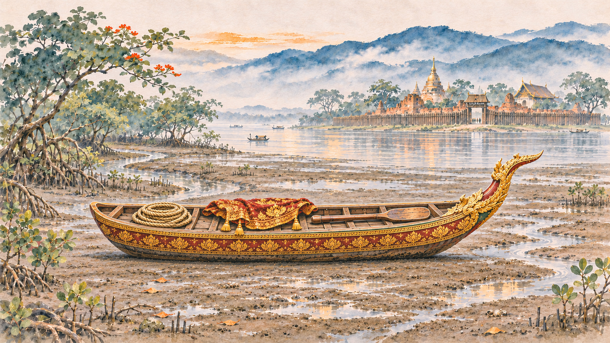
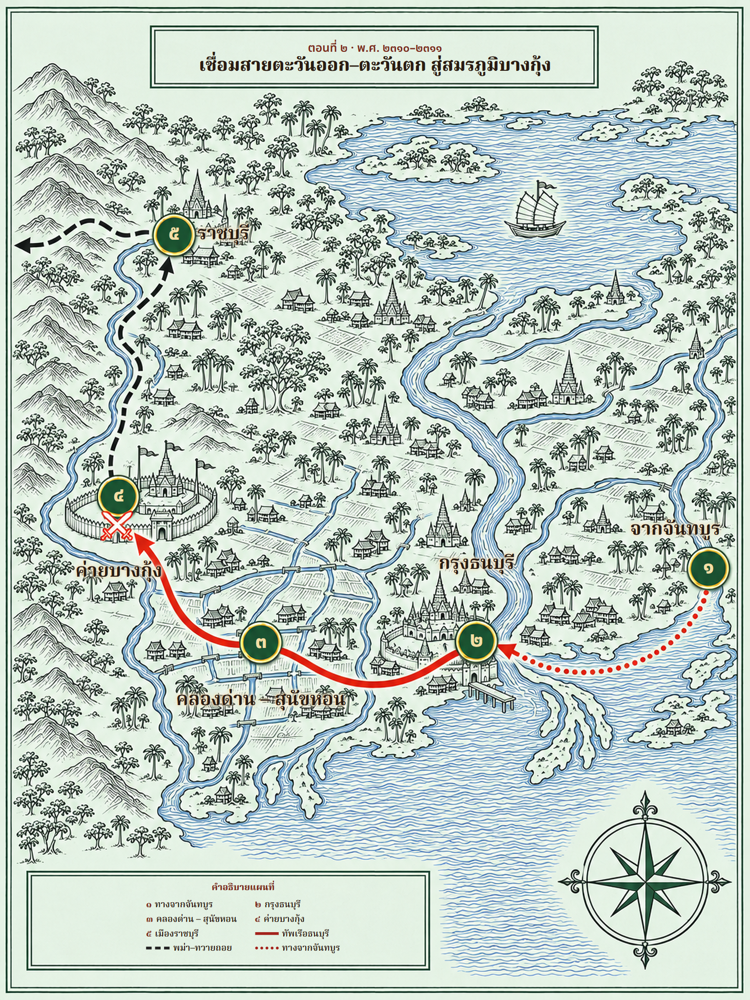

# ภาคที่ 1: จากนายสุดจินดาสู่ขุนศึกกรุงธนบุรี (พ.ศ. 2286 – 2318)
## ตอนที่ 2: พระมหามนตรีที่บางกุ้ง จุดเริ่มต้นคู่แม่ทัพพี่น้อง

---

### องก์ที่ 1: เปิดฉากโคลนตมในคลองสุนัขหอน

ท้องเรือรบไม้สักครูดกับเลนตมสีดำสนิทจนหยุดนิ่งกลางคลองแคบ เสียงพายกระทบกราบเรือดังถี่รัวแต่ไม่อาจขยับหัวเรือให้พ้นโคลนไปได้แม้แต่นิ้วเดียว

ต้นฤดูแล้ง ปีชวด จุลศักราช 1130 (ต้นปี พ.ศ. 2311) ลมหนาวปลายฤดูพัดผ่านดงจากและป่าแสมระหว่างแม่น้ำท่าจีนกับแม่น้ำแม่กลอง น้ำทะเลกำลังลงจัดจนระดับน้ำใน **คลองสุนัขหอน** งวดลงเกือบแห้งขอด ขบวนเรือรบขนาดเบาจำนวน **20 ลำ** ของกรุงธนบุรีที่เพิ่งเร่งฝีพายลัดออกจากคลองด่านและคลองมหาชัยจึงตกอยู่ในสภาพติดหล่มกลางทาง

ห่างออกไปเบื้องหน้าเพียงไม่กี่คุ้งน้ำ ที่ **ค่ายบางกุ้ง** ริมฝั่งแม่น้ำแม่กลอง กองกำลังชาวจีนโพ้นทะเลและชาวบ้านในพื้นที่กำลังถูกกองทัพพม่าและทวายของ **แมงกี้มารหญ้า** เจ้าเมืองทวาย ล้อมกรอบไว้ทั้งทางบกและทางน้ำด้วยกำลังพลกว่า **3,000 นาย** (ดังที่เล่าภาพรวมยุทธการไว้แล้วใน *กระดานศึกพระเจ้าตาก* ตอนที่ 6) หากทัพเรือธนบุรีต้องจอดรอน้ำขึ้นตามตำราเดินเรืออีกหลายชั่วยาม ค่ายบางกุ้งอาจแตกเสียก่อนรุ่งสาง

บนหัวเรือลำหน้าสุดในขบวนทัพหน้า ชายหนุ่มวัยยี่สิบสี่ปีผู้เพิ่งได้รับพระราชทานบรรดาศักดิ์เป็น **พระมหามนตรี** เจ้ากรมพระตำรวจในขวา ไม่ได้ยืนรอน้ำขึ้นเช่นนายเรือทั่วไป นามเดิมของเขาคือ **บุญมา** อดีตนายสุดจินดามหาดเล็กที่เพิ่งก้าวเข้าสู่สมรภูมิใหญ่เป็นครั้งแรก

เมื่อมีพระราชโองการจากเรือพระที่นั่งให้เร่งฝีพายและลงเข็นเรือฝ่าโคลนตม ทหารไทยและจีนนับพันนายจึงกระโดดลงไปในโคลนลึกครึ่งเอว พระมหามนตรี (บุญมา) คุมกำลังหน่วยหน้าออกแรงฉุดลากและเข็นเรือรบทั้ง 20 ลำฝ่าเลนตมคลองสุนัขหอนไปทีละลำ เสียงโห่ร้องเอาแรงดังก้องไปทั่วดงจาก จนกระทั่งท้องเรือพ้นคอคอดตื้นเขิน ทะลวงออกสู่ผืนน้ำกว้างของแม่น้ำแม่กลองได้ทันเวลาก่อนฟ้ามืด

สำหรับพระมหามนตรี นี่ไม่ใช่เพียงการเข็นเรือข้ามโคลนเพื่อช่วยค่ายจีนบางกุ้งเท่านั้น แต่คือการทดสอบครั้งแรกต่อสายตาขององค์จอมทัพแห่งกรุงธนบุรี—ว่าอดีตมหาดเล็กจากตระกูลขุนนางกรุงเก่าผู้นี้ กล้าลงโคลน กล้าถือดาบขึ้นหน้าแนว และสมควรแก่ความไว้วางพระทัยที่ทรงมอบตำแหน่ง **เจ้ากรมพระตำรวจในขวา** ให้หรือไม่

*หมายเหตุผู้เขียน: เส้นทางเดินทัพเรือของกรุงธนบุรีผ่านคลองด่าน คลองมหาชัย และคลองสุนัขหอนออกสู่แม่น้ำแม่กลองอ้างอิงจากพระราชพงศาวดารกรุงธนบุรี ฉบับพันจันทนุมาศ (เจิม) ส่วนฉากเรือติดเลนโคลนยามน้ำงวดและการลงเข็นเรือข้างต้นเป็นภาพจำลองเหตุการณ์ที่ประกอบขึ้นจากสภาพภูมิศาสตร์และจังหวะน้ำขึ้นลงของลำคลอง มิได้มีข้อความบรรยายรายละเอียดขั้นตอนนี้ไว้โดยตรงในตัวบทพงศาวดาร*

---

### องก์ที่ 2: กระดานการเมืองและหลักฐาน

ก่อนจะเข้าสู่การประจันบานหน้าค่ายบางกุ้ง นักสืบประวัติศาสตร์ต้องหยุดคลี่คลายปมสำคัญที่สุดข้อหนึ่งในชีวิตช่วงต้นของบุญมาเสียก่อน นั่นคือ **ท่านเข้าร่วมทัพของพระยาตากที่ไหนและเมื่อใดแน่ — ที่จันทบูรใน พ.ศ. 2310 หรือที่กรุงธนบุรีในต้น พ.ศ. 2311?**

คำตอบเรื่องนี้ไม่ได้มีเพียงเสียงเดียว หากแยกออกเป็นสองสายหลักฐานที่ควรวางเทียบเคียงกันอย่างตรงไปตรงมา:

#### 1. สายพระราชพงศาวดารกรุงรัตนโกสินทร์ รัชกาลที่ 1 และปฐมวงศ์: เส้นทางสู่จันทบูร (พ.ศ. 2310)

หลักฐานฝ่ายราชสำนักรัตนโกสินทร์—ทั้ง *พระราชพงศาวดารกรุงรัตนโกสินทร์ รัชกาลที่ 1* ฉบับเจ้าพระยาทิพากรวงศ์, พระราชนิพนธ์ *ปฐมวงศ์*, และพระประวัติในประชุมพงศาวดาร—เล่าถึงเหตุการณ์หลังนายสุดจินดา (บุญมา) หนีออกจากกรุงศรีอยุธยาไปพบ **หลวงยกกระบัตร (ทองด้วง)** พี่ชายที่เมืองราชบุรีไว้ว่า

พี่ชายเป็นผู้แนะนำให้น้องชายเดินทางไปพึ่ง **พระยาตาก** ซึ่งกำลังรวบรวมไพร่พลอยู่ทางหัวเมืองชายทะเลตะวันออก นายสุดจินดาจึงเดินทางลัดเลาะผ่านหัวเมืองชายฝั่งอย่างชลบุรีมุ่งหน้าไปสมทบที่เมือง **จันทบูร (จันทบุรี)** เพื่อร่วมกำลังกอบกู้พระนคร หลักฐานสายนี้จึงเล่าว่าพระยาตากทรงรับนายสุดจินดาไว้ในราชการใกล้ชิดและตั้งขึ้นเป็น **พระมหามนตรี** ตั้งแต่ช่วงรวมพลที่หัวเมืองตะวันออก ก่อนจะเคลื่อนทัพเรือกลับมาตีค่ายโพธิ์สามต้น *(อนึ่ง เกร็ดเล่าขานชั้นหลังบางแห่งเล่าเสริมว่านายสุดจินดาไปรับมารดาของพระยาตากจากเพชรบุรีไปส่งถึงจันทบูรด้วย แต่เมื่อสอบทานกับปฐมวงศ์และพระราชพงศาวดารรัชกาลที่ 1 แล้วไม่ปรากฏหลักฐานยืนยันตรงกัน จึงขอเล่าเฉพาะส่วนที่หลักฐานชั้นต้นระบุตรงกัน)*

#### 2. สายพระราชพงศาวดารกรุงธนบุรี ฉบับพันจันทนุมาศ (เจิม): ปรากฏตัวที่กรุงธนบุรี (ต้น พ.ศ. 2311)

ทว่าเมื่อพลิกไปอ่านหลักฐานที่ใกล้เหตุการณ์มากที่สุดของฝั่งกรุงธนบุรีอย่าง **พระราชพงศาวดารกรุงธนบุรี ฉบับพันจันทนุมาศ (เจิม)** ภาพกลับต่างออกไปอย่างน่าสังเกต

- ในช่วงที่พระยาตากตีเมืองจันทบูร (มิถุนายน พ.ศ. 2310) และย้อนกลับมาตีค่ายโพธิ์สามต้น (พฤศจิกายน พ.ศ. 2310) จนถึงวันปราบดาภิเษก (28 ธันวาคม พ.ศ. 2310) **ฉบับพันจันทนุมาศ (เจิม) ไม่ได้เอ่ยชื่อนายสุดจินดา (บุญมา) ไว้ในบัญชีนายทัพนายกองเลย**
- ชื่อของท่านปรากฏเป็นครั้งแรกในพงศาวดารฉบับนี้เมื่อ **ต้นปี พ.ศ. 2311** หลังตั้งราชธานีธนบุรีแล้ว โดยบันทึกว่านายสุดจินดาเดินทางมาเข้าเฝ้าถวายตัวที่กรุงธนบุรี (ดังที่ *กระดานศึกพระเจ้าตาก* ตอนที่ 6 ยึดเป็นแกนหลักว่าเดินทางมาจากแถบอัมพวา–ราชบุรี) สมเด็จพระเจ้าตากสินทรงคุ้นเคยกับตระกูลนี้มาก่อนจึงทรงพระโสมนัส โปรดเกล้าฯ แต่งตั้งเป็น **พระมหามนตรี** เจ้ากรมพระตำรวจในขวา แล้วจึงเสด็จนำทัพเรือ 20 ลำไปช่วยค่ายบางกุ้ง

เหตุใดหลักฐานสองชุดจึงบันทึกเวลาเข้าถวายตัวต่างกันราวครึ่งปี? นักประวัติศาสตร์อธิบายได้สองทาง: ทางแรก พงศาวดารกรุงธนบุรีอาจไม่ได้บันทึกขุนนางระดับรองที่เข้าสมทบที่จันทบูรไว้ครบทุกคน จนกระทั่งท่านได้เป็นแม่ทัพหน้าในศึกบางกุ้งจึงเริ่มมีชื่อปรากฏชัด ทางที่สอง เอกสารสายราชสกุลรัตนโกสินทร์ที่เรียบเรียงในชั้นหลังอาจผนวกเรื่องเล่าความสัมพันธ์เก่าก่อนเข้ากับเหตุการณ์ช่วงจันทบุรีเพื่อเน้นความใกล้ชิดตั้งแต่เริ่มกู้แผ่นดิน

ไม่ว่าจุดนัดพบครั้งแรกจะเกิดขึ้นที่ค่ายจันทบูรปลายปี 2310 หรือท้องพระโรงกรุงธนบุรีต้นปี 2311 สิ่งที่หลักฐานทุกฉบับยืนยันตรงกันอย่างไม่มีข้อโต้แย้งคือ **สมรภูมิบางกุ้งในต้น พ.ศ. 2311 คือเวทีแรกที่พระมหามนตรี (บุญมา) พิสูจน์ฝีมือในฐานะแม่ทัพหน้าของกรุงธนบุรี**

#### 3. ทำไมศึกบางกุ้งจึงสำคัญต่อ "ชะตาของสองพี่น้อง"

ในทางการเมืองต้นกรุงธนบุรี ศึกบางกุ้งมิใช่เพียงการขับไล่แมงกี้มารหญ้า เจ้าเมืองทวาย ออกจากลุ่มน้ำแม่กลอง แต่เป็นการตัดสินว่า **"ราชธานีใหม่ที่ธนบุรีจะอยู่รอดหรือไม่"**

- หากธนบุรีแพ้ศึกบางกุ้ง กองทัพพม่าจะใช้คลองสุนัขหอน–คลองมหาชัย–คลองด่าน ย้อนเข้ามาตีกรุงธนบุรีทางหลังบ้านทันที และ **เมืองราชบุรี** ที่หลวงยกกระบัตร (ทองด้วง) พำนักอยู่ก็จะตกอยู่ใต้อิทธิพลของพม่าจากทวายโดยตรง
- ในทางกลับกัน หากธนบุรีชนะศึกบางกุ้ง นี่จะเป็นใบเบิกทางสำคัญที่ทำให้ขุนนางเก่าอยุธยาในแถบราชบุรี–อัมพวาเห็นประจักษ์ว่าสมเด็จพระเจ้าตากสินมิได้มีดีแค่ตีค่ายทหารพม่าที่ตกค้างในอยุธยา แต่สามารถรับมือทัพพม่าที่ยกข้ามชายแดนเข้ามาใหม่ได้ด้วย

---

### องก์ที่ 3: จุดปะทะริมแม่น้ำแม่กลองและคำเชิญสู่ราชบุรี

เมื่อขบวนเรือรบ 20 ลำของกรุงธนบุรีหลุดจากเลนตมคลองสุนัขหอนออกสู่แม่น้ำแม่กลอง ภาพเบื้องหน้าที่คุ้งน้ำบางกุ้งคือแนวเรือรบและค่ายล้อมของพม่า–ทวายที่ตั้งเรียงรายปิดล้อมโบสถ์วัดบางกุ้งไว้แน่นหนา

แมงกี้มารหญ้า เจ้าเมืองทวาย ยกกำลัง 3,000 นายข้ามด่านเข้ามาอย่างมั่นใจว่ากรุงธนบุรีที่เพิ่งสถาปนาได้ไม่กี่สัปดาห์ยังบอบช้ำเกินกว่าจะส่งทัพเรือมาช่วยค่ายจีนบางกุ้งได้ทันเวลา แนวระวังป้องกันด้านท้ายน้ำจึงหละหลวมกว่าที่ควร

#### ยุทธวิธีตีขนาบและคมดาบแรกของพระมหามนตรี

สมเด็จพระเจ้าตากสินทรงใช้ยุทธวิธีการรบสะเทินน้ำสะเทินบกแบบสายฟ้าแลบ โดยทรงวาง **พระมหามนตรี (บุญมา)** ไว้ที่หัวหอกของทัพหน้า

1. **เปิดฉากด้วยปืนหน้าเรือ:** ทันทีที่เรือทัพหน้าแล่นพ้นคุ้งน้ำเข้าสู่ระยะยิง ปืนใหญ่และปืนจินดาหน้าเรือระดมยิงใส่แนวเรือรบพม่าที่จอดขวางลำน้ำแม่กลองจนแตกขบวน
2. **กระโจนขึ้นตลิ่งตีค่ายล้อม:** พระมหามนตรีนำทหารกรมพระตำรวจในขวาและกำลังอาสาขึ้นบกริมตลิ่งแม่กลอง พุ่งเข้าตีแนวค่ายไม้ของพม่าที่หันหน้าเข้าหาวัดบางกุ้งโดยไม่เปิดโอกาสให้แมงกี้มารหญ้าปรับแนวปืนกลับมาตั้งรับทางน้ำได้ทัน
3. **ตีกระหนาบสามด้าน:** ในเวลาเดียวกัน สมเด็จพระเจ้าตากสินทรงนำทัพหลวงหนุนตามขึ้นตลิ่ง ส่วนกองกำลังชาวจีนในค่ายบางกุ้งที่เห็นธงหลวงมาถึงก็เปิดประตูค่ายตีโต้ออกมาด้านหลัง

การรบตะลุมบอนดำเนินไปอย่างดุเดือดเพียงไม่กี่ชั่วยาม เมื่อถูกบีบทั้งจากเรือทัพหน้า จากทัพหลวง และจากภายในค่ายบางกุ้ง แนวค่ายพม่าก็พังทลายลง แมงกี้มารหญ้าจำต้องทิ้งเรือรบ ปืนใหญ่น้อย และเสบียงทั้งหมด พาทหารที่เหลือแตกพ่ายหนีขึ้นบกย้อนกลับไปทางเมืองราชบุรี มุ่งหน้าออกด่านเจ้าขว้าว–ไทรโยคกลับเมืองทวาย

#### จากคุ้งน้ำแม่กลอง สู่การชักนำ "หลวงยกกระบัตร (ทองด้วง)"

ชัยชนะที่บางกุ้งเกิดขึ้นในพื้นที่หน้าด่านของเมือง **ราชบุรี–สมุทรสงคราม** เอง เส้นทางหนีของทัพพม่าที่แตกพ่ายผ่านเขตราชบุรี ย่อมทำให้ข่าวความเด็ดขาดของสมเด็จพระเจ้าตากสินและฝีมือของพระมหามนตรี (บุญมา) ดังก้องไปถึงหูของ **หลวงยกกระบัตร (ทองด้วง)** แทบจะในวันรุ่งขึ้น

หลังเสร็จศึกบางกุ้ง พระมหามนตรีจึงกราบบังคมทูลแนะนำพี่ชายร่วมสายโลหิตให้เข้าถวายตัวรับราชการกับกรุงธนบุรี สมเด็จพระเจ้าตากสินซึ่งทรงรู้จักมักคุ้นกับหลวงยกกระบัตรมาตั้งแต่ครั้งกรุงศรีอยุธยา และกำลังทรงต้องการขุนนางผู้มีทั้งความรู้ด้านกฎหมาย–การปกครองและฝีมือรบมาช่วยสร้างราชธานีใหม่ ทรงพระโสมนัสอย่างยิ่ง จึงมีพระบรมราชโองการโปรดเกล้าฯ แต่งตั้งหลวงยกกระบัตร (ทองด้วง) ในวัย 32 ปี ขึ้นเป็น **พระราชวรินทร์** เจ้ากรมพระตำรวจนอกขวา

นับแต่วันนั้นเป็นต้นมา โครงสร้างกรมพระตำรวจของกรุงธนบุรีซึ่งเป็นกำลังรบใกล้ชิดพระมหากษัตริย์ก็อยู่ในมือของ **สองพี่น้องตระกูลอักษรสุนทรศาสตร์**—**พระราชวรินทร์ (ทองด้วง)** คุมกรมพระตำรวจนอกขวา และ **พระมหามนตรี (บุญมา)** คุมกรมพระตำรวจในขวา

ความสัมพันธ์ระหว่างสองคนนี้มีลักษณะเกื้อหนุนกันอย่างประหลาด คนหนึ่งเป็นน้องชายที่พุ่งทะยานเข้าสู่สนามรบก่อน เปิดประตูราชสำนักธนบุรีด้วยคมดาบที่บางกุ้ง แล้วหันกลับไปดึงพี่ชายผู้สุขุมเยือกเย็นกว่าเข้ามาเคียงข้างบนกระดานเดียวกัน

---

### องก์ที่ 4: แรงสะเทือนและก้าวแรกสู่สนามรบรวมแผ่นดิน

การเข้ามาของพระราชวรินทร์ (ทองด้วง) เคียงข้างพระมหามนตรี (บุญมา) เปลี่ยนดุลกำลังภายในกองทัพกรุงธนบุรีอย่างลึกซึ้ง

ก่อนหน้าศึกบางกุ้ง สมเด็จพระเจ้าตากสินทรงมีแม่ทัพคู่พระทัยสายตีฝ่าวงล้อมจากวัดพิชัยสงครามอย่างพระเชียงเงิน พระยาพิชัยราชา และหลวงพิชัยอาสา (จ้อย) เป็นกำลังหลัก ทว่าในการสร้างอาณาจักรใหม่ พระองค์ทรงต้องการ "ขุนนางเก่าอยุธยา" ที่เข้าใจการปกครองหัวเมือง ระบบสารตรา และสามารถเชื่อมโยงกับกรมการเมืองท้องถิ่นได้ การได้สองพี่น้องตระกูลขุนนางมหาดไทยมาร่วมงานจึงช่วยอุดช่องโหว่นี้ได้อย่างพอดี

ทว่างานแรกที่รอคู่แม่ทัพพี่น้องอยู่เบื้องหน้า กลับเป็นศึกที่ทดสอบหัวใจยิ่งกว่าการรบกับพม่าที่บางกุ้ง

ปี พ.ศ. 2311 ยังไม่ทันผ่านพ้นไป ข่าวร้ายก็มาจาก **ตำบลเกยไชย** เมื่อสมเด็จพระเจ้าตากสินเสด็จยกทัพเรือขึ้นเหนือไปปราบชุมนุมเจ้าพระยาพิษณุโลก (เรือง) แล้วต้องกระสุนปืนที่พระชงฆ์เบื้องซ้ายจนต้องล่าทัพกลับกรุงธนบุรี (ดังที่เล่าไว้ใน *กระดานศึกพระเจ้าตาก* ตอนที่ 7) แรงสั่นสะเทือนจากความพ่ายแพ้ครั้งแรกบังคับให้ราชธานีใหม่ต้องหันคมดาบไปทางตะวันออกเฉียงเหนือ—ข้ามทิวเขาดงพญาไฟไปปราบชุมนุม **กรมหมื่นเทพพิพิธ** ที่เมืองพิมาย

และในศึกสายเลือดระหว่าง "กษัตริย์ใหม่" กับ "เจ้าฟ้าแห่งราชวงศ์เก่า" ที่กำลังจะระเบิดขึ้นนั้น ทัพหน้าของกรุงธนบุรีไม่ใช่ใครอื่น หากคือ **พระราชวรินทร์ (ทองด้วง)** กับ **พระมหามนตรี (บุญมา)**

**จบตอนที่ 2**

*(ติดตามต่อใน ตอนที่ 3: เจ้าพระยาสุรสีห์ ผู้เฝ้าประตูหัวเมืองเหนือ)*
