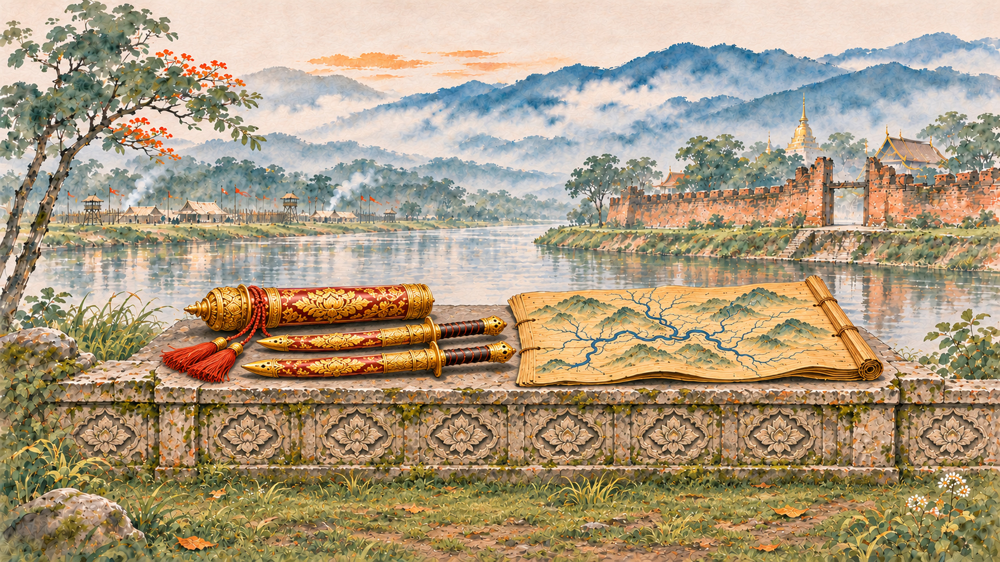
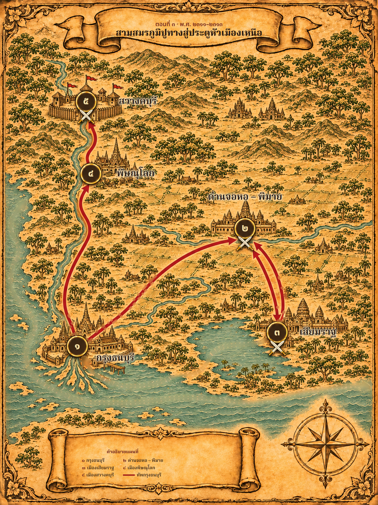

# ภาคที่ 1: จากนายสุดจินดาสู่ขุนศึกกรุงธนบุรี (พ.ศ. 2286 – 2318)
## ตอนที่ 3: เจ้าพระยาสุรสีห์ ผู้เฝ้าประตูหัวเมืองเหนือ

---

### องก์ที่ 1: เปิดฉากประตูเมืองพิษณุโลกที่เคยเป็นของบิดา

ปลายฤดูฝน ปีขาล จุลศักราช 1132 (พ.ศ. 2313) กลิ่นควันไฟจากค่ายไม้ซุงเมืองสวางคบุรียังไม่ทันจางหายจากปลายจมูกของกองทัพกรุงธนบุรี

เหนือคุ้งน้ำน่านที่ **เมืองพิษณุโลก** ขบวนทัพหลวงและทัพบกกำลังเคลื่อนย้อนลงมาพักพลเพื่อจัดระเบียบหัวเมืองฝ่ายเหนือใหม่ทั้งหมด ท่ามกลางขุนพลผู้มีส่วนร่วมในชัยชนะครั้งสำคัญนี้ ชายวัยยี่สิบเจ็ดปีผู้เพิ่งนำกำลัง 5,000 นายเดินทัพบกฟากตะวันออกฝ่าป่าทึบและโคลนตมฤดูฝนเข้าตีเมืองสวางคบุรีจนแตก ยืนมองแนวกำแพงอิฐเก่าแก่ของเมืองพิษณุโลกด้วยความรู้สึกที่ซับซ้อนกว่าแม่ทัพคนใดในกองทัพ

นามของเขาในเวลานั้นคือ **พระยายมราช (บุญมา)**

สำหรับไพร่พลในขบวนทัพ พิษณุโลกคือเมืองยุทธศาสตร์ที่เพิ่งยึดคืนมาจาก **เจ้าพระฝาง (เรือน)** ได้อย่างเด็ดขาด แต่สำหรับบุญมา เมืองนี้ยังมีอีกความหมายหนึ่งซ่อนอยู่ใต้ผืนดิน—เมื่อเพียงสองปีก่อนหน้านี้ (พ.ศ. 2311) **พระอักษรสุนทรศาสตร์ (ทองดี)** บิดาของเขาซึ่งอพยพหนีภัยพม่าขึ้นมาพึ่งใบบุญเจ้าพระยาพิษณุโลก (เรือง) ได้รับแต่งตั้งเป็นเจ้าพระยาจักรีประจำเมืองนี้ และได้ถึงแก่อสัญกรรมลง ณ เมืองพิษณุโลกแห่งนี้เองก่อนที่บ้านเมืองจะถูกชุมนุมพระฝางกลืนกิน

ไม่กี่วันถัดมา บนพลับพลาที่ประทับ **สมเด็จพระเจ้าตากสิน** ทรงมีพระบรมราชโองการปูนบำเหน็จความชอบให้ขุนพลผู้ปราบชุมนุมสุดท้ายในแผ่นดินลงได้สำเร็จ ตำแหน่งที่ทรงมอบให้พระยายมราช (บุญมา) มิใช่เพียงยศในราชสำนักธนบุรี หากคือตำแหน่งผู้สำเร็จราชการเมืองเอกฝ่ายเหนือ—**เจ้าพระยาสุรสีห์พิษณุวาธิราช** ครองเมืองพิษณุโลก

จากบุตรคนเล็กของเสมียนตรากรมมหาดไทยที่หนีกรุงแตกมาด้วยเรือพายลำเดียวเมื่อสามปีก่อน บัดนี้บุญมาก้าวขึ้นมาถือบังเหียนเมืองหน้าด่านที่ใหญ่ที่สุดทางภาคเหนือของสยาม ท่ามกลางซากปรักหักพังของสงครามกลางเมืองและเงาของกองทัพพม่าที่ยังคงตั้งมั่นอยู่เหนือเทือกเขาด้านทิศเหนือ

---

### องก์ที่ 2: กระดานการเมืองและหลักฐาน

ตลอดสามปีหลังศึกบางกุ้ง (พ.ศ. 2311–2313) บทบาทของบุญมาไม่ได้จำกัดอยู่เพียงสนามรบเดียว หากเคลื่อนย้ายข้ามกระดานถึงสามภูมิภาค—ตั้งแต่ที่ราบสูงอีสาน ชายแดนกัมพูชา ไปจนถึงลุ่มน้ำน่านตอนบน แต่เมื่อสวมบทบาทนักสืบประวัติศาสตร์ตรวจทานยศและตำแหน่งในช่วงเวลาดังกล่าว เราจะพบปมสำคัญที่ต้องชี้แจงให้ชัดเจนตามหลักฐานชั้นต้น

#### 1. ตรวจลำดับการเลื่อนยศ พ.ศ. 2311–2313 กับพระราชพงศาวดาร

ในโครงเรื่องตั้งต้นของหนังสือชุดนี้มีการระบุจุดต้องตรวจเรื่องลำดับยศของบุญมาก่อนขึ้นเป็นเจ้าพระยาสุรสีห์ เมื่อเทียบ **พระราชพงศาวดารกรุงธนบุรี ฉบับพันจันทนุมาศ (เจิม)** คู่กับ **ฉบับพระราชหัตถเลขา** และ **พระราชพงศาวดารกรุงรัตนโกสินทร์ รัชกาลที่ 1** ฉบับเจ้าพระยาทิพากรวงศ์ พบข้อเท็จจริงที่เรียงร้อยตามลำดับเวลาดังนี้:

1. **พระมหามนตรี** (เจ้ากรมพระตำรวจในขวา): ตำแหน่งแรกเมื่อเข้าถวายตัวและนำทัพหน้าตีค่ายพม่าที่บางกุ้งในต้น พ.ศ. 2311 (ขณะที่พี่ชายคือทองด้วงเป็น **พระราชวรินทร์** เจ้ากรมพระตำรวจนอกขวา)
2. **พระยาอนุชิตราชา** (จางวางพระตำรวจขวา): ได้รับพระราชทานเลื่อนบรรดาศักดิ์ในปลาย พ.ศ. 2311 หลังร่วมกับพี่ชายนำทัพหน้าข้ามดงพญาไฟไปตีด่านจอหอและเมืองพิมายจนจับตัวกรมหมื่นเทพพิพิธได้สำเร็จ (ในคราวเดียวกันนั้น ทองด้วงได้เลื่อนจากพระราชวรินทร์ขึ้นเป็น **พระยาอภัยรณฤทธิ์**)
3. **พระยายมราช** (เสนาบดีกรมเมือง): ได้รับแต่งตั้งใน พ.ศ. 2313 **ก่อนยกทัพไปปราบชุมนุมเจ้าพระฝาง**! พงศาวดารฉบับพันจันทนุมาศ (เจิม) บันทึกความตอนนี้ไว้อย่างชัดเจนว่า ขณะจะจัดทัพขึ้นไปปราบเมืองสวางคบุรีนั้น *"พระยายมราชถึงแก่กรรม จึงโปรดให้พระยาอนุชิตราชาเลื่อนที่เป็นพระยายมราช"* แล้วมอบหมายให้พระยายมราชคนใหม่ถือพล **5,000 นาย** ยกทัพบกฟากตะวันออกแม่น้ำน่านขึ้นไปตีเมืองสวางคบุรี
4. **เจ้าพระยาสุรสีห์พิษณุวาธิราช** (เจ้าเมืองพิษณุโลก): ได้รับพระราชทานเลื่อนขึ้นในปลาย พ.ศ. 2313 **หลังปราบชุมนุมเจ้าพระฝางสำเร็จ** เพื่อให้รั้งเมืองพิษณุโลกป้องกันหัวเมืองเหนือทั้งหมด และในคราวเดียวกันนั้นเอง พระยาอภัยรณฤทธิ์ (ทองด้วง) ผู้พี่ชาย จึงได้รับแต่งตั้งขึ้นเป็น **พระยายมราช** สืบตำแหน่งต่อจากน้องชาย!

*(หมายเหตุผู้เขียน: ในหนังสือเล่มที่ 1 ของชุดนี้ คือ กระดานศึกพระเจ้าตาก ตอนที่ 10 ได้กล่าวถึงตำแหน่งของบุญมาในศึกพระฝางว่าเป็น "พระยาอนุชิตราชา" โดยข้ามขั้นการเลื่อนเป็น "พระยายมราช" ก่อนยกทัพไป เมื่อตรวจทานกับพระราชพงศาวดารฉบับพันจันทนุมาศ (เจิม) แล้วพบว่าท่านถือยศ "พระยายมราช" อยู่ตลอดศึกสวางคบุรี พ.ศ. 2313 เล่มนี้จึงขอลำดับตำแหน่งตามตัวบทพงศาวดารอย่างครบถ้วน เพื่อความถูกต้องทางประวัติศาสตร์)*

#### 2. ทำไมกรุงธนบุรีจึงวาง "สายเลือดเดียว" คุมตำแหน่งยุทธศาสตร์พร้อมกัน

การที่สมเด็จพระเจ้าตากสินทรงเลื่อนยศสองพี่น้องให้ก้าวกระโดดจากขุนนางระดับพระขึ้นเป็นเสนาบดีและเจ้าเมืองเอกภายในเวลาเพียงสามปี สะท้อนการคำนวณทางการเมืองสองชั้น

- **ความไว้วางพระทัยเหนือสายเลือดเก่า:** หลังศึกเกยไชยและศึกพิมาย กรุงธนบุรีตระหนักว่าขุนนางบางส่วนที่เข้ามาสวามิภักดิ์ยังมีใจโลเล ดังเช่นความบาดหมางระหว่างพระยาจักรี (แขก) กับพระยายมราชคนเดิมในศึกนครศรีธรรมราช พ.ศ. 2312 (เล่าไว้ใน *กระดานศึกพระเจ้าตาก* ตอนที่ 9) การใช้สองพี่น้องที่ร่วมเป็นร่วมตายมาด้วยกันโดยไม่มีความระแวงกันเอง ช่วยลดปัญหาแม่ทัพเกี่ยงงอนไม่ช่วยรบในสนามจริง
- **ความสมดุลระหว่าง "คนในเมือง" กับ "คนชายแดน":** เมื่อเสร็จศึกพระฝาง สมเด็จพระเจ้าตากสินทรงวางพี่ชาย (พระยายมราช ทองด้วง และต่อมาคือเจ้าพระยาจักรี) ไว้เป็นแกนหลักฝ่ายบริหารและการทหารในราชธานีธนบุรี แล้วส่งน้องชาย (เจ้าพระยาสุรสีห์ บุญมา) ที่มีบุคลิกเฉียบขาดและเคลื่อนที่เร็วขึ้นไปเฝ้าประตูหัวเมืองเหนือที่พิษณุโลก โดยมีขุนพลคู่พระทัยเดิมอย่าง **พระยาพิชัย (จ้อย)** ตั้งค่ายคุมเมืองพิชัยอยู่ด้านหน้าอีกชั้นหนึ่ง

---

### องก์ที่ 3: จุดปะทะจากดงพญาไฟถึงระเนียดไม้สวางคบุรี

เส้นทางไต่เต้าจากพระมหามนตรีสู่เจ้าพระยาสุรสีห์ของบุญมา ไม่ได้เกิดจากความดีความชอบในห้องประชุม หากแลกมาด้วยระยะทางเดินทัพนับพันกิโลเมตรในสามสมรภูมิต่อเนื่อง

#### 1. ดงพญาไฟและด่านจอหอ (ปลาย พ.ศ. 2311)

ไม่นานหลังความพ่ายแพ้ที่เกยไชย สมเด็จพระเจ้าตากสินทรงมอบหมายให้พระราชวรินทร์ (ทองด้วง) กับพระมหามนตรี (บุญมา) คุมทัพหน้าเดินเท้าข้าม **ดงพญาไฟ** ฝ่าไข้ป่าและทางเกวียนชันมุ่งสู่เมืองนครราชสีมาและเมืองพิมาย (ดังที่เล่าภาพรวมไว้ใน *กระดานศึกพระเจ้าตาก* ตอนที่ 8)

ในสมรภูมินั้น ภาระของพระมหามนตรีอยู่ที่การคุมหน่วยลาดตระเวนหน้าและปีกโจมตีเมื่อเข้าปะทะกับทัพของพระยาศรีสุริยวงศ์ที่ **ด่านจอหอ** ความคล่องตัวของการรบภาคพื้นดินต่างจากการรบทางเรือที่เกยไชย กองทัพหน้าของสองพี่น้องสามารถโอบตีแนวค่ายด่านจอหอแตกก่อนที่ทัพหลวงจะตามขึ้นมาสมทบ นำไปสู่การยึดเมืองนครราชสีมา เมืองพิมาย และการยุติชุมนุมกรมหมื่นเทพพิพิธลงอย่างเด็ดขาด ความชอบในศึกนี้ทำให้บุญมาได้เลื่อนขึ้นเป็น **พระยาอนุชิตราชา**

#### 2. ศึกเสียมราฐและบทเรียนเรื่อง "ข่าวลือ" (พ.ศ. 2312)

ปีถัดมา เมื่อสมเด็จพระเจ้าตากสินเสด็จกรีธาทัพเรือหลวงลงใต้ไปปราบชุมนุมเจ้านครศรีธรรมราช พระองค์ทรงส่งกองทัพอีกสายหนึ่งมี **พระยาอภัยรณฤทธิ์ (ทองด้วง)** และ **พระยาอนุชิตราชา (บุญมา)** ถือกำลังราว **2,000 นาย** ยกออกจากนครราชสีมาลงไปตีหัวเมืองเขมรเนื่องจากฝ่ายกัมพูชาปฏิเสธไม่ยอมส่งเครื่องราชบรรณาการเช่นครั้งกรุงศรีอยุธยา

การรุกคืบในกัมพูชาดำเนินไปอย่างได้ผล กองทัพของสองพี่น้องเข้าตี **เมืองเสียมราฐ** แตก ขณะที่ทัพของพระยาโกษาธิบดีอีกสายหนึ่งตีได้เมืองพระตะบอง ทว่าระหว่างที่ตั้งค่ายรอคำสั่งจากราชธานี กลับเกิดข่าวลือสะพัดจากทางใต้ว่า สมเด็จพระเจ้าตากสินเสด็จสวรรคตลงระหว่างศึกนครศรีธรรมราชแล้ว

พระยาอภัยรณฤทธิ์และพระยาอนุชิตราชาตกอยู่ต่อหน้าทางแยกอันตราย หากข่าวลือเป็นจริงและกรุงธนบุรีเกิดจลาจลชิงราชสมบัติ กองทัพของทั้งสองจะถูกตัดขาดอยู่ในแผ่นดินเขมร ทั้งสองจึงตัดสินใจถอนทัพจากเสียมราฐกลับมาตั้งหลักที่นครราชสีมาและลพบุรีเพื่อรักษาความมั่นคงของส่วนกลาง แม้เมื่อสมเด็จพระเจ้าตากสินเสด็จกลับจากปักษ์ใต้จะทรงกริ้วในตอนแรกที่แม่ทัพถอนกำลังโดยพลการ แต่เมื่อทรงไต่สวนทราบเจตนาบริสุทธิ์ว่าทำไปเพราะห่วงราชธานีและไม่เคยคิดแปรพักตร์ ก็พระราชทานอภัยโทษให้ เหตุการณ์นี้แสดงให้เห็นว่าทั้งคู่ไม่เพียงเก่งรบ แต่ระมัดระวังทางการเมืองอย่างยิ่งยวดเมื่อต้องอยู่ไกลสายตาพระเจ้าแผ่นดิน

#### 3. ทัพบกฟากตะวันออกสู่สวางคบุรี (พ.ศ. 2313)

บททดสอบใหญ่ที่สุดของบุญมาในฐานะแม่ทัพเต็มตัวมาถึงในกลางปีขาล พ.ศ. 2313 เมื่อสมเด็จพระเจ้าตากสินทรงระดมทัพสามสายขึ้นไปปราบ **ชุมนุมเจ้าพระฝาง** (ดังที่เล่าภาพรวมไว้ใน *กระดานศึกพระเจ้าตาก* ตอนที่ 10):

- **ทัพเรือหลวง:** สมเด็จพระเจ้าตากสินเสด็จนำขึ้นไปตามแม่น้ำน่านเพื่อตีเมืองพิษณุโลกโดยตรง
- **ทัพบกฟากตะวันตก:** พระยาพิชัยราชาคุมกำลังขึ้นไปทางเมืองสุโขทัย–สวรรคโลกเพื่อตัดปีกขวาของเจ้าพระฝาง
- **ทัพบกฟากตะวันออก:** **พระยายมราช (บุญมา)** ถือพล **5,000 นาย** (ตามตัวเลขใน *ฉบับพันจันทนุมาศ (เจิม)*) เดินทัพเลียบฝั่งตะวันออกของแม่น้ำน่านฝ่าฝนและทางโคลน มุ่งตรงขึ้นไปตีโอบ **เมืองพิชัย** และ **เมืองสวางคบุรี** จากด้านหลัง

การจัดทัพเช่นนี้วางภาระหนักไว้บนบ่าของพระยายมราช (บุญมา) เพราะในขณะที่ทัพหลวงยึดเมืองพิษณุโลกได้รวดเร็วและส่งกำลังตามหนุนขึ้นมา แนวระวังป้องกันหลักของเจ้าพระฝางถอยไปรวมตัวอยู่หลังแนวระเนียดไม้ซุงที่สวางคบุรี ทัพบกฟากตะวันออกของบุญมาจึงต้องทำงานประสานกับทัพพระยาพิชัยราชาและทัพหนุนจากพิษณุโลก ปิดล้อมพื้นที่ลุ่มริมน้ำน่านไม่ให้กองกำลังพระสงฆ์สีแดงตีฝ่าข้ามไปทางฝั่งตะวันออกเข้าสู่เขตเพชรบูรณ์หรือล้านช้างได้

เมื่อระเนียดไม้ซุงสวางคบุรีแตกพ่ายลงและเจ้าพระฝางหนีหายเข้าไปในป่าลึกทางเหนือ สงครามรวมแผ่นดินตลอดสามปีจึงปิดฉากลงอย่างสมบูรณ์

---

### องก์ที่ 4: แรงสะเทือนและโจทย์ใหม่ที่เมืองพิษณุโลก

การแต่งตั้ง **เจ้าพระยาสุรสีห์พิษณุวาธิราช (บุญมา)** ให้อยู่ครองเมืองพิษณุโลกในปลาย พ.ศ. 2313 ไม่ใช่รางวัลพักผ่อนหลังศึกหนัก หากคือการส่งขุนศึกไปนั่งบนถังดินปืน

หากกางแผนที่หัวเมืองเหนือใน พ.ศ. 2314 จะเห็นความท้าทายสามด้านที่เจ้าพระยาสุรสีห์ต้องแบกรับทันทีที่เข้าว่าราชการในกำแพงเมืองพิษณุโลก:

1. **บ้านเมืองที่บอบช้ำจากการผลัดมือสามครั้ง:** นับแต่ พ.ศ. 2306 พิษณุโลกผ่านทั้งศึกช้างเผือกของพระเจ้าบุเรงนอง ไข้ทรพิษ การตั้งตัวของเจ้าพิษณุโลก (เรือง) การล้อมยึดของเจ้าพระฝาง และการตีชิงคืนของกรุงธนบุรี กำแพงเมือง ไพร่พล และยุ้งฉางเสบียงล้วนทรุดโทรมหนัก งานแรกของเจ้าพระยาสุรสีห์คือการฟื้นฟูระบบเกณฑ์ไพร่ เก็บสะสมข้าวเปลือก และซ่อมแนวป้อมปราการริมแม่น้ำน่าน
2. **รอยแผลทางศาสนาและจิตใจราษฎร:** หลังการชำระอธิกรณ์คณะสงฆ์เมืองเหนือที่สวางคบุรี ชาวเมืองเหนือจำนวนมากยังหวาดเกรงอำนาจจากส่วนกลาง เจ้าพระยาสุรสีห์ต้องปกครองอย่างเด็ดขาดแต่ไม่ให้ชาวบ้านตีตัวออกห่างจนหนีไปเข้ากับพม่าทางเหนือ
3. **ฐานทัพพม่าที่ประชิดชายแดน:** เหนือเมืองพิษณุโลกและพิชัยขึ้นไปเพียงไม่กี่วันเดินทัพ **เมืองเชียงใหม่** และหัวเมืองล้านนาทั้งปวงยังอยู่ใต้การยึดครองของพม่าแห่งราชวงศ์คองบอง เมื่อพระเจ้ามังระเสร็จศึกติดพันกับราชวงศ์ชิงของจีน แม่ทัพพม่าอย่าง **โปสุพลา (เนเมียวสีหบดี)** ก็เริ่มเคลื่อนพลลงมาจากเชียงใหม่ทีละก้าวเพื่อทวงคืนลุ่มน้ำเจ้าพระยาตอนบน

ไม่ถึงสองปีหลังเจ้าพระยาสุรสีห์เข้าครองเมืองพิษณุโลก เสียงกลองศึกของโปสุพลาก็ดังก้องลงมาจากช่องเขาเหนือเมืองลับแลและเมืองพิชัย—เปิดฉากสงครามยืดเยื้อที่จะทดสอบว่าเจ้าเมืองพิษณุโลกคนใหม่ผู้นี้จะรักษาประตูหัวเมืองเหนือไว้ได้หรือไม่ และจะเปิดประตูล้านนาให้สยามได้อย่างไร

**จบตอนที่ 3**

*(ติดตามต่อใน ตอนที่ 4: ศึกพิชัยและเชียงใหม่ ครั้งแรกที่ล้านนาเปลี่ยนข้าง)*
