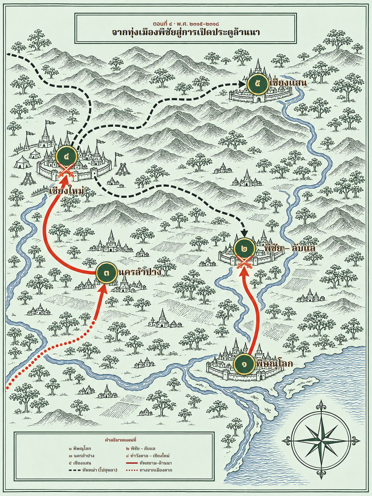

# ภาคที่ 1: จากนายสุดจินดาสู่ขุนศึกกรุงธนบุรี (พ.ศ. 2286 – 2318)
## ตอนที่ 4: ศึกพิชัยและเชียงใหม่ ครั้งแรกที่ล้านนาเปลี่ยนข้าง

---

### องก์ที่ 1: เปิดฉากหมอกหนาวเหนือทุ่งเมืองพิชัย

หมอกเดือนยี่ปีมะเส็งคลุมยอดไผ่และทุ่งหญ้าแห้งริมแม่น้ำน่านจนมองเห็นแนวป่าทางทิศเหนือได้เพียงระยะไม่กี่ช่วงหอก

เช้าตรู่วันอังคาร เดือนยี่ แรม 7 ค่ำ จุลศักราช 1135 (ตรงกับวันที่ 4 มกราคม พ.ศ. 2317 ตามปฏิทินสากล) กองกำลังทหารม้าและทหารราบจาก **เมืองพิษณุโลก** เร่งฝีเท้าขึ้นมาตามแนวตลิ่งฝั่งตะวันออกเพื่อสมทบกับทัพหน้าของ **เมืองพิชัย** ที่กำลังเปิดประตูเมืองออกไปปะทะกับกองทัพพม่ากลางทุ่งโล่ง

เบื้องหน้าของพวกเขาคือธงรบของ **โปสุพลา** แม่ทัพใหญ่ฝ่ายพม่าที่คุมกำลังจากฐานที่มั่นในเมืองเชียงใหม่ลงมาตีเมืองพิชัยเป็นครั้งที่สอง เพื่อล้างอายจากความพ่ายแพ้เมื่อปี พ.ศ. 2315 และเพื่อเปิดประตูทะลวงลงไปยังพิษณุโลก

ผู้นำทัพพิษณุโลกที่ควบม้าฝ่าหมอกหนาวเข้าสู่แนวรบคือ **เจ้าพระยาสุรสีห์พิษณวาธิราช (บุญมา)** ในวัยสามสิบปีเต็ม สำหรับคนในหัวเมืองเหนือ ชื่อของเขามิได้เป็นเพียงเจ้าเมืองหน้าด่านที่คอยตั้งรับหลังกำแพงอิฐอีกต่อไป หากคือแม่ทัพที่ขึ้นชื่อเรื่องความดุดันและการออกชิงจังหวะตีข้าศึกกลางสนาม

ขณะที่ **พระยาพิชัย** (จ้อย หรือที่บันทึกประวัติท้องถิ่นบางแห่งเรียกทองดี) นำทหารเมืองพิชัยประจันบานอย่างดุเดือดจนดาบในมือขวาหักสะบั้นกลางวงล้อม (ดังที่เล่าภาพรวมไว้ใน *กระดานศึกพระเจ้าตาก* ตอนที่ 12) การมาถึงของกองทัพเจ้าพระยาสุรสีห์จากพิษณุโลกได้กลายเป็นค้อนเหล็กที่กระแทกเข้าใส่ปีกของกองทัพโปสุพลาอย่างจัง

พม่าแตกถอยกลับขึ้นเหนือไปทางเชียงใหม่อีกครั้ง ทว่าสำหรับเจ้าพระยาสุรสีห์ที่ยืนมองฝุ่นควันจางลงบนทุ่งพิชัย คำถามสำคัญไม่ได้จบอยู่แค่การไล่ข้าศึกพ้นประตูเมือง

ตราบใดที่ **เชียงใหม่** ยังเป็นฐานส่งกำลังบำรุงของพม่า ทัพโปสุพลาก็จะลงมาเคาะประตูเมืองพิชัยและพิษณุโลกซ้ำแล้วซ้ำเล่าทุกฤดูแล้ง—ทางเดียวที่จะหยุดศึกหัวเมืองเหนือให้เด็ดขาด คือต้องขึ้นไปรื้อกระดานในล้านนาเสียเอง

---

### องก์ที่ 2: กระดานการเมืองและหลักฐาน

เหตุการณ์ระหว่าง พ.ศ. 2315–2318 เป็นช่วงหัวเลี้ยวหัวต่อที่เชื่อมประวัติศาสตร์ลุ่มน้ำเจ้าพระยาเข้ากับดินแดนล้านนาและอาณาจักรอังวะอย่างแนบแน่น เมื่อกางหลักฐานขึ้นเทียบกัน ได้แก่ **พระราชพงศาวดารกรุงธนบุรี ฉบับพันจันทนุมาศ (เจิม)**, **ตำนานพื้นเมืองเชียงใหม่** (และ *พงศาวดารโยนก*), ประกอบคำอธิบายใน **ไทยรบพม่า** เราจะเห็นภาพความเปลี่ยนแปลงบนกระดานได้อย่างชัดเจน

#### 1. ข้อควรระวังสำหรับผู้อ่าน: "บุญมา" สองคนในสมรภูมิเดียวกัน

ก่อนลงลึกสู่ยุทธการเชียงใหม่ ต้องทำความเข้าใจชื่อบุคคลสำคัญให้ชัดเจนเสียก่อน เพื่อไม่ให้สับสนระหว่างตัวละครเอกของหนังสือเล่มนี้กับผู้นำท้องถิ่นล้านนา

ในศึกเชียงใหม่ พ.ศ. 2317–2318 มีแม่ทัพที่ชื่อเดิมว่า **"บุญมา"** ถึง **2 คน** รบอยู่เคียงข้างกัน:

- **บุญมา คนที่หนึ่ง** คือ **เจ้าพระยาสุรสีห์พิษณวาธิราช (บุญมา)** เจ้าเมืองพิษณุโลก น้องชายของเจ้าพระยาจักรี (ทองด้วง) ตัวเอกของหนังสือเล่มนี้
- **บุญมา คนที่สอง** คือ **พระยาจ่าบ้าน (บุญมา)** ขุนนางชาวเมืองเชียงใหม่เชื้อสายท้องถิ่น ซึ่งเป็นผู้ก่อการลุกฮือต่อต้านอำนาจพม่าและจับมือกับ **เจ้ากาวิละ** (บุตรชายเจ้าฟ้าชายแก้วแห่งนครลำปาง) เพื่อขอสวามิภักดิ์ต่อกรุงธนบุรี และต่อมาได้รับการแต่งตั้งเป็น **พระยาวิเชียรปราการ** เจ้าเมืองเชียงใหม่

ในตำนานล้านนามักเรียกพระยาจ่าบ้านว่า "พญาจ่าบ้านบุญมา" ส่วนในพงศาวดารธนบุรีเรียกเจ้าพระยาสุรสีห์ตามบรรดาศักดิ์ตลอดเวลา ทั้งสองคนเป็นคนละบุคคลโดยสิ้นเชิง และมีบทบาทประสานกันระหว่างกำลังท้องถิ่นล้านนากับทัพหลวงกรุงธนบุรี

#### 2. ทำไม "ล้านนา" จึงเปลี่ยนข้างจากอังวะมาหาธนบุรี

ตลอดกว่าสองศตวรรษนับตั้งแต่รัชกาลพระเจ้าบุเรงนอง เชียงใหม่และหัวเมืองล้านนาถูกปกครองเป็นเมืองขึ้นของพม่า โดยเฉพาะหลังเสียกรุงศรีอยุธยา พ.ศ. 2310 **พระเจ้ามังระ** ทรงใช้เชียงใหม่เป็นฐานทัพหน้าด้านใต้ มี **โป่มะยุง่วน** เป็นเจ้าเมืองเชียงใหม่ฝ่ายพม่า และส่ง **โปสุพลา** มาคุมกำลังใหญ่

ทว่าการรุกคืบลงใต้ของโปสุพลากลับประสบอุปสรรคครั้งแล้วครั้งเล่า เมื่อยกมาตีเมืองพิชัยใน พ.ศ. 2315 และ พ.ศ. 2316–2317 ก็ถูกเจ้าพระยาสุรสีห์กับพระยาพิชัยตีแตกกลับไปทุกคราว *ตำนานพื้นเมืองเชียงใหม่* และคำอธิบายใน *ไทยรบพม่า* สะท้อนให้เห็นว่า ช่วงเวลาเดียวกันนั้น **ฝ่ายพม่ากำลังเผชิญวิกฤตสำคัญสองด้าน**:

1. **ความพ่ายแพ้ซ้ำซากทำให้พม่ากดขี่คนพื้นเมืองหนักขึ้น:** ทุกครั้งที่ทัพโปสุพลาแพ้กลับเชียงใหม่ พม่าต้องรีดเกณฑ์เสบียง ไพร่พล ช้างม้า และเงินส่วยจากชาวล้านนามากขึ้นเพื่อเตรียมทัพใหม่ จนเกิดความระแวงและบาดหมางอย่างรุนแรงระหว่างโป่มะยุง่วนกับขุนนางพื้นเมืองอย่าง **พระยาจ่าบ้าน** และตระกูลเจ้าเจ็ดตนแห่งลำปางของ **เจ้ากาวิละ**
2. **กบฏชาวมอญที่เมืองเมาะตะมะ (พ.ศ. 2317):** ขณะที่พม่ากำลังระดมกำลังจะแก้ตัวทางล้านนา เกิดเหตุ **พระยาเจ่ง** ผู้นำชาวมอญก่อการแข็งเมืองต่อต้านพม่าที่เมืองเมาะตะมะ เมื่อถูกพม่าปราบปรามอย่างหนัก ครัวเรือนมอญจำนวนมากจึงอพยพข้ามด่านแม่ละเมาและด่านเจดีย์สามองค์เข้ามาพึ่งพระบรมโพธิสมภารในกรุงธนบุรี ทำให้สายส่งกำลังของพม่าจากลุ่มน้ำอิรวดีสู่เชียงใหม่สั่นคลอนอย่างหนัก

ในสายตาของสมเด็จพระเจ้าตากสินและเจ้าพระยาสุรสีห์ เมื่อคนในบ้านของข้าศึกกำลังลุกฮือทั้งที่เมาะตะมะและเชียงใหม่ โอกาสทองที่รอคอยมาตั้งแต่ พ.ศ. 2314 (เมื่อครั้งเสด็จขึ้นไปตีเชียงใหม่ครั้งแรกแต่ไม่สำเร็จเพราะยังขาดแนวร่วมท้องถิ่น) ก็มาถึงแล้ว

#### 3. ตรวจบทบาทของเจ้าพระยาสุรสีห์ในแต่ละศึก (2315–2318)

เมื่อเทียบ *ฉบับพันจันทนุมาศ (เจิม)* กับ *ตำนานพื้นเมืองเชียงใหม่* และ *ไทยรบพม่า* พบว่าบทบาทของเจ้าพระยาสุรสีห์แยกออกเป็น 3 ขั้นตอนชัดเจน:

- **ในศึกเมืองพิชัย ครั้งที่ 1 (พ.ศ. 2315):** เมื่อโปสุพลายกทัพพม่าตีเมืองลับแลแตกแล้วเคลื่อนประชิดเมืองพิชัย เจ้าพระยาสุรสีห์คุมทัพเมืองพิษณุโลกขึ้นไปช่วยพระยาพิชัยรบต้านจนทัพพม่าแตกถอยกลับไปเชียงใหม่
- **ในศึกเมืองพิชัย ครั้งที่ 2 (ปลาย พ.ศ. 2316 – มกราคม พ.ศ. 2317):** เมื่อโปสุพลายกทัพใหญ่ลงมาอีกครั้ง เจ้าพระยาสุรสีห์ยกกำลังจากพิษณุโลกขึ้นไปสมทบกับพระยาพิชัยที่ตั้งรับอยู่ ทั้งสองฝ่ายร่วมกันออกสกัดและประจันบานกับพม่าจนเกิดเหตุการณ์พระยาพิชัยดาบหัก และตีทัพพม่าแตกยับเยิน
- **ในศึกตีเมืองเชียงใหม่ (ปลาย พ.ศ. 2317 – มกราคม พ.ศ. 2318):** เมื่อสมเด็จพระเจ้าตากสินเสด็จยกทัพหลวงขึ้นเหนือ โดยมี **เจ้าพระยาจักรี (ทองด้วง)** เป็นแม่ทัพใหญ่คุมกำลังร่วมกับ **เจ้าพระยาสุรสีห์ (บุญมา)** ทั้งสองพี่น้องรับหน้าที่เป็นกำลังหลักของทัพหน้า–ทัพโอบฝ่ายสยาม ขึ้นไปสมทบกับเจ้ากาวิละที่ลำปางและพระยาจ่าบ้าน ก่อนเข้าตีแนวป้องกันท่าวังตาลและโอบล้อมประตูเมืองเชียงใหม่

---

### องก์ที่ 3: จุดปะทะจากประตูเมืองพิชัยถึงกำแพงเชียงใหม่

#### 1. ยุทธวิธี "ตัดหน้าค่าย" ที่พิชัย (พ.ศ. 2315 – 2317)

ความสำเร็จของเจ้าพระยาสุรสีห์และพระยาพิชัยในการรักษาเมืองพิชัยทั้งสองครั้ง เกิดจากการอ่านลักษณะภูมิประเทศและจุดอ่อนของทัพผู้รุกรานได้อย่างแม่นยำ

เมืองพิชัยเป็นเมืองขนาดย่อม กำแพงดินและระเนียดไม้ซุงไม่แข็งแรงพอจะทนการปิดล้อมระยะยาวของทัพพม่าที่มีปืนใหญ่เหนือกว่าได้เหมือนกำแพงอิฐเมืองพิษณุโลก หากปล่อยให้โปสุพลาตั้งค่ายประชิดและขุดสนามเพลาะล้อมรอบเมืองได้เมื่อใด เมืองพิชัยย่อมเสียเปรียบทันที

เจ้าพระยาสุรสีห์กับพระยาพิชัยจึงใช้ยุทธวิธีตรงกันข้าม—**ไม่ยอมรอให้ล้อม แต่ชิงออกตีสกัดกลางทางหรือตีกระหนาบขณะข้าศึกกำลังเคลื่อนขบวน**

ในศึกครั้งที่สอง (มกราคม พ.ศ. 2317) เมื่อพระยาพิชัยนำทัพออกปะทะหน้าเมืองจนดาบหักคามือและยันแนวรบไว้กลางทุ่งหมอก กองทัพของเจ้าพระยาสุรสีห์ที่เร่งเดินทัพขึ้นมาจากพิษณุโลกก็เข้าตีกระหนาบด้านข้างในจังหวะที่กำลังพม่ายังแปรขบวนไม่สมบูรณ์ แรงปะทะพร้อมกันจากสองทิศทำให้ขบวนทัพของโปสุพลาปั่นป่วนและแตกพ่ายถอยร่นกลับขึ้นเหนือ ทิ้งร่องรอยความสูญเสียไว้ตลอดเส้นทางขึ้นลับแล

#### 2. ยุทธการรวมสายน้ำ: ลำปาง – ท่าวังตาล – เชียงใหม่ (ปลาย พ.ศ. 2317 – ต้น พ.ศ. 2318)

ชัยชนะที่พิชัยเปิดทางให้กระดานรุกพลิกกลับ ปลายปีมะเมีย พ.ศ. 2317 สมเด็จพระเจ้าตากสินทรงระดมทัพหลวงขึ้นเหนือ โดยวาง **เจ้าพระยาจักรี (ทองด้วง)** กับ **เจ้าพระยาสุรสีห์ (บุญมา)** เป็นแกนนำทัพใหญ่ เคลื่อนพลผ่านเมืองตากและเมืองเถินมุ่งตรงสู่นครลำปาง

เมื่อทัพสยามก้าวเข้าสู่เขตลำปาง **เจ้ากาวิละ** และตระกูลเจ้าเจ็ดตนที่ลุกขึ้นสังหารขุนนางพม่าในเมืองไว้ล่วงหน้าแล้วก็เปิดประตูเมืองต้อนรับและนำกำลังพลชาวล้านนาเข้าสมทบ ทำให้ทัพธนบุรีที่เคยเดินดุ่มเข้าไปในดินแดนที่ไม่คุ้นเคยเมื่อ พ.ศ. 2314 กลายเป็น **"ทัพผสมสยาม–ล้านนา"** ที่มีทั้งผู้นำทาง คนส่งเสบียง และผู้รู้ภูมิประเทศครบมือ

ด่านสำคัญก่อนถึงตัวเมืองเชียงใหม่คือ **ท่าวังตาล** ริมแม่น้ำปิง ทางตอนใต้ของเมืองเชียงใหม่ ซึ่งเคยเป็นจุดปะทะหนักมาก่อน เมื่อทัพหน้าของพระยาจ่าบ้านและพระยากำแพงเพชรเคลื่อนประชิดเข้าปะทะกับแนวสกัดของพม่า กองทัพหลักภายใต้การนำของเจ้าพระยาจักรีและเจ้าพระยาสุรสีห์ก็เคลื่อนหนุนเข้าตีทะลวงแนวต้านทานของพม่าจนแตกถอยกลับเข้ากำแพงเมืองเชียงใหม่

กลางเดือนมกราคม พ.ศ. 2318 (ปลายปีมะเมีย จ.ศ. 1136) กองทัพผสมสยาม–ล้านนาก็เข้าล้อม **กำแพงอิฐเมืองเชียงใหม่** ไว้รอบด้าน เจ้าพระยาจักรีและเจ้าพระยาสุรสีห์แบ่งหน้าที่คุมแนวค่ายล้อมประชิดประตูเมืองและเร่งขุดสนามเพลาะตีค่ายนอกเมืองของพม่าแตกไปทีละจุด ท่ามกลางแรงกดดันจากทั้งกองทัพธนบุรีด้านนอกและความไม่พอใจของราษฎรชาวเชียงใหม่ด้านใน

ในที่สุด **โป่มะยุง่วน** และ **โปสุพลา** เห็นว่าไม่อาจรักษาเมืองเชียงใหม่ไว้ได้อีกต่อไป จึงตัดสินใจพากำลังทหารพม่าตีฝ่าวงล้อมหลบหนีออกจากเมืองในยามวิกาล มุ่งหน้าขึ้นเหนือไปทาง **เมืองเชียงแสน** เพื่อกลับสู่กรุงอังวะ

รุ่งเช้าของวันถัดมา สมเด็จพระเจ้าตากสินเสด็จพระราชดำเนินเข้าสู่เมืองเชียงใหม่ ท่ามกลางเสียงโห่ร้องต้อนรับของชาวล้านนา นับเป็นครั้งแรกในรอบกว่า 200 ปีที่เมืองเชียงใหม่หลุดพ้นจากอำนาจพม่าและกลับเข้ามาเป็นแนวร่วมกับราชอาณาจักรสยามทางตอนใต้

---

### องก์ที่ 4: แรงสะเทือนและพายุใหญ่ที่กำลังมุ่งสู่พิษณุโลก

ชัยชนะที่เชียงใหม่ในต้น พ.ศ. 2318 เปลี่ยนโฉมหน้าภูมิรัฐศาสตร์ของเอเชียตะวันออกเฉียงใต้ภาคพื้นทวีปไปอย่างถาวร

- **สถาปนาปราการล้านนา:** สมเด็จพระเจ้าตากสินไม่ได้ทรงส่งขุนนางจากธนบุรีมาปกครองล้านนาโดยตรง หากทรงแต่งตั้ง **พระยาจ่าบ้าน (บุญมา)** ขึ้นเป็น **พระยาวิเชียรปราการ** ครองเมืองเชียงใหม่ และทรงแต่งตั้ง **เจ้ากาวิละ** ครองนครลำปาง เพื่อสร้างกำแพงกันชนที่คนล้านนาพร้อมจะลุกขึ้นป้องกันบ้านเกิดของตนเอง
- **ความหมายต่อเจ้าพระยาสุรสีห์:** ตลอด 5 ปีที่ครองเมืองพิษณุโลก (พ.ศ. 2313–2318) เจ้าพระยาสุรสีห์เปลี่ยนเมืองหน้าด่านที่เคยบอบช้ำให้กลายเป็นฐานส่งกำลังบำรุงที่ผลักแนวรบออกจากลุ่มน้ำเจ้าพระยาขึ้นไปถึงแม่น้ำปิงได้สำเร็จ ท่านไม่ได้รบเพียงลำพังอีกต่อไป หากมีทั้งพี่ชายเป็น **เจ้าพระยาจักรี** คอยหนุนอยู่ข้างหลัง มีพระยาพิชัยเป็นปีกขวา และมีเจ้าเมืองลำปาง–เชียงใหม่เป็นปราการเบื้องหน้า

ทว่าบนกระดานสงครามระหว่างสยามกับราชวงศ์คองบอง ชัยชนะที่เชียงใหม่กลับเป็นสัญญาณเตือนภัยสูงสุดสำหรับกรุงอังวะ

การเสียเชียงใหม่หมายความว่าพม่าสูญเสียคลังเสบียง ไพร่พล และฐานยิงทางภาคใต้ไปทั้งแถบ หากพระเจ้ามังระปล่อยให้กรุงธนบุรีและพันธมิตรล้านนาตั้งหลักมั่นคงได้นานกว่านี้ เส้นทางเดินทัพจากพม่าเข้าสู่ลุ่มน้ำเจ้าพระยาทางทิศเหนือจะถูกปิดตายตลอดกาล

แม้ว่าในต้น พ.ศ. 2318 กองทัพพม่าอีกสายหนึ่งของงุยอคงหวุ่นที่ยกไล่ล่าครัวมอญเข้ามาทางด่านเจดีย์สามองค์ จะเพิ่งถูกกองทัพกรุงธนบุรีล้อมจับเชลยได้ทั้งกองทัพที่ **ตำบลบางแก้ว** เมืองราชบุรี (ดังที่เล่าไว้ใน *กระดานศึกพระเจ้าตาก* ตอนที่ 13) แต่ความพ่ายแพ้ที่บางแก้วและเชียงใหม่ไม่ได้ทำให้กรุงอังวะยอมถอย

ตรงกันข้าม พระเจ้ามังระกำลังเรียกตัวแม่ทัพอาวุโสผู้เจนจัดสมรภูมิที่สุดของราชวงศ์คองบอง—จอมทัพเฒ่าผู้เพิ่งกรำศึกชนะกองทัพจีนแห่งราชวงศ์ชิงมาหมาดๆ—ให้คุมกองทัพมหึมาข้ามด่านแม่ละเมามุ่งตรงมายังหัวใจแนวป้องกันภาคเหนือของสยาม

ชื่อของจอมทัพเฒ่าผู้นั้นคือ **อะแซหวุ่นกี้** และเป้าหมายแรกบนแผนที่ของเขาคือกำแพงเมือง **พิษณุโลก** ที่ **เจ้าพระยาสุรสีห์ (บุญมา)** นั่งรักษาอยู่

**จบตอนที่ 4 (จบภาคที่ 1: จากนายสุดจินดาสู่ขุนศึกกรุงธนบุรี)**

*(ติดตามต่อใน ภาคที่ 2 ตอนที่ 5: วงล้อมอะแซหวุ่นกี้ที่พิษณุโลก)*
