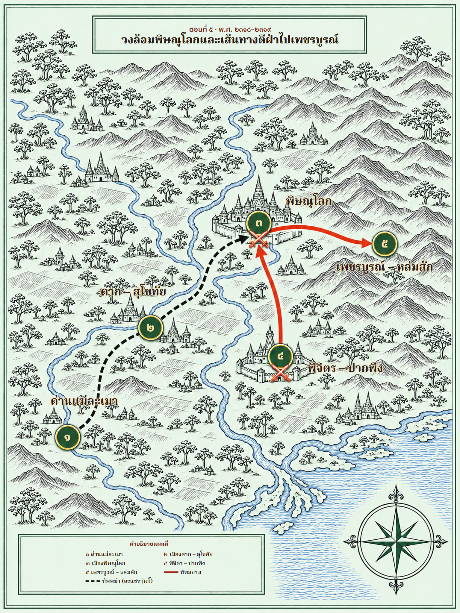

# ภาคที่ 2: สองพี่น้องบนกระดานศึกธนบุรี (พ.ศ. 2318 – 2325)
## ตอนที่ 5: วงล้อมอะแซหวุ่นกี้ที่พิษณุโลก สี่เดือนบนเชิงเทินและการตีฝ่า

---

### องก์ที่ 1: เปิดฉากฉางข้าวที่ก้นถัง

คบเพลิงริมเชิงเทินด้านตะวันตกของ **เมืองพิษณุโลก** สาดแสงสีส้มจับผิวน้ำแม่น้ำน่านในคืนเดือนหงายที่ไม่มีใครหลับตาลง

ปลายปีมะแม จุลศักราช 1137 (ปลาย พ.ศ. 2318) ตลอดสองฟากฝั่งแม่น้ำน่านที่ผ่ากลางตัวเมืองพิษณุโลกไม่เหลือทุ่งนาหรือเรือนแพของชาวบ้านให้เห็นอีกแล้ว เบื้องหน้าค่ายคูประตูหอรบของเมืองหน้าด่านฝ่ายเหนือเต็มไปด้วยแนวดินถม สะพานข้ามน้ำ และธงรบของกองทัพพม่าที่ตั้งประชิดล้อมกรอบไว้ทุกทิศทาง

บนหอรบไม้ใกล้ประตูเมือง ชายวัยสามสิบสองปีผู้ครองเมืองพิษณุโลกมาตั้งแต่ พ.ศ. 2313 ยืนตรวจตราการผลัดเวรของพลปืนและพลหอกด้วยตนเอง นามของเขาคือ **เจ้าพระยาสุรสีห์พิษณวาธิราช (บุญมา)** เคียงข้างด้วยพี่ชายคือ **เจ้าพระยาจักรี (ทองด้วง)** ซึ่งนำกำลังจากส่วนกลางขึ้นมาช่วยรักษาเมืองสำคัญแห่งนี้ไว้ร่วมกัน

ในหนังสือเล่มที่ 1 (*กระดานศึกพระเจ้าตาก* ตอนที่ 14) ผู้อ่านได้เห็นภาพรวมของมหาศึกพิษณุโลกและการเผชิญหน้าระหว่าง **อะแซหวุ่นกี้** กับเจ้าพระยาจักรีมาแล้ว ทว่าหากมองจากสายตาของเจ้าพระยาสุรสีห์ผู้เป็น **"เจ้าของบ้าน"** เดิมพันของศึกนี้กลับหนักหน่วงในอีกมิติหนึ่ง

เมืองพิษณุโลกไม่ใช่วังที่เจ้าพระยาสุรสีห์เพิ่งเดินทางมาเยือนชั่วคราว แต่เป็นฐานอำนาจที่ท่านฟื้นฟูด้วยมือตนเองตลอด 5 ปีที่ผ่านมา เป็นเมืองที่ท่านสะสมข้าวเปลือก ซ่อมกำแพงอิฐ ฝึกไพร่พลหัวเมืองเหนือ และเป็นเมืองที่พระอักษรสุนทรศาสตร์ (ทองดี) ผู้เป็นบิดาเคยใช้ชีวิตวาระสุดท้ายเมื่อ 7 ปีก่อน

ทว่ายามนี้ เสบียงในยุ้งฉางหลวงเริ่มร่อยหรอลงจนต้องปันส่วนข้าวสารแก่ทหารและราษฎรที่อพยพเข้ามาหลบภัยภายในกำแพงเมือง กำลังพม่าของจอมทัพเฒ่าอะแซหวุ่นกี้มีมากเป็นทวีคูณ และทัพหลวงของสมเด็จพระเจ้าตากสินที่ยกขึ้นมาช่วยจากกรุงธนบุรียังถูกแนวค่ายพม่าสกัดไว้ที่ปากพิงและตอนล่างของลำน้ำน่าน

โจทย์บนโต๊ะในพลับพลาเมืองพิษณุโลกจึงไม่ใช่คำถามว่า "จะชนะในสนามเปิดได้อย่างไร" หากคือคำถามที่โหดหินกว่านั้น: **เมื่อเสบียงหมดก่อนกำลังหนุนจะมาถึง เจ้าเมืองพิษณุโลกจะยอมอดตายอยู่ในกำแพงที่สร้างมากับมือ หรือจะกล้าทิ้งเมืองทั้งเมืองเพื่อพากองทัพรอดออกไป**

---

### องก์ที่ 2: กระดานการเมืองและหลักฐาน

เมื่อกางแผนที่ลุ่มน้ำน่าน–ยม–เจ้าพระยาในปี พ.ศ. 2318–2319 ขึ้นวางบนโต๊ะยุทธการ แล้วเทียบหลักฐานหลัก ได้แก่ **พระราชพงศาวดารกรุงธนบุรี ฉบับพันจันทนุมาศ (เจิม)**, **ฉบับพระราชหัตถเลขา**, และงานวิเคราะห์ใน **ไทยรบพม่า** นักสืบประวัติศาสตร์จะเห็นจุดต่างที่น่าจับตา 3 ประการ

#### 1. เหตุใดอะแซหวุ่นกี้จึงทุ่มกำลังทั้งหมดมาที่ "เมืองของเจ้าพระยาสุรสีห์"

หลังจากเสียกรุงเชียงใหม่ให้แก่ทัพผสมสยาม–ล้านนาในเดือนมกราคม พ.ศ. 2318 และถูกกองทัพกรุงธนบุรีล้อมจับทัพของงุยอคงหวุ่นที่บางแก้วในเดือนมีนาคมปีเดียวกัน **พระเจ้ามังระ** แห่งกรุงอังวะทรงเปลี่ยนยุทธศาสตร์จากการส่งแม่ทัพหัวเมืองลงมาหยั่งเชิง มาเป็นการส่งแม่ทัพอาวุโสสูงสุดผู้ผ่านศึกสงครามกับจีนแห่งราชวงศ์ชิงมาแล้ว คือ **อะแซหวุ่นกี้** (มหาสีหสุระ)

พงศาวดารไทยระบุตัวเลขกำลังพลของฝ่ายพม่าในศึกนี้ไว้สูงถึงราว **30,000–35,000 นาย** (ดังที่ต้องย้ำตามกติกาการอ่านหลักฐานว่า ตัวเลขกำลังพลในพงศาวดารมักประเมินสูงกว่ากำลังรบที่ส่งเสบียงข้ามเทือกเขาได้จริง แต่ก็สะท้อนขนาดทัพใหญ่ที่สุดของพม่าในสมัยกรุงธนบุรี)

อะแซหวุ่นกี้เลือกเดินทัพผ่าน **ด่านแม่ละเมา** ตีเมืองตากและสุโขทัย แล้วมุ่งตรงเข้าปิดล้อม **เมืองพิษณุโลก** พร้อมทั้งให้กองกำลังพม่าทางเหนือตรึงแนวเชียงใหม่–น่านไว้ เพื่อไม่ให้พระยาวิเชียรปราการ (พระยาจ่าบ้าน) และเจ้ากาวิละลงมาช่วยได้ เป้าหมายของจอมทัพเฒ่าชัดเจนมาก: หากหักเมืองพิษณุโลกและจับสองแม่ทัพพี่น้องได้ ประตูลงสู่ลุ่มน้ำเจ้าพระยาตอนล่างจะเปิดกว้างทันที

#### 2. ความแตกต่างของหลักฐานต่อเหตุการณ์ล้อมเมือง

ในฐานะนักสืบประวัติศาสตร์ เราต้องแยกแยะเนื้อความที่ปรากฏในหลักฐานแต่ละฉบับออกจากกันอย่างซื่อตรง:

- **พระราชพงศาวดารกรุงธนบุรี ฉบับพันจันทนุมาศ (เจิม):** ซึ่งเป็นหลักฐานร่วมสมัยใกล้เหตุการณ์ที่สุด บันทึกการรบพุ่งรอบเมืองพิษณุโลกไว้อย่างเข้มข้น ทั้งการที่เจ้าพระยาจักรีและเจ้าพระยาสุรสีห์ส่งทหารออกไปตีค่ายพม่า ทำลายสะพานข้ามแม่น้ำน่าน และรับศึกยืดเยื้อยาวนานกว่า 4 เดือน แต่ **ฉบับพันจันทนุมาศ (เจิม) ไม่ได้บันทึกเหตุการณ์ "อะแซหวุ่นกี้ขอดูตัวเจ้าพระยาจักรี" และคำทำนายว่าจะได้เป็นกษัตริย์** ไว้แต่อย่างใด
- **พระราชพงศาวดาร ฉบับพระราชหัตถเลขา และไทยรบพม่า:** เกร็ดเรื่องอะแซหวุ่นกี้ขอสงบศึก 1 วันเพื่อ "ขอดูตัวเจ้าพระยาจักรี" พร้อมคำกล่าวว่า *"ท่านนี้รูปก็งาม ฝีมือก็เข้มแข็ง... ภายหน้าจะได้เป็นกษัตริย์เป็นแน่แท้"* และคำเตือนว่าเมืองจะเสียเพราะขาดเสบียง ปรากฏเด่นชัดในฉบับชำระสมัยรัชกาลที่ 4 และงานนิพนธ์ยุคหลัง นักประวัติศาสตร์ปัจจุบันตั้งข้อสังเกตว่า เกร็ดนี้อาจได้รับอิทธิพลการเล่าเรื่องตามขนบวรรณกรรมพิชัยสงครามหรือสะท้อนมุมมองย้อนหลังหลังผลัดแผ่นดินแล้ว
- **มุมมองฝั่งพม่าตามที่ *ไทยรบพม่า* (สมเด็จฯ กรมพระยาดำรงราชานุภาพ) เล่าไว้โดยอาศัยหลักฐานฝั่งพม่า:** อธิบายว่าแม้กองทัพของอะแซหวุ่นกี้ (มหาสีหสุระ) จะรุกเข้ายึดเมืองพิษณุโลกได้หลังฝ่ายไทยตีฝ่าวงล้อมออกไป แต่ต้องเผชิญแรงต้านทานหนัก เส้นทางลำเลียงยาวไกลและความขาดแคลนเสบียง ประกอบกับการสวรรคตของ **พระเจ้ามังระ** ในเดือนมิถุนายน พ.ศ. 2319 (ค.ศ. 1776) เมื่อ **พระเจ้าจิงกูจา** ขึ้นครองราชย์จึงมีคำสั่งให้ถอนทัพกลับกรุงอังวะ

#### 3. บทบาทเฉพาะตัวของเจ้าพระยาสุรสีห์ในฐานะเจ้าเมืองผู้รักษาฐาน

แม้เรื่องเล่าชั้นหลังจะฉายแสงไปที่ฉากดูตัวของเจ้าพระยาจักรี ทว่าในมิติการปฏิบัติการจริง **เจ้าพระยาสุรสีห์ (บุญมา)** คือผู้คุมพื้นที่และกลไกการป้องกันเมืองพิษณุโลกโดยตรง การที่เมืองขนาดกลางริมแม่น้ำน่านสามารถต้านทัพใหญ่พม่าได้นานกว่า 4 เดือนตั้งแต่ปลาย พ.ศ. 2318 ถึงเดือนเมษายน พ.ศ. 2319 (พ้นฤดูแล้งไปกว่าครึ่ง) ย่อมต้องอาศัยการวางคลังเสบียง การเกณฑ์ไพร่หัวเมืองเหนือที่มั่นคง และความเด็ดขาดของเจ้าเมืองที่ลูกน้องยอมสู้เคียงบ่าเคียงไหล่แม้ยามข้าวหมดฉาง

---

### องก์ที่ 3: จุดปะทะในเมืองปิดล้อมและการตีฝ่าสู่เพชรบูรณ์

การป้องกันเมืองพิษณุโลกตลอดกว่า 4 เดือนไม่ใช่การนั่งหลบหลังกำแพงอิฐเฉยๆ หากคือการรบเชิงรุกที่ต้องคำนวณทุกวันบนขอบเหวของความอดอยาก

#### 1. ยุทธวิธี "ตัดสะพาน-ตีค่ายประชิด" สองฝั่งแม่น้ำน่าน

ตัวเมืองพิษณุโลกมี **แม่น้ำน่าน** ไหลผ่านกลางเมือง แบ่งพื้นที่ออกเป็นฝั่งตะวันออกและฝั่งตะวันตก อะแซหวุ่นกี้วางค่ายล้อมทั้งสองฝั่งและพยายามสร้างสะพานข้ามแม่น้ำเพื่อเชื่อมกำลังเข้าตีหักประตูเมืองพร้อมกัน

เจ้าพระยาสุรสีห์และเจ้าพระยาจักรีใช้ความคุ้นเคยกับกระแสน้ำและภูมิประเทศรอบเมืองออกปฏิบัติการตอบโต้อย่างต่อเนื่อง

- ทุกครั้งที่พม่าขยับค่ายเข้ามาขุดสนามเพลาะประชิดคูเมือง หรือลากไม้ซุงลงทอดสะพานข้ามลำน้ำน่าน กองทหารไทยจากในเมืองจะเปิดประตูออกตีโฉบฉวยทำลายสะพานและเผาค่ายหน้าของพม่าอยู่เนืองๆ
- การปะทะดุเดือดที่สุดเกิดขึ้นตามแนวค่ายริมน้ำและนอกกำแพงเมือง ทั้งสองพี่น้องแบ่งหน้าที่กันคุมปีกและออกตีตัดกำลังพม่า ทำให้กองทัพที่มีกำลังน้อยกว่ามากสามารถยื้อเวลาไว้ได้ข้ามปี จากปลาย พ.ศ. 2318 เข้าสู่ต้น พ.ศ. 2319

ในขณะเดียวกัน **สมเด็จพระเจ้าตากสิน** ทรงนำทัพหลวงขึ้นมาตั้งรับอยู่ที่เมืองพิจิตรและนครสวรรค์ ทรงพยายามส่งกองกำลังและเสบียงตีแหวกขึ้นไปช่วยเมืองพิษณุโลก แต่แนวค่ายสกัดของพม่าที่ปากพิงและตามคุ้งน้ำน่านตอนล่างแน่นหนาเกินกว่าจะทะลวงเข้าไปถึงตัวเมืองได้

#### 2. ทางแยกเดือน 5: ทิ้งอิฐหิน เพื่อรักษากำลังพล

เมื่อย่างเข้าสู่ **เดือน 5 ปีวอก** (ประมาณปลายเดือนมีนาคมถึงต้นเดือนเมษายน พ.ศ. 2319) วิกฤตที่แท้จริงของเมืองพิษณุโลกไม่ได้มาจากปืนใหญ่พม่า แต่มาจาก **ท้องที่หิวโหย**

ข้าวสารในฉางหลวงหมดสิ้น ราษฎรและทหารต้องประทังชีวิตด้วยของหาได้ในเมืองที่ปิดตาย โรคภัยและความอ่อนล้าเริ่มคร่ากำลังรบลงทุกวัน หากยืดเยื้อต่อไปอีกเพียงไม่กี่สัปดาห์ ทหารทั้งเมืองจะหมดแรงแม้แต่จะยกดาบขึ้นสู้ และเมื่อกำแพงแตก ทุกคนจะตกเป็นเชลยหรือถูกสังหารทั้งเมือง

เจ้าพระยาสุรสีห์ในฐานะเจ้าเมืองพิษณุโลกต้องตัดสินใจเรื่องที่ขมขื่นที่สุดในชีวิตขุนศึก—**สละเมืองที่ตนสร้างและรักษามา 5 ปี**

แผนการตีฝ่าวงล้อมของสองพี่น้องวางไว้อย่างรัดกุม:

1. **เลือกทิศทางตะวันออกสู่เพชรบูรณ์:** ทิศเหนือและทิศตะวันตกเป็นฐานทัพหลักของพม่าที่เชื่อมกลับไปด่านแม่ละเมา ส่วนทิศใต้ตามลำน้ำน่านมีค่ายพม่าดักสกัดทัพหลวงของสมเด็จพระเจ้าตากสินอยู่ เหลือเพียง **ทิศตะวันออก** ที่มุ่งหน้าเข้าสู่เทือกเขาเพชรบูรณ์ซึ่งเป็นป่าเขาและทุรกันดาร พม่าวางกำลังปิดล้อมเบาบางกว่าด้านอื่น
2. **จัดขบวนตีแหวกพร้อมครอบครัวราษฎร:** คืนเดือนมืดต้นเดือนเมษายน พ.ศ. 2319 เจ้าพระยาสุรสีห์และเจ้าพระยาจักรีจัดขบวนไพร่พลและราษฎรที่ยังเดินไหว พุ่งทะลวงตีฝ่าแนวค่ายล้อมของพม่าด้านตะวันออกออกไปได้สำเร็จ มุ่งหน้าสู่เขต **เมืองเพชรบูรณ์** (และหล่มสัก) เพื่อรักษาชีวิตคนและกำลังรบหลักไว้

รุ่งเช้าเมื่อกองทัพพม่ายกเข้าสู่เมืองพิษณุโลกได้สำเร็จ สิ่งที่อะแซหวุ่นกี้พบมีเพียงกำแพงอิฐว่างเปล่า ฉางข้าวที่ไร้เมล็ดข้าว และเมืองที่ไม่อาจใช้เป็นคลังเสบียงเลี้ยงทัพสามหมื่นคนต่อไปได้

---

### องก์ที่ 4: แรงสะเทือนจากชัยชนะที่ว่างเปล่า

การละทิ้งเมืองพิษณุโลกในเดือนเมษายน พ.ศ. 2319 คือบทเรียนทางยุทธศาสตร์ที่ติดตัวเจ้าพระยาสุรสีห์ไปตลอดชีวิต—**กำแพงเมืองสร้างใหม่ได้ แต่กองทัพที่สูญสลายไม่อาจสร้างคืนทันศึกหน้า**

แม้พม่าจะยึดตัวเมืองพิษณุโลกได้ แต่กลับติดกับดักเสบียงของตนเองท่ามกลางเมืองร้าง ขณะที่ฤดูฝนกำลังใกล้เข้ามาและทัพหลวงของสมเด็จพระเจ้าตากสินยังคงคุมเส้นทางลำน้ำเจ้าพระยาตอนล่างไว้อย่างเหนียวแน่น เมื่อเกิดการผลัดแผ่นดินในกรุงอังวะหลัง **พระเจ้ามังระสวรรคตในเดือนมิถุนายน พ.ศ. 2319** อะแซหวุ่นกี้จึงต้องสั่งถอนทัพใหญ่กลับพม่าทั้งหมด

สำหรับเจ้าพระยาสุรสีห์ การตีฝ่าวงล้อมออกมาได้โดยกำลังหลักของสองพี่น้องไม่ถูกทำลาย ทำให้ทั้งคู่กลับมารวมพลกับกรุงธนบุรีได้ทันที และเมื่อพม่าถอนทัพกลับไปแล้ว เมืองพิษณุโลกก็กลับคืนสู่มือของท่านดังเดิม ทว่าตลอดรัชกาลกรุงธนบุรีหลังจากนั้น พม่าไม่เคยส่งทัพใหญ่ลงมาคุกคามภาคกลางของสยามได้อีกเลย

เมื่อพรมแดนทางทิศตะวันตกและทิศเหนือสงบลง สมรภูมิของเจ้าพระยาสุรสีห์กำลังจะเปลี่ยนทิศทางอย่างฉับพลัน—จากลุ่มน้ำน่านข้ามทิวเขาเพชรบูรณ์และดงพญาไฟ มุ่งตรงสู่ดินแดนที่ท่านไม่เคยเหยียบย่างมาก่อน: **ลุ่มน้ำโขงตอนล่าง** ณ นครจำปาศักดิ์

**จบตอนที่ 5**

*(ติดตามต่อใน ตอนที่ 6: ศึกจำปาศักดิ์ แม่น้ำโขงสายแรกของเจ้าพระยาสุรสีห์)*
