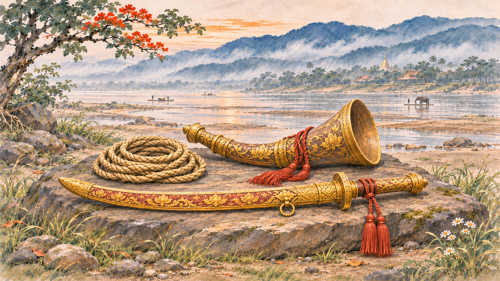
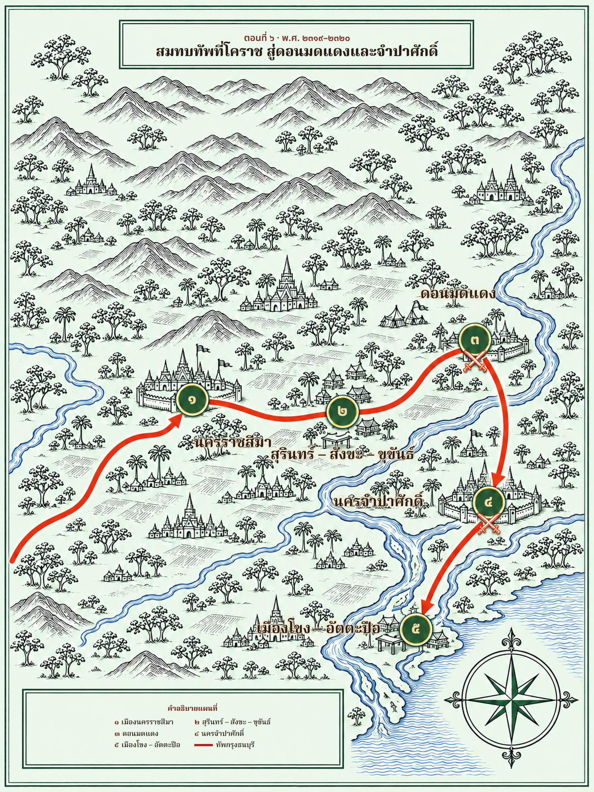

# ภาคที่ 2: สองพี่น้องบนกระดานศึกธนบุรี (พ.ศ. 2318 – 2325)
## ตอนที่ 6: ศึกจำปาศักดิ์ แม่น้ำโขงสายแรกของเจ้าพระยาสุรสีห์

---

### องก์ที่ 1: เปิดฉากขอบน้ำฝั่งโขงที่จำปาศักดิ์

ลมแล้งต้นปีระกาพัดเอาฝุ่นแดงจากหาดทรายกลาง **แม่น้ำโขง** เข้ามากระทบหน้าค่ายชั่วคราวริมฝั่งตะวันตก

ต้น พ.ศ. 2320 (ปลายปีวอก จุลศักราช 1138 ต่อเนื่องต้นปี 1139) เบื้องหน้าของ **เจ้าพระยาสุรสีห์พิษณวาธิราช (บุญมา)** ไม่ใช่ลำน้ำน่านสีขุ่นของเมืองพิษณุโลก และไม่ใช่คลองจากแถบแม่กลองที่ท่านคุ้นเคยมาตั้งแต่หนุ่ม หากเป็นผืนน้ำกว้างสุดลูกหูลูกตาของมหานทีแม่น้ำโขง ฟากตรงข้ามคือที่ตั้งของ **นครจำปาศักดิ์** ราชธานีแห่งลาวตอนใต้ที่ซ่อนตัวอยู่หลังเกาะแก่งและขุนเขาอันห่างไกลจากกรุงธนบุรีหลายร้อยกิโลเมตร

ข้างกายของเจ้าพระยาสุรสีห์ในสมรภูมินี้ คือ **เจ้าพระยาจักรี (ทองด้วง)** พี่ชายร่วมสายเลือด กับขบวนทัพผสมขนาดใหญ่ที่เพิ่งตีฝ่าแนวต้านทานของฝ่ายจำปาศักดิ์ ณ **ดอนมดแดง** ริมลำน้ำมูลแตกพ่ายมาหมาดๆ

สำหรับราชสำนักกรุงธนบุรี การส่งกองทัพขนาดใหญ่ข้ามอีสานมาถึงฝั่งโขงคือก้าวแรกของการขยายอิทธิพลออกนอกลุ่มน้ำเจ้าพระยาหลังจากเพิ่งรอดพ้นจากศึกอะแซหวุ่นกี้มาได้เพียงไม่กี่เดือน แต่สำหรับ **เจ้าพระยาสุรสีห์** เอง นี่คือ **"แม่น้ำโขงสายแรก"** ในชีวิตการรบของท่าน

ตลอด 8 ปีแรกในราชการกรุงธนบุรี (พ.ศ. 2311–2319) สนามรบหลักของท่านวนเวียนอยู่ระหว่างลุ่มน้ำแม่กลอง นครราชสีมา พิษณุโลก และล้านนา มีเพียงช่วงสั้นๆ ที่ไปตีเสียมราฐใน พ.ศ. 2312 ทว่าในวันนั้นที่ริมฝั่งโขง ท่านกำลังจะได้เรียนรู้ภูมิประเทศ กระแสน้ำ เกาะแก่ง และเกมการเมืองของหัวเมืองลาว–เขมรป่าดง—ความรู้ชุดเดียวกับที่จะกลายเป็นกุญแจสำคัญในศึกเวียงจันทน์อีกสองปีข้างหน้า

และเหยื่อคนสำคัญที่กำลังหลบหนีลงใต้ไปตามสายน้ำเชี่ยวเบื้องหน้านั้น คือ **เจ้าโอ (เจ้าไชยกุมาร)** และ **เจ้าอิน** แห่งนครจำปาศักดิ์

---

### องก์ที่ 2: กระดานการเมืองและหลักฐาน

เมื่อกางแผนที่ภาคตะวันออกเฉียงเหนือและลุ่มน้ำโขงตอนล่างใน พ.ศ. 2319–2320 ขึ้นตรวจสอบกับ **พระราชพงศาวดารกรุงธนบุรี ฉบับพันจันทนุมาศ (เจิม)**, **ฉบับพระราชหัตถเลขา**, และ **พงศาวดารเมืองนครจำปาศักดิ์** (ใน *ประชุมพงศาวดาร ภาคที่ 70*) จะช่วยไขจุดที่ต้องตรวจทานในโครงเรื่องได้ชัดเจนว่า **"ในศึกจำปาศักดิ์ ทัพของใครเดินเส้นทางไหนกันแน่"**

#### 1. ตรวจเส้นทางเดินทัพของ "เจ้าพระยาจักรี" และ "เจ้าพระยาสุรสีห์"

หลายคนมักเข้าใจว่าสองพี่น้องยกทัพใหญ่ก้อนเดียวกันออกจากกรุงธนบุรีพร้อมกันตั้งแต่ต้น แต่เมื่ออ่าน *พระราชพงศาวดาร ฉบับพันจันทนุมาศ (เจิม)* ตามลำดับเหตุการณ์ จะพบว่าศึกนี้แบ่งออกเป็น **2 จังหวะ** ชัดเจน:

- **จังหวะที่ 1 — ทัพเจ้าพระยาจักรีขึ้นหน้าไปปราบนางรอง (พ.ศ. 2319):** ชนวนเหตุเริ่มต้นจากเรื่องพิพาทท้องถิ่นระหว่าง **พระยานางรอง** กับ **พระยานครราชสีมา** เมื่อพระยานางรองเอาใจออกห่างไปขอพึ่งอำนาจของเจ้านครจำปาศักดิ์ (ดังที่เล่าไว้ใน *กระดานศึกพระเจ้าตาก* ตอนที่ 15) สมเด็จพระเจ้าตากสินจึงโปรดให้ **เจ้าพระยาจักรี (ทองด้วง)** คุมทัพจากกรุงธนบุรีขึ้นไปปราบเมืองนางรองก่อน จนจับและประหารชีวิตพระยานางรองได้สำเร็จที่นครราชสีมา
- **จังหวะที่ 2 — ทัพเจ้าพระยาสุรสีห์ยกตามขึ้นไปสมทบที่นครราชสีมา (ปลาย พ.ศ. 2319 – ต้น พ.ศ. 2320):** หลังเสร็จศึกนางรอง เจ้าพระยาจักรีสืบทราบว่า **เจ้าโอ (เจ้าไชยกุมาร)** และ **เจ้าอิน** แห่งจำปาศักดิ์ได้ระดมกำลังพลเตรียมจะยกลงมาตีหัวเมืองอีสานของสยาม สมเด็จพระเจ้าตากสินจึงโปรดให้จัดทัพใหญ่เพิ่มเติม โดยมี **เจ้าพระยาสุรสีห์ (บุญมา)** ยกกำลังจากกรุงธนบุรีขึ้นไป **สมทบ (รวมทัพ)** กับเจ้าพระยาจักรีที่ **เมืองนครราชสีมา**

เมื่อสองพี่น้องบรรจบทัพกันที่นครราชสีมาแล้ว จึงเคลื่อนขบวนร่วมกันเป็นทัพใหญ่ขนาดกว่า 10,000 นาย (ตามตัวเลขในพงศาวดาร) เดินทัพผ่านแนวอีสานใต้ **เขมรป่าดง** (บุรีรัมย์–สุรินทร์–สังขะ–ขุขันธ์) เลียบ **ลำน้ำมูล** มุ่งหน้าสู่ **ดอนมดแดง** และข้ามแม่น้ำโขงเข้าสู่ **นครจำปาศักดิ์**

#### 2. สองปัจจัยที่ทำให้ทัพธนบุรีข้ามอีสานไปถึงฝั่งโขงได้โดยไม่ขาดเสบียง

การเดินทัพระยะทางกว่า 500–600 กิโลเมตรจากภาคกลางไปถึงแม่น้ำโขงในสมัยที่ยังไม่มีถนนลาดยาง มีอุปสรรคสำคัญคือการส่งเสบียงและช้างม้าพาหนะ เหตุใดกองทัพของเจ้าพระยาจักรีและเจ้าพระยาสุรสีห์จึงไม่ประสบปัญหาเสบียงหมดเหมือนทัพพม่าที่พิษณุโลก?

คำตอบอยู่ในหมากทางการทูต 2 ชั้นที่เกิดขึ้นกลางทาง:

1. **การสวามิภักดิ์ของ "เขมรป่าดง" (สุรินทร์–สังขะ–ขุขันธ์):** เมื่อกองทัพสยามเคลื่อนผ่านอีสานใต้ บรรดาเจ้าเมืองเขมรป่าดงทั้งสามเมืองต่างนำช้างศึก ช้างลำเลียง ม้า และเสบียงอาหารออกมาอ่อนน้อมสมทบ ช่วยแก้โจทย์เรื่องพาหนะบรรทุกอาวุธหนักและข้าวสารได้ทันที
2. **พันธมิตรที่ดอนมดแดง ("พระวอ"):** ที่ **บ้านดอนมดแดง** (เขตจังหวัดอุบลราชธานีในปัจจุบัน) **พระวอ** (พระวรราชภักดี) อดีตเสนาบดีผู้แตกคอกับ **พระเจ้าสิริบุญสาร** แห่งเวียงจันทน์และเพิ่งบาดหมางกับเจ้าโอแห่งจำปาศักดิ์ ได้หันมาสวามิภักดิ์ร่วมมือกับทัพเจ้าพระยาจักรี–เจ้าพระยาสุรสีห์ กลายเป็นกำลังนำทางและทัพท้องถิ่นริมแม่น้ำมูล

#### 3. เทียบมุมมองจาก "พงศาวดารเมืองนครจำปาศักดิ์"

ขณะที่พงศาวดารฝ่ายธนบุรีมองศึกนี้ในฐานะการปราบหัวเมืองประเทศราชที่คุกคามชายแดนอีสาน *พงศาวดารเมืองนครจำปาศักดิ์* ให้ภาพเบื้องหลังฝ่ายลาวตอนใต้เพิ่มเติมว่า ราชสำนักจำปาศักดิ์ในเวลานั้นตกอยู่ในภาวะเปราะบางจากการแตกแยกภายใน—ทั้งความขัดแย้งระหว่างสายสกุลเจ้าผู้ครองนครกับกลุ่มของพระวอ–พระตาที่อพยพมาจากเวียงจันทน์ และความไม่พร้อมรับมือทัพผสมที่มีกองช้างศึกจากเขมรป่าดงหนุนหลัง ทำให้แนวป้องกันของจำปาศักดิ์พังทลายลงอย่างรวดเร็วเมื่อปะทะกันจริง

---

### องก์ที่ 3: จุดปะทะตั้งแต่ดอนมดแดงถึงสี่พันดอน–อัตตะปือ

เมื่อกองทัพผสมของเจ้าพระยาจักรีและเจ้าพระยาสุรสีห์เคลื่อนเลียบลำน้ำมูลลงมาถึงเขต **ดอนมดแดง** การปะทะจึงเริ่มขึ้นอย่างรวดเร็วและเฉียบขาด

#### 1. ตีค่ายดอนมดแดงและข้ามโขงยึดจำปาศักดิ์

กองทัพของเจ้าโอและเจ้าอินตั้งค่ายสกัดอยู่ที่ดอนมดแดงเพื่อหวังยันทัพสยามให้อยู่ฝั่งตะวันตกของแม่น้ำโขง ทว่าเมื่อต้องเผชิญกับทัพหลวงจากธนบุรี กองช้างศึกจากสุรินทร์–สังขะ–ขุขันธ์ และกำลังท้องถิ่นของพระวอที่รู้ภูมิประเทศริมน้ำมูลดี ค่ายดอนมดแดงก็ไม่อาจต้านทานได้ เจ้าโอและเจ้าอินต้องถอยร่นข้ามแม่น้ำโขงกลับไปยังเมืองจำปาศักดิ์

เจ้าพระยาจักรีและเจ้าพระยาสุรสีห์ไม่เปิดโอกาสให้ฝ่ายจำปาศักดิ์ตั้งหลักหลังแนวแม่น้ำได้ทัน ทั้งสองสั่งระดมเรือแพท้องถิ่นนำกำลังข้าม **แม่น้ำโขง** ตามตีกระชั้นชิดจนเข้ายึดตัว **เมืองนครจำปาศักดิ์** ได้สำเร็จ

#### 2. ปฏิบัติการไล่ล่าของเจ้าพระยาสุรสีห์: เกาะแก่งเมืองโขงและป่าอัตตะปือ

บทบาทโดดเด่นเฉพาะตัวของ **เจ้าพระยาสุรสีห์ (บุญมา)** ในศึกนี้ปรากฏชัดเจนที่สุดในช่วง **"การปิดบัญชี"** หลังเมืองจำปาศักดิ์แตก

เมื่อเสียราชธานีแล้ว **เจ้าโอ** และ **เจ้าอิน** พาครอบครัวและขุนนางคนสนิทล่องเรือหนีลงใต้ไปตามกระแสน้ำโขง มุ่งหน้าเข้าสู่เขต **เมืองโขง (สีทันดร หรือสี่พันดอน)** ซึ่งเต็มไปด้วยเกาะน้อยใหญ่และแก่งหินซับซ้อน ก่อนจะหลบลึกเข้าไปในเขตป่าเขาของ **เมืองอัตตะปือ** (ทางตะวันออกเฉียงใต้ของลาว ใกล้แนวพรมแดนกัมพูชา–เวียดนาม)

หากปล่อยให้เจ้านครจำปาศักดิ์หลบหนีข้ามไปตั้งหลักในเขตกัมพูชาหรือเวียดนามได้ ศึกอีสานใต้อาจยืดเยื้อไม่รู้จบ เจ้าพระยาสุรสีห์จึงเป็นกำลังหลักในการนำทัพไล่ติดตามลงไปตามลำน้ำโขง เข้าตี **เมืองโขง** จนแตก แล้วส่งกำลังบุกฝ่าป่าเขาเข้าไปถึง **เมืองอัตตะปือ** จับตัว **เจ้าโอ (เจ้าไชยกุมาร)**, **เจ้าอิน**, พร้อมเจ้านายและขุนนางจำปาศักดิ์ทั้งหมดกลับมาได้สำเร็จ

ผลจากการติดตามไปจนสุดปลายสายน้ำในครั้งนี้ ไม่เพียงนำเชลยสำคัญกลับมาถวายกรุงธนบุรีได้ครบถ้วน แต่ยังเปิดพื้นที่ให้เจ้าพระยาสุรสีห์ได้เห็นสภาพภูมิศาสตร์จริงของ **"สี่พันดอน"** และแนวแก่งหินอันโหดหินทางตอนใต้ของจำปาศักดิ์ด้วยตาตนเอง

---

### องก์ที่ 4: แรงสะเทือนจากบำเหน็จความชอบและเงาเลือดที่ดอนมดแดง

เมื่อเจ้าพระยาจักรีและเจ้าพระยาสุรสีห์นำทัพพร้อมตัวเจ้าโอและเจ้าอินกลับลงมาถึงกรุงธนบุรีใน พ.ศ. 2320 ชัยชนะครั้งนี้ได้ขยับพรมแดนอำนาจของกรุงธนบุรีข้ามแม่น้ำโขงไปจนถึงสี่พันดอนและอัตตะปือเป็นครั้งแรก

สมเด็จพระเจ้าตากสินทรงปูนบำเหน็จความชอบครั้งใหญ่ให้แก่แม่ทัพทั้งสอง:

- ทรงสถาปนา **เจ้าพระยาจักรี (ทองด้วง)** ขึ้นเป็น **สมเด็จเจ้าพระยามหากษัตริย์ศึก** ตำแหน่งเจ้าพระยาชั้นพิเศษเทียบเท่าเจ้าต่างกรม ถืออำนาจบัญชาการทหารสูงสุดในแผ่นดิน
- ทรงมอบความไว้วางพระราชหฤทัยให้ **เจ้าพระยาสุรสีห์ (บุญมา)** ยังคงดำรงตำแหน่งแม่ทัพหน้าคู่กายพี่ชาย และทรงไว้ชีวิต **เจ้าโอ** โปรดให้กลับไปครองนครจำปาศักดิ์ในฐานะเมืองประเทศราชเช่นเดียวกับที่ทรงใช้กับเจ้านครศรีธรรมราช (หนู)

ทว่าในความสงบหลังศึกจำปาศักดิ์ กลับมีเชื้อไฟลูกใหม่ซ่อนอยู่บนแผนที่เดิม

ทันทีที่ทัพใหญ่ของสมเด็จเจ้าพระยามหากษัตริย์ศึกและเจ้าพระยาสุรสีห์ถอนกลับลงมาภาคกลาง **พระวอ** ที่ดอนมดแดงก็สูญเสียเกราะกำบัง **พระเจ้าสิริบุญสาร** แห่งกรุงเวียงจันทน์ ซึ่งเฝ้ามองความเคลื่อนไหวจากทางเหนือ จึงส่งกองทัพเวียงจันทน์ยกลงมาปิดล้อมค่ายดอนมดแดงและ **สังหารพระวอสิ้นชีพ** ลงก่อนที่ทัพธนบุรีจะขึ้นไปช่วยได้ทัน

การสังหารพันธมิตรของกรุงธนบุรีกลางลุ่มน้ำมูลใน พ.ศ. 2321 จุดชนวนสงครามครั้งใหญ่ที่สุดในอาณาจักรล้านช้าง—สงครามที่จะบังคับให้ **เจ้าพระยาสุรสีห์** ต้องหวนกลับมายังเขตแก่งหินสี่พันดอนที่ท่านเพิ่งผ่านมาเมื่อปีก่อน แต่คราวนี้ไม่ใช่นั่งเรือลงใต้ตามน้ำ หากต้อง **นำทัพเรือ 10,000 นายจากกัมพูชาล่องทวนน้ำขึ้นเหนือฝ่า "แก่งหลี่ผี" เพื่อไปล้อมกรุงเวียงจันทน์!**

**จบตอนที่ 6**

*(ติดตามต่อใน ตอนที่ 7: เวียงจันทน์และพระแก้วมรกต ทัพเรือข้ามแก่งหลี่ผี)*
