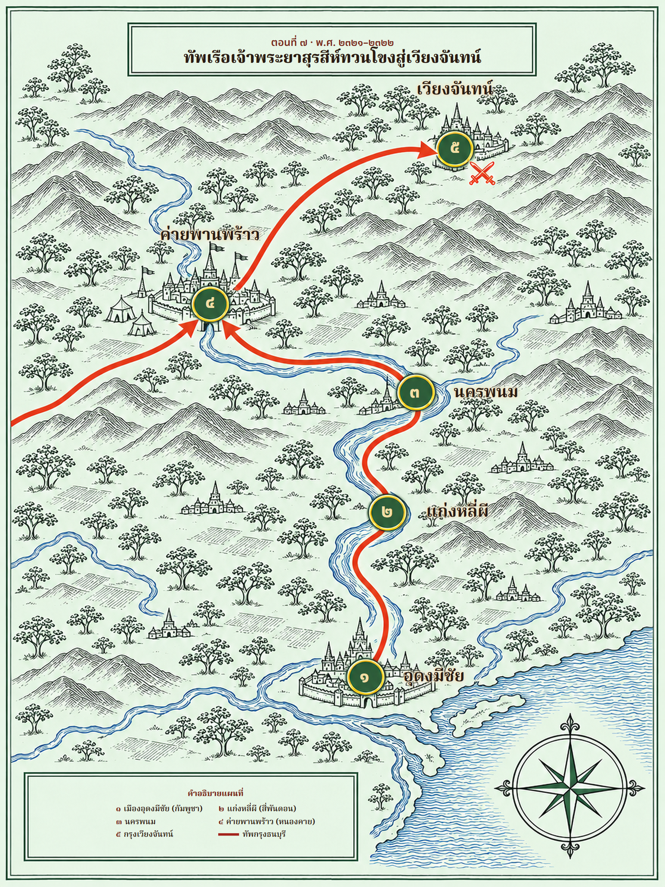

# ภาคที่ 2: สองพี่น้องบนกระดานศึกธนบุรี (พ.ศ. 2318 – 2325)
## ตอนที่ 7: เวียงจันทน์และพระแก้วมรกต ทัพเรือข้ามแก่งหลี่ผี

---

### องก์ที่ 1: เปิดฉากเสียงคำรามแห่งแก่งหลี่ผี

น้ำโขงตรงช่วง **สี่พันดอน** ไม่ได้ไหลเป็นสายเดียว หากแตกกระจายออกเป็นร้อยลำน้ำที่กระแทกเข้าใส่ผาหินสีดำสนิทจนละอองน้ำฟุ้งตลบเหมือนหมอกขาว

ปลายฤดูฝนต่อต้นฤดูแล้ง ปีจอ จุลศักราช 1140 (ปลาย พ.ศ. 2321) ขบวนเรือรบและเรือลำเลียงเสบียงขนาดมหึมาที่เกณฑ์มาจากกรุงกัมพูชาจำต้องทอดสมอหยุดนิ่งอยู่ท้ายแก่งหินอันโหดหินที่สุดของเอเชียตะวันออกเฉียงใต้—**แก่งหลี่ผี**

บนตลิ่งหินริมลำน้ำ **เจ้าพระยาสุรสีห์พิษณวาธิราช (บุญมา)** ยืนเพ่งมองร่องน้ำเชี่ยวกรากเบื้องหน้าด้วยสายตาของแม่ทัพผู้ผ่านศึกใหญ่ทางน้ำและทางบกมาแล้วตั้งแต่ **ศึกบางกุ้ง** เมื่อ พ.ศ. 2311 ตามที่พระราชพงศาวดารบันทึกไว้ ทว่าอุปสรรคครั้งนี้ไม่เหมือนคุ้งน้ำบางกุ้งหรือการรุกในลุ่มน้ำแม่กลอง ตรงหน้าท่านคือกำแพงหินและน้ำตกที่เรือรบลำไหนก็พายทวนน้ำข้ามไปไม่ได้

ในหนังสือเล่มที่ 1 (*กระดานศึกพระเจ้าตาก* ตอนที่ 17) ผู้อ่านได้เห็นภาพรวมของศึกเวียงจันทน์ที่ปะทุขึ้นหลัง **พระเจ้าสิริบุญสาร** ส่งทัพลงมาสังหาร **พระวอ** ที่ดอนมดแดงจนกลายเป็นชนวนสงครามใหญ่ แต่หากเจาะลึกเฉพาะบทบาทของ **เจ้าพระยาสุรสีห์** ภารกิจที่ท่านได้รับมอบหมายใน พ.ศ. 2321 คือหนึ่งในปฏิบัติการส่งกำลังบำรุงและทัพเรือที่ทะเยอทะยานที่สุดในยุคธนบุรี

ขณะที่ **สมเด็จเจ้าพระยามหากษัตริย์ศึก (ทองด้วง)** คุมทัพบก 20,000 นายจากกรุงธนบุรีเดินเท้าข้ามอีสานขึ้นตรงไปยัง **ค่ายพานพร้าว** ฝั่งตรงข้ามกรุงเวียงจันทน์ เจ้าพระยาสุรสีห์ต้องลงไปเกณฑ์ไพร่พลและกองเรือรบจาก **กัมพูชา** กว่า 10,000 นาย (ตามตัวเลขในพงศาวดาร) ล่องทวนแม่น้ำโขงจากใต้ขึ้นเหนือเพื่อขนเสบียง ปืนใหญ่ และกำลังตีขนาบขึ้นไปบรรจบกับพี่ชายให้ทันฤดูแล้ง

หากทัพเรือของเจ้าพระยาสุรสีห์ติดตายอยู่ใต้แก่งหลี่ผี ทัพบกสองหมื่นคนที่พานพร้าวก็จะขาดทั้งเรือข้ามโขงและกำลังหนุน—และเวียงจันทน์ก็จะยื้อเวลาอยู่หลังแม่น้ำใหญ่ไปได้อีกปีเต็ม

---

### องก์ที่ 2: กระดานการเมืองและหลักฐาน

เมื่อกางแผนที่ลุ่มน้ำโขงตั้งแต่ทะเลสาบเขมรขึ้นไปจนถึงเวียงจันทน์ใน พ.ศ. 2321–2322 แล้วเทียบหลักฐานสามฝ่าย ได้แก่ **พระราชพงศาวดารกรุงธนบุรี ฉบับพันจันทนุมาศ (เจิม)**, **ฉบับพระราชหัตถเลขา**, **พงศาวดารล้านช้าง**, และ **พระราชพงศาวดารกรุงรัตนโกสินทร์ รัชกาลที่ 1** จะเห็นว่าความสำเร็จของศึกเวียงจันทน์ตั้งอยู่บนการแก้โจทย์ 3 ข้อที่พันเกี่ยวกัน

#### 1. เหตุใดต้องแบ่งทัพเป็น "คีมบก–เรือ" แทนการเดินทัพบกรวมกัน

ในทางภูมิศาสตร์ จากกรุงธนบุรีขึ้นไปถึง **ค่ายพานพร้าว** (เขตอำเภอศรีเชียงใหม่ จังหวัดหนองคาย) เป็นระยะทางกว่า 600 กิโลเมตร ผ่านทิวเขาดงพญาไฟและที่ราบสูงอันกันดารในฤดูแล้ง

หากให้กำลังพลทั้งหมด 30,000 นายเดินเท้าไปในสายทางเดียว ปัญหาเสบียงอาหารและน้ำดื่มระหว่างทางจะทำให้ทัพสยามหมดแรงก่อนได้เห็นกำแพงเมืองเวียงจันทน์ และเมื่อไปถึงริมฝั่งโขงแล้ว หากไม่มีกองเรือรบและเรือลำเลียงอยู่ในมือ ทัพบกก็ไม่อาจข้ามแม่น้ำโขงอันกว้างใหญ่เข้าไปตีฝั่งเวียงจันทน์ได้สะดวก

ด้วยเหตุนี้ ราชสำนักธนบุรีจึงออกแบบ **"คีมสองง่าม"**:

- **ปีกทัพบก:** **สมเด็จเจ้าพระยามหากษัตริย์ศึก** นำทัพหลวงจากกรุงธนบุรีผ่านนครราชสีมา ขึ้นตรงไปตั้งฐานที่ค่ายพานพร้าว เพื่อดึงความสนใจและตรึงกำลังหลักของพระเจ้าสิริบุญสารไว้หน้าเมืองเวียงจันทน์
- **ปีกทัพเรือและสายส่งกำลัง:** **เจ้าพระยาสุรสีห์** ลงไปเมืองอุดงมีชัยในกัมพูชา เกณฑ์กองทัพเรือเขมรราว 10,000 นาย (ตัวเลขพงศาวดารที่สะท้อนการระดมพลครั้งใหญ่จากเมืองประเทศราช) ขนข้าวปลาอาหารและศาสตราวุธทวนแม่น้ำโขงขึ้นเหนือ เพื่อกวาดล้างหัวเมืองหน้าด่านริมโขงแล้วขึ้นไปเป็นแขนขวาให้ทัพบกที่พานพร้าว
- **แนวร่วมทางเหนือ:** อาณาจักรล้านช้าง **หลวงพระบาง** ของ **เจ้าสุริยวงศ์** ที่เป็นอริกับเวียงจันทน์มาช้านาน เข้าสวามิภักดิ์ต่อกรุงธนบุรีและเตรียมทัพลงมาตีกระหนาบจากทางเหนือ

#### 2. หลักฐานว่าด้วยปฏิบัติการข้าม "แก่งหลี่ผี"

เรื่องราวที่กองทัพเรือของเจ้าพระยาสุรสีห์สามารถนำเรือรบจำนวนมากผ่านแนวแก่งหินสี่พันดอนขึ้นไปถึงเวียงจันทน์ได้อย่างไร มีรายละเอียดในหลักฐานที่ควรอ่านเทียบกันอย่างระมัดระวัง:

- **หลักฐานฝ่ายไทยในพระราชพงศาวดารฉบับพระราชหัตถเลขา:** ระบุชัดเจนว่าเมื่อ **เจ้าพระยาสุรสีห์** ยกทัพจากทางเมืองเขมรทวนแม่น้ำโขงขึ้นไปตีกรุงศรีสัตนาคนหุต ท่านได้จัดการ **"ขุดคลองอ้อมแก่งลิผี"** เพื่อให้ขบวนเรือรบและเรือลำเลียงข้ามแนวแก่งหินขึ้นสู่ลำน้ำโขงตอนบนได้ (ทั้งนี้ ไม่ปรากฏหลักฐานในพงศาวดารกัมพูชาหรือพงศาวดารล้านช้างที่บันทึกเรื่องการขุดคลองอ้อมแก่งนี้ไว้โดยตรง จึงยึดตามบันทึกในพระราชพงศาวดารไทยเป็นสำคัญ)

ในทางวิศวกรรมภาคสนาม การ "ขุดคลองอ้อมแก่ง" ไม่ได้หมายถึงการขุดคลองเดินเรือลึกขนาดใหญ่ผ่านหินแกรนิตทั้งแท่ง หากเป็นการปรับแต่งร่องน้ำตื้นริมเกาะแก่ง ดัดแปลงลำห้วยธรรมชาติข้างฝั่ง ผนวกกับการวางรางไม้ลากเรือข้ามช่วงที่น้ำตกชันที่สุด—เป็นปฏิบัติการที่ต้องอาศัยการบังคับบัญชาที่เด็ดขาดอย่างยิ่ง เพราะการคุมไพร่พลต่างถิ่นนับหมื่นคนทำงานหนักกลางโขดหินและไข้ป่า หากแม่ทัพไม่คุมวินัยอย่างเข้มงวด กองทัพย่อมแตกหนีกลางทางได้ง่าย

---

### องก์ที่ 3: จุดปะทะทวนกระแสน้ำโขงสู่กำแพงเวียงจันทน์

#### 1. ยึดหัวเมืองริมโขงจากจำปาศักดิ์ถึงหนองคาย

ทันทีที่กองทัพเรือของเจ้าพระยาสุรสีห์หลุดพ้นแก่งหลี่ผีขึ้นมาได้ ดุลอำนาจตลอดลำน้ำโขงตอนกลางก็เปลี่ยนไปทันที

เมืองจำปาศักดิ์ (ซึ่ง *พงศาวดารหัวเมืองมณฑลอีสาน* บันทึกว่าในคราวศึก พ.ศ. 2321 ทัพไทยได้เข้ายึดเมืองและตามไปจับตัว **เจ้าองค์หลวงไชยกุมาร** ที่อพยพหนีไปตั้งอยู่ ณ เกาะไชยไว้ด้วย) กลายเป็นฐานเติมเสบียงและส่งกำลังขึ้นเหนือ จากนั้นกองทัพเรือจึงเร่งฝีพายทวนน้ำเข้าตีหัวเมืองสำคัญริมแม่น้ำโขงของฝ่ายเวียงจันทน์ตามลำดับ:

1. **เมืองนครพนม (ศรีโคตรบูรณ์):** เมืองยุทธศาสตร์ริมฝั่งซ้ายแม่น้ำโขงที่เป็นด่านแรกของเวียงจันทน์ทางใต้ ไม่อาจต้านทานการรุกประสานของทัพเรือจากเขมรได้
2. **เมืองเวียงคุกและหนองคาย:** แนวรับด่านสุดท้ายก่อนเข้าเขตกรุงเวียงจันทน์ถูกตีแตกพ่าย เปิดเส้นทางลำน้ำช่วงโค้งน้ำหนองคาย–พานพร้าวให้เชื่อมต่อกันได้โดยสมบูรณ์

ต้นปี พ.ศ. 2322 เรือรบและเรือลำเลียงเสบียงของเจ้าพระยาสุรสีห์ก็แล่นเข้าเทียบท่า **ค่ายพานพร้าว** บรรจบกับทัพบกของ **สมเด็จเจ้าพระยามหากษัตริย์ศึก** ได้ตามกำหนดการ กลายเป็นค่ายใหญ่ที่มีทั้งทหารราบ ทหารม้า ปืนใหญ่ และกองเรือพร้อมข้ามแม่น้ำโขงเข้าปิดล้อมราชธานีล้านช้าง

#### 2. สี่เดือนหน้ากำแพงเวียงจันทน์ และชัยชนะที่บ้านสิงห์–บ้านพะโค

**พระเจ้าสิริบุญสาร** แห่งเวียงจันทน์ไม่ยอมออกรบกลางแจ้ง พระองค์สั่งปิดประตูเมืองตั้งรับหลังกำแพงและวางค่ายริมน้ำฝั่งซ้ายแม่น้ำโขง โดยหวังว่าแม่น้ำโขงอันกว้างใหญ่กับฤดูแล้งที่ใกล้สิ้นสุดจะบีบให้กองทัพธนบุรีขาดเสบียงและต้องถอนทัพกลับไปเอง

ทว่าคราวนี้กองทัพกรุงธนบุรีมีเรือรบและสายส่งกำลังจากกัมพูชา–จำปาศักดิ์อยู่ในมือ การปิดล้อมและระดมยิงปืนใหญ่ข้ามแม่น้ำโขงจึงดำเนินไปอย่างต่อเนื่องยาวนานถึง **4 เดือน** ทั้งยังได้กองทัพจาก **หลวงพระบาง** ลงมาตีกระหนาบด้านเหนือ ทำให้เวียงจันทน์ถูกบีบจากทั้งสองฝั่ง

จุดแตกหักเกิดขึ้นเมื่อสมเด็จเจ้าพระยามหากษัตริย์ศึกและเจ้าพระยาสุรสีห์ส่งกำลังข้ามแม่น้ำโขงเข้าตีค่ายนอกเมืองสำคัญของเวียงจันทน์ ได้แก่ **บ้านสิงห์** และ **บ้านพะโค** จนแตกพ่ายยับเยิน เมื่อปราการชั้นนอกพังทลายลง พระเจ้าสิริบุญสารทรงเห็นว่าไม่อาจรักษาพระนครได้อีกต่อไป จึงลอบลงเรือตีฝ่าวงล้อมหนีไปทาง **เมืองคำเกิด** ทิ้งกรุงเวียงจันทน์ไว้เบื้องหลัง

กองทัพของสองพี่น้องจึงเข้ายึดกรุงเวียงจันทน์ได้สำเร็จ รวบรวมอาณาจักรล้านช้างทั้ง 3 แห่ง (หลวงพระบาง เวียงจันทน์ และจำปาศักดิ์) ให้ยอมรับอำนาจของกรุงธนบุรีในฐานะเมืองประเทศราชพร้อมกันเป็นครั้งแรก

---

### องก์ที่ 4: แรงสะเทือนแห่งพระแก้วมรกตและรอยร้าวในราชธานี

หลังยึดกรุงเวียงจันทน์ได้ใน พ.ศ. 2322 สมเด็จเจ้าพระยามหากษัตริย์ศึกและเจ้าพระยาสุรสีห์ได้อัญเชิญพระพุทธรูปสำคัญคู่บ้านคู่เมืองล้านช้าง 2 องค์ ได้แก่ **พระพุทธมหามณีรัตนปฏิมากร (พระแก้วมรกต)** และ **พระบาง** ลงเรืออัญเชิญกลับมายังกรุงธนบุรี (โดยสมเด็จพระเจ้าตากสินเสด็จพระราชดำเนินขึ้นไปทรงรับถึงเมืองสระบุรี แล้วโปรดให้ประดิษฐานไว้ ณ วัดแจ้ง ข้างพระราชวังธนบุรี) ขณะเดียวกันตาม *พงศาวดารหัวเมืองมณฑลอีสาน* ได้นำตัว **เจ้าองค์หลวงไชยกุมาร** เจ้านครจำปาศักดิ์ลงมาถวายที่กรุงธนบุรีด้วย ก่อนที่สมเด็จพระเจ้าตากสินจะโปรดให้ **เจ้าไชยกุมาร** กลับไปครองนครจำปาศักดิ์ตามเดิมในฐานะเมืองประเทศราช

สำหรับเจ้าพระยาสุรสีห์ ชัยชนะที่เวียงจันทน์คือบทพิสูจน์ว่าท่านไม่ได้เป็นเพียง "เจ้าพระยาเสือ" ที่ถนัดการตีโฉบฉวยหรือรบประจันบานระยะสั้นอีกต่อไป แต่สามารถบัญชาการทัพเรือทางไกลกว่าพันกิโลเมตร คุมกำลังต่างชาติพันธุ์นับหมื่น และเอาชนะอุปสรรคธรรมชาติที่แก่งหลี่ผีได้สำเร็จ

ทว่าเมื่อขบวนทัพชัยกลับคืนสู่ **กรุงธนบุรี** ในปลาย พ.ศ. 2322 บรรยากาศภายในพระนครกลับไม่สงบสุขดังภาพชัยชนะภายนอก

ความเหนื่อยล้าจากการทำศึกต่อเนื่องกว่าทศวรรษ ปัญหาข้าวยากหมากแพง และความตึงเครียดภายในพระราชวังธนบุรี กำลังก่อตัวเป็นคลื่นใต้น้ำที่รุนแรงขึ้นทุกวัน ขณะเดียวกันใน **กัมพูชา** ก็เกิดเหตุรัฐประหารปลงพระชนม์ **สมเด็จพระรามราชา (นักองค์โนน)** ลงตั้งแต่ พ.ศ. 2322 แล้วดึงกองทัพญวนเข้ามาแทรกแซง กระทั่งปลาย พ.ศ. 2324 กรุงธนบุรีจึงตัดสินใจส่งทัพใหญ่เข้าปราบปราม เจ้าพระยาสุรสีห์ต้องจับดาบออกเดินทัพทางไกลอีกครั้งเคียงข้าง **สมเด็จเจ้าพระยามหากษัตริย์ศึก** ผู้เป็นพี่ชาย—โดยไม่รู้เลยว่า เมื่อก้าวพ้นเขตกรุงธนบุรีไปได้ไม่นาน แผ่นดินเบื้องหลังจะเกิดการเปลี่ยนแปลงครั้งใหญ่ที่สุดในชีวิตของท่าน

**จบตอนที่ 7**

*(ติดตามต่อใน ตอนที่ 8: ศึกเขมรและแผ่นดินใหม่ จากแม่ทัพหน้าสู่กรมพระราชวังบวร)*
