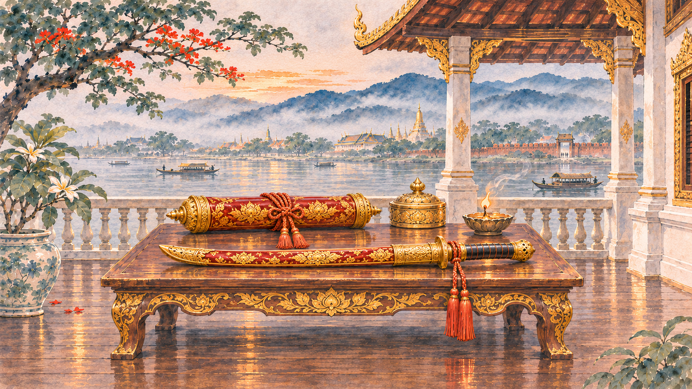
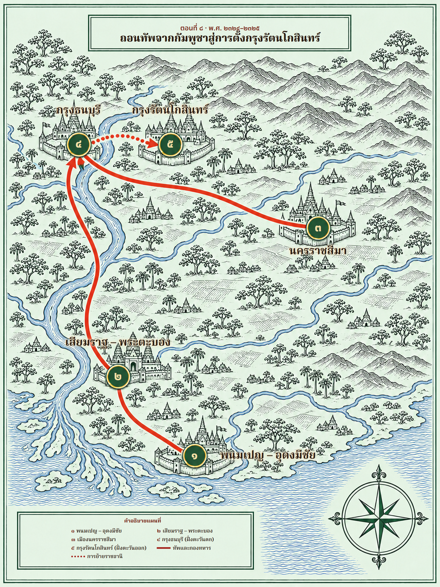

# ภาคที่ 2: สองพี่น้องบนกระดานศึกธนบุรี (พ.ศ. 2318 – 2325)
## ตอนที่ 8: ศึกเขมรและแผ่นดินใหม่ จากแม่ทัพหน้าสู่กรมพระราชวังบวร

---

### องก์ที่ 1: เปิดฉากม้าเร็วกลางแนวรบเขมร–ญวน

ลมแล้งเดือนสี่ พ.ศ. 2325 พัดเอาฝุ่นดินแดงจากท้องทุ่งกัมพูชาเข้ามากระทบกระโจมค่ายทัพหน้าของกรุงธนบุรี

ห่างจากราชธานีออกไปหลายร้อยกิโลเมตร **เจ้าพระยาสุรสีห์พิษณวาธิราช (บุญมา)** กำลังคุมกำลังส่วนหน้าประจันหน้าอยู่กับแนวป้องกันผสมของฝ่ายเขมรภายใต้ **เจ้าฟ้าทะละหะ (มู)** และกองทัพ **ญวน (ตระกูลเหงียน)** ที่ยกขึ้นมาหนุนหลังถึงเขตพนมเปญและลุ่มน้ำโขงตอนล่าง ขณะที่ **สมเด็จเจ้าพระยามหากษัตริย์ศึก (ทองด้วง)** พี่ชายของท่าน คุมทัพหลวงตั้งมั่นอยู่ในแนวหลังแถบเมืองเสียมราฐ–อุดงมีชัย พร้อมด้วย **กรมขุนอินทรพิทักษ์** พระราชโอรสในสมเด็จพระเจ้าตากสิน

กองทัพสยามกว่า 20,000 นายชุดนี้เพิ่งกรีธาทัพเข้ามาในกัมพูชาตั้งแต่ปลาย พ.ศ. 2324 เพื่อปราบปรามเหตุวิกฤตการณ์สืบเนื่องจากการที่เจ้าฟ้าทะละหะ (มู) ก่อรัฐประหารปลงพระชนม์ **สมเด็จพระรามราชา (นักองค์โนน)** ลงตั้งแต่ พ.ศ. 2322 แล้วดึงกองกำลังญวนเข้ามาแทรกแซง (ดังที่เล่าภาพรวมไว้ใน *กระดานศึกพระเจ้าตาก* ตอนที่ 18) ตลอดหลายเดือนของการรุกคืบ ทัพหน้าของเจ้าพระยาสุรสีห์ตีหัวเมืองด่านหน้าแตกมาตามลำดับ แต่เมื่อปะทะเข้ากับกองเรือและค่ายทหารญวนที่หนุนช่วยเขมร สถานการณ์จึงกลายเป็นการคุมเชิงที่ต้องระมัดระวังทั้งแนวหน้าและแนวหลัง

แล้วม้าเร็วจากแนวหลังก็ควบฝ่าด่านเข้ามาพร้อมข่าวที่ทำให้สมรภูมิกัมพูชาทั้งหมดหยุดชะงัก

ใบบอกลับจากพระนครรายงานว่า เกิดความไม่สงบครั้งใหญ่ขึ้นในกรุงเก่าและลุกลามเข้ายึดพระราชวังกรุงธนบุรีแล้ว—เหตุการณ์ที่รู้จักกันต่อมาว่า **"กบฏพระยาสรรค์"**

ในพริบตาเดียว กระดานศึกของเจ้าพระยาสุรสีห์ก็กลับด้านจากหน้ามือเป็นหลังมือ หากถอนทัพกลับทันทีโดยไม่จัดการแนวหน้าให้เรียบร้อย กองทัพเขมรและญวนที่จ้องอยู่ตรงหน้าจะตีตลบหลังทันที แต่หากยังตรึงทัพอยู่ในกัมพูชาต่อไป แผ่นดินเบื้องหลังที่กรุงธนบุรีก็จะไร้กำลังทหารหลักคอยรักษาความสงบเรียบร้อย

การตัดสินใจในห้วงเดือนมีนาคม พ.ศ. 2325 นี้ กำลังจะเปลี่ยนสถานะของสองพี่น้องจาก "แม่ทัพแห่งกรุงธนบุรี" ไปสู่ **"ปฐมกษัตริย์และพระมหาอุปราชแห่งราชวงศ์ใหม่"**

---

### องก์ที่ 2: กระดานการเมืองและหลักฐาน

การเปลี่ยนแผ่นดินจากกรุงธนบุรีสู่กรุงรัตนโกสินทร์ใน พ.ศ. 2325 เป็นเหตุการณ์ที่ละเอียดอ่อนที่สุดตอนหนึ่งในประวัติศาสตร์ไทย เพื่อรักษาความซื่อตรงต่อหลักฐานตามกติกาของหนังสือเล่มนี้ เราจำเป็นต้องกางบันทึกหลักฐานร่วมสมัยและพงศาวดาร 3 ฉบับวางเทียบกันบนโต๊ะอย่างตรงไปตรงมา โดยไม่คาดเดาแรงจูงใจของบุคคลเกินกว่าที่เอกสารบันทึกไว้

#### 1. เทียบคำบอกเล่าของหลักฐาน 3 ฉบับต่อวิกฤต พ.ศ. 2325

1. **พระราชพงศาวดารกรุงธนบุรี ฉบับพันจันทนุมาศ (เจิม):** พงศาวดารฉบับนี้บันทึกเหตุการณ์ในฝั่งกรุงธนบุรีโดยลำดับข้อเท็จจริงอย่างกระชับว่า ในปลาย พ.ศ. 2324 ต่อต้น พ.ศ. 2325 เกิดเหตุจลาจลในกรุงเก่าและขบวนของ **พระยาสรรค์** ยกเข้าล้อมพระราชวังกรุงธนบุรีจนสมเด็จพระเจ้าตากสินทรงออกผนวช จากนั้น **พระยาสุริยอภัย** (หลานของสมเด็จเจ้าพระยามหากษัตริย์ศึกซึ่งครองเมืองนครราชสีมา) จึงนำกำลังลงมาปราบปรามฝ่ายพระยาสรรค์ในพระนคร ก่อนที่ทัพใหญ่ของสมเด็จเจ้าพระยามหากษัตริย์ศึกและเจ้าพระยาสุรสีห์จะเดินทางกลับจากกัมพูชาเข้ามาถึงในวันที่ **6 เมษายน พ.ศ. 2325**
2. **พระราชพงศาวดารกรุงรัตนโกสินทร์ รัชกาลที่ 1 ฉบับเจ้าพระยาทิพากรวงศ์:** ให้รายละเอียดขยายความบริบทของความวุ่นวายปลายรัชกาลอย่างชัดเจน ทั้งปัญหาข้าวยากหมากแพง ความตึงเครียดในการปกครองและการลงทัณฑ์ในพระนคร การที่ขุนนางและราษฎรบางส่วนเดือดร้อนจนเกิดกบฏพระยาสรรค์ ตลอดจนเหตุการณ์เมื่อทัพใหญ่กลับจากกัมพูชา—มีการไต่สวนเหตุการณ์จลาจล คณะขุนนางผู้ใหญ่ได้พร้อมกันอัญเชิญสมเด็จเจ้าพระยามหากษัตริย์ศึกขึ้นครองราชสมบัติ และมีการตัดสินสำเร็จโทษสมเด็จพระเจ้าตากสินด้วยเหตุผลทางการเมืองเพื่อยุติความแตกแยกและป้องกันการชิงอำนาจซ้ำซ้อนในอนาคต
3. **จดหมายเหตุความทรงจำของกรมหลวงนรินทรเทวี:** พระนิพนธ์ของ **พระองค์เจ้ากุ** (พระขนิษฐาต่างมารดาของทั้งรัชกาลที่ 1 และกรมพระราชวังบวรมหาสุรสิงหนาท) ซึ่งทรงพำนักอยู่ในกรุงธนบุรีขณะเกิดเหตุการณ์จริง บันทึกเหตุการณ์ช่วงจลาจลไว้อย่างสั้น กระชับ และตรงไปตรงมาตามสายตาของผู้เห็นเหตุการณ์ในพระนคร—สะท้อนความโกลาหลของการยึดวัง การปะทะระหว่างฝ่ายพระยาสรรค์กับพระยาสุริยอภัย และความตึงเครียดในช่วงผลัดแผ่นดิน โดยไม่ได้ขยายความวิพากษ์วิจารณ์ทางการเมืองยืดยาวเช่นพงศาวดารฉบับชำระชั้นหลัง

#### 2. ความแตกต่างของบทบาท "สองพี่น้อง" ในช่วงเปลี่ยนผ่าน

เมื่ออ่านเทียบเอกสารทั้งสามฉบับ จะเห็นความแตกต่างของตำแหน่งและบทบาทระหว่างสองพี่น้องก่อนวันเปลี่ยนแผ่นดิน:

- **สมเด็จเจ้าพระยามหากษัตริย์ศึก (ทองด้วง)** ถือตำแหน่งสูงสุดทางทหารและบริหารในราชอาณาจักร มีบารมีเหนือขุนนางส่วนกลางและเป็นผู้บัญชาการทัพใหญ่จากกัมพูชา รวมถึงเป็นผู้ติดต่อเจรจาให้ฝ่ายญวนยอมสงบศึกเพื่อให้ทัพสยามถอนตัวกลับได้อย่างปลอดภัย
- **เจ้าพระยาสุรสีห์ (บุญมา)** ทำหน้าที่คุมทัพหน้าในกัมพูชา เคลื่อนกำลังประชิดแนวเขมร–ญวน และเมื่อได้รับแจ้งเหตุวิกฤตในพระนคร ท่านได้ร่วมจัดการถอนทัพและคุมกำลังติดตามกลับมายังกรุงธนบุรีเพื่อรักษาเสถียรภาพทางทหารร่วมกับพี่ชายอย่างใกล้ชิด

---

### องก์ที่ 3: จุดปะทะทางการทูต การถอยทัพ และการสถาปนาสองราชสำนัก

#### 1. การทูตสงบศึกในกัมพูชาและการถอนกำลังสู่พระนคร

โจทย์แรกของสองพี่น้องในเดือนมีนาคม พ.ศ. 2325 คือ **จะถอนทัพ 20,000 นายออกจากกัมพูชาอย่างไรไม่ให้เสียทัพ**

ในสถานการณ์ที่แนวรบกำลังตึงเครียดกับกองทัพญวน หากถอนกำลังพลอย่างเร่งรีบโดยไม่มีข้อตกลง ฝ่ายญวนและเจ้าฟ้าทะละหะ (มู) ย่อมรุกไล่ตีกระหนาบหลังทันที สมเด็จเจ้าพระยามหากษัตริย์ศึกจึงใช้การทูตส่งผู้แทนไปเจรจากับแม่ทัพญวนเพื่อทำความตกลงสงบศึกและแบ่งเขตคุมเชิงชั่วคราว ขณะที่ทัพหน้าของเจ้าพระยาสุรสีห์รักษาระเบียบแนวรบอย่างเข้มงวดไม่ให้ข้าศึกฉวยโอกาสโจมตีระหว่างถอนกำลัง

ด้วยแผนการถอยทัพที่เป็นระบบ กองทัพใหญ่ทั้งสองสายจึงถอนตัวออกจากดินแดนกัมพูชามุ่งหน้ากลับสู่ลุ่มน้ำเจ้าพระยาได้โดยปลอดภัย

#### 2. วันที่ 6 เมษายน พ.ศ. 2325 และพระราชพิธีเดือนมิถุนายน พ.ศ. 2325

เมื่อ **พระยาสุริยอภัย** คุมกำลังจากนครราชสีมาลงมาปราบฝ่ายพระยาสรรค์และเข้าควบคุมความสงบเรียบร้อยในพระราชวังกรุงธนบุรีไว้ได้ในเบื้องต้นแล้ว วันที่ **6 เมษายน พ.ศ. 2325** (วันเสาร์ เดือน 5 แรม 9 ค่ำ ปีขาล จุลศักราช 1144) กองทัพใหญ่จากกัมพูชาก็เดินทางมาถึงกรุงธนบุรี

ตามความในพระราชพงศาวดาร หลังการไต่สวนเหตุการณ์จลาจลและการตัดสินทางการเมืองเพื่อยุติวิกฤตปลายกรุงธนบุรีแล้ว คณะขุนนางผู้ใหญ่ได้อัญเชิญสมเด็จเจ้าพระยามหากษัตริย์ศึกขึ้นปราบดาภิเษกเป็นปฐมกษัตริย์แห่งพระบรมราชจักรีวงศ์ ทรงพระนามต่อมาว่า **พระบาทสมเด็จพระพุทธยอดฟ้าจุฬาโลกมหาราช**

ในวันเดียวกันนั้น พระบาทสมเด็จพระพุทธยอดฟ้าจุฬาโลกมหาราชทรงมีพระราชดำริย้ายราชธานีข้ามแม่น้ำเจ้าพระยาจากฝั่งตะวันตก (ธนบุรีเดิม) มายังฝั่งตะวันออก (บางกอก) ด้วยเหตุผลทางยุทธศาสตร์และภูมิประเทศ—เนื่องจากฝั่งตะวันออกเป็นหัวแหลมที่มีลำน้ำโอบล้อมเป็นคูเมืองธรรมชาติถึง 3 ด้าน ขยายพระนครได้กว้างขวางกว่าพื้นที่เดิมที่ถูกขนาบด้วยวัดแจ้งและวัดท้ายตลาด โดยทรงประกอบพิธียกเสาหลักเมือง **กรุงรัตนโกสินทร์** ในวันที่ **21 เมษายน พ.ศ. 2325**

ต่อมาใน **เดือนมิถุนายน พ.ศ. 2325** (ระหว่างวันที่ 10–13 มิถุนายน) เมื่อสร้างพระราชมณเฑียรเป็นการชั่วคราวแล้วเสร็จ พระบาทสมเด็จพระพุทธยอดฟ้าจุฬาโลกมหาราชทรงประกอบ **พระราชพิธีบรมราชาภิเษกโดยสังเขป** และในวาระเดียวกันนี้เอง ทรงพระกรุณาโปรดเกล้าฯ ให้ประกอบ **พระราชพิธีอุปราชาภิเษก** สถาปนาเจ้าพระยาสุรสีห์พิษณวาธิราช สมเด็จพระอนุชาธิราช ขึ้นเป็น **กรมพระราชวังบวรสถานมงคล** (พระมหาอุปราช หรือ **วังหน้า**) พระองค์แรกแห่งกรุงรัตนโกสินทร์ มีพระนามจารึกในสุพรรณบัฏตามที่ใช้เรียกขานสืบมาว่า **กรมพระราชวังบวรมหาสุรสิงหนาท**

นับจากเดือนมิถุนายน พ.ศ. 2325 เป็นต้นไป ขุนศึกผู้เคยถือดาบเป็นนายสุดจินดามหาดเล็กและเจ้าเมืองพิษณุโลก ได้เสด็จขึ้นดำรงพระอิสริยยศสูงสุดฝ่ายหน้าเคียงคู่พระเชษฐาธิราชอย่างเป็นทางการ

#### 3. การแบ่งพื้นที่ป้องกันพระนครใหม่: วังหลวงทางใต้ – วังหน้าทางเหนือ

การตั้ง **พระราชวังบวรสถานมงคล (วังหน้า)** ในราชธานีใหม่มิใช่เพียงการให้เกียรติพระอนุชาธิราชในฐานะขุนพลคู่พระทัย แต่เป็นการวางผังป้องกันยุทธศาสตร์ของกรุงเทพมหานครตั้งแต่วันแรก:

- **พระบรมมหาราชวัง (วังหลวง)** ตั้งอยู่ทางด้านใต้ของเกาะรัตนโกสินทร์ คุมลำน้ำเจ้าพระยาตอนล่างและเส้นทางออกสู่ทะเล
- **พระราชวังบวรสถานมงคล (วังหน้า)** ตั้งอยู่ทางด้านเหนือของท้องสนามหลวง (พื้นที่พิพิธภัณฑสถานแห่งชาติ พระนคร และมหาวิทยาลัยธรรมศาสตร์ในปัจจุบัน) หันหน้าสู่ทิศเหนือและลำน้ำเจ้าพระยาตอนบน เพื่อรับศึกที่อาจยกลงมาจากลุ่มน้ำเจ้าพระยาตอนเหนือและหัวเมืองตะวันตกโดยตรง

การจัดวางผังเช่นนี้สอดคล้องกับบทบาทเดิมของทั้งสองพระองค์ตลอด 15 ปีในสมัยกรุงธนบุรี—พระเชษฐาธิราชทรงเป็นศูนย์กลางอำนาจบริหารและการทหารสูงสุด ส่วนพระอนุชาธิราชทรงประทับอยู่แนวหน้าด้านทิศเหนือ พร้อมออกรับแรงปะทะแรกของสงครามเสมอ

---

### องก์ที่ 4: แรงสะเทือนและพายุลูกใหญ่ที่กำลังก่อตัวที่อังวะ

การผลัดแผ่นดินใน พ.ศ. 2325 และความเหนื่อยล้าจากการตั้งราชธานีใหม่หมายความว่า กรุงรัตนโกสินทร์ในช่วง 3 ปีแรก (พ.ศ. 2325–2327) ยังอยู่ในระยะก่อร่างสร้างกำแพงเมือง ขุดคูคลอง และจัดระเบียบกำลังพลใหม่ทั้งหมด

ทว่าในจังหวะเวลาเดียวกันนั้น ที่ลุ่มน้ำอิรวดีทางทิศตะวันตก ความวุ่นวายทางการเมืองในราชสำนักพม่าที่ยืดเยื้อมาตั้งแต่สมัยพระเจ้าจิงกูจาได้สิ้นสุดลงแล้ว

**พระเจ้าปดุง (ปะดุงมิน / โบดอพญา)** พระโอรสอีกพระองค์หนึ่งของพระเจ้าอลองพญา ทรงยึดอำนาจขึ้นครองราชย์แห่งราชวงศ์คองบองได้สำเร็จใน พ.ศ. 2325 ทรงย้ายราชธานีไปสร้าง **กรุงอมรปุระ** ทรงยกทัพพิชิต **เมืองยะไข่** ได้อย่างราบคาบ และทรงระดมไพร่พลมหาศาลจากทั่วทั้งจักรวรรดิพม่า มอญ รัฐฉาน และหัวเมืองขึ้น

ข่าวกรองจากชายแดนเริ่มส่งสัญญาณเตือนภัยเข้ามาสู่พระราชวังบวรสถานมงคลว่า กษัตริย์องค์ใหม่แห่งกรุงอังวะ–อมรปุระไม่ได้คิดจะส่งทัพขนาดย่อมมาหยั่งเชิงเหมือนสมัยแมงกี้มารหญ้าหรือโปสุพลา

พระเจ้าปดุงกำลังเตรียม **"สงครามเก้าทัพ"** บุกเข้าตีกรุงรัตนโกสินทร์ที่เพิ่งตั้งได้เพียงสามปีพร้อมกันถึงห้าทิศทาง—และแนวรบที่หนักที่สุดในสงครามชี้ชะตาแผ่นดินครั้งนั้น กำลังจะพุ่งตรงเข้าหาทัพของ **กรมพระราชวังบวรมหาสุรสิงหนาท** ที่ **ทุ่งลาดหญ้า** เมืองกาญจนบุรี

**จบตอนที่ 8 (จบภาคที่ 2: สองพี่น้องบนกระดานศึกธนบุรี)**

*(ติดตามต่อใน ภาคที่ 3 ตอนที่ 9: เก้าทัพจากห้าทิศ)*
