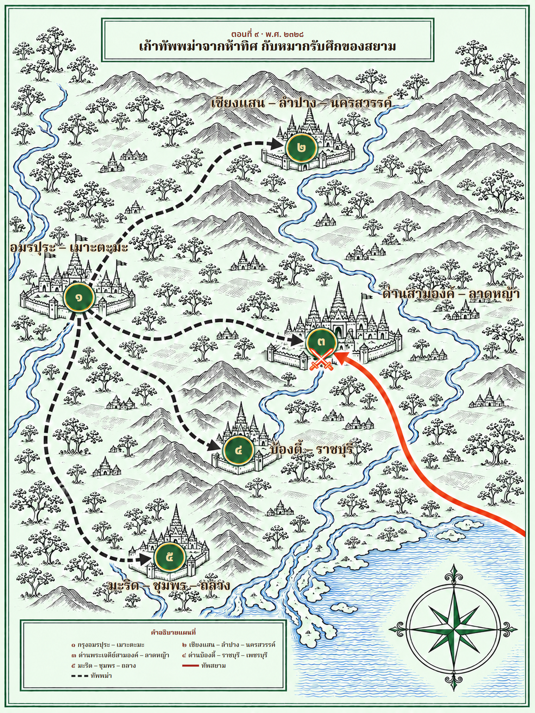

# ภาคที่ 3: สงครามเก้าทัพ (พ.ศ. 2327 – 2330)
## ตอนที่ 9: เก้าทัพจากห้าทิศ กระดานรับศึกแห่งกรุงรัตนโกสินทร์

---

### องก์ที่ 1: เปิดฉากแผ่นดินอายุสามขวบหน้าพายุเก้าทัพ

ลมหนาวต้นฤดูแล้งปลาย พ.ศ. 2328 (จุลศักราช 1147 ปีมะเส็ง สัปตศก) พัดผ่านแนวกำแพงอิฐที่เพิ่งก่อขึ้นใหม่บนฝั่งตะวันออกของแม่น้ำเจ้าพระยา ปูนฉาบตามป้อมปราการบางจุดเพิ่งแห้งสนิท คูพระนครด้านตะวันออกเพิ่งขุดเชื่อมตลอดแนวไม่นาน—**กรุงรัตนโกสินทร์** ในยามนั้นมีอายุเพียง **3 ปีเศษ**

ภายในท้องพระโรง **พระราชวังบวรสถานมงคล (วังหน้า)** ด้านทิศเหนือของท้องสนามหลวง **กรมพระราชวังบวรมหาสุรสิงหนาท** ทรงตรวจบัญชีรายชื่อหัวเมืองและจำนวนไพร่พลที่เกณฑ์เข้าพระนครได้จริงอย่างเคร่งเครียด ตัวเลขบนสมุดไทยขาวไม่ต่างจากสัญญาณเตือนภัย: หลังจากทำศึกต่อเนื่องมาตั้งแต่กรุงแตก พ.ศ. 2310 ผ่านสงครามอะแซหวุ่นกี้ ศึกเวียงจันทน์ ศึกกัมพูชา และเพิ่งระดมแรงงานก่อสร้างพระนครใหม่ สยามรวบรวมกำลังรบทั้งแผ่นดินได้ราว **70,000 นาย** (ตามตัวเลขใน *พระราชพงศาวดารกรุงรัตนโกสินทร์ รัชกาลที่ 1* และ *ไทยรบพม่า*)

แต่ข่าวกรองจากด่านชายแดนตะวันตกและเหนือกลับรายงานตรงกันว่า **พระเจ้าปดุง (โบดอพญา)** แห่งราชวงศ์คองบอง—ผู้เพิ่งทรงพิชิตอาณาจักร **ยะไข่ (อาระกัน)** ได้อย่างราบคาบและทรงสร้างราชธานีใหม่ที่ **กรุงอมรปุระ**—กำลังเคลื่อนทัพใหญ่ที่ระดมพลจากทั่วพม่า มอญ ไทใหญ่ และยะไข่ บุกเข้าตีสยามพร้อมกันถึง **9 กองทัพ จาก 5 ทิศทาง**!

นี่ไม่ใช่การส่งแม่ทัพหน้ามาหยั่งเชิงอย่างเมื่อสิบปีก่อน หากเป็นความพยายามครั้งใหญ่ที่สุดของราชวงศ์คองบองที่จะปิดบัญชีกรุงรัตนโกสินทร์ตั้งแต่ยังไม่ทันตั้งตัว และพระบาทสมเด็จพระพุทธยอดฟ้าจุฬาโลกมหาราชกับกรมพระราชวังบวรมหาสุรสิงหนาททรงตระหนักดีว่า หากใช้วิธีตั้งรับแบบเดิมของกรุงศรีอยุธยา แผ่นดินใหม่ย่อมตกอยู่ในวงล้อมทันที

---

### องก์ที่ 2: กระดานการเมืองและหลักฐาน

เมื่อกางแผนที่ภูมิภาคตั้งแต่เมืองอมรปุระและเมาะตะมะมาจนถึงลุ่มน้ำเจ้าพระยา ลุ่มน้ำโขง และคาบสมุทรปักษ์ใต้ แล้วตรวจสอบเทียบกันระหว่าง **พระราชพงศาวดารกรุงรัตนโกสินทร์ รัชกาลที่ 1**, **พงศาวดารเรื่องไทยรบพม่า**, และ **พงศาวดารพม่าราชวงศ์คองบอง (*Konbaung Set*)** จะเห็นกลไกทั้ง "แผนรุกเก้าทัพ" ของพระเจ้าปดุง และ "การแก้หมาก" ของสองพระองค์แห่งกรุงรัตนโกสินทร์

#### 1. โครงสร้าง 9 กองทัพจาก 5 ทิศทาง และข้อจำกัดของตัวเลขกำลังพล

เหตุใดพระเจ้าปดุงจึงทรงมั่นพระราชหฤทัยว่าศึก พ.ศ. 2328 จะเผด็จศึกสยามได้ในฤดูแล้งเดียว? คำตอบอยู่ที่ความสำเร็จในการพิชิต **ยะไข่** เมื่อ พ.ศ. 2327–2328 ซึ่งทำให้ราชสำนักอมรปุระมีทั้งขวัญกำลังใจ กำลังคน และเสบียงอาวุธเพิ่มขึ้นมหาศาล พระองค์จึงทรงวางแผนบีบสยามพร้อมกันจาก 5 ทิศทาง รวม 9 กองทัพ ดังที่ *พระราชพงศาวดารกรุงรัตนโกสินทร์ รัชกาลที่ 1* และ *ไทยรบพม่า* จำแนกไว้:

1. **ทิศใต้ (ทางทะเลอันดามันและมะริด):** **ทัพที่ 1** คุมพลราว 10,000 นาย (บางแห่งระบุ 14,000 นายเมื่อรวมทัพเรือ) เดิมโปรดให้แมงยีแมงข่องกยอเป็นแม่ทัพ แต่ภายหลังทรงลงโทษประหารชีวิตเพราะจัดหาเสบียงทัพหลวงไม่ทัน แล้วตั้ง **แกงหวุ่นแมงยี (เกงหวุ่นแมงยีมหาสีหสุระ)** มาคุมทัพแทน แบ่งทัพเรือให้ **ยี่หวุ่น** ตีหัวเมืองฝั่งตะวันตก (ตะกั่วป่า ตะกั่วทุ่ง ถลาง) ส่วนทัพบกตีข้ามคาบสมุทรเข้าชุมพร ไชยา นครศรีธรรมราช และสงขลา
2. **ทิศตะวันตกเฉียงใต้ (ด่านบ้องตี้ เมืองทวาย):** **ทัพที่ 2** นำโดย **อนอกแฝกคิดหวุ่น** กำลังพล 10,000 นาย ยกเข้าทางราชบุรีและเพชรบุรีเพื่อลงไปบรรจบกับทัพที่ 1 ทางภาคใต้
3. **ทิศเหนือ (เมืองเชียงแสนและล้านนา):** **ทัพที่ 3** นำโดย **สะโดศิริมหาอุจนา (เจ้าเมืองตองอู)** กำลังพล 30,000 นาย ยกจากเชียงแสนลงมาตีเมืองลำปาง หัวเมืองฝ่ายเหนือ และลุ่มน้ำเจ้าพระยาตอนบน
4. **ทิศตะวันตกเฉียงเหนือ (ด่านแม่ละเมา เมืองเมาะตะมะ–ตาก):** **ทัพที่ 9** นำโดย **นรธาจอข่อง** (และมีกำลังฝ่ายเหนือของ **เนเมียวสีหซุย** เคลื่อนเข้าแนวภาคเหนือตอนล่าง) กำลังพล 5,000 นาย ยกเข้าตีเมืองตากและหัวเมืองฝ่ายเหนือตอนล่างเพื่อเชื่อมกับทัพที่ 3
5. **ทิศตะวันตกสายกลาง (ด่านพระเจดีย์สามองค์ เมืองกาญจนบุรี) — 5 ทัพรวด:** สายนี้คือหมัดหนักที่สุดที่มุ่งตรงเข้าตีพระนคร ประกอบด้วย **ทัพที่ 4** ของ **เมียนหวุ่น** (11,000 นาย) เป็นทัพหน้า, **ทัพที่ 5** ของ **เมียนเมหวุ่น** (5,000 นาย) เป็นทัพหนุน, **ทัพที่ 6** ของ **ตะแคงกามะ** (เจ้าชายศิริธรรมราชา พระราชโอรส, 12,000 นาย) ตั้งที่ท่าดินแดง, **ทัพที่ 7** ของ **ตะแคงจักกุ (สะโดเมงสอ)** (พระราชโอรส, 11,000 นาย) ตั้งที่สามสบ, และ **ทัพที่ 8** คือ **ทัพหลวงของพระเจ้าปดุง** เอง (50,000 นาย)

เมื่อบวกตัวเลขตาม *ไทยรบพม่า* ทั้ง 9 กองทัพ จะได้รวม **144,000 นาย** (และใน *Konbaung Set* ก็บันทึกการระดมพลครั้งใหญ่ในระดับแสนกว่าคนเช่นเดียวกัน) อย่างไรก็ตาม นักประวัติศาสตร์สมัยใหม่ตั้งข้อสังเกตตรงกันว่า ตัวเลขหลักแสนในพงศาวดารโบราณมักรวมทั้งกำลังรบจริง ไพร่พลขนเสบียง คนเลี้ยงสัตว์พาหนะ และเป็นการนับตามเกณฑ์ระดมพลในบัญชีราชการ ซึ่งในทางปฏิบัติจริงจำนวนทหารถืออาวุธในสนามรบย่อมต่ำกว่าตัวเลขทางบัญชี—และยิ่งทัพใหญ่เท่าไร ภาระเรื่อง **"ข้าวปลาอาหารและน้ำดื่ม"** บนเส้นทางป่าเขาทุรกันดารก็จะยิ่งกลายเป็นจุดตายของกองทัพนั้นมากขึ้นเท่านั้น

#### 2. ปฏิเสธยุทธศาสตร์ตั้งรับในพระนคร: หมาก 4 ทัพของสยาม

เมื่อกำลังพลฝ่ายไทยมีเพียงราวครึ่งหนึ่งของฝ่ายพม่า (70,000 ต่อ 144,000 ตามตัวเลขพงศาวดาร) พระบาทสมเด็จพระพุทธยอดฟ้าจุฬาโลกมหาราชและกรมพระราชวังบวรมหาสุรสิงหนาททรงตระหนักถึงบทเรียนความพ่ายแพ้ของกรุงศรีอยุธยาใน พ.ศ. 2310 อย่างลึกซึ้ง—**หากปล่อยให้ข้าศึก 5 ทิศทางเดินทัพเข้ามาถึงชานพระนครได้พร้อมกันและยึดเสบียงตามหัวเมืองรอบนอกไว้ได้หมด การตั้งรับในกำแพงเมืองก็เท่ากับรอวันอดตาย**

ทั้งสองพระองค์จึงทรงตัดสินพระราชหฤทัยใช้ยุทธศาสตร์ใหม่ที่เรียกว่า **"สกัดปิดปากประตูชายแดน"** หรือเลือกทิ้งแนวรองชั่วคราวเพื่อทุ่มกำลังใส่จุดชี้ขาด โดยแบ่งกำลัง 70,000 นายออกเป็น **4 ทัพหลัก** ดังนี้:

- **ทัพที่ 1 (รับด้านเหนือ — นครสวรรค์):** โปรดให้ **สมเด็จพระเจ้าหลานเธอ เจ้าฟ้ากรมหลวงอนุรักษ์เทเวศร์** (ต่อมาคือ กรมพระราชวังบวรสถานพิมุข หรือวังหลัง) ทรงคุมกำลัง 15,000 นาย ยกขึ้นไปตั้งมั่นที่เมือง **นครสวรรค์** เพื่อขวางปากแม่น้ำเจ้าพระยาตอนบน ไม่ให้ทัพพม่าสายเชียงแสน–ลำปาง และสายด่านแม่ละเมาลงมาสมทบกับทัพหลวงได้
- **ทัพที่ 2 (รับด้านตะวันตกสายหลัก — ทุ่งลาดหญ้า กาญจนบุรี):** มอบหน้าที่หนักที่สุดให้ **กรมพระราชวังบวรมหาสุรสิงหนาท** เสด็จคุมกำลังมากที่สุดราว **30,000 นาย** ยกออกไปยันทัพหลวง 89,000 นายของพระเจ้าปดุงที่ **ด่านพระเจดีย์สามองค์** ตั้งค่ายขวางช่องทางออกของเทือกเขาตะนาวศรี ณ **ทุ่งลาดหญ้า** แขวงเมืองกาญจนบุรี
- **ทัพที่ 3 (ทัพหลวงในพระนคร — กองหนุนยุทธศาสตร์):** **พระบาทสมเด็จพระพุทธยอดฟ้าจุฬาโลกมหาราช** ทรงคุมกำลัง 20,000 นาย รักษาพระนครไว้เป็นกองหนุนกลาง พร้อมเคลื่อนที่ไปอุดแนวที่วิกฤตที่สุด ไม่ว่าจะเป็นด้านเหนือหรือด้านตะวันตก
- **ทัพที่ 4 (รับด้านราชบุรี):** **เจ้าพระยาธรรมา** และ **พระยายมราช** คุมกำลังราว 5,000 นาย ไปตั้งสกัดทัพที่ 2 ของพม่าที่จะเข้าทางด่านบ้องตี้ ณ เมือง **ราชบุรี** ส่วนหัวเมืองปักษ์ใต้ที่อยู่ไกลออกไปจำเป็นต้องปล่อยให้เจ้าเมืองท้องถิ่นต้านทานตามกำลังไปก่อนจนกว่าสมรภูมิหลักทางตะวันตกจะชี้ขาด

---

### องก์ที่ 3: จุดปะทะและรอยร้าวในแผนของพระเจ้าปดุง

แม้พม่าจะยังไม่ทันเข้าตีค่ายลาดหญ้าเต็มรูปแบบ แต่ปัญหาเชิงโครงสร้างของ **"สงครามเก้าทัพ"** ก็เริ่มปรากฏตั้งแต่ก่อนข้ามเข้าเขตทุ่งราบภาคกลางของสยาม

ในฝั่งพม่า เส้นทางสายกลางผ่าน **ด่านพระเจดีย์สามองค์** ลัดเลาะตามหุบเขาแคบของแม่น้ำแควน้อยและแม่น้ำแควใหญ่ มีที่ราบเพาะปลูกน้อยและลำเลียงเสบียงได้ช้ามาก การยัดกำลังพลถึง 5 กองทัพ (ตั้งแต่ทัพที่ 4 ถึงทัพที่ 8) ให้เดินเรียงแถวต่อกันเข้ามาในช่องเขาแคบสายเดียว ทำให้เกิดความแออัดอย่างรุนแรง เสบียงที่เกณฑ์จากเมืองเมาะตะมะส่งขึ้นมาถึงแนวหน้าไม่ทันความต้องการของคนนับหมื่น จนพระเจ้าปดุงต้องทรงลงพระอาญาประหารแม่ทัพส่งเสบียงทางใต้มาแล้วตั้งแต่ช่วงต้นศึก

ขณะเดียวกัน ข่าวจากแนวเหนือและใต้ก็เริ่มบ่งชี้ว่า "จังหวะเวลา" ของ 5 ทิศทางไม่พร้อมกัน:

- ทาง **เหนือ** ทัพที่ 3 ของพม่าต้องเสียเวลาติดพันอยู่ที่ **เมืองลำปาง** ซึ่ง **พระยากาวิละ** ปิดประตูเมืองสู้ต้านทานอย่างเหนียวแน่น และทัพหน้าบางส่วนที่ลงมาถึงแม่น้ำน่านก็ถูกทัพของกรมหลวงอนุรักษ์เทเวศร์คุมเชิงไว้ระหว่างนครสวรรค์–พิจิตร–ปากพิง
- ทาง **ใต้** แม้ทัพพม่าจะเข้าตีชุมพรและไชยาได้ แต่การรบฝั่งทะเลอันดามันและเกาะ **ถลาง** กำลังเจอการต่อต้านอย่างคาดไม่ถึงจากชาวเมืองท้องถิ่น ทำให้ทัพใต้ไม่อาจขึ้นเหนือมาบรรจบกับทัพราชบุรีได้ตามกำหนด

นั่นหมายความว่า ณ ปลาย พ.ศ. 2328 ชะตากรรมของสงครามเก้าทัพทั้งหมดแขวนอยู่บนเส้นทางเดียว—คือ **ทุ่งลาดหญ้า** ในหุบเขาเมืองกาญจนบุรี ที่ซึ่ง **กรมพระราชวังบวรมหาสุรสิงหนาท** เสด็จไปถึงก่อนและทรงเลือกชัยภูมิรอรับหน้าทัพหลวงของพระเจ้าปดุงเอาไว้แล้ว

---

### องก์ที่ 4: แรงสะเทือนก่อนเสียงปืนแรกที่ทุ่งลาดหญ้า

เมื่อทัพหน้าของกรมพระราชวังบวรมหาสุรสิงหนาทตั้งค่ายปักขวากขุดสนามเพลาะขวางช่องทางเดินทัพที่ทุ่งลาดหญ้า เชิงเขาบรรทัดได้สำเร็จ เกมกระดานทั้งแผ่นดินก็เปลี่ยนโฉมหน้าทันที

พระเจ้าปดุงทรงคาดหวังว่าจะเดินทัพทะลุออกจากด่านพระเจดีย์สามองค์ลงสู่ทุ่งราบภาคกลางได้ง่ายเหมือนในสงครามเสียกรุง พ.ศ. 2310 ทว่าเมื่อกองหน้าของเมียนหวุ่นและเมียนเมหวุ่นโผล่พ้นแนวเขาสู่ทุ่งลาดหญ้า กลับพบแนวค่ายมั่นของวังหน้าที่ปิดปากทางออกเอาไว้ทุกตารางวา โดยมีทัพหลวงของรัชกาลที่ 1 พร้อมหนุนจากเบื้องหลัง

ในศึกที่ฝ่ายข้าศึกมีจำนวนคนมากกว่า แต่ติดอยู่ในหุบเขาที่ไม่มีข้าวและเสบียงเพียงพอ เวลาไม่ได้อยู่ข้างพระเจ้าปดุง—และกรมพระราชวังบวรมหาสุรสิงหนาททรงเตรียมกลศึกที่ไม่ได้ตัดสินกันด้วยการเอาทหารเข้าชนตรงๆ หากเป็นการ **ตัดเส้นเลือดใหญ่แห่งเสบียงและการลวงขวัญข้าศึก** ที่จะทำให้ทัพมหึมาของราชวงศ์คองบองพังทลายลงด้วยความหิวโหย

**จบตอนที่ 9**

*(ติดตามต่อใน ตอนที่ 10: ลาดหญ้า ศึกตัดเสบียงที่ตัดสินสงคราม)*
