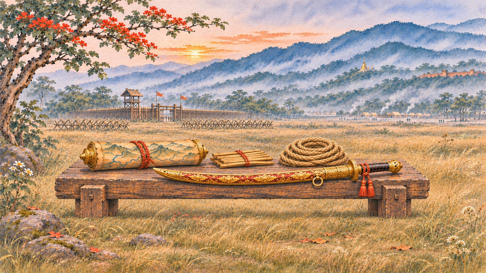
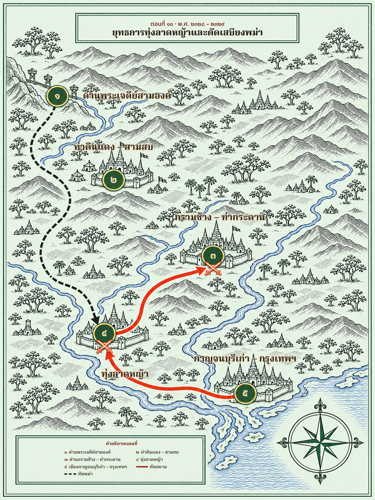

# ภาคที่ 3: สงครามเก้าทัพ (พ.ศ. 2327 – 2330)
## ตอนที่ 10: ลาดหญ้า ศึกตัดเสบียงที่ตัดสินสงคราม

---

### องก์ที่ 1: เปิดฉากหน้าค่ายเชิงเขาบรรทัด ทุ่งลาดหญ้า

แสงแดดยามเช้าในฤดูหนาวเดือนยี่ จุลศักราช 1147 (มกราคม พ.ศ. 2328 / ค.ศ. 1786) สาดส่องลงบนยอดหญ้าแห้งของ **ทุ่งลาดหญ้า** เชิงเทือกเขาบรรทัด เหนือเมืองกาญจนบุรีเก่าขึ้นไป

บนหอรบไม้ซุงภายในค่ายหลักฝ่ายสยาม **กรมพระราชวังบวรมหาสุรสิงหนาท** ทรงทอดพระเนตรไปยังเชิงเขาเบื้องหน้า ซึ่งปรากฏแนวค่ายพม่าตั้งเรียงรายยาวเหยียดตามสันเขาและริมลำน้ำแควใหญ่ ควันไฟจากเตาหุงข้าวของทหารพม่าลอยขึ้นเป็นสายบางๆ กว่าเมื่อเดือนก่อนอย่างเห็นได้ชัด—สัญญาณทางสนามรบที่แม่ทัพผู้ผ่านศึกมาเกือบ 20 ปีอย่างพระองค์ทรงอ่านออกได้ทันทีว่า **ข้างบนนั้นกำลังขาดเสบียง!**

เบื้องหลังแนวค่ายลาดหญ้าคือทางเดินราบตรงเข้าสู่สุพรรณบุรี นครชัยศรี และพระนคร หากแนวรับของวังหน้าแตก กองทัพหลวงของพระเจ้าปดุงจะหลุดลงสู่ทุ่งราบภาคกลางทันที แต่เบื้องหน้าของทัพพม่ากลับเป็นหุบเขาแคบที่เส้นทางส่งเสบียงต้องลัดเลาะย้อนกลับไปตามเทือกเขาตะนาวศรีสู่เมืองเมาะตะมะเป็นระยะทางหลายร้อยกิโลเมตร

ณ สมรภูมิแห่งนี้ กรมพระราชวังบวรมหาสุรสิงหนาทไม่ทรงสั่งให้ไพร่พล 30,000 นายบุกปีนเขาขึ้นไปตีค่ายพม่าตรงๆ หากทรงเปิดการรบที่อาศัยความอดทน กลลวง และการตัดเส้นทางลำเลียง—ยุทธวิธีที่ต่อมาถูกจารึกว่าเป็นการศึกครั้งสำคัญที่สุดในพระชนม์ชีพของพระองค์

---

### องก์ที่ 2: กระดานการเมืองและหลักฐาน

เมื่อตรวจสอบเหตุการณ์ที่ทุ่งลาดหญ้าจาก **พระราชพงศาวดารกรุงรัตนโกสินทร์ รัชกาลที่ 1** และ **ไทยรบพม่า** (พระนิพนธ์สมเด็จฯ กรมพระยาดำรงราชานุภาพ) จะพบคำอธิบายที่สอดรับกันเป็นเหตุเป็นผลอย่างยิ่งว่า เหตุใดกองทัพฝ่ายสยามราว 30,000 นาย จึงสามารถยันกำลังพม่าสายด่านพระเจดีย์สามองค์ทั้ง 5 กองทัพ (คือทัพที่ 4–8 รวม **89,000 นาย** ซึ่งเป็นกำลังส่วนหลักจากยอดรวม 9 ทัพ 144,000 นาย โดยมีทัพหลวงของพระเจ้าปดุง 50,000 นายตั้งคุมเชิงอยู่แนวหลัง และมีทัพหน้าของเมียนหวุ่นกับเมียนเมหวุ่นรวม 16,000 นายเข้าประชิดลาดหญ้า) จนฝ่ายพม่าต้องถอยทัพกลับไปได้โดยไม่ต้องเสี่ยงแตกหักกลางทุ่ง

#### 1. ยุทธวิธี 3 ชั้นที่กรมพระราชวังบวรฯ ทรงใช้ที่ลาดหญ้า

ใน *พระราชพงศาวดารกรุงรัตนโกสินทร์ รัชกาลที่ 1* และ *ไทยรบพม่า* บันทึกหมากการศึกหลักของกรมพระราชวังบวรมหาสุรสิงหนาทไว้ 2 ประการแรกอย่างชัดเจน พร้อมด้วยกลลวงอีก 1 ประการที่แพร่หลายในงานอธิบายประวัติศาสตร์ชั้นหลัง (โดยแยกข้อเท็จจริงชั้นต้นออกจากรายละเอียดชั้นหลังให้ชัดเจน):

1. **อุดปากตรอกด้วยค่ายปีกกา:** ตาม *พระราชพงศาวดารกรุงรัตนโกสินทร์ รัชกาลที่ 1* และ *ไทยรบพม่า* พระองค์ทรงจัดแนวค่ายชักปีกกาขวางตลอดทุ่งลาดหญ้าเชื่อมระหว่างชายเขาและลำน้ำแควใหญ่ เพื่อสกัดทัพหน้าของเมียนหวุ่น (11,000 นาย) และเมียนเมหวุ่น (5,000 นาย) มิให้ขยายแนวรุกออกสู่ทุ่งราบ (ก่อนหน้านั้นทรงให้ **พระยามหาโยธา (เจ่ง)** คุมกองอาสารามัญ 3,000 นายไปตั้งขัดตาทัพหน้าอยู่ที่ **ด่านกรามช้าง** แล้วถอยร่นลงมาสมทบที่ลาดหญ้า)
2. **ส่งกองโจรอ้อมหลังตัดเส้นเสบียง:** *พระราชพงศาวดารกรุงรัตนโกสินทร์ รัชกาลที่ 1* และ *ไทยรบพม่า* บันทึกตรงกันว่า ทรงแต่งตั้ง **พระองค์เจ้าขุนเณร** เป็นนายกองโจรนำกำลังเข้าไปปฏิบัติการซุ่มโจมตีแถบ **พุไคร้** และ **ท่ากระดาน** ดักปล้นและทำลายขบวนลำเลียงเสบียงของพม่าอย่างต่อเนื่องจนข้าวปลาอาหารจากเมาะตะมะส่งขึ้นมาถึงแนวหน้าไม่ได้
3. **กลลวงกำลังพลเข้าออกค่าย:** สำหรับเรื่องอุบายจัดกำลังทหารลอบเดินออกจากค่ายในเวลากลางคืนแล้วถือธงทิวเดินกลับเข้าค่ายในเวลากลางวันเพื่อลวงให้ฝ่ายพม่าเข้าใจว่ากรุงรัตนโกสินทร์มีทัพหนุนเข้ามาเติมไม่ขาดสาย เป็นรายละเอียดเชิงกลศึกที่แพร่หลายในงานอธิบายและเล่าเรื่องประวัติศาสตร์ชั้นหลังต่อจาก *ไทยรบพม่า* จึงควรระบุแยกว่าเป็นภาพการรบตามสายคำอธิบายประวัติศาสตร์ยุคหลัง

#### 2. เหตุการณ์รัชกาลที่ 1 เสด็จขึ้นไปตรวจราชการทัพที่ลาดหญ้า

ใน *พระราชพงศาวดารกรุงรัตนโกสินทร์ รัชกาลที่ 1* และ *ไทยรบพม่า* บันทึกเหตุการณ์ช่วงกลางศึกประมาณ **เดือนยี่ ขึ้น 9 ค่ำ ปีมะเส็ง จุลศักราช 1147** (มกราคม พ.ศ. 2328 / ค.ศ. 1786) ว่า เมื่อการคุมเชิงที่ลาดหญ้ายืดเยื้อมาหลายสัปดาห์ **พระบาทสมเด็จพระพุทธยอดฟ้าจุฬาโลกมหาราช** ทรงพระวิตกว่าการศึกยังไม่เด็ดขาด จึงเสด็จพระราชดำเนินพร้อมทัพหลวงราว 20,000 นายขึ้นไปยังทุ่งลาดหญ้า

เมื่อเสด็จไปถึง **กรมพระราชวังบวรมหาสุรสิงหนาท** กราบบังคมทูลชี้แจงในสาระสำคัญว่า กองทัพพม่ากำลังขาดแคลนเสบียงอาหารและอดอยากใกล้จะแตกพ่ายอยู่แล้ว ขออย่าได้ทรงพระวิตก พระองค์จะทรงจัดการตีทัพพม่าให้เสร็จสิ้นเอง พระบาทสมเด็จพระพุทธยอดฟ้าจุฬาโลกมหาราชจึงทรงนำทัพหลวงเสด็จพระราชดำเนินกลับพระนคร (ทั้งนี้ หนังสือ *กระดานศึกวังหน้า* ยึดเฉพาะเนื้อความหลักที่ปรากฏในพระราชพงศาวดารและ *ไทยรบพม่า* โดยไม่เติมบทสนทนาที่ไม่มีในหลักฐานชั้นต้น)

---

### องก์ที่ 3: จุดปะทะและวันแตกหักที่ทุ่งลาดหญ้า

เมื่อการปิดล้อมตัดเสบียงยืดเยื้อข้ามเข้าสู่เดือนสาม จุลศักราช 1147 (กุมภาพันธ์ พ.ศ. 2328 / ค.ศ. 1786) *พระราชพงศาวดารกรุงรัตนโกสินทร์ รัชกาลที่ 1* และ *ไทยรบพม่า* ระบุว่าสภาพในค่ายพม่าบนเทือกเขากาญจนบุรีมาถึงจุดวิกฤตจากความอดอยากอย่างหนัก จนทหารพม่าต้องขุดหาเผือกมันและรากไม้ รวมถึงฆ่าสัตว์พาหนะในค่ายกินประทังชีวิต ขวัญกำลังใจของแนวหน้าเมียนหวุ่นและเมียนเมหวุ่นทรุดลงอย่างรวดเร็ว

ในฝั่งสยาม กรมพระราชวังบวรมหาสุรสิงหนาททรงจับสัญญาณความอ่อนล้าของข้าศึกได้ครบถ้วน จึงทรงมีพระราชบัณฑูรให้เปิดฉาก **รุกใหญ่พร้อมกันทุกปีก** เข้าตีค่ายหน้าของพม่าตามสันเขา

- กองกำลังฝ่ายหน้าของไทยนำโดยขุนพลวังหน้า—เช่น **พระยากลาโหมราชเสนา**, **พระยาจ่าแสนยากร**, **พระยามหาโยธา**, และกองทหารปืนใหญ่—บุกทะลวงเข้าใส่ค่ายปีกกาของพม่าพร้อมกันทั้งทางหน้าค่ายและด้านข้าง
- ฝ่ายพม่าที่หิวโหยและหมดกระสุนดินดำไม่อาจต้านทานแรงบุกประชิดได้ ค่ายของเมียนหวุ่นและเมียนเมหวุ่นพังทลายลงตามลำดับ ทหารพม่าแตกหนีถอยร่นย้อนกลับขึ้นเขามุ่งหน้าด่านพระเจดีย์สามองค์
- กองทัพวังหน้าและกองโจรของพระองค์เจ้าขุนเณรไล่ตีกระหนาบตลอดเส้นทางหุบเขา ทำให้ทัพหนุนของตะแคงกามะที่ท่าดินแดง ตะแคงจักกุที่สามสบ และทัพหลวงของพระเจ้าปดุงเองต้องถอนกำลังกลับออกไปพ้นเขตสยามทั้งหมด

---

### องก์ที่ 4: แรงสะเทือนและเสียงปืนใหญ่ที่ยังไม่เงียบทางปักษ์ใต้

ชัยชนะที่ **ทุ่งลาดหญ้า** ในเดือนกุมภาพันธ์ พ.ศ. 2328 (ค.ศ. 1786) คือจุดหักเหที่ช่วยชีวิตกรุงรัตนโกสินทร์วัย 3 ปีไว้ได้ ทันทีที่ทัพหลวงของพระเจ้าปดุงพังทลาย ทัพที่ 2 ทางด่านบ้องตี้ก็ถอยกลับ และในเวลาไล่เลี่ยกัน **พระบาทสมเด็จพระพุทธยอดฟ้าจุฬาโลกมหาราช** พร้อม **กรมหลวงอนุรักษ์เทเวศร์** ก็ตีค่ายพม่าของเนเมียวสีหซุยที่ **ปากพิง** แตกยับเยิน คลี่คลายแนวรบภาคเหนือลงได้เกือบทั้งหมด

ทว่าในขณะที่ภาคกลางและภาคเหนือกำลังเฉลิมฉลองชัยชนะ ม้าเร็วจากปักษ์ใต้กลับนำข่าวร้ายขึ้นมาทูลเกล้าฯ ถวาย: **ทัพที่ 1 ของแกงหวุ่นแมงยีไม่ได้ถอยตามทัพหลวง!** กองทัพพม่าสายใต้ตีเมือง **ชุมพร** และ **ไชยา** แตกแล้ว ลุกลามต่อไปถึง **นครศรีธรรมราช** และแยกทัพเรือของ **ยี่หวุ่น** เข้าปิดล้อมเกาะ **ถลาง** ในทะเลอันดามัน

หากปล่อยให้พม่ายึดครองคาบสมุทรปักษ์ใต้ไว้ได้ ภาคใต้ทั้งหมดอาจหลุดจากอำนาจกรุงรัตนโกสินทร์ และกลายเป็นฐานส่งกำลังของพระเจ้าปดุงในปีถัดไป—ดังนั้น เมื่อเพิ่งเสร็จศึกที่ลาดหญ้าได้ไม่นาน **กรมพระราชวังบวรมหาสุรสิงหนาท** จึงทรงนำกองทัพเคลื่อนพลลงสู่สมรภูมิภาคใต้ทันที

**จบตอนที่ 10**

*(ติดตามต่อใน ตอนที่ 11: ทัพวังหน้าลงใต้ จากถลางถึงปัตตานี)*
