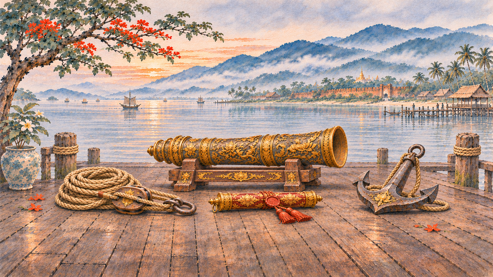
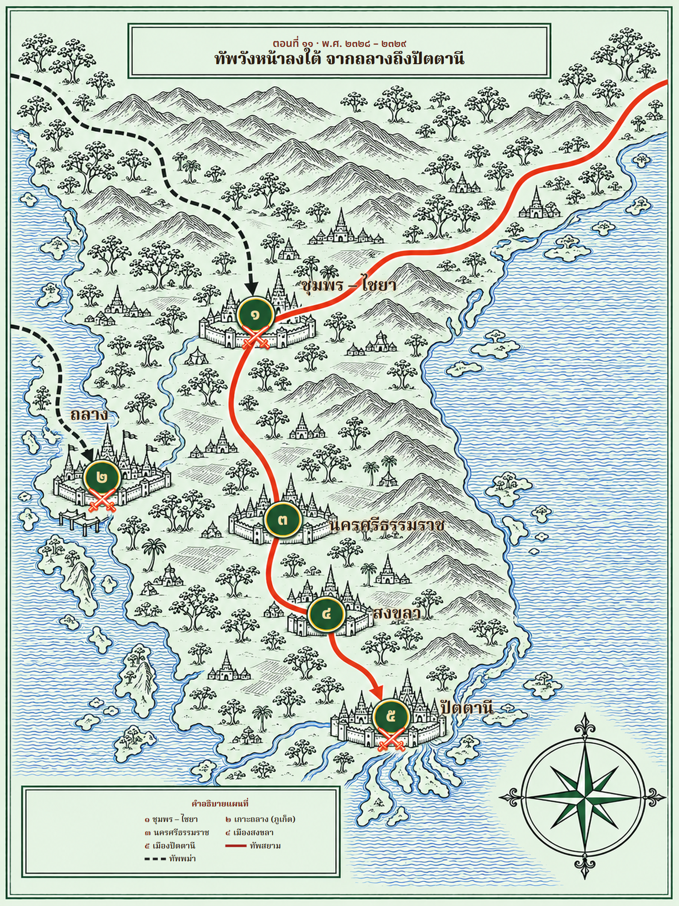

# ภาคที่ 3: สงครามเก้าทัพ (พ.ศ. 2327 – 2330)
## ตอนที่ 11: ทัพวังหน้าลงใต้ จากถลางถึงปัตตานี

---

### องก์ที่ 1: เปิดฉากคลื่นลมปักษ์ใต้หลังชัยชนะที่ลาดหญ้า

เสียงโห่ร้องแห่งชัยชนะที่ทุ่งลาดหญ้ายังไม่ทันจางลง ลมมรสุมตะวันออกเฉียงเหนือในปลายเดือนสี่ ปีมะเส็ง จุลศักราช 1147 (เดือนมีนาคม ค.ศ. 1786 — ปลาย พ.ศ. 2328 แบบนับศักราชเดิม หรือต้น พ.ศ. 2329 ตามปฏิทินสากล) ก็พาเรือรบและเรือลำเลียงในขบวนทัพของ **กรมพระราชวังบวรมหาสุรสิงหนาท** แล่นลงใต้เลียบชายฝั่งอ่าวไทยอย่างเร่งด่วน

ตลอดหลายเดือนที่กรุงเทพฯ ทุ่มกำลังทั้งหมดยันทัพหลวงของพระเจ้าปดุงอยู่ทางตะวันตกและเหนือ **ทัพที่ 1 ของพม่า** นำโดย **แกงหวุ่นแมงยี** (มหาสีหสุระ) ซึ่งยกออกจากเมืองมะริดตั้งแต่ต้นสงครามเก้าทัพได้แผ่แสนยานุภาพเข้าตีหัวเมืองปักษ์ใต้จนปั่นป่วนไปทั่วทั้งคาบสมุทร เมืองชุมพรและเมืองไชยาถูกตีแตกและเผาทำลาย นครศรีธรรมราชต้องอพยพผู้คนหนีเข้าป่า ขณะที่ฝั่งทะเลอันดามัน กองเรือของ **ยี่หวุ่น** ก็ยกเข้าปิดล้อมเกาะ **ถลาง**

สำหรับกรมพระราชวังบวรมหาสุรสิงหนาท การเสด็จลงใต้ในครั้งนี้มีเดิมพัน 2 ชั้นซ้อนกัน: ชั้นแรกคือ **การขับไล่ทัพพม่าสายใต้ให้พ้นคาบสมุทร** ก่อนที่ฤดูฝนจะตัดเส้นทางเดินทัพ และชั้นที่สองคือ **การจัดระเบียบความมั่นคงของหัวเมืองปักษ์ใต้และหัวเมืองมลายู** เพื่อไม่ให้เกิดช่องโหว่ทางยุทธศาสตร์หลังบ้านของราชอาณาจักรอีกต่อไป

---

### องก์ที่ 2: กระดานการเมืองและหลักฐาน

เมื่อกางแผนที่คาบสมุทรมลายูตั้งแต่ชุมพรลงไปจนถึงปัตตานีและไทรบุรี แล้วตรวจสอบเทียบกันระหว่าง **พระราชพงศาวดารกรุงรัตนโกสินทร์ รัชกาลที่ 1**, **พงศาวดารเมืองถลาง**, **จดหมายเหตุท้าวเทพกระษัตรี–ฟรานซิส ไลต์**, และ **พงศาวดารเมืองปัตตานี** จะเห็นภาพความจริงในภาคสนามที่ซับซ้อนกว่าคำเล่าลือทั่วไป

#### 1. แนวฝั่งตะวันตก (ถลาง): ชัยชนะท้องถิ่นก่อนทัพกรุงลงมาถึง

ในฝั่งทะเลอันดามัน **ยี่หวุ่น** แม่ทัพเรือพม่าคุมกำลังราว 3,000 นาย ตีเมืองตะกั่วป่าและตะกั่วทุ่งแตกแล้วยกข้ามมาล้อม **เมืองถลาง (ภูเก็ต)** ในจังหวะวิกฤตที่สุด—เพราะเจ้าเมืองถลางเพิ่งถึงแก่อนิจกรรมลงพอดี

**คุณหญิงจัน** ภริยาเจ้าเมือง กับ **นางมุก** ผู้เป็นน้องสาว (ซึ่งภายหลังได้รับพระราชทานบรรดาศักดิ์เป็น **ท้าวเทพกระษัตรี** และ **ท้าวศรีสุนทร**) ร่วมกับกรมการเมืองและราษฎรชาวถลางจัดตั้งค่ายป้องกัน รวบรวมกำลังหญิง–ชายช่วยกันตรึงแนวรบและลวงกำลังข้าศึกนานราว 1 เดือน จนทัพเรือของยี่หวุ่นขาดเสบียงอาหารและไม่อาจหักเข้าเมืองได้ จึงจำต้องถอนทัพกลับไปทางมะริดในกลางเดือนมีนาคม ค.ศ. 1786

หลักฐานร่วมสมัยชิ้นสำคัญที่ยืนยันบริบทความยากลำบากของเมืองถลางในเวลานั้นคือ **จดหมายโต้ตอบระหว่างท้าวเทพกระษัตรีกับกัปตันฟรานซิส ไลต์ (Francis Light หรือพระยาราชกปิตัน)** พ่อค้าและข้าราชการอังกฤษซึ่งเคยค้าดีบุกอยู่ที่บ้านท่าเรือบนเกาะถลางและเพิ่งย้ายกิจการไปอยู่แถบไทรบุรี (ก่อนบุกเบิกเกาะปีนังในปีเดียวกันนั้น) จดหมายเหตุชุดนี้สะท้อนทั้งสายสัมพันธ์ทางการค้าและการเมืองอันใกล้ชิดในภูมิภาค รวมถึงสภาพความบอบช้ำและภาวะขาดแคลนเสบียงอาหารของราษฎรชาวถลางหลังรอดพ้นการปิดล้อมของพม่าได้สำเร็จด้วยกำลังตนเอง ก่อนที่กองทัพจากกรุงเทพฯ จะเคลื่อนลงมาถึงฝั่งคาบสมุทร

#### 2. มุมมองสองด้านในเรื่อง "ปัตตานี" พ.ศ. 2329

หากหัวเมืองไทยตอนบนมองการเดินทัพลงสู่ปัตตานีว่าเป็นภารกิจรวบรวมหัวเมืองประเทศราชหลังสงครามเก้าทัพ ในอีกด้านหนึ่ง *พงศาวดารเมืองปัตตานี* และความทรงจำท้องถิ่นมลายูให้ภาพที่แตกต่างกันอย่างชัดเจน

- **มุมมองราชสำนักกรุงรัตนโกสินทร์:** ตาม *พระราชพงศาวดารกรุงรัตนโกสินทร์ รัชกาลที่ 1* เมื่อราชสำนักสยามตีทัพพม่าที่ไชยาแตกและลงมาจัดการนครศรีธรรมราชแล้ว กรมพระราชวังบวรมหาสุรสิงหนาทเสด็จไปประทับที่เมือง **สงขลา** เพื่อเรียกหัวเมืองประเทศราชมลายูที่เคยขึ้นกับกรุงศรีอยุธยาเข้ามาสวามิภักดิ์ตามราชประเพณีเดิม โดยเมือง **ไทรบุรี** และ **ตรังกานู** ยอมส่งเครื่องราชบรรณาการเข้ามาอ่อนน้อม มีเพียง **ปัตตานี** ภายใต้การปกครองของ **สุลต่านมูฮัมหมัด (พระยาตานี)** ที่ไม่ยอมจำนน ฝ่ายสยามจึงถือว่าเป็นการแข็งเมืองและจำเป็นต้องใช้กำลังปราบปรามเพื่อความมั่นคงของพรมแดนใต้
- **มุมมองฝ่ายปัตตานี:** หลังกรุงศรีอยุธยาเสียแก่พม่าใน พ.ศ. 2310 รัฐสุลต่านปัตตานีอยู่ในฐานะรัฐมลายูอิสระทางใต้ที่ปกครองตนเองมาต่อเนื่องเกือบ 20 ปี การที่ราชธานีใหม่ในลุ่มน้ำเจ้าพระยาส่งกองทัพขนาดใหญ่ลงมาบังคับให้ยอมรับอำนาจจึงถูกมองเป็นการรุกรานอธิปไตยของบ้านเมือง ทำให้สุลต่านมูฮัมหมัดตัดสินใจนำกำลังชาวปัตตานีต่อสู้ป้องกันเมืองอย่างเต็มที่ แม้ทราบดีว่ามีกำลังน้อยกว่ามากก็ตาม

การอ่านหลักฐานทั้งสองฝ่ายควบคู่กันจึงช่วยให้เข้าใจทั้งเหตุผลเชิงภูมิรัฐศาสตร์ของกรุงเทพฯ และความสูญเสียอันหนักหน่วงที่เกิดขึ้นกับผู้คนในปัตตานีอย่างเป็นธรรม

---

### องก์ที่ 3: จุดปะทะตั้งแต่ไชยา–นครศรีธรรมราชถึงกรือเซะ ปัตตานี

#### 1. ตีทัพพม่าแตกที่ไชยา และการตัดสินคดีเจ้าพระยานคร (พัฒน์)

เมื่อกองทัพของกรมพระราชวังบวรมหาสุรสิงหนาทเสด็จมาถึงเมือง **ชุมพร** พม่าที่ยึดเมืองอยู่ต่างถอยร่นลงไปรวมตัวกันที่ **ไชยา** พระองค์จึงทรงมีพระราชบัณฑูรให้ทัพหน้าของ **พระยากลาโหมราชเสนา** และ **พระยาจ่าแสนยากร** รุกเข้าตีค่ายพม่าของ **เนเมียวคุงนะรัต** ณ เมืองไชยา

การรบที่ไชยาดำเนินไปอย่างเฉียบขาด ฝ่ายพม่าที่ถูกตัดขาดจากทัพหลวงของพระเจ้าปดุงตั้งแต่หลังศึกลาดหญ้าไม่อาจต้านทานกองทัพวังหน้าได้ ค่ายพม่าแตกพ่าย ทหารพม่าหนีกระเจิงข้ามเทือกเขาตะนาวศรีกลับไปทางมะริดจนหมดสิ้น แกงหวุ่นแมงยีแม่ทัพใหญ่ฝั่งใต้เองก็ต้องถอนกำลังกลับออกนอกเขตสยามในที่สุด

จากไชยา กรมพระราชวังบวรมหาสุรสิงหนาทเสด็จต่อไปยัง **เมืองนครศรีธรรมราช** ทรงเรียกตัว **เจ้าพระยานครศรีธรรมราช (พัฒน์)** ซึ่งอพยพหลบหนีออกจากเมืองระหว่างที่พม่ารุกมาเข้าเฝ้า เพื่อทรงไต่สวนข้อเท็จจริง

แม้แม่ทัพที่หลบหนีข้าศึกมักมีโทษหนักถึงประหารชีวิตในยามสงคราม แต่เมื่อทรงสอบสวนและทรงวินิจฉัยตามเหตุการณ์จริงแล้ว พบว่าเมืองนครศรีธรรมราชมีไพร่พลน้อยกว่าทัพพม่าหลายเท่า ซ้ำยังถูกข่าวลวงของพม่าที่ประกาศว่ากรุงเทพฯ เสียเมืองแล้ว การทิ้งเมืองเพื่อรักษาผู้คนและไม่ยอมจำนนต่อพม่าจึงมีเหตุอันควรรับฟังได้ พระองค์จึงทรงพระกรุณา **ภาคทัณฑ์ไว้ชีวิต** แล้วโปรดให้เจ้าพระยานคร (พัฒน์) รวบรวมราษฎรกลับมาฟื้นฟูบ้านเมืองตามเดิม (ในการเสด็จศึกภาคใต้ พ.ศ. 2329 นี้ กรมพระราชวังบวรฯ ยังทรงนิพนธ์วรรณกรรมอิงเหตุการณ์สงครามเรื่อง *เพลงยาวรบพม่าที่นครศรีธรรมราช* เอาไว้ด้วย)

#### 2. ยุทธการที่ปัตตานีและตำนานปืนใหญ่ "พญาตานี"

เมื่อภาคใต้ตอนบนปลอดจากทัพพม่าแล้ว ราวกลางถึงปลาย พ.ศ. 2329 กรมพระราชวังบวรมหาสุรสิงหนาทจึงเสด็จนำทัพลงไปยังเมือง **สงขลา** และมีพระราชบัณฑูรให้ทัพหน้า—นำโดย **พระยากลาโหมราชเสนา** และ **พระยาจ่าแสนยากร**—ยกเข้าตีเมือง **ปัตตานี** ทางบกและทางเรือประสานกัน

กองกำลังของปัตตานีภายใต้ **สุลต่านมูฮัมหมัด** ตั้งแนวรับอย่างเหนียวแน่นบริเวณตัวเมืองและมัสยิด **กรือเซะ** ทว่าด้วยกำลังพลและอาวุธปืนใหญ่ที่ฝ่ายสยามมีเหนือกว่า กองทัพหน้าของวังหน้าก็สามารถตีฝ่าแนวป้องกันเข้าเมืองปัตตานีได้สำเร็จ สุลต่านมูฮัมหมัดสิ้นพระชนม์ในสนามรบ เมืองปัตตานีได้รับความเสียหายอย่างหนัก ผู้คนและเชลยศึกชาวมลายูจำนวนมากถูกกวาดต้อนขึ้นไปยังกรุงเทพมหานคร และเมืองปัตตานีต้องยอมรับสถานะเมืองประเทศราชของกรุงรัตนโกสินทร์ตั้งแต่นั้น (ภายหลังเมื่อฟื้นฟูบ้านเมือง **เต็งกูลามีเด็น** ได้ย้ายศูนย์กลางการปกครองออกจากย่านกรือเซะไปยังพื้นที่ใหม่)

ท่ามกลางยุทธภัณฑ์ที่กองทัพสยามยึดได้จากปัตตานี มี **ปืนใหญ่ทองเหลืองขนาดมหึมา** ซึ่งหล่อขึ้นตั้งแต่ยุคที่ปัตตานีรุ่งเรืองในสมัยรายาบีรูอยู่ด้วย ได้แก่ปืนใหญ่ **ศรีปัตตานี** (ต่อมาจารึกนามว่า **พญาตานี**) และ **ศรีนครา** (ส่วนปืนใหญ่ **มหาเลลา** อีกกระบอกหนึ่งสูญหายไปในคราวศึก) กรมพระราชวังบวรฯ ทรงให้ชักลากปืนใหญ่ศรีปัตตานีและศรีนคราลงเรือรบนำกลับพระนคร ทว่าเรือลำเลียงปืนใหญ่ **ศรีนครา** ประสบคลื่นลมหรืออุบัติเหตุจมลงในอ่าวปัตตานี คงเหลือแต่ปืนใหญ่ **พญาตานี** ที่นำกลับขึ้นมายังกรุงเทพมหานครได้สำเร็จ และต่อมาถูกนำไปตั้งไว้หน้าศาลาว่าการกระทรวงกลาโหมจนถึงปัจจุบัน

---

### องก์ที่ 4: แรงสะเทือนจากปักษ์ใต้สู่ข่าวศึกใหม่ที่สังขละบุรี

เมื่อกรมพระราชวังบวรมหาสุรสิงหนาทเสด็จยกทัพกลับคืนสู่กรุงเทพมหานครใน พ.ศ. 2329 แผนที่ความมั่นคงของกรุงรัตนโกสินทร์ก็เปลี่ยนไปอย่างสิ้นเชิง: ตั้งแต่หัวเมืองล้านนาลงมาจนถึงปักษ์ใต้และมลายูตอนบน ล้วนกลับเข้ามาอยู่ใต้ร่มอำนาจของพระนครใหม่อีกครั้ง

สำหรับผู้คนในภาคใต้โดยเฉพาะถลางและปัตตานี ปี พ.ศ. 2328–2329 ทิ้งรอยแผลจากสงครามและการพลัดพรากไว้ยาวนาน ขณะที่ในกรุงอมรปุระ **พระเจ้าปดุง** ไม่ทรงยอมรับความอับอายจากการถอยทัพในสงครามเก้าทัพ พระองค์ทรงประเมินบทเรียนใหม่ทั้งหมด—เลิกการแบ่งเก้าทัพจากห้าทิศทาง แล้วทุ่มกำลังก้อนใหญ่เพียงสายเดียวข้าม **ด่านพระเจดีย์สามองค์** เข้ามาตั้งฐานถาวรที่ **ท่าดินแดง** และ **สามสบ** ในปลาย พ.ศ. 2329 เพื่อรอเปิดศึกตัดสินอีกครั้งในฤดูแล้งถัดไป

**จบตอนที่ 11**

*(ติดตามต่อใน ตอนที่ 12: ศึกท่าดินแดง ปิดฉากการรุกของพระเจ้าปดุง)*
