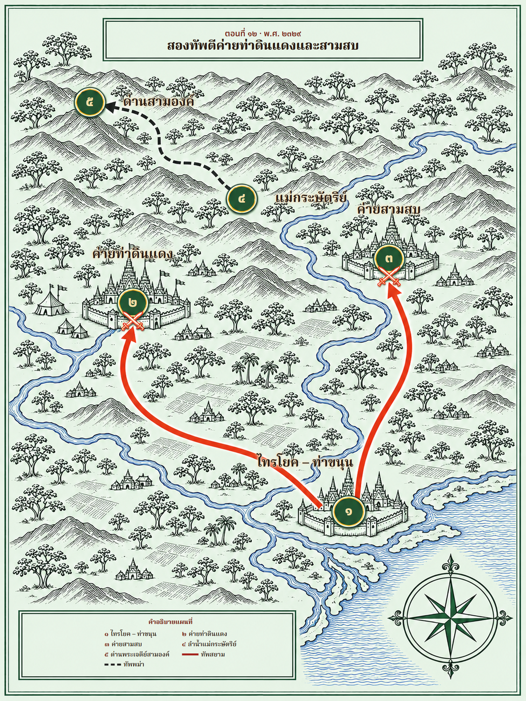

# ภาคที่ 3: สงครามเก้าทัพ (พ.ศ. 2327 – 2330)
## ตอนที่ 12: ศึกท่าดินแดง ปิดฉากการรุกของพระเจ้าปดุง

---

### องก์ที่ 1: เปิดฉากเงาหอกที่ท่าดินแดงและสามสบ

หมอกหนาวปลายเดือนสาม จุลศักราช 1148 ปีมะเมีย อัฐศก (กุมภาพันธ์ พ.ศ. 2329 / ค.ศ. 1787) ลอยคลุมยอดไม้เหนือลำน้ำแควน้อย ตั้งแต่แถบ **ไทรโยค** (เขตอำเภอไทรโยค) และ **ท่าขนุน** (เขตอำเภอทองผาภูมิ) ทอดยาวขึ้นไปสู่เขต **ท่าดินแดง** และ **สามสบ** ในอำเภอสังขละบุรี จังหวัดกาญจนบุรี

บนเรือพระที่นั่งในขบวนทัพเรือสยามที่เพิ่งพายทวนน้ำเชี่ยวและแก่งหินขึ้นมาถึงจุดเปลี่ยนทัพขึ้นบก **พระบาทสมเด็จพระพุทธยอดฟ้าจุฬาโลกมหาราช** และ **กรมพระราชวังบวรมหาสุรสิงหนาท** ทรงทอดพระเนตรไปยังเส้นทางป่าเขาเบื้องหน้า—ทิศเดียวกับด่านพระเจดีย์สามองค์ที่วังหน้าเพิ่งทรงขับไล่พระเจ้าปดุงกลับออกไปได้เพียงหนึ่งปีเต็ม

แต่คราวนี้ข้าศึกไม่ได้เดินทัพสะเปะสะปะเหมือนสงครามเก้าทัพ หน่วยลาดตระเวนรายงานตรงกันว่า กองทัพพม่าภายใต้การบัญชาการของ **พระมหาอุปราชา** แห่งกรุงอมรปุระได้ข้ามด่านพระเจดีย์สามองค์เข้ามาตั้งค่ายมั่นพร้อมยุ้งฉางเสบียงถาวรล่วงหน้าไว้แล้ว ณ ตำบล **ท่าดินแดง** และ **สามสบ** เตรียมพร้อมจะทำสงครามยืดเยื้อข้ามปีเพื่อล้างอายจากความพ่ายแพ้ที่ทุ่งลาดหญ้า

เพื่อไม่ให้ข้าศึกมีเวลาสะสมเสบียงและยกระดับค่ายหน้าขึ้นเป็นฐานบุกภาคกลาง ทั้งสองพระองค์จึงทรงตัดสินพระราชหฤทัย **เสด็จกรีฑาทัพขึ้นไปตีหักค่ายพม่าถึงในเขตชายแดนด้วยพระองค์เองพร้อมกัน** เพื่อชิงความได้เปรียบก่อนข้าศึกจะตั้งตัวมั่น

---

### องก์ที่ 2: กระดานการเมืองและหลักฐาน

เมื่อตรวจสอบแผนที่สมรภูมิสังขละบุรีและหลักฐานสำคัญ 3 ชุด ได้แก่ **พระราชพงศาวดารกรุงรัตนโกสินทร์ รัชกาลที่ 1**, **กลอนเพลงยาวนิราศ เรื่องรบพม่าที่ท่าดินแดง** (พระราชนิพนธ์ในพระบาทสมเด็จพระพุทธยอดฟ้าจุฬาโลกมหาราช), และ **ไทยรบพม่า** (พระนิพนธ์สมเด็จฯ กรมพระยาดำรงราชานุภาพ) จะช่วยให้เห็นข้อเท็จจริงที่แม่นยำทั้งแผนของพม่าและการแบ่งทัพของฝ่ายสยาม

#### 1. บทเรียนของพระเจ้าปดุง: จาก 9 ทัพ เหลือ 1 สายทาง 3 กอง

ความล้มเหลวที่ทุ่งลาดหญ้าใน พ.ศ. 2328 สอนให้พระเจ้าปดุงทรงรู้ว่า การกระจายทัพ 5 ทิศทางทำให้ไม่มีกำลังใดหนุนถึงกัน และเส้นทางสายไกลขาดเสบียงตั้งแต่ยังไม่เห็นกำแพงกรุงเทพฯ ดังนั้นในฤดูแล้ง พ.ศ. 2329 (จ.ศ. 1148) พระองค์จึงเปลี่ยนยุทธศาสตร์ใหม่ทั้งหมด—**รวบกำลังทั้งหมดมาทางด่านพระเจดีย์สามองค์เพียงทางเดียว** โดยให้ **พระมหาอุปราชา** ทรงเป็นแม่ทัพใหญ่คุมกำลังรวมประมาณ **50,000 นาย** (ตามตัวเลขพงศาวดารไทย) แบ่งออกเป็น 3 กองหนุนเนื่องกัน:

1. **กองหน้าฝั่งแรก (ท่าดินแดง):** ให้ **เมียนหวุ่น** คุมพล **15,000 นาย** ลงมาตั้งค่ายขุดสนามเพลาะและวางขวากหนามไว้อย่างแข็งแรงที่ตำบล **ท่าดินแดง**
2. **กองหน้าฝั่งที่สอง (สามสบ):** ให้ **เมียนเมหวุ่น** คุมพล **15,000 นาย** ตั้งค่ายคู่ขนานกันอยู่ที่ตำบล **สามสบ** (จุดที่ลำน้ำไหลมาบรรจบกัน)
3. **กองหลวง (แม่กระษัตริย์):** **พระมหาอุปราชา** ทรงคุมกำลัง **20,000 นาย** ตั้งค่ายใหญ่และคลังเสบียงรอหนุนอยู่ที่ริมลำน้ำ **แม่กระษัตริย์** ด้านหลัง

แผนของพม่าคือการสร้างฐานส่งกำลังบำรุงและค่ายป้อมกึ่งถาวรไล่เรียงมาจากแม่กระษัตริย์สู่สามสบและท่าดินแดงให้แน่นหนาเสียก่อน แล้วค่อยเคลื่อนพลลงมาตีลุ่มน้ำเจ้าพระยาในจังหวะที่พร้อมเต็มที่

#### 2. ตรวจหลักฐาน: การแบ่งทัพระหว่างสองพระองค์ (รัชกาลที่ 1 – วังหน้า)

จุดที่ต้องตรวจสอบให้ชัดตามหลักฐานชั้นต้นคือ **ในการรบที่ท่าดินแดง–สามสบ สองพระองค์ทรงแบ่งทัพเข้าตีเป้าหมายใดบ้าง?** คำตอบจากทั้ง *พระราชพงศาวดารกรุงรัตนโกสินทร์ รัชกาลที่ 1* และ *กลอนเพลงยาวนิราศ เรื่องรบพม่าที่ท่าดินแดง* (ซึ่งเป็นบันทึกสายตรงของผู้บัญชาการศึกเอง) ระบุตรงกันชัดเจน:

- **กองกำลังฝ่ายสยาม:** กรุงเทพฯ จัดทัพขนาดประมาณ **40,000 นาย** (ตัวเลขตามพงศาวดาร) เสด็จออกจากพระนครเมื่อ **วันพฤหัสบดี เดือน 3 ขึ้น 14 ค่ำ ปีมะเมีย จุลศักราช 1148** (ตรงกับวันที่ **1 กุมภาพันธ์ พ.ศ. 2329 / ค.ศ. 1787**) โดยเสด็จทางเรือขึ้นไปตามลำน้ำแควน้อยจนถึง **ไทรโยค** และ **ท่าขนุน** แล้วจึงเปลี่ยนเป็นทัพบกเดินตัดป่าขึ้นสู่แนวค่ายพม่า
- **การแบ่งสองปีกเข้าตีพร้อมกัน:** แทนที่จะให้ทัพหนึ่งรอเป็นกองหนุนเหมือนที่ทุ่งลาดหญ้า คราวนี้ทรงแยกเข้าตีค่ายหน้าทั้งสองจุดของพม่าในวันและเวลาเดียวกัน
  - **พระบาทสมเด็จพระพุทธยอดฟ้าจุฬาโลกมหาราช** ทรงนำทัพหลวงเข้าตีค่ายของ **เมียนหวุ่น** ที่ตำบล **ท่าดินแดง**
  - **กรมพระราชวังบวรมหาสุรสิงหนาท** เสด็จนำทัพเข้าตีค่ายของ **เมียนเมหวุ่น** ที่ตำบล **สามสบ**

การตีสองค่ายพร้อมกันเช่นนี้มีเหตุผลทางยุทธวิธีที่เฉียบคมอย่างยิ่ง—เพราะค่ายท่าดินแดงและค่ายสามสบตั้งอยู่ใกล้พอที่จะส่งกำลังช่วยกันได้ หากสยามตีเพียงค่ายเดียว อีกค่ายจะยกทัพมาตีกระหนาบข้างทันที แต่เมื่อทั้งสองพระองค์ทรงบุกเข้าตีทั้งสองค่ายในเวลาเดียวกัน ฝ่ายพม่าจึงถูกตรึงไว้กับที่และไม่อาจช่วยเหลือกันได้

---

### องก์ที่ 3: สามวันแห่งเปลวเพลิงที่ท่าดินแดงและสามสบ

เมื่อกองทัพสยามเดินป่าผ่านแนวเขาขึ้นไปประชิดแนวค่ายข้าศึกเรียบร้อยแล้ว ทั้งสองพระองค์จึงทรงนัดหมายวันเข้าตีพร้อมกันใน **วันพุธ เดือน 4 ขึ้น 5 ค่ำ ปีมะเมีย จุลศักราช 1148** (ปลายเดือนกุมภาพันธ์ พ.ศ. 2329 / ค.ศ. 1787)

1. **วันที่ 1 (ขึ้น 5 ค่ำ เดือน 4):** เสียงปืนใหญ่และเสียงกลองศึกดังขึ้นพร้อมกันทั้งสองฟาก ทหารฝ่ายวังหลวงโหมเข้าตีค่าย **ท่าดินแดง** ขณะที่กองทัพของ **กรมพระราชวังบวรมหาสุรสิงหนาท** รุกประชิดค่าย **สามสบ** ฝ่ายพม่าของเมียนหวุ่นและเมียนเมหวุ่นซึ่งตั้งค่ายมานานหลายเดือนมีป้อมระเนียดและหอรบแข็งแรง จึงระดมยิงปืนใหญ่และปืนคาบศิลา–คาบชุดต้านทานอย่างหนักหน่วงตลอดวันแรก
2. **วันที่ 2 (ขึ้น 6 ค่ำ เดือน 4):** กองทัพไทยทั้งสองสายขุดสนามเพลาะรุกคืบและตั้งปืนใหญ่ยิงถล่มหอรบค่ายพม่าอย่างต่อเนื่องเพื่อเปิดช่องทะลวงกำแพงไม้ซุง ฝ่ายพม่าเริ่มเสียกำลังพลและไม่อาจส่งกำลังจากสามสบไปช่วยท่าดินแดง หรือจากท่าดินแดงไปช่วยสามสบได้ตามที่วางแผนไว้
3. **วันที่ 3 — วันแตกหัก (วันศุกร์ เดือน 4 ขึ้น 7 ค่ำ):** ในช่วงบ่ายของวันที่สาม แนวป้องกันของพม่าทั้งสองค่ายพังทลายลงพร้อมกัน ทหารไทยตีหักเข้าค่าย **ท่าดินแดง** และค่าย **สามสบ** ได้สำเร็จ กองกำลังของเมียนหวุ่นและเมียนเมหวุ่นแตกพ่ายยับเยิน ทิ้งศาสตราวุธ ช้างม้า และเสบียงอาหารไว้เกลื่อนสมรภูมิ

เมื่อค่ายหน้าทั้งสองถูกตีแตกในเวลาเพียง 3 วัน กองทัพไทยก็เร่งรุกติดตามขึ้นไปจนถึงค่ายหลวงของ **พระมหาอุปราชา** ที่ริมลำน้ำ **แม่กระษัตริย์** พระมหาอุปราชาทรงเห็นว่าแนวหน้าพังหมดแล้วและไม่อาจตั้งรับได้ จึงทรงสั่งถอนทัพหลวงทั้งหมดหนีกลับข้าม **ด่านพระเจดีย์สามองค์** ไปยังเมืองเมาะตะมะ กองทัพไทยยึดได้ทั้งค่าย เสื้อผ้า อาวุธ เสบียงอาหาร และปืนใหญ่จำนวนมาก ก่อนเสด็จยกทัพกลับคืนสู่กรุงเทพมหานครอย่างสมพระเกียรติ

---

### องก์ที่ 4: แรงสะเทือนและจุดเปลี่ยนของสงครามไทย–พม่า

ชัยชนะใน **ศึกท่าดินแดง–สามสบ** ในปลาย พ.ศ. 2329 (ต้น ค.ศ. 1787) ปิดฉากการรุกรานครั้งใหญ่ของพระเจ้าปดุงอย่างถาวร

นับตั้งแต่ พ.ศ. 2329–2330 เป็นต้นมา ตลอดระยะเวลาราวหนึ่งศตวรรษที่เหลืออยู่ของราชวงศ์คองบอง (จนกระทั่งสิ้นสุดราชวงศ์ใน พ.ศ. 2428) **ไม่เคยมีกองทัพพม่าขนาดใหญ่ชุดใดสามารถเดินทัพทะลุด่านพระเจดีย์สามองค์เข้ามาถึงลุ่มน้ำเจ้าพระยาตอนล่างหรือชานพระนครกรุงเทพมหานครได้อีกเลย**

การยุติภัยคุกคามต่อใจกลางแผ่นดินส่งผลทันทีต่อบทบาทของ **กรมพระราชวังบวรมหาสุรสิงหนาท**:

- ในด้าน **พระนคร** ช่วงเวลาหลังสงครามเก้าทัพและศึกท่าดินแดงเปิดโอกาสให้พระองค์ทรงวางรากฐานสถาปัตยกรรม ศิลปกรรม และพุทธศาสนาภายใน **พระราชวังบวรสถานมงคล**, **วัดมหาธาตุยุวราชรังสฤษฎิ์** (วัดสลักเดิม), และการอัญเชิญ **พระพุทธสิหิงค์** ลงมาประดิษฐาน ณ วังหน้า—เสมือนราชสำนักที่สองอันรุ่งเรืองเคียงคู่พระบรมมหาราชวัง
- ในด้าน **การทหาร** กระดานศึกไม่ได้ขีดเส้นอยู่รอบกรุงรัตนโกสินทร์อีกต่อไป หากขยับออกไปตามแนวชายแดนตะวันตกในภาพรวม ขณะที่ส่วนซึ่งปรากฏบทบาทของกรมพระราชวังบวรฯ อย่างชัดเจนในทศวรรษสุดท้ายแห่งพระชนม์ชีพคือการปกป้องปราการ **ล้านนา** ที่เมืองเชียงใหม่

**จบตอนที่ 12 (จบภาคที่ 3: สงครามเก้าทัพ)**

*(ติดตามต่อใน ภาคที่ 4 ตอนที่ 13: วังหน้า วัดมหาธาตุ และพระพุทธสิหิงค์)*
