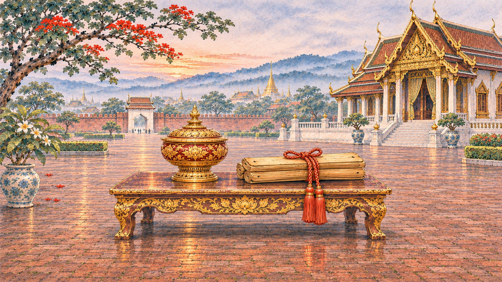
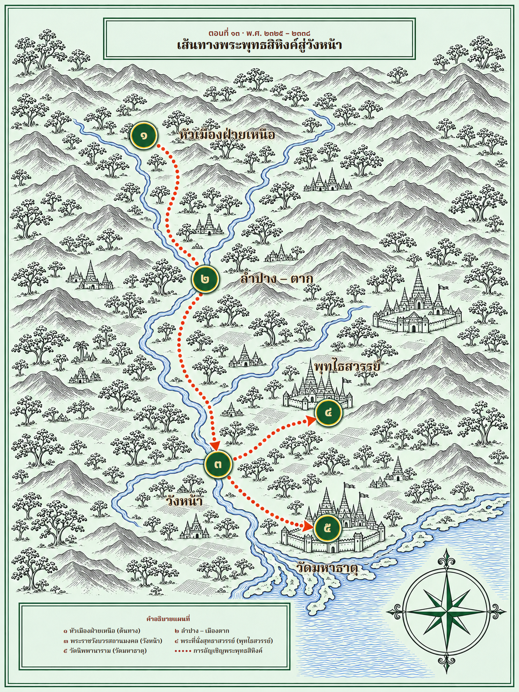

# ภาคที่ 4: ปราการล้านนาและอวสานวังหน้า (พ.ศ. 2330 – 2346)
## ตอนที่ 13: วังหน้า วัดมหาธาตุ และพระพุทธสิหิงค์

> **หมายเหตุถึงผู้อ่านภาคที่ ๔ (ตอนที่ ๑๓–๑๖):** ภาคนี้เรียบเรียงจากพระราชพงศาวดารกรุงรัตนโกสินทร์ รัชกาลที่ ๑ ประชุมพงศาวดาร และงานศึกษาประวัติศาสตร์สงครามไทย–พม่า แต่ผู้เรียบเรียงยังไม่ได้ตรวจเทียบกับตัวเล่มพิมพ์ฉบับเต็มพร้อมเลขหน้า ข้อความบางส่วนอาศัยตัวบทที่เผยแพร่ออนไลน์และงานสรุปของหน่วยงานและนักวิชาการ จึงมีหลายจุดที่หลักฐานไม่ชัดและเขียนไว้อย่างระมัดระวัง ได้แก่ ปีและต้นทางการอัญเชิญพระพุทธสิหิงค์ (ตอนที่ ๑๓) บทบาทของวังหน้าในศึกทวายและแนวกระบุรี–มะริด (ตอนที่ ๑๔) เรื่องนิราศเดินทัพไปทวายที่ยังไม่นำมาใช้เป็นหลักฐาน (ตอนที่ ๑๔) และรายละเอียดการมอบหมายบัญชาการทัพที่เมืองเถิน (ตอนที่ ๑๖) เส้นทางบนแผนที่ตอนที่ ๑๔ เป็นภาพประกอบเชิงภาพรวม ไม่ใช่การยืนยันเส้นทางเดินทัพรายละเอียด ผู้ที่จะนำข้อความภาคนี้ไปอ้างอิงต่อ ควรตรวจกับต้นฉบับพงศาวดารโดยตรงก่อน

---

### องก์ที่ 1: เปิดฉากยามเช้าที่วังหน้าไร้เสียงกลองศึก

แสงแดดยามเช้าในฤดูแล้งช่วงราว พ.ศ. 2338 ส่องลอดยอดหลังคาเครื่องไม้มุงกระเบื้องเคลือบสีของ **พระที่นั่งสุทธาสวรรย์** (ภายหลังเปลี่ยนนามเป็น **พระที่นั่งพุทไธสวรรย์**) ซึ่งเพิ่งโปรดให้สร้างขึ้นใหม่ภายในเขตกำแพง **พระราชวังบวรสถานมงคล** ด้านทิศเหนือของทุ่งพระเมรุ (ท้องสนามหลวง)

บนลานปูอิฐหน้าพระที่นั่ง ไม่มีธงรบ ไม่มีกองลำเลียงข้าวสาร และไม่มีเสียงฝีเท้าทหารเดินตรวจสนามเพลาะเหมือนที่ทุ่งลาดหญ้าหรือสามสบเมื่อทศวรรษก่อน หากมีเพียงผอบเครื่องบูชา ม้วนคัมภีร์ใบลานจารึกอักษรขอม และพระแท่นทองสำหรับเตรียมประดิษฐาน **พระพุทธสิหิงค์** พระพุทธรูปสำริดสำคัญจากหัวเมืองฝ่ายเหนือที่ทรงอัญเชิญลงมายังพระนคร

ถัดออกไปทางกำแพงวังด้านทิศใต้ติดกับเขตพระราชวังแห่งนี้ คือเขตพุทธาวาสของ **วัดนิพพานาราม** (วัดสลักเดิม) ที่ผ่านการบูรณปฏิสังขรณ์ขนานใหญ่และใช้เป็นสถานที่ประชุมพระเถราจารย์ทำ **สังคายนาพระไตรปิฎก** เมื่อเจ็ดปีก่อนหน้า (พ.ศ. 2331) และได้รับพระราชทานนามใหม่เป็น **วัดพระศรีสรรเพชญ** (ก่อนที่จะได้รับพระราชทานนามในภายหลังว่า **วัดพระศรีรัตนมหาธาตุ** หรือ **วัดมหาธาตุ**)

สำหรับ **กรมพระราชวังบวรมหาสุรสิงหนาท** ในพระชนมายุ 52 พรรษา—ผู้เคยนำกำลังเข็นเรือรบฝ่าเลนตมที่คลองสุนัขหอนเมื่อวัย 24 ปี เฝ้าประตูหัวเมืองเหนือที่พิษณุโลกกว่าทศวรรษ และยันทัพหลวงพม่าที่ทุ่งลาดหญ้า—ทศวรรษแรกหลังสงครามเก้าทัพมิใช่เพียงช่วงเวลาพักรบระหว่างฤดูแล้ง หากเป็นสมรภูมิอีกแบบหนึ่งที่ไม่มีคมดาบ: **การสร้าง "ราชสำนักที่สอง" ของแผ่นดินรัตนโกสินทร์ขึ้นมาเคียงข้างพระบรมมหาราชวัง**

---

### องก์ที่ 2: กระดานการเมืองและหลักฐาน

เมื่อเปลี่ยนสายตาจากทุ่งรบมาสู่สถาปัตยกรรมและพุทธศาสนจักรในพระนคร เรื่องราวของ **พระพุทธสิหิงค์** และ **วัดมหาธาตุ** เป็นจุดที่ข้อมูลทางประวัติศาสตร์สมัยรัตนโกสินทร์กับตำนานศาสนาซ้อนทับกันอยู่ จึงต้องแยกแยะส่วนที่เป็นตำนานออกจากเหตุการณ์ทางประวัติศาสตร์อย่างรอบคอบ

#### 1. ปีที่อัญเชิญพระพุทธสิหิงค์และสถานที่ประดิษฐาน

จุดแรกที่ต้องพิจารณาตามหลักฐานทางประวัติศาสตร์คือ **พระพุทธสิหิงค์ถูกอัญเชิญลงมาจากหัวเมืองฝ่ายเหนือในปีใด ต้นทางอยู่ที่ใด และประดิษฐานไว้ที่ใด?**

1. **ปีและต้นทางในการอัญเชิญ:** งานเขียนและตำนานประวัติศาสตร์ฝ่ายรัตนโกสินทร์กล่าวถึงปีที่อัญเชิญพระพุทธสิหิงค์ลงมาไว้ไม่ตรงกัน กล่าวคือ เอกสารสายตำนานวังหน้าบางฉบับเชื่อมโยงการอัญเชิญพระพุทธสิหิงค์ลงมาไว้กับช่วงศึกทางเหนือใน **พ.ศ. 2330** ขณะที่เอกสารฝ่ายประวัติศาสตร์ศิลปะและงานเรียบเรียงยุคหลังจำนวนมากมักผูกเหตุการณ์นี้กับ **พ.ศ. 2338 (จุลศักราช 1157)** อันเป็นช่วงปลายทศวรรษที่สองของรัชกาลที่ 1 นอกจากนี้ ดังที่จะเล่าถึงในตอนที่ 15 ตัวเมืองเชียงใหม่เองอยู่ในสภาพเมืองร้างเป็นส่วนใหญ่กระทั่งพระยากาวิละย้ายกำลังจากเวียงป่าซางกลับเข้าไปฟื้นฟูในปลาย พ.ศ. 2338 (มีนาคม ค.ศ. 1796) ด้วยข้อจำกัดของหลักฐานที่ไม่มีฉบับใดชี้ชัดตรงกันในรายละเอียดผู้รักษาองค์พระหรือจุดเก็บรักษาในล้านนา จึงสรุปได้เพียงอย่างระมัดระวังว่า **กรมพระราชวังบวรมหาสุรสิงหนาททรงอัญเชิญพระพุทธสิหิงค์ลงมาจากหัวเมืองฝ่ายเหนือในช่วงทศวรรษ พ.ศ. 2330–2338 แต่ต้นทางเฉพาะแห่งและรายละเอียดปลีกย่อยยังไม่ชัด**
2. **การสร้างพระที่นั่งสุทธาสวรรย์และสถานที่ประดิษฐาน:** เมื่ออัญเชิญพระพุทธสิหิงค์ลงมายังกรุงเทพมหานครแล้ว ในช่วงปลายทศวรรษ พ.ศ. 2330 (ราว **พ.ศ. 2338**) กรมพระราชวังบวรมหาสุรสิงหนาทโปรดเกล้าฯ ให้สร้างพระที่นั่งองค์หนึ่งขึ้นในพระราชวังบวรสถานมงคล พร้อมปราสาททองสำหรับประดิษฐานพระพุทธสิหิงค์ พระราชทานนามว่า **พระที่นั่งสุทธาสวรรย์** และโปรดให้เขียนภาพจิตรกรรมฝาผนังพุทธประวัติภายในพระที่นั่งในสมัยรัชกาลที่ 1 ต่อมาในสมัยรัชกาลที่ 3 สมเด็จพระบวรราชเจ้ามหาศักดิพลเสพทรงเปลี่ยนนามพระที่นั่งองค์นี้เป็น **พระที่นั่งพุทไธสวรรย์** เพื่อมิให้พ้องกับพระที่นั่งสุทไธสวรรย์ในพระบรมมหาราชวัง
3. **การย้ายไป–กลับหลัง พ.ศ. 2346:** ภายหลังกรมพระราชวังบวรมหาสุรสิงหนาทเสด็จสวรรคตใน พ.ศ. 2346 พระบาทสมเด็จพระพุทธยอดฟ้าจุฬาโลกมหาราชโปรดให้อัญเชิญพระพุทธสิหิงค์ลงไปประดิษฐาน ณ วัดพระศรีรัตนศาสดารามในพระบรมมหาราชวัง กระทั่งในสมัยรัชกาลที่ 4 (พ.ศ. 2394) จึงโปรดเกล้าฯ ให้อัญเชิญกลับคืนมาประดิษฐาน ณ **พระที่นั่งพุทไธสวรรย์** ในพระราชวังบวรสถานมงคล (พิพิธภัณฑสถานแห่งชาติ พระนคร) มาจนถึงปัจจุบัน

#### 2. แยก "ตำนาน" ออกจาก "ข้อเท็จจริงทางประวัติศาสตร์"

เรื่องราวของพระพุทธสิหิงค์มีสองชั้นที่ควรแยกออกจากกันอย่างชัดเจน:

- **ชั้นที่ 1 — ตำนานพระพุทธสิหิงค์ (*สิหิงคนิทาน*):** *สิหิงคนิทาน* ซึ่งพระโพธิรังษี พระเถระชาวเมืองเชียงใหม่รจนาขึ้นราวพุทธศตวรรษที่ 20 เล่าว่าพระพุทธสิหิงค์สร้างขึ้นในลังกาทวีปเมื่อราว พ.ศ. 700 โดยพระเจ้าสีหฬะทรงนิมนต์พระอรหันต์และอาศัยพญานาคเนรมิตพระรูปจำลองของพระพุทธองค์ จากนั้นพระพุทธรูปองค์นี้ได้เดินทางผ่านนครศรีธรรมราช สุโขทัย อยุธยา กำแพงเพชร เชียงราย และเชียงใหม่ รายละเอียดส่วนการสร้างในลังกา พ.ศ. 700 และปาฏิหาริย์พญานาคจัดเป็น **ตำนานศาสนา** เพื่อยกย่องความศักดิ์สิทธิ์ของพระพุทธรูปคู่บ้านคู่เมือง มิใช่บันทึกประวัติศาสตร์ร่วมสมัย
- **ชั้นที่ 2 — หลักฐานทางพงศาวดารและประวัติศาสตร์ศิลปะ:** ในประวัติศาสตร์ไทยสมัยอยุธยา–รัตนโกสินทร์ มีพระพุทธรูปที่ได้รับการยกย่องเป็นพระพุทธสิหิงค์สำคัญอยู่ 3 องค์ ได้แก่ องค์ที่ประดิษฐาน ณ **พระที่นั่งพุทไธสวรรย์** กรุงเทพฯ (ศิลปะสุโขทัย–ลังกา ปางสมาธิราบ), องค์ที่ประดิษฐาน ณ **วิหารลายคำ วัดพระสิงห์วรมหาวิหาร** จังหวัดเชียงใหม่ (ศิลปะล้านนา ปางมารวิชัย), และองค์ที่ประดิษฐาน ณ **หอพระพุทธสิหิงค์** จังหวัดนครศรีธรรมราช (ศิลปะแบบนครศรีธรรมราช) ส่วนเส้นทางการเก็บรักษาและการเคลื่อนย้ายองค์พระที่ลงมายังกรุงเทพฯ นั้นมีรายละเอียดที่ไม่ตรงกันในหลักฐานแต่ละสาย จึงไม่สรุปเจาะจงเกินกว่าที่พงศาวดารระบุไว้ว่าทรงอัญเชิญลงมาจากหัวเมืองฝ่ายเหนือในสมัยรัชกาลที่ 1

การแยกสองชั้นนี้ช่วยให้ผู้อ่านเข้าใจทั้งแรงศรัทธาที่ผู้คนในอดีตมีต่อ "พระสิงห์" และข้อเท็จจริงที่ตรวจสอบได้จากเอกสารราชการโดยไม่ปะปนกัน

#### 3. แผนผังอำนาจคู่: วังหลวงทางใต้ – วังหน้าทางเหนือ

ในทางภูมิรัฐศาสตร์ภายในพระนคร การสร้าง **พระราชวังบวรสถานมงคล** มิใช่เรื่องของความโอ่อ่าส่วนพระองค์ แต่เป็นการวางโครงสร้างความมั่นคงของกรุงรัตนโกสินทร์บนพื้นที่เกาะรัตนโกสินทร์ชั้นใน:

- **พระบรมมหาราชวัง (วังหลวง)** ตั้งอยู่ทางตอนใต้ของทุ่งพระเมรุ มี **วัดพระศรีรัตนศาสดาราม** ประดิษฐาน **พระพุทธมหามณีรัตนปฏิมากร (พระแก้วมรกต)** ซึ่งสองพี่น้องร่วมกันอัญเชิญมาจากเวียงจันทน์ใน พ.ศ. 2322 เป็นศูนย์กลางพระพุทธศาสนาของวังหลวง
- **พระราชวังบวรสถานมงคล (วังหน้า)** ตั้งอยู่ทางตอนเหนือของทุ่งพระเมรุ (ตั้งแต่บริเวณพิพิธภัณฑสถานแห่งชาติ พระนคร ท่าพระจันทร์ ไปจนถึงริมคลองคูเมืองเดิมด้านปากคลองบางลำพู) คอยคุมแนวป้องกันพระนครด้านเหนือ–ตะวันตกเฉียงเหนือ และมี **วัดมหาธาตุ (วัดสลักเดิม)** กับ **พระพุทธสิหิงค์** เป็นศูนย์กลางทางจิตวิญญาณคู่ขนานกัน

ทั้งสองวังหันหน้าเข้าหากันผ่านสนามหลวงกว้างขวางที่เป็นทั้งลานสวนสนาม ลานถวายพระเพลิงพระบรมศพ และพื้นที่กันชนของราชธานีใหม่

---

### องก์ที่ 3: จุดปะทะเชิงสร้างสรรค์ — สร้างวังหน้า บูรณะวัดสลัก และสังคายนา

แม้บทบาทหลักของกรมพระราชวังบวรมหาสุรสิงหนาทในสายตาคนทั่วไปจะเป็น "แม่ทัพ" ทว่างานก่อสร้างและทำนุบำรุงพระศาสนาตลอดช่วง พ.ศ. 2325–2338 แสดงให้เห็นว่าพระองค์ทรงวางระบบ **ราชสำนักที่สอง** อย่างเป็นแบบแผนไม่แพ้การจัดทัพในสนามรบ

#### 1. การสร้างพระราชวังบวรสถานมงคล (พ.ศ. 2325 – 2328)

เมื่อพระบาทสมเด็จพระพุทธยอดฟ้าจุฬาโลกมหาราชทรงประกอบพระราชพิธีอุปราชาภิเษกสถาปนาเจ้าพระยาสุรสีห์ขึ้นเป็น **กรมพระราชวังบวรมหาสุรสิงหนาท** ใน พ.ศ. 2325 แล้ว โปรดเกล้าฯ ให้สร้างพระราชวังบวรสถานมงคลขึ้นทางด้านเหนือของพระบรมมหาราชวังในเวลาไล่เลี่ยกัน

การก่อสร้างพระราชวังบวรสถานมงคลดำเนินการอย่างเร่งด่วนตั้งแต่ พ.ศ. 2325 จนแล้วเสร็จสมบูรณ์พร้อมการสมโภชพระนครใน พ.ศ. 2328 (ก่อนสงครามเก้าทัพจะเปิดฉากเพียงไม่กี่เดือน) ภายในประกอบด้วย:

1. **ป้อมและกำแพงวังชั้นนอก:** ก่ออิฐถือปูนล้อมรอบเช่นเดียวกับพระบรมมหาราชวัง มีประตูและป้อมปราการเตรียมพร้อมสำหรับเป็นที่มั่นป้องกันพระนครด้านเหนือ
2. **พระที่นั่งศิวโมกขพิมาน:** ท้องพระโรงโถงขนาดใหญ่สำหรับเสด็จออกว่าราชการของฝ่ายวังหน้า ตรวจพล และรับรองขุนนางแม่ทัพนายกองในสังกัดกรมพระราชวังบวรฯ
3. **หมู่พระวิมาน 3 องค์:** คือ พระที่นั่งวสันตพิมาน พระที่นั่งวายุสถานอมเรศ และพระที่นั่งพรหมเมศร์ธาดา เป็นเขตพระราชมณเฑียรที่ประทับส่วนพระองค์ (ปัจจุบันเป็นส่วนจัดแสดงหลักของพิพิธภัณฑสถานแห่งชาติ พระนคร)
4. **พระที่นั่งสุทธาสวรรย์ (พุทไธสวรรย์) และพระที่นั่งบูรพาภิมุข:** สร้างขึ้นเพิ่มเติมในระยะต่อมาของรัชกาล โดยพระที่นั่งสุทธาสวรรย์สร้างขึ้นราว พ.ศ. 2338 เพื่อใช้เป็นที่ประดิษฐานพระพุทธสิหิงค์ ส่วนพระที่นั่งบูรพาภิมุขเป็นพระที่นั่งสำคัญทางด้านตะวันออกของหมู่พระวิมาน

การมีท้องพระโรง ขุนนางจตุสดมภ์ฝ่ายวังหน้า (เช่น พระยากลาโหมราชเสนา และพระยาจ่าแสนยากร ซึ่งออกรบเคียงข้างพระองค์ในสงครามเก้าทัพและปัตตานี) ตลอดจนกรมทหารในสังกัด ทำให้วังหน้าเป็นองค์กรบริหารและการทหารที่มีศักยภาพพร้อมออกศึกได้ทันทีเมื่อเกิดเหตุฉุกเฉินที่ชายแดน

#### 2. จาก "วัดสลัก" สู่วัดนิพพานาราม – วัดพระศรีสรรเพชญ – วัดมหาธาตุ

ติดกับกำแพงด้านใต้ของพระราชวังบวรสถานมงคล มีวัดราษฎร์โบราณสมัยกรุงศรีอยุธยาตั้งอยู่ชื่อว่า **วัดสลัก** (หรือวัดฉลัก)

ในความทรงจำและเรื่องเล่าชั้นหลังเกี่ยวกับประวัติวัดมหาธาตุ มักเล่าต่อกันมาว่าเมื่อครั้งนายสุดจินดา (บุญมา) หนีออกจากกรุงศรีอยุธยาใน พ.ศ. 2310 ได้ล่องเรือผ่านมาแวะพักและตั้งจิตอธิษฐานหน้าวัดสลักแห่งนี้ ทว่าในพระราชพงศาวดารสมัยธนบุรีและต้นรัตนโกสินทร์ไม่ปรากฏบันทึกคำอธิษฐานดังกล่าวไว้เป็นลายลักษณ์อักษร เรื่องเล่านี้จึงจัดอยู่ในฐานะ **ตำนานมุขปาฐะที่เล่าขานกันในชั้นหลัง** เพื่ออธิบายความผูกพันระหว่างพระองค์กับวัดข้างวังหน้า

ตามลำดับเหตุการณ์ทางประวัติศาสตร์สมัยรัชกาลที่ 1 และเอกสารประวัติวัดมหาธาตุยุวราชรังสฤษฎิ์ การบูรณะและเปลี่ยนนามพระอารามสำคัญแห่งนี้แบ่งได้เป็น 3 ช่วงเวลา:

- **พ.ศ. 2326 (จ.ศ. 1145):** หลังสถาปนากรุงรัตนโกสินทร์ได้หนึ่งปี กรมพระราชวังบวรมหาสุรสิงหนาททรงมีพระราชศรัทธาบูรณปฏิสังขรณ์วัดสลักขึ้นใหม่ทั้งพระอาราม สร้างพระอุโบสถ พระวิหาร และเสนาสนะสงฆ์อย่างงดงาม แล้วพระราชทานนามใหม่ว่า **วัดนิพพานาราม** (วัดข้างวังหน้าคู่พระบารมีฝ่ายบวรราชเจ้า)
- **พ.ศ. 2331 (จ.ศ. 1150):** พระบาทสมเด็จพระพุทธยอดฟ้าจุฬาโลกมหาราชทรงปรารภว่าพระไตรปิฎกที่ตกค้างมาแต่ครั้งกรุงศรีอยุธยาแตกกระจัดกระจายและวิปลาสคลาดเคลื่อนมาก จึงทรงร่วมกับกรมพระราชวังบวรมหาสุรสิงหนาทโปรดให้ประชุมพระภิกษุสงฆ์ทรงปริยัติธรรม **218 รูป** (มีสมเด็จพระสังฆราชเป็นประธาน) และราชบัณฑิต **32 คน** ทำ **สังคายนาพระไตรปิฎก** ณ วัดนิพพานารามแห่งนี้ ในคราวเดียวกันรัชกาลที่ 1 จึงโปรดเกล้าฯ พระราชทานนามพระอารามใหม่ว่า **วัดพระศรีสรรเพชญ** (หรือวัดพระศรีสรรเพชญดาราม) ให้สอดคล้องกับชื่อวัดหลวงสำคัญในกรุงศรีอยุธยาเก่า
- **พ.ศ. 2346 (จ.ศ. 1165):** ภายหลังกรมพระราชวังบวรมหาสุรสิงหนาทเสด็จสวรรคต รัชกาลที่ 1 โปรดเกล้าฯ พระราชทานนามใหม่ว่า **วัดพระศรีรัตนมหาธาตุ** (นิยมเรียกสั้นๆ ว่า **วัดมหาธาตุ**) เพื่อให้สมฐานะพระอารามที่ประทับของสมเด็จพระสังฆราชและที่ประดิษฐานพระบรมสารีริกธาตุ ก่อนที่ในรัชกาลที่ 5 พ.ศ. 2439 จะทรงเติมสร้อยพระนามเป็น **วัดมหาธาตุยุวราชรังสฤษฎิ์** มาจนถึงปัจจุบัน

ในการทำสังคายนา พ.ศ. 2331 กรมพระราชวังบวรมหาสุรสิงหนาทมิได้ทรงเป็นเพียงเจ้าภาพสถานที่ หากทรงเป็นกำลังสำคัญในการอุปถัมภ์การตรวจชำระพระคัมภีร์ร่วมกับวังหลวง—ภาพของแม่ทัพผู้คุ้นเคยกับการตรวจบัญชีข้าวสารและกระสุนดินดำ หันมาตรวจดูแลบัญชีคัมภีร์ใบลานและการจัดเตรียมภัตตาหารแก่พระภิกษุสงฆ์ **218 รูป** และราชบัณฑิต **32 คน** ตลอดระยะเวลาของการสังคายนา สะท้อนบทบาทการฟื้นฟู "โครงสร้างทางปัญญาและศีลธรรม" ของอาณาจักรหลังสงครามเสียกรุง

#### 3. พระพุทธสิหิงค์: สัญลักษณ์แห่งสายสัมพันธ์สยาม–ล้านนา

การอัญเชิญ **พระพุทธสิหิงค์** จากหัวเมืองฝ่ายเหนือลงมาประดิษฐาน ณ **พระที่นั่งสุทธาสวรรย์ (พุทไธสวรรย์)** ในช่วงทศวรรษ พ.ศ. 2330–2338 มีความหมายทางการเมืองและวัฒนธรรมลึกซึ้งไม่แพ้การอัญเชิญพระแก้วมรกตจากเวียงจันทน์เมื่อ พ.ศ. 2322

ในเชิงยุทธศาสตร์ ยุคทศวรรษ 2330 เป็นช่วงที่ **พระยากาวิละ** และเจ้านายตระกูลเจ้าเจ็ดตนกำลังรวบรวมผู้คนจากลำปางและเวียงป่าซางเตรียมกลับเข้าฟื้นฟูเมืองเชียงใหม่ที่ร้างไปหลังศึกสมัยธนบุรี–ต้นรัตนโกสินทร์ การที่พระพุทธรูปศักดิ์สิทธิ์คู่บ้านคู่เมืองของล้านนาได้มาประดิษฐานอยู่ใน **พระราชวังบวรสถานมงคล** ย่อมสะท้อนสายสัมพันธ์อันแน่นแฟ้นระหว่างราชสำนักวังหน้ากับหัวเมืองฝ่ายเหนือ—โดยเฉพาะกรมพระราชวังบวรมหาสุรสิงหนาทซึ่งเคยยกทัพขึ้นไปร่วมตีเมืองเชียงใหม่ตั้งแต่ครั้งเป็นเจ้าพระยาสุรสีห์ (พ.ศ. 2317–2318) และภายหลังทรงบัญชาการศึกช่วยลำปาง–ป่าซางอีกหลายครั้ง

ในเชิงศิลปกรรม ภายในพระที่นั่งสุทธาสวรรย์มีการเขียน **จิตรกรรมฝาผนังสมัยรัชกาลที่ 1** เรื่องพุทธประวัติ เทพชุมนุม และทศชาติชาดก ซึ่งปัจจุบันถือเป็นหนึ่งในงานจิตรกรรมฝาผนังต้นรัตนโกสินทร์ที่สมบูรณ์และงดงามที่สุดแห่งหนึ่งของประเทศ เมื่อผนวกรวมกับมรดกทางวรรณกรรมของพระองค์อย่าง *เพลงยาวรบพม่าที่นครศรีธรรมราช* (พ.ศ. 2329) จะเห็นได้ว่าวังหน้าในรัชกาลที่ 1 มิได้เป็นเพียงค่ายทหาร หากเป็นศูนย์กลางศิลปะ วรรณกรรม และพุทธศิลป์ที่หล่อหลอมวัฒนธรรมกรุงเก่าให้สืบต่อมาในกรุงเทพมหานคร

---

### องก์ที่ 4: แรงสะเทือนและกระดานศึกที่ขยับไปทางตะวันตก

ตลอดช่วงเวลาตั้งแต่ พ.ศ. 2325 ถึง พ.ศ. 2338 พระราชวังบวรสถานมงคล วัดมหาธาตุ และพระพุทธสิหิงค์ได้วางรากฐานให้กรุงรัตนโกสินทร์มีเสถียรภาพทางวัฒนธรรมและศาสนาอย่างมั่นคง—จากราชธานีชั่วคราวริมน้ำเจ้าพระยา กลายเป็นนครหลวงที่มีทั้งพระแก้วมรกตในวังหลวงและพระพุทธสิหิงค์ในวังหน้า มีวัดพระศรีรัตนศาสดารามคู่กับวัดพระศรีสรรเพชญ (วัดมหาธาตุ) และมีประเพณีสังคายนาพระไตรปิฎกสืบต่อจากอยุธยา

ทว่าความสงบภายในกำแพงพระนครไม่ได้หมายความว่าเส้นเขตแดนรอบอาณาจักรจะปลอดเสียงปืน

อันที่จริง ระหว่างที่งานก่อสร้างและปฏิสังขรณ์พระอารามในกรุงเทพฯ กำลังดำเนินอยู่นั้นเอง ยุทธศาสตร์ของสยามได้พลิกกลับจาก **"ตั้งรับหลังแนวชายแดน"** ไปเป็น **"รุกข้ามเทือกเขาตะนาวศรี"** เพื่อช่วงชิงหัวเมืองชายฝั่งทะเลอันดามันอย่าง **ทวาย มะริด และตะนาวศรี** กลับคืนจากอำนาจของพระเจ้าปดุง

และการรุกข้ามเขาตะวันตกใน พ.ศ. 2330–2336 ก็กำลังจะเปิดเผยให้เห็นรอยร้าวทางความคิดเชิงยุทธศาสตร์ระหว่าง "วังหลวง" กับ "วังหน้า"—รวมถึงขีดจำกัดอันโหดร้ายของภูมิประเทศและเส้นทางเสบียงที่เคยกลืนกินกองทัพผู้รุกรานมานักต่อนักแล้ว

**จบตอนที่ 13**

*(ติดตามต่อใน ตอนที่ 14: แนวตะวันตก ทวายและตะนาวศรี)*
