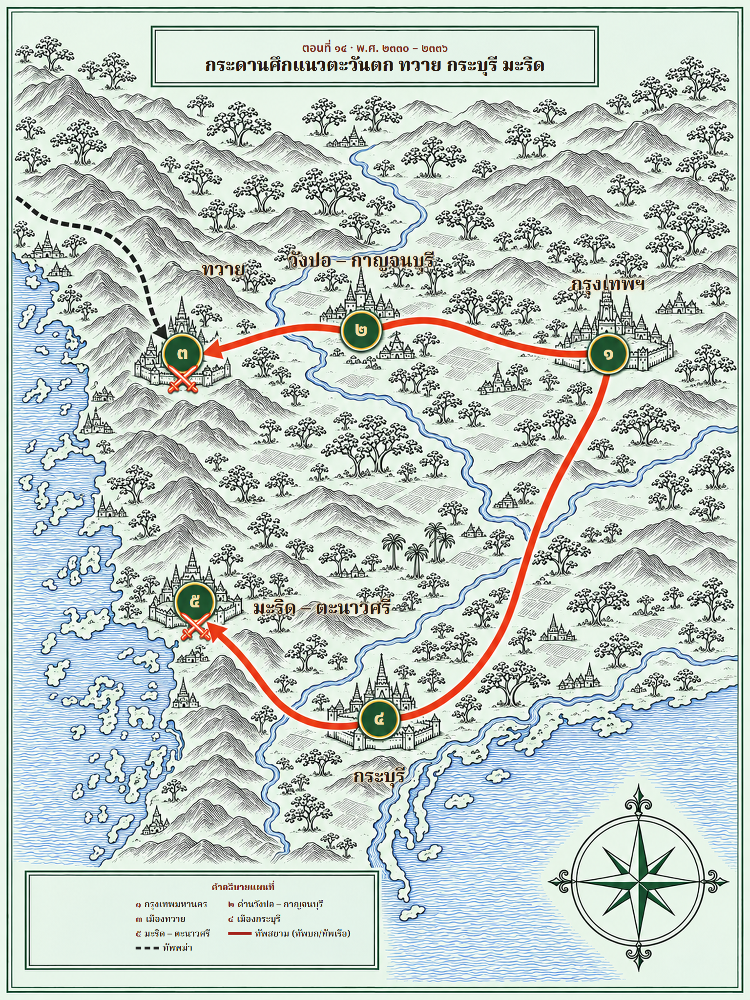

# ภาคที่ 4: ปราการล้านนาและอวสานวังหน้า (พ.ศ. 2330 – 2346)
## ตอนที่ 14: แนวตะวันตก ทวายและตะนาวศรี

---

### องก์ที่ 1: เปิดฉากเสียงขวานต่อเรือที่เมืองกระบุรี พ.ศ. 2336

สายลมจากทะเลอันดามันพัดผ่านปากน้ำ **กระบุรี** ในฤดูร้อน พ.ศ. 2336 (จุลศักราช 1155) พาเสียงขวานถากไม้และเสียงค้อนตอกหมันเรือดังก้องไปตลอดแนวอู่ต่อเรือชั่วคราวริมฝั่ง

ภายในค่ายบัญชาการด้านแนวฝั่งตะวันตกเฉียงใต้ **กรมพระราชวังบวรมหาสุรสิงหนาท** ในพระชนมายุ 50 พรรษา ทรงตรวจดูความคืบหน้าของการต่อเรือรบและการลำเลียงข้าวสารที่ส่งข้ามคอคอดกระมาจากฝั่งเมือง **ชุมพร** เพื่อสนับสนุนกองกำลังทางเรือของ **พระยาจ่าแสนยากร** ซึ่งเคลื่อนหน้าขึ้นไปยึดหัวเมืองชายฝั่งทะเลอันดามันอย่าง **เมืองมะริด** และ **เมืองตะนาวศรี** เอาไว้

ห่างขึ้นไปทางทิศเหนือหลายร้อยกิโลเมตร หลังแนวกำแพงป่าทึบและสันเขาสูงชันของเทือกเขาตะนาวศรี กองทัพหลวงของ **พระบาทสมเด็จพระพุทธยอดฟ้าจุฬาโลกมหาราช** พร้อมด้วยแม่ทัพใหญ่ฝ่ายวังหลวงอย่าง **เจ้าพระยารัตนาพิพิธ (สน)**, **เจ้าพระยามหาเสนา (ปลี)**, และ **พระยายมราช (บุนนาค)** กำลังตรึงกำลังอยู่ในเขต **เมืองทวาย** ท่ามกลางข่าวกรองที่ตึงเครียดขึ้นทุกวันว่า กองทัพใหญ่จากกรุงอมรปุระภายใต้การนำของพระมหาอุปราชาแห่งพม่ากำลังเคลื่อนลงมาทวงเมืองชายฝั่งคืน

นี่คือช่วงเวลาที่ประวัติศาสตร์การรบระหว่างสยามกับพม่าพลิกกลับทิศอย่างสิ้นเชิง—จากที่พม่าเคยยกทัพข้ามด่านพระเจดีย์สามองค์เข้ามาล้อมสยามในสงครามเก้าทัพ (พ.ศ. 2328) และท่าดินแดง (พ.ศ. 2329) มาสู่ช่วงเวลาที่ **สยามพยายามข้ามเทือกเขาตะนาวศรีออกไปตั้งหลักบนชายฝั่งอันดามันเสียเอง**

ทว่าสำหรับกรมพระราชวังบวรมหาสุรสิงหนาท ผู้ทรงอ่านแผนที่เสบียงและภูเขามาตลอดพระชนม์ชีพ การยกทัพออกไปตั้งมั่นไกลเกินแนวสันเขานั้นกลับมองเห็นจุดตายชัดเจน—จุดตายที่พระองค์เคยเห็นพม่าพ่ายแพ้เพราะมันมาแล้วที่ทุ่งลาดหญ้า

---

### องก์ที่ 2: กระดานการเมืองและหลักฐาน

เมื่อกาง **พระราชพงศาวดารกรุงรัตนโกสินทร์ รัชกาลที่ 1** (ฉบับเจ้าพระยาทิพากรวงศ์), **ไทยรบพม่า** (พระนิพนธ์สมเด็จฯ กรมพระยาดำรงราชานุภาพ), และบทพระราชนิพนธ์ **เพลงยาวนิราศเสด็จไปตีเมืองพม่า (พ.ศ. 2336)** ของกรมพระราชวังบวรมหาสุรสิงหนาท ขึ้นตรวจสอบพร้อมกัน จะพบข้อเท็จจริงสำคัญที่ต้องแยกแยะให้แม่นยำ เพื่อไม่ให้เล่าผิดตัวบุคคลหรือผิดสมรภูมิ

#### 1. [ตรวจหลักฐาน] วังหน้าร่วมศึกทวาย พ.ศ. 2330 และ พ.ศ. 2336 หรือไม่?

ในประวัติศาสตร์ต้นกรุงรัตนโกสินทร์ สยามยกทัพไปตีและรักษา **เมืองทวาย** สองคราวใหญ่ (พ.ศ. 2330–2331 และ พ.ศ. 2335–2336) ซึ่งพระราชพงศาวดารระบุบทบาทของกรมพระราชวังบวรมหาสุรสิงหนาทไว้ชัดเจนว่า **พระองค์ไม่ได้อยู่ในสมรภูมิตัวเมืองทวายโดยตรงทั้งสองคราว** หากทรงคุมแนวรบคนละด้านเพื่อป้องกันอาณาจักรไว้พร้อมกัน:

1. **คราวศึก พ.ศ. 2330 – 2331 (ตีเมืองทวาย ครั้งที่ 1 / สงครามครั้งที่ 4 ใน *ไทยรบพม่า*):** หลังเสร็จศึกท่าดินแดงไม่ถึงปี พระบาทสมเด็จพระพุทธยอดฟ้าจุฬาโลกมหาราชทรงดำริยกทัพข้ามเขาไปตีเมืองทวายบ้าง ทว่าในช่วงเดียวกันนั้นพระเจ้าปดุงส่งทัพพม่ายกมาตี **เมืองป่าซาง** และ **นครลำปาง** ทางภาคเหนือ (*สงครามครั้งที่ 3*) ทั้งสองพระองค์จึงทรงแบ่งภารกิจกัน: **รัชกาลที่ 1** เสด็จยกทัพหลวงราว **20,000 นาย** (ตัวเลขตาม *ไทยรบพม่า*) ข้ามด่านวังปอ–ไทรโยคไปตีเมืองทวายด้วยพระองค์เอง (ร่วมกับเจ้าพระยารัตนาพิพิธ, เจ้าพระยามหาเสนา, พระยายมราช, กรมหลวงอิศรสุนทร, และกรมหลวงเทพหริรักษ์) ส่วน **กรมพระราชวังบวรมหาสุรสิงหนาทไม่ได้เสด็จไปเมืองทวาย** หากเสด็จยกทัพขึ้นเหนือไปขับไล่พม่าทางลำปาง–ป่าซางและจัดระเบียบป้องกันหัวเมืองล้านนา
2. **คราวศึก พ.ศ. 2335 – 2336 (ศึกทวาย–มะริด–ตะนาวศรี / สงครามครั้งที่ 5 ใน *ไทยรบพม่า*):** เมื่อ **มังจันจา** (หรือแมงจันจา) เจ้าเมืองทวายแปรพักตร์ขอสวามิภักดิ์ต่อกรุงเทพฯ ในต้น พ.ศ. 2335 รัชกาลที่ 1 เสด็จคุมทัพหลวงทางบกไปยังเมืองทวายเช่นเดิม ส่วน **กรมพระราชวังบวรมหาสุรสิงหนาทไม่ได้เสด็จเข้าสู่สมรภูมิตัวเมืองทวาย** หากทรงรับผิดชอบ **แนวรบทางเรือและแนวป้องกันปีกใต้** โดยเสด็จทางชลมารคผ่านเมือง **ชุมพร** ไปประทับตั้งฐานบัญชาการและต่อเรือรบที่ **เมืองกระบุรี** และปากน้ำ **เมืองสิงขร** พร้อมทั้งส่ง **พระยาจ่าแสนยากร** คุมกองเรือหน้าขึ้นไปยึดและรักษา **เมืองมะริด** กับ **เมืองตะนาวศรี** เพื่อปิดล้อมทางทะเลและเชื่อมการป้องกันคาบสมุทรปักษ์ใต้ไม่ให้พม่าลอบตีตลบหลังพระนคร

การระบุตำแหน่งแห่งที่ตามหลักฐานเช่นนี้สำคัญมาก เพราะทำให้เห็นบทบาทจริงของกรมพระราชวังบวรฯ ในฐานะผู้คุม **แนวป้องกันชายแดนและทัพเรือปีกใต้** รวมถึงผู้ดูแลเสถียรภาพแนวหลังพระนครยามที่ทัพหลวงของพระมหากษัตริย์ยกข้ามเขาออกไปนอกเขตแดน

#### 2. เหตุการณ์ พ.ศ. 2335: เมื่อเจ้าเมืองทวายขอขึ้นกับสยาม

เหตุใดสยามจึงกลับเข้าสู่กระดานศึกทวายอีกครั้งใน พ.ศ. 2335 ทั้งที่การบุกครั้งแรกใน พ.ศ. 2330–2331 ต้องถอยทัพกลับเพราะเส้นทางภูเขาทุรกันดาร?

คำตอบไม่ได้เกิดจากแผนบุกของกรุงเทพฯ เพียงฝ่ายเดียว หากเกิดจากรอยร้าวภายในอาณาจักรพม่าเอง ตาม *พระราชพงศาวดารกรุงรัตนโกสินทร์ รัชกาลที่ 1* และ *ไทยรบพม่า* ในช่วงปลาย พ.ศ. 2334 ถึงเดือนมีนาคม พ.ศ. 2335 (ปลาย จ.ศ. 1153 – ต้น จ.ศ. 1154) **มังจันจา** เจ้าเมืองทวายเกิดความขัดแย้งกับราชสำนักกรุงอมรปุระของพระเจ้าปดุง จึงตัดสินใจชักชวนเมืองมะริดและตะนาวศรีแข็งเมืองต่อพม่า และส่งทูตถือสาส์นพร้อมเครื่องบรรณาการข้ามเขามาสวามิภักดิ์ต่อพระบาทสมเด็จพระพุทธยอดฟ้าจุฬาโลกมหาราช

เพื่อแสดงความจริงใจ มังจันจาได้สืบเสาะและส่งตัว **พระองค์เจ้าชี** พระราชภาคิไนยในรัชกาลที่ 1 ซึ่งถูกพม่ากวาดต้อนไปตั้งแต่คราวเสียกรุงศรีอยุธยา พ.ศ. 2310 กลับคืนสู่กรุงเทพมหานครด้วย

การสวามิภักดิ์ของทวาย มะริด และตะนาวศรี เปิดโอกาสให้สยามเข้าถึงหัวเมืองท่าฝั่งทะเลอันดามันที่เคยเป็นของอยุธยามาแต่โบราณ รัชกาลที่ 1 จึงโปรดให้จัดกองทัพหน้า (นำโดยเจ้าพระยารัตนาพิพิธ เจ้าพระยามหาเสนา และพระยายมราช) รุดหน้าออกไปรับมอบเมืองทวาย แล้ววางแผนรวมกำลังบุกขึ้นไปตีเมืองเมาะตะมะและหงสาวดีต่อไป

#### 3. ความเห็นต่างทางยุทธศาสตร์ระหว่าง "วังหลวง" กับ "วังหน้า"

ทว่าในห้องยุทธการของราชสำนักรัตนโกสินทร์ การเข้ายึดครองเมืองทวายกลับเผยให้เห็น **มุมมองทางทหารที่ต่างกันอย่างแหลมคม** ระหว่างพระบาทสมเด็จพระพุทธยอดฟ้าจุฬาโลกมหาราช กับกรมพระราชวังบวรมหาสุรสิงหนาท

ตามที่ *พระราชพงศาวดารกรุงรัตนโกสินทร์ รัชกาลที่ 1* บันทึกไว้ เมื่อกองทัพไทยเข้าไปอยู่ในเมืองทวายแล้วเริ่มพบสัญญาณความรวนเรของมังจันจาและชาวเมืองทวาย ประกอบกับข่าวกองทัพใหญ่ของพม่าที่กำลังเคลื่อนลงมา:

- **ความเห็นของกรมพระราชวังบวรมหาสุรสิงหนาท:** ทรงประเมินจากหลักภูมิศาสตร์และเสบียงว่า เมืองทวายตั้งอยู่ฟากตะวันตกของเทือกเขาตะนาวศรี มีแนวเขากั้นกลางจากลุ่มน้ำเจ้าพระยา หากพม่ายกทัพใหญ่ลงมาทางบกจากเมาะตะมะ พม่าส่งกำลังได้ง่ายกว่าสยามมาก และชาวเมืองทวายเองก็อาจแปรพักตร์ได้ทุกเมื่อ ดังนั้นจึงทรงกราบทูลเสนอให้ **รื้อกำแพงเมืองทวายและกวาดต้อนผู้คนกลับมาตั้งหลักในเขตสยาม** เพื่อตัดกำลังข้าศึกและรักษาไพร่พลฝ่ายเรา
- **พระราชดำริของรัชกาลที่ 1:** ทรงเห็นว่าสยามเพิ่งได้เมืองทวายมาโดยไม่ต้องเสียเลือดเนื้อ หากรีบรื้อเมืองถอยกลับทันทีจะเสียโอกาสในการใช้ทวายเป็นฐานสะสมเสบียงและช้างม้ารุกต่อไปยังเมืองมอญ–พม่า จึงทรงมีพระราชประสงค์ให้รักษาเมืองทวายไว้ก่อนและจัดการควบคุมกำลังในเมืองให้รัดกุมยิ่งขึ้น

นี่คือการแลกเปลี่ยนความเห็นเชิงยุทธศาสตร์ที่เกิดขึ้นจริงตามพระราชพงศาวดาร สะท้อนว่ากรมพระราชวังบวรฯ ทรงยึดหลัก **"รักษาคนและคุมสายส่งกำลัง"** เสมอมา ตั้งแต่ครั้งตัดสินใจสละเมืองพิษณุโลกใน พ.ศ. 2319

---

### องก์ที่ 3: จุดปะทะ — ภูเขา เสบียง และความแปรพักตร์ พ.ศ. 2336

การรบช่วง พ.ศ. 2330–2336 ในแนวตะวันตกไม่ได้ตัดสินกันด้วยกำลังพลในทุ่งราบ แต่ตัดสินกันด้วย **ความชันของเทือกเขาตะนาวศรีและปัญหาเสบียงอาหาร**

#### 1. บทเรียนจากด่านวังปอ (พ.ศ. 2330 – 2331)

ในคราวตีเมืองทวายครั้งแรก พ.ศ. 2330–2331 ทัพหลวงของรัชกาลที่ 1 ต้องเดินทัพข้าม **เขาสูงและป่าทึบบริเวณด่านวังปอ** ต่อจากไทรโยค ตาม *พระราชพงศาวดารกรุงรัตนโกสินทร์ รัชกาลที่ 1* เส้นทางบางช่วงสูงชันจนต้องใช้เชือกชักลากคนและช้างม้าไต่ขึ้นไปตามไหล่เขา แนวหน้าของ **พระยาสุรเสนา** และ **พระยาสมบัติบาล** ปะทะกับค่ายสกัดของพม่าอย่างดุเดือดจนแม่ทัพทั้งสองสิ้นชีวิตในที่รบ

แม้ทัพไทยจะตีค่ายหน้าของพม่าแตกและรุกเข้าล้อมเมืองทวายได้ แต่เมื่อไม่สามารถลำเลียงข้าวสารและปืนใหญ่ขนาดหนักข้ามเขาตามไปหนุนได้ทัน ทัพหลวงจึงจำต้องถอนกำลังกลับ ผลลัพธ์ของศึก พ.ศ. 2330–2331 จึงเป็นเครื่องพิสูจน์ตั้งแต่แรกว่า **เทือกเขาตะนาวศรีเป็นกำแพงธรรมชาติที่ป้องกันไม่ให้พม่าบุกกรุงเทพฯ ได้ง่ายฉันใด มันก็ขวางไม่ให้ทัพสยามรุกไปยึดเมืองทวายได้ง่ายฉันนั้น**

#### 2. ปีกใต้ที่กระบุรี–มะริด และบทบันทึกใน *เพลงยาวนิราศ* (พ.ศ. 2336)

เมื่อศึกทวายปะทุขึ้นอีกครั้งใน พ.ศ. 2335–2336 กรมพระราชวังบวรมหาสุรสิงหนาททรงรับภาระคุมแนวรบทางเรือและปีกใต้ เสด็จลงไปตั้งมั่นที่เมือง **กระบุรี** และปากน้ำ **สิงขร** ทรงเร่งรัดการต่อเรือรบเพื่อสร้างกำลังทางน้ำในฝั่งอันดามัน และส่ง **พระยาจ่าแสนยากร** นำกองทัพเรือหน้าขึ้นไปควบคุมเมือง **มะริด** และ **ตะนาวศรี**

ในระหว่างการเคลื่อนพลทางใต้ครั้งนี้เอง กรมพระราชวังบวรฯ ทรงพระราชนิพนธ์วรรณคดีสำคัญเรื่อง **เพลงยาวนิราศเสด็จไปตีเมืองพม่า (พ.ศ. 2336)** (หรือที่เรียกกันว่า *นิราศเสด็จไปตีเมืองทวาย พ.ศ. 2336*) ซึ่งสะท้อนทั้งความยากลำบากของการเดินทัพเรือฝ่าคลื่นลม เส้นทางผ่านหัวเมืองปักษ์ใต้สู่กระบุรี และความรู้สึกของจอมทัพวัยห้าสิบพรรษาที่ยังคงต้องออกกรำศึกไกลพระนคร

อย่างไรก็ตาม ขอบเขตปฏิบัติการทางทะเลจากกระบุรีขึ้นไปมะริดก็เผชิญข้อจำกัดทางภูมิศาสตร์ไม่ต่างจากทัพบกทางทวาย การต่อเรือรบใหม่ต้องใช้เวลา การส่งข้าวสารจากฝั่งอ่าวไทย (ชุมพร) ข้ามคอคอดกระมายังฝั่งอันดามันมีกำลังขนจำกัด และเมื่อลมมรสุมเปลี่ยนทิศ การเดินเรือในทะเลอันดามันก็ยิ่งอันตราย

#### 3. แนวรบทวาย–มะริดแตกสลาย (พ.ศ. 2336 – ต้น พ.ศ. 2337)

ความกังวลที่กรมพระราชวังบวรฯ ทรงเตือนไว้ล่วงหน้ากลายเป็นความจริงในปี พ.ศ. 2336

ทางกรุงอมรปุระ **พระเจ้าปดุง** ทรงส่งกองทัพใหญ่ภายใต้การนำของ **พระมหาอุปราชา (ตะโดเมงสอ)** ยกกำลังลงมาทางเมาะตะมะเพื่อตีเมืองทวายคืนอย่างเต็มกำลัง ขณะเดียวกัน ภายในเมืองทวายที่ทหารไทยตั้งรักษาการอยู่กลับเกิดความระแวงระหว่างชาวพื้นเมืองกับฝ่ายไทย เมื่อทัพพม่ายกมาประชิดเมืองทวาย ชาวทวายก็ก่อการลุกฮือขึ้นเป็นไส้ศึก ลอบโจมตีและเผาค่ายไทยจากภายในประสานกับทัพพม่าด้านนอก

กองทัพหลวงและทัพหน้าของไทยในเมืองทวายตกอยู่ในวงล้อมสองด้าน เส้นทางถอยข้ามเทือกเขาตะนาวศรีเต็มไปด้วยความโกลาหลและการสูญเสีย (แม่ทัพฝ่ายไทยต้องรบฝ่าวงล้อมถอยกลับเข้ามาทางด่านตะวันตก) เมื่อฐานหลักที่ทวายพังทลายลง สถานการณ์ที่ **เมืองมะริด** ก็พลิกผันทันที เจ้าเมืองมะริดและกำลังพื้นเมืองแปรพักตร์หันกลับไปเข้ากับฝ่ายพม่าและโจมตีทัพเรือของพระยาจ่าแสนยากร

กรมพระราชวังบวรมหาสุรสิงหนาทซึ่งทรงตั้งคุมเชิงและดูแลแนวป้องกันอยู่ที่ **กระบุรี** จึงทรงสั่งถอนกำลังทัพเรือและกำลังป้องกันชายฝั่งทั้งหมดกลับคืนสู่เขตสยามและกรุงเทพมหานคร เพื่อรักษาขุมกำลังทางเรือและไพร่พลของพระนครเอาไว้ไม่ให้สูญเสียไปกับแนวรบที่ขาดการสนับสนุนแล้ว

---

### องก์ที่ 4: แรงสะเทือนและปมสู่ปราการล้านนา

การถอยทัพจาก **ทวาย** และ **มะริด** ใน พ.ศ. 2336 (ต่อเนื่องต้น พ.ศ. 2337) คือบทสรุปทางภูมิรัฐศาสตร์ระหว่างสยามกับพม่าที่ยั่งยืนมาจนถึงสมัยปัจจุบัน: **เทือกเขาตะนาวศรีกลายเป็นเส้นเขตแดนธรรมชาติถาวร** สยามเลิกความพยายามในการยกทัพข้ามเขาไปยึดหัวเมืองชายฝั่งทะเลอันดามันตอนล่าง และหันกลับมายึดยุทธศาสตร์ **"รักษาพระนคร เสริมแนวป้องกันชายแดน และยึดครองพื้นที่ยุทธศาสตร์ภายในแนวสันเขา"** เป็นหลัก

ในฝั่งพระนครหลังเสร็จศึกทวาย กรมพระราชวังบวรมหาสุรสิงหนาททรงหันกลับมาทุ่มเทกับการจัดระบบป้องกันราชธานี และงานทำนุบำรุงพระศาสนาอย่างเต็มที่—จนนำไปสู่การสร้างพระที่นั่งสุทธาสวรรย์และการอัญเชิญพระพุทธสิหิงค์ใน พ.ศ. 2338 ดังที่เล่าไว้ในตอนที่แล้ว

ทว่าความสงบในแนวตะวันตกกลับเป็นเพียงความเงียบก่อนพายุลูกใหม่ทางทิศเหนือ

ตราบใดที่พม่ายังยึดครอง **เมืองเชียงแสน** ไว้เป็นฐานกำลังในลุ่มน้ำโขงตอนบน และมองเห็นว่า **พระยากาวิละ** เพิ่งอพยพผู้คนจากเวียงป่าซางกลับเข้าไปฟื้นฟู **เมืองเชียงใหม่** ในปลาย พ.ศ. 2338 – ต้น พ.ศ. 2339 พระเจ้าปดุงย่อมไม่ปล่อยให้ "ปราการล้านนา" ตั้งตัวติดได้ง่ายๆ—และนั่นคือเหตุผลที่ใน พ.ศ. 2340 กรมพระราชวังบวรมหาสุรสิงหนาทจะต้องเสด็จกรีฑาทัพขึ้นเหนืออีกครั้งเพื่อปกป้องเมืองเชียงใหม่

**จบตอนที่ 14**

*(ติดตามต่อใน ตอนที่ 15: ศึกเชียงใหม่ พ.ศ. 2340 ปราการล้านนา)*
