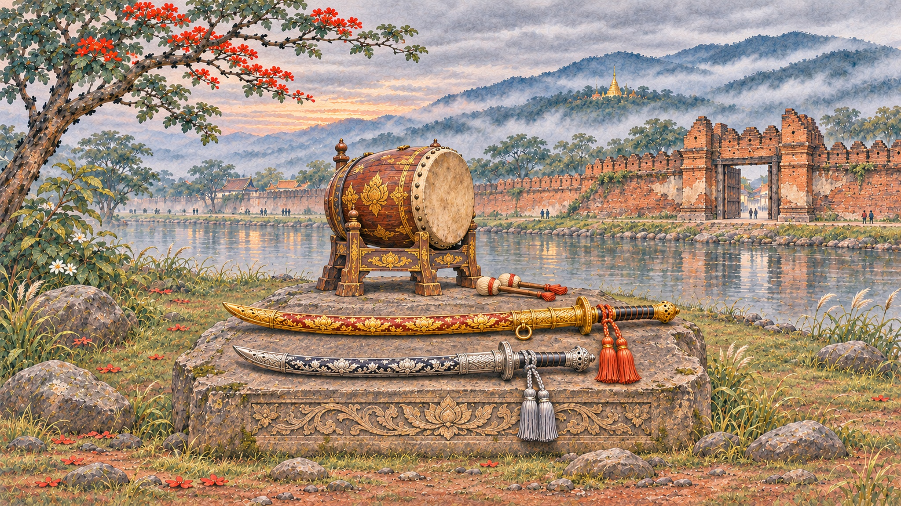

# ภาคที่ 4: ปราการล้านนาและอวสานวังหน้า (พ.ศ. 2330 – 2346)
## ตอนที่ 15: ศึกเชียงใหม่ พ.ศ. 2340 ปราการล้านนา

---

### องก์ที่ 1: เปิดฉากเมืองเกิดใหม่กลางวงล้อม พ.ศ. 2340

คบเพลิงจากค่ายล้อมของกองทัพพม่าส่องแสงเรืองรองอยู่รอบกำแพงอิฐและคูเมือง **เชียงใหม่** ท่ามกลางลมหนาวปลาย พ.ศ. 2340 (จุลศักราช 1159 ปีมะเส็ง นพศก) เสียงโห่ร้องและเสียงกลองศึกดังก้องจากฝั่งแม่น้ำปิงตลอดแนว

เบื้องหลังแนวใบเสมาที่เพิ่งซ่อมแซมขึ้นใหม่ไม่นาน **พระยากาวิละ** (เจ้าผู้ครองนครเชียงใหม่ในตำแหน่งพระยาเชียงใหม่ขณะนั้น) และพี่น้องตระกูลเจ้าเจ็ดตนกำลังยืนตรวจตราความพร้อมของไพร่พลชาวล้านนาด้วยสีหน้าเคร่งเครียด เมืองเชียงใหม่เพิ่งได้รับการฟื้นฟูขึ้นจากสภาพเมืองร้างเมื่อปลาย พ.ศ. 2338 ตามการนับปีไทยแบบเดิม (ตรงกับวันที่ 5 มีนาคม ค.ศ. 1796 หรือต้น พ.ศ. 2339 ตามปฏิทินสากล) ได้เพียงปีเศษเท่านั้น กำแพงเมืองบางด้านยังเพิ่งก่อเสริม ไพร่พลและเสบียงอาหารเพิ่งรวบรวมเข้ามาตั้งรกรากได้ไม่เต็มที่

ทว่ากองทัพใหญ่จากกรุงอมรปุระของพระเจ้าปดุงก็เคลื่อนกำลังลงมาจากฐานที่มั่น **เมืองเชียงแสน** เข้าปิดล้อมเมืองเชียงใหม่และกดดันแนวลำพูนไว้ทุกด้าน—ในเอกสารฝ่ายล้านนาอย่าง *ประชุมพงศาวดาร ภาคที่ 5* (เรื่องพงศาวดารเมืองนครเชียงใหม่ เมืองลำปาง เมืองลำพูน) ออกนามแม่ทัพพม่าว่า **อึ้งแซะโป่** และ **ซิดซิงโป่** พร้อมระบุตัวเลขกำลังพล **99,000 นาย** ขณะที่งานเรียบเรียงฝ่ายไทยชั้นหลังอย่าง *ไทยรบพม่า* ออกนามแม่ทัพพม่าว่า **เนเมียวจ่อดินสีหสุระ** และประเมินกำลังพลราว **55,000 นาย**

พระยากาวิละปิดประตูเมืองสู้ต้านทานสุดกำลัง แต่งเจ้านายบุตรหลานคุมไพร่พลออกตีโต้แนวล้อมหลายคราว พร้อมส่งหนังสือบอกลงไปยังกรุงเทพมหานคร—และเมื่อใบบอกนั้นมาถึงท้องพระโรงเมืองหลวง ผู้ที่ทรงได้รับพระกรุณาโปรดเกล้าฯ ให้เสด็จยาตราพยุหโยธาทัพหลวงขึ้นเหนือเพื่อช่วยรักษาปราการล้านนาคือ **กรมพระราชวังบวรมหาสุรสิงหนาท** แม่ทัพผู้เคยร่วมตีเมืองเชียงใหม่มาแล้วเมื่อ 23 ปีก่อน

---

### องก์ที่ 2: กระดานการเมืองและหลักฐาน

เมื่อกางแผนที่ลุ่มน้ำปิง–วัง–ยม–น่าน ใน พ.ศ. 2339–2341 แล้วสอบทานกับหลักฐานสำคัญ ได้แก่ **ประชุมพงศาวดาร ภาคที่ 5** (รวมเรื่องพงศาวดารเมืองนครเชียงใหม่ เมืองลำปาง เมืองลำพูน พิมพ์ครั้งแรก พ.ศ. 2460 / ชุดคุรุสภา เล่ม 4 พ.ศ. 2506), **พระราชพงศาวดารกรุงรัตนโกสินทร์ รัชกาลที่ 1** (ฉบับเจ้าพระยาทิพากรวงศ์), **ตำนานพื้นเมืองเชียงใหม่**, **พงศาวดารโยนก**, และ **ไทยรบพม่า** จะเห็นโครงสร้างการบัญชาการของฝ่ายสยามและจุดที่หลักฐานแต่ละสายบันทึกรายละเอียดต่างกันไว้ดังนี้

#### 1. ผู้นำทัพจากกรุงเทพฯ และกำลังร่วมรบในศึก พ.ศ. 2340

เพื่อไม่ให้ข้อมูลจากศึกคนละปีหรือพงศาวดารคนละฉบับปะปนกัน จำเป็นต้องแยกข้อเท็จจริงเฉพาะของ **ศึกเชียงใหม่ พ.ศ. 2340 (จ.ศ. 1159)** ออกจากศึกเชียงใหม่ พ.ศ. 2345 (ซึ่งจะเล่าในตอนที่ 16) ดังนี้:

1. **ผู้นำทัพใหญ่จากกรุงเทพฯ:** ใน *ประชุมพงศาวดาร ภาคที่ 5* บันทึกความในศึก จ.ศ. 1159 ไว้ชัดเจนว่าเมื่อพม่ามาล้อมเมืองเชียงใหม่ *"ทรงพระกรุณาโปรดเกล้าฯ ให้กรมพระราชวังบวรสถานมงคล เสด็จยาตราพยุหโยธาทัพหลวงขึ้นมาช่วยเมืองนครเชียงใหม่"* สอดคล้องกับโครงเรื่องใน *พระราชพงศาวดารกรุงรัตนโกสินทร์ รัชกาลที่ 1* และ *ไทยรบพม่า* ที่ระบุว่า **กรมพระราชวังบวรมหาสุรสิงหนาท** ทรงเป็น **แม่ทัพใหญ่** เสด็จยกทัพขึ้นเหนือมาช่วยเมืองเชียงใหม่ด้วยพระองค์เอง (ทั้งนี้ การตั้งกองบัญชาการค้างอยู่ที่ **เมืองเถิน** เพราะทรงพระประชวรหนักเป็นเหตุการณ์ในศึกครั้งหลังเมื่อ พ.ศ. 2345 มิใช่ พ.ศ. 2340)
2. **กำลังร่วมทัพจากฝ่ายสยามและล้านนา:** ในขบวนทัพช่วยเหลือเชียงใหม่คราว พ.ศ. 2340 มีพระบรมวงศานุวงศ์และขุนนางฝ่ายสยามร่วมรบด้วย ที่ปรากฏใน *ไทยรบพม่า* และเอกสารประวัติศาสตร์สายรัตนโกสินทร์คือ **สมเด็จพระเจ้าหลานเธอ เจ้าฟ้ากรมหลวงเทพหริรักษ์** ส่วนกำลังฝ่ายท้องถิ่นที่ยืนหยัดต้านทานอยู่ในเมืองเชียงใหม่และลำพูน–ลำปางคือ **พระยากาวิละ** และเจ้านายพี่น้องตระกูลเจ้าเจ็ดตน (อนึ่ง เนื่องจากผู้เขียนไม่มีหน้าข้อความฉบับเต็มของพงศาวดารทุกฉบับในมือเพื่อตรวจยืนยันรายนามแม่ทัพสมทบจากหัวเมืองประเทศราชอื่นทีละคน จึงขอเล่าเฉพาะกำลังหลักระหว่างกรุงรัตนโกสินทร์กับหัวเมืองล้านนาตามที่ตรวจหลักฐานได้)
3. **ข้อสังเกตเรื่องนามแม่ทัพพม่าและตัวเลขกำลังพล:** ผู้อ่านที่เปิดเทียบหลายตำราจะพบชื่อและตัวเลขที่ไม่ตรงกันสองชุด ชุดแรกจาก *ประชุมพงศาวดาร ภาคที่ 5* (สายล้านนา) ออกนามแม่ทัพพม่าว่า **อึ้งแซะโป่** และ **ซิดซิงโป่** และลงตัวเลขกำลังพลตามสำนวนพงศาวดารไว้ **99,000 นาย** ส่วนชุดที่สองจาก *ไทยรบพม่า* และงานเรียบเรียงยุคหลังออกนามแม่ทัพพม่าว่า **เนเมียวจ่อดินสีหสุระ** และประเมินกำลังพลราว **55,000 นาย** ทั้งนี้คำเรียกอย่าง "อึ้งแซะโป่" หรือ "ซิดซิงโป่" ในบันทึกไทย–ล้านนาอาจเป็นการถอดเสียงตำแหน่งหรือราชทินนามของแม่ทัพพม่าในคราวเดียวกันมากกว่าจะหมายถึงบุคคลคนละชุดกับชื่อในพงศาวดารพม่าที่นำมาเรียบเรียงใน *ไทยรบพม่า* จึงควรระบุแหล่งที่มาคู่กันไว้โดยไม่ปะปนกัน

#### 2. ข้อควรระวังสำหรับผู้อ่าน: "บุญมา" สองคนในเรื่องราวเมืองเชียงใหม่

เมื่อเล่าถึงการฟื้นฟูเมืองเชียงใหม่ในยุคของพระยากาวิละ หลักฐานล้านนาและพงศาวดารไทยย่อมต้องเอ่ยท้าวความถึงจุดเริ่มต้นในสมัยกรุงธนบุรี (พ.ศ. 2317–2318) ซึ่งอาจทำให้ผู้อ่านเกิดความสับสนกับชื่อ **"บุญมา"** ที่ปรากฏในประวัติศาสตร์เมืองเชียงใหม่อีกครั้ง ดังที่ได้อธิบายไว้แล้วในตอนที่ 4:

- **บุญมา คนที่หนึ่ง** คือ **กรมพระราชวังบวรมหาสุรสิงหนาท** (พระนามเดิม **บุญมา**) อดีต **เจ้าพระยาสุรสีห์พิษณวาธิราช** เจ้าเมืองพิษณุโลก ผู้ร่วมตีเชียงใหม่ในสมัยกรุงธนบุรี และบัดนี้เสด็จขึ้นเหนือในฐานะ **พระมหาอุปราช (วังหน้า)** แห่งกรุงรัตนโกสินทร์
- **บุญมา คนที่สอง** คือ **พระยาจ่าบ้าน (บุญมา)** หรือที่ตำนานพื้นเมืองเชียงใหม่เรียก "พญาจ่าบ้านบุญมา" ขุนนางพื้นเมืองเชียงใหม่ผู้ร่วมก่อการกับเจ้ากาวิละขับไล่พม่าใน พ.ศ. 2317–2318 และได้รับแต่งตั้งเป็น **พระยาวิเชียรปราการ** ครองเมืองเชียงใหม่เป็นคนแรกในสมัยธนบุรี ทว่าพระยาจ่าบ้าน (บุญมา) ถึงแก่กรรมไปตั้งแต่ปลายสมัยธนบุรี (พ.ศ. 2321–2322) ก่อนเกิดศึก พ.ศ. 2340 เกือบยี่สิบปีแล้ว

ดังนั้น ในศึก พ.ศ. 2340 ผู้ที่นำทัพหลวงจากกรุงเทพฯ ขึ้นไปช่วยพระยากาวิละคือ **กรมพระราชวังบวรมหาสุรสิงหนาท (บุญมา)** ส่วน **"บุญมา" แห่งเชียงใหม่ (พระยาจ่าบ้าน)** เป็นวีรบุรุษยุคก่อนหน้าที่พระยากาวิละสืบสานภารกิจฟื้นฟูบ้านเมืองต่อมาจนสำเร็จ

#### 3. ยุทธศาสตร์ "เก็บผักใส่ซ้า เก็บข้าใส่เมือง" ก่อน พ.ศ. 2340

เหตุใดกรุงอมรปุระจึงต้องทุ่มกำลังพลขนาดใหญ่ลงมาตีเชียงใหม่ใน พ.ศ. 2340? คำตอบอยู่ที่ความเปลี่ยนแปลงอันสำคัญยิ่งของล้านนาระหว่าง พ.ศ. 2318–2339

หลังเสียเมืองเชียงใหม่ครั้งที่ 1 ในสมัยธนบุรี เมืองเชียงใหม่เคยถูกทิ้งร้างเพราะขาดผู้คนและถูกพม่าคุกคามซ้ำแล้วซ้ำเล่า จนกระทั่งพระยากาวิละและพี่น้องตระกูลเจ้าเจ็ดตนใช้ **เวียงป่าซาง** (ในเขตจังหวัดลำพูนปัจจุบัน) เป็นฐานตั้งมั่นมานานหลายปี พร้อมดำเนินนโยบาย **"เก็บผักใส่ซ้า เก็บข้าใส่เมือง"** คือส่งกองกำลังขึ้นไปกวาดต้อนผู้คนและหัวเมืองไทใหญ่–ยอง–เขินทางตอนเหนือมาสะสมเป็นกำลังคนและกำลังผลิต จนกระทั่งมั่นคงพอจะย้ายกลับมาฟื้นฟู **เมืองเชียงใหม่** เป็นศูนย์กลางอีกครั้งเมื่อ พ.ศ. 2338–2339 (ขนานนามว่า *รัตนติงษาอภินวบุรี*)

ในสายตาของกรุงอมรปุระ การที่เชียงใหม่ฟื้นคืนชีพขึ้นมาพร้อมกำแพงเมืองและไพร่พลจำนวนมาก ย่อมหมายความว่าฐานทัพหน้าของพม่าที่ **เชียงแสน** จะถูกลดทอนอิทธิพลลงและพม่าจะสูญเสียเส้นทางรุกรานสยามทางภาคเหนือไปตลอดกาล ดังนั้นพม่าจึงต้องรีบบดขยี้เชียงใหม่ตั้งแต่ยังเพิ่งตั้งตัวไม่ติด

---

### องก์ที่ 3: จุดปะทะ — การยืนหยัดในวงล้อมและการตีโต้ประสาน

การรบที่เมืองเชียงใหม่ใน พ.ศ. 2340–2341 แบ่งออกเป็น 2 ระยะสำคัญ คือการยันวงล้อมภายในเมืองของฝ่ายล้านนา และการตีประสานระหว่างทัพหนุนของสยามจากภายนอกกับกำลังล้านนาจากภายใน

#### 1. การตั้งล้อมของพม่า และการต้านทานของพระยากาวิละ

เมื่อกองทัพพม่าเคลื่อนลงมาถึงลุ่มน้ำปิงใน จ.ศ. 1159 (พ.ศ. 2340) ฝ่ายพม่าได้ตั้งค่ายประชิดปิดล้อมรอบกำแพงเมืองเชียงใหม่ไว้ทุกด้านเพื่อตัดขาดการส่งกำลังบำรุง พร้อมทั้งจัดกำลังสกัดเส้นทางเชื่อมต่อระหว่างลำพูน–ป่าซางกับหัวเมืองทางใต้

ภายในกำแพงเมืองเชียงใหม่ **พระยากาวิละ** และเจ้านายพี่น้องในตระกูลเจ้าเจ็ดตนจากลำปางและลำพูนจัดแบ่งกำลังกันรักษาเชิงเทินทุกด้านอย่างเข้มแข็ง ตามที่ *ประชุมพงศาวดาร ภาคที่ 5* บันทึกไว้ พระยาเชียงใหม่แต่งเจ้านายบุตรหลานถือพลออกตีตอบโต้ค่ายพม่าทุกทิศทุกด้านหลายครั้งหลายคราวเพื่อยืดเวลาให้ได้นานที่สุดจนกว่าทัพหลวงจากกรุงเทพฯ จะขึ้นไปถึง

ความทรงจำจากศึกสงครามเก้าทัพเมื่อครั้งพระยากาวิละปิดประตูเมืองลำปางต้านทัพพม่าใน พ.ศ. 2328 ได้ถูกนำกลับมาใช้อีกครั้ง—และเช่นเดียวกับครั้งนั้น **เวลาและเสบียงคืออาวุธที่ทำงานอยู่ข้างฝ่ายตั้งรับ**

#### 2. การเคลื่อนทัพวังหน้าขึ้นเหนือและแผนตีกระหนาบ

เมื่อใบบอกจากเมืองเชียงใหม่ลงมาถึงกรุงเทพมหานคร **กรมพระราชวังบวรมหาสุรสิงหนาท** ทรงได้รับพระกรุณาโปรดเกล้าฯ ให้เป็นแม่ทัพใหญ่เสด็จยาตราทัพหลวงขึ้นเหนือผ่านหัวเมืองฝ่ายเหนือและเส้นทางลุ่มน้ำวัง–ลำปางมุ่งหน้าสู่ลุ่มน้ำปิงเพื่อช่วยเหลือเมืองเชียงใหม่

เส้นทางขึ้นเชียงใหม่มีเทือกเขากั้นระหว่างลุ่มน้ำวัง (ลำปาง) กับลุ่มน้ำปิง (ลำพูน–เชียงใหม่) หากส่งกำลังเดินเรียงเดี่ยวเข้าไปโดยไม่ประสานกับกำลังในพื้นที่ย่อมเสี่ยงต่อการถูกพม่าดักซุ่มสกัดกลางทาง กรมพระราชวังบวรฯ และแม่ทัพนายกองฝ่ายสยาม (รวมถึง **เจ้าฟ้ากรมหลวงเทพหริรักษ์**) จึงเร่งเคลื่อนทัพเข้าตีแนวสกัดของพม่าทางด้านใต้ผ่านลำพูนขึ้นไปยังวงล้อมหน้าเมืองเชียงใหม่ เพื่อประสานกับกำลังของ **พระยากาวิละ** ที่เตรียมตีโต้ออกมาจากภายในกำแพงเมือง

#### 3. วันแตกหักหน้ากำแพงเมืองเชียงใหม่

เมื่อถูกโจมตีประสานกันทั้งจากทัพหนุนฝ่ายสยามด้านนอกและกำลังของพระยากาวิละที่ตีโอบออกมาจากในเมือง แนวค่ายล้อมของพม่าที่ตั้งอยู่รอบเชียงใหม่และลำพูนก็ไม่อาจรักษาแนวติดต่อถึงกันได้

ตามหลักฐานใน *ประชุมพงศาวดาร ภาคที่ 5*, *พระราชพงศาวดารกรุงรัตนโกสินทร์ รัชกาลที่ 1*, และ *ตำนานพื้นเมืองเชียงใหม่* การรบดำเนินไปจนกระทั่งฝ่ายไทย–ล้านนาตีค่ายล้อมของพม่าแตกกระเจิง กำลังพม่าที่เหลือต่างแตกพ่ายถอยร่นหนีกลับขึ้นเหนือไปทาง **เมืองเชียงแสน** (ส่วนรายละเอียดเรื่องชะตากรรมส่วนตัวของแม่ทัพพม่าหรือรายนามเชลยระดับรองในเอกสารแต่ละสายยังมีบันทึกต่างกันและผู้เขียนไม่มีเลขหน้าพงศาวดารฉบับสมบูรณ์ยืนยัน จึงไม่เพิ่มเติมเกินหลักฐาน)

เมืองเชียงใหม่ที่เพิ่งฟื้นฟูขึ้นใหม่จึงรอดพ้นจากภัยพิบัติได้อย่างงดงาม และพันธมิตรระหว่างกรุงรัตนโกสินทร์กับหัวเมืองล้านนาก็แข็งแกร่งเกินกว่าที่ทัพหัวเมืองพม่าจะเจาะลงมาได้อีกโดยง่าย

---

### องก์ที่ 4: แรงสะเทือนและศึกครั้งสุดท้ายที่รออยู่ในอีกห้าปีข้างหน้า

ชัยชนะในศึกเชียงใหม่ พ.ศ. 2340–2341 มีความหมายต่อยุทธศาสตร์ของกรุงรัตนโกสินทร์เทียบเท่าชัยชนะที่ทุ่งลาดหญ้าในภาคกลางเมื่อทศวรรษก่อน: **ปราการล้านนาไม่ล่มสลาย** และเส้นทางรุกรานจากอังวะลงสู่ลุ่มน้ำเจ้าพระยาทางทิศเหนือถูกปิดตายไว้ที่แนวแม่น้ำปิง–วัง

สำหรับ **กรมพระราชวังบวรมหาสุรสิงหนาท** ชัยชนะครั้งนี้คือการปิดวงจรประวัติศาสตร์ส่วนพระองค์ได้อย่างน่าทึ่ง—ใน พ.ศ. 2317–2318 ท่านในนาม **เจ้าพระยาสุรสีห์** เป็นแม่ทัพหน้าของกรุงธนบุรีที่ร่วมกับพระยาจ่าบ้าน (บุญมา) และเจ้ากาวิละตีเอาเมืองเชียงใหม่คืนจากพม่าเป็นครั้งแรก และอีก 23 ปีต่อมาใน พ.ศ. 2340–2341 พระองค์ในนาม **กรมพระราชวังบวรฯ** ก็ได้เสด็จนำทัพจากกรุงรัตนโกสินทร์ขึ้นมาช่วยรักษาเมืองเชียงใหม่ของพระยากาวิละไว้ได้อีกครั้ง

ทว่าเมฆหมอกทางเหนือยังไม่สลายไปทั้งหมด ตราบใดที่ธงรบของพม่ายังโบกสะบัดอยู่เหนือกำแพงเมือง **เชียงแสน** ริมฝั่งโขงตอนบน พระเจ้าปดุงก็ย่อมเตรียมส่งกองทัพลงมาลองกำลังกับเมืองเชียงใหม่อีกคำรบหนึ่ง

และในอีก 5 ปีข้างหน้า—**พ.ศ. 2345**—เมื่อเสียงกลองศึกดังขึ้นรอบเชียงใหม่เป็นครั้งสุดท้าย กรมพระราชวังบวรมหาสุรสิงหนาทในวัยย่างเข้า 60 พรรษาจะต้องเสด็จขึ้นเหนือเป็นครั้งสุดท้ายในพระชนม์ชีพ ท่ามกลางพระโรคประชวรที่กำลังรุมเร้าหนักขึ้นทุกย่างก้าวสู่ **เมืองเถิน**

**จบตอนที่ 15**

*(ติดตามต่อใน ตอนที่ 16: ทัพสุดท้ายขึ้นเหนือ และอวสานวังหน้า)*
