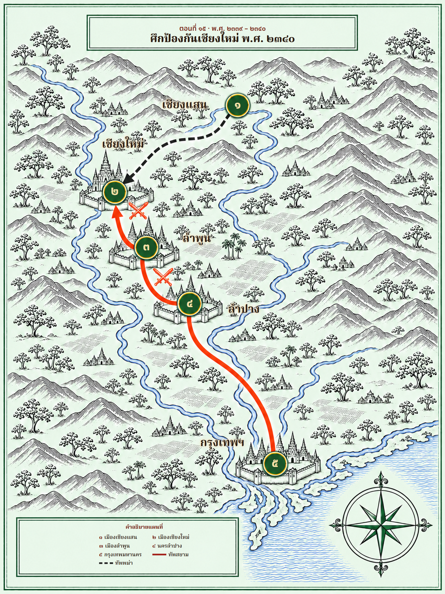

# ภาคที่ 4: ปราการล้านนาและอวสานวังหน้า (พ.ศ. 2330 – 2346)
## ตอนที่ 15: ศึกเชียงใหม่ พ.ศ. 2340 ปราการล้านนา

---

### องก์ที่ 1: เปิดฉากเมืองเกิดใหม่กลางวงล้อม พ.ศ. 2340

คบเพลิงจากค่ายล้อมของกองทัพพม่าส่องแสงเรืองรองอยู่รอบกำแพงอิฐและคูเมือง **เชียงใหม่** ท่ามกลางลมหนาวปลาย พ.ศ. 2340 (จุลศักราช 1159 ปีมะเส็ง นพศก) เสียงโห่ร้องและเสียงกลองศึกดังก้องจากฝั่งแม่น้ำปิงตลอดแนว

เบื้องหลังแนวใบเสมาที่เพิ่งซ่อมแซมขึ้นใหม่ไม่นาน **พระยากาวิละ** เจ้าผู้ครองนครเชียงใหม่และพี่น้องตระกูลเจ้าเจ็ดตนกำลังยืนตรวจตราความพร้อมของไพร่พลชาวล้านนาด้วยสีหน้าเคร่งเครียด เมืองเชียงใหม่เพิ่งได้รับการฟื้นฟูขึ้นจากสภาพเมืองร้างเมื่อปลาย พ.ศ. 2338 ตามการนับปีไทยแบบเดิม (ตรงกับวันที่ 5 มีนาคม ค.ศ. 1796 หรือต้น พ.ศ. 2339 ตามปฏิทินสากล) ได้เพียงปีเศษเท่านั้น กำแพงเมืองบางด้านยังเพิ่งก่อเสริม ไพร่พลและเสบียงอาหารเพิ่งรวบรวมเข้ามาตั้งรกรากได้ไม่เต็มที่

ทว่ากองทัพใหญ่จากกรุงอมรปุระของพระเจ้าปดุงภายใต้การนำของแม่ทัพพม่า **เนเมียวจ่อดินสีหสุระ** (หลักฐานไทย–ล้านนาออกนามแม่ทัพพม่าในคราวนี้เช่น อึ้งแซะโป่ และซิดซิงโป่) พร้อมกำลังพลตามบัญชีพงศาวดารราว **55,000 นาย** ก็เคลื่อนทัพลงมาจากฐานที่มั่น **เมืองเชียงแสน** เข้าปิดล้อมเมืองเชียงใหม่และกดดันแนวลำพูนไว้ทุกด้าน

พระยากาวิละปิดประตูเมืองสู้ต้านทานสุดกำลัง พร้อมแต่งม้าเร็วถือหนังสือบอกฝ่าวงล้อมลงไปยังกรุงเทพมหานคร—และเมื่อใบบอกนั้นมาถึงท้องพระโรงเมืองหลวง ผู้ที่เสด็จนำทัพใหญ่ขึ้นเหนือเพื่อช่วยรักษาปราการล้านนาด้วยพระองค์เองคือ **กรมพระราชวังบวรมหาสุรสิงหนาท** แม่ทัพผู้เคยร่วมตีเมืองเชียงใหม่มาแล้วเมื่อ 23 ปีก่อน

---

### องก์ที่ 2: กระดานการเมืองและหลักฐาน

เมื่อกางแผนที่ลุ่มน้ำปิง–วัง–ยม–น่าน–โขง ใน พ.ศ. 2339–2341 แล้วสอบทานกับหลักฐานหลัก 4 ชุด ได้แก่ **พระราชพงศาวดารกรุงรัตนโกสินทร์ รัชกาลที่ 1** (ฉบับเจ้าพระยาทิพากรวงศ์), **ตำนานพื้นเมืองเชียงใหม่**, **พงศาวดารโยนก** (ของพระยาประชากิจกรจักร), และ **ไทยรบพม่า** (ของสมเด็จฯ กรมพระยาดำรงราชานุภาพ) จะเห็นทั้งโครงสร้างการบัญชาการของฝ่ายสยาม และประวัติความเป็นมาอันซับซ้อนของปราการล้านนา

#### 1. [ตรวจหลักฐาน] ใครนำทัพจากกรุงเทพฯ และใครร่วมทัพในศึก พ.ศ. 2340?

คำถามสำคัญที่ต้องตรวจสอบให้ตรงตามหลักฐานชั้นต้นคือ **ในศึกเชียงใหม่ พ.ศ. 2340 วังหน้าเสด็จเป็นแม่ทัพใหญ่หรือไม่ และมีทัพใดร่วมสมทบ?**

1. **ผู้นำทัพใหญ่จากกรุงเทพฯ:** ทั้ง *พระราชพงศาวดารกรุงรัตนโกสินทร์ รัชกาลที่ 1* และ *ไทยรบพม่า* ยืนยันตรงกันว่า พระบาทสมเด็จพระพุทธยอดฟ้าจุฬาโลกมหาราชโปรดเกล้าฯ ให้ **กรมพระราชวังบวรมหาสุรสิงหนาท** ทรงเป็น **แม่ทัพใหญ่** ยกกองทัพหลวงจากกรุงเทพมหานครขึ้นไปช่วยเมืองเชียงใหม่ ในการเสด็จคราวนี้ กรมพระราชวังบวรมหาสุรสิงหนาทเสด็จขึ้นไปตั้งกองบัญชาการหลักอยู่ที่ **เมืองเถิน** (ปัจจุบันอยู่ในจังหวัดลำปาง) เพื่อคุมเส้นทางส่งกำลังบำรุงและวางแผนจัดสายทัพเข้าตีกระหนาบวงล้อมพม่า
2. **เจ้านายและแม่ทัพฝ่ายสยามที่ร่วมทัพ:** จากเมืองเถิน กรมพระราชวังบวรฯ ทรงจัดแบ่งกำลังออกเป็นหลายสาย โดยมีพระบรมวงศานุวงศ์และขุนนางชั้นผู้ใหญ่คุมทัพหน้ารุกเข้าพื้นที่ลำปาง–ลำพูน–เชียงใหม่ ได้แก่ **สมเด็จพระเจ้าหลานเธอ เจ้าฟ้ากรมหลวงเทพหริรักษ์** และ **พระเจ้าหลานเธอ กรมขุนสุนทรภูเบศร์** พร้อมด้วยแม่ทัพฝ่ายวังหน้าและกำลังพลจากหัวเมืองฝ่ายเหนือ
3. **ทัพพันธมิตรเวียงจันทน์และทัพล้านนา:** ศึก พ.ศ. 2340–2341 มิใช่การรบของกรุงเทพฯ เพียงลำพัง หากเป็นการผนึกกำลังของ **สามฝ่าย** คือ กรุงรัตนโกสินทร์, ล้านนาภายใต้การนำของ **พระยากาวิละ** และตระกูลเจ้าเจ็ดตน, กับกองทัพประเทศราชจาก **อาณาจักรล้านช้างเวียงจันทน์** (ซึ่งมี **เจ้าอนุวงศ์** ร่วมนำทัพมาสมทบด้วย) นับเป็นปฏิบัติการร่วมระหว่างสยาม–ล้านนา–ล้านช้างที่ใหญ่ที่สุดครั้งหนึ่งในการสกัดอิทธิพลพม่า

#### 2. ข้อควรระวังสำหรับผู้อ่าน: "บุญมา" สองคนในเรื่องราวเมืองเชียงใหม่

เมื่อเล่าถึงการฟื้นฟูเมืองเชียงใหม่ในยุคของพระยากาวิละ หลักฐานล้านนาและพงศาวดารไทยย่อมต้องเอ่ยท้าวความถึงจุดเริ่มต้นในสมัยกรุงธนบุรี (พ.ศ. 2317–2318) ซึ่งอาจทำให้ผู้อ่านเกิดความสับสนกับชื่อ **"บุญมา"** ที่ปรากฏในประวัติศาสตร์เมืองเชียงใหม่อีกครั้ง ดังที่ได้อธิบายไว้แล้วในตอนที่ 4:

- **บุญมา คนที่หนึ่ง** คือ **กรมพระราชวังบวรมหาสุรสิงหนาท** (พระนามเดิม **บุญมา**) อดีต **เจ้าพระยาสุรสีห์พิษณวาธิราช** เจ้าเมืองพิษณุโลก ผู้ร่วมตีเชียงใหม่ในสมัยกรุงธนบุรี และบัดนี้เสด็จขึ้นเหนือในฐานะ **พระมหาอุปราช (วังหน้า)** แห่งกรุงรัตนโกสินทร์
- **บุญมา คนที่สอง** คือ **พระยาจ่าบ้าน (บุญมา)** หรือที่ตำนานพื้นเมืองเชียงใหม่เรียก "พญาจ่าบ้านบุญมา" ขุนนางพื้นเมืองเชียงใหม่ผู้ร่วมก่อการกับเจ้ากาวิละขับไล่พม่าใน พ.ศ. 2317–2318 และได้รับแต่งตั้งเป็น **พระยาวิเชียรปราการ** ครองเมืองเชียงใหม่เป็นคนแรกในสมัยธนบุรี ทว่าพระยาจ่าบ้าน (บุญมา) ถึงแก่กรรมไปตั้งแต่ปลายสมัยธนบุรี (พ.ศ. 2321–2322) ก่อนเกิดศึก พ.ศ. 2340 เกือบยี่สิบปีแล้ว

ดังนั้น ในศึก พ.ศ. 2340 ผู้ที่นำทัพหลวงจากกรุงเทพฯ ขึ้นไปช่วยพระยากาวิละคือ **กรมพระราชวังบวรมหาสุรสิงหนาท (บุญมา)** ส่วน **"บุญมา" แห่งเชียงใหม่ (พระยาจ่าบ้าน)** เป็นวีรบุรุษยุคก่อนหน้าที่พระยากาวิละสืบสานภารกิจฟื้นฟูบ้านเมืองต่อมาจนสำเร็จ

#### 3. ยุทธศาสตร์ "เก็บผักใส่ซ้า เก็บข้าใส่เมือง" ก่อน พ.ศ. 2340

เหตุใดพระเจ้าปดุงจึงทรงทุ่มกำลังพลถึง 55,000 นายลงมาตีเชียงใหม่ใน พ.ศ. 2340? คำตอบอยู่ที่ความเปลี่ยนแปลงอันสำคัญยิ่งของล้านนาระหว่าง พ.ศ. 2318–2339

หลังเสียเมืองเชียงใหม่ครั้งที่ 1 ในสมัยธนบุรี เมืองเชียงใหม่เคยถูกทิ้งร้างเพราะขาดผู้คนและถูกพม่าคุกคามซ้ำแล้วซ้ำเล่า จนกระทั่งพระยากาวิละและพี่น้องตระกูลเจ้าเจ็ดตนใช้ **เวียงป่าซาง** (ในเขตจังหวัดลำพูนปัจจุบัน) เป็นฐานตั้งมั่นมานานหลายปี พร้อมดำเนินนโยบาย **"เก็บผักใส่ซ้า เก็บข้าใส่เมือง"** คือส่งกองกำลังขึ้นไปกวาดต้อนผู้คนและหัวเมืองไทใหญ่–ยอง–เขินทางตอนเหนือมาสะสมเป็นกำลังคนและกำลังผลิต จนกระทั่งมั่นคงพอจะย้ายกลับมาฟื้นฟู **เมืองเชียงใหม่** เป็นศูนย์กลางอีกครั้งเมื่อ พ.ศ. 2338–2339 (ขนานนามว่า *รัตนติงษาอภินวบุรี*)

ในสายตาของกรุงอมรปุระ การที่เชียงใหม่ฟื้นคืนชีพขึ้นมาพร้อมกำแพงเมืองและไพร่พลมหาศาล ย่อมหมายความว่าฐานทัพหน้าของพม่าที่ **เชียงแสน** จะถูกลดทอนอิทธิพลลงและพม่าจะสูญเสียเส้นทางรุกรานสยามทางภาคเหนือไปตลอดกาล ดังนั้นพม่าจึงต้องรีบบดขยี้เชียงใหม่ตั้งแต่ยังเพิ่งตั้งตัวไม่ติด

---

### องก์ที่ 3: จุดปะทะ — ปิดทำนบแม่น้ำปิงและการตีกระหนาบสามทาง

การรบที่เมืองเชียงใหม่ใน พ.ศ. 2340–2341 แบ่งออกเป็น 2 ระยะสำคัญ คือการยันวงล้อมภายในเมืองของฝ่ายล้านนา และการตีฝ่ากระหนาบของทัพสยาม–เวียงจันทน์จากภายนอก

#### 1. แผนตัดน้ำ–ล้อมเมืองของพม่า และการต้านทานของพระยากาวิละ

เมื่อกองทัพพม่าของเนเมียวจ่อดินสีหสุระลงมาถึงลุ่มน้ำปิงใน พ.ศ. 2340 ฝ่ายพม่าไม่ได้อาศัยเพียงกำลังทหารล้อมค่ายรอบกำแพงเมือง หากใช้ยุทธวิธีกดดันทางภูมิศาสตร์ด้วยการตั้งค่ายประชิดและพยายามทำทำนบปิดกั้นลำน้ำปิงสายเดิมเพื่อตัดเส้นทางน้ำและเสบียงอาหารที่จะส่งเข้าเมืองเชียงใหม่ ทั้งยังแบ่งกำลังส่วนหนึ่งเข้าตรึงพื้นที่ลำพูน–ป่าซางเพื่อสกัดทัพหนุนจากทางใต้

ภายในกำแพงเมืองเชียงใหม่ **พระยากาวิละ** และเจ้านายพี่น้องในตระกูลเจ้าเจ็ดตน (เช่น เจ้าคำสม เจ้าดวงทิพย์ แห่งลำปาง และเจ้านายสายลำพูน) จัดแบ่งกำลังกันรักษาเชิงเทินทุกด้านอย่างเข้มแข็ง ไม่ยอมเปิดประตูออกรบกลางทุ่งให้เสียเปรียบจำนวนคน แต่คอยส่งกองกำลังออกตีโฉบฉวยค่ายพม่าและยืดเวลาให้ได้นานที่สุดจนกว่าทัพจากกรุงเทพฯ จะขึ้นไปถึง

ความทรงจำจากศึกสงครามเก้าทัพเมื่อครั้งพระยากาวิละปิดประตูเมืองลำปางต้านทัพพม่าใน พ.ศ. 2328 ได้ถูกนำกลับมาใช้อีกครั้ง—และเช่นเดียวกับครั้งนั้น **เวลาและเสบียงคืออาวุธที่ทำงานอยู่ข้างฝ่ายตั้งรับ**

#### 2. วังหน้าที่เมืองเถิน และการปล่อยหมัดกระหนาบสามทิศ

ทันทีที่ **กรมพระราชวังบวรมหาสุรสิงหนาท** ทรงนำทัพใหญ่จากกรุงเทพมหานครเสด็จขึ้นไปถึง **เมืองเถิน** พระองค์ทรงประเมินสถานการณ์จากภูมิประเทศที่ทรงคุ้นเคยเป็นอย่างดี

เส้นทางขึ้นเชียงใหม่มีเทือกเขากั้นระหว่างลุ่มน้ำวัง (ลำปาง–เถิน) กับลุ่มน้ำปิง (ลำพูน–เชียงใหม่) หากส่งทัพใหญ่ทั้งหมดเดินเรียงเดี่ยวเข้าไปในช่องเขาเดียว ย่อมเสี่ยงต่อการถูกพม่าดักซุ่มสกัดกลางทาง ดังนั้นกรมพระราชวังบวรฯ จึงทรงใช้แผน **ตีกระหนาบประสานหลายสาย**:

1. **สายหลักจากเมืองเถิน–ลำปาง–ลำพูน:** โปรดให้ **เจ้าฟ้ากรมหลวงเทพหริรักษ์** และ **กรมขุนสุนทรภูเบศร์** นำกองทัพสยามเคลื่อนขึ้นเหนือผ่านนครลำปางมุ่งเข้าสู่ลำพูน เพื่อตีค่ายสกัดของพม่าทางด้านใต้ของเมืองเชียงใหม่
2. **สายตะวันออกเฉียงเหนือจากเวียงจันทน์:** ประสานให้กองทัพล้านช้างเวียงจันทน์ (ซึ่งมี **เจ้าอนุวงศ์** ร่วมทัพมาด้วย) เคลื่อนกำลังผ่านเส้นทางหัวเมืองน่าน–แพร่เข้ามาตีตลบปีกตะวันออกของวงล้อมพม่า ไม่ให้พม่าถอยร่นหรือส่งกำลังหนุนได้สะดวก
3. **กำลังภายในกำแพงเชียงใหม่:** เมื่อทัพสยามและทัพเวียงจันทน์เคลื่อนเข้าประชิดแนวค่ายล้อมด้านนอก **พระยากาวิละ** ก็เปิดประตูเมืองเชียงใหม่นำทหารล้านนาตีประสานออกมาจากด้านใน

#### 3. วันแตกหักหน้ากำแพงเมืองเชียงใหม่

เมื่อถูกโจมตีพร้อมกันทั้งจากแนวหน้าสยามด้านใต้ แนวทัพเวียงจันทน์ด้านตะวันออก และกำลังของพระยากาวิละที่พุ่งออกมาจากในเมือง แนวค่ายล้อมของพม่าที่ตั้งอยู่รอบเชียงใหม่และลำพูนก็ไม่อาจรักษาแนวติดต่อถึงกันได้

ตาม *พระราชพงศาวดารกรุงรัตนโกสินทร์ รัชกาลที่ 1* และ *ตำนานพื้นเมืองเชียงใหม่* การรบดำเนินไปอย่างดุเดือดจนกระทั่งฝ่ายไทย–ล้านนาตีค่ายพม่าแตกกระเจิง **แม่ทัพพม่า (เนเมียวจ่อดินสีหสุระ / ซิดซิงโป่) สิ้นชีวิตในคราวศึกครั้งนี้** แม่ทัพพม่าบางส่วนถูกจับเป็นเชลย (รวมถึงแม่ทัพระดับรองอย่างอุปะกองตามบันทึกประวัติศาสตร์) ส่วนกำลังพม่าที่เหลือต่างแตกพ่ายถอยร่นหนีกลับขึ้นเหนือไปทาง **เมืองเชียงแสน**

เมืองเชียงใหม่ที่เพิ่งฟื้นฟูขึ้นใหม่จึงรอดพ้นจากภัยพิบัติได้อย่างงดงาม และพันธมิตรระหว่างกรุงรัตนโกสินทร์กับหัวเมืองล้านนาก็แข็งแกร่งเกินกว่าที่ทัพหัวเมืองพม่าจะเจาะลงมาได้อีกโดยง่าย

---

### องก์ที่ 4: แรงสะเทือนและศึกครั้งสุดท้ายที่รออยู่ในอีกห้าปีข้างหน้า

ชัยชนะในศึกเชียงใหม่ พ.ศ. 2340–2341 มีความหมายต่อยุทธศาสตร์ของกรุงรัตนโกสินทร์เทียบเท่าชัยชนะที่ทุ่งลาดหญ้าในภาคกลางเมื่อทศวรรษก่อน: **ปราการล้านนาไม่ล่มสลาย** และเส้นทางรุกรานจากอังวะลงสู่ลุ่มน้ำเจ้าพระยาทางทิศเหนือถูกปิดตายไว้ที่แนวแม่น้ำปิง–วัง

สำหรับ **กรมพระราชวังบวรมหาสุรสิงหนาท** ชัยชนะครั้งนี้คือการปิดวงจรประวัติศาสตร์ส่วนพระองค์ได้อย่างน่าทึ่ง—ใน พ.ศ. 2317–2318 ท่านในนาม **เจ้าพระยาสุรสีห์** เป็นแม่ทัพหน้าของกรุงธนบุรีที่ร่วมกับพระยาจ่าบ้าน (บุญมา) และเจ้ากาวิละตีเอาเมืองเชียงใหม่คืนจากพม่าเป็นครั้งแรก และอีก 23 ปีต่อมาใน พ.ศ. 2340–2341 พระองค์ในนาม **กรมพระราชวังบวรฯ** ก็ได้เสด็จนำทัพจากกรุงรัตนโกสินทร์ขึ้นมาช่วยรักษาเมืองเชียงใหม่ของพระยากาวิละไว้ได้อีกครั้ง

ทว่าเมฆหมอกทางเหนือยังไม่สลายไปทั้งหมด ตราบใดที่ธงรบของพม่ายังโบกสะบัดอยู่เหนือกำแพงเมือง **เชียงแสน** ริมฝั่งโขงตอนบน พระเจ้าปดุงก็ย่อมเตรียมส่งกองทัพลงมาลองกำลังกับเมืองเชียงใหม่อีกคำรบหนึ่ง

และในอีก 5 ปีข้างหน้า—**พ.ศ. 2345**—เมื่อเสียงกลองศึกดังขึ้นรอบเชียงใหม่เป็นครั้งสุดท้าย กรมพระราชวังบวรมหาสุรสิงหนาทในวัยย่างเข้า 60 พรรษาจะต้องเสด็จขึ้นเหนือเป็นครั้งสุดท้ายในพระชนม์ชีพ ท่ามกลางพระโรคประชวรที่กำลังรุมเร้าหนักขึ้นทุกย่างก้าวสู่ **เมืองเถิน**

**จบตอนที่ 15**

*(ติดตามต่อใน ตอนที่ 16: ทัพสุดท้ายขึ้นเหนือ และอวสานวังหน้า)*
