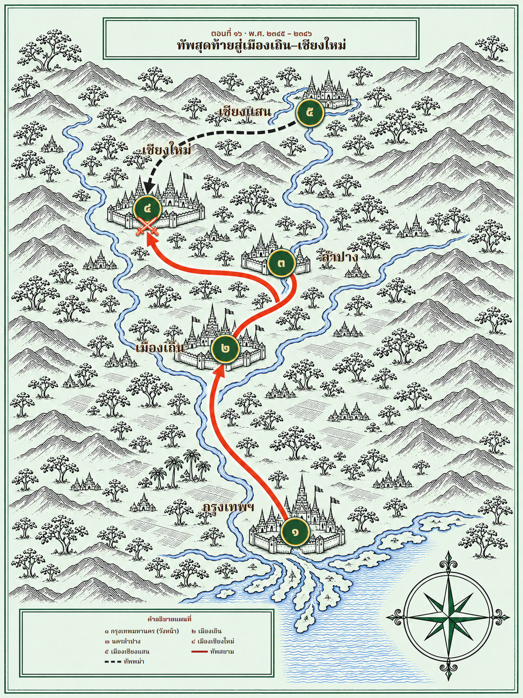

# ภาคที่ 4: ปราการล้านนาและอวสานวังหน้า (พ.ศ. 2330 – 2346)
## ตอนที่ 16: ทัพสุดท้ายขึ้นเหนือ และอวสานวังหน้า

---

### องก์ที่ 1: เปิดฉากพระอาการประชวรกลางศึกที่เมืองเถิน พ.ศ. 2345

ภายในพลับพลาที่ประทับริมลำน้ำวัง ณ **เมืองเถิน** (เขตจังหวัดลำปางในปัจจุบัน) ในฤดูแล้งปลาย พ.ศ. 2345 (จุลศักราช 1164 ปีจอ จัตวาศก) บรรยากาศรอบกองบัญชาการทัพใหญ่เงียบสงัดผิดจากทุกสมรภูมิที่เคยผ่านมา

**กรมพระราชวังบวรมหาสุรสิงหนาท** ในพระชนมายุ 59 พรรษา—แม่ทัพผู้ผ่านสนามรบต่อเนื่องมานานกว่าสามสิบห้าปีตั้งแต่คลองสุนัขหอน พิษณุโลก เวียงจันทน์ ทุ่งลาดหญ้า ปัตตานี จนถึงท่าดินแดง—กำลังทรงพระประชวรหนักด้วย **พระโรคนิ่ว** อาการกำเริบรุนแรงกลางทางระหว่างเสด็จยกทัพขึ้นไปช่วยเมืองเชียงใหม่ ตามบันทึกใน *ประชุมพงศาวดาร ภาคที่ 13 (เรื่องที่ 1 ตำนานวังหน้า)* พระอาการประชวรที่เมืองเถินครั้งนั้นรุนแรงจนไม่อาจเสด็จนำทัพต่อไปได้

เบื้องหน้าขึ้นไปทางทิศเหนือ กองทัพพม่ากำลังยกกำลังลงมาคุกคามและปิดล้อมเมือง **เชียงใหม่** ของพระยากาวิละอีกครั้ง เสียงกลองศึกและใบบอกขอทัพหนุนเร่งเร้าเข้ามาไม่ขาดสาย ทว่าพระวรกายของแม่ทัพแห่งกรุงธนบุรีและรัตนโกสินทร์ไม่อาจทรงม้าศึกข้ามสันเขาขึ้นไปถึงเชียงใหม่ได้อีกต่อไป

ท่ามกลางวิกฤตที่เวลารอไม่ได้ พระบาทสมเด็จพระพุทธยอดฟ้าจุฬาโลกมหาราชจึงโปรดเกล้าฯ ให้ **สมเด็จพระเจ้าหลานเธอ เจ้าฟ้ากรมหลวงอนุรักษ์เทเวศร์ (กรมพระราชวังบวรสถานพิมุข หรือกรมพระราชวังหลัง)** เสด็จยกทัพขึ้นไปสมทบ ณ เมืองเถิน และทรงพระกรุณาโปรดเกล้าฯ ให้กรมพระราชวังหลังเสด็จขึ้นไปบัญชาการรบแทนกรมพระราชวังบวรมหาสุรสิงหนาทในการขับไล่ข้าศึกที่เมืองเชียงใหม่

นี่คือการส่งไม้ต่อครั้งสุดท้ายบนกระดานศึกของวังหน้า—และเป็นจุดเริ่มต้นของวาระสุดท้ายแห่งพระชนม์ชีพ

---

### องก์ที่ 2: กระดานการเมืองและหลักฐาน

เมื่อตรวจสอบเหตุการณ์ช่วง พ.ศ. 2345–2347 จากหลักฐานสำคัญ ได้แก่ **พระราชพงศาวดารกรุงรัตนโกสินทร์ รัชกาลที่ 1** (ฉบับเจ้าพระยาทิพากรวงศ์), **ประชุมพงศาวดาร ภาคที่ 13 (เรื่องที่ 1 ตำนานวังหน้า)** (พระนิพนธ์สมเด็จฯ กรมพระยาดำรงราชานุภาพ พิมพ์ใน *ประชุมพงศาวดาร เล่ม 11* พ.ศ. 2507), และ **จดหมายเหตุความทรงจำของกรมหลวงนรินทรเทวี** ประกอบหลักฐานฝ่ายล้านนา (*ประชุมพงศาวดาร ภาคที่ 10* และ *ภาคที่ 21* รวมถึงเอกสารการสถาปนาเจ้าประเทศราช) จะพบข้อเท็จจริงสำคัญ 3 ประการที่ต้องเล่าอย่างซื่อตรงตามขอบเขตหลักฐานโดยไม่แต่งเติมแรงจูงใจหรือคำสนทนาที่ตรวจสอบไม่ได้

#### 1. ศึกเชียงใหม่ พ.ศ. 2345 และบทบาทของกรมพระราชวังหลัง

เหตุการณ์ทางเหนือใน พ.ศ. 2345 เกิดขึ้นเมื่อกองทัพพม่ายกกองกำลังลงมาจากทางเหนือ (รวมถึงความเคลื่อนไหวจากเมืองสาดและเชียงแสน) เพื่อมาล้อมตี **เมืองเชียงใหม่** อีกครั้ง พระบาทสมเด็จพระพุทธยอดฟ้าจุฬาโลกมหาราชจึงโปรดเกล้าฯ ให้ **กรมพระราชวังบวรมหาสุรสิงหนาท** เสด็จยกทัพขึ้นเหนือเป็นแม่ทัพใหญ่

เมื่อพระองค์เสด็จขึ้นไปถึง **เมืองเถิน** และทรงพระประชวรหนักด้วยพระโรคนิ่วจนไม่อาจเสด็จต่อไปได้ ตามความใน *ประชุมพงศาวดาร ภาคที่ 13 (เรื่องตำนานวังหน้า)* จึงโปรดเกล้าฯ ให้ **กรมพระราชวังหลัง (กรมพระราชวังบวรสถานพิมุข)** เสด็จยกทัพขึ้นไปสมทบ ณ เมืองเถิน และทรงให้กรมพระราชวังหลังเสด็จขึ้นไปบัญชาการรบแทนพระองค์ กรมพระราชวังหลังทรงนำทัพสยามขึ้นไปประสานกำลังกับฝ่ายล้านนาของ **พระยากาวิละ** ตีค่ายพม่าที่ล้อมเมืองเชียงใหม่แตกพ่ายไปได้สำเร็จ (ในความเคลื่อนไหวแถบหัวเมืองเหนือคราวนั้น ฝ่ายล้านนายังสามารถจับกุมตัว **ราชาจอมหงษ์** ที่เมืองสาดส่งลงมาถวายที่กรุงเทพฯ ตามที่ปรากฏใน *ประชุมพงศาวดาร ภาคที่ 21* และใน พ.ศ. 2345 จ.ศ. 1164 นี้เอง รัชกาลที่ 1 ทรงพระกรุณาโปรดเกล้าฯ สถาปนาพระยากาวิละขึ้นเป็น **พระเจ้าบรมราชาธิบดี** เจ้าผู้ครองนครเชียงใหม่ ตามที่ปรากฏใน *เรื่องทรงตั้งเจ้าประเทศราชกรุงรัตนโกสินทร์ รัชกาลที่ 1*)

หลังเสร็จศึกเชียงใหม่ใน พ.ศ. 2345 กรมพระราชวังบวรมหาสุรสิงหนาทจึงเสด็จกลับลงมายังกรุงเทพมหานคร ดังที่ *ประชุมพงศาวดาร ภาคที่ 13* บันทึกว่าพระอาการค่อยทุเลาลงคราวหนึ่ง ก่อนจะทรุดหนักลงอีกในปีถัดมา

#### 2. วันสวรรคต พ.ศ. 2346 และพระชนมายุ

ตามหลักฐานใน *พระราชพงศาวดารกรุงรัตนโกสินทร์ รัชกาลที่ 1* และ *ประชุมพงศาวดาร ภาคที่ 13 (เรื่องตำนานวังหน้า)* เมื่อพระโรคนิ่วกำเริบหนักขึ้นในปลาย พ.ศ. 2346 **กรมพระราชวังบวรมหาสุรสิงหนาท** เสด็จสวรรคต ณ **พระที่นั่งบูรพาภิมุข** ภายใน **พระราชวังบวรสถานมงคล** ใน:

- **วันพฤหัสบดี เดือน 12 แรม 4 ค่ำ ปีกุน เบญจศก จุลศักราช 1165**
- ตรงกับวันที่ **3 พฤศจิกายน พ.ศ. 2346 (ค.ศ. 1803)** *(ตรวจสอบวันในสัปดาห์ตามปฏิทินสากลตรงกับวันพฤหัสบดี)*
- สิริพระชนมายุ **60 พรรษา** (ประสูติเมื่อ จ.ศ. 1105 = พ.ศ. 2286)

#### 3. เหตุการณ์หลังสวรรคตตามหลักฐานพงศาวดาร

เพื่อให้สอดคล้องกับหลักการเล่าเรื่องประเด็นอ่อนไหวอย่างระมัดระวัง เหตุการณ์ในวังหน้าหลังการสวรรคตของกรมพระราชวังบวรมหาสุรสิงหนาทใน พ.ศ. 2346–2347 จะยึดเฉพาะข้อเท็จจริงแกนหลักที่ตรวจสอบได้จาก **พระราชพงศาวดารกรุงรัตนโกสินทร์ รัชกาลที่ 1** และ **จดหมายเหตุความทรงจำของกรมหลวงนรินทรเทวี** เท่านั้น โดยตัดรายละเอียดปลีกย่อยหรือคำกล่าวอ้างที่ไม่มีเลขหน้าต้นฉบับยืนยันออกทั้งหมด:

1. **คดีพระองค์เจ้าลำดวนและพระองค์เจ้าอินทปัต (ต้น ค.ศ. 1804):** ภายหลังกรมพระราชวังบวรมหาสุรสิงหนาทเสด็จสวรรคตได้ราวสองเดือน มีข้อกล่าวหาในราชสำนักว่า **พระองค์เจ้าลำดวน** (พระโอรสองค์ใหญ่) และ **พระองค์เจ้าอินทปัต** (พระโอรสในกรมพระราชวังบวรฯ) ร่วมกับ **พระยากลาโหม (ทองอิน)** (ซึ่งใน *จดหมายเหตุความทรงจำของกรมหลวงนรินทรเทวี* ออกนามว่า "อินกลาโหม") คบคิดซ่องสุมกำลังก่อการกระด้างกระเดื่องต่อแผ่นดิน ทั้งนี้ หลักฐานเท่าที่ตรวจได้ยังไม่ยืนยันว่าเป็นคนเดียวกับ **พระยากลาโหมราชเสนา** ที่ออกศึกใน พ.ศ. 2328–2329 (ตอนที่ 10, 11, และ 13) หรือเป็นขุนนางต่างบุคคลกันในตำแหน่งเดียวกัน จึงขอแยกการระบุนามไว้ให้ชัดเจนไม่ปะปน (ส่วนพฤติการณ์ปลีกย่อยภายในวังที่ไม่สามารถตรวจยืนยันเลขหน้าต้นฉบับฉบับเจ้าพระยาทิพากรวงศ์ได้ ขอไม่นำมาบรรยายขยายความเกินหลักฐาน)
2. **การจับกุมและสำเร็จโทษ:** ครั้นถึง **วันเสาร์ เดือน 3 ขึ้น 2 ค่ำ ปีกุน จุลศักราช 1165** (ตรงกับวันที่ **14 มกราคม พ.ศ. 2346 / ค.ศ. 1804** ตามวิธีนับปีไทยเดิมที่ขึ้นปีใหม่ในเดือนเมษายน; วันในสัปดาห์ตรงกับวันเสาร์) พระบาทสมเด็จพระพุทธยอดฟ้าจุฬาโลกมหาราชโปรดให้จับกุมพระองค์เจ้าลำดวนและพระองค์เจ้าอินทปัตมาไต่สวน และซัดทอดถึงพระยากลาโหม (ทองอิน) กับพรรคพวก จึงมีพระราชวินิจฉัยให้ถอดพระยศเป็น **หม่อมลำดวน** และ **หม่อมอินทปัต** แล้วนำไปสำเร็จโทษ (ใน *จดหมายเหตุความทรงจำของกรมหลวงนรินทรเทวี* ระบุสถานที่สำเร็จโทษว่า ณ **วัดปทุมคงคา**) ส่วนพระยากลาโหม (ทองอิน) และผู้ร่วมคิดการให้ประหารชีวิตทั้งหมด
3. **งานพระเมรุถวายพระเพลิง พ.ศ. 2347:** ด้วยความโทมนัสและกริ้วในเรื่องคดีความของพระโอรสฝ่ายวังหน้า ในชั้นต้นรัชกาลที่ 1 ทรงขุ่นเคืองเรื่องการจัดงานพระศพ ทว่าพระบรมวงศานุวงศ์และเสนาบดีผู้ใหญ่ได้พากันเข้ามากราบบังคมทูลทัดทาน โดยรำลึกถึงพระคุณงามความดีของกรมพระราชวังบวรฯ ที่ทรงร่วมตรากตรำกอบกู้แผ่นดินเคียงบ่าเคียงไหล่มาตั้งแต่ครั้งกรุงธนบุรี พระองค์จึงทรงคลายพระพิโรธและโปรดเกล้าฯ ให้จัดสร้างพระเมรุถวายพระเพลิงพระบรมศพอย่างสมพระเกียรติ ณ ท้องสนามหลวงในปีชวด **พ.ศ. 2347** (และในปี พ.ศ. 2346 นั้นยังโปรดให้เปลี่ยนนามวัดพระศรีสรรเพชญข้างวังหน้าเป็น **วัดพระศรีรัตนมหาธาตุ** หรือ **วัดมหาธาตุ** ด้วย)

---

### องก์ที่ 3: ภาพรวม 36 ปีบนกระดานศึก (พ.ศ. 2310 – 2346)

เมื่อวางแผนที่ชีวิตของ **นายสุดจินดา (บุญมา)** ตั้งแต่คืนหนีกรุงศรีอยุธยา พ.ศ. 2310 จนถึงวันสวรรคต ณ พระที่นั่งบูรพาภิมุข พ.ศ. 2346 ลงบนโต๊ะยุทธการแผ่นเดียวกัน เราจะมองเห็นเส้นเรื่องตลอด **36 ปี** ที่สอดคล้องกันเป็นผืนเดียว:

1. **ปี 2310 – 2313 (ผู้เปิดประตูราชสำนักธนบุรี):** จากมหาดเล็กกรุงเก่าที่หนีลงราชบุรี ท่านเป็นน้องชายที่ก้าวเข้าไปรับราชการกับสมเด็จพระเจ้าตากสินก่อนในตำแหน่ง **พระมหามนตรี** พิสูจน์ฝีมือด้วยการนำทัพหน้าตีค่ายพม่าที่บางกุ้ง แล้วชักนำพี่ชาย (หลวงยกกระบัตร ทองด้วง) เข้าสู่ราชการ ก่อนไต่เต้าจากพระยาอนุชิตราชาและพระยายมราชขึ้นเป็น **เจ้าพระยาสุรสีห์พิษณวาธิราช** ครองเมืองพิษณุโลก
2. **ปี 2313 – 2325 (แม่ทัพหน้าผู้รักษาหัวเมืองเหนือและขยายขอบขัณฑสีมา):** ตลอด 12 ปีในตำแหน่งเจ้าเมืองพิษณุโลก ท่านรบเคียงบ่าเคียงไหล่กับเจ้าพระยาจักรีผู้พี่ชาย ตั้งแต่การช่วยพระยาพิชัยตีทัพโปสุพลา ร่วมยึดเชียงใหม่ครั้งแรก การตั้งรับอะแซหวุ่นกี้สี่เดือนก่อนตีฝ่าวงล้อมออกมาได้โดยไม่เสียกำลังหลัก การบุกจำปาศักดิ์ ขุดคลองอ้อมแก่งหลี่ผีตีเวียงจันทน์อัญเชิญพระแก้วมรกต จนถึงศึกกัมพูชาและวิกฤตผลัดแผ่นดิน พ.ศ. 2325
3. **ปี 2325 – 2330 (ปราการหลักแห่งกรุงรัตนโกสินทร์ในสงครามเก้าทัพ):** เมื่อได้รับสถาปนาเป็น **กรมพระราชวังบวรมหาสุรสิงหนาท** พระองค์ทรงรับภาระหนักที่สุดที่ **ทุ่งลาดหญ้า** ในสงครามเก้าทัพ ใช้ค่ายปีกกา กองโจรตัดเสบียง และกลลวงจนทัพหลวงพระเจ้าปดุงถอยกลับ จากนั้นเสด็จลงใต้ตีพม่าแตกที่ไชยา จัดระเบียบหัวเมืองใต้จนถึงปัตตานี และร่วมตีค่ายสามสบในศึกท่าดินแดงปิดฉากการรุกใหญ่ของพม่าเข้าสู่ภาคกลางอย่างถาวร
4. **ปี 2325 – 2346 (ผู้สร้างราชสำนักที่สองและผู้พิทักษ์ปราการล้านนา):** ในยามสงบ ทรงสร้างพระราชวังบวรสถานมงคล บูรณะวัดสลัก (วัดมหาธาตุ) ร่วมสังคายนาพระไตรปิฎก พ.ศ. 2331 และอัญเชิญพระพุทธสิหิงค์จากหัวเมืองฝ่ายเหนือมาประดิษฐาน ณ พระที่นั่งสุทธาสวรรย์ (พุทไธสวรรย์) ในช่วงทศวรรษ พ.ศ. 2330–2338 ครั้นแนวรบตะวันตกที่ทวาย–มะริดสอนให้รู้ขีดจำกัดของการรุกข้ามเทือกเขาตะนาวศรี พระองค์ก็ทรงหันไปทุ่มกำลังปกป้อง **เชียงใหม่** ใน พ.ศ. 2340 และ พ.ศ. 2345 จนถึงวาระสุดท้ายที่เมืองเถิน

ตลอด 36 ปีนี้ พระองค์มิใช่แม่ทัพที่รบชนะทุกคราวโดยไร้รอยแผล—เมื่อครั้งเป็นเจ้าพระยาสุรสีห์เคยต้องตัดสินใจทิ้งเมืองพิษณุโลกใน พ.ศ. 2319 ครั้นดำรงพระอิสริยยศวังหน้าก็เคยทรงสั่งถอนทัพเรือจากกระบุรี–มะริดใน พ.ศ. 2336 และทรงประสบพระอาการประชวรหนักด้วยพระโรคนิ่วที่เมืองเถินใน พ.ศ. 2345—แต่ทุกครั้งที่แผ่นดินเผชิญวิกฤตชี้เป็นชี้ตาย ตั้งแต่บางกุ้งจนถึงทุ่งลาดหญ้าและเชียงใหม่ หลักฐานพงศาวดารแสดงให้เห็นว่าพระองค์ทรงอยู่แถวหน้าเสมอ

---

### องก์ที่ 4: แรงสะเทือนและมรดกของแม่ทัพผู้ร่วมสร้างสองราชธานี

เพียงหนึ่งปีหลังกรมพระราชวังบวรมหาสุรสิงหนาทเสด็จสวรรคต ใน **พ.ศ. 2347** (จ.ศ. 1166 ตามความใน *ประชุมพงศาวดาร ภาคที่ 10*) กำลังฝ่ายล้านนาภายใต้การนำของพระเจ้ากาวิละ (พระเจ้าบรมราชาธิบดี) ร่วมกับทัพหัวเมืองพันธมิตรและฝ่ายสยามก็ยกขึ้นไปตี **เมืองเชียงแสน** ฐานที่มั่นสุดท้ายของพม่าในล้านนาได้สำเร็จ ปิดฉากอิทธิพลทางทหารของพม่าในภาคเหนือของไทยได้อย่างถาวร—อันเป็นก้าวต่อเนื่องทางยุทธศาสตร์ภายหลังการที่พระบาทสมเด็จพระพุทธยอดฟ้าจุฬาโลกมหาราช กรมพระราชวังบวรมหาสุรสิงหนาท และพระเจ้ากาวิละได้ร่วมกันรักษาปราการเชียงใหม่ไว้ได้ใน พ.ศ. 2340 และ พ.ศ. 2345

ส่วนภายในเกาะรัตนโกสินทร์ มรดกที่จับต้องได้ของกรมพระราชวังบวรมหาสุรสิงหนาทไม่ได้จางหายไปพร้อมควันพระเมรุ พ.ศ. 2347:

- **พระราชวังบวรสถานมงคล** และ **พระที่นั่งพุทไธสวรรย์** ได้กลายเป็น **พิพิธภัณฑสถานแห่งชาติ พระนคร** แหล่งเก็บรักษาประวัติศาสตร์และโบราณวัตถุสำคัญของชาติ โดยยังคงประดิษฐาน **พระพุทธสิหิงค์** ไว้ให้ประชาชนสรงน้ำสักการะทุกเทศกาลสงกรานต์
- **วัดมหาธาตุยุวราชรังสฤษฎิ์** ยังคงเป็นพระอารามหลวงสำคัญและศูนย์กลางการศึกษาพระพุทธศาสนาเคียงข้างท้องสนามหลวงสืบเนื่องมาตั้งแต่สังคายนา พ.ศ. 2331
- และปืนใหญ่ **พญาตานี** ที่ทรงนำขึ้นมาจากปักษ์ใต้ใน พ.ศ. 2329 ยังคงตั้งตระหง่านอยู่หน้ากระทรวงกลาโหม เป็นพยานเงียบของยุคสมัยที่กรุงรัตนโกสินทร์เพิ่งตั้งตัว

จากบุตรคนเล็กของขุนนางกรุงเก่าที่ล่องเรือหนีไฟกรุงแตกในปี พ.ศ. 2310 สู่แม่ทัพที่ยืนอยู่ข้างหลังพระมหากษัตริย์แต่อยู่หน้าสุดในสนามรบตลอดแผ่นดินธนบุรีและต้นรัตนโกสินทร์ เรื่องราวของ **กรมพระราชวังบวรมหาสุรสิงหนาท** คือภาพสะท้อนที่ชัดเจนที่สุดว่า แผ่นดินใหม่มิได้สร้างขึ้นด้วยพระปรีชาญาณของจอมทัพเพียงพระองค์เดียว หากสร้างขึ้นด้วย **"คู่แม่ทัพพี่น้อง"** ที่เกื้อหนุนกันฝ่าพายุสงครามมาจนรอด

**จบตอนที่ 16 (จบบริบูรณ์ภาคที่ 4 และเล่มที่ 3: กระดานศึกวังหน้า)**

*(ขอบคุณที่ร่วมเดินทางบน "กระดานศึกวังหน้า" ทั้ง 16 ตอนตลอด 4 ภาค)*
