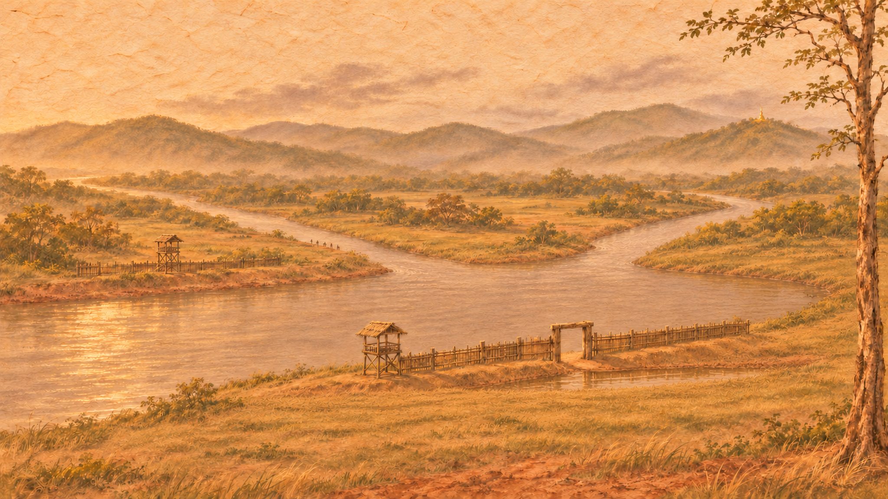
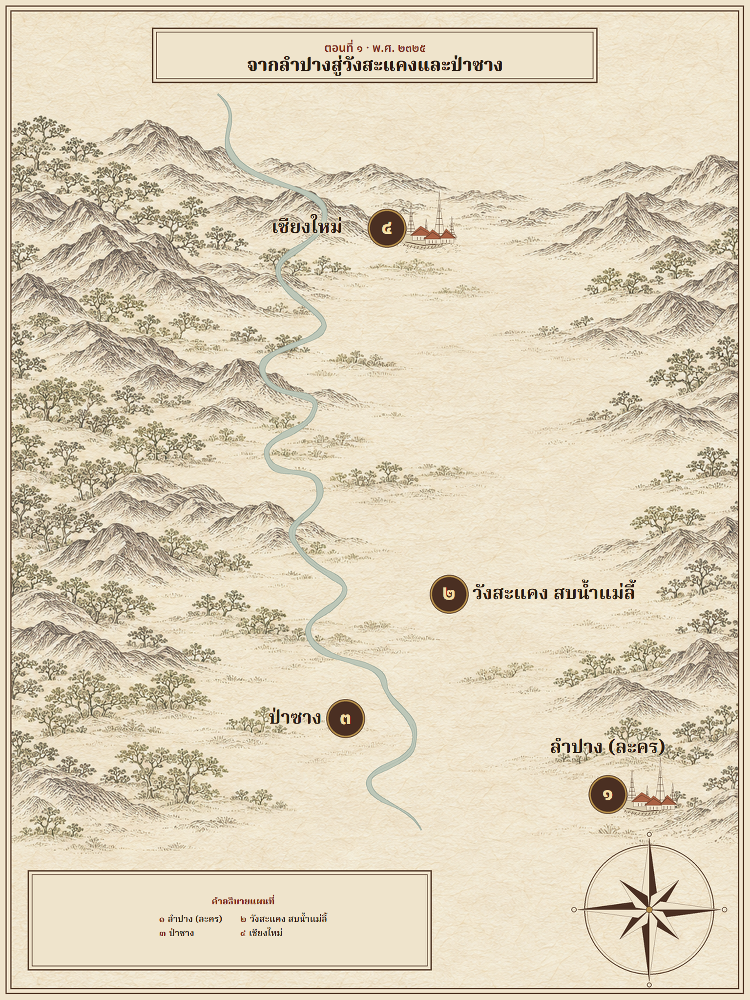

# ภาคที่ 1: ได้เมืองคืน แล้วใครจะอยู่
## ตอนที่ 1: เจ้าเมืองที่อยู่นอกเมือง

> **หมายเหตุถึงผู้อ่านตอนที่ 1:** ตอนนี้เรียบเรียงจากการอ่านภาพสแกน *ตำนานพื้นเมืองเชียงใหม่* (ฉบับพิมพ์ พ.ศ. 2514 ปลายผูก 6 หน้า 97 และเปิดผูก 7 หน้า 98 ความละเอียด 960 พิกเซล โดยไม่อาศัย OCR) ศักราชในตัวบทใช้จุลศักราช (จ.ศ.) ซึ่งเมื่อบวก 1181 จะได้ปี พ.ศ. ตามการนับแบบไทยเก่าที่เริ่มปีใหม่ในเดือนเมษายน (ความต่าง 1 ปีกับปฏิทินสากลสำหรับเหตุการณ์ก่อนเมษายนเป็นเพียงความต่างของระบบการนับปี มิใช่ความขัดแย้งระหว่างแหล่งข้อมูล) และคงการระบุวันเดือนตามตัวบทโดยไม่แปลงเป็นวันที่สากล ข้อความที่อ่านได้ไม่ครบทุกคำสรุปเป็นเค้าความโดยไม่คัดตรงตัวยาวและมีวงเล็บกำกับสั้น ๆ ว่า (อ่านได้บางส่วน) ส่วนตัวเลขบางจุดที่อ่านจากภาพได้ไม่แน่ใจจะไม่ถอดตัวเลขมา ขณะที่ตัวเลขที่ระบุไว้เป็นตัวเลขตามตัวบท ผู้ที่จะนำไปอ้างอิงต่อควรตรวจทานกับต้นฉบับโดยตรงก่อน

---

### ฉากเปิด: แปดวันจากลำปางสู่วังสะแคง สบน้ำแม่ลี้

ใน **จ.ศ. 1144 (พ.ศ. 2325 ตามปีนับเก่า)** ตัวบท *ตำนานพื้นเมืองเชียงใหม่* หน้า 98 บันทึกการเดินทางของ **เจ้ากาวิละ** ออกจากเมือง **ละคร (ลำปาง)** พร้อมไพร่ตามตัวบทจำนวน **300 คน**

ขบวนใช้เวลาเดินทาง **8 วัน** ก่อนจะมาถึง **วังสะแคง สบน้ำแม่ลี้** ซึ่งตัวบทระบุชัดว่าเป็นสถานที่เดียวกับที่ **พระยาจ่าบ้าน** เคยตั้งหลักมาก่อน (ตามตัวบทเป็นที่เดียวกันกับปลายทางของเหตุการณ์ในตอนที่ 3)

ผู้ที่เดินทางมาถึงวังสะแคง สบน้ำแม่ลี้ในวันนั้น ไม่ใช่เพียงผู้นำจากเมืองลำปาง หากเป็นผู้ที่ตัวบทเพิ่งบันทึกไว้ก่อนหน้านั้นหนึ่งหน้าว่าได้รับพระราชทานแต่งตั้งให้เป็น **เจ้าเมืองเชียงใหม่** ทว่าจุดหมายแรกที่ขบวนหยุดตั้งหลักกลับไม่ได้อยู่ในตัวเวียงเชียงใหม่ แต่เริ่มต้นอยู่นอกเมืองที่วังสะแคง ก่อนจะขยับขึ้นไปตั้งเวียงที่ **ป่าซาง** ในปีเดียวกัน

---

### แผนที่สถานที่ในหลักฐาน: ลำปาง วังสะแคง ป่าซาง และเชียงใหม่

แผนที่ของตอนนี้วางเฉพาะเมืองและสถานที่ 4 แห่งที่ปรากฏใน *ตำนานพื้นเมืองเชียงใหม่* หน้า 97–98 ได้แก่ **ลำปาง**, **วังสะแคงสบน้ำแม่ลี้**, **ป่าซาง**, และ **เชียงใหม่** โดยไม่ได้ลากเส้นทางเดินขบวนเชื่อมระหว่างจุด เนื่องจากตัวบทระบุเพียงระยะเวลาเดินทาง 8 วันจากลำปางถึงวังสะแคง ไม่ได้ระบุแนวทางหรือจุดพักแรมระหว่างทาง

---

### คำถามของตอน

**ผู้ที่ได้เป็นเจ้าเมืองเชียงใหม่ ทำไมจึงต้องไปตั้งหลักที่ป่าซาง**

ตัวบท *ตำนานพื้นเมืองเชียงใหม่* หน้า 97–98 ตอบคำถามเบื้องต้นได้ว่าเจ้ากาวิละได้รับตำแหน่งเจ้าเมืองเชียงใหม่เมื่อไร เดินทางออกมาจากลำปางพร้อมใคร ไปหยุดอยู่ที่ใด และสร้างสิ่งใดขึ้นที่ป่าซาง แต่สำหรับคำถามสำคัญว่า **"ทำไมจึงไม่ตั้งในตัวเมืองเชียงใหม่ และทำไมจึงต้องเป็นป่าซาง"** ตัวบทให้คำตอบไว้เพียงถ้อยคำสั้น ๆ ว่า **"เพื่อข้ามศึกสงคราม"** ควบคู่ไปกับภาพบ้านเมืองที่ตัวบทบรรยาย ส่วนเหตุผลเชิงลึกทางภูมิศาสตร์หรือยุทธศาสตร์ไม่ได้ปรากฏในหน้าเอกสารนี้

เพื่อให้ผู้อ่านเห็นขอบเขตของหลักฐานตั้งแต่ต้นเล่ม เนื้อหาต่อจากนี้จึงแยกข้อมูลออกเป็น 3 ชั้น คือ **ชั้นที่ 1 สิ่งที่ตัวบทเดิมพูด** **ชั้นที่ 2 สิ่งที่ผู้เรียบเรียงจัดกรอบหรือเทียบช่วงเวลากับตอนอื่น** และ **ชั้นที่ 3 สิ่งที่ยังไม่รู้เพราะตัวบทไม่ได้บอก**

---

### หลักฐานตามตัวบทตำนานพื้นเมืองเชียงใหม่ (หน้า 97–98)

#### 1. การแต่งตั้งหลังเปลี่ยนแผ่นดินและการเปิดผูก 7 (หน้า 97–98)

จุดเริ่มต้นของฐานะ "เจ้าเมืองเชียงใหม่" ของเจ้ากาวิละปรากฏในช่วงรอยต่อระหว่างปลายผูก 6 (หน้า 97) กับการเปิดผูก 7 (หน้า 98) ดังนี้

- **การเข้าเฝ้าและการแต่งตั้งที่ "กรุงศรีอยุทธยา" (หน้า 97, ชัดเรื่องกาวิละเป็นเจ้าเมืองเชียงใหม่และธรรมลังกาเป็นอุปราชา / ชื่อและเมืองของน้องแต่ละคนอ่านได้บางส่วน):** ตัวบทเล่าว่าภายหลังเปลี่ยนแผ่นดิน (จ.ศ. 1143 ตามปีตำนาน) เจ้ากาวิละได้พาน้องเดินทางลงไปเข้าเฝ้าที่ **"กรุงศรีอยุทธยา"** (ตามบริบทหมายถึงราชสำนักสยามที่กรุงเทพฯ) ได้รับพระราชทานสิ่งของเป็นรายการยาว และได้รับแต่งตั้งให้ **เจ้ากาวิละ** เป็น **"พระยามังราวชิรประการกำแพงแก้ว"** ครองตำแหน่งเจ้าเมืองเชียงใหม่ พร้อมให้ **เจ้าธรรมลังกา** (น้องถ้วนสาม) เป็นอุปราชาเมืองเชียงใหม่ ส่วนน้องคนอื่นมีเค้าความตามที่อ่านได้จากภาพสแกนว่า **เจ้าคำโสม** (น้องถ้วนสอง) เป็นพระยานครลำปาง **เจ้าดวงทิพย์** (น้องถ้วน 4) เป็นอุปราชา และ **เจ้าหมูหล้า** (น้องถ้วน 5) เป็นราชวงศ์เมืองละคร
  ในชั้นการเทียบช่วงเวลากับตอนที่ 2 ผู้อ่านจะพบว่าใน พ.ศ. 2317 (ตอนที่ 2) หลักฐานทั้งสองฝั่งระบุตรงกันว่ากาวิละได้รับแต่งตั้งให้ครองเมืองลำปาง ส่วนในบันทึกหน้า 97 นี้เป็นเหตุการณ์ภายหลังเปลี่ยนแผ่นดิน (จ.ศ. 1143 ตามระบบการนับปีแบบเก่าของตำนาน) ซึ่งกาวิละจึงได้รับตำแหน่งเจ้าเมืองเชียงใหม่ **ความต่างนี้จึงไม่ใช่ความขัดแย้งของหลักฐาน แต่เป็นเหตุการณ์คนละช่วงเวลา** ทั้งนี้ ชื่อ ลำดับ "น้องถ้วนที่" และเมืองของน้องแต่ละคนในหน้า 97 อ่านได้เพียงบางส่วน จึงคงไว้เป็นเค้าความตามตัวบทโดยไม่เชื่อมโยงกับชื่อบุคคลภายนอกตัวบท
- **การเปิดผูก 7 และการระบุอายุผู้นำ (หน้า 98, อ่านได้บางส่วน):** เมื่อขึ้นผูก 7 ตัวบทกล่าวย้ำถึงตำแหน่ง **"พระยามังราวชิรประการกำแพงแก้ว"** ซึ่งได้รับพระราชทานให้ปกครองเขตเมืองเชียงใหม่ พร้อมกับมีการระบุตัวเลขอายุขณะนั้นของกาวิละ มหาอุปราชา และเจ้ารัตนหัวเมืองแก้วไว้ในตัวบท (ผู้เรียบเรียงอ่านตัวเลขอายุจากภาพสแกนได้ไม่แน่ใจจึงไม่ถอดตัวเลขมา)

#### 2. จากลำปางสู่วังสะแคง และภาพบ้านเมืองตามถ้อยคำตัวบท (หน้า 98)

ถัดจากการเปิดผูก 7 ตัวบทหน้า 98 ลำดับเหตุการณ์การเคลื่อนย้ายจากลำปางและการตั้งหลักชั่วคราวที่วังสะแคงไว้สามประเด็นต่อเนื่องกัน

- **การเดินทาง 8 วันสู่วังสะแคง สบน้ำแม่ลี้ (หน้า 98):** ใน **จ.ศ. 1144 (พ.ศ. 2325)** กาวิละยกออกจากเมืองละคร (ลำปาง) พร้อมไพร่ตามตัวบทจำนวน **300 คน** ใช้เวลาเดินทาง **8 วัน** จนถึง **วังสะแคง สบน้ำแม่ลี้** ซึ่งตัวบทระบุว่าเป็นที่ที่พระยาจ่าบ้านเคยตั้งมาก่อน
- **สภาพล้านนาตามถ้อยคำของตัวบท (หน้า 98):** ในหน้าเดียวกัน ตัวบทบรรยายสภาพบ้านเมืองล้านนาในช่วงเวลานั้นด้วยถ้อยคำว่า **"บ้านห่าง นาห่าง บ้านอุกเมืองรก"** และ **"ไปทางใต้ก็กลัวเสือ ไปทางเหนือก็กลัวช้าง"** ผู้คนไม่ตั้งบ้านเรือน โดยตัวบทอธิบายสาเหตุไว้เองว่าเป็นเพราะไม่มีท้าวพระยาเป็นผู้นำ
  ในชั้นการตีความ ถ้อยคำเหล่านี้เป็นสำนวนของตัวบทที่สะท้อนความกระจัดกระจายของชุมชนและความขาดแคลนผู้ปกครองในสายตาผู้บันทึก ไม่ใช่ข้อสรุปยืนยันว่าตัวเมืองเชียงใหม่ว่างเปล่าโดยไม่มีผู้คนอาศัยอยู่เลย (ตอนที่ 7 จะกล่าวถึงถ้อยคำเหล่านี้อีกครั้ง)
- **การตั้งอยู่ที่วังสะแคงราวหนึ่งเดือนและการรวมไพร่เก่า (หน้า 98, อ่านได้บางส่วน):** ตัวบทระบุว่ามีพระราชโองการให้กาวิละมา **"เสวยเมืองเชียงใหม่"** ระหว่างที่ตั้งพักอยู่ที่ **วังสะแคง** ราว **หนึ่งเดือน** (ตามตัวบท) กาวิละได้สอบถามหาขุนนางและไพร่เก่า โดยมีตัวบทระบุจำนวนไพร่ที่เข้ามาสมทบเข้าพวกไว้ด้วย (ผู้เรียบเรียงอ่านตัวเลขจำนวนไพร่ช่วงนี้จากภาพสแกนได้ไม่แน่ใจจึงไม่ถอดตัวเลขมา)

#### 3. การย้ายขึ้นตั้งเวียงป่าซางและบัญชาการสร้างบ้านเมือง (หน้า 98)

หลังจากตั้งหลักอยู่ที่วังสะแคงราวหนึ่งเดือน ตัวบทหน้า 98 บันทึกการย้ายที่ตั้งอีกครั้งภายในปีเดียวกัน

- **การตั้งเวฬุกามหรือป่าซาง (หน้า 98):** ใน **เดือนเจี่ยง แรม 8 ค่ำ** ของปี จ.ศ. 1144 (พ.ศ. 2325) ตัวบทเล่าว่ากาวิละ **"ยกเข้าตั้งเวฬุกาม คือว่าป่าซาง"** มีการก่อสร้างคุ้ม ปราสาท ค่ายคู ประตูเวียง และป้อมหอรบ โดยจัดตั้งเวียงอยู่ริมลำน้ำแม่ท่า แยกเป็นสองฝั่งคือ **ป่าซางหลวง** กับ **ป่าซางน้อย** ตามลำน้ำสองฝั่ง ตัวบทระบุจุดมุ่งหมายของการตั้งเวียงที่นั่นไว้สั้น ๆ เพียงว่า **"เพื่อข้ามศึกสงคราม"**
- **การทำไร่นาและสร้างวัดวาอาราม (หน้า 98, อ่านได้บางส่วน):** เมื่อตั้งเวียงแล้ว มีเค้าความว่าเจ้ากาวิละมีบัญชาให้ **"ท้าวพระยาขุนไพร่ไทย กระไร่นา"** เพื่อให้เป็นปัจจัยบริบูรณ์ และให้สร้างวัดวาอารามไว้เป็นที่สถิตสำราญของพระสงฆ์

---

### สิ่งที่ยังไม่รู้

เมื่อแยกสิ่งที่ตัวบทหน้า 97–98 บันทึกไว้แล้ว ยังคงมีคำถามสำคัญและรายละเอียดอีกหลายจุดที่หลักฐานในตอนนี้ไม่ได้ตอบ ดังนี้

- **เหตุผลเชิงลึกว่าทำไมต้องเป็นป่าซาง และทำไมไม่เข้าตั้งในเวียงเชียงใหม่ทันที:** ตัวบทให้เหตุผลเพียงถ้อยคำสั้น ๆ ว่า **"เพื่อข้ามศึกสงคราม"** ควบคู่กับสภาพบ้านเมืองที่บรรยายว่า "บ้านห่าง นาห่าง บ้านอุกเมืองรก" แต่ไม่ได้อธิบายเงื่อนไขเชิงภูมิศาสตร์ ลำน้ำ แหล่งเสบียง หรือข้อได้เปรียบเฉพาะของพื้นที่ป่าซาง ซึ่งต้องอาศัยหลักฐานอื่นมาสอบทานเพิ่มเติมในตอนที่ 4
- **เส้นทางเดินขบวน 8 วันจากลำปางถึงวังสะแคง:** ตัวบทระบุเพียงต้นทางที่ลำปาง ปลายทางที่วังสะแคงสบน้ำแม่ลี้ จำนวนไพร่ 300 คน (ตามตัวบท) และระยะเวลา 8 วัน แต่ไม่ได้ระบุแนวทางเดินหรือจุดพักแรมระหว่างทาง
- **รายละเอียดชีวิตประจำวันและสภาพประชากรในป่าซาง:** นอกเหนือจากเค้าความเรื่องบัญชาให้ทำไร่นาและสร้างวัดวาอาราม ตัวบทหน้า 98 ไม่ได้เล่าถึงอาชีพ ความเป็นอยู่รายวัน หรือจำนวนประชากรทั้งหมดที่เข้ามาตั้งถิ่นฐานในช่วงแรก
- **ตัวเลขและชื่อเฉพาะที่อ่านจากภาพสแกนได้ไม่แน่ใจ:** ตัวเลขอายุของกาวิละ มหาอุปราชา และเจ้ารัตนหัวเมืองแก้วในหน้า 98, จำนวนไพร่เก่าที่เข้าสมทบที่วังสะแคงในหน้า 98, ตลอดจนชื่อ ลำดับ "น้องถ้วนที่" และเมืองที่น้องแต่ละคนได้รับแต่งตั้งในหน้า 97 ล้วนเป็นจุดที่อ่านจากภาพสแกนได้บางส่วนหรือยังอ่านตัวเลขไม่แน่ใจ จึงต้องรอการตรวจทานกับต้นฉบับเพิ่มเติม

---

### ตะขอไปตอนถัดไป

ก่อนที่เจ้ากาวิละจะได้รับตำแหน่งเจ้าเมืองเชียงใหม่และยกไพร่จากลำปางมาตั้งหลักอยู่นอกเมืองใน พ.ศ. 2325 ตำแหน่งเจ้าเมืองของหัวเมืองล้านนาเหล่านี้เริ่มต้นขึ้นอย่างไรเมื่อแปดปีก่อนหน้า ในตอนที่ 2 เราจะย้อนกลับไปยัง พ.ศ. 2317 เพื่ออ่านหลักฐานสองฝั่งพร้อมกัน

**จบตอนที่ 1**

*(ติดตามต่อใน ตอนที่ 2: กาวิละกับพระยาจ่าบ้าน)*

---

## ตารางที่มาของข้อเท็จจริง (ไม่พิมพ์ในหนังสือ ใช้ตรวจ)

| ข้อความในบท | ข้อในใบข้อเท็จจริง | หน้าพิมพ์ | ระดับ |
|---|---|---|---|
| วิธีอ่าน ข้อจำกัด และการนับปี: ตำนานพื้นเมืองเชียงใหม่ ฉบับ สนร. 2514 อ่านจากภาพสแกน 960 พิกเซล (สแกน 104 = หน้า 97, สแกน 105 = หน้า 98) จ.ศ. + 1181 = พ.ศ. แบบเริ่มเมษายน ตัวเลขเป็นตัวเลขตามตัวบท และตัวบทเรียกกรุงเทพฯ ว่า "กรุงศรีอยุทธยา" | ตำนานภาค 1–2 (วิธีอ่านและข้อจำกัด, หมายเหตุเรื่องการนับปี) | 97–98 | ตามใบข้อเท็จจริง |
| หลังเปลี่ยนแผ่นดิน (จ.ศ. 1143 ตามปีตำนาน) กาวิละพาน้องไปเข้าเฝ้าที่ "กรุงศรีอยุทธยา" (ราชสำนักสยามที่กรุงเทพฯ) ได้รับของพระราชทานเป็นรายการยาว และได้รับแต่งตั้ง: เจ้ากาวิละเป็น "พระยามังราวชิรประการกำแพงแก้ว" เจ้าเมืองเชียงใหม่, เจ้าธรรมลังกา (น้องถ้วนสาม) เป็นอุปราชาเมืองเชียงใหม่; เค้าความเรื่องน้องอื่น: เจ้าคำโสม (น้องถ้วนสอง) เป็นพระยานครลำปาง, เจ้าดวงทิพย์ (น้องถ้วน 4) เป็นอุปราชา, เจ้าหมูหล้า (น้องถ้วน 5) เป็นราชวงศ์เมืองละคร (เทียบกับตอนที่ 2 ว่าเป็นคนละช่วงเวลา ไม่ใช่ความขัดแย้ง) | ตำนาน D0 | 97 | ชัดเรื่องกาวิละเป็นเจ้าเมืองเชียงใหม่และธรรมลังกาเป็นอุปราชา / บางส่วนเรื่องชื่อและเมืองของน้องแต่ละคน |
| ผูก 7 เปิด: ระบุตำแหน่ง "พระยามังราวชิรประการกำแพงแก้ว" ได้รับพระราชทานให้ปกครองเขตเมืองเชียงใหม่ และมีการระบุอายุกาวิละ มหาอุปราชา และเจ้ารัตนหัวเมืองแก้ว (ไม่พิมพ์ตัวเลขอายุเนื่องจากอ่านไม่แน่ใจ) | ตำนาน D1 | 98 | บางส่วน (ไม่ถอดตัวเลขอายุ) |
| จ.ศ. 1144 (พ.ศ. 2325) กาวิละยกจากละคร (ลำปาง) พร้อมไพร่ตามตัวบท "300 คน" ใช้เวลา 8 วัน ถึงวังสะแคง สบน้ำแม่ลี้ ที่พระยาจ่าบ้านเคยตั้ง (ตามตัวบทเป็นที่เดียวกันกับตอนที่ 3) | ตำนาน D2 | 98 | ชัด (ปีและชื่อสถานที่) |
| สภาพล้านนาตามตัวบท: "บ้านห่าง นาห่าง บ้านอุกเมืองรก" "ไปทางใต้ก็กลัวเสือ ไปทางเหนือก็กลัวช้าง" ผู้คนไม่ตั้งบ้านเรือน ตัวบทอธิบายเหตุว่าไม่มีท้าวพระยาเป็นผู้นำ (ไม่ระบุว่าเชียงใหม่ว่างสนิท) | ตำนาน D3 (และ สิ่งที่ตัวบทกลุ่มนี้ไม่บอก) | 98 | ชัด |
| มีพระราชโองการให้มา "เสวยเมืองเชียงใหม่" กาวิละอยู่ที่วังสะแคงราวหนึ่งเดือน (ตามตัวบท) ถามหาขุนนางไพร่เก่า ได้ไพร่เข้าพวก (ไม่พิมพ์ตัวเลขจำนวนไพร่เนื่องจากอ่านไม่แน่ใจ) | ตำนาน D4 | 98 | บางส่วน (ไม่ถอดตัวเลขจำนวนไพร่) |
| เดือนเจี่ยง แรม 8 ค่ำในปีเดียวกัน (จ.ศ. 1144 / พ.ศ. 2325) ย้ายขึ้นตั้งที่ป่าซาง ตัวบทเล่าว่า "ยกเข้าตั้งเวฬุกาม คือว่าป่าซาง" สร้างคุ้ม ปราสาท ค่ายคู ประตูเวียง ป้อมหอรบ ตั้งเวียงริมน้ำแม่ท่าที่แยกเป็นป่าซางหลวงกับป่าซางน้อยตามลำน้ำสองฝั่ง "เพื่อข้ามศึกสงคราม" | ตำนาน D5 | 98 | ชัด |
| มีบัญชาให้ "ท้าวพระยาขุนไพร่ไทย กระไร่นา" เป็นปัจจัยบริบูรณ์ และสร้างวัดวาอารามให้เป็นที่สถิตสำราญของพระสงฆ์ | ตำนาน D6 | 98 | บางส่วน |

---

## รายการภาพที่ต้องสร้าง (ไม่พิมพ์ในหนังสือ ใช้ตรวจ)

1. **ภาพฉากเปิดตอน (`images/ep01_scene.jpg` — สัดส่วน 16:9 แนวนอน)**
   - **โทนสีและวัสดุประจำเล่ม 4 ("กระดาษสาและไม้สัก"):** กูอาชบางผสมหมึกซีเปีย ลายเส้นพู่กันแห้งบนกระดาษสาเห็นเส้นใย จานสีอุ่นครีมกระดาษสา (`#EFE4CC`) น้ำตาลไม้สัก ดินแดงลูกรัง เหลืองรง–ส้มหญ้าฝรั่น เขียวมอส–มะกอก เน้นแดงรักและทองคำเปลวไม่เกิน 3% มียอดเจดีย์ล้านนาทรงระฆังปิดทองเล็ก ๆ ไกลมากอยู่ช่วงบนของภาพ และลำต้นไม้สักเก่าชิดขอบขวาของภาพ
   - **แนวคิดและองค์ประกอบ:** ริมลำน้ำบริเวณวังสะแคงสบน้ำแม่ลี้และแนวค่ายไม้ริมตลิ่งที่มีคูเวียง ประตูไม้ และป้อมหอรบตั้งอยู่สองฝั่งลำน้ำ (อ้างอิงตำนาน D2 และ D5 หน้า 98) พื้นดินและหญ้าริมตลิ่งต่อเนื่องถึงขอบล่าง ไกลออกไปในระยะไกลมากเห็นเงาซิลูเอตขนาดเล็กของขบวนคนเคลื่อนตามแนวตลิ่ง ภูเขาเบื้องหลังซ้อนชั้นสีมะกอก–เหลืองรงในหมอกควันบาง
   - **กติกาบังคับ:** ไม่มีหน้าคน (บุคคลเห็นเป็นเพียงเงาซิลูเอตเล็กจิ๋วระยะไกลเท่านั้น) ไม่มีอาวุธเด่น ไม่มีปืน วัตถุหลักอยู่ในช่วง 45–78% ของความสูงภาพและตั้งบนพื้นอย่างมั่นคง ห้ามใส่ข้อความ ตัวเลข ป้าย ธง หรือลายน้ำในภาพ ห้ามใช้โทนเขียวหยก–ครามของเล่ม 1–3
2. **แผนที่ประจำตอน (`images/ep01_map.png` — สัดส่วน 3:4 แนวตั้ง)**
   - **โทนสีและรูปแบบประจำเล่ม 4:** พื้นครีมกระดาษสา (`#EFE4CC`) เห็นเส้นใยกระดาษ ลายเส้นหมึกซีเปีย ภูเขาลายขีดแต้มสีมะกอกอ่อน แม่น้ำสีเทาอมเขียวหม่น กรอบเส้นคู่บาง กล่องหัวแผนที่เปล่าด้านบน กล่องคำอธิบายเปล่าล่างซ้าย เข็มทิศไม่มีตัวอักษรล่างขวา วงกลมพิกัดสีน้ำตาลไม้สักเข้มขอบทองบาง (ห้ามใช้พื้นเขียวเซลาดอนของเล่ม 3)
   - **เมืองและสถานที่ที่อนุญาตให้ใส่ในแผนที่ (4 แห่งตามใบข้อเท็จจริง D2 และ D5 เท่านั้น ห้ามใส่เมืองอื่น):**
     - **ลำปาง**
     - **วังสะแคงสบน้ำแม่ลี้**
     - **ป่าซาง**
     - **เชียงใหม่**
   - **กติกาบังคับ:** ห้ามลากเส้นทางหรือลูกศรใด ๆ ระหว่างวงกลม (ตัวบทระบุเพียงระยะ 8 วัน ไม่ระบุเส้นทางระหว่างลำปางถึงวังสะแคง) ห้ามใส่เมืองอื่นนอกเหนือจาก 4 ชื่อข้างต้น ไม่มีหน้าคน ไม่มีอาวุธเด่น ห้ามมีตัวอักษรหรือป้ายชื่อในภาพแผนที่ฐาน
