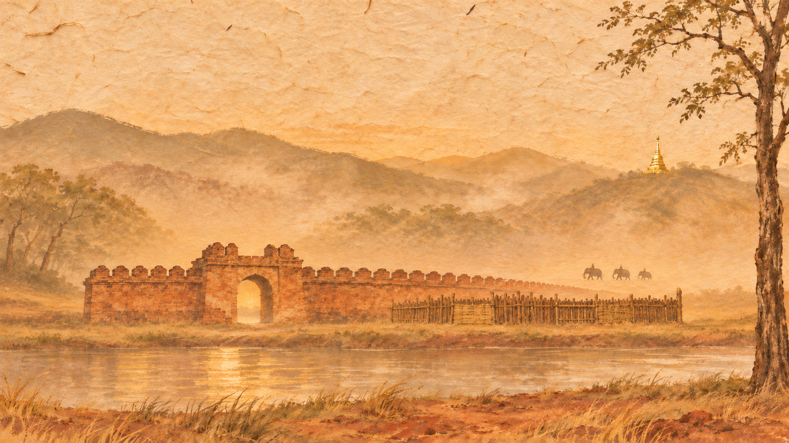
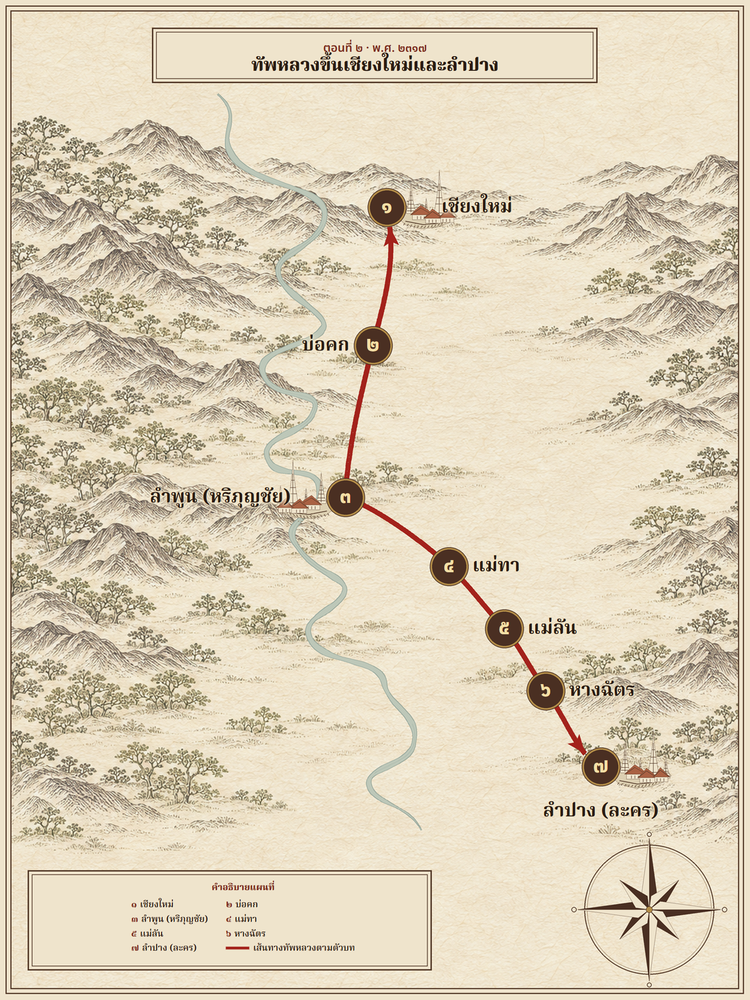

# ภาคที่ 1: ได้เมืองคืน แล้วใครจะอยู่
## ตอนที่ 2: กาวิละกับพระยาจ่าบ้าน ธนบุรีรับสองผู้นำล้านนา

> **หมายเหตุถึงผู้อ่านตอนที่ 2:** ตอนนี้เทียบสองแหล่ง คือ *พงศาวดารกรุงธนบุรี ฉบับพันจันทนุมาศ (เจิม)* (ภาพหน้าพิมพ์ ระเบียนหอสมุดแห่งชาติ 4835 หน้า 43–49 ซึ่งยังไม่ทราบสำนักพิมพ์ ปีพิมพ์ และชื่อบรรณาธิการ) กับ *ตำนานพื้นเมืองเชียงใหม่* หน้า 92–94 (ภาพสแกน) ข้อความที่อ่านไม่ครบจะสรุปเป็นเค้าความ และคงตัวสะกดชื่อเฉพาะตามภาพ

---

### ฉากเปิด: คืนที่ประตูช้างเผือกและเช้าหน้าค่ายล้อมเมืองเชียงใหม่

ในปี พ.ศ. 2317 (ตามที่หน้า 44 ของ *พงศาวดารกรุงธนบุรี ฉบับพันจันทนุมาศ (เจิม)* ระบุ "พ.ศ. 2317" ไว้ในวงเล็บ) ภายหลังจากที่สมเด็จพระเจ้าตากสินทรงประทับ ณ ค่ายเมืองลำพูนแล้ว วันรุ่งขึ้นทัพหลวงได้เคลื่อนจากเมืองลำพูนขึ้นสู่เมืองเชียงใหม่ โดยประทับแรมที่ **บ่อคก** เป็นระยะทาง 352 เส้น แล้วเดินทัพต่อไปอีก 172 เส้น จนถึงค่ายมั่นริมน้ำเมืองเชียงใหม่ (คำว่า "เส้น" เป็นหน่วยวัดระยะทางตามตัวบท)

ตัวบทพงศาวดารกรุงธนบุรีหน้า 44 บันทึกว่า ในคืนนั้นเอง "เจ้าเมืองเชียงใหม่" (ฝ่ายพม่า) รู้ข่าวว่าทัพหลวงจะยกขึ้นมา ด้วย "เกรงพระเดชานุภาพ" จึงพาครัวหนีออกจากเมืองทาง **ประตูช้างเผือก** ระหว่างที่ผู้คนพากันหนีออกทางประตูเมืองนั้น มีคนตายที่ประตูราว 200 เศษ (คำว่า "ครัว" และคำว่า "เกรงพระเดชานุภาพ" เป็นถ้อยคำของผู้บันทึกในตัวบท โดยไม่ได้ระบุสาเหตุการหนีอื่นนอกเหนือจากนี้)

ครั้นรุ่งเช้า **วันอาทิตย์ เดือนยี่ ขึ้น 14 ค่ำ** (หน้า 45) สมเด็จพระเจ้าตากสินทรงช้างพระที่นั่งเสด็จไปทอดพระเนตรค่ายข้าทูลละอองซึ่งตั้งล้อมเมืองเชียงใหม่ไว้ แล้วเสด็จกลับพระตำหนัก ตัวบทเล่าว่าพระสงฆ์ในเมืองเชียงใหม่ถวายพระพรว่า ในเวลาที่ทัพหลวงเสด็จมาถึงนั้นเกิด "แผ่นดินไหว" ซึ่งตัวบทเรียกเหตุการณ์นี้ว่า "อัศจรรย์"

---

### แผนที่เส้นทางทัพหลวงและเมืองในหลักฐาน พ.ศ. 2317

แผนที่ของตอนนี้วางเฉพาะเมืองและจุดพักทัพที่ปรากฏในตัวบท *พงศาวดารกรุงธนบุรี* หน้า 44–49 และ *ตำนานพื้นเมืองเชียงใหม่* หน้า 92–94 โดยแบ่งเป็นสองช่วงเส้นทางตามลำดับเหตุการณ์ดังนี้

- **เส้นทางช่วงที่ 1 จากลำพูนขึ้นเชียงใหม่ (หน้า 44–47):** เริ่มจากค่ายเมือง **ลำพูน** (นครหริภุญชัย) เดินทัพขึ้นเหนือไปประทับแรมที่ **บ่อคก** (ระยะทางตามตัวบท 352 เส้น) แล้วเดินทัพต่อไปถึงค่ายมั่นริมน้ำเมือง **เชียงใหม่** (ระยะทางตามตัวบท 172 เส้น) ภายในและรอบเมืองเชียงใหม่มีสถานที่ที่ตัวบทระบุชื่อคือ **ประตูช้างเผือก** **วัดพระสิงห์** และ **พระตำหนักกรมนาเมืองเชียงใหม่**
- **เส้นทางช่วงที่ 2 จากเชียงใหม่ผ่านลำพูนไปลำปาง (หน้า 48–49):** จากค่ายเมือง **เชียงใหม่** เสด็จกลับมาประทับที่ค่ายเมือง **หริภุญชัย (ลำพูน)** ซึ่งมีพระบรมธาตุเมืองหริภุญชัย จากนั้นเสด็จจากเมืองลำพูนไปยังเมือง **ลำปาง** (ซึ่งตำนานพื้นเมืองเชียงใหม่เรียกว่าเมืองละคร) โดยประทับแรมรายวันตามจุดที่ตัวบทหน้า 49 ระบุตามลำดับคือ **แม่ทา** **แม่ลัน** และ **หางฉัตร** ก่อนถึงเมือง **ลำปาง** ซึ่งมีวัดพระบรมธาตุลำปางและพระตำหนักค่ายลำปาง

---

### คำถามของตอน

**ผู้นำล้านนาสองคนที่เข้ากับธนบุรีได้ตำแหน่งอะไร และเหตุใดกาวิละได้ลำปาง ไม่ใช่เชียงใหม่**

เมื่อนำหลักฐานสองฝั่งมาวางเทียบกัน—คือ *พงศาวดารกรุงธนบุรี ฉบับพันจันทนุมาศ (เจิม)* หน้า 44–49 กับ *ตำนานพื้นเมืองเชียงใหม่* ผูก 6 หน้า 92–94—เราจะพบว่าตัวบททั้งสองฝั่งตอบคำถามครึ่งแรกเรื่อง **"ตำแหน่งที่ผู้นำล้านนาแต่ละคนได้รับ"** ได้อย่างชัดเจนและสอดคล้องกัน แต่สำหรับคำถามครึ่งหลังว่า **"เหตุใดกาวิละจึงได้ครองลำปาง ไม่ใช่เชียงใหม่"** ตัวบททั้งสองแหล่งไม่ได้บันทึกเหตุผลไว้

---

### หลักฐานฝั่ง ก.: พงศาวดารกรุงธนบุรี (หน้า 43–49)

#### 1. ข้อจำกัดและช่องว่างของต้นฉบับ

หลักฐานฝั่งสยามที่ใช้ในตอนนี้คือ *พงศาวดารกรุงธนบุรี ฉบับพันจันทนุมาศ (เจิม)* ฉบับพิมพ์ที่มีเชิงอรรถของบรรณาธิการ (ระเบียนหอสมุดแห่งชาติ NLT 4835) โดยใช้ข้อมูลช่วงหน้า 43–49 เนื่องจากยังไม่มีหน้า 41–42 ส่วนหน้า 38–40 เป็นเหตุการณ์ยกทัพไปเชียงใหม่ครั้งก่อนปี พ.ศ. 2313 ที่ไม่ปรากฏหัวปีในหน้าเหล่านั้นและยังไม่ได้ตรวจหน้า 37 จึงยังไม่นำมาเล่าในตอนนี้

ข้อจำกัดสำคัญที่ผู้อ่านต้องทราบคือ **ช่องว่างในต้นฉบับหน้า 43** ซึ่งระบุข้อความไว้ชัดเจนว่า "ตอนฉบับต่อจากนี้ยังขาดอยู่ตอนหนึ่ง" โดยแจ้งว่าเนื้อความขาดหายไป 7 หัวข้อ รวมถึงเรื่องทัพหลวงขึ้นไปปราบพม่าที่เชียงใหม่ในเดือน 12 พ.ศ. 2317 แล้วหน้า 44 จึงเปิดความใหม่ด้วยประโยคว่า "ต่อไปนี้เป็นพระราชพงศาวดาร" ดังนั้น เหตุการณ์ในหน้า 44–49 จึงเป็นบันทึกช่วงหลังจากที่เนื้อความตอนต้นของศึกเชียงใหม่ขาดหายไปแล้ว ทั้งนี้ นอกจากหน้า 44 ที่ระบุ "พ.ศ. 2317" ไว้ในวงเล็บแล้ว หน้า 45–49 ไม่ได้ระบุเลขปีซ้ำอีก แต่เรียงเหตุการณ์ต่อเนื่องกันตามลำดับวันในตัวบท (จึงคงการระบุวันเดือนตามปฏิทินจันทรคติเดิมโดยไม่แปลงเป็นวันที่สากล)

#### 2. จากค่ายเมืองลำพูนถึงเชียงใหม่ และการแยกชั้นเชิงอรรถบรรณาธิการ

ในหน้า 44 ก่อนที่ทัพหลวงจะเคลื่อนผ่านบ่อคกขึ้นไปเชียงใหม่ สมเด็จพระเจ้าตากสินทรงประทับอยู่ ณ ค่ายเมืองลำพูน โปรดให้เรียก **พระยาจ่าบ้าน** **พระยาลำพูน** พร้อมด้วยลาวแสนและขุนหมื่น พวกที่ตัวบทระบุว่า "ได้ทำราชการด้วยกันมา" ให้เข้าเฝ้าพร้อมกัน ในโอกาสนี้ทรงพระราชทานเสื้อผ้าและผ้านุ่งห่มแก่ภรรยาของพระยาจ่าบ้านและภรรยาของพระยาลำพูน

เมื่อทัพหลวงขึ้นถึงเชียงใหม่ผ่านเหตุการณ์คืนที่เจ้าเมืองเชียงใหม่ฝ่ายพม่าพาครัวหนีออกทางประตูช้างเผือกและเช้าวันอาทิตย์ เดือนยี่ ขึ้น 14 ค่ำ ตามที่เล่าในฉากเปิดแล้ว ในหน้า 45 และหน้า 46 มีจุดที่ต้องแยก **ชั้นตัวบทเดิม** ออกจาก **ชั้นความเห็นของบรรณาธิการในเชิงอรรถ** สองจุดดังนี้

- **ตำแหน่งสมุหนายก (หน้า 45):** เชิงอรรถ (1) ของบรรณาธิการในหน้า 45 ระบุในตอนแรกว่าตำแหน่ง "สมุหนายก" ที่ปรากฏในตัวบทนั้นคือสมเด็จพระพุทธยอดฟ้าจุฬาโลก แต่ต่อมาบรรณาธิการได้แย้งตนเองด้วยหลักฐานร่างท้องตราปี พ.ศ. 2317 ซึ่งระบุว่าเจ้าพระยาศรีธรรมาธิราชรักษาการตำแหน่งสมุหนายกอยู่
- **เรื่องเจ้าพระยาสวรรคโลก (หน้า 46):** ในชั้นตัวบทหน้า 46 เล่าเรื่อง "เจ้าพระยาสวรรคโลก" ถูกลงพระราชอาญาด้วยเหตุที่มิได้ปลงใจในราชการ แต่ในชั้นเชิงอรรถ (1) หน้าเดียวกัน บรรณาธิการได้อ้างหลักฐานเอกสารอื่นเทียบไว้ว่า มีร่างท้องตราเป็นหลักฐานว่าเมื่อ พ.ศ. 2317 เจ้าพระยาสวรรคโลกต้องโทษอยู่ที่กรุงธนบุรี หาได้ตามเสด็จไปในงานพระราชสงครามคราวนี้ด้วยไม่ จุดนี้แสดงให้เห็นว่าบรรณาธิการของฉบับพิมพ์ได้นำเอกสารร่างท้องตรามาสอบทานกับเนื้อความในตัวบทพงศาวดาร

#### 3. การพระราชทานตำแหน่ง ณ พระตำหนักกรมนาเมืองเชียงใหม่

ใน **วันพุธ เดือนยี่ แรม 2 ค่ำ** (หน้า 47) สมเด็จพระเจ้าตากสินเสด็จไปทรงนมัสการพระพุทธปฏิมากร ณ **วัดพระสิงห์** ในเมืองเชียงใหม่ (วัดพระสิงห์แห่งนี้เป็นวัดเดียวกับที่ฐานข้อมูลจารึกในภายหลังระบุว่าเก็บรอยพระพุทธบาทไม้มุกซึ่งจะกล่าวถึงในตอนที่ 6 แต่ในตัวบทพงศาวดารหน้า 47 ไม่ได้กล่าวถึงรอยพระพุทธบาทไม้มุก และไม่มีหลักฐานระบุว่ารอยพระพุทธบาทนั้นอยู่ที่วัดพระสิงห์ใน พ.ศ. 2317)

ครั้นรุ่งขึ้น **วันพฤหัสบดี เดือนยี่ แรม 3 ค่ำ** ณ **พระตำหนักกรมนาเมืองเชียงใหม่** (หน้า 47–48) ทรงพระกรุณาโปรดเกล้าฯ พระราชทานตำแหน่งแก่ผู้นำและเจ้านายล้านนาในสามเมืองหลักตามลำดับในตัวบทดังนี้

- **นครเมืองเชียงใหม่ (หน้า 47):** โปรดให้ **พระยาจ่าบ้าน** ถือพระราชอาชญาสิทธิ์เป็น **พระยาวิเชียรปราการ** ครองนครเมืองเชียงใหม่ ให้ **พระยาวงพราว** (ผู้หลาน) เป็นพระยาอุปราชาฝ่ายหน้านครเชียงใหม่ และให้ **อ้อยโพธิ์** เป็นราชวงศ์
- **นครหริภุญชัย หรือลำพูน (หน้า 47):** โปรดให้ **พระยาลำพูน** ถือพระราชอาชญาสิทธิ์เป็น **พระยาอ้ายวงศ์** ครองนครหริภุญชัย และให้ **ต้อมต่อ (?)** ผู้น้อง เป็นอุปราชาฝ่ายหน้านครหริภุญชัย
- **นครลำปาง (หน้า 47–48):** โปรดให้ **กาวิละ** ถือพระราชอาชญาสิทธิ์เป็น **พระยากาวิละ** ครองนครลำปาง พระราชทานเสื้อผ้าให้ **น้อยธรรม** ผู้น้อง (ปรากฏในบรรทัดท้ายหน้า 47 ต่อเนื่องไปต้นหน้า 48 ซึ่งระบุตำแหน่ง **อุปราชานครลำปาง**) และในหน้า 48 มีเค้าความว่าทรงพระราชทานเสื้อผ้าแก่ผู้น้อง ได้แก่ **นายสม นายดวงทิพ นายมูลา นายคำฟั่น นายบุญมา** เป็นราชวงศ์

ต่อจากรายชื่อตำแหน่ง ในหน้า 48 ตัวบทระบุให้ "จัดแจงตั้งแต่งพระหลวงแสนขุนหมื่น" และให้ตระเตรียมเมืองเชียงใหม่ หริภุญชัย ลำปาง แพร่ เถิน บ้านนา ฯลฯ "ตามรัฐตามกอง" ครองเมืองตามบุพประเพณีสืบมา (ทั้งนี้ เชิงอรรถ (1) ของบรรณาธิการในหน้า 48 ระบุว่าชื่อบ้านบางแห่งในต้นฉบับสะกดคำว่า "เกาะ เป็น กอะ")

#### 4. การเสด็จไปหริภุญชัยและลำปาง เรื่องนัดดานารี และพิธีที่พระบรมธาตุลำปาง

วันรุ่งขึ้น **วันศุกร์ เดือนยี่ แรม 4 ค่ำ** (หน้า 48) สมเด็จพระเจ้าตากสินเสด็จยกทัพหลวงออกจากค่ายเมืองเชียงใหม่เพื่อกลับพระนคร โดยโปรดให้ **เจ้าพระยาจักรี** แม่ทัพอยู่ช่วยจัดแจงเมืองเชียงใหม่และให้คอยฟังข่าวราชการ (ตามทัพพม่า) ทั้งนี้ ตัวบทระบุเพียงนามตำแหน่ง "เจ้าพระยาจักรี" โดยไม่ได้ขยายความเพิ่มเติม ส่วนในเชิงอรรถ (2) หน้า 48 บรรณาธิการตั้งข้อสังเกตไว้ว่าตัวบทไม่ได้บอกว่าพระยายมราชได้เลื่อนขึ้นเป็นเจ้าพระยาจักรี แต่ "เจ้าพระยาจักรี" ในที่นี้ดูเหมือนจะไม่ใช่เจ้าพระยาจักรี (หมุด) สมุหนายก (จึงแยกไว้เป็นข้อสังเกตชั้นบรรณาธิการโดยไม่ระบุตัวตนว่าคือผู้ใด) จากนั้นทัพหลวงเสด็จลงมาประทับที่ **ค่ายเมืองหริภุญชัย** ทรงนมัสการพระบรมธาตุและพระราชทานเงินแก่ชาวลาว และมีเค้าความว่าให้พระยาวงพราวและน้อยโพธิ์ถอดนามพระพัฒน์ (?)

ณ ค่ายเมืองหริภุญชัยนั้น **พระยาวิเชียรปราการ** (พระยาจ่าบ้าน) ได้ถวาย **นัดดานารี** เป็นบาทบริจาริกา 1 คน สมเด็จพระเจ้าตากสินทรงพระกรุณาโปรดเกล้าฯ พระราชทานเงิน 1 ชั่ง ผ้าสำรับหนึ่ง แล้วส่งคืนแก่พระยาวิเชียรปราการ

ในประเด็นการส่งนัดดานารีคืนนี้ ต้องแยกชั้นตัวบทออกจากชั้นความเห็นของบรรณาธิการให้ชัดเจน กล่าวคือ ตัวบทเดิมบันทึกเพียงการถวาย การพระราชทานเงิน 1 ชั่งกับผ้าสำรับหนึ่ง และการส่งตัวคืน ส่วนเหตุผลที่ไม่ทรงรับไว้นั้น ปรากฏอยู่ใน **เชิงอรรถ (3) หน้า 48** ซึ่งเป็นความเห็นของบรรณาธิการที่อธิบายว่า ได้ความว่าการที่ไม่ทรงรับนั้นเพราะทรงรังเกียจในการพรากลูกเขา ดังจะเห็นได้ในตอนพระยากาวิละนำถวายนัดดานารีต่อไป

จากเมืองหริภุญชัย (ลำพูน) หน้า 49 บันทึกลำดับการเสด็จพระราชดำเนินไปยังเมืองลำปางดังนี้

- **วันเสาร์ แรม 5 ค่ำ:** เสด็จจากเมืองลำพูนมาประทับแรมที่ **แม่ทา**
- **วันอาทิตย์ แรม 6 ค่ำ:** ประทับแรมที่ **แม่ลัน**
- **วันจันทร์ แรม 7 ค่ำ:** ประทับแรมที่ **หางฉัตร**
- **วันอังคาร แรม 8 ค่ำ:** เสด็จถึง **ลำปาง** ครั้นเวลาบ่ายสี่โมง เสด็จนมัสการ **พระบรมธาตุลำปาง** ทรงบูชาด้วยดอกไม้ทองและเงิน และถวายไถ่ครัวชาย 3 คน หญิง 14 คน รวม 17 คน เป็นข้าพระบรมธาตุ (คำว่า "ครัว" เป็นถ้อยคำของผู้บันทึกในตัวบท)

ที่เมืองลำปางนี้ **พระยากาวิละ** ได้ถวายนัดดานารีเป็นบาทบริจาริกาเช่นเดียวกัน พระองค์ก็ทรงพระกรุณาโปรดเกล้าฯ พระราชทานเงิน 1 ชั่ง ผ้าสำรับหนึ่ง แล้วส่งคืนแก่พระยากาวิละดังเดิม

ต่อจากเรื่องนัดดานารี ข้อความช่วงท้ายหน้า 49 มีสองประเด็นสำคัญที่สรุปเป็นเค้าความได้ดังนี้

- **คำกราบทูลเกี่ยวกับบิดามารดาและญาติพี่น้อง (หน้า 49):** พระยากาวิละกับพระยาอุปราชาได้กราบทูลเนื้อความเกี่ยวกับบิดามารดาและญาติพี่น้อง ซึ่งมีเค้าความเอ่ยถึงการอยู่พร้อมกันและโทษด้วยพลัดพรากจากบิดามารดา เมื่อทรงเห็นว่ามีความตั้งใจสวามิภักดิ์เป็นแท้ จึงโปรดให้พาตามเสด็จมาด้วย
- **พิธีที่พระวิหารวัดพระบรมธาตุลำปาง (หน้า 49):** โปรดให้ตาพระยากาวิละ พระยากาวิละ น้อยธรรม (อุปราชา) และราชวงศ์อีกสองคน (คนหนึ่งสะกด ค่าฟั่น หรือ คำฟั่น ส่วนอีกคนหนึ่งอ่านไม่ชัด) ไปทำพิธีที่พระวิหารวัดพระบรมธาตุลำปาง (ปรากฏคำว่า "ถอนา") แล้วเสด็จประทับแรม ณ พระตำหนักค่ายลำปาง 2 เวน

---

### หลักฐานฝั่ง ข.: ตำนานพื้นเมืองเชียงใหม่ (ผูก 6 หน้า 92–94)

#### 1. ข้อจำกัดของภาพสแกนและหมายเหตุเรื่องการนับปี

หลักฐานฝั่งล้านนาคือ *ตำนานพื้นเมืองเชียงใหม่* (ฉบับพิมพ์ พ.ศ. 2514) ช่วงท้ายผูก 6 หน้าพิมพ์ 92–94 (ภาพสแกนหน้าที่ 99–101)

สำหรับศักราชในตัวบทใช้ **จุลศักราช (จ.ศ.)** เมื่อแปลงเป็นพุทธศักราชด้วยการบวก 1181 จะได้ปีตามวิธีนับแบบไทยเก่าที่เริ่มปีใหม่ในเดือนเมษายน ในเหตุการณ์นี้ตัวบทระบุ **จ.ศ. 1136** ซึ่งบวก 1181 ได้ตรงกับ **พ.ศ. 2317** ทั้งนี้ หากเหตุการณ์ใดในตัวบทมีปี พ.ศ. ที่แปลงจาก จ.ศ. ต่างจากการนับตามปฏิทินสากล 1 ปีเพราะอยู่ก่อนเดือนเมษายน ย่อมเป็นเพียงความต่างของระบบการนับปี มิใช่ความขัดแย้งระหว่างแหล่งข้อมูล (ส่วนชื่อปีนักษัตรแบบล้านนาในตัวบทไม่ได้นำมาถอดความ)

#### 2. เรื่องเล่าในตำนานพื้นเมืองเชียงใหม่

เนื้อความใน *ตำนานพื้นเมืองเชียงใหม่* หน้า 92–94 เล่าลำดับเหตุการณ์ช่วงเข้ากับกรุงธนบุรีไว้ดังนี้

- **การปรึกษากันก่อนทัพธนบุรีขึ้นมา (หน้า 92–93):** มีเค้าความว่าก่อนที่ทัพธนบุรีจะยกขึ้นมา พระยาจ่าบ้านกับกลุ่มของเจ้ากาวิละ (เจ้าเมืองละคร คือเมืองลำปาง) ได้ปรึกษากันเรื่องฝ่ายพม่าที่เมืองเชียงใหม่ โดยฝ่ายเจ้ากาวิละและกลุ่มพี่น้องที่ตัวบทเรียกว่า "เจ้าทั้งเจ็ดองค์พี่น้อง" มี **เจ้าฟ้าหลวงชายแก้ว** ผู้เป็นบิดาเป็นประธาน
- **การช่วยผู้บิดาออกจากที่จองจำของพม่า (หน้า 93–94):** ตัวบทเล่าเป็นเค้าความว่าผู้บิดา (เจ้าฟ้าชายแก้ว) ถูกฝ่ายพม่าจองจำไว้ (ตัวบทใช้คำว่า "คอกขัง") ลูกๆ จึงใช้อุบายและกำลังพาบิดาออกมา แล้วพากันไปสมทบกับทัพหลวงฝ่ายใต้
- **การตั้งตำแหน่งที่เชียงใหม่และลำพูน (หน้า 94):** ตำนานพื้นเมืองเชียงใหม่ระบุว่า สมเด็จพระเจ้าตากสินได้เมืองเชียงใหม่ใน **จ.ศ. 1136 (พ.ศ. 2317)** ทรงตั้ง **พระยาจ่าบ้าน** เป็น "พระยาเชียงใหม่" ให้ **ก้อนแก้ว** (ผู้เป็นหลาน) เป็นอุปราชา และทรงตั้งผู้อื่นเป็นพระยาลำพูนกับอุปราชาลำพูน
- **การตั้งตำแหน่งที่ลำปาง (หน้า 94):** เมื่อเสด็จถึงเมืองลำปาง กาวิละพาพี่น้องทั้ง 6 เข้าเฝ้า ได้รับแต่งตั้งเป็น **พระยาละคร (ลำปาง)** และ **ธรรมลังกา** น้องถ้วนสาม (น้องคนที่สาม) ได้เป็นอุปราชา
- **เรื่องนางศรีโนชา (หน้า 94, รายละเอียดคำสู่ขออ่านได้บางส่วน):** ในหน้า 94 นี้ **ตำนานพื้นเมืองเชียงใหม่เล่าว่า** **นางศรีโนชา** ธิดาของเจ้าฟ้าชายแก้วและเป็นน้องของกาวิละ ถูกถวายเป็น "ราชเทวี" ของ **เจ้าพระยาสุรสีห์** (วังหน้า) โดยมีเค้าความว่าเจ้าพระยาสุรสีห์ได้ส่งผู้มาสู่ขอต่อเจ้าทั้งเจ็ดองค์ก่อน
   เรื่องนางศรีโนชานี้ต้องระบุข้อจำกัดไว้ตรงๆ ว่า เป็นข้อมูลที่ตำนานเล่าว่าในฝั่งเชียงใหม่ แต่**ยังไม่ได้เทียบกับแหล่งฝ่ายสยามที่เปิดอ่านได้** (ตัวบทฝ่ายสยามที่เปิดอ่านในเล่ม 3 ไม่ได้บอกเรื่องนี้ และข้อความภาพสแกนหน้า 94 ช่วงนี้ยังต้องรอการสอบทานเพิ่มเติม) จึงไม่นำเรื่องนี้ไปสรุปบุคลิกภาพหรือความสัมพันธ์ของบุคคลใด

#### 3. เทียบสองแหล่ง: จุดที่สอดคล้องและมุมเล่าที่ต่างกัน

เมื่อวาง *พงศาวดารกรุงธนบุรี* (หน้า 44–49) คู่กับ *ตำนานพื้นเมืองเชียงใหม่* (หน้า 92–94) เราสามารถแยกแยะจุดที่หลักฐานทั้งสองฝั่งสอดคล้องกัน และจุดที่เป็นความต่างของมุมเล่าได้ดังนี้

- **จุดที่สองแหล่งสอดคล้องกัน:**
   1. ทั้งสองแหล่งระบุศักราชตรงกันคือ **พ.ศ. 2317** (จ.ศ. 1136 ในตำนานพื้นเมือง) และระบุผลการแต่งตั้งผู้นำหลักตรงกัน คือ **พระยาจ่าบ้าน** ได้ครองเมืองเชียงใหม่ (พงศาวดารธนบุรีระบุนามยศว่า *พระยาวิเชียรปราการ* ส่วนตำนานระบุว่า *พระยาเชียงใหม่*) โดยมีหลานเป็นอุปราชาเชียงใหม่เหมือนกัน และมีการแต่งตั้งเจ้าเมืองกับอุปราชาเมืองลำพูน (หริภุญชัย)
   2. ทั้งสองแหล่งระบุตรงกันว่า เมื่อเสด็จไปถึงเมืองลำปาง **กาวิละ** ได้รับแต่งตั้งให้ครองเมืองลำปาง (พงศาวดารธนบุรีระบุว่า *พระยากาวิละ ครองนครลำปาง* ส่วนตำนานระบุว่า *พระยาละคร*) โดยมีกลุ่มพี่น้องเข้าเฝ้าและได้รับแต่งตั้งตำแหน่งในเมืองลำปาง
   3. **ความสอดคล้องของชื่อน้องและตำแหน่งอุปราชาลำปาง (ที่ยังไม่สรุปเป็นข้อเท็จจริงตายตัว):** ตำนานพื้นเมืองเชียงใหม่ระบุว่ากาวิละพาพี่น้องทั้ง 6 เข้าเฝ้า และ **ธรรมลังกา** น้องถ้วนสามได้เป็นอุปราชา ซึ่งสอดคล้องกับพงศาวดารกรุงธนบุรีหน้า 47–48 ที่ระบุว่าพระราชทานเสื้อผ้าแก่ **น้อยธรรม** ผู้น้อง เป็นอุปราชานครลำปาง พร้อมด้วยผู้น้องอีก 5 คนเป็นราชวงศ์ ได้แก่ **นายสม นายดวงทิพ นายมูลา นายคำฟั่น นายบุญมา** แม้ชื่อ "น้อยธรรม" กับ "ธรรมลังกา" และชื่อ "คำฟั่น" กับ "คำฝั้น" จะสอดคล้องกันทั้งในแง่รูปชื่อ ลำดับพี่น้อง และตำแหน่งอุปราชา แต่ตัวบททั้งสองแหล่งไม่ได้ระบุเชื่อมชื่อไว้โดยตรง ในชั้นนี้จึงบันทึกไว้ว่าชื่อสอดคล้องกันและยังไม่ยืนยันเป็นข้อเท็จจริงว่าเป็นชื่อเดียวกันจนกว่าจะมีแหล่งรองรับ
- **ความต่างของมุมเล่า (ไม่ใช่ความขัดแย้ง):**
   1. **เรื่องผู้บิดาและพี่น้องเจ็ดองค์:** ตำนานพื้นเมืองเชียงใหม่มีเนื้อความเล่าเรื่อง **เจ้าฟ้าหลวงชายแก้ว** ผู้บิดาและ "เจ้าทั้งเจ็ดองค์พี่น้อง" การปรึกษากันระหว่างพระยาจ่าบ้านกับกลุ่มเจ้ากาวิละ และการช่วยบิดาที่ถูกฝ่ายพม่า "คอกขัง" ออกมาสมทบทัพใต้ ขณะที่พงศาวดารกรุงธนบุรีหน้า 44–49 ไม่มีเรื่องราวช่วงก่อนประทับค่ายเมืองลำพูน (ส่วนหนึ่งเนื่องจากหน้า 43 มีข้อความขาดหายไป 7 หัวข้อ) อย่างไรก็ตาม ในพงศาวดารกรุงธนบุรีหน้า 49 ก็มีเค้าความที่พระยากาวิละกับพระยาอุปราชากราบทูลเรื่องโทษพลัดพรากจากบิดามารดาญาติพี่น้อง และการให้ตาพระยากาวิละกับพี่น้องเข้าทำพิธีที่พระวิหารวัดพระบรมธาตุลำปาง ความต่างนี้จึงเป็นความต่างของมุมเล่าในแต่ละแหล่ง ไม่ใช่ความขัดแย้งกัน
   2. **เรื่องการไม่รับนัดดานารีกับเรื่องนางศรีโนชา:** พงศาวดารกรุงธนบุรี (หน้า 48–49) เล่าว่าสมเด็จพระเจ้าตากสินไม่ทรงรับนัดดานารีที่พระยาวิเชียรปราการและพระยากาวิละถวาย โดยพระราชทานเงิน 1 ชั่งกับผ้าสำรับหนึ่งแล้วส่งคืน ส่วนตำนานพื้นเมืองเชียงใหม่ (หน้า 94) เล่าเรื่องเจ้าพระยาสุรสีห์ส่งคนมาสู่ขอและรับนางศรีโนชา น้องของกาวิละ เป็นราชเทวี สองเรื่องนี้เป็น**คนละเรื่อง คนละผู้รับ และคนละฝ่าย** จึง**ไม่ขัดกันโดยตรง**

---

### สิ่งที่ยังไม่รู้

เมื่อแยกสิ่งที่ตัวบทบันทึกและสิ่งที่บรรณาธิการทำเชิงอรรถออกไปแล้ว ยังคงมีคำถามและช่องว่างของข้อมูลที่หลักฐานทั้งสองแหล่งในตอนนี้ยังไม่ตอบ ดังนี้

- **เหตุใดกาวิละจึงได้ครองลำปาง ไม่ใช่เชียงใหม่:** ตัวบททั้งสองฝั่งบอกตรงกันว่าพระยาจ่าบ้านได้ครองเชียงใหม่และกาวิละได้ครองลำปาง แต่**ตัวบทไม่ตอบเหตุผล**ว่าทำไมจึงจัดวางตำแหน่งเช่นนั้น แม้ตำนานพื้นเมืองเชียงใหม่ (หน้า 92–93) จะเรียกกลุ่มเจ้ากาวิละว่าเป็นฝ่ายเมืองละคร (ลำปาง) มาตั้งแต่ต้น และพงศาวดารกรุงธนบุรี (หน้า 48) จะระบุกว้างๆ ให้ตระเตรียมบ้านเมือง "ตามรัฐตามกอง" ครองเมืองตามบุพประเพณีสืบมา แต่ไม่มีข้อความใดอธิบายเหตุผลของการตัดสินพระทัยตั้งผู้ใดครองเมืองใด จึงต้องเว้นไว้เป็นสิ่งที่ยังไม่รู้โดยไม่คาดเดาเหตุผลเอง
- **ประวัติและชื่อเดิมของพระยาจ่าบ้าน และรายละเอียดช่วงต้นฉบับขาด:** หลักฐานทั้งสองแหล่งในตอนนี้ไม่ได้ระบุว่าพระยาจ่าบ้านมีชื่อเดิมหรือประวัติความเป็นมาอย่างไรก่อนหน้านี้ อีกทั้งต้นฉบับพงศาวดารกรุงธนบุรีหน้า 43 ขาดเนื้อความไป 7 หัวข้อ (รวมถึงตอนทัพหลวงขึ้นไปปราบพม่าที่เชียงใหม่ เดือน 12 พ.ศ. 2317) ส่วนหน้า 41–42 และตำนานพื้นเมืองเชียงใหม่หน้า 86–91 (ช่วงก่อนธนบุรีเข้าเชียงใหม่) ยังไม่ได้นำมาสอบทาน เช่นเดียวกับข้อมูลหน้าปก สำนักพิมพ์ ปีพิมพ์ และชื่อบรรณาธิการของพงศาวดารกรุงธนบุรี ระเบียน NLT 4835 ที่ยังต้องตรวจสอบเพิ่มเติม
- **ชื่อเฉพาะและข้อความที่อ่านได้บางส่วน:**
   1. การเชื่อมชื่อ "น้อยธรรม" กับ "ธรรมลังกา" และ "คำฟั่น" (หรือ "ค่าฟั่น") กับ "คำฝั้น" รวมถึงชื่ออุปราชาเชียงใหม่ผู้เป็นหลานพระยาจ่าบ้าน ซึ่งพงศาวดารธนบุรีอ่านได้บางส่วนว่า "พระยาวงพราว" ขณะที่ตำนานพื้นเมืองระบุว่า "ก้อนแก้ว" และชื่อ "ต้อมต่อ (?)" อุปราชาหริภุญชัย ล้วนต้องรอแหล่งข้อมูลรองรับและการสอบทานตัวอักษรเพิ่มเติม
   2. ถ้อยคำในพงศาวดารกรุงธนบุรีที่อ่านได้บางส่วน เช่น ข้อความ "ถอดนามพระพัฒน์ (?)" ในหน้า 48 ถ้อยคำกราบทูลเรื่องบิดามารดาในหน้า 49 และคำกริยา "ถอนา" กับชื่อราชวงศ์อีกคนหนึ่งในพิธีที่วัดพระบรมธาตุลำปางในหน้า 49
   3. รายละเอียดคำสู่ขอนางศรีโนชาในตำนานพื้นเมืองเชียงใหม่หน้า 94 (อ่านได้บางส่วน) ซึ่งยังไม่ได้สอบเทียบกับหลักฐานฝ่ายสยามที่เปิดอ่านได้
- **จำนวนกำลังพลและเหตุผลอื่นที่เจ้าเมืองเชียงใหม่ฝ่ายพม่าหนี:** ตัวบทพงศาวดารกรุงธนบุรีหน้า 44–49 ไม่ได้ระบุจำนวนทหารของฝ่ายใดเลย และไม่ได้ระบุสาเหตุที่เจ้าเมืองเชียงใหม่ฝ่ายพม่าพาครัวหนีออกทางประตูช้างเผือกนอกจากถ้อยคำว่า "เกรงพระเดชานุภาพ"

---

### ตะขอไปตอนถัดไป

เมื่อทัพหลวงกลับลงใต้ เมืองหลักของล้านนาสามเมืองมีผู้ครองตามพระราชอาชญาสิทธิ์ครบแล้ว แต่ตำนานพื้นเมืองเชียงใหม่ หน้า 95–96 บอกว่าเพียงปีรุ่งขึ้นใน จ.ศ. 1137 เชียงใหม่ก็ถูกล้อมอีกครั้ง

**จบตอนที่ 2**

*(ติดตามต่อใน ตอนที่ 3: เมืองที่รักษาไว้ยาก)*

---

## ตารางที่มาของข้อเท็จจริง (ไม่พิมพ์ในหนังสือ ใช้ตรวจ)

| ข้อความในบท | ข้อในใบข้อเท็จจริง | หน้าพิมพ์ | ระดับ |
|---|---|---|---|
| ข้อจำกัดแหล่ง ก.: พงศาวดารกรุงธนบุรี ฉบับพันจันทนุมาศ (เจิม) ระเบียน NLT 4835 ยังไม่ทราบสำนักพิมพ์/ปีพิมพ์/ชื่อบรรณาธิการ เก็บภาพหน้า 38–40, 43–49 (ไม่มีหน้า 41–42) | ธนบุรี (หัวข้อแหล่ง และ สิ่งที่ต้องตรวจเพิ่ม #1–#3) | 38–40, 43–49 | ตามใบข้อเท็จจริง |
| ช่องว่างต้นฉบับ: หน้า 43 ระบุ "ตอนฉบับต่อจากนี้ยังขาดอยู่ตอนหนึ่ง" ขาด 7 หัวข้อ (รวมทัพหลวงปราบพม่าที่เชียงใหม่ เดือน 12 พ.ศ. 2317) หน้า 44 เปิดด้วย "ต่อไปนี้เป็นพระราชพงศาวดาร" | ธนบุรี (หัวข้อแหล่ง ข้อจำกัดของตัวเล่ม) | 43–44 | ชัด |
| พ.ศ. 2317 (ในวงเล็บหน้า 44) สมเด็จพระเจ้าตากสินประทับค่ายเมืองลำพูน เรียกพระยาจ่าบ้าน พระยาลำพูน ลาวแสน ขุนหมื่น พวกที่ "ได้ทำราชการด้วยกันมา" เข้าเฝ้า พระราชทานเสื้อผ้าและผ้านุ่งห่มแก่ภรรยาพระยาจ่าบ้านและพระยาลำพูน | ธนบุรี #1 | 44 | ชัด |
| วันรุ่งขึ้นทัพหลวงเดินจากลำพูนขึ้นเชียงใหม่ ประทับแรมที่ "บ่อคก" แล้วถึงค่ายมั่นริมน้ำเมืองเชียงใหม่ ระยะทาง 352 เส้น และ 172 เส้น ตามลำดับ | ธนบุรี #2 | 44 | ชัด |
| คืนนั้น "เจ้าเมืองเชียงใหม่" (ฝ่ายพม่า) รู้ว่าทัพหลวงจะยกขึ้น "เกรงพระเดชานุภาพ" พาครัวหนีออกทางประตูช้างเผือก มีคนตายที่ประตูราว 200 เศษ | ธนบุรี #3 | 44 | ชัด (ตัวเลขอ่านจากภาพ) |
| วันรุ่ง (วันอาทิตย์ เดือนยี่ ขึ้น 14 ค่ำ) ทรงช้างพระที่นั่งไปทอดพระเนตรค่ายข้าทูลละอองซึ่งล้อมเมืองเชียงใหม่ไว้ แล้วเสด็จกลับพระตำหนัก สงฆ์ในเมืองเชียงใหม่ถวายว่าเวลาทัพเสด็จถึงเกิด "แผ่นดินไหว" ("อัศจรรย์") | ธนบุรี #4 | 45 | ชัด |
| เชิงอรรถ (1) บรรณาธิการระบุในตอนแรกว่า "สมุหนายก" คือสมเด็จพระพุทธยอดฟ้าจุฬาโลก แต่ต่อมาแย้งตนเองด้วยร่างท้องตราปี 2317 ว่าเจ้าพระยาศรีธรรมาธิราชรักษาการตำแหน่งสมุหนายกอยู่ | ธนบุรี #5 | 45 | ชัด (เชิงอรรถบรรณาธิการ) |
| ตัวบทเล่าเรื่อง "เจ้าพระยาสวรรคโลก" ถูกลงพระราชอาญาด้วยมิได้ปลงใจในราชการ แต่เชิงอรรถ (1) ระบุว่ามีร่างท้องตราเป็นหลักฐานว่าเมื่อ พ.ศ. 2317 เจ้าพระยาสวรรคโลกต้องโทษอยู่กรุงธนบุรี ไม่ได้ตามเสด็จไปในงานพระราชสงคราม | ธนบุรี #6 | 46 | ชัด (เทียบตัวบทกับเชิงอรรถ) |
| วันพุธ เดือนยี่ แรม 2 ค่ำ ทรงนมัสการพระพุทธปฏิมากร ณ วัดพระสิงห์ในเมืองเชียงใหม่; วันพฤหัสบดี เดือนยี่ แรม 3 ค่ำ พระราชทานตำแหน่ง ณ พระตำหนักกรมนาเมืองเชียงใหม่ (หมายเหตุเชื่อมวัดพระสิงห์กับตอนพระพุทธบาทไม้มุกโดยไม่ระบุว่าพระพุทธบาทอยู่ที่นั่นใน พ.ศ. 2317) | ธนบุรี #7 (และหัวข้อ ภาพ/ฉากที่ใช้ได้) | 47 | ชัด |
| พระราชทานตำแหน่ง: พระยาจ่าบ้าน เป็น พระยาวิเชียรปราการ ครองนครเมืองเชียงใหม่ / พระยาวงพราว (ผู้หลาน) เป็นพระยาอุปราชาฝ่ายหน้านครเชียงใหม่ / อ้อยโพธิ์ เป็นราชวงศ์ / พระยาลำพูน เป็น พระยาอ้ายวงศ์ ครองนครหริภุญชัย / ต้อมต่อ (?) ผู้น้อง เป็นอุปราชาฝ่ายหน้านครหริภุญชัย / กาวิละ เป็น พระยากาวิละ ครองนครลำปาง พระราชทานเสื้อผ้าให้น้อยธรรม ผู้น้อง | ธนบุรี #8 | 47 | ชัดเรื่องผู้ครองเมืองหลัก / บางส่วนเรื่องชื่อ ต้อมต่อ และพระยาวงพราว |
| ต่อหน้า 48: อุปราชานครลำปาง พระราชทานเสื้อผ้าแก่ นายสม นายดวงทิพ นายมูลา นายคำฟั่น นายบุญมา ผู้น้อง เป็นราชวงศ์ | ธนบุรี #9 | 48 | บางส่วน (สะกดชื่อตามภาพ) |
| ให้ "จัดแจงตั้งแต่งพระหลวงแสนขุนหมื่น" ตระเตรียมเมืองเชียงใหม่ หริภุญชัย ลำปาง แพร่ เถิน บ้านนา ฯลฯ "ตามรัฐตามกอง" ครองเมืองตามบุพประเพณีสืบมา (เชิงอรรถ (1) ระบุชื่อบ้านบางแห่งต้นฉบับสะกด "เกาะ เป็น กอะ") | ธนบุรี #10 | 48 | ชัด |
| วันศุกร์ เดือนยี่ แรม 4 ค่ำ เสด็จยกทัพหลวงจากค่ายเมืองเชียงใหม่กลับพระนคร ให้เจ้าพระยาจักรีแม่ทัพอยู่ช่วยจัดแจงเมืองเชียงใหม่และคอยฟังข่าวราชการ (ตามทัพพม่า) พร้อมแยกชั้นเชิงอรรถ (2) หน้า 48 ของบรรณาธิการที่ตั้งข้อสังเกตว่า "เจ้าพระยาจักรี" ในที่นี้ดูเหมือนจะไม่ใช่เจ้าพระยาจักรี (หมุด) สมุหนายก โดยไม่ระบุตัวตน; เสด็จประทับค่ายเมืองหริภุญชัย นมัสการพระบรมธาตุ พระราชทานเงินแก่ชาวลาว เค้าความให้พระยาวงพราวและน้อยโพธิ์ถอดนามพระพัฒน์ (?) พระยาวิเชียรปราการถวายนัดดานารีเป็นบาทบริจาริกา 1 คน พระราชทานเงิน 1 ชั่ง ผ้าสำรับหนึ่ง ส่งคืน | ธนบุรี #11 | 48 | ชัดโดยรวม / บางส่วนที่ "ถอดนามพระพัฒน์" |
| เชิงอรรถ (3) ของบรรณาธิการระบุว่าที่ไม่ทรงรับเพราะทรงรังเกียจในการพรากลูกเขา ดังจะเห็นได้ในตอนพระยากาวิละนำถวายนัดดานารีต่อไป | ธนบุรี #12 | 48 | ชัด (ความเห็นบรรณาธิการ) |
| วันเสาร์ แรม 5 ค่ำ เสด็จจากลำพูนประทับแรมแม่ทา → วันอาทิตย์ แรม 6 ค่ำ แม่ลัน → วันจันทร์ แรม 7 ค่ำ หางฉัตร → วันอังคาร แรม 8 ค่ำ ถึงลำปาง บ่ายสี่โมงเสด็จนมัสการพระบรมธาตุลำปาง บูชาด้วยดอกไม้ทอง เงิน ถวายไถ่ครัวชาย 3 หญิง 14 รวม 17 คน เป็นข้าพระบรมธาตุ | ธนบุรี #13 | 49 | ชัด (ตัวเลข 17 อ่านจากภาพ) |
| พระยากาวิละถวายนัดดานารีเป็นบาทบริจาริกา โปรดฯ พระราชทานเงิน 1 ชั่ง ผ้าสำรับหนึ่ง ส่งคืนแก่พระยากาวิละดังเดิม | ธนบุรี #14 | 49 | ชัด |
| เค้าความว่าพระยากาวิละกับพระยาอุปราชากราบทูลเรื่องบิดามารดาญาติพี่น้องต้องโทษพลัดพรากจากกัน ทรงเห็นว่าตั้งใจสวามิภักดิ์เป็นแท้ จึงพาตามเสด็จมาด้วย | ธนบุรี #15 | 49 | บางส่วน (ใช้เป็นเค้าความ) |
| เค้าความว่าให้ตาพระยากาวิละ พระยากาวิละ น้อยธรรม อุปราชา และราชวงศ์อีกสองคน (คนหนึ่งสะกด ค่าฟั่น/คำฟั่น อีกคนอ่านไม่ชัด) ทำพิธี ("ถอนา") ที่พระวิหารวัดพระบรมธาตุลำปาง เสด็จประทับแรมที่พระตำหนักค่ายลำปาง 2 เวน | ธนบุรี #16 | 49 | บางส่วน (ชื่อกลุ่มสุดท้ายและคำกริยา) |
| ข้อจำกัดแหล่ง ข. และการนับปี: ตำนานพื้นเมืองเชียงใหม่ ฉบับ สนร. 2514 อ่านจากภาพสแกน 960 พิกเซล (สแกน 99–101 = หน้า 92–94) จ.ศ. + 1181 = พ.ศ. แบบนับเริ่มเมษายน (จ.ศ. 1136 = พ.ศ. 2317) | ตำนาน (วิธีอ่านและข้อจำกัด และ หมายเหตุเรื่องการนับปี) | 92–94 | ตามใบข้อเท็จจริง |
| เค้าความว่าพระยาจ่าบ้านกับกลุ่มเจ้ากาวิละ (เจ้าเมืองละคร = ลำปาง) ปรึกษากันเรื่องฝ่ายพม่าที่เชียงใหม่ก่อนทัพธนบุรีขึ้นมา เจ้ากาวิละและ "เจ้าทั้งเจ็ดองค์พี่น้อง" มีเจ้าฟ้าหลวงชายแก้วผู้บิดาเป็นประธาน | ตำนาน A1 | 92–93 | บางส่วน (ใช้เป็นเค้าความ) |
| เค้าความว่าผู้บิดา (เจ้าฟ้าชายแก้ว) ถูกฝ่ายพม่าจองจำ ("คอกขัง") ลูกๆ จึงใช้อุบายและกำลังพาท่านออกมา แล้วพาไปสมทบทัพหลวงฝ่ายใต้ | ตำนาน A2 | 93–94 | บางส่วน (ใช้เป็นเค้าความ) |
| ตำนานระบุว่าพระเจ้าตากสินได้เชียงใหม่ใน จ.ศ. 1136 (พ.ศ. 2317) ตั้งพระยาจ่าบ้านเป็น "พระยาเชียงใหม่" ให้ก้อนแก้ว (หลาน) เป็นอุปราชา ตั้งผู้อื่นเป็นพระยาลำพูนกับอุปราชาลำพูน | ตำนาน A3 | 94 | ชัด (ปีชัด) |
| เมื่อเสด็จถึงลำปาง กาวิละพาพี่น้องทั้ง 6 เข้าเฝ้า ได้เป็น พระยาละคร (ลำปาง) ธรรมลังกาน้องถ้วนสามได้เป็นอุปราชา (สอดคล้องกับธนบุรีหน้า 47–49 เรื่องกาวิละครองลำปางและมี "น้อยธรรม" เป็นน้อง แต่ยังไม่สรุปเป็นข้อเท็จจริงว่าชื่อเดียวกันโดยไม่มีแหล่งรอง) | ตำนาน A4 (และ ธนบุรี สิ่งที่ภาพหน้านี้ไม่ได้บอก) | 94 (เทียบธนบุรี 47–49) | ชัด |
| ตำนานพื้นเมืองเชียงใหม่เล่าว่า นางศรีโนชา ธิดาเจ้าฟ้าชายแก้ว น้องของกาวิละ ถูกถวายเป็น "ราชเทวี" ของเจ้าพระยาสุรสีห์ (วังหน้า) โดยมีเค้าความว่าเจ้าพระยาสุรสีห์ส่งผู้มาสู่ขอเจ้าทั้งเจ็ดองค์ก่อน (ยังไม่ได้เทียบกับแหล่งฝ่ายสยาม) | ตำนาน A5 | 94 | ชัดเรื่องชื่อนางและผู้รับ / บางส่วนในรายละเอียดคำสู่ขอ |
| พงศาวดารธนบุรี (หน้า 48–49) เล่าเรื่องกษัตริย์ไม่รับนัดดานารีที่พระยาจ่าบ้านและกาวิละถวายแล้วส่งคืน ส่วนตำนาน (หน้า 94) เล่าเรื่องรับนางศรีโนชาเป็นราชเทวีของเจ้าพระยาสุรสีห์ เป็นคนละเรื่อง คนละผู้รับ และคนละฝ่าย ไม่ขัดกันโดยตรง | ตำนาน A6 | 94 + ธนบุรี 48–49 | ตามใบข้อเท็จจริง |
| ตะขอไปตอนที่ 3 (เมืองที่รักษาไว้ยาก): ปีรุ่งขึ้นใน จ.ศ. 1137 เมืองเชียงใหม่ต้องเผชิญกับการล้อมอีกครั้ง (หน้า 95–96 กลุ่ม ข) | ตำนาน กลุ่ม ข (หัวข้อและ B1 เฉพาะเค้าโครง) | 95–96 | ตามใบข้อเท็จจริง |

---

## รายการภาพที่ต้องสร้าง (ไม่พิมพ์ในหนังสือ ใช้ตรวจ)

1. **ภาพฉากเปิดตอน (`images/ep02_scene.jpg` — สัดส่วน 16:9 แนวนอน)**
   - **แนวคิดและองค์ประกอบ:** กำแพงอิฐและประตูช้างเผือกของเมืองเชียงใหม่ในยามเช้าตรู่ (อ้างอิงฉากหน้า 44–45 คืนที่เจ้าเมืองฝ่ายพม่าพาครัวหนีออกทางประตูช้างเผือก และรุ่งเช้าวันอาทิตย์ เดือนยี่ ขึ้น 14 ค่ำ ที่เสด็จทรงช้างทอดพระเนตรค่ายล้อมเมือง) ด้านหน้าเป็นแนวค่ายไม้ริมน้ำ ไกลออกไปเป็นเงาซิลูเอตย้อนแสงของขบวนช้างพระที่นั่งและค่ายล้อมเมืองอยู่ลิบๆ
   - **กติกาบังคับ:** ห้ามใส่พานหรือของพระราชทานในฉากเปิด (เสื้อผ้าเป็นเหตุการณ์หน้า 44 และ 47 คนละฉาก) ไม่มีหน้าคน (บุคคลเห็นเป็นเพียงเงาซิลูเอตระยะไกลเท่านั้น) ไม่มีอาวุธเด่น ห้ามใส่ข้อความหรือตัวอักษรใดๆ ในภาพ
2. **แผนที่ประจำตอน (`images/ep02_map.png` — สัดส่วน 3:4 แนวตั้ง)**
   - **แนวคิดและองค์ประกอบ:** แผนที่ภูมิประเทศล้านนาโทนสีเซลาดอน (celadon) แสดงเส้นทางเดินทัพและเสด็จพระราชดำเนินใน พ.ศ. 2317 (จ.ศ. 1136)
   - **เมืองและจุดที่อนุญาตให้ใส่ในแผนที่ (ตามใบข้อเท็จจริงเท่านั้น ห้ามใส่เมืองอื่น):**
     - เมืองหลัก 3 เมือง: **เชียงใหม่**, **ลำพูน (หริภุญชัย)**, **ลำปาง (ละคร)**
     - จุดตามเส้นทางจากลำพูนขึ้นเชียงใหม่ (หน้า 44): **บ่อคก** (พร้อมเส้นทางลำพูน → บ่อคก → ค่ายมั่นริมน้ำเมืองเชียงใหม่)
     - จุดตามเส้นทางจากลำพูนไปลำปาง (หน้า 49): **แม่ทา**, **แม่ลัน**, **หางฉัตร** (พร้อมเส้นทางลำพูน → แม่ทา → แม่ลัน → หางฉัตร → ลำปาง)
   - **กติกาบังคับ:** ห้ามใส่ชื่อเมืองอื่นนอกเหนือจากที่ใบข้อเท็จจริงระบุ (ห้ามใส่ป่าซาง แพร่ เถิน หรือเมืองอื่นที่ไม่ได้อยู่ในเส้นทางแผนที่ของใบนี้) ไม่มีหน้าคน ไม่มีอาวุธเด่น
