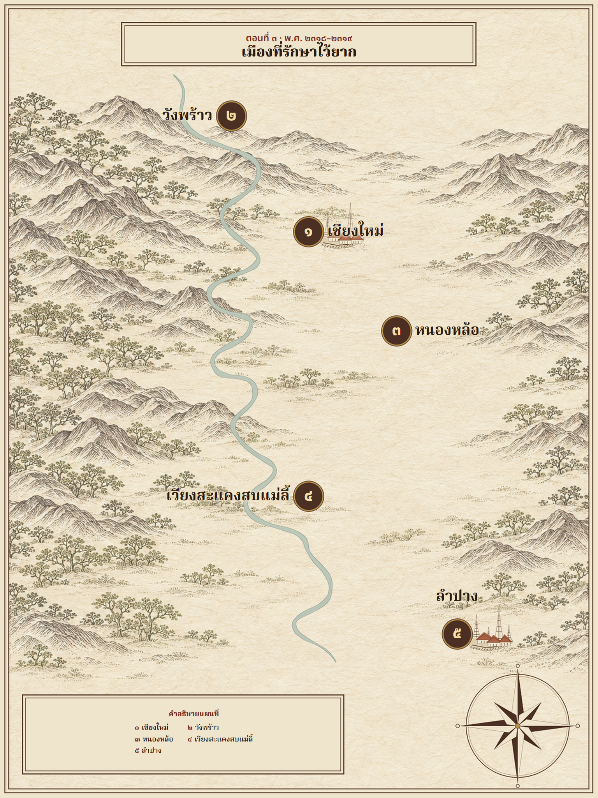

# ภาคที่ 1: ได้เมืองคืน แล้วใครจะอยู่
## ตอนที่ 3: เมืองที่รักษาไว้ยาก

> **หมายเหตุถึงผู้อ่านตอนที่ 3:** ตอนนี้เรียบเรียงจากการอ่านภาพสแกน *ตำนานพื้นเมืองเชียงใหม่* (ฉบับพิมพ์ พ.ศ. 2514 ผูก 6 หน้า 95–96 และอ้างเทียบสำนวนหน้า 98 ตอนต้นผูก 7 ความละเอียด 960 พิกเซล โดยไม่อาศัย OCR) ศักราชในตัวบทใช้จุลศักราช (จ.ศ.) ซึ่งเมื่อบวก 1181 จะได้ปี พ.ศ. ตามการนับแบบไทยเก่าที่เริ่มปีใหม่ในเดือนเมษายน (ความต่าง 1 ปีกับปฏิทินสากลสำหรับเหตุการณ์ก่อนเมษายนเป็นเพียงความต่างของระบบการนับปี มิใช่ความขัดแย้งระหว่างแหล่งข้อมูล) และคงการระบุเวลาตามตัวบทโดยไม่แปลงเป็นวันที่สากล ข้อความที่อ่านได้ไม่ครบทุกคำสรุปเป็นเค้าความโดยไม่คัดตรงตัวยาวและมีวงเล็บกำกับสั้น ๆ ว่า (อ่านได้บางส่วน) ส่วนตัวเลขกำลังพลบางจุดที่อ่านจากภาพได้ไม่แน่ใจจะไม่ถอดตัวเลขมา ขณะที่ตัวเลขอื่นที่ระบุไว้เป็นตัวเลขตามตัวบท ผู้ที่จะนำไปอ้างอิงต่อควรตรวจทานกับต้นฉบับโดยตรงก่อน

---

### ฉากเปิด: แปดเดือนในวงล้อมและความอดอยากในเวียง

เพียงปีรุ่งขึ้นหลังจากได้เมืองเชียงใหม่คืน ใน **จ.ศ. 1137 (พ.ศ. 2318 ตามปีนับเก่า)** ตัวบท *ตำนานพื้นเมืองเชียงใหม่* หน้า 95 บันทึกว่าฝ่ายพม่าได้ยกทัพมาล้อมเมืองเชียงใหม่อีกครั้ง

ตัวบทแสดงความต่างของกำลังพลระหว่างฝ่ายพม่าที่ยกมาล้อมกับกำลังฉกรรจ์ของ **พระยาจ่าบ้าน** ภายในเมืองไว้ด้วยตัวเลขที่ต่างกันมาก (ตัวบทใช้ตัวเลขจำนวนมาก แต่ผู้เรียบเรียงอ่านตัวเลขทั้งสองจำนวนจากภาพสแกนได้ไม่แน่ใจจึงไม่ถอดมา) การปิดล้อมดำเนินไปอย่างยาวนานตามตัวบทว่า **"8 เดือน"**

ผลของการถูกล้อมต่อเนื่องหลายเดือนปรากฏอยู่ในถ้อยคำสั้น ๆ ของตัวบทหน้า 95 ว่า ผู้คนในเมืองตกอยู่ในภาวะอดอยากอย่างหนัก จนต้องกินสัตว์เลี้ยงและสิ่งอื่นประทังชีวิตจน **"บ่ค้างเหลือ"** กระทั่งในที่สุดเมื่อมีทัพจากฝ่ายใต้ยกขึ้นมา (ตัวบทระบุกำลังพลตามตัวบทว่า 30,000) ฝ่ายพม่าจึงแตกถอยไป

---

### แผนที่สถานที่ในหลักฐาน: เชียงใหม่ ลำปาง และที่ตั้งของพระยาจ่าบ้าน

แผนที่ของตอนนี้แสดงเฉพาะตำแหน่งเมืองและสถานที่ตั้งที่ปรากฏชื่อใน *ตำนานพื้นเมืองเชียงใหม่* หน้า 95–96 โดยไม่ได้ลากเส้นทางเดินทัพหรือเส้นทางอพยพ เนื่องจากตัวบทไม่ได้ระบุแนวทางการเดินทางระหว่างสถานที่เหล่านี้ จุดที่ปรากฏตามหลักฐานมี 5 แห่ง ได้แก่ **เชียงใหม่**, **ลำปาง**, **วังพร้าว**, **หนองหล้อ**, และ **เวียงสะแคงสบแม่ท่า**

---

### คำถามของตอน

**เมืองที่เพิ่งได้คืนมาล้อมรอบด้วยศึกอีกครั้ง พระยาจ่าบ้านรักษาเมืองไว้ได้อย่างไร และทำไมจึงย้ายที่ตั้งหลายครั้ง**

เมื่ออ่าน *ตำนานพื้นเมืองเชียงใหม่* หน้า 95–96 อย่างละเอียด เราจะพบว่าตัวบทตอบได้เพียงว่า **"เกิดอะไรขึ้น"**—ได้แก่ การถูกล้อมแปดเดือน ความอดอยาก การได้รับกำลังเสริมจากกาวิละและทัพจากฝ่ายใต้ สภาพบ้านเมืองที่รกร้างหลังศึก การขัดใจกันภายในจนถึงขั้นสังหารหลาน และการย้ายที่ตั้งออกไปนอกตัวเมืองหลายครั้ง—แต่ตัวบทไม่ได้อธิบายว่า **"ทำไมพระยาจ่าบ้านจึงต้องย้ายที่ตั้งหลายครั้ง"** และไม่ได้ให้คำอธิบายเชิงยุทธศาสตร์

เนื้อหาต่อจากนี้จึงแยกข้อมูลออกเป็น 3 ชั้น คือ **ชั้นที่ 1 สิ่งที่ตัวบทเดิมพูด** **ชั้นที่ 2 สิ่งที่ผู้เรียบเรียงตั้งข้อสังเกตหรือจัดกรอบจากตัวบท** และ **ชั้นที่ 3 สิ่งที่ยังไม่รู้เพราะตัวบทไม่ได้บอก**

---

### หลักฐานตามตัวบทตำนานพื้นเมืองเชียงใหม่ (หน้า 95–96)

#### 1. การถูกล้อมใน จ.ศ. 1137 กำลังเสริมจากกาวิละ และทัพใต้ (หน้า 95)

เหตุการณ์ศึกป้องกันเมืองเชียงใหม่ใน **จ.ศ. 1137 (พ.ศ. 2318)** ปรากฏในตัวบทหน้า 95 ตามลำดับดังนี้

- **การล้อมเมืองและความอดอยาก (หน้า 95):** ฝ่ายพม่ายกมาล้อมเมืองเชียงใหม่ โดยมีกำลังพลต่างจากฝ่ายพระยาจ่าบ้านอย่างมากตามตัวเลขในตัวบท (ตัวบทใช้ตัวเลขจำนวนมาก แต่ผู้เรียบเรียงอ่านจากภาพได้ไม่แน่ใจจึงไม่ถอดมา) ระหว่างการล้อม ผู้คนในเมืองอดอยากจนต้องกินสัตว์เลี้ยงและสิ่งอื่นจน "บ่ค้างเหลือ"
- **กำลังช่วยเหลือจากกาวิละ (หน้า 95, อ่านได้บางส่วน):** ในช่วงวิกฤตินั้น **กาวิละ** ได้ส่งคนตามตัวบทว่า **หนึ่งพัน** มาช่วยรักษาเมือง โดยมีเค้าความว่า "ตัวเจ้าเป็นหัวหน้าเข้ามา"
- **การแตกทัพของฝ่ายพม่าหลังล้อมนาน 8 เดือน (หน้า 95):** ฝ่ายพม่าตั้งล้อมเมืองเชียงใหม่อยู่นานตามตัวบท **"8 เดือน"** จนกระทั่งทัพจากฝ่ายใต้ (ตัวบทระบุจำนวนตามตัวบทว่า 30,000) ยกขึ้นมา ฝ่ายพม่าจึงแตกถอยไป

#### 2. สภาพเมืองหลังศึกและการย้ายออกไปตั้งนอกเมือง (หน้า 95)

แม้ฝ่ายพม่าจะแตกทัพไปแล้ว แต่ผลกระทบต่อเมืองเชียงใหม่และผู้คนตามบันทึกหน้า 95 แสดงให้เห็นว่าการครองเมืองต่อจากนั้นไม่ได้กลับเข้าสู่ภาวะปกติ

- **การอพยพของผู้คนและการไปตั้งที่วังพร้าว (หน้า 95, อ่านได้บางส่วน):** หลังศึกครั้งนั้น ผู้คนพากันหนีกระจัดกระจายไปทั้งทางเหนือและทางใต้ ส่วน **พระยาจ่าบ้าน** กับ **อุปราชา** (ผู้เป็นหลาน) ได้พาครอบครัวไปยังเมือง **ลำปาง** ก่อนจะกลับมาตั้งหลักอยู่ที่ **วังพร้าว** ซึ่งอยู่นอกตัวเมืองเชียงใหม่ แล้วจึงค่อยขึ้นตั้งเวียงเชียงใหม่
- **สภาพเวียงเชียงใหม่ตามถ้อยคำของตัวบท (หน้า 95 และหน้า 98):** ตัวบทหน้า 95 บรรยายสภาพเวียงเชียงใหม่ในช่วงนี้ด้วยถ้อยคำว่า "ห่าทรอกตัน ... คุ่มเครือเขาเถาวัลย์ เป็นที่แรดช้างเสือหมี" พร้อมระบุว่าผู้คนมีน้อย ทางเดินไม่แจ้งไม่ถาง และตัวบทยังใช้ถ้อยคำลักษณะคล้ายกันซ้ำอีกครั้งใน **หน้า 98** ตอนต้นผูก 7
  ในชั้นการตีความ ถ้อยคำเหล่านี้เป็นสำนวนของตัวบทที่สะท้อนภาพรวมความรกร้างของบ้านเมืองและจำนวนผู้คนที่เบาบางลงหลังสงคราม ไม่ใช่หลักฐานยืนยันว่าตัวเมืองเชียงใหม่ไม่มีผู้คนอาศัยอยู่เลย

#### 3. ความขัดแย้งที่วังพร้าวใน จ.ศ. 1138 และการย้ายที่ตั้งหลายครั้ง (หน้า 96)

ถัดจากเรื่องราวในหน้า 95 ตัวบทหน้า 96 บันทึกเหตุการณ์แตกหักภายในกลุ่มผู้นำและการเคลื่อนย้ายที่ตั้งของพระยาจ่าบ้านไว้อย่างกระชับ

- **การสังหารอุปราชาก้อนแก้วใน จ.ศ. 1138 (หน้า 96):** ตัวบทบันทึกว่าพระยาจ่าบ้านกับ **อุปราชาก้อนแก้ว** (ผู้เป็นหลาน) เกิดขัดใจกันเรื่องเสบียงที่เก็บไว้ที่ **วังพร้าว** และใน **จ.ศ. 1138 (พ.ศ. 2319)** พระยาจ่าบ้านได้ฆ่าอุปราชาผู้เป็นหลานตนตามถ้อยคำในตัวบท
  ในชั้นการอ่านหลักฐาน ต้องระบุให้ชัดว่าเหตุการณ์นี้เป็นบันทึกที่ปรากฏในตัวบทฝั่งล้านนาฝั่งเดียว โดยตัวบทระบุเหตุสั้น ๆ เพียงเรื่องขัดใจกันด้านเสบียงที่วังพร้าว ไม่ได้ขยายความถึงเบื้องหลังหรือแรงจูงใจอื่น และชื่อ "อุปราชาก้อนแก้ว" ในที่นี้ใช้ตามตัวบทโดยไม่ระบุเชื่อมโยงกับบุคคลใดนอกตัวบท
- **การย้ายที่ตั้งหลายครั้งจนถึงเวียงสะแคงสบแม่ท่า (หน้า 96, อ่านได้บางส่วน):** ตัวบทหน้า 96 บันทึกการย้ายที่ตั้งของพระยาจ่าบ้านหลายครั้ง แต่ผู้เรียบเรียงอ่านลำดับและศักราชรายปีจากภาพสแกนได้ไม่ครบ จึงระบุได้เฉพาะชื่อสถานที่ที่ปรากฏในตัวบท ได้แก่ **วังพร้าว**, **หนองหล้อ**, และ **เวียงสะแคงสบแม่ท่า** นอกจากนี้ ในเนื้อความช่วงเดียวกันยังมีเค้าความกล่าวถึงการเข้าตีเชียงแสนและได้เมืองเปา (?) ก่อนที่พระยาจ่าบ้านจะกลับมาตั้งหลักอยู่ที่ **เวียงสะแคงสบแม่ท่า**

---

### สิ่งที่ยังไม่รู้

เมื่อแยกสิ่งที่ตัวบทหน้า 95–96 บันทึกออกจากส่วนที่เอกสารไม่ได้ตอบ ยังคงมีช่องว่างและข้อจำกัดของหลักฐานหลายประการ ดังนี้

- **เหตุผลของการย้ายที่ตั้งหลายครั้ง:** ตัวบทระบุชื่อสถานที่ตั้งของพระยาจ่าบ้านทั้งวังพร้าว หนองหล้อ และเวียงสะแคงสบแม่ท่า แต่ไม่ได้อธิบายเหตุผลเชิงยุทธศาสตร์หรือเงื่อนไขทางกายภาพว่าทำไมจึงต้องย้ายที่ตั้งหลายครั้งและเหตุใดจึงไม่ปักหลักอยู่ในตัวเวียงเชียงใหม่ตลอดช่วงเวลานั้น
- **สาเหตุอื่นของความอดอยากและสภาพประชากรที่แท้จริง:** นอกจากการถูกล้อมนาน 8 เดือน ตัวบทไม่ได้บอกสาเหตุอื่นของความอดอยาก และไม่ได้ระบุจำนวนผู้คนที่เหลืออยู่จริงในเมืองเชียงใหม่ (มีเพียงถ้อยคำบรรยายภาพรวมความรกร้าง)
- **ลำดับปีรายปีของการย้ายที่ตั้งและเหตุการณ์ช่วงท้าย (หน้า 96):** ข้อความช่วงการย้ายที่ตั้งจากวังพร้าว หนองหล้อ ไปจนถึงการเข้าตีเชียงแสน เมืองเปา (?) และการกลับมาตั้งที่เวียงสะแคงสบแม่ท่า อ่านจากภาพสแกนได้บางส่วน จึงยังไม่สามารถเรียงลำดับปีรายปีได้
- **ตัวเลขกำลังพลใน จ.ศ. 1137 (หน้า 95):** ตัวเลขกำลังพลฝ่ายพม่าและฝ่ายพระยาจ่าบ้านในหน้า 95 อ่านจากภาพสแกนได้ไม่แน่ใจ จึงยังต้องตรวจทานกับต้นฉบับก่อนนำมาใช้เป็นตัวเลขยืนยัน
- **มุมมองจากหลักฐานฝั่งอื่นต่อกรณีวังพร้าว:** เหตุการณ์ที่พระยาจ่าบ้านฆ่าอุปราชาก้อนแก้วใน จ.ศ. 1138 อ้างอิงจาก *ตำนานพื้นเมืองเชียงใหม่* ฝั่งเดียว ยังไม่ได้สอบเทียบกับเอกสารฝั่งอื่น
- **ข้อความอีกตอนหนึ่งในหน้า 95:** ตัวบทหน้า 95 มีเรื่องเล่าอีกตอนหนึ่งที่ผู้เรียบเรียงยังไม่ได้ตรวจภาพซ้ำ จึงยังไม่นำมาใช้ในตอนนี้

---

### ตะขอไปตอนถัดไป

บันทึกช่วงนี้ของ *ตำนานพื้นเมืองเชียงใหม่* หน้า 96 จบลงที่การกลับมาตั้งหลักของพระยาจ่าบ้าน ณ เวียงสะแคงสบแม่ท่า ในตอนถัดไป ชื่อสถานที่แห่งเดียวกันนี้จะกลับมาเป็นจุดตั้งต้นอีกครั้งก่อนการย้ายไปตั้งหลักที่ป่าซาง

**จบตอนที่ 3**

*(ติดตามต่อในตอนถัดไป)*

---

## ตารางที่มาของข้อเท็จจริง (ไม่พิมพ์ในหนังสือ ใช้ตรวจ)

| ข้อความในบท | ข้อในใบข้อเท็จจริง | หน้าพิมพ์ | ระดับ |
|---|---|---|---|
| วิธีอ่าน ข้อจำกัด และการนับปี: ตำนานพื้นเมืองเชียงใหม่ ฉบับ สนร. 2514 อ่านจากภาพสแกน 960 พิกเซล (สแกน 102–103 = หน้า 95–96, สแกน 105 = หน้า 98) จ.ศ. + 1181 = พ.ศ. แบบเริ่มเมษายน ตัวเลขเป็นตัวเลขตามตัวบท | ตำนานภาค 1–2 (วิธีอ่านและข้อจำกัด, หมายเหตุเรื่องการนับปี) | 95–96, 98 | ตามใบข้อเท็จจริง |
| จ.ศ. 1137 (พ.ศ. 2318) ฝ่ายพม่ายกมาล้อมเชียงใหม่อีก ตัวบทใช้ตัวเลขกำลังพลต่างกันมากระหว่างฝ่ายพม่ากับฝ่ายพระยาจ่าบ้าน (ไม่พิมพ์ตัวเลขเนื่องจากอ่านไม่แน่ใจ) ผู้คนในเมืองอดอยาก กินสัตว์เลี้ยงและสิ่งอื่นจน "บ่ค้างเหลือ" | ตำนาน B1 | 95 | ชัดโดยรวม / ตัวเลขอ่านไม่แน่ใจ (ไม่ถอดตัวเลข) |
| กาวิละส่งคนหนึ่งพัน (ตามตัวบท) มาช่วยรักษาเมือง มีเค้าความว่า "ตัวเจ้าเป็นหัวหน้าเข้ามา" | ตำนาน B2 | 95 | บางส่วน |
| ฝ่ายพม่าล้อมอยู่นานตามตัวบท "8 เดือน" จนทัพใต้ (ตัวบทระบุ 30,000) ขึ้นมา พม่าจึงแตกไป | ตำนาน B3 | 95 | ชัดโดยรวม |
| หลังศึกผู้คนหนีไปทั้งเหนือและใต้ พระยาจ่าบ้านกับอุปราชา (หลาน) พาครอบครัวไปลำปาง แล้วกลับมาตั้งที่วังพร้าว (นอกตัวเมืองเชียงใหม่) ก่อนขึ้นตั้งเวียงเชียงใหม่ | ตำนาน B4 | 95 | บางส่วน |
| ตัวบทบรรยายสภาพเวียงเชียงใหม่: "ห่าทรอกตัน ... คุ่มเครือเขาเถาวัลย์ เป็นที่แรดช้างเสือหมี" ผู้คนน้อย ทางเดินไม่แจ้งไม่ถาง (ใช้ถ้อยคำคล้ายกันซ้ำในหน้า 98 ตอนต้นผูก 7) — ไม่ระบุว่าเชียงใหม่ว่างสนิท | ตำนาน B5 (และ สิ่งที่ตัวบทกลุ่มนี้ไม่บอก) | 95, 98 | ชัด |
| อ้างไว้ใน "สิ่งที่ยังไม่รู้" 1 ประโยคว่าหน้า 95 มีเรื่องเล่าอีกตอนหนึ่งที่ยังไม่ได้ตรวจภาพซ้ำจึงยังไม่นำมาใช้ (ไม่เล่าเนื้อหา) | ตำนาน B6 (เว้นไว้ตามกติกา) | 95 | บางส่วน (รอตรวจภาพซ้ำ) |
| พระยาจ่าบ้านกับอุปราชาก้อนแก้ว (หลาน) ขัดใจกันเรื่องเสบียงที่เก็บไว้ที่วังพร้าว พระยาจ่าบ้านฆ่าอุปราชา (หลานตน) ใน จ.ศ. 1138 (พ.ศ. 2319) ตามตัวบท (บันทึกฝั่งล้านนาฝั่งเดียว) | ตำนาน B7 | 96 | ชัด (ปีชัด) |
| พระยาจ่าบ้านย้ายที่ตั้งหลายครั้ง (อ่านลำดับปีรายปีได้ไม่ครบ) ชื่อสถานที่ที่ปรากฏคือ วังพร้าว, หนองหล้อ, และเวียงสะแคงสบแม่ท่า มีเค้าความการเข้าตีเชียงแสนและได้เมืองเปา (?) แล้วกลับมาตั้งที่เวียงสะแคงสบแม่ท่า | ตำนาน B8 | 96 | บางส่วน (ไม่เรียงลำดับปีรายปี) |
| ตะขอไปตอนถัดไป: เวียงสะแคงสบแม่ท่าจะกลับมาเป็นจุดตั้งต้นอีกครั้งก่อนย้ายไปตั้งหลักที่ป่าซาง (ไม่เล่ารายละเอียดของกลุ่ม ง) | ตำนาน B8 (เชื่อมชื่อสถานที่ตามคำสั่ง) | 96 | ตามใบข้อเท็จจริง |

---

## รายการภาพที่ต้องสร้าง (ไม่พิมพ์ในหนังสือ ใช้ตรวจ)

1. **ภาพฉากเปิดตอน (`images/ep03_scene.jpg` — สัดส่วน 16:9 แนวนอน)**
   - **แนวคิดและองค์ประกอบ:** แนวกำแพงอิฐเมืองเชียงใหม่ที่มีพุ่มไม้และเถาวัลย์ขึ้นรกเกาะตามแนวกำแพง ลานดินหน้ากำแพงว่างเปล่า (อ้างอิงสำนวนตัวบท B5 หน้า 95 และหน้า 98 เรื่องเวียงรก) เป็นภาพเชิงสัญลักษณ์ของสภาพเมืองหลังศึก ไม่ใช่ภาพของการล้อม เพราะตัวบทไม่ได้บรรยายลักษณะค่ายล้อมของฝ่ายพม่า ห้ามใส่ค่ายข้าศึก ตรอกซอกซอย หรือรายละเอียดที่ตัวบทไม่ระบุ
   - **กติกาบังคับ:** ไม่มีหน้าคน ไม่มีอาวุธเด่น ไม่มีปืน วัตถุทุกชิ้นตั้งอยู่บนพื้นอย่างมั่นคง ห้ามใส่ข้อความหรือตัวอักษรใด ๆ ในภาพ ห้ามแต่งเติมรายละเอียดเสียง กลิ่น หรือผู้คน
2. **แผนที่ประจำตอน (`images/ep03_map.png` — สัดส่วน 3:4 แนวตั้ง)**
   - **แนวคิดและองค์ประกอบ:** แผนที่ภูมิประเทศโทนสีเซลาดอน (celadon) แสดงเฉพาะตำแหน่งเมืองและสถานที่ตั้งที่ปรากฏในตัวบท พ.ศ. 2318–2319
   - **เมืองและสถานที่ที่อนุญาตให้ใส่ในแผนที่ (ตามใบข้อเท็จจริง B4 และ B8 เท่านั้น ห้ามใส่เมืองอื่น):**
     - **เชียงใหม่**
     - **ลำปาง**
     - **วังพร้าว**
     - **หนองหล้อ**
     - **เวียงสะแคงสบแม่ท่า**
   - **กติกาบังคับ:** ห้ามลากเส้นทางทัพหรือเส้นทางหนี (ตัวบทไม่ระบุแนวทาง) ห้ามใส่เมืองอื่นนอกเหนือจาก 5 ชื่อข้างต้น (ห้ามใส่ป่าซาง ลำพูน เชียงแสน หรือเมืองเปา) ไม่มีหน้าคน ไม่มีอาวุธเด่น ไม่มีปืน ห้ามใส่ข้อความตกแต่งนอกเหนือจากชื่อสถานที่ที่อนุญาต
