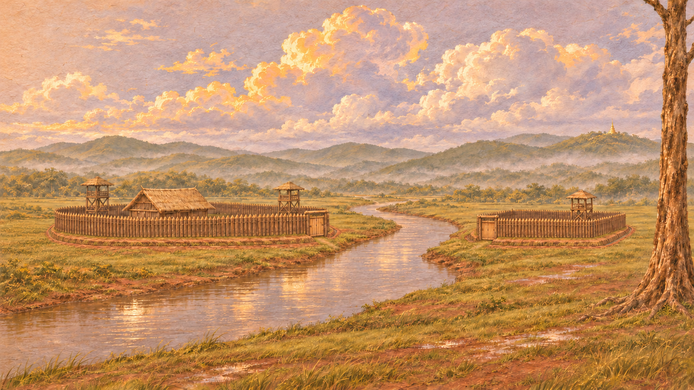
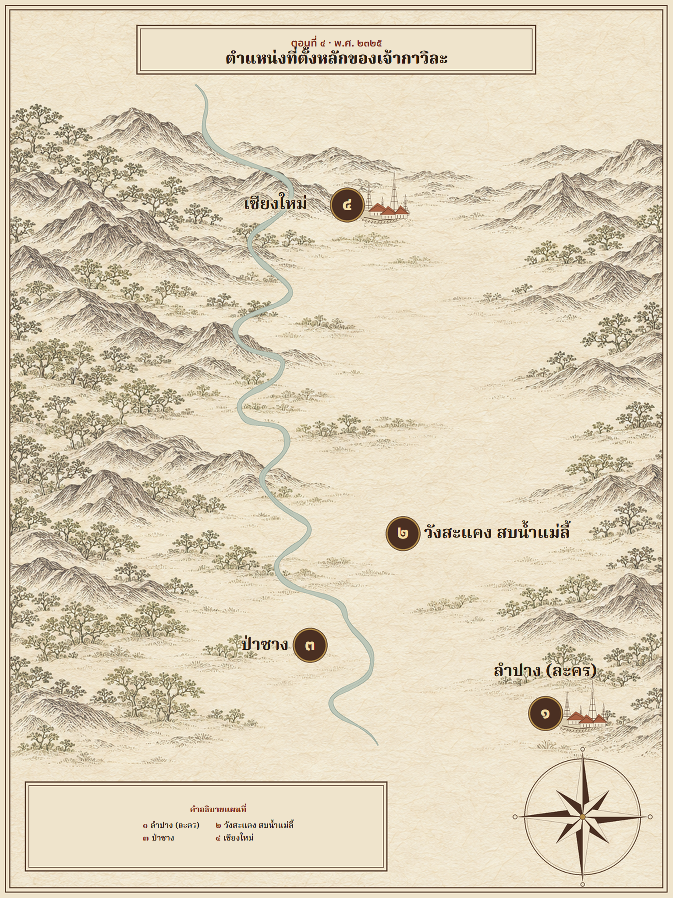

# ภาคที่ 2: ตั้งหลักที่ป่าซาง
## ตอนที่ 4: ทำไมป่าซาง

> **หมายเหตุถึงผู้อ่านตอนที่ 4:** ตอนนี้วางหลักฐานสองชั้นเทียบกัน ฝั่ง ก. คือตัวบท *ตำนานพื้นเมืองเชียงใหม่* หน้า 98 และ 100 (ภาพสแกน) ฝั่ง ข. คืองานชั้นรองสมัยใหม่ รายงานวิจัยของ สกว. โดย รศ.สมโชติ อ๋องสกุล และคณะ (ตรวจจากภาพหน้า PDF 43–44 และ 48–49) ผู้อ่านควรแยกถ้อยคำของตัวบทโบราณออกจากคำอธิบายของนักวิชาการสมัยใหม่

---

### ฉากเปิด: ป่าซางหลวง ป่าซางน้อย ริมน้ำแม่ท่า

ในเดือนเจี่ยง แรม 8 ค่ำของ **จ.ศ. 1144 (พ.ศ. 2325 ตามปีนับเก่า)** ตัวบท *ตำนานพื้นเมืองเชียงใหม่* หน้า 98 บันทึกการลงหลักปักฐานครั้งใหม่ของเจ้ากาวิละริมลำน้ำแม่ท่า ด้วยถ้อยคำว่า **"ยกเข้าตั้งเวฬุกาม คือว่าป่าซาง"**

ตัวบทระบุถึงสิ่งปลูกสร้างครบองค์ประกอบของเวียงป้องกันศึก ได้แก่ คุ้ม ปราสาท ค่ายคู ประตูเวียง และป้อมหอรบ โดยวางแนวเวียงคร่อมลำน้ำแม่ท่าแยกออกเป็นสองฝั่งคือ **ป่าซางหลวง** กับ **ป่าซางน้อย**

เมื่อวางโครงสร้างเวียงลงบนสองฝั่งน้ำแล้ว ตัวบทกลับให้คำอธิบายถึงจุดมุ่งหมายไว้เพียงสี่คำสั้น ๆ ว่า **"เพื่อข้ามศึกสงคราม"** ทิ้งปริศนาไว้ให้ผู้อ่านยุคหลังต้องตั้งคำถามต่อว่า เหตุใดผู้ที่ได้รับตำแหน่งเจ้าเมืองเชียงใหม่จึงเลือกตั้งเวียงอยู่ที่นี่แทนที่จะเข้าไปตั้งในตัวเมืองเชียงใหม่ทันที

---

### แผนที่สถานที่ในหลักฐาน: ป่าซาง ลำปาง เชียงใหม่ และวังสะแคง สบน้ำแม่ลี้

แผนที่ของตอนนี้วางเฉพาะเมืองและสถานที่ 4 แห่งที่ปรากฏในหลักฐาน ได้แก่ **ป่าซาง**, **ลำปาง**, **เชียงใหม่**, และ **วังสะแคง สบน้ำแม่ลี้** โดยไม่ได้ลากเส้นทางเชื่อมระหว่างจุด เนื่องจากตัวบทตำนานไม่ได้ระบุแนวทางเดินทัพหรือเส้นทางเดินทางระหว่างสถานที่เหล่านี้

---

### คำถามของตอน

**ทำไมต้องป่าซาง**

คำถามสั้น ๆ ข้อนี้เป็นจุดที่เผยให้เห็นความต่างระหว่าง "สิ่งที่เอกสารโบราณบันทึก" กับ "สิ่งที่นักวิชาการสมัยใหม่อธิบาย" ได้ชัดเจนที่สุดในเล่มนี้ เพราะในตัวบท *ตำนานพื้นเมืองเชียงใหม่* มีคำตอบเพียงถ้อยคำสั้น ๆ ว่า **"เพื่อข้ามศึกสงคราม"** ควบคู่กับภาพบ้านเมืองที่รกร้าง ขณะที่รายงานวิจัยสมัยใหม่ของ สกว. ได้เสนอเหตุผลไว้ถึง 3 ประการ ทั้งด้านความอุดมสมบูรณ์และแม่น้ำเป็นปราการ ด้านอิทธิพลของพม่าทางตอนใต้ และด้านความสะดวกในการขอความช่วยเหลือจากลำปาง

---

### หลักฐานฝั่ง ก.: ตัวบทตำนานพื้นเมืองเชียงใหม่ (หน้า 98 และ 100)

ใน *ตำนานพื้นเมืองเชียงใหม่* ผูก 7 หน้า 98 เค้าโครงเหตุการณ์ในปี **จ.ศ. 1144 (พ.ศ. 2325)** ที่เกี่ยวเนื่องกับการเลือกตั้งหลักที่ป่าซางมีขอบเขตจำกัดอยู่เพียงห้าประเด็นดังนี้

- **จุดเริ่มต้นที่วังสะแคง สบน้ำแม่ลี้ (หน้า 98):** เจ้ากาวิละยกจากเมืองละคร (ลำปาง) พร้อมไพร่ตามตัวบท **300 คน** เดินทาง 8 วันถึง **วังสะแคง สบน้ำแม่ลี้** ซึ่งเป็นที่ที่พระยาจ่าบ้านเคยตั้งมาก่อน และพำนักอยู่ที่นั่นราวหนึ่งเดือนเพื่อถามหาขุนนางและไพร่เก่า ตัวบทว่ามีคนล่ำฉกรรจ์ 700 คน "เข้ากันทั้งเก่าใหม่ เป็นคนพันหนึ่ง" (ตัวเลขตามตัวบท)
- **สภาพล้านนาตามถ้อยคำของตัวบท (หน้า 98):** ตัวบทบรรยายสภาพบ้านเมืองด้วยถ้อยคำว่า **"บ้านห่าง นาห่าง บ้านอุกเมืองรก"** และ **"ไปทางใต้ก็กลัวเสือ ไปทางเหนือก็กลัวช้าง"** ผู้คนไม่ตั้งบ้านเรือน เพราะไม่มีท้าวพระยาเป็นผู้นำ
- **เหตุผลเดียวที่ตัวบทระบุสำหรับการตั้งป่าซาง (หน้า 98):** เมื่อถึงเดือนเจี่ยง แรม 8 ค่ำในปีเดียวกัน เจ้ากาวิละจึงย้ายขึ้นตั้งเวียงที่ **ป่าซาง** ริมน้ำแม่ท่า แยกเป็นป่าซางหลวงกับป่าซางน้อย สร้างคุ้ม ปราสาท ค่ายคู ประตูเวียง และป้อมหอรบ โดยตัวบทระบุจุดมุ่งหมายไว้เพียงถ้อยคำสั้น ๆ ว่า **"เพื่อข้ามศึกสงคราม"**
- **การวางพื้นฐานการดำรงชีพและศาสนา (หน้า 98):** ตัวบทมีเค้าความว่ามีบัญชาให้ท้าวพระยา ขุนนาง และไพร่พลทำไร่นาเพื่อเป็นปัจจัยบริบูรณ์ และสร้างวัดวาอารามให้เป็นที่สถิตของพระสงฆ์
- **ข้อสังเกตประกอบจากหน้า 100:** ถัดมาใน **จ.ศ. 1146 (พ.ศ. 2327)** ตัวบทหน้า 100 มีเค้าความว่าขณะที่เจ้าฟ้าชายแก้วเสด็จไปป่าซาง ฝ่ายพม่าเข้าล้อมเวียงละคร (ลำปาง) เจ้ากาวิละจึงให้เจ้ามหาอุปราชารักษาบ้านเวนแล้วขอกองทัพจาก **"กรุงศรีอยุทธยา"** (ตามบริบทหมายถึงราชสำนักสยามที่กรุงเทพฯ) จนทัพสยามขึ้นมาช่วย

กล่าวโดยสรุป ตัวบทตำนานไม่ได้อธิบายข้อได้เปรียบทางภูมิศาสตร์ของป่าซาง ไม่ได้เปรียบเทียบป่าซางกับทำเลอื่น และไม่ได้ชี้แจงเหตุผลนอกเหนือไปจากคำว่า "เพื่อข้ามศึกสงคราม"

---

### หลักฐานฝั่ง ข.: คำอธิบายของรายงานวิจัยสมัยใหม่ (ชั้นรอง)

เมื่อขยับจากตัวบทโบราณมาดูงานศึกษาชั้นรองสมัยใหม่ ในรายงานวิจัยฉบับสมบูรณ์ของสำนักงานกองทุนสนับสนุนการวิจัย (สกว.) โครงการวิจัยและพัฒนาเครือข่ายในพื้นที่เพื่อหนุนเสริมการเรียนรู้วิชาประวัติศาสตร์ในระดับประถมศึกษา ปีที่ 4–6 สถานศึกษาในจังหวัดเชียงใหม่ โดย **รศ.สมโชติ อ๋องสกุล และคณะ** (ตรวจเทียบจากภาพหน้าเอกสาร PDF จริงแล้ว) ผู้วิจัยได้เรียบเรียงคำอธิบายเกี่ยวกับป่าซางและลำปางไว้ในสองช่วงดังนี้

#### 1. เหตุผล 3 ข้อของการเลือกตั้งเวียงป่าซาง (หน้า PDF 44)

รายงานของผู้วิจัยอธิบายภูมิหลังว่า หลังได้รับแต่งตั้งเป็นเจ้าเมืองเชียงใหม่ใน พ.ศ. 2325 เชียงใหม่ในขณะนั้นมีสภาพที่รายงานเรียกว่า **"เมืองร้าง"** (และในหน้า PDF 43 รายงานสรุปช่วงเวลาว่านาน 20 ปี ตั้งแต่ พ.ศ. 2319–2339) ขาดแคลนกำลังคนอย่างมาก และพม่ายังมีอิทธิพลตามหัวเมืองต่าง ๆ ในล้านนา เช่น น่าน พร้าว ฝาง เชียงราย โดยเฉพาะเชียงแสนที่เป็นฐานที่มั่นสำคัญ

ในด้านกำลังคน **ตามรายงาน สกว. ซึ่งเป็นงานชั้นรอง** กาวิละแบ่งไพร่จากเมืองลำปางประมาณ **300 คน** ไปรวมกับไพร่เดิมของพระยาหลวงวชิรปราการที่บริเวณวังสะแกงอีก **700 คน** รวมเป็นหนึ่งพันคน แล้วจึงนำไปตั้งมั่นที่ป่าซางและสร้างเวียงป่าซางริมน้ำแม่ทา (รายงานสะกด "แม่ทา") ใน พ.ศ. 2325 "เพื่อให้เป็นเมืองชั่วคราว" โดยตั้งมั่นรวบรวมกำลังคนนาน **14 ปี**

จากนั้น **รายงานของผู้วิจัยให้เหตุผลที่เลือกตั้งเมืองที่เวียงป่าซางก่อนไว้ 3 ข้อ** ได้แก่

1. **ความอุดมสมบูรณ์และแม่น้ำเป็นปราการ:** รายงานของผู้วิจัยให้เหตุผลว่า ป่าซางเป็นพื้นที่ที่มีความอุดมสมบูรณ์มาก มีแม่น้ำ 3 สายไหลมาบรรจบกัน ได้แก่ **น้ำแม่ปิง แม่กวง และแม่ทา** ขณะเดียวกันแม่น้ำยังทำหน้าที่เป็นปราการสำคัญในการป้องกันข้าศึก
2. **อิทธิพลพม่าและความบอบช้ำจากสงคราม:** รายงานของผู้วิจัยให้เหตุผลว่า อิทธิพลของพม่าทางตอนใต้เบาบางกว่าทางตอนเหนือ และพื้นที่ทางตอนใต้ได้รับความบอบช้ำจากภัยสงครามน้อยกว่า
3. **ความสะดวกในการประสานงานกับลำปาง:** รายงานของผู้วิจัยให้เหตุผลว่า หากเกิดสงครามกับพม่าก็สามารถขอความช่วยเหลือจากเมืองลำปางได้สะดวก เพราะป่าซางตั้งอยู่ระหว่างลำปางกับเชียงใหม่

ทั้งนี้ ในหน้า PDF 44 เลขเชิงอรรถ 7 กำกับอยู่ท้ายเหตุผลข้อที่ 3 ซึ่งในรายการเชิงอรรถท้ายหน่วยของรายงานอ้างถึง สรัสวดี อ๋องสกุล *ประวัติศาสตร์ลานนา* หน้า 318–319 (งานเรียบเรียงสมัยใหม่อีกทอดหนึ่ง มิได้อ้างเอกสารชั้นต้นร่วมสมัยโดยตรง) ผู้เรียบเรียงไม่ทราบว่าเชิงอรรถนี้ครอบคลุมข้อความถึงเพียงใด

#### 2. บทบาทของเมืองลำปางในช่วงตั้งหลักที่ป่าซาง (หน้า PDF 48–49)

ในหน้า PDF 48–49 รายงานของผู้วิจัยอธิบายเพิ่มเติมว่า ระหว่างที่เจ้ากาวิละตั้งมั่นอยู่ที่เวียงป่าซางก่อนจะตั้งเมืองเชียงใหม่ เมืองลำปางภายใต้การปกครองของ **พระยาคำสม** (พ.ศ. 2325–2337) ถูกใช้เป็นฐานที่มั่นของเชียงใหม่และลำพูนเพื่อต่อสู้กับทัพพม่า เนื่องจากอยู่ใกล้กับสยามและได้รับความบอบช้ำจากพม่าน้อยกว่า รายงานยังยกเหตุการณ์ พ.ศ. 2327 ที่พระเจ้ากาวิละออกจากเวียงป่าซางมาช่วยเมืองลำปางต่อสู้กับพม่าจนกองทัพสยามยกมาช่วย และระบุว่าเมื่อพระยาคำสมถึงแก่อนิจกรรมใน พ.ศ. 2337 จึงโปรดเกล้าฯ แต่งตั้งพระยาอุปราชดวงทิพย์เป็นพระยานครลำปาง

---

### เทียบสองชั้น: จุดที่สอดคล้องและระยะห่างระหว่างตัวบทกับงานวิจัย

เมื่อวางหลักฐานชั้นต้น (ตำนานหน้า 98 และ 100) คู่กับงานชั้นรอง (รายงานวิจัย สกว. หน้า PDF 44 และ 48–49) เราจะเห็นความต่างของระดับข้อมูลอย่างน้อยสามประการ

1. **คำบรรยายสภาพเมือง:** ตัวบทตำนานหน้า 98 ใช้สำนวนว่า "บ้านห่าง นาห่าง บ้านอุกเมืองรก" ส่วนรายงานวิจัยสมัยใหม่สรุปด้วยคำว่า "เมืองร้าง" (และสรุประยะเวลานาน 20 ปี) คำว่า "เมืองร้าง" และตัวเลข "20 ปี" จึงเป็นคำสรุปของนักวิชาการสมัยใหม่ ไม่ใช่ถ้อยคำหรือข้อเท็จจริงโดยตรงจากตัวบทตำนาน
2. **ตัวเลขกำลังคนเริ่มต้น:** ตัวเลขไพร่ **300 คน** จากลำปางตรงกันทั้งในตำนาน (หน้า 98) และในรายงาน สกว. ส่วนตัวเลขไพร่เดิมที่วังสะแคง **700 คน** "เข้ากันทั้งเก่าใหม่ เป็นคนพันหนึ่ง" ปรากฏทั้งในตำนานหน้า 98 (ผู้อ่านภาษาไทยตรวจยืนยันจากภาพ) และในรายงาน สกว. ซึ่งสรุปเป็นหนึ่งพันคนตรงกัน (ตัวเลขทั้งหมดเป็นตัวเลขตามตัวบท)
3. **ความสอดคล้องที่ไม่ใช่การพิสูจน์:** เหตุผลข้อที่ 3 ของรายงานเรื่องการขอความช่วยเหลือจากลำปางได้สะดวกและบทบาทของลำปางในหน้า PDF 48–49 นั้น **ผู้เรียบเรียงสังเกตว่าเหตุการณ์ในตำนานหน้า 100 (จ.ศ. 1146 ที่พม่าล้อมลำปางและทัพสยามขึ้นมาช่วย) สอดคล้องกับเหตุผลข้อที่ 3 ของรายงาน แต่ไม่ได้พิสูจน์ว่านี่คือเหตุผลที่แท้จริงในการเลือกตั้งเวียงป่าซาง** และเหตุผลทั้ง 3 ข้อของรายงานยังคงเป็นคำอธิบายของนักวิชาการสมัยใหม่ที่ยังไม่ได้รับการยืนยันจากเอกสารชั้นต้น

---

### สิ่งที่ยังไม่รู้

เมื่อแยกคำอธิบายของนักวิชาการสมัยใหม่ออกจากตัวบทโบราณแล้ว ยังคงมีคำถามสำคัญที่หลักฐานยังไม่ตอบ ดังนี้

- **กาวิละคิดและตัดสินใจด้วยเหตุผลใดจริง ๆ ใน พ.ศ. 2325:** ไม่มีเอกสารชั้นต้นใดในชุดนี้ที่บันทึกพระดำริหรือการอภิปรายของเจ้ากาวิละในวันที่ตัดสินใจย้ายจากวังสะแคง สบน้ำแม่ลี้ ไปตั้งเวียงที่ป่าซาง นอกจากถ้อยคำสั้น ๆ ของผู้บันทึกตำนานว่า "เพื่อข้ามศึกสงคราม"
- **เหตุผล 3 ข้อของรายงานวิจัยมีหลักฐานชั้นต้นรองรับหรือไม่:** รายงาน สกว. เป็นงานชั้นรองเพื่อการเรียนรู้ และเชิงอรรถในรายงานอ้างอิงต่อจากงานประวัติศาสตร์สมัยใหม่อีกชั้นหนึ่ง จึงยังไม่ทราบว่าข้อวิเคราะห์ทั้งสามประการมีเอกสารร่วมสมัยยืนยันหรือไม่
- **รายละเอียดภูมิศาสตร์และการจัดการพื้นที่ใน พ.ศ. 2325:** นอกเหนือจากการกล่าวถึงแม่น้ำ 3 สาย (แม่ปิง แม่กวง และแม่ทา) ในรายงาน สกว. แล้ว เรายังไม่มีข้อมูลเชิงภูมิศาสตร์หรือโบราณคดีชั้นต้นในตอนนี้เกี่ยวกับระยะทาง สภาพลำน้ำ หรือแนวเส้นทางคมนาคมรอบป่าซางในสมัยนั้น
- **ตัวเลขไพร่ที่เข้าสมทบที่วังสะแคง (หน้า 98):** ตัวเลข 700 คนและ "คนพันหนึ่ง" เป็นตัวเลขตามตัวบท ตรงกับที่รายงาน สกว. สรุปว่าไพร่ลำปาง 300 รวมกับไพร่เดิมที่วังสะแกง 700 เป็นหนึ่งพันคน แต่ตัวบทไม่อธิบายว่านับอย่างไร

---

### ตะขอไปตอนถัดไป

ไม่ว่าเหตุผลเบื้องหลังการเลือกตั้งหลักที่ป่าซางจะมีกี่ประการ เวียงริมลำน้ำแห่งนี้ก็ไม่ใช่พื้นที่ของผู้นำเพียงคนเดียว ในตอนที่ 5 เราจะหันมาดูผู้คนที่ร่วมกันแบกรับภาระอยู่ในเวียงป่าซาง—คือกลุ่มพี่น้องเจ้าเจ็ดตน

**จบตอนที่ 4**

*(ติดตามต่อใน ตอนที่ 5: พี่น้องเจ้าเจ็ดตน)*

---

## ตารางที่มาของข้อเท็จจริง (ไม่พิมพ์ในหนังสือ ใช้ตรวจ)

| ข้อความในบท | ข้อในใบข้อเท็จจริง / ไฟล์รายงาน | หน้า | ระดับ |
|---|---|---|---|
| วิธีอ่าน ข้อจำกัด และการนับปี: ตำนานพื้นเมืองเชียงใหม่ ฉบับ สนร. 2514 อ่านจากภาพสแกน 960 พิกเซล จ.ศ. + 1181 = พ.ศ. แบบเริ่มเมษายน ตัวบทเรียกกรุงเทพฯ ว่า "กรุงศรีอยุทธยา" | ตำนานภาค 1–2 (วิธีอ่านและข้อจำกัด, หมายเหตุเรื่องการนับปี) | 98, 100 | ตามใบข้อเท็จจริง |
| จ.ศ. 1144 (พ.ศ. 2325) กาวิละยกจากลำปางพร้อมไพร่ตามตัวบท 300 คน เดินทาง 8 วันถึงวังสะแคง สบน้ำแม่ลี้ ที่พระยาจ่าบ้านเคยตั้ง (แก้ชื่อจาก "แม่ท่า" เป็น "แม่ลี้" ตามใบฉบับล่าสุด) | ตำนาน D2 | 98 | ชัด (ปีและชื่อสถานที่) |
| สภาพล้านนาตามถ้อยคำตัวบท: "บ้านห่าง นาห่าง บ้านอุกเมืองรก" และ "ไปทางใต้ก็กลัวเสือ ไปทางเหนือก็กลัวช้าง" ผู้คนไม่ตั้งบ้านเรือนเพราะไม่มีท้าวพระยาเป็นผู้นำ (ไม่ระบุว่าเชียงใหม่ว่างสนิท) | ตำนาน D3 | 98 | ชัด |
| พำนักที่วังสะแคงราวหนึ่งเดือน ถามหาขุนนางไพร่เก่า คนล่ำฉกรรจ์ 700 คน เข้ากันทั้งเก่าใหม่เป็นคนพันหนึ่ง (ผู้ใช้ยืนยันเลข 700 จากภาพ ๒๑ พ.ย.) | ตำนาน D4 | 98 | ชัดเรื่องเลข 700 |
| ต้นเดือนเจี่ยงในปีเดียวกัน "ยกเข้าตั้งเวฬุกาม คือว่าป่าซาง" สร้างคุ้ม ปราสาท ค่ายคู ประตูเวียง ป้อมหอรบ แยกเป็นป่าซางหลวงกับป่าซางน้อยริมน้ำแม่ท่า "เพื่อข้ามศึกสงคราม" | ตำนาน D5 | 98 | ชัด |
| มีบัญชาให้ "ท้าวพระยาขุนไพร่ไทย กระไร่นา" เป็นปัจจัยบริบูรณ์ และสร้างวัดวาอารามให้เป็นที่สถิตสำราญของพระสงฆ์ | ตำนาน D6 | 98 | บางส่วน |
| จ.ศ. 1146 (พ.ศ. 2327) เจ้าฟ้าชายแก้วไปป่าซาง ตรงกับพม่าล้อมเวียงละคร (ลำปาง) กาวิละให้เจ้ามหาอุปราชารักษาบ้านเวนและขอกองทัพจาก "กรุงศรีอยุทธยา" (สยาม) — ใช้เป็นข้อสังเกตว่าสอดคล้องกับเหตุผลข้อ 3 ของรายงาน ไม่ใช่การพิสูจน์ | ตำนาน D9 | 100 | บางส่วน |
| รายงานวิจัย สกว. (`RDG5340014V2_S02.pdf`, รศ.สมโชติ อ๋องสกุล และคณะ): เรียกเชียงใหม่ว่า "เมืองร้าง" (หน้า PDF 43 สรุป 20 ปี พ.ศ. 2319–2339), พม่ามีอิทธิพลตามหัวเมือง (น่าน พร้าว ฝาง เชียงราย เชียงแสน), ไพร่ลำปาง 300 + วังสะแกง 700 = หนึ่งพันคน, สร้างเวียงป่าซางริมน้ำแม่ทา พ.ศ. 2325 "เพื่อให้เป็นเมืองชั่วคราว", ตั้งมั่นนาน 14 ปี, เหตุผล 3 ข้อ (อุดมสมบูรณ์มีแม่น้ำ 3 สาย แม่ปิง แม่กวง แม่ทา เป็นปราการ / อิทธิพลพม่าตอนใต้เบาบางและบอบช้ำน้อยกว่า / ขอความช่วยเหลือจากลำปางได้สะดวกเพราะอยู่ระหว่างลำปางกับเชียงใหม่); เชิงอรรถหมายเลข 7 (หน้า PDF 95) อ้างหนังสือชั้นรองอีกทอดหนึ่ง | รายงาน สกว. E1 (`แหล่ง/ข้อมูลเสริมจากรายงาน_สกว_ป่าซาง.md` + ตรวจภาพจริง `RDG5340014V2_S02.pdf`) | PDF 43–44, 95 | งานชั้นรอง (ตรวจหน้าภาพ PDF ยืนยันถ้อยคำแล้ว) |
| บทบาทลำปางช่วงตั้งมั่นที่ป่าซาง: เมืองลำปางภายใต้พระยาคำสม (พ.ศ. 2325–2337) เป็นฐานที่มั่นของเชียงใหม่และลำพูนต่อสู้กับพม่าเพราะอยู่ใกล้สยามและบอบช้ำน้อยกว่า, พ.ศ. 2327 กาวิละออกจากป่าซางมาช่วยลำปางจนทัพสยามมาช่วย, พ.ศ. 2337 พระยาคำสมถึงแก่อนิจกรรม ตั้งพระยาอุปราชดวงทิพย์เป็นพระยานครลำปาง | รายงาน สกว. E5 (`แหล่ง/ข้อมูลเสริมจากรายงาน_สกว_ป่าซาง.md` + ตรวจภาพจริง `RDG5340014V2_S02.pdf`) | PDF 48–49 | งานชั้นรอง (ตรวจหน้าภาพ PDF ยืนยันถ้อยคำแล้ว) |

---

## รายการภาพที่ต้องสร้าง (ไม่พิมพ์ในหนังสือ ใช้ตรวจ)

1. **ภาพฉากเปิดตอน (`images/ep04_scene.jpg` — สัดส่วน 16:9 แนวนอน)**
   - **โทนสีและวัสดุประจำเล่ม 4 ("กระดาษสาและไม้สัก"):** กูอาชบางผสมหมึกซีเปีย ลายเส้นพู่กันแห้งบนกระดาษสาเห็นเส้นใย จานสีอุ่นครีมกระดาษสา (`#EFE4CC`) น้ำตาลไม้สัก ดินแดงลูกรัง เหลืองรง–ส้มหญ้าฝรั่น เขียวมอส–มะกอก เน้นแดงรักและทองคำเปลวไม่เกิน 3% มียอดเจดีย์ล้านนาทรงระฆังปิดทองเล็ก ๆ ไกลมากอยู่ช่วงบนของภาพ และลำต้นไม้สักเก่าชิดขอบขวาของภาพ
   - **แนวคิดและองค์ประกอบ:** แนวเวียงค่ายไม้ คูเวียง ประตูไม้ และป้อมหอรบตั้งอยู่ริมสองฝั่งลำน้ำแม่ท่า (อ้างอิงตำนาน D5 หน้า 98 เรื่องป่าซางหลวง–ป่าซางน้อย) พื้นดินและหญ้าริมตลิ่งต่อเนื่องถึงขอบล่าง ฉากหลังเป็นทิวเขาสีมะกอก–เหลืองรงซ้อนชั้นในหมอกบาง
   - **กติกาบังคับ:** ไม่มีหน้าคน (ไม่จำเป็นต้องมีบุคคลในฉาก หากมีให้เป็นเพียงเงาเล็กจิ๋วไกลมาก) ไม่มีอาวุธเด่น ไม่มีปืน วัตถุหลักอยู่ในช่วง 45–78% ของความสูงภาพและตั้งบนพื้นอย่างมั่นคง ห้ามใส่ข้อความ ตัวเลข ป้าย ธง หรือลายน้ำในภาพ ห้ามใช้โทนเขียวหยก–ครามของเล่ม 1–3
2. **แผนที่ประจำตอน (`images/ep04_map.png` — สัดส่วน 3:4 แนวตั้ง)**
   - **โทนสีและรูปแบบประจำเล่ม 4:** พื้นครีมกระดาษสา (`#EFE4CC`) เห็นเส้นใยกระดาษ ลายเส้นหมึกซีเปีย ภูเขาลายขีดแต้มสีมะกอกอ่อน แม่น้ำสีเทาอมเขียวหม่น กรอบเส้นคู่บาง กล่องหัวแผนที่เปล่าด้านบน กล่องคำอธิบายเปล่าล่างซ้าย เข็มทิศไม่มีตัวอักษรล่างขวา วงกลมพิกัดสีน้ำตาลไม้สักเข้มขอบทองบาง (ห้ามใช้พื้นเขียวเซลาดอนของเล่ม 3)
   - **เมืองและสถานที่ที่อนุญาตให้ใส่ในแผนที่ (4 แห่งตามใบข้อเท็จจริงและรายงาน เท่านั้น ห้ามใส่เมืองอื่น):**
     - **ป่าซาง**
     - **ลำปาง**
     - **เชียงใหม่**
     - **วังสะแคง สบน้ำแม่ลี้**
   - **หมายเหตุเรื่องแม่น้ำ:** หากวาดลำน้ำ 3 สายบรรจบบริเวณป่าซาง ให้ใช้ลายเส้นแม่น้ำเดิมของแผนที่ฐานโดยไม่ต้องใส่ป้ายชื่อแม่น้ำ และระบุชัดในคำอธิบายประกอบภายนอกว่าเป็นข้อมูลจากรายงาน สกว. (งานชั้นรอง)
   - **กติกาบังคับ:** ห้ามลากเส้นทางหรือลูกศรใด ๆ ระหว่างเมือง ห้ามใส่เมืองอื่นนอกเหนือจาก 4 ชื่อข้างต้น (ห้ามใส่ลำพูน เชียงแสน น่าน พร้าว ฝาง เชียงราย) ไม่มีหน้าคน ไม่มีอาวุธเด่น ห้ามมีตัวอักษรหรือป้ายชื่อในภาพแผนที่ฐาน
