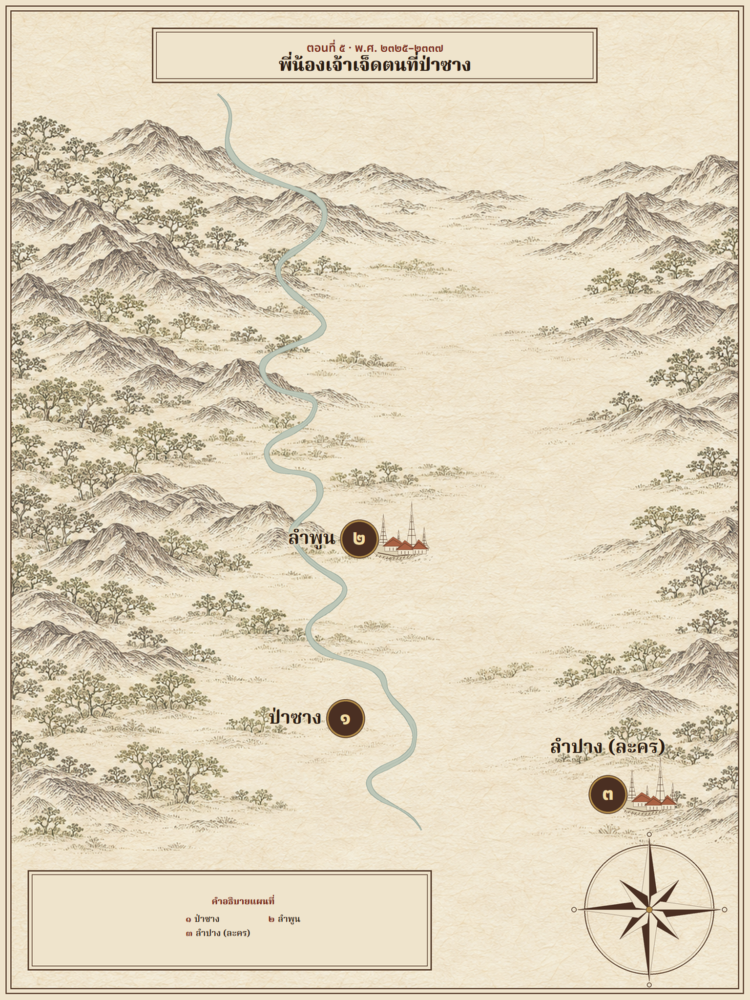

# ภาคที่ 2: ตั้งหลักที่ป่าซาง
## ตอนที่ 5: พี่น้องเจ้าเจ็ดตน

> **หมายเหตุถึงผู้อ่านตอนที่ 5:** ตอนนี้เรียบเรียงจากภาพสแกน *ตำนานพื้นเมืองเชียงใหม่* หน้า 92–93, 97, 99–100, 102–103 และ 105 ข้อความส่วนใหญ่อ่านจากภาพได้ไม่ครบทุกคำ จึงสรุปเป็นเค้าความ และคงตำแหน่งตามตัวบทโดยไม่ระบุชื่อตัวบุคคลเกินที่ตัวบทเรียก

---

### ฉากเปิด: ฉัตรทองและมหาสมัยกาลใหญ่ ใน จ.ศ. 1150

ใน **จ.ศ. 1150 (พ.ศ. 2331 ตามปีนับเก่า)** ตัวบท *ตำนานพื้นเมืองเชียงใหม่* หน้า 103 บันทึกภาพการบำเพ็ญกุศลร่วมกันของเจ้านายพี่น้องในช่วงที่ยังตั้งหลักอยู่ที่ป่าซาง

ตัวบทเล่าเป็นเค้าความว่า ในปีนั้นพี่น้องทั้งสามได้ร่วมกันสร้าง **ฉัตรทอง** (ตัวบทว่าทำด้วยรักและทองคำเปลว) แล้วในเดือน 8 เพ็ญ ได้พร้อมกัน **"ต่างฉัตร" (ตั้งฉัตร) ถวายแด่พระมหาชินธาตุเจ้าสุเทพ** นิมนต์พระสงฆ์ตามตัวบทจำนวน **108 รูป** เพื่อจัดพิธี **"มหาสมัยกาลใหญ่"** ซึ่งตัวบทเรียกว่าเป็น "ปฐมหัวก่อน" (ครั้งแรก)

พิธีทำบุญร่วมกันใน จ.ศ. 1150 เกิดขึ้นในปีเดียวกับที่ตัวบทหน้า 102–103 บันทึกคำสอนของ **เจ้าฟ้าหลวงชายแก้ว** ผู้เป็นบิดาซึ่งวางแนวทางให้ลูก ๆ ประนีประนอมและแบ่งหน้าที่ดูแลบ้านเมืองร่วมกัน ตัวบทบันทึกสองเรื่องนี้ไว้ในหน้าใกล้กัน โดยไม่ได้อธิบายความเชื่อมโยงระหว่างกัน (คำสอนของบิดามีเค้าความถึงการแบ่งหน้าที่ดูแลเมืองละครและเมืองเชียงใหม่ ส่วนพิธีทำบุญเป็นกิจของพี่น้องสามพระองค์)

---

### แผนที่สถานที่ในหลักฐาน: ป่าซาง ลำปาง และลำพูน

แผนที่ของตอนนี้วางเฉพาะตำแหน่งเมืองหลัก 3 แห่งที่ปรากฏในหลักฐานของตอนนี้ ได้แก่ **ป่าซาง** (ที่ตั้งหลักของเจ้านายพี่น้อง), **ลำปาง** (เมืองละครซึ่งเป็นฐานเดิมและเป็นจุดที่เกิดเหตุล้อมเมืองใน จ.ศ. 1146), และ **ลำพูน** โดยไม่ได้ลากเส้นทางเชื่อมระหว่างเมือง เนื่องจากตัวบทไม่ได้ระบุเส้นทางเดินทัพหรือเส้นทางเดินทางในเหตุการณ์เหล่านี้

---

### คำถามของตอน

**เจ้านายพี่น้องแบ่งภาระกันอย่างไรในช่วงตั้งหลักที่ป่าซาง และบิดาวางหลักอะไรไว้ให้ลูก**

เมื่ออ่าน *ตำนานพื้นเมืองเชียงใหม่* หน้า 92–93, 97, 99–100 และ 102–105 จะพบว่าตัวบทตอบคำถามได้ในระดับข้อเท็จจริงและเค้าความบางประการ ได้แก่ ใครได้รับตำแหน่งอะไรหลังเปลี่ยนแผ่นดิน การประชุมแบ่งหน้าที่ของพี่น้อง การขอกองทัพจากกรุงเทพฯ ใน จ.ศ. 1146 และหลักการที่บิดาวางไว้ใน จ.ศ. 1150 เรื่องการประนีประนอมกับการแบ่งหน้าที่ดูแลเมืองละครและเมืองเชียงใหม่ แต่ตัวบทไม่ได้อธิบายว่า **"ทำไมจึงแบ่งหน้าที่กันเช่นนั้น"** และไม่ได้สรุปภาพรวมความสัมพันธ์กับกรุงเทพฯ ว่าเป็นอย่างไร

---

### หลักฐานตามตัวบทตำนานพื้นเมืองเชียงใหม่

#### 1. ตำแหน่งของพี่น้องหลังเปลี่ยนแผ่นดิน (หน้า 97)

ในตอนปลายผูก 6 หน้า 97 ตัวบทบันทึกการแบ่งตำแหน่งของพี่น้องกลุ่มเจ้ากาวิละภายหลังเปลี่ยนแผ่นดินไว้เป็นจุดตั้งต้น (ชัดเรื่องกาวิละเป็นเจ้าเมืองเชียงใหม่และธรรมลังกาเป็นอุปราชา)

ตัวบทเล่าว่า เจ้ากาวิละได้พาน้องเดินทางไปเข้าเฝ้าที่ **"กรุงศรีอยุทธยา"** (ตามบริบทหมายถึงราชสำนักสยามที่กรุงเทพฯ) ได้รับของพระราชทานเป็นรายการยาว และได้รับแต่งตั้งตำแหน่งดังนี้

- **ฝ่ายเมืองเชียงใหม่:** **เจ้ากาวิละ** ได้รับแต่งตั้งเป็น **"พระยามังราวชิรประการกำแพงแก้ว"** ให้เป็นเจ้าเมืองเชียงใหม่ และ **เจ้าธรรมลังกา** (น้องถ้วนสาม) เป็นอุปราชาเมืองเชียงใหม่
- **ฝ่ายเมืองละคร (ลำปาง):** มีเค้าความตามที่อ่านได้จากภาพสแกนว่า **เจ้าคำโสม** (น้องถ้วนสอง) เป็นพระยานครลำปาง **เจ้าดวงทิพย์** (น้องถ้วน 4) เป็นอุปราชา และ **เจ้าหมูหล้า** (น้องถ้วน 5) เป็นราชวงศ์เมืองละคร

ทั้งนี้ ชื่อและตำแหน่งทั้งหมดคงไว้ตามตัวบทหน้า 97 โดยไม่เชื่อมโยงเป็นข้อเท็จจริงตายตัวกับชื่อในพงศาวดารกรุงธนบุรีหรือในจารึก (ความสอดคล้องของชื่อบางคู่ได้บันทึกแยกชั้นไว้แล้วในตอนที่ 2 และตอนที่ 6)

#### 2. กลุ่ม "เจ้าทั้งเจ็ดองค์พี่น้อง" และการประชุมแบ่งหน้าที่ที่ป่าซาง (หน้า 92–93 และ 99)

ภาพความเป็นกลุ่มเครือญาติของพี่น้องชุดนี้ปรากฏต่อเนื่องตั้งแต่ช่วงต้นจนถึงช่วงตั้งหลักที่ป่าซาง

- **บิดาในฐานะประธานกลุ่มพี่น้อง (หน้า 92–93):** ในช่วงก่อนทัพกรุงธนบุรีจะยกขึ้นมาใน พ.ศ. 2317 ตัวบทเรียกกลุ่มของเจ้ากาวิละว่า **"เจ้าทั้งเจ็ดองค์พี่น้อง"** โดยมี **เจ้าฟ้าหลวงชายแก้ว** ผู้เป็นบิดาเป็นประธาน
- **การประชุมแบ่งหน้าที่ที่ป่าซาง (หน้า 99):** เมื่อเจ้ากาวิละตั้งหลักที่ป่าซางแล้ว ตัวบทหน้า 99 มีเค้าความถึงการประชุมน้อง ๆ เรื่องผู้คนที่จะเข้ามาอยู่บ้านเมือง โดยมีการแบ่งหน้าที่ระหว่างพี่น้อง ตัวบทกล่าวถึงพระราชอาชญาให้เรียก **มหาอุปราชา** และ **เจ้ารัตนหัวเมืองแก้ว** (น้องสองคน) มาพร้อมกัน แล้วให้มหาอุปราชาเป็น **"เค้า"** (หัวหน้า) ในพระราชอาชญาเรื่องการพระราชทานแก่เจ้านาย ท้าวพระยา เสนาอำมาตย์ทั้งมวล

#### 3. บิดาเสด็จเยี่ยมป่าซาง และการขอกองทัพจาก "กรุงศรีอยุทธยา" ใน จ.ศ. 1146 (หน้า 100)

ใน **จ.ศ. 1146 (พ.ศ. 2327 ตามปีนับเก่า)** ตัวบทหน้า 100 บันทึกเหตุการณ์ที่เชื่อมโยงทั้งบทบาทของบิดา การแบ่งภาระของพี่น้อง และการติดต่อกับราชสำนักที่กรุงเทพฯ

- **เค้าความตามตัวบท:** **เจ้าฟ้าชายแก้ว** ผู้บิดาได้เสด็จไปดูบ้านเมืองป่าซางและเยี่ยมพระราชบุตร ช่วงเวลาดังกล่าวตรงกับที่ฝ่ายพม่าเข้าล้อม **เวียงละคร (ลำปาง)** เจ้ากาวิละจึงให้ **"เจ้ามหาอุปราชา"** รักษาบ้านเวนไว้ แล้วส่งเรื่องขอกองทัพจาก **"กรุงศรีอยุทธยา"** (ตามบริบทหมายถึงราชสำนักสยามที่กรุงเทพฯ) จากนั้นทัพสยามได้ยกขึ้นมาช่วยจนฝ่ายพม่าแตกไปใน **เดือน 6 แรม 6 ค่ำ**

ในชั้นการอ่านหลักฐาน เมื่อวางข้อเท็จจริงจากหน้า 97 (การลงไปเข้าเฝ้าและรับแต่งตั้งตำแหน่ง) คู่กับหน้า 100 (การขอกองทัพจากกรุงเทพฯ เมื่อลำปางถูกล้อม) เราเห็นเพียงข้อเท็จจริงเฉพาะสองเหตุการณ์ที่ตัวบทบันทึกไว้ โดยไม่ขยายความสรุปสถานะทางการเมืองหรือประเมินระดับอำนาจระหว่างล้านนากับกรุงเทพฯ เกินกว่าที่เอกสารระบุ

#### 4. คำสอนของเจ้าฟ้าหลวงชายแก้ว และมหาสมัยกาลใหญ่ ใน จ.ศ. 1150 (หน้า 102–103)

ถัดมาอีกสี่ปี ใน **จ.ศ. 1150 (พ.ศ. 2331)** ตัวบทหน้า 102–103 บันทึกสองเหตุการณ์สำคัญของตระกูลเจ้าเจ็ดตน (อ่านได้บางส่วนทั้งสองข้อ)

- **คำสอนของบิดาเรื่องการประนีประนอมและการแบ่งเมือง (หน้า 102–103):** ตัวบทหน้า 102 บันทึกคำสอนของ **เจ้าฟ้าหลวงชายแก้ว** ผู้เป็นบิดาไว้ยาวหลายบรรทัด มีเค้าความสำคัญสองประการคือ ประการแรก สอนให้ลูก ๆ ประนีประนอมและไม่ทะเลาะกัน และประการที่สอง วางแนวทางการแบ่งหน้าที่ปกครองเมืองของลูก โดยให้ **เมืองละคร (ลำปาง)** มีน้องสามคนและให้พระยาหลวงละครเป็นอธิบดี ส่วน **เมืองเชียงใหม่** มีน้องสองคนและให้พระยาหลวงเชียงใหม่เป็นอาธิปติ (ทั้งนี้ คงตำแหน่งตามตัวบทโดยไม่ระบุชื่อตัวบุคคลลงไปเอง)
- **การสร้างฉัตรทองและจัดมหาสมัยกาลใหญ่ (หน้า 103):** ในปี จ.ศ. 1150 เดียวกัน พี่น้องทั้งสามได้สร้างฉัตรทอง และในเดือน 8 เพ็ญได้ตั้งฉัตรนั้นถวายพระมหาชินธาตุเจ้าสุเทพ (ที่ดอยสุเทพ ไม่ใช่ที่ป่าซาง) พร้อมนิมนต์พระสงฆ์ตามตัวบท 108 รูป จัดพิธี **"มหาสมัยกาลใหญ่"** เป็นครั้งแรกตามถ้อยคำตัวบท ดังที่ยกมาเป็นฉากเปิด (ตัวบทหน้า 117 ยังกล่าวถึงฉัตรมหาชินธาตุเจ้าสุเทพอีกครั้งใน จ.ศ. 1167 ว่าสายฟ้าฟาดยอดจิกฉัตร ซึ่งเป็นเหตุการณ์ต่างปี)

#### 5. โยงสู่ช่วงปลายที่ป่าซางใน จ.ศ. 1156 (หน้า 105)

หลังจากเหตุการณ์ใน จ.ศ. 1150 เจ้านายสามพี่น้องยังคงตั้งหลักอยู่ที่ป่าซางต่อเนื่องมาจนถึง **จ.ศ. 1156 (พ.ศ. 2337)** ซึ่งตัวบทหน้า 105 สรุปช่วงเวลาที่ป่าซางไว้เป็นเค้าความว่า พี่น้องทั้งสามพระองค์ได้ "สร้างบ้านแปงเมือง" รวบรวมไพร่ฟ้าข้าแผ่นดิน กระทำบุญให้ทาน และ "สถิตสำราญในเมืองป่าซาง" เป็นระยะเวลาตามตัวบทว่า **14 ปี ปลาย 4 เดือน 20 วัน** พร้อมบันทึกว่าในปี จ.ศ. 1156 เดียวกันนั้น **"พระเป็นเจ้าทั้งสามพระองค์พี่น้อง"** กับเสนาอำมาตย์ได้กระทำบุญใหญ่ที่ป่าซาง อภิเษกพระสงฆ์ชื่อ **ฐิตตมังคละ** ขึ้นเป็นสังฆราชใหญ่ (ชื่อพระสงฆ์ชัด)

---

### สิ่งที่ยังไม่รู้

เมื่อแยกเค้าความที่ตัวบทบันทึกไว้แล้ว ยังคงมีช่องว่างและข้อจำกัดของหลักฐานหลายประการที่เอกสารในตอนนี้ไม่ได้ตอบ ดังนี้

- **เหตุผลเบื้องหลังการแบ่งหน้าที่และบุคลิกของพี่น้องแต่ละคน:** ตัวบทระบุเพียงตำแหน่งที่ได้รับ (หน้า 97) การประชุมแบ่งหน้าที่ (หน้า 99) และแนวทางแบ่งเมืองของบิดา (หน้า 102–103) แต่ไม่ได้อธิบายว่าเหตุใดจึงจัดสรรภาระให้แต่ละคนเช่นนั้น และไม่ได้พรรณนาบุคลิกลักษณะของพี่น้องแต่ละองค์
- **ภาพรวมความสัมพันธ์เชิงอำนาจระหว่างป่าซางกับกรุงเทพฯ:** หลักฐานในตอนนี้แสดงให้เห็นเฉพาะเหตุการณ์สองครั้งคือการลงไปเข้าเฝ้ารับแต่งตั้งตำแหน่ง (หน้า 97) และการขอกองทัพมาช่วยเมื่อลำปางถูกล้อม (หน้า 100) จึงยังไม่สามารถใช้สรุปสถานะหรือกรอบความสัมพันธ์เชิงอำนาจในภาพรวมได้
- **ความต่างของตัวเลขจำนวนพี่น้องในสองหน้า:** ตัวบทหน้า 92–93 เรียกกลุ่มพี่น้องว่า "เจ้าทั้งเจ็ดองค์พี่น้อง" ขณะที่ข้อความในหน้า 102–103 ซึ่งอ่านจากภาพสแกนได้บางส่วนปรากฏตัวเลขว่า "ลูก 8 คน" ผู้เรียบเรียงตรวจภาพสแกนซ้ำแล้วอ่านทั้งสองตัวเลขได้ชัดตามนี้ แต่ตัวบทไม่อธิบายว่าเหตุใดจึงต่างกัน (เช่น ว่าหมายถึงกลุ่มเดียวกันหรือไม่) จึงยังไม่สรุป
- **ความชัดเจนของรายละเอียดที่อ่านได้บางส่วนและลำดับปี:** ข้อความส่วนใหญ่ในตอนนี้ (หน้า 97, 99–100, 102–103 และ 105) อ่านจากภาพสแกนได้บางส่วน ทั้งรายละเอียดคำสอนของบิดา ชื่อและลำดับของน้องแต่ละคน ลำดับปีเหตุการณ์พม่าล้อมลำปางใน จ.ศ. 1146 รวมถึงตัวเลขระยะเวลาที่ป่าซางในหน้า 105 ล้วนเป็นจุดที่ควรตรวจทานกับต้นฉบับเพิ่มเติม

---

### ตะขอไปตอนถัดไป

ในปี จ.ศ. 1156 (พ.ศ. 2337) เดียวกับที่ตำนานระบุว่าเจ้านายสามพี่น้องอยู่ที่ป่าซาง มีจารึกบนพระพุทธบาทไม้มุกกล่าวถึง "เจ้าพญาหลวงเมืองเชียงใหม่ทั้งสามพระองค์พี่น้อง"

**จบตอนที่ 5**

*(ติดตามต่อใน ตอนที่ 6: พระพุทธบาทไม้มุก)*

---

## ตารางที่มาของข้อเท็จจริง (ไม่พิมพ์ในหนังสือ ใช้ตรวจ)

| ข้อความในบท | ข้อในใบข้อเท็จจริง | หน้าพิมพ์ | ระดับ |
|---|---|---|---|
| วิธีอ่าน ข้อจำกัด และการนับปี: ตำนานพื้นเมืองเชียงใหม่ ฉบับ สนร. 2514 อ่านจากภาพสแกน 960 พิกเซล จ.ศ. + 1181 = พ.ศ. แบบเริ่มเมษายน ตัวบทเรียกกรุงเทพฯ ว่า "กรุงศรีอยุทธยา" | ตำนานภาค 1–2 (วิธีอ่านและข้อจำกัด, หมายเหตุเรื่องการนับปี) | 92–93, 97, 99–100, 102–103, 105 | ตามใบข้อเท็จจริง |
| เจ้ากาวิละและกลุ่มพี่น้องที่ตัวบทเรียกว่า "เจ้าทั้งเจ็ดองค์พี่น้อง" มีเจ้าฟ้าหลวงชายแก้วผู้เป็นบิดาเป็นประธาน | ตำนาน A1 | 92–93 | บางส่วน |
| หลังเปลี่ยนแผ่นดิน กาวิละพาน้องเข้าเฝ้าที่ "กรุงศรีอยุทธยา" (ราชสำนักสยามที่กรุงเทพฯ) ได้รับของพระราชทานเป็นรายการยาว ได้รับแต่งตั้ง: เจ้ากาวิละเป็น "พระยามังราวชิรประการกำแพงแก้ว" เจ้าเมืองเชียงใหม่, เจ้าธรรมลังกา (น้องถ้วนสาม) เป็นอุปราชาเมืองเชียงใหม่; เค้าความเรื่องน้องอื่น: เจ้าคำโสม (น้องถ้วนสอง) เป็นพระยานครลำปาง, เจ้าดวงทิพย์ (น้องถ้วน 4) เป็นอุปราชา, เจ้าหมูหล้า (น้องถ้วน 5) เป็นราชวงศ์เมืองละคร | ตำนาน D0 | 97 | ชัดเรื่องกาวิละเป็นเจ้าเมืองเชียงใหม่และธรรมลังกาเป็นอุปราชา / บางส่วนเรื่องชื่อและเมืองของน้องแต่ละคน |
| ฉากกาวิละประชุมน้อง ๆ เรื่องคนที่จะเข้ามา พี่น้องแบ่งหน้าที่ มีพระราชอาชญาเรียกมหาอุปราชาและเจ้ารัตนหัวเมืองแก้ว (น้องสองคน) มาพร้อมกัน ให้มหาอุปราชาเป็น "เค้า" (หัวหน้า) ในพระราชอาชญาเรื่องพระราชทานแก่เจ้านายท้าวพระยาเสนาอำมาตย์ทั้งมวล | ตำนาน D7 | 99 | บางส่วน |
| จ.ศ. 1146 (พ.ศ. 2327) เจ้าฟ้าชายแก้วผู้บิดาเสด็จไปดูบ้านเมืองป่าซาง เยี่ยมพระราชบุตร ตรงกับที่พม่าเข้าล้อมเวียงละคร (ลำปาง) กาวิละให้ "เจ้ามหาอุปราชา" รักษาบ้านเวน แล้วขอกองทัพจาก "กรุงศรีอยุทธยา" (ราชสำนักสยามที่กรุงเทพฯ) ทัพสยามมาช่วย พม่าแตกในเดือน 6 แรม 6 ค่ำ (ใช้เฉพาะเค้าความ ไม่เล่าการรบ ไม่พิมพ์ตัวเลขกำลังพล) | ตำนาน D9 | 100 | บางส่วน |
| จ.ศ. 1150 (พ.ศ. 2331) เจ้าฟ้าหลวงชายแก้วผู้บิดาให้คำสอนลูก ๆ (เค้าความ: ให้ประนีประนอม ไม่ทะเลาะกัน แบ่งหน้าที่ปกครองเมืองของลูก 8 คน: เมืองละครให้น้องสามคน พระยาหลวงละครเป็นอธิบดี, เมืองเชียงใหม่ให้น้องสองคน พระยาหลวงเชียงใหม่เป็นอาธิปติ — บันทึกความต่างของตัวเลข "เจ็ดองค์" กับ "ลูก 8 คน" ไว้เฉพาะใน "สิ่งที่ยังไม่รู้") | ตำนาน D13 | 102–103 | บางส่วน |
| จ.ศ. 1150 (พ.ศ. 2331) พี่น้องทั้งสามสร้างฉัตรทอง เดือน 8 เพ็ญ ต่างฉัตรถวายพระมหาชินธาตุเจ้าสุเทพ นิมนต์พระสงฆ์ 108 รูป จัด "มหาสมัยกาลใหญ่" เป็นครั้งแรก | ตำนาน D14 (อ่านซ้ำ ๑๙ พ.ย. ๒๕๖๙) | 103 | ชัดโดยรวม |
| จ.ศ. 1156 (พ.ศ. 2337) ตัวบทสรุปช่วงป่าซางว่าพี่น้องทั้งสามพระองค์ "สร้างบ้านแปงเมือง" เก็บไพร่ฟ้าข้าแผ่นดิน กระทำบุญให้ทาน และ "สถิตสำราญในเมืองป่าซาง" นานตามตัวบทว่า 14 ปี ปลาย 4 เดือน 20 วัน; และ "พระเป็นเจ้าทั้งสามพระองค์พี่น้อง" พร้อมเสนาอำมาตย์ทำบุญใหญ่ที่ป่าซาง อภิเษกพระสงฆ์ชื่อ ฐิตตมังคละ เป็นสังฆราชใหญ่ | ตำนานภาค 2–4 ข้อ E3–E4 | 105 | บางส่วน (E3) / ชื่อพระสงฆ์ชัด รายละเอียดพิธีบางส่วน (E4) |

---

## รายการภาพที่ต้องสร้าง (ไม่พิมพ์ในหนังสือ ใช้ตรวจ)

1. **ภาพฉากเปิดตอน (`images/ep05_scene.jpg` — สัดส่วน 16:9 แนวนอน)**
   - **โทนสีและวัสดุประจำเล่ม 4 ("กระดาษสาและไม้สัก"):** กูอาชบางผสมหมึกซีเปีย ลายเส้นพู่กันแห้งบนกระดาษสาเห็นเส้นใย จานสีอุ่นครีมกระดาษสา (`#EFE4CC`) น้ำตาลไม้สัก ดินแดงลูกรัง เหลืองรง–ส้มหญ้าฝรั่น เขียวมอส–มะกอก เน้นแดงรักและทองคำเปลวไม่เกิน 3% มียอดเจดีย์ล้านนาทรงระฆังปิดทองเล็ก ๆ ไกลมากอยู่ช่วงบนของภาพ และลำต้นไม้สักเก่าชิดขอบขวาของภาพ
   - **แนวคิดและองค์ประกอบ:** ฉัตรทองและองค์พระธาตุเจดีย์ทรงระฆังแบบล้านนาตั้งมั่นคงอยู่บนลานดินเรียบที่ต่อเนื่องถึงขอบล่าง (อ้างอิงตำนาน D14 หน้า 103 เรื่องการสร้างฉัตรทองถวายพระธาตุ) ฉากหลังเป็นทิวเขาสีมะกอก–เหลืองรงซ้อนชั้นในหมอกบาง
   - **กติกาบังคับ:** ไม่มีหน้าคน ไม่มีบุคคลในฉาก ไม่มีอาวุธเด่น ไม่มีปืน วัตถุหลักอยู่ในช่วง 45–78% ของความสูงภาพและตั้งบนพื้นอย่างมั่นคง ห้ามใส่ข้อความ ตัวเลข ป้าย ธง หรือลายน้ำในภาพ ห้ามใช้โทนเขียวหยก–ครามของเล่ม 1–3
2. **แผนที่ประจำตอน (`images/ep05_map.png` — สัดส่วน 3:4 แนวตั้ง)**
   - **โทนสีและรูปแบบประจำเล่ม 4:** พื้นครีมกระดาษสา (`#EFE4CC`) เห็นเส้นใยกระดาษ ลายเส้นหมึกซีเปีย ภูเขาลายขีดแต้มสีมะกอกอ่อน แม่น้ำสีเทาอมเขียวหม่น กรอบเส้นคู่บาง กล่องหัวแผนที่เปล่าด้านบน กล่องคำอธิบายเปล่าล่างซ้าย เข็มทิศไม่มีตัวอักษรล่างขวา วงกลมพิกัดสีน้ำตาลไม้สักเข้มขอบทองบาง (ห้ามใช้พื้นเขียวเซลาดอนของเล่ม 3)
   - **เมืองและสถานที่ที่อนุญาตให้ใส่ในแผนที่ (3 แห่งตามใบข้อเท็จจริง D0, D9, D14 เท่านั้น ห้ามใส่เมืองอื่น):**
     - **ป่าซาง**
     - **ลำปาง**
     - **ลำพูน**
   - **กติกาบังคับ:** ห้ามลากเส้นทางหรือลูกศรใด ๆ ระหว่างเมือง ห้ามใส่เมืองอื่นนอกเหนือจาก 3 ชื่อข้างต้น (ห้ามใส่เชียงใหม่ ตาก ระแหง เถิน หรือเมืองอื่น) ไม่มีหน้าคน ไม่มีอาวุธเด่น ห้ามมีตัวอักษรหรือป้ายชื่อในภาพแผนที่ฐาน
