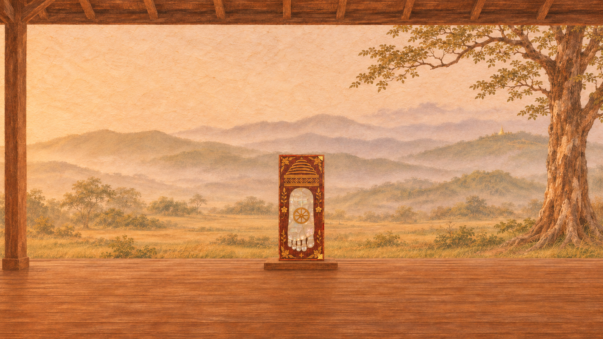
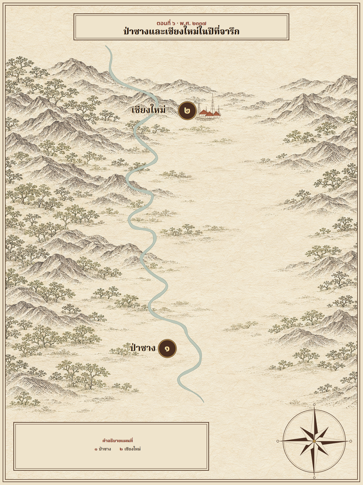

# ภาคที่ 2: ตั้งหลักที่ป่าซาง
## ตอนที่ 6: พระพุทธบาทไม้มุก

> **หมายเหตุถึงผู้อ่านตอนที่ 6:** ตอนนี้เรียบเรียงจากฐานข้อมูลจารึกในประเทศไทย ศูนย์มานุษยวิทยาสิรินธร (ศมส.) รายการจารึกพระพุทธบาทไม้มุก (ชม. 65, เรียบเรียงโดย พันธุ์ทิพย์ ธีระเนตร พ.ศ. 2548 อ้างอิงบทความของ ฮันส์ เพนธ์ ใน *วารสารศิลปากร* ปีที่ 18 ฉบับที่ 5 มกราคม พ.ศ. 2518 หน้า 49–55) โดยตรวจคำอ่าน–ปริวรรตจากไฟล์ PDF และข้อความสกัดของฐานข้อมูลโดยตรง (เลขเชิงอรรถ (1)–(29) ในคำปริวรรตมีเพียงตัวเลขกำกับ ไม่มีข้อความเชิงอรรถ) ประกอบกับภาพสแกน *ตำนานพื้นเมืองเชียงใหม่* (ฉบับพิมพ์ พ.ศ. 2514 ผูก 7 หน้า 98 และหน้า 102–105 ความละเอียด 960 พิกเซล โดยไม่อาศัย OCR) และคำปริวรรตจารึกบนแผ่นไม้วัดพระสิงห์ (จ.ศ. 1166) จากฐานข้อมูล ศมส. ศักราชในตัวบทใช้จุลศักราช (จ.ศ.) ซึ่งเมื่อบวก 1181 จะได้ปี พ.ศ. ตามการนับแบบไทยเก่าที่เริ่มปีใหม่ในเดือนเมษายน และคงการระบุวันเดือนตามตัวบทโดยไม่แปลงเป็นวันที่สากล ข้อความที่อ่านจากภาพสแกนตำนานได้ไม่ครบทุกคำสรุปเป็นเค้าความและมีวงเล็บกำกับสั้น ๆ ว่า (อ่านได้บางส่วน) ผู้ที่จะนำไปอ้างอิงต่อควรตรวจทานกับต้นฉบับและบทความต้นทางโดยตรงก่อน

---

### ฉากเปิด: รอยพระพุทธบาทเก่าแก่และสิบห้าบรรทัดด้านหลัง

แผ่นไม้รูปสี่เหลี่ยมผืนผ้า สูงรวมฐาน **199 เซนติเมตร** กว้าง **91 เซนติเมตร** หนา **5 เซนติเมตร** ปัจจุบันจัดแสดงอยู่ที่พิพิธภัณฑสถานแห่งชาติ เชียงใหม่ (เดิมพบอยู่ที่วิหารลายคำ วัดพระสิงห์ อำเภอเมือง จังหวัดเชียงใหม่)

ด้านหน้าของแผ่นไม้เป็นภาพ **รอยพระพุทธบาท** ประดับด้วยหอยมุกฝังในชาด ลวดลายรอบด้านเป็นรูปใบไม้และดอกไม้วาดด้วยสีทองบนน้ำรัก จากส้นพระบาทขึ้นไปเป็นภาพแสดงจักรวาล ประกอบด้วยเขาพระสุเมรุล้อมด้วยมหาสมุทร มหาทวีปทั้ง 4 เขาเจ็ดแนว และกำแพงจักรวาล เหนือขึ้นไปเป็นภาพสวรรค์ 22 ชั้นของกามโลกและรูปโลก ท่ามกลางภาพสวรรค์มีรูปจักร 1 รูป ส่วนด้านล่างของพระบาทจารพระนามอดีตพระพุทธเจ้า 3 พระองค์ คือ **พระพุทธกกุสนธ์ โกนาคมน์ และกัสสปะ**

เมื่อพลิกไปดูด้านหลัง จะพบข้อความจารึกอีกชุดหนึ่งจำนวน **15 บรรทัด** (ใต้ข้อความมีภาพเขียนสีทองบนชาดซึ่งชำรุดหลายแห่ง) จารึกด้านหลังนี้เขียนขึ้นในภายหลังด้านหน้ามาก โดยระบุศักราชชัดเจนว่า **จ.ศ. 1156 (พ.ศ. 2337)** เพื่อบันทึกเหตุการณ์การบูรณะรอยพระบาทเก่าแก่แผ่นนี้

---

### แผนที่สถานที่ในหลักฐาน: ป่าซางและเชียงใหม่

แผนที่ของตอนนี้วางเฉพาะสองสถานที่หลักที่ปรากฏในหลักฐาน พ.ศ. 2337 (จ.ศ. 1156) ได้แก่ **ป่าซาง** และ **เชียงใหม่** โดยไม่ได้ลากเส้นทางเชื่อมระหว่างสองแห่ง เนื่องจากตัวบทจารึกไม่ได้ระบุสถานที่ปลายทางของการนำรอยพระบาทเข้าไปปรึกษา

---

### คำถามของตอน

**ใน พ.ศ. 2337 ใครนำรอยพระบาทเก่าไปปรึกษาเจ้านายแห่งเชียงใหม่ เจ้านายอยู่ที่ใดในปีนั้น และทำไมต้องปรึกษา**

เมื่อวางจารึกพระพุทธบาทไม้มุกคู่กับ *ตำนานพื้นเมืองเชียงใหม่* เราจะพบว่าหลักฐานสองฝั่งช่วยกันตอบคำถามได้บางส่วน แต่ยังคงเหลือช่องว่างสำคัญไว้ กล่าวคือ **ตัวบทจารึกด้านหลัง** ตอบได้ว่า "ใคร" เป็นผู้นำรอยพระบาทมา (พระสงฆ์สององค์ตามตัวบท) และ "ทำไม" (เกรงว่าจะเกิดภัยวิบัติตามถ้อยคำตัวบท) ส่วน **ตำนานพื้นเมืองเชียงใหม่** ตอบได้ว่าในปี จ.ศ. 1156 นั้นเจ้านายสามพี่น้องอยู่ที่ใด (อยู่ที่ป่าซาง) แต่คำถามว่ารอยพระบาทถูกเคลื่อนย้ายไปยังที่ใดในวันปรึกษานั้น หลักฐานทั้งสองฝั่งไม่ได้ระบุไว้

เพื่อให้ผู้อ่านเห็นขอบเขตของหลักฐานอย่างตรงไปตรงมา เนื้อหาตอนนี้จึงแยกข้อมูลออกเป็น 3 ชั้น คือ **ชั้นที่ 1 สิ่งที่ตัวบทจารึกและตัวบทตำนานพูด** **ชั้นที่ 2 สิ่งที่ฐานข้อมูล ศมส. (เรียบเรียงโดย พันธุ์ทิพย์ ธีระเนตร อ้างอิง ฮันส์ เพนธ์ *วารสารศิลปากร* ปีที่ 18 ฉบับที่ 5 พ.ศ. 2518 หน้า 49–55) ระบุเสริม** และ **ชั้นที่ 3 สิ่งที่ยังไม่รู้**

---

### หลักฐานฝั่ง ก.: ตัวบทจารึกพระพุทธบาทไม้มุก (ชม. 65)

#### 1. ด้านหน้า: รอยพระบาทสองยุคและข้อสรุปจากฐานข้อมูล

ฐานข้อมูลจารึกในประเทศไทย (ศมส.) ระบุว่าจารึกพระพุทธบาทไม้มุก (ทะเบียน ชม. 65) มีคำจารึกทั้ง 2 ด้าน แต่จารึกขึ้นคนละช่วงเวลา โดยจารึกบนแผ่นไม้ปรากฏอักษรธรรมล้านนา มอญ และเทวนาครี ภาษาสันสกฤต บาลี และไทย

ตามสรุปของฐานข้อมูล ด้านหน้ามีพระนามของอดีตพระพุทธเจ้า 3 พระองค์ (พระพุทธกกุสนธ์ โกนาคมน์ และกัสสปะ) ชื่อของสวรรค์ชั้นต่าง ๆ และชื่อสัตว์หิมพานต์ ส่วนในชั้นการกำหนดอายุของนักวิชาการที่ฐานข้อมูลอ้างอิง **ฮันส์ เพนธ์** (พ.ศ. 2518) สันนิษฐานจากรูปแบบอักษรธรรมล้านนาที่ปรากฏด้านหน้าว่า น่าจะสร้างขึ้นราว **พุทธศตวรรษที่ 21** หมายความว่าเมื่อถึง พ.ศ. 2337 รอยพระบาทแผ่นนี้ไม่ใช่ของสร้างใหม่ แต่เป็นโบราณวัตถุที่มีอายุหลายร้อยปีแล้ว

#### 2. ด้านหลัง: เรื่องเล่าการบูรณะใน จ.ศ. 1156 (พ.ศ. 2337)

จารึกด้านหลังจำนวน 15 บรรทัดเริ่มต้นด้วยบทสรรเสริญเป็นภาษาบาลี ก่อนเข้าสู่ศักราชชัดเจนคือ **จ.ศ. 1156 (พ.ศ. 2337)** ปีกาบยี ฤดูร้อน เดือน 9 เพ็ง วันพฤหัสบดี จากนั้นคำอ่าน–ปริวรรตที่ตรวจจากไฟล์ PDF ของฐานข้อมูล ศมส. เล่าลำดับเหตุการณ์ไว้ดังนี้

- **ผู้ริเริ่ม (มูลศรัทธา) ตามตัวบท:** มี **สาธุเจ้าคำภีร** ซึ่งตัวบทระบุว่าเป็นเจ้าอาวาสวัด **"สิหลารามาธิบดี"** และ **สาธุเจ้าปัญญาวชิรภิกขุ** ลูกชาวบ้านหนองควาย
- **เหตุผลของการนำรอยพระบาทมาปรึกษา:** ทั้งสองเป็นมูลศรัทธาได้นำเอารูปพระบาทแห่งพระพุทธเจ้า **"อันมีในเมืองเชียงใหม่"** มา โดยตัวบทระบุเหตุผลว่ากลัวจะเป็น **"จรวิบัติภัยวิปริต"** ปิ้นแปรฉิบหายเสีย จึงจะเอารูปพระบาท **"เข้าไป"** เมตตาและปรารภ (?) กับ **"เจ้าพญาหลวงเมืองเชียงใหม่ทั้งสามพระองค์พี่น้อง"** พร้อมด้วยภรรยา เสนาอมาตย์ ราชวงศ์ อนุราชวงศ์ และประชาราษฎรบ้านเมืองทุกคน
- **การบูรณะซ่อมแซม:** เมื่อทุกฝ่ายยินดีสาธุการและบูชาด้วยข้าวตอกดอกไม้เทียนธูปแล้ว จึงเรียก **ช่างไม้และช่างแต้ม** มาปฏิสังขรณ์รอยพระบาทส่วนที่ชำรุดแตกหัก ซ่อมใส่รักหางและ **"สุวรรณคำแดงเรืองเรื่อ"** (สีทอง) ตามแบบเก่า ส่วนรอยที่ชำรุดเสียหายก็ซ่อมเท่าที่ยังเหลือ "พอหื้อเป็นที่ไหว้และบูชาแก่คนและเทวดาทั้งหลายตราบเมี้ยน 5000 พระวัสสา"

ทั้งนี้ ข้อความคำอ่าน–ปริวรรตมีช่องว่างและเครื่องหมายสงสัย (?) หลายจุด รวมถึงมีตัวเลขเชิงอรรถ **(1)–(29)** กำกับไว้ท้ายคำ แต่ไฟล์คำปริวรรตของฐานข้อมูลมีเพียงตัวเลขกำกับ ไม่มีข้อความคำอธิบายเชิงอรรถแนบมาด้วย

#### 3. แยกชั้นตัวบทกับฐานข้อมูล: ใครคือ "ทั้งสามพระองค์พี่น้อง"

จุดสำคัญที่ต้องแยกชั้นให้ชัดคือตัวตนของ **"เจ้าพญาหลวงเมืองเชียงใหม่ทั้งสามพระองค์พี่น้อง"**

- **ชั้นตัวบทจารึก:** ในข้อความคำปริวรรตทั้ง 15 บรรทัดที่ตรวจได้จากไฟล์ PDF และข้อความสกัด **ไม่ปรากฏชื่อ กาวิละ ธรรมลังกา หรือคำฝั้น** ตัวบทเอ่ยเรียกเพียงตำแหน่ง "เจ้าพญาหลวงเมืองเชียงใหม่ทั้งสามพระองค์พี่น้อง"
- **ชั้นฐานข้อมูล ศมส.:** ช่อง "ผู้สร้าง" ในหน้าฐานข้อมูลระบุว่าคือ **พระเจ้ากาวิละ เจ้าธรรมลังกา และเจ้าคำฝั้น** โดยเรียบเรียงจากบทความของ ฮันส์ เพนธ์ (*วารสารศิลปากร* ปีที่ 18 ฉบับที่ 5 มกราคม 2518 หน้า 49–55) เนื่องจากยังไม่ได้เปิดอ่านบทความต้นทางของเพนธ์เพื่อตรวจสอบเหตุผลและเชิงอรรถต้นฉบับ จึงบันทึกไว้ในชั้นข้อมูลที่ฐานข้อมูลระบุ มิใช่ชื่อที่ปรากฏในตัวบทจารึกโดยตรง

---

### หลักฐานฝั่ง ข.: ตำนานพื้นเมืองเชียงใหม่ และจารึกแผ่นไม้วัดพระสิงห์

#### 1. ตำนานพื้นเมืองเชียงใหม่: เจ้านายสามพี่น้องอยู่ที่ป่าซางใน จ.ศ. 1156

เมื่อนำ *ตำนานพื้นเมืองเชียงใหม่* (ฉบับพิมพ์ พ.ศ. 2514) มาวางเทียบเคียง เราจะเห็นทั้งฉากหลังของการอุปถัมภ์ศาสนาในช่วงตั้งหลักที่ป่าซาง และตำแหน่งที่อยู่ของเจ้านายสามพี่น้องในปีเดียวกับจารึก

- **ฉากหลังช่วงตั้งหลักที่ป่าซาง (หน้า 98 และ 102–103):** ตั้งแต่ จ.ศ. 1144 (พ.ศ. 2325) เจ้ากาวิละย้ายมาตั้งเวียงที่ **ป่าซาง** (ป่าซางหลวง–ป่าซางน้อย ริมน้ำแม่ท่า) ต่อมาใน **จ.ศ. 1150 (พ.ศ. 2331)** ตัวบทหน้า 102–103 บันทึกคำสอนของเจ้าฟ้าหลวงชายแก้วผู้บิดาเรื่องการประนีประนอมและการแบ่งหน้าที่ปกครองเมืองของลูกทั้ง 8 คน ระหว่างเมืองละคร (ลำปาง) กับเมืองเชียงใหม่ (อ่านได้บางส่วน) และในปี จ.ศ. 1150 เดียวกัน พี่น้องทั้งสามได้สร้างฉัตรทองถวายพระธาตุ นิมนต์พระสงฆ์ 108 รูป จัด **"มหาสมัยกาลใหญ่"** (อ่านได้บางส่วน) ซึ่งเป็นฉากหลังของการบำรุงศาสนาในห้วงเวลาก่อนหน้า (ไม่ใช่เหตุการณ์เดียวกับจารึกพระพุทธบาท)
- **ภาพรวมช่วงป่าซางและการทำบุญใหญ่ใน จ.ศ. 1156 (หน้า 105):** ใน **จ.ศ. 1156 (พ.ศ. 2337)** ตัวบทสรุปช่วงเวลาที่ป่าซางไว้เป็นเค้าความว่า พี่น้องทั้งสามพระองค์ "สร้างบ้านแปงเมือง" รวบรวมไพร่ฟ้าข้าแผ่นดิน กระทำบุญให้ทาน และ "สถิตสำราญในเมืองป่าซาง" นานตามตัวเลขในตัวบทว่า **14 ปี ปลาย 4 เดือน 20 วัน** (อ่านได้บางส่วน) และในปี จ.ศ. 1156 เดียวกันนี้ ตัวบทเล่าว่า **"พระเป็นเจ้าทั้งสามพระองค์พี่น้อง"** พร้อมเสนาอำมาตย์กระทำบุญใหญ่ที่ป่าซาง โดยมีเค้าความว่าได้อภิเษกพระสงฆ์ชื่อ **ฐิตตมังคละ** ขึ้นเป็นสังฆราชใหญ่แก่คณะสงฆ์ทั้งมวล (ชื่อพระสงฆ์ชัด / รายละเอียดพิธีอ่านได้บางส่วน) รวมถึงบันทึกว่าในปีเดียวกัน **เจ้ามหาอุปราชา** สร้างพระวิหารและพระพุทธรูปไว้สักการะ ณ ที่แห่งหนึ่งซึ่งชื่อวิหารอ่านไม่ชัด (อ่านได้บางส่วน)

เมื่อเทียบกับฝั่งจารึก จะเห็นจุดเชื่อมสำคัญคือ **ในปีเดียวกับจารึกพระพุทธบาทไม้มุก (จ.ศ. 1156) ตำนานพื้นเมืองเชียงใหม่ระบุว่าเจ้านายสามพี่น้องอยู่ที่ป่าซาง** และถ้อยคำ "พระเป็นเจ้าทั้งสามพระองค์พี่น้อง" ในตำนานก็ **สอดคล้อง** กับถ้อยคำ "เจ้าพญาหลวงเมืองเชียงใหม่ทั้งสามพระองค์พี่น้อง" ในจารึก อย่างไรก็ตาม ข้อมูลนี้เป็นเพียงความสอดคล้องด้านช่วงเวลาและกลุ่มบุคคล ไม่ใช่หลักฐานยืนยันว่ารอยพระบาทไม้มุกถูกนำไปที่ป่าซาง

#### 2. เทียบเคียงกับจารึกบนแผ่นไม้วัดพระสิงห์ (จ.ศ. 1166)

เพื่อขยายมุมมองเรื่องการอุปถัมภ์ศาสนาของเจ้านายล้านนาในระยะใกล้เคียงกัน ฐานข้อมูล ศมส. (รายการ 15941) ยังบันทึก **จารึกบนแผ่นไม้วัดพระสิงห์** ซึ่งระบุศักราช **จ.ศ. 1166** (พ.ศ. 2347 ตามฐานข้อมูล ทั้งนี้ คำปริวรรตระบุวันทางจันทรคติกับวันที่ในปฏิทินสากลไม่ตรงกัน จึงไม่ลงวันที่เต็ม)

- **เนื้อหาตามคำปริวรรต:** บันทึกเหตุการณ์เมื่อช้าง **"มหานาคราชพลายสาร"** ล้มลง ได้งาคู่หนึ่ง จึงมีศรัทธาให้สลักงาคู่นั้นเป็นพระพุทธรูปจำนวน **289 องค์** ลงรักปิดทองและประดับมณีแก้วแว่น ใส่แท่นตั้งและกั้งฉัตรคำ 1 ไว้เพื่อเป็นที่ไหว้บูชาแก่มนุษย์และเทวดาตราบศาสนา 5,000 ปี
- **ข้อสังเกตเรื่องผู้สร้างและการขัดกันเล็กน้อยในฐานข้อมูล:** ในข้อความคำปริวรรตที่สกัดได้ ตัวบทเรียกผู้สร้างด้วยพระนามตำแหน่งยาว (เช่น "บรมบพิตราราชาธิราชเจ้า... เจ้าขันฑเสมาพิงตรา เชียงใหม่") โดยไม่ปรากฏคำว่า "กาวิละ" ส่วนในหน้าฐานข้อมูล ศมส. (รายการ 15941) ช่อง **"เนื้อหาโดยสังเขป"** ระบุว่าพระเจ้ากาวิละให้สลักพระพุทธรูป 289 องค์ แต่ช่อง **"ผู้สร้าง"** กลับระบุว่า **"ไม่ปรากฏหลักฐาน"** ข้อมูลสองช่องนี้จึงขัดกันเล็กน้อยภายในฐานข้อมูลเอง ในชั้นนี้จึงบันทึกไว้ทั้งสองช่องโดยไม่ตัดสินว่าผู้สร้างคือใคร และไม่คาดเดาว่าพระนามตำแหน่งในคำปริวรรตหมายถึงบุคคลใด

---

### สิ่งที่ยังไม่รู้

เมื่อแยกชั้นตัวบทจารึก ชั้นฐานข้อมูล ศมส. และชั้นตำนานพื้นเมืองเชียงใหม่ออกจากกันแล้ว ยังคงมีประเด็นที่หลักฐานในตอนนี้ยังไม่ตอบ ดังนี้

- **รอยพระบาทไม้มุกถูกนำไปที่ใดใน พ.ศ. 2337:** แม้ตำนานพื้นเมืองเชียงใหม่จะระบุว่าใน จ.ศ. 1156 เจ้านายสามพี่น้องอยู่ที่ป่าซาง แต่ตัวบทจารึกบอกเพียงว่า "เอาเข้าไป" ปรึกษาโดยไม่ระบุสถานที่ จึงยังไม่รู้ว่ารอยพระบาทแผ่นนี้ถูกเคลื่อนย้ายไปยังที่ใด และยังไม่รู้ว่าในวันที่ปรึกษานั้น "เจ้าพญาหลวงเมืองเชียงใหม่" ในจารึกอยู่ที่ป่าซางหรือไม่
- **วัดของสาธุเจ้าคำภีร์:** คำปริวรรตจารึกอ่านชื่อวัดได้ว่า **"สิหลารามาธิบดี"** ซึ่งยังไม่ยืนยันว่าตรงกับวัดพระสิงห์อันเป็นสถานที่พบแผ่นไม้ในภายหลังหรือไม่
- **ลักษณะของภัยที่เกรง:** ตัวบทจารึกใช้ถ้อยคำกว้าง ๆ ว่า **"จรวิบัติภัยวิปริต"** ไม่ได้ระบุรายละเอียดว่าภัยที่เกรงนั้นคือเหตุการณ์ใด
- **เนื้อหาเชิงอรรถ (1)–(29) และบทความต้นทางของเพนธ์:** คำปริวรรตมีเพียงตัวเลขเชิงอรรถกำกับโดยไม่มีข้อความอธิบาย และยังไม่ได้อ่านบทความต้นทางของ ฮันส์ เพนธ์ (*วารสารศิลปากร* ปีที่ 18 ฉบับที่ 5 หน้า 49–55) เพื่อตรวจสอบหลักฐานการระบุตัวตนสามพี่น้อง
- **ผู้สร้างและวันที่เต็มของจารึกแผ่นไม้วัดพระสิงห์:** ข้อมูลช่อง "เนื้อหาโดยสังเขป" กับช่อง "ผู้สร้าง" ของฐานข้อมูล ศมส. รายการ 15941 ขัดกันเล็กน้อยเรื่องชื่อผู้สร้าง และวันทางจันทรคติในคำปริวรรตไม่ตรงกับวันในสัปดาห์ตามปฏิทินสากล จึงต้องรอการตรวจสอบเพิ่มเติม

---

### ตะขอไปตอนถัดไป

สองปีต่อมา ใน จ.ศ. 1158 ตัวบท *ตำนานพื้นเมืองเชียงใหม่* ระบุว่าเจ้านายสามพี่น้องได้ยกขบวนจากป่าซางกลับเข้าสู่เวียงหลวงเชียงใหม่

**จบตอนที่ 6**

*(ติดตามต่อใน ตอนที่ 7: กลับเข้าเชียงใหม่)*

---

## ตารางที่มาของข้อเท็จจริง (ไม่พิมพ์ในหนังสือ ใช้ตรวจ)

| ข้อความในบท | ไฟล์ / ข้อในใบข้อเท็จจริง | ระดับ |
|---|---|---|
| จารึกพระพุทธบาทไม้มุก (ชม. 65): แผ่นไม้สี่เหลี่ยมผืนผ้า สูงรวมฐาน 199 ซม. กว้าง 91 ซม. หนา 5 ซม. เดิมพบที่วิหารลายคำ วัดพระสิงห์ ปัจจุบันอยู่ที่พิพิธภัณฑสถานแห่งชาติ เชียงใหม่ ด้านหน้ามุกฝังในชาด ลายใบไม้ดอกไม้สีทองบนน้ำรัก ภาพจักรวาล (เขาพระสุเมรุ มหาสมุทร มหาทวีป 4 เขา 7 แนว กำแพงจักรวาล สวรรค์ 22 ชั้น รูปจักร 1 รูป) นามอดีตพุทธ 3 พระองค์ (กกุสนธ์ โกนาคมน์ กัสสปะ) ชื่อสวรรค์และสัตว์หิมพานต์ ด้านหลังมี 15 บรรทัดและภาพสีทองบนชาดที่ชำรุด | `แหล่ง/sac_1764_page_text.txt` (L556–L590) + `บททดลอง_พระพุทธบาทไม้มุก.md` | ยืนยัน (หน้าฐานข้อมูล ศมส.) |
| อักษรธรรมล้านนา มอญ เทวนาครี ภาษาสันสกฤต บาลี ไทย; ฮันส์ เพนธ์ (ศิลปากร 18(5) ม.ค. 2518 หน้า 49–55, เรียบเรียงโดย พันธุ์ทิพย์ ธีระเนตร พ.ศ. 2548) สันนิษฐานด้านหน้าราวพุทธศตวรรษที่ 21 | `แหล่ง/sac_1764_page_text.txt` (L560–L566, L586–L597) + `แหล่ง/บันทึกตรวจแหล่ง_จารึก.md` | อ้างทอดสอง (ฐานข้อมูล ศมส. อ้างเพนธ์ 2518 ยังไม่ได้อ่านต้นทาง) |
| ด้านหลัง จ.ศ. 1156 (พ.ศ. 2337) ปีกาบยี ฤดูร้อน เดือน 9 เพ็ง วันพฤหัสบดี; สาธุเจ้าคำภีร (เจ้าอาวาสสิหลารามาธิบดี) กับสาธุเจ้าปัญญาวชิรภิกขุ ลูกชาวบ้านหนองควาย นำรูปพระบาท "อันมีในเมืองเชียงใหม่" กลัว "จรวิบัติภัยวิปริต" ปิ้นแปรฉิบหายเสีย "เข้าไป" เมตตาปรารภ (?) กับ "เจ้าพญาหลวงเมืองเชียงใหม่ทั้งสามพระองค์พี่น้อง" พร้อมภรรยา เสนาอมาตย์ ราชวงศ์ อนุราชวงศ์ ประชาราษฎร เรียกช่างไม้และช่างแต้มซ่อมใส่รักหางและ "สุวรรณคำแดงเรืองเรื่อ" ตราบเมี้ยน 5000 พระวัสสา; มีช่องว่าง (?) และเลขเชิงอรรถ (1)–(29) ไม่มีข้อความเชิงอรรถ | `แหล่ง/mai-muk_side2.pdf` (ตรวจภาพเทียบ `.txt`) + `แหล่ง/mai-muk_side2.txt` (บรรทัด 2–15) | ยืนยันในกรอบคำปริวรรตที่อ่านได้ (มีเครื่องหมาย ? และไม่มีข้อความเชิงอรรถ) |
| ชื่อ กาวิละ ธรรมลังกา คำฝั้น ไม่ปรากฏในคำปริวรรต มาจากช่อง "ผู้สร้าง" ของฐานข้อมูล ศมส. อ้างเพนธ์ 2518 | `แหล่ง/sac_1764_page_text.txt` (L591–L597) + `แหล่ง/บันทึกตรวจแหล่ง_จารึก.md` (L9–L11) | อ้างทอดสอง (ระบุชัดว่าเป็นชั้นฐานข้อมูล) |
| ฉากหลังป่าซาง (จ.ศ. 1144), คำสอนบิดาเจ้าฟ้าหลวงชายแก้วเรื่องแบ่งหน้าที่ลูก 8 คน (จ.ศ. 1150 หน้า 102–103), พี่น้องทั้งสามสร้างฉัตรทองและจัดมหาสมัยกาลใหญ่ (จ.ศ. 1150 หน้า 103) | ตำนานภาค 1–2 ข้อ D5 (หน้า 98, ชัด), D13–D14 (หน้า 102–103, บางส่วน) | ชัด (D5) / บางส่วน (D13–D14) |
| จ.ศ. 1156 (พ.ศ. 2337) สรุปช่วงป่าซาง 14 ปี ปลาย 4 เดือน 20 วัน; "พระเป็นเจ้าทั้งสามพระองค์พี่น้อง" ทำบุญใหญ่ที่ป่าซาง อภิเษกพระสงฆ์ฐิตตมังคละ เป็นสังฆราชใหญ่; เจ้ามหาอุปราชาสร้างวิหารและพระพุทธรูป (ชื่อวิหารอ่านไม่ชัด) — สอดคล้องกับจารึก ไม่ยืนยันว่ารอยพระบาทถูกนำไปป่าซาง | ตำนานภาค 2–4 ข้อ E3, E4, E5 (หน้า 105) + หมายเหตุท้ายกลุ่ม E | บางส่วน (E3, E5) / ชื่อพระสงฆ์ชัด รายละเอียดพิธีบางส่วน (E4) |
| จารึกบนแผ่นไม้วัดพระสิงห์ (จ.ศ. 1166 / พ.ศ. 2347 ตามฐานข้อมูล, ไม่ลงวันที่เต็มเพราะวันจันทรคติไม่ตรงปฏิทินสากล): ช้างมหานาคราชพลายสารล้ม ได้งาคู่ สลักพระพุทธรูป 289 องค์ ลงรักปิดทอง ประดับมณี ตั้งแท่นกั้งฉัตรคำ 1 ตราบศาสนา 5,000 ปี; ตัวบทเรียกด้วยพระนามตำแหน่งยาว ไม่เห็นคำว่ากาวิละ | `แหล่ง/wat-phra-sing_wood_side1.txt` (บรรทัด 2–25) + `side2.txt` (บรรทัด 1–2) + `แหล่ง/บันทึกตรวจแหล่ง_จารึก.md` (L13–L17) | ยืนยันในกรอบคำปริวรรต |
| หน้าฐานข้อมูล ศมส. รายการ 15941 ช่อง "เนื้อหาโดยสังเขป" ระบุพระเจ้ากาวิละให้สลักพระพุทธรูป 289 องค์ แต่ช่อง "ผู้สร้าง" ระบุ "ไม่ปรากฏหลักฐาน" (ขัดกันเล็กน้อย ไม่ตัดสินผู้สร้าง) | อ้างจากบันทึกตรวจแหล่งและคำสั่งเตรียมตอน 6 (ไม่ได้ตรวจหน้าเว็บ 15941 ซ้ำ) | อ้างจากบันทึกตรวจแหล่ง (ไม่ได้ตรวจซ้ำ) |
| ตะขอไปตอนที่ 7: จ.ศ. 1158 เจ้านายกลับเข้าเวียงหลวงเชียงใหม่ | ตำนานภาค 2–4 ข้อ E6 (หน้า 106, เฉพาะเค้าโครงประโยคเดียว) | ชัดโดยรวม |

---

## รายการภาพที่ต้องสร้าง (ไม่พิมพ์ในหนังสือ ใช้ตรวจ)

1. **ภาพฉากเปิดตอน (`images/ep06_scene.jpg` — สัดส่วน 16:9 แนวนอน)**
   - **โทนสีและวัสดุประจำเล่ม 4 ("กระดาษสาและไม้สัก"):** กูอาชบางผสมหมึกซีเปีย ลายเส้นพู่กันแห้งบนกระดาษสาเห็นเส้นใย จานสีอุ่นครีมกระดาษสา (`#EFE4CC`) น้ำตาลไม้สัก ดินแดงลูกรัง เหลืองรง–ส้มหญ้าฝรั่น เขียวมอส–มะกอก เน้นแดงรักและทองคำเปลวไม่เกิน 3% มียอดเจดีย์ล้านนาทรงระฆังปิดทองเล็ก ๆ ไกลมากอยู่ช่วงบนของภาพ และลำต้นไม้สักเก่าชิดขอบขวาของภาพ
   - **แนวคิดและองค์ประกอบ:** แผ่นไม้พระพุทธบาทประดับมุกฝังบนชาดทรงสี่เหลี่ยมผืนผ้าตั้งวางอย่างมั่นคงบนพื้นไม้หรือพื้นเรียบ (อ้างอิงลักษณะวัตถุใน `sac_1764_page_text.txt`) รอบรอยพระบาทเป็นลวดลายใบไม้และดอกไม้สีทองบนน้ำรักพร้อมลวดลายจักรวาลเชิงสัญลักษณ์ พื้นรองรับต่อเนื่องถึงขอบล่าง
   - **กติกาบังคับ:** วัตถุหลักอยู่ในช่วง 45–78% ของความสูงภาพและตั้งบนพื้นอย่างมั่นคง ไม่มีหน้าคน ไม่มีอาวุธเด่น ไม่มีตัวอักษรหรือข้อความใด ๆ ในภาพ **ห้ามวาดตัวอักษรจารึกจริง ให้ใช้ลายเส้นนามธรรมแทน** ห้ามใส่ป้าย ธง หรือลายน้ำ ห้ามใช้โทนเขียวหยก–ครามของเล่ม 1–3
2. **แผนที่ประจำตอน (`images/ep06_map.png` — สัดส่วน 3:4 แนวตั้ง)**
   - **โทนสีและรูปแบบประจำเล่ม 4:** พื้นครีมกระดาษสา (`#EFE4CC`) เห็นเส้นใยกระดาษ ลายเส้นหมึกซีเปีย ภูเขาลายขีดแต้มสีมะกอกอ่อน แม่น้ำสีเทาอมเขียวหม่น กรอบเส้นคู่บาง กล่องหัวแผนที่เปล่าด้านบน กล่องคำอธิบายเปล่าล่างซ้าย เข็มทิศไม่มีตัวอักษรล่างขวา วงกลมพิกัดสีน้ำตาลไม้สักเข้มขอบทองบาง (ห้ามใช้พื้นเขียวเซลาดอนของเล่ม 3)
   - **เมืองและสถานที่ที่อนุญาตให้ใส่ในแผนที่ (2 แห่งตามใบข้อเท็จจริงกลุ่ม E เท่านั้น ห้ามใส่เมืองอื่น):**
     - **ป่าซาง**
     - **เชียงใหม่**
   - **กติกาบังคับ:** ห้ามลากเส้นทางหรือลูกศรใด ๆ ระหว่างป่าซางกับเชียงใหม่ (ตัวบทจารึกไม่ระบุว่ารอยพระบาทถูกนำไปที่ใด) ห้ามใส่เมืองอื่นนอกเหนือจาก 2 ชื่อข้างต้น ไม่มีหน้าคน ไม่มีอาวุธเด่น ห้ามมีตัวอักษรหรือป้ายชื่อในภาพแผนที่ฐาน
