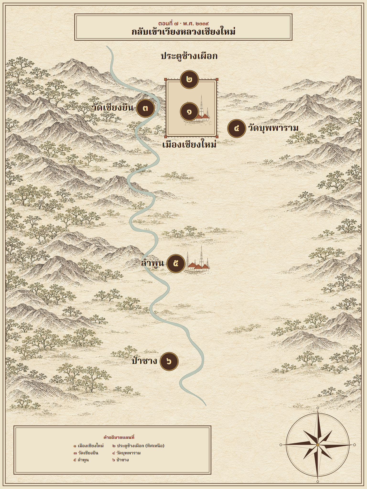

# ภาคที่ 3: ใครเข้ามาอยู่ในเวียง
## ตอนที่ 7: กลับเข้าเชียงใหม่

> **หมายเหตุถึงผู้อ่านตอนที่ 7:** ตอนนี้เรียบเรียงจากภาพสแกน *ตำนานพื้นเมืองเชียงใหม่* หน้า 98 และ 104–106 ประกอบกับภาพถ่ายหน้าพิมพ์ 44 ของ *พงศาวดารกรุงธนบุรี ฉบับพันจันทนุมาศ (เจิม)* (ระเบียนหอสมุดแห่งชาติ 4835) ข้อความที่อ่านไม่ครบสรุปเป็นเค้าความ และตัวเลขระยะเวลาหรือจำนวนคนเป็นตัวเลขตามตัวบท

---

### ฉากเปิด: ห้าวันจากป่าซางถึงประตูช้างเผือก

ใน **จ.ศ. 1158 (พ.ศ. 2339 ตามปีนับเก่า)** ตัวบท *ตำนานพื้นเมืองเชียงใหม่* หน้า 106 บันทึกการยกขบวนออกจากเมืองป่าซางเพื่อกลับเข้าเมืองเชียงใหม่ไว้อย่างชัดเจนตามลำดับวันและสถานที่

ขบวนยกออกจาก **ป่าซาง** ใน **เดือน 6 ออก 8 ค่ำ** โดยตัวบทระบุว่าขบวนเดินทางด้วย "มรรคาลังการ" เป็นเวลา **5 วัน** ครั้นถึง **เดือน 6 ออก 12 ค่ำ วัน 5** จึงเดินทางมาถึงเมืองเชียงใหม่

เมื่อมาถึงแล้ว ขบวนไม่ได้ตรงเข้าสู่ตัวเวียงหลวงในทันที ตัวบทระบุลำดับสถานที่ไว้ว่า เสด็จเข้าช้างประทับที่ **วัดบุพพาราม** จากนั้นไปไหว้พระที่ **วัดเชียงยืน** ราวใกล้เที่ยงจึงยกเข้าสู่ **เวียงหลวง** ทาง **ประตูช้างเผือกทิศเหนือ** แล้วพักแรมที่เชียงขวางหน้าวัดเชียงยืนคืนหนึ่ง รุ่งขึ้นจึงเสด็จเข้า **คุ้มน้อย** ที่ตัวบทเรียกว่าราชวังแห่งกษัตราธิราชในกาลก่อน

ชื่อ **ประตูช้างเผือก** ในบันทึก พ.ศ. 2339 นี้ชวนให้ย้อนนึกถึงอีกฉากหนึ่งเมื่อยี่สิบสองปีก่อนใน พ.ศ. 2317 เมื่อ *พงศาวดารกรุงธนบุรี ฉบับพันจันทนุมาศ (เจิม)* หน้า 44 บันทึกว่าคืนก่อนทัพหลวงกรุงธนบุรีจะขึ้นถึงเชียงใหม่ "เจ้าเมืองเชียงใหม่" (ฝ่ายพม่า) รู้ข่าวว่าทัพหลวงจะยกขึ้น ด้วย "เกรงพระเดชานุภาพ" จึงพาครัวหนีออกจากเมืองทาง **ประตูช้างเผือก** และมีคนตายที่ประตูราว 200 เศษ แม้ตัวบททั้งสองแหล่งจะไม่ได้ยืนยันว่าประตูใน พ.ศ. 2317 กับ พ.ศ. 2339 เป็นโครงสร้างประตูเดียวกัน แต่ตัวบทสองแหล่งต่างเอ่ยชื่อประตูเดียวกันไว้ในสองช่วงเวลาสำคัญ—ครั้งหนึ่งเป็นทางหนีออกจากเมือง และอีกครั้งเป็นทางกลับเข้าเวียงหลวง

---

### แผนที่สถานที่ในหลักฐาน: จากป่าซางสู่เวียงหลวงเชียงใหม่

แผนที่ของตอนนี้วางเฉพาะเมืองและสถานที่ที่ปรากฏชื่อในตัวบท *ตำนานพื้นเมืองเชียงใหม่* หน้า 98 และหน้า 104–106 โดยไม่ได้ลากเส้นทางเดินทัพหรือเส้นทางขบวน เนื่องจากตัวบทไม่ได้ระบุแนวทางเดินหรือจุดพักระหว่างทางตลอดห้าวันนั้น สถานที่ที่ปรากฏชื่อตามหลักฐานมีสองระดับคือ

- **เมืองหลักในห้วงเวลา พ.ศ. 2325–2339:** **ป่าซาง** (ที่ตั้งหลักของเจ้านายสามพี่น้อง), **ลำพูน** (ที่ตั้งพระมหาชินธาตุเจ้าลำพูนซึ่งมีการสร้างหอยอและพระพุทธรูปใน จ.ศ. 1153), และ **เมืองเชียงใหม่**
- **สถานที่เฉพาะในและรอบเมืองเชียงใหม่ (หน้า 106):** **วัดบุพพาราม**, **วัดเชียงยืน**, และ **ประตูช้างเผือกทิศเหนือ** ซึ่งเป็นลำดับจุดที่ตัวบทระบุก่อนเสด็จเข้าคุ้มน้อยราชวังเก่าในเวียงหลวง

---

### คำถามของตอน

**ทำไมการตั้งเวียงเชียงใหม่ครั้งแรกอยู่ได้แค่เดือนเดียว และครั้งที่สองต่างอย่างไร**

ตัวบท *ตำนานพื้นเมืองเชียงใหม่* หน้า 104–106 บันทึกความพยายามเข้าตั้งเวียงเชียงใหม่ไว้ถึงสองครั้ง ห่างกันห้าปี คือครั้งแรกใน **จ.ศ. 1153 (พ.ศ. 2334)** ซึ่งอยู่ได้เพียงเดือนเดียวแล้วต้องถอยกลับป่าซาง และครั้งที่สองใน **จ.ศ. 1158 (พ.ศ. 2339)** ซึ่งเสด็จเข้าประทับในคุ้มน้อยราชวังเก่าในเวียงหลวงได้

เมื่ออ่านตัวบทอย่างซื่อตรง เราจะพบว่าตัวบทตอบได้เพียง **"ปีที่เกิดขึ้นและการถอยกลับ"** ส่วนคำถามว่า **"ทำไมครั้งแรกจึงตั้งไม่ได้"** และ **"ครั้งที่สองต่างจากครั้งแรกอย่างไร"** ตัวบทไม่ได้ให้คำอธิบายที่ชัดเจนไว้

---

### หลักฐานตามตัวบทตำนานพื้นเมืองเชียงใหม่

#### 1. ภูมิหลังก่อนกลับเวียง: สภาพล้านนาและการตั้งหลักที่ป่าซาง (หน้า 98)

ก่อนจะถึงเหตุการณ์ความพยายามเข้าตั้งเวียงเชียงใหม่ในทศวรรษ พ.ศ. 2330 ตัวบท *ตำนานพื้นเมืองเชียงใหม่* ผูก 7 หน้า 98 ได้บันทึกภูมิหลังช่วง **จ.ศ. 1144 (พ.ศ. 2325)** ไว้สองประเด็นสำคัญที่ช่วยให้เห็นบริบทของเมืองในสายตาผู้บันทึก

- **สภาพบ้านเมืองตามถ้อยคำของตัวบท (หน้า 98):** ตัวบทบรรยายสภาพล้านนาในช่วงนั้นด้วยถ้อยคำว่า "บ้านห่าง นาห่าง บ้านอุกเมืองรก" และ "ไปทางใต้ก็กลัวเสือ ไปทางเหนือก็กลัวช้าง" ผู้คนไม่ตั้งบ้านเรือน โดยตัวบทอธิบายเหตุไว้ว่าเพราะไม่มีท้าวพระยาเป็นผู้นำ
- **การย้ายขึ้นตั้งที่ป่าซาง (หน้า 98):** ในเดือนเจี่ยง แรม 8 ค่ำของปี จ.ศ. 1144 (พ.ศ. 2325) ตัวบทเล่าว่าเจ้ากาวิละ "ยกเข้าตั้งเวฬุกาม คือว่าป่าซาง" แล้วสร้างคุ้ม ปราสาท ค่ายคู ประตูเวียง ป้อมหอรบ โดยตั้งเวียงริมน้ำแม่ท่าที่แยกเป็น **ป่าซางหลวง** กับ **ป่าซางน้อย** ตามลำน้ำสองฝั่ง ด้วยจุดมุ่งหมายตามถ้อยคำตัวบทว่า "เพื่อข้ามศึกสงคราม"

ป่าซางจึงกลายเป็นที่ตั้งหลักของเจ้านายพี่น้องต่อเนื่องมาราวเก้าปี (จ.ศ. 1144 ถึง 1153 ตามตัวบท) ก่อนจะมีความพยายามกลับขึ้นไปตั้งเวียงเชียงใหม่ครั้งแรก

#### 2. ความพยายามครั้งแรกใน จ.ศ. 1153 และช่วงปลายที่ป่าซาง (หน้า 104–105)

เนื้อความใน *ตำนานพื้นเมืองเชียงใหม่* หน้า 104–105 บันทึกลำดับเหตุการณ์ตั้งแต่ความพยายามเข้าตั้งเวียงเชียงใหม่ครั้งแรก ไปจนถึงภาพรวมการอยู่ที่ป่าซางใน จ.ศ. 1156 ดังนี้

- **ขึ้นตั้งเวียงเชียงใหม่ครั้งแรกแล้วต้องถอยกลับ (หน้า 104):** ใน **จ.ศ. 1153 (พ.ศ. 2334 ตามปีนับเก่า)** ตัวบทเล่าว่าเจ้ากาวิละพาน้องทั้งสองกับขัตติยวงศ์ ท้าวพระยา เสนาอำมาตย์ "ขึ้นตั้งเวียงเชียงใหม่" เป็นครั้งแรก แต่เมื่อขึ้นไปอยู่ได้เพียง **หนึ่งเดือน** ตัวบทระบุว่า "ตั้งบ่ได้" เพราะเหตุการณ์ที่ตัวบทใช้ถ้อยคำว่า "บ่เติงตำนาน" แล้วจึง **ถอยมาอยู่ป่าซางที่เก่า**
  ในชั้นการอ่านและการตีความ ส่วนที่อ่านได้ชัดคือปีศักราช (จ.ศ. 1153) ระยะเวลาหนึ่งเดือน และการถอยกลับป่าซาง ส่วนถ้อยคำ "บ่เติงตำนาน" นั้นอ่านจากภาพได้ไม่ชัดและมีนัยกำกวม (ผู้เรียบเรียงอ่านเค้าความอย่างกว้างว่าเงื่อนไขไม่พร้อม) โดยตัวบทไม่ได้ขยายความว่ามีอุปสรรคด้านใดเกิดขึ้นจริง
- **การสร้างศาสนสถานที่ลำพูนในปีเดียวกัน (หน้า 104):** ในปี จ.ศ. 1153 เดียวกันนั้น ตัวบทเล่าเป็นเค้าความว่ามีการสร้างหอยอ 4 ด้านของ **พระมหาชินธาตุเจ้าลำพูน** และสร้างพระพุทธรูปในวิหารด้านเหนือแห่งพระธาตุ
- **ตัวบทสรุปช่วงเวลาที่ป่าซาง (หน้า 105):** ถัดมาใน **จ.ศ. 1156 (พ.ศ. 2337)** ตัวบทได้สรุปภารกิจของพี่น้องทั้งสามพระองค์ในช่วงที่ตั้งหลักอยู่ป่าซางไว้เป็นเค้าความว่า ได้ช่วยกัน "สร้างบ้านแปงเมือง" รวบรวมไพร่ฟ้าข้าแผ่นดินเข้ามาตั้งถิ่นฐานบ้านเมือง กระทำบุญให้ทาน และ "สถิตสำราญในเมืองป่าซาง" เป็นระยะเวลาตามตัวเลขในตัวบทว่า **นานได้ 14 ปี ปลาย 4 เดือน 20 วัน**
- **การทำบุญใหญ่ที่ป่าซางใน จ.ศ. 1156 และจุดเชื่อมกับตอนที่ 6 (หน้า 105, ชื่อพระสงฆ์ชัด):** ในปี **จ.ศ. 1156 (พ.ศ. 2337)** เดียวกันนี้ ตัวบทเล่าว่า "พระเป็นเจ้าทั้งสามพระองค์พี่น้อง" พร้อมเสนาอำมาตย์กระทำบุญใหญ่ที่ป่าซาง โดยมีเค้าความว่าได้อภิเษกพระสงฆ์ชื่อ **ฐิตตมังคละ** ขึ้นเป็นสังฆราชใหญ่แก่คณะสงฆ์ทั้งมวล
  ในชั้นการเทียบหลักฐานกับตอนที่ 6 (พระพุทธบาทไม้มุก) ปี จ.ศ. 1156 นี้ตรงกับปีที่ปรากฏในจารึกด้านหลังพระพุทธบาทไม้มุก และถ้อยคำ "พระเป็นเจ้าทั้งสามพระองค์พี่น้อง" ในตำนานก็สอดคล้องกับถ้อยคำ "เจ้าพญาหลวงทั้งสามพระองค์พี่น้อง" ในจารึก กล่าวคือ **ในปีเดียวกับจารึก ตำนานพื้นเมืองเชียงใหม่ระบุว่าเจ้านายสามพี่น้องอยู่ที่ป่าซาง** อย่างไรก็ตาม ข้อมูลนี้เป็นเพียงความสอดคล้องด้านปีและตำแหน่งที่ประทับของเจ้านายเท่านั้น ไม่ใช่หลักฐานยืนยันว่ารอยพระบาทไม้มุกถูกนำไปที่ป่าซาง เพราะทั้งตัวบทจารึกและตำนานไม่ได้ระบุว่ารอยพระบาทถูกเคลื่อนย้ายไปยังที่ใด
- **การสร้างพระวิหารของเจ้ามหาอุปราชา (หน้า 105):** ในปี จ.ศ. 1156 เดียวกันตามตัวบท เจ้ามหาอุปราชได้สร้าง "พระวิหารอินทขีน" และพระพุทธรูปเจ้าองค์หนึ่งไว้เป็นที่ไหว้และบูชา (ตัวบทลงเดือน 8 เพ็ญ มีการสมโภชฉลองและเล่นมหรสพ; ผู้เรียบเรียงอ่านชื่อ "อินทขีน" จากภาพสแกนหน้า 105 ได้ชัด แต่ไม่ทราบว่าเป็นวัดเดียวกับวัดอินทขิน (หน้า 114) ที่ตัวบทกล่าวว่าพระเจ้าเชียงใหม่ผู้เป็นพระวรเชษฐาทรงสร้างในภายหลังหรือไม่)

#### 3. การกลับเข้าเวียงหลวงเชียงใหม่ใน จ.ศ. 1158 (หน้า 106)

ห้าปีหลังความพยายามครั้งแรก และสองปีหลังการทำบุญใหญ่ที่ป่าซาง ตัวบท *ตำนานพื้นเมืองเชียงใหม่* หน้า 106 จึงบันทึกการกลับเข้าเชียงใหม่ครั้งที่สองใน **จ.ศ. 1158 (พ.ศ. 2339)** ตามลำดับที่ยกมาในฉากเปิด ได้แก่

1. **เดือน 6 ออก 8 ค่ำ:** ยกขบวนออกจากเมืองป่าซาง เดินทางด้วย "มรรคาลังการ" เป็นเวลา 5 วัน
2. **เดือน 6 ออก 12 ค่ำ วัน 5:** ถึงเมืองเชียงใหม่ เสด็จเข้าช้างประทับที่ **วัดบุพพาราม** และไหว้พระที่ **วัดเชียงยืน**
3. **เข้าสู่เวียงหลวง:** ราวใกล้เที่ยงยกเข้าเวียงหลวงทาง **ประตูช้างเผือกทิศเหนือ** พักแรมที่เชียงขวางหน้าวัดเชียงยืนคืนหนึ่ง รุ่งขึ้นจึงเสด็จเข้า **คุ้มน้อยราชวังเก่า**

ในชั้นการตั้งข้อสังเกตของผู้เรียบเรียง มีสองประเด็นที่ปรากฏชัดจากการวางตัวบทช่วงหน้า 104–106 คู่กับหลักฐานตอนก่อนหน้า ประเด็นแรกคือ ในครั้งที่สองนี้ตัวบทให้ความสำคัญกับลำดับวันเดือนและพิธีการเข้าสู่เมือง—ตั้งแต่วัดนอกกำแพงเมืองไปจนถึงประตูเมืองทิศเหนือและคุ้มน้อยราชวังเก่า—ต่างจากครั้งแรกใน จ.ศ. 1153 ที่บันทึกไว้สั้นเพียงว่าขึ้นตั้งเวียงแล้วอยู่ได้เดือนหนึ่งจึงถอยกลับ ประเด็นที่สองคือ การที่ตัวบทตำนานหน้า 106 เอ่ยชื่อ **ประตูช้างเผือกทิศเหนือ** ใน พ.ศ. 2339 ตรงกับชื่อ **ประตูช้างเผือก** ใน *พงศาวดารกรุงธนบุรี* หน้า 44 เมื่อ พ.ศ. 2317 คือชื่อประตูนี้ปรากฏในเอกสารทั้งสองฝั่งในสองจังหวะสำคัญของเมืองเชียงใหม่ โดยตัวบทไม่ได้ยืนยันว่าเป็นโครงสร้างประตูเดิมโดยไม่เปลี่ยนแปลง

---

### สิ่งที่ยังไม่รู้

เมื่อแยกสิ่งที่ตัวบทบันทึกออกจากสิ่งที่ผู้เรียบเรียงสังเกตแล้ว คำถามหลักของตอนนี้และรายละเอียดอีกหลายจุดยังคงเป็นช่องว่างที่หลักฐานไม่ได้ตอบ ดังนี้

- **ทำไมความพยายามครั้งแรกใน จ.ศ. 1153 จึงอยู่ได้แค่เดือนเดียว:** ตัวบทหน้า 104 ระบุเพียงว่า "ตั้งบ่ได้" เพราะเหตุการณ์ "บ่เติงตำนาน" ซึ่งถ้อยคำในภาพสแกนอ่านได้บางส่วนและมีนัยกำกวม ตัวบทไม่ได้อธิบายรายละเอียดหรือสาเหตุของอุปสรรคใด ๆ เพิ่มเติม จึงต้องเว้นสาเหตุที่แท้จริงไว้เป็นสิ่งที่ยังไม่รู้โดยไม่คาดเดา
- **ครั้งที่สอง (จ.ศ. 1158) ต่างจากครั้งแรกอย่างไร:** ตัวบทไม่ได้เปรียบเทียบเงื่อนไขระหว่าง พ.ศ. 2334 กับ พ.ศ. 2339 และไม่ได้อธิบายว่ามีปัจจัยใดที่เปลี่ยนแปลงไปจนทำให้สามารถเสด็จเข้าประทับในคุ้มน้อยราชวังเก่าได้ในครั้งที่สอง
- **เส้นทางเดินขบวนและรายละเอียดระหว่างทาง 5 วัน:** ตัวบทหน้า 106 ระบุเพียงจุดเริ่มต้นที่ป่าซาง ระยะเวลา 5 วัน และจุดหมายที่วัดบุพพาราม วัดเชียงยืน และประตูช้างเผือกทิศเหนือ ไม่ได้ระบุเส้นทางเดินขบวน จุดพักแรมรายวัน หรือจำนวนผู้ร่วมขบวน
- **ความเชื่อมโยงระหว่างรอยพระบาทไม้มุกกับป่าซางใน จ.ศ. 1156:** แม้ตำนานหน้า 105 จะระบุว่าเจ้านายสามพี่น้องอยู่ที่ป่าซางในปีเดียวกับจารึกพระพุทธบาทไม้มุก แต่ตัวบทตำนานไม่ได้กล่าวถึงรอยพระบาทไม้มุกเลย และจารึกเองก็ไม่ได้ระบุว่านำแผ่นไม้ไปปรึกษา ณ ที่ใด จึงยังไม่รู้ว่ารอยพระบาทแผ่นนั้นถูกนำไปป่าซางหรือไม่
- **สถานะทางกายภาพของประตูช้างเผือกใน พ.ศ. 2317 กับ พ.ศ. 2339:** ตัวบทสองแหล่งเอ่ยชื่อประตูช้างเผือกเหมือนกัน แต่ไม่มีข้อความยืนยันว่าเป็นโครงสร้างประตูเดิมหรือผ่านการบูรณะปรับเปลี่ยนอย่างไรในช่วงยี่สิบสองปีนั้น
- **ถ้อยคำและตัวเลขที่อ่านได้บางส่วน:** ความสัมพันธ์ระหว่างพระวิหารอินทขีนที่เจ้ามหาอุปราชสร้างใน จ.ศ. 1156 (หน้า 105) กับวัดอินทขินที่ตัวบทหน้า 114 ว่ากาวิละทรงสร้าง, รายละเอียดพิธีอภิเษกพระสงฆ์ฐิตตมังคละ (หน้า 105), ถ้อยคำ "บ่เติงตำนาน" (หน้า 104), และตัวเลขระยะเวลาที่ป่าซาง "14 ปี ปลาย 4 เดือน 20 วัน" (หน้า 105) ล้วนเป็นจุดที่อ่านจากภาพสแกนได้บางส่วนและยังควรสอบทานกับต้นฉบับเพิ่มเติม

---

### ตะขอไปตอนถัดไป

ตามตัวบท *ตำนานพื้นเมืองเชียงใหม่* หน้า 106 เมื่อเสด็จเข้าอยู่ในเวียงหลวงเชียงใหม่ได้ 10 เดือนปลาย 5 วัน ก็ถึงศึกใหญ่จากพม่า ก่อนไปดูศึกนั้นในตอนที่ 9 ตอนที่ 8 จะย้อนกลับไปดูช่วงป่าซางอีกครั้ง คราวนี้จากมุมของผู้คนที่เข้ามาอยู่ในเมือง

**จบตอนที่ 7**

*(ติดตามต่อในตอนถัดไป)*

---

## ตารางที่มาของข้อเท็จจริง (ไม่พิมพ์ในหนังสือ ใช้ตรวจ)

| ข้อความในบท | ข้อในใบข้อเท็จจริง | หน้าพิมพ์ | ระดับ |
|---|---|---|---|
| วิธีอ่าน ข้อจำกัด และการนับปี: ตำนานพื้นเมืองเชียงใหม่ ฉบับ สนร. 2514 อ่านจากภาพสแกน 960 พิกเซล (สแกน 105 = หน้า 98, สแกน 111–113 = หน้า 104–106) จ.ศ. + 1181 = พ.ศ. แบบเริ่มเมษายน ตัวเลขเป็นตัวเลขตามตัวบท | ตำนานภาค 1–2 (วิธีอ่านและข้อจำกัด, หมายเหตุเรื่องการนับปี) + ตำนานภาค 2–4 (หัวข้อวิธีอ่าน) | 98, 104–106 | ตามใบข้อเท็จจริง |
| พ.ศ. 2317 คืนนั้น "เจ้าเมืองเชียงใหม่" (ฝ่ายพม่า) รู้ว่าทัพหลวงจะยกขึ้น "เกรงพระเดชานุภาพ" พาครัวหนีออกทางประตูช้างเผือก มีคนตายที่ประตูราว 200 เศษ (ใช้เทียบว่าตัวบทสองแหล่งเอ่ยชื่อประตูเดียวกัน ไม่ยืนยันโครงสร้างเดียวกัน) | ธนบุรี #3 + หมายเหตุท้ายกลุ่ม E | 44 | ชัด (ตัวเลขอ่านจากภาพ) |
| สภาพล้านนาตามตัวบท: "บ้านห่าง นาห่าง บ้านอุกเมืองรก" "ไปทางใต้ก็กลัวเสือ ไปทางเหนือก็กลัวช้าง" ผู้คนไม่ตั้งบ้านเรือน ตัวบทอธิบายเหตุว่าไม่มีท้าวพระยาเป็นผู้นำ (ไม่ระบุว่าเชียงใหม่ว่างสนิท) | ตำนาน D3 (และหมายเหตุ สิ่งที่ตัวบทกลุ่มนี้ไม่บอก) | 98 | ชัด |
| จ.ศ. 1144 (พ.ศ. 2325) เดือนเจี่ยง แรม 8 ค่ำ ย้ายขึ้นตั้งที่ป่าซาง ตัวบทเล่าว่า "ยกเข้าตั้งเวฬุกาม คือว่าป่าซาง" สร้างคุ้ม ปราสาท ค่ายคู ประตูเวียง ป้อมหอรบ ตั้งเวียงริมน้ำแม่ท่าที่แยกเป็นป่าซางหลวงกับป่าซางน้อย "เพื่อข้ามศึกสงคราม" | ตำนาน D5 | 98 | ชัด |
| จ.ศ. 1153 (พ.ศ. 2334 ตามปีนับเก่า) กาวิละพาน้องทั้งสองกับขัตติยวงศ์ท้าวพระยาเสนาอำมาตย์ "ขึ้นตั้งเวียงเชียงใหม่" เป็นครั้งแรก อยู่ได้เดือนหนึ่ง "ตั้งบ่ได้" เพราะเหตุการณ์ "บ่เติงตำนาน" (เค้าความว่าเงื่อนไขไม่พร้อม สาเหตุตามตัวบทกำกวม) แล้วถอยมาอยู่ป่าซางที่เก่า | ตำนาน E1 | 104 | บางส่วน (ปีกับการถอยชัด / สาเหตุตามตัวบทกำกวม) |
| ปีเดียวกัน (จ.ศ. 1153) สร้างหอยอ 4 ด้านของพระมหาชินธาตุเจ้าลำพูน และสร้างพระพุทธรูปในวิหารด้านเหนือแห่งพระธาตุ | ตำนาน E2 | 104 | บางส่วน |
| จ.ศ. 1156 (พ.ศ. 2337) ตัวบทสรุปช่วงป่าซางว่าพี่น้องทั้งสามพระองค์ "สร้างบ้านแปงเมือง" รวบรวมไพร่ฟ้าข้าแผ่นดินเข้ามาตั้งถิ่นฐานบ้านเมือง กระทำบุญให้ทาน และ "สถิตสำราญในเมืองป่าซาง" นานได้ 14 ปี ปลาย 4 เดือน 20 วัน (ตัวเลขตามตัวบท) | ตำนาน E3 | 105 | บางส่วน (ตัวเลขอ่านจากภาพ) |
| จ.ศ. 1156 (พ.ศ. 2337) "พระเป็นเจ้าทั้งสามพระองค์พี่น้อง" พร้อมเสนาอำมาตย์กระทำบุญใหญ่ที่ป่าซาง อภิเษกพระสงฆ์ชื่อ ฐิตตมังคละ ขึ้นเป็นสังฆราชใหญ่แก่คณะสงฆ์ทั้งมวล — ปีเดียวกับจารึกพระพุทธบาทไม้มุก (จ.ศ. 1156) และสอดคล้องกับถ้อยคำ "เจ้าพญาหลวงทั้งสามพระองค์พี่น้อง" ในจารึก (ไม่ระบุว่ารอยพระบาทถูกนำไปป่าซาง) | ตำนาน E4 + หมายเหตุท้ายกลุ่ม E | 105 | บางส่วน (ชื่อพระสงฆ์ชัด / รายละเอียดพิธีบางส่วน) |
| ปีเดียวกัน (จ.ศ. 1156) เจ้ามหาอุปราชสร้าง "พระวิหารอินทขีน" และพระพุทธรูปเจ้าองค์หนึ่ง เดือน 8 เพ็ญ มีสมโภชและมหรสพ (แก้ตามภาพสแกน-112 ๒๐ พ.ย.: เดิมเขียนว่าชื่อวิหารอ่านไม่ชัด) | ตำนาน E5 | 105 | ชัด |
| จ.ศ. 1158 (พ.ศ. 2339) การกลับเข้าเชียงใหม่: เดือน 6 ออก 8 ค่ำ ยกออกจากป่าซาง (ขบวนใช้ "มรรคาลังการ" 5 วัน) ถึงเมืองเชียงใหม่ เดือน 6 ออก 12 ค่ำ วัน 5 เข้าช้างประทับที่วัดบุพพาราม ไหว้พระที่วัดเชียงยืน ก่อนยกเข้าเวียงหลวงทางประตูช้างเผือกทิศเหนือ เสด็จเข้าคุ้มน้อยราชวังเก่า | ตำนาน E6 | 106 | ชัดโดยรวม (ชื่อวัดและประตูชัด) |
| ตะขอไปตอนถัดไป: อยู่ในเวียงหลวงเชียงใหม่ได้ 10 เดือนปลาย 5 วัน ก็ถึงศึกใหญ่จากพม่า | ตำนาน E7 | 106 | ชัด (ตัวเลขตามตัวบท) |

---

## รายการภาพที่ต้องสร้าง (ไม่พิมพ์ในหนังสือ ใช้ตรวจ)

1. **ภาพฉากเปิดตอน (`images/ep07_scene.jpg` — สัดส่วน 16:9 แนวนอน)**
   - **แนวคิดและองค์ประกอบ:** มุมมองด้านนอกกำแพงอิฐและประตูช้างเผือกทางทิศเหนือของเมืองเชียงใหม่ (อ้างอิงตำนาน E6 หน้า 106) ด้านนอกกำแพงเห็นสถาปัตยกรรมหลังคาวิหารล้านนาของวัดบุพพารามและวัดเชียงยืนอยู่ไกล ๆ โดยมีเงาซิลูเอตของขบวนช้างเคลื่อนเข้าใกล้ประตูเมืองในระยะไกล
   - **กติกาบังคับ:** ไม่มีหน้าคน (บุคคลเห็นเป็นเพียงเงาซิลูเอตระยะไกลเท่านั้น) ไม่มีอาวุธเด่น วัตถุทุกชิ้นตั้งอยู่บนพื้นอย่างมั่นคง ห้ามใส่ข้อความหรือตัวอักษรใด ๆ ในภาพ ห้ามแต่งเติมฝูงชนสองข้างทางหรือรายละเอียดประสาทสัมผัสที่ไม่มีในตัวบท
2. **แผนที่ประจำตอน (`images/ep07_map.png` — สัดส่วน 3:4 แนวตั้ง)**
   - **แนวคิดและองค์ประกอบ:** แผนที่ภูมิประเทศโทนสีเซลาดอน (celadon) แสดงตำแหน่งเมืองและสถานที่สำคัญที่ปรากฏชื่อในตัวบทช่วง พ.ศ. 2334–2339 เท่านั้น
   - **เมืองและสถานที่ที่อนุญาตให้ใส่ในแผนที่ (ตามใบข้อเท็จจริงกลุ่ม E และ D5 เท่านั้น ห้ามใส่เมืองอื่น):**
     - เมืองหลัก 3 แห่ง: **ป่าซาง**, **ลำพูน**, **เชียงใหม่**
     - สถานที่เฉพาะในและรอบเมืองเชียงใหม่ (E6): **วัดบุพพาราม**, **วัดเชียงยืน**, **ประตูช้างเผือก (ทิศเหนือ)**
   - **กติกาบังคับ:** ห้ามใส่เส้นทางทัพหรือลูกศรเส้นทางเดินขบวน (ตัวบทไม่ระบุเส้นทางระหว่างป่าซางถึงเชียงใหม่) ห้ามใส่เมืองอื่นนอกใบข้อเท็จจริง ไม่มีหน้าคน ไม่มีอาวุธเด่น ห้ามใส่ข้อความตกแต่งนอกเหนือจากชื่อสถานที่ที่อนุญาต
