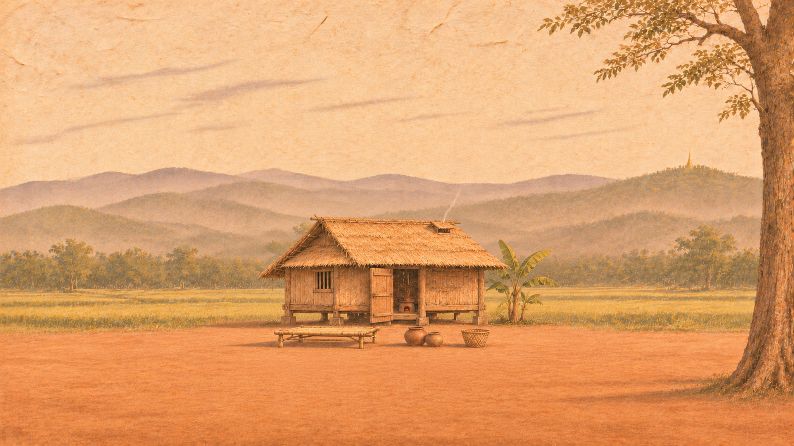
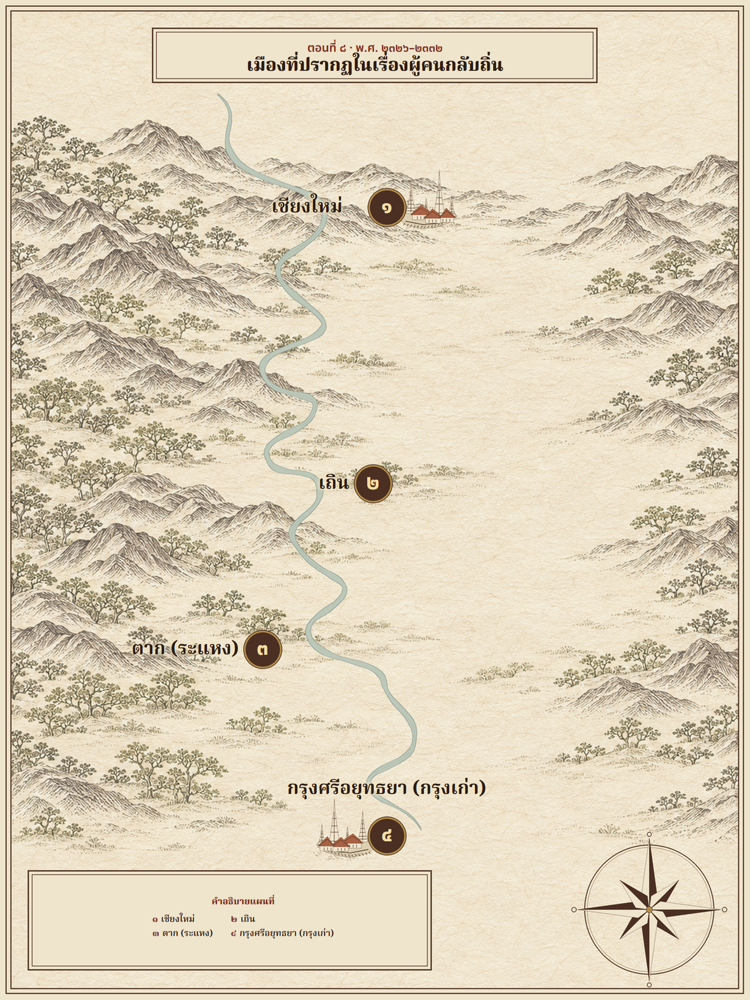

# ภาคที่ 3: ใครเข้ามาอยู่ในเวียง
## ตอนที่ 8: คนกลับถิ่น คนถูกกวาดต้อน

> **หมายเหตุถึงผู้อ่านตอนที่ 8:** ในเชิงลำดับเวลา เหตุการณ์ในตอนนี้ (จ.ศ. 1145–1151 หรือ พ.ศ. 2326–2332) เกิดขึ้นในช่วงที่เจ้านายตั้งหลักอยู่ที่ป่าซาง **ก่อนเหตุการณ์กลับเข้าเวียงเชียงใหม่ในตอนที่ 7 (จ.ศ. 1158)** ตอนนี้จึงย้อนเวลากลับไปดูช่วงป่าซางจากมุมของ "ผู้คน" โดยแยกหลักฐานออกเป็นสองชั้นชัดเจน ได้แก่ ฝั่ง ก. ภาพสแกนตัดขยายครึ่งหน้าของ *ตำนานพื้นเมืองเชียงใหม่* (ฉบับพิมพ์ พ.ศ. 2514 ผูก 7 หน้า 99–103 โดยไม่อาศัย OCR) ซึ่งเป็นมุมมองและถ้อยคำของผู้บันทึกฝ่ายเชียงใหม่ และฝั่ง ข. งานศึกษาชั้นรองสมัยใหม่ คือ รายงานวิจัย สกว. โดย รศ.สมโชติ อ๋องสกุล และคณะ (หน้า PDF 44) เพื่อแสดงคำเรียกของงานวิชาการยุคหลัง ศักราชในตัวบทใช้จุลศักราช (จ.ศ.) ซึ่งเมื่อบวก 1181 จะได้ปี พ.ศ. ตามการนับแบบไทยเก่าที่เริ่มปีใหม่ในเดือนเมษายน (จ.ศ. 1145 = พ.ศ. 2326, จ.ศ. 1146 = พ.ศ. 2327, จ.ศ. 1148 = พ.ศ. 2329, จ.ศ. 1151 = พ.ศ. 2332) และคงวันเดือนปีตามตัวบทโดยไม่แปลงเป็นวันที่สากล ตัวบทเรียกราชสำนักสยามที่กรุงเทพฯ ว่า "กรุงศรีอยุทธยา" จึงคงตามตัวบทพร้อมอธิบายในวงเล็บ ส่วนข้อความที่อ่านจากภาพสแกนได้ไม่ครบทุกคำสรุปเป็นเค้าความพร้อมกำกับว่า (อ่านได้บางส่วน) ผู้ที่จะนำไปอ้างอิงต่อควรตรวจทานกับต้นฉบับโดยตรงก่อน

---

### ฉากเปิด: เมื่อชาวตาก ระแหง และเถินได้คืนสู่บ้านเมือง

ใน **จ.ศ. 1146 (พ.ศ. 2327 ตามปีนับเก่า)** เจ้ากาวิละ (ซึ่งตัวบทในหน้านี้เรียกว่า เจ้ามังราวชิรปราการกำแพงแก้ว) เสด็จลงไปเฝ้ากษัตริย์ที่ **"กรุงศรีอยุทธยา"** (ตามบริบทหมายถึงราชสำนักสยามที่กรุงเทพฯ) เพื่อแจ้งราชการ แล้วได้กราบทูลขอผู้คนกลุ่มหนึ่งกลับคืนสู่บ้านเดิม

ตัวบท *ตำนานพื้นเมืองเชียงใหม่* หน้า 100 ระบุว่าผู้คนเหล่านั้นคือ **ชาวระแหง บ้านตาก บ้านเชียงเงิน และชาวเถิน** ที่ก่อนหน้านั้น "พ่ายม่านหนี" ลงไปอาศัยอยู่ที่บ้านป้อมเมืองกรุงเก่า เมื่อกษัตริย์ทรงประทานอนุญาตให้เอาขึ้นมาตั้งบ้านตั้งเมืองและให้เป็นเมืองขึ้นกับเชียงใหม่ ผู้บันทึกฝ่ายเชียงใหม่ในหน้า 101 จึงบรรยายด้วยถ้อยคำว่า พระยาตาก **"ได้คืนมาอยู่บ้านเมืองแห่งตนมีความยินดี"**

ทว่าในช่วงเวลาราวหกเจ็ดปีของการตั้งหลักที่ป่าซาง (จ.ศ. 1145–1151) การได้คืนสู่บ้านเดิมเป็นเพียงเส้นทางเดียวในบรรดาหลายเส้นทางที่ผู้คนเคลื่อนย้ายเข้ามาอยู่ในเขตอำนาจของเชียงใหม่—และตัวบทตำนานเองก็เลือกใช้คำเรียกแต่ละเส้นทางไม่เหมือนกัน

---

### แผนที่สถานที่ในหลักฐาน: ภาพรวมเมืองในตัวบทหน้า 99–103

แผนที่ของตอนนี้แสดงเฉพาะตำแหน่งภาพรวมของเมืองหลักที่ตัวบทระบุชื่อไว้ชัดเจน ได้แก่ **เชียงใหม่**, **ตาก (ระแหง)**, **เถิน**, **กรุงศรีอยุทธยา (กรุงเก่า)**, **เมืองชวาด**, **เมืองแหน**, และ **เมืองปั่น** โดยไม่ได้ลากเส้นทางหรือลูกศรเชื่อมระหว่างเมือง เนื่องจากตัวบทไม่ได้ระบุแนวเส้นทางหรือพิกัดของหมู่บ้านย่อยทั้งหมด

---

### คำถามของตอน

**ตัวบทเรียกคนที่เข้ามาอยู่ในเมืองด้วยคำอะไรบ้าง และเขาเข้ามาอย่างไร**

เมื่ออ่าน *ตำนานพื้นเมืองเชียงใหม่* หน้า 99–103 อย่างละเอียด เราจะพบว่าผู้บันทึกฝ่ายเชียงใหม่ไม่ได้ใช้คำเพียงคำเดียว แต่ใช้คำหลายคำแยกตามวิธีการ ได้แก่ **"เกลี้ยกล่อม"** **"สมัคร"** **"ยินดี"** **"กวาดเอาผู้คนครอบครัวเข้ามาใส่บ้านเมือง"** และ **"ทูลขอเอา ... ขึ้นมาตั้งบ้านตั้งเมือง"** ทั้งหมดนี้ช่วยให้เห็นวิธีการที่ตัวบทบันทึกไว้ แต่ตัวบทไม่ได้บอกเราเลยว่าชาวบ้านทั่วไปรู้สึกอย่างไร มีจำนวนรวมกี่คน หรือถูกนำไปตั้งบ้านเรือนอยู่ที่ใด

---

### หลักฐานจากตำนานพื้นเมืองเชียงใหม่: สามทางที่ตัวบทให้ชื่อต่างกัน (หน้า 99–103)

ใน **จ.ศ. 1145 (พ.ศ. 2326)** ตัวบทหน้า 99 มีเค้าความสรุปเจตจำนงของพี่น้องสามพระองค์ไว้ว่าต้องการให้ได้ผู้คนมาเพิ่มพูนบ้านเมืองไม่ขาด (อ่านได้บางส่วน) โดยเรียกบ้านน้อยเมืองใหญ่ที่มุ่งหน้าไปหานั้นว่า **"ลูกเมืองอังวะ"** (คือเมืองที่ยังขึ้นกับอังวะอยู่) จากนั้นตัวบทจึงบันทึกการเคลื่อนย้ายผู้คนออกเป็นสามทางที่มีคำเรียกต่างกันชัดเจน

#### ทางที่ 1: เกลี้ยกล่อมด้วยหนังสือและของกำนัล (หน้า 99, จ.ศ. 1145 / พ.ศ. 2326)

ข้อเท็จจริงในกลุ่มนี้ส่วนใหญ่เป็นระดับ **(อ่านได้บางส่วน)** จึงสรุปเป็นเค้าความตามตัวบท ดังนี้

- **ของกำนัลและการเกลี้ยกล่อมครั้งแรก (หน้า 99, อ่านได้บางส่วน):** เจ้าทั้งสามพระองค์มีคำสั่งให้พระยาสามล้านกับไพร่นำถ้วยลายงาม 40 ใบไปมอบแก่ผู้นำท้องถิ่น (ชื่อและตำแหน่งในภาพสแกนอ่านไม่แน่ใจทุกคำ) เพื่อเกลี้ยกล่อมจนเป็นใจ จากนั้นจึงเล็ดลอดเข้าตีบ้านตองโผะ ได้ผู้คนและครอบครัวเข้ามาใส่บ้านเมืองเป็นครั้งแรก
- **หนังสือเกลี้ยกล่อมและคำว่า "ยินดี–สมัคร" (หน้า 99, อ่านได้บางส่วน):** ถัดมา เจ้ามหาอุปราชกับเจ้ารัตน์หัวเมืองแก้วส่งหนังสือเกลี้ยกล่อมพร้อมของกำนัลคือถ้วยลายงามและเสื้อไปยังผู้นำท้องถิ่นฝั่งแม่คงตะวันตกและฟ้าน้อยหมดเมืองหลวง (ชื่อเฉพาะหลายคำอ่านไม่ชัด) ผู้บันทึกฝ่ายเชียงใหม่บรรยายว่าฝ่ายนั้น **"ยินดี"** และ **"สมัคร"** ขึ้นสวามิภักดิ์ แล้วคุมผู้คนเข้ามาใส่บ้านเมืองเป็นครั้งที่สอง
- **การเกลี้ยกล่อมที่ไม่ต่อเนื่อง (หน้า 99, อ่านได้บางส่วน):** มีเค้าความว่าส่งน้อยชินาขาว ชินาดำ และหมอปุกถือหนังสือไปเกลี้ยกล่อมพระยามลา เมืองชวาด แม้ตัวบทระบุว่าฝ่ายนั้นสมัครอยู่แล้ว แต่คณะผู้ถือหนังสือกลับเข้ามาเสียก่อน โดยตัวบทไม่ได้อธิบายเหตุผล

#### ทางที่ 2: ยกรี้พลไปตีแล้ว "กวาดเอาผู้คนครอบครัวเข้ามาใส่บ้านเมือง" (หน้า 99–103, จ.ศ. 1145–1151)

ในอีกหลายกรณี ตัวบทฝ่ายเชียงใหม่ไม่ได้ใช้คำว่าเกลี้ยกล่อม แต่ใช้คำว่า **"กวาดเอา"** อย่างตรงไปตรงมา

- **บ้านทาฝั่งและบ้านแม่ปะ (หน้า 99, จ.ศ. 1145 / พ.ศ. 2326):** เจ้ากาวิละ (ตัวบทเรียก พระเป็นเจ้าตนมังราวชิรประการกำแพงแก้ว) แต่งนายจันทราชาคุมกำลังไปตี **บ้านทาฝั่ง** ฟากแม่คงทางตะวันตก ได้ตัวพ่อเมืองทู่ พ่อเมืองกิตติ พ่อเมืองยาน และอาจารย์นันโท (สะกดตามภาพสแกน) แล้วผู้บันทึกใช้ถ้อยคำว่า **"กวาดเอาผู้คนครอบครัวเข้ามาใส่บ้านเมือง"** ถัดมาแต่งแสนราชโกฎิคุมกำลังไปตี **บ้านแม่ปะ** ได้ตัวแสนขัตติยะกับหมื่นชุมภู และ **"กวาดเอาครอบครัวเข้ามาใส่บ้านเมือง"**
- **เมืองชวาดและเมืองแหน (หน้า 100, จ.ศ. 1146 / พ.ศ. 2327):** ขณะที่พม่ายกมาล้อมเมืองละคร (ลำปาง) เจ้ามหาอุปราชยกไปตี **เมืองชวาด** และ **เมืองแหน** แล้ว **"กวาดเอาครอบครัวเมืองชวาด เมืองแหน ลงมาใส่บ้านเมือง"** ส่วน **พระยาชวาด** ซึ่งไปช่วยพม่าล้อมลำปางนั้น ตัวบท (อ่านได้บางส่วน และลำดับประโยคในภาพสแกนยังกำกวม) มีเค้าความว่าเมื่อถอยจากลำปางกลับขึ้นไปถึงเมืองชวาดแล้วเห็นแต่เมืองเปล่า จึงพาลูกบ่าวชาวไพร่ติดตามลงมาหาลูกเมียและน้อมตัวเป็นข้าราชการอยู่ที่ป่าซาง (ผู้เรียบเรียงอ่านลำดับข้อความส่วนนี้ไม่แน่ใจนัก และไม่แต่งเติมความรู้สึกของพระยาชวาดเกินตัวบท)
- **เมืองปั่นและเมืองตองกาย (หน้า 101, จ.ศ. 1148 / พ.ศ. 2329):** เดือน 8 ออก 2 ค่ำ วัน 5 เจ้ารัตน์หัวเมืองแก้ว พระราชวังหลัง คุมรี้พลตามตัวบท **500 คน** เดินทาง 25 วันไปยัง **เมืองปั่น** ได้ตัวเจ้าฟ้าหน่อคำพร้อมลูกเมียครอบครัว และ **"กวาดเอาเมืองปั่นเมืองตองกาย ลงมาใส่บ้านเมือง"**
- **บ้านอมชืก บ้านสะต้อย บ้านวังลุง วังกาด (หน้า 103, จ.ศ. 1151 / พ.ศ. 2332):** ตัวบทหน้า 103 บันทึกว่าเจ้าจันทราชา เจ้ากาวิละน้อย (ตัวบทเรียงสองชื่อต่อกัน ผู้เรียบเรียงไม่ยืนยันว่าเป็นคนเดียวกัน) คุมรี้พลข้ามแม่น้ำแม่คงไปทางตะวันตกตี **บ้านอมชืก** ได้ครอบครัวเข้ามาใส่บ้านเมือง และต่อมาแต่งให้จันทราชาเป็นแม่ทัพไปตี **บ้านสะต้อย บ้านวังลุง วังกาด** ได้ตัวแสนศรีพร้อมชาวบ้านชาวไพร่ ครอบครัว และเครื่องศัสตราวุธลงมาใส่บ้านเมือง (ในหน้านี้ผู้เรียบเรียงอ่านไม่พบคำว่า "กวาด" ตัวบทใช้ถ้อยคำว่า "ได้ ... ลงมาใส่บ้านเมือง")

#### ทางที่ 3: การขอให้คนกลับถิ่น และผู้ที่ถูกฝ่ายพม่า "กวาด" ไป (หน้า 100–101, จ.ศ. 1146–1148)

นอกเหนือจากสองทางแรก ตัวบทยังบันทึกกระแสเคลื่อนย้ายผู้คนที่สวนทางกันในสองลักษณะ

- **การขอให้คนกลับถิ่น (หน้า 100–101, จ.ศ. 1146–1147 / พ.ศ. 2327–2328):** หลังเจ้ากาวิละทูลขอชาวระแหง บ้านตาก บ้านเชียงเงิน และชาวเถิน ซึ่ง "พ่ายม่านหนี" ลงไปอยู่บ้านป้อมเมืองกรุงเก่า กลับขึ้นมาตั้งบ้านตั้งเมือง กษัตริย์ที่ "กรุงศรีอยุทธยา" (ราชสำนักสยามที่กรุงเทพฯ) ทรงประทานให้ตามขอและให้เป็นเมืองขึ้นกับเชียงใหม่ ตัวบทหน้า 101 ระบุว่าพระยาตาก **"ได้คืนมาอยู่บ้านเมืองแห่งตนมีความยินดี"** นำลูกสาว (นางคำงา) ถวายเป็นบาทบริจาร และส่งลูกชายสองคน (นายน้อยชะวะนะ และนายน้อยสุภา — ชื่ออ่านได้บางส่วน) มาอยู่เป็น "ปากกลาง" และนับตั้งแต่ **จ.ศ. 1147** เมืองตาก ระแหง และเมืองเถิน จึงมาขึ้นราชการที่เชียงใหม่ป่าซางทุกเมือง
- **ผู้ที่ถูกฝ่ายพม่า "กวาด" ไป (หน้า 101, จ.ศ. 1148 / พ.ศ. 2329):** ในปีเดียวกันกับที่เจ้ารัตน์ไปเมืองปั่น นายคำมูล นายวอน และนายน้อยกาวิละ คุมรี้พลตามตัวบท **300 คน** ขึ้นไปเกลี้ยกล่อมนาขวาเจ้าเมืองเชียงแสน และไปติดตามเอา **พระยาแพร่** กับ **พระยาเถิน** ที่เมืองเชียงแสน ซึ่งตัวบทระบุด้วยถ้อยคำว่า **"ด้วยอันม่านกวาดเอาไปนั้น"** จนได้ตัวพระยาแพร่และพระยาเถินกลับมา นอกจากนี้ยังส่งหนังสือเกลี้ยกล่อมพระยาสุรินทร์เมืองฝาง และมีเค้าความเรื่องการเกลี้ยกล่อมเจ้าฟ้าเชียงตุงให้ต่อต้านพม่าแต่ไม่ชนะและต้องหนีไป (อ่านได้บางส่วน)

จุดที่น่าสังเกตจากการวางหลักฐานทั้งสองฝั่งเคียงกันคือ **ตัวบทตำนานใช้คำว่า "กวาด" กับทั้งฝ่ายเชียงใหม่และฝ่ายพม่า** โดยในที่นี้นำเสนอตามถ้อยคำของเอกสารเคียงกันโดยไม่สรุปแทนผู้อ่านว่าการกระทำของสองฝ่ายเหมือนหรือต่างกันอย่างไร

---

### ชั้นงานชั้นรอง: คำว่า "กวาดต้อน" "เทครัว" และยุค "เก็บผักใส่ซ้า เก็บข้าใส่เมือง"

เมื่อขยับจากถ้อยคำของตัวบทตำนานมาดูงานศึกษาชั้นรองสมัยใหม่ รายงานวิจัย สกว. โดย **รศ.สมโชติ อ๋องสกุล และคณะ** (หน้า PDF 44) เรียกช่วง พ.ศ. 2325–2339 ว่าเป็นยุค **"เก็บผักใส่ซ้า เก็บข้าใส่เมือง"** หมายถึงการรวบรวมผู้คนเข้าเมือง โดยระบุว่ามีทั้งการเกลี้ยกล่อมชาวเมืองเชียงใหม่ที่หลบหนีอยู่ป่าเขาให้กลับมา และใช้คำของงานวิชาการสมัยใหม่ว่า **"กวาดต้อน"** กับ **"เทครัว"** (คือการยกลงมาทั้งเมือง) เพื่ออธิบายการย้ายผู้คนจากหัวเมืองต่าง ๆ เช่น แคว้นสิบสองปันนาและเมืองเล็กสองฝั่งแม่น้ำสาละวิน

คำว่า **"กวาดต้อน"** และ **"เทครัว"** จึงเป็นภาษาของนักวิชาการยุคหลัง ขณะที่ตัวบทตำนานหน้า 99–103 ใช้คำว่า **"เกลี้ยกล่อม"** **"สมัคร"** **"ยินดี"** **"กวาดเอาผู้คนครอบครัวเข้ามาใส่บ้านเมือง"** และ **"ได้คืนมาอยู่บ้านเมืองแห่งตน"** การวางคำทั้งสองชั้นแยกจากกันช่วยให้ผู้อ่านเห็นได้ชัดว่าสิ่งใดคือถ้อยคำในเอกสารโบราณ และสิ่งใดคือคำสรุปของงานศึกษาสมัยใหม่

---

### สิ่งที่ยังไม่รู้

เมื่ออ่านตัวบทหน้า 99–103 อย่างเคร่งครัด จะเห็นข้อจำกัดและช่องว่างสำคัญของหลักฐานหลายประการ

- **เสียงของชาวบ้านทั่วไปไม่ปรากฏในตัวบท:** เอกสารเอ่ยถึงเฉพาะชื่อผู้นำ เช่น พระยาตาก พระยาชวาด ฟ้าน้อยหมด เจ้าฟ้าหน่อคำ แสนขัตติยะ หรือแสนศรี แต่ไม่เคยบันทึกเสียง ความรู้สึก หรือความต้องการของชาวบ้านทั่วไป
- **จำนวนผู้คนรวมที่เข้ามาอยู่ในบ้านเมือง:** ตัวบทใช้เพียงถ้อยคำกว้าง ๆ เช่น "ผู้คนครอบครัว" หรือ "ครอบครัวเป็นอันมาก" ไม่มีตัวเลขรวมว่ามีผู้คนจำนวนกี่คนหรือกี่ครัวเรือนที่เข้ามาในช่วง จ.ศ. 1145–1151
- **ที่ตั้งถิ่นฐานใหม่และชะตากรรมหลังเข้ามา:** ตัวบทใช้คำว่า "ใส่บ้านเมือง" โดยไม่ระบุว่าผู้คนที่เข้ามาแต่ละกลุ่มถูกจัดให้ไปตั้งชุมชนอยู่ที่ใด มีชีวิตความเป็นอยู่อย่างไร และไม่ปรากฏหลักฐานในตอนนี้ว่าผู้คนเหล่านั้นมีสถานะทางสังคมหรือความสัมพันธ์กับชุมชนเดิมอย่างไร
- **เหตุผลที่แท้จริงของผู้นำท้องถิ่นและความต่างระหว่างวิธีต่าง ๆ:** ตัวบทอธิบายการยอมเข้ามาของผู้นำท้องถิ่นด้วยถ้อยคำสำนวนของผู้บันทึกฝ่ายเชียงใหม่ว่า "ยินดีด้วยบุญสมภาร" เท่านั้น และไม่สามารถยืนยันได้ว่าในทางปฏิบัติ ชะตาของผู้คนจากเมืองที่ถูก "เกลี้ยกล่อม" กับเมืองที่ถูก "กวาดเอา" แตกต่างกันหรือไม่

---

### ตะขอไปตอนถัดไป

หลังจากรวบรวมผู้คนเข้ามาใส่บ้านเมืองในช่วง จ.ศ. 1145–1151 แล้ว เจ้านายก็กลับเข้าตั้งเวียงเชียงใหม่ได้ใน จ.ศ. 1158 (ตอนที่ 7) ในตอนที่ 9 เมืองที่เพิ่งตั้งหลักใหม่แห่งนี้จะต้องเผชิญกับศึกใหญ่

**จบตอนที่ 8**

*(ติดตามต่อใน ตอนที่ 9: ศึกใหญ่ พ.ศ. 2340)*

---

## ตารางที่มาของข้อเท็จจริง (ไม่พิมพ์ในหนังสือ ใช้ตรวจ)

| ข้อความในบท | ข้อในใบข้อเท็จจริง / ไฟล์รายงาน | หน้า | ระดับ |
|---|---|---|---|
| วิธีอ่าน ข้อจำกัด และการนับปี: ตำนานพื้นเมืองเชียงใหม่ ผูก 7 อ่านจากภาพสแกนตัดขยายครึ่งหน้า จ.ศ. + 1181 = พ.ศ. ปีนับเก่า ตัวบทเรียกกรุงเทพฯ ว่า "กรุงศรีอยุทธยา" | ใบข้อเท็จจริงตอน 8 (หัวข้อวิธีอ่าน ภาพรวม สิ่งที่ใบไม่บอก ข้อควรระวังด้านภาษา) | 99–103 | ตามใบข้อเท็จจริง |
| จ.ศ. 1145 (พ.ศ. 2326) เค้าความว่าพี่น้องสามพระองค์ต้องการให้ได้ผู้คนมาเพิ่มพูนบ้านเมืองไม่ขาด เรียกบ้านน้อยเมืองใหญ่เหล่านั้นว่า "ลูกเมืองอังวะ" | ตำนาน J1.1 | 99 | บางส่วน |
| เค้าความเรื่องเจ้าทั้งสามพระองค์ให้พระยาสามล้านกับไพร่นำถ้วยลายงาม 40 ใบไปเกลี้ยกล่อมผู้นำท้องถิ่นจนเป็นใจ แล้วเล็ดลอดเข้าตีบ้านตองโผะ ได้ผู้คนครอบครัวเข้ามาใส่บ้านเมืองเป็นครั้งแรก (ไม่พิมพ์เลขไพร่ 30 คนตามกติกาตัวเลขกำลังพล) | ตำนาน J1.2 | 99 | บางส่วน |
| เค้าความเรื่องเจ้ามหาอุปราชกับเจ้ารัตน์หัวเมืองแก้วส่งหนังสือเกลี้ยกล่อมพร้อมถ้วยลายงามและเสื้อถึงผู้นำฝั่งแม่คงตะวันตกและฟ้าน้อยหมดเมืองหลวง ตัวบทใช้คำว่า "ยินดี" และ "สมัคร" ขึ้นมาใส่บ้านเมืองเป็นครั้งที่สอง | ตำนาน J1.3 | 99 | บางส่วน |
| กาวิละ (พระเป็นเจ้าตนมังราวชิรประการกำแพงแก้ว) แต่งนายจันทราชาคุมกำลังไปตีบ้านทาฝั่ง ฟากแม่คงตะวันตก ได้ตัวพ่อเมืองทู่ พ่อเมืองกิตติ พ่อเมืองยาน อาจารย์นันโท แล้ว "กวาดเอาผู้คนครอบครัวเข้ามาใส่บ้านเมือง" | ตำนาน J1.4 | 99 | ชัดโดยรวม |
| แต่งแสนราชโกฎิคุมกำลังไปตีบ้านแม่ปะ ได้ตัวแสนขัตติยะ หมื่นชุมภู "กวาดเอาครอบครัวเข้ามาใส่บ้านเมือง" | ตำนาน J1.5 | 99 | ชัดโดยรวม |
| เค้าความเรื่องส่งน้อยชินาขาว ชินาดำ หมอปุก ถือหนังสือไปเกลี้ยกล่อมพระยามลา เมืองชวาด แม้สมัครอยู่แล้วแต่คณะกลับเข้ามาเสียก่อน | ตำนาน J1.6 | 99 | บางส่วน |
| จ.ศ. 1146 (พ.ศ. 2327) พม่าล้อมเมืองละคร มหาอุปราชตีเมืองชวาดและเมืองแหน "กวาดเอาครอบครัวเมืองชวาด เมืองแหน ลงมาใส่บ้านเมือง" | ตำนาน J2.1 | 100 | ชัดโดยรวม |
| เค้าความเรื่องพระยาชวาดซึ่งไปช่วยพม่าล้อมลำปาง เมื่อถอยกลับขึ้นไปถึงเห็นแต่เมืองเปล่า จึงพาลูกบ่าวชาวไพร่ติดตามลงมาหาลูกเมียและน้อมตัวเป็นข้าราชการที่ป่าซาง (ระบุว่าอ่านลำดับไม่แน่ใจ ไม่แต่งความรู้สึก) | ตำนาน J2.2 | 100 | บางส่วน |
| กาวิละลงไปเฝ้ากษัตริย์ที่ "กรุงศรีอยุทธยา" (ราชสำนักสยามที่กรุงเทพฯ) ทูลขอเอาชาวระแหง บ้านตาก บ้านเชียงเงิน ชาวเถิน ที่ "พ่ายม่านหนี" ลงไปอยู่บ้านป้อมเมืองกรุงเก่า ขึ้นมาตั้งบ้านตั้งเมือง กษัตริย์ประทานให้และให้เป็นเมืองขึ้นกับเชียงใหม่ | ตำนาน J2.3 | 100 | ชัด |
| พระยาตาก "ได้คืนมาอยู่บ้านเมืองแห่งตนมีความยินดี" ถวายลูกสาว (นางคำงา) และให้ลูกชายสองคน (นายน้อยชะวะนะ นายน้อยสุภา — ชื่อบางส่วน) มาอยู่เป็น "ปากกลาง" | ตำนาน J2.4 | 101 | ชัดโดยรวม / ชื่อบางส่วน |
| นับแต่ จ.ศ. 1147 เมืองตาก ระแหง เมืองเถิน มาขึ้นราชการที่เชียงใหม่ป่าซางทุกเมือง | ตำนาน J2.5 | 101 | ชัด |
| จ.ศ. 1148 (พ.ศ. 2329) เดือน 8 ออก 2 ค่ำ วัน 5 เจ้ารัตน์หัวเมืองแก้ว พระราชวังหลัง คุมรี้พลตามตัวบท 500 คน เดินทาง 25 วันไปเมืองปั่น ได้ตัวเจ้าฟ้าหน่อคำและลูกเมียครอบครัว และ "กวาดเอาเมืองปั่นเมืองตองกาย ลงมาใส่บ้านเมือง" | ตำนาน J3.2 | 101 | ชัดโดยรวม |
| นายคำมูล นายวอน นายน้อยกาวิละ คุมรี้พลตามตัวบท 300 คน ขึ้นไปเกลี้ยกล่อมนาขวาเจ้าเมืองเชียงแสน และติดตามเอาพระยาแพร่กับพระยาเถินที่เชียงแสน "ด้วยอันม่านกวาดเอาไปนั้น" จนได้ตัวกลับมา และส่งหนังสือเกลี้ยกล่อมพระยาสุรินทร์เมืองฝาง | ตำนาน J3.3 | 101 | ชัดโดยรวม |
| เค้าความเรื่องการเกลี้ยกล่อมเจ้าฟ้าเชียงตุงให้ต่อต้านพม่าแต่ไม่ชนะและต้องหนีไป | ตำนาน J3.4 | 101 | บางส่วน |
| จ.ศ. 1151 (พ.ศ. 2332) ตัวบทใช้คำว่า "กวาด" กับผู้คนฝ่ายพม่าที่ถูกนำมาใส่บ้านเมืองด้วย (ไม่เล่าการรบและไม่พิมพ์เลขกำลังพลนอกกติกา) | ตำนาน J4.4 | 103 | ชัดโดยรวม |
| จันทราชา (เจ้ากาวิละน้อย) และท้าวสิทธิ ท้าวขุน ข้ามแม่น้ำแม่คงไปตะวันตกตีบ้านอมชืก บ้านสะต้อย บ้านวังลุง วังกาด ได้ตัวแสนศรีและชาวบ้านชาวไพร่ ครอบครัว เครื่องศัสตราวุธลงมาใส่บ้านเมือง (ไม่พิมพ์เลขกำลังพลนอกกติกา) | ตำนาน J4.5 | 103 | ชัดโดยรวม |
| งานชั้นรองสมัยใหม่: รายงานวิจัย สกว. (รศ.สมโชติ อ๋องสกุล และคณะ) เรียกช่วง พ.ศ. 2325–2339 ว่ายุค "เก็บผักใส่ซ้า เก็บข้าใส่เมือง" และใช้คำว่า "กวาดต้อน" / "เทครัว" สำหรับการย้ายผู้คนลงมาทั้งเมืองจากหัวเมืองตอนบน (เช่น สิบสองปันนาและสองฝั่งแม่น้ำสาละวิน) | รายงาน สกว. E2 (`แหล่ง/ข้อมูลเสริมจากรายงาน_สกว_ป่าซาง.md`) | PDF 44 | งานชั้นรอง |

---

## รายการภาพที่ต้องสร้าง (ไม่พิมพ์ในหนังสือ ใช้ตรวจ)

1. **ภาพฉากเปิดตอน (`images/ep08_scene.jpg` — สัดส่วน 16:9 แนวนอน)**
   - **โทนสีและวัสดุประจำเล่ม 4 ("กระดาษสาและไม้สัก"):** กูอาชบางผสมหมึกซีเปีย ลายเส้นพู่กันแห้งบนกระดาษสาเห็นเส้นใย จานสีอุ่นครีมกระดาษสา (`#EFE4CC`) น้ำตาลไม้สัก ดินแดงลูกรัง เหลืองรง–ส้มหญ้าฝรั่น เขียวมอส–มะกอก เน้นแดงรักและทองคำเปลวไม่เกิน 3% มียอดเจดีย์ล้านนาทรงระฆังปิดทองเล็ก ๆ ไกลมากอยู่ช่วงบนของภาพ และลำต้นไม้สักเก่าชิดขอบขวาของภาพ
   - **แนวคิดและองค์ประกอบ:** ภาพเชิงสัญลักษณ์ที่ไม่ตัดสินใคร แสดงเรือนไม้เก่าที่ว่างเปล่าและยังมีเตาไฟเก่าหลงเหลืออยู่ภายใน (หรืออาจเลือกเป็นชุดถ้วยลายงามวางสงบบนพื้นไม้เก่า) พื้นไม้และดินต่อเนื่องถึงขอบล่าง บรรยากาศนิ่งสงบ
   - **กติกาบังคับ:** ไม่มีคน (ห้ามมีบุคคลหรือหน้าคนในฉาก) ไม่มีอาวุธ ห้ามภาพการรบ ห้ามภาพการจับกุม ห้ามภาพขบวนคนถูกต้อน วัตถุหลักอยู่ในช่วง 45–78% ของความสูงภาพและตั้งบนพื้นอย่างมั่นคง ห้ามใส่ข้อความ ตัวเลข ป้าย ธง หรือลายน้ำในภาพ ห้ามใช้โทนเขียวหยก–ครามของเล่ม 1–3
2. **แผนที่ประจำตอน (`images/ep08_map.png` — สัดส่วน 3:4 แนวตั้ง)**
   - **โทนสีและรูปแบบประจำเล่ม 4:** พื้นครีมกระดาษสา (`#EFE4CC`) เห็นเส้นใยกระดาษ ลายเส้นหมึกซีเปีย ภูเขาลายขีดแต้มสีมะกอกอ่อน แม่น้ำสีเทาอมเขียวหม่น กรอบเส้นคู่บาง กล่องหัวแผนที่เปล่าด้านบน กล่องคำอธิบายเปล่าล่างซ้าย เข็มทิศไม่มีตัวอักษรล่างขวา วงกลมพิกัดสีน้ำตาลไม้สักเข้มขอบทองบาง (ห้ามใช้พื้นเขียวเซลาดอนของเล่ม 3)
   - **เมืองและสถานที่ที่อนุญาตให้ใส่ในแผนที่ (เฉพาะเมืองภาพรวมที่ตัวบทระบุชัด เท่านั้น ห้ามใส่เมืองอื่น):**
     - **เชียงใหม่**
     - **ตาก (ระแหง)**
     - **เถิน**
     - **กรุงศรีอยุทธยา (กรุงเก่า)**
     - **เมืองชวาด**
     - **เมืองแหน**
     - **เมืองปั่น**
   - **กติกาบังคับ:** ห้ามลากเส้นทางหรือลูกศรใด ๆ ระหว่างเมือง ห้ามเติมเมืองอื่นนอกเหนือจากรายการที่ตัวบทระบุชัด ไม่มีหน้าคน ไม่มีอาวุธเด่น ห้ามมีตัวอักษรหรือป้ายชื่อในภาพแผนที่ฐาน
