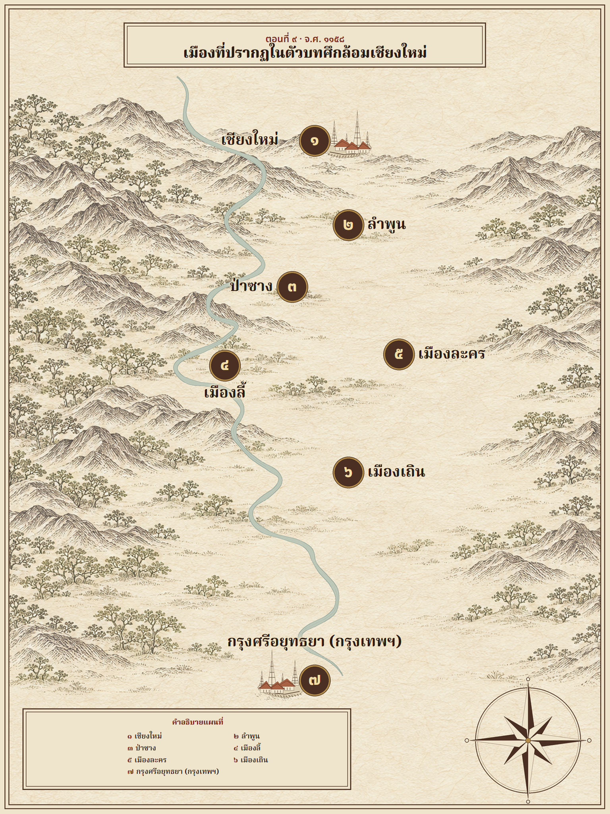

# ภาคที่ 3: ใครเข้ามาอยู่ในเวียง
## ตอนที่ 9: ศึกใหญ่ พ.ศ. 2340 เมืองที่เพิ่งฟื้นต้องรับศึกอีกครั้ง

> **หมายเหตุถึงผู้อ่านตอนที่ 9:** ตอนนี้วางหลักฐานสองฝั่งเทียบเคียงกันอย่างชัดเจน ได้แก่ ฝั่ง ก. ภาพสแกนตัดขยายครึ่งหน้าของ *ตำนานพื้นเมืองเชียงใหม่* (ฉบับพิมพ์ พ.ศ. 2514 ผูก 7 หน้า 106 โดยไม่อาศัย OCR) และฝั่ง ข. *ตำนานวังน่า* (ประชุมพงศาวดาร ภาคที่ 13 เรื่องที่ 1) ฉบับพิมพ์แจกในงานศพ นางสุ่น ชาติโอสถ พ.ศ. 2462 (ผู้เรียบเรียงตรวจข้อความจากภาพสแกนหน้าพิมพ์ 36–37 ที่เผยแพร่ในวิกิมีเดียคอมมอนส์ และจากฉบับถอดความของวิกิซอร์ซ) พร้อมข้อความในหนังสือเล่มที่ 3 ในชุดเดียวกัน (*กระดานศึกวังหน้า* ตอนที่ 15–16) ที่เรียบเรียงจากเรื่องเดียวกัน ด้านการนับปี ตัวบทตำนานเชียงใหม่ระบุศักราชเป็น **จ.ศ. 1159 ปีเมืองไส้ เดือน 4 (ล้านนา) แรม 2 ค่ำ** เมื่อบวก 1181 ตามการนับปีแบบไทยเก่าจะได้ **พ.ศ. 2340** ตรงกับที่เล่ม 3 เรียกศึกนี้ (ในตอนนี้คงวันเดือนปีตามตัวบทโดยไม่แปลงเป็นวันที่สากล) ตัวบทเชียงใหม่เรียกราชสำนักสยามที่กรุงเทพฯ ว่า "กรุงศรีอยุทธยา" จึงคงตามตัวบทพร้อมอธิบายในวงเล็บ ส่วนตัวเลขกำลังพลเป็นตัวเลขตามตัวบท และตัวเลขฝ่ายพม่า 99,000 ผู้เรียบเรียงอ่านจากภาพสแกนไม่ชัดในครั้งแรก และได้รับการยืนยันจากผู้อ่านภาษาไทยแล้ว

---

### ฉากเปิด: หนังสือ "ห้อแสนสิริอักษร" จากเมืองที่เพิ่งตั้งใหม่

เมื่อกองทัพพม่ายกมาปิดล้อมเมืองเชียงใหม่ใน **จ.ศ. 1159 ปีเมืองไส้ เดือน 4 แรม 2 ค่ำ** พี่น้องทั้งสามพระองค์ได้ปรึกษากันต่อหน้าสถานการณ์ที่ตัวบท *ตำนานพื้นเมืองเชียงใหม่* หน้า 106 เรียกว่า "มหาสงครามอันใหญ่"

ถ้อยคำสั้น ๆ ที่ผู้บันทึกฝ่ายเชียงใหม่บันทึกไว้ในการปรึกษาครั้งนั้นคือ แม้จะไม่กลัวฝ่ายพม่ามาปล้นเอา แต่ **"เมืองเราก็ตั้งใหม่ เข้าน้ำบ่จัยก็บ่บริบูรณ์"** (ตัวบทไม่ได้ขยายความเพิ่มเติมว่าถ้อยคำนี้หมายถึงการขาดเสบียงอาหารหรือขาดกำลังคน) จึงเห็นควรให้ขอกองทัพจากฝ่ายใต้

พี่น้องทั้งสามพระองค์จึงแต่งหนังสือชื่อ **"ห้อแสนสิริอักษร"** พร้อมคุมเอาฝ่ายพม่าที่จับได้ลงไปทูลเกล้าฯ พระมหากษัตริย์เจ้า ณ **"กรุงศรีอยุทธยา"** (ตามบริบทหมายถึงราชสำนักสยามที่กรุงเทพฯ) เพื่อทูลขอกองทัพขึ้นมาช่วย

---

### แผนที่สถานที่ในหลักฐาน: เชียงใหม่ ลำพูน ป่าซาง เมืองลี้ เมืองเถิน เมืองละคร และกรุงศรีอยุทธยา

แผนที่ของตอนนี้แสดงเฉพาะตำแหน่งภาพรวมของเมืองที่ตัวบทตำนานหน้า 106 ระบุชื่อไว้ ได้แก่ **เชียงใหม่**, **ลำพูน**, **ป่าซาง**, **เมืองลี้**, **เมืองเถิน**, **เมืองละคร** (ผู้เรียบเรียงเข้าใจว่าคือลำปาง ตัวบทหน้านี้ไม่ได้อธิบาย), และ **กรุงศรีอยุทธยา** (กรุงเทพฯ) โดยไม่ได้ลากเส้นทางเดินทัพหรือลูกศรเชื่อมระหว่างเมือง

---

### คำถามของตอน

**เมื่อเชียงใหม่ถูกล้อมต้นปีที่เล่ม 3 เรียก พ.ศ. 2340 ตัวบทเชียงใหม่เล่าลำดับเหตุการณ์อย่างไร และตรงหรือต่างจากที่เล่ม 3 เล่า**

ตัวบท *ตำนานพื้นเมืองเชียงใหม่* หน้า 106 ตอบลำดับโครงหลักได้ชัดเจน ตั้งแต่การส่งหนังสือขอกองทัพใต้ การที่เมืองถูกล้อมอยู่นานสองเดือนสิบแปดวัน การตีโต้จากเมืองลี้ ลำพูน ป่าซาง จนถึงหน้าเวียงเชียงใหม่ และกองทัพใต้ลากลับ แต่ตัวบทไม่ได้บอกเราว่าชาวเมืองเชียงใหม่ใช้ชีวิตกันอย่างไรในช่วงที่ถูกล้อม และไม่ได้เล่าฉากการรบละเอียดนอกเหนือจากโครงหลักเหล่านั้น

---

### หลักฐานสองฝั่ง

#### ฝั่ง ก.: ตัวบทตำนานพื้นเมืองเชียงใหม่ (หน้า 106)

ลำดับเหตุการณ์ใน *ตำนานพื้นเมืองเชียงใหม่* ผูก 7 หน้า 106 มีขอบเขตอยู่ 6 ช่วงต่อเนื่องกันดังนี้

1. **การเข้าล้อมเมืองเชียงใหม่ (หน้า 106):** ใน **จ.ศ. 1159 ปีเมืองไส้ เดือน 4 แรม 2 ค่ำ** แม่ทัพฝ่ายพม่าซึ่งตัวบทออกนามว่า **"ม่านอิงเซะโป่ ซิดซิงโป่"** ยกมาจากอังวะ มีรี้พล ****99,000** ตามตัวบท** เข้าแวดล้อมเมืองเชียงใหม่ "เป็นมหาสงครามอันใหญ่" พระเป็นเจ้าแต่งเจ้านายลูกหลานเป็นหัวหน้าออกตีฝ่ายพม่าแตกออกไปหลายครั้ง
2. **การส่งหนังสือขอกองทัพใต้ (หน้า 106):** พี่น้องทั้งสามพระองค์ปรึกษากันว่า แม้ไม่กลัวฝ่ายพม่ามาปล้นเอา แต่ **"เมืองเราก็ตั้งใหม่ เข้าน้ำบ่จัยก็บ่บริบูรณ์"** (ตัวบทไม่ขยายความ) จึงแต่งหนังสือ **"ห้อแสนสิริอักษร"** คุมเอาฝ่ายพม่าที่จับได้ลงไปทูลเกล้าฯ พระมหากษัตริย์เจ้า ณ "กรุงศรีอยุทธยา" (ราชสำนักสยามที่กรุงเทพฯ) เพื่อทูลขอกองทัพ
3. **ทัพวังหน้าขึ้นถึงเมืองเถินและแบ่งทัพทางเมืองลี้ (หน้า 106):** ตัวบทระบุว่า **"พระราชวังบวรสถานมงคลวังหน้าเป็นแม่ทัพใหญ่"** มีรี้พลตามตัวบท **"แสนหนึ่ง"** เสด็จขึ้นไปถึง **เมืองเถิน** แล้วแบ่งกองทัพที่นั่น ให้ **"เจ้าอินทปัด เจ้าจำนวล"** ซึ่งตัวบทเรียกว่า **"โอรสบุตรทั้งสององค์พี่น้อง"** (ตัวบทไม่ได้ระบุชัดว่าเป็นโอรสบุตรของผู้ใด จึงไม่ระบุเกินตัวบท) เป็นแม่ทัพคุมรี้พลตามตัวบท **40,000 คน** ขึ้นทาง **เมืองลี้**
4. **การปะทะที่เมืองลี้ (หน้า 106):** ม่านอิงเซะโป่แต่งรี้พลไปต้านถึงเมืองลี้ รบกัน **3 วัน 3 คืน** กองทัพพม่าต้านไม่ได้จึงแตกถอยขึ้นไปตั้งที่ **เมืองลำพูน**
5. **การตีโต้จากเมืองละคร ป่าซาง ลำพูน สู่เชียงใหม่ (หน้า 106):** ตัวบทระบุว่า **"กษัตริย์เจ้าวังหน้ายังอยู่เมือง" (ตัวบทไม่ระบุชื่อเมืองในประโยคนี้ ประโยคก่อนหน้าบอกว่าเสด็จขึ้นมาถึงเมืองเถินและแบ่งกองทัพที่นั่น)** แต่งรี้พลขึ้นมาทาง **เมืองละคร** (ผู้เรียบเรียงเข้าใจว่าคือลำปาง ตัวบทหน้านี้ไม่ได้อธิบาย) มาบรรจบกันที่เวียงลำพูน ตีฝ่ายพม่าที่ **เวียงป่าซาง** และ **เวียงลำพูน** จนแตก แล้วขึ้นมาตีฝ่ายพม่าที่ล้อมเวียงเชียงใหม่ ม่านอิงเซะโป่ต้านไม่ได้แตกกระจายไป และจับได้ **"ม่านอุปปะคองโป่"** ที่ **ทุ่งช้างคลาน** พร้อมไพร่ม่านเป็นอันมาก
6. **ระยะเวลาล้อมและการลากลับของทัพใต้ (หน้า 106):** ตัวบทระบุว่าฝ่ายพม่าล้อมเวียงเชียงใหม่ **"นานได้สองเดือนสิบแปดวัน"** เมื่อฝ่ายพม่าแตกไปแล้ว กองทัพใต้จึงลาทัพกลับลงไป

#### ฝั่ง ข.: *ตำนานวังน่า* (ประชุมพงศาวดาร ภาคที่ 13 เรื่องที่ 1) และข้อความในเล่ม 3

ผู้เรียบเรียงอ่านข้อความ *ตำนานวังน่า* (ประชุมพงศาวดาร ภาคที่ 13 เรื่องที่ 1) ตอนที่ว่าด้วยเรื่องการล้อมวงและการสวรรคตของวังหน้า (ผู้เรียบเรียงตรวจจากภาพสแกนหน้าพิมพ์ 36–37 ของฉบับพิมพ์ พ.ศ. 2462 ว่าตรงกับฉบับถอดความของวิกิซอร์ซ) เทียบกับสิ่งที่เล่ม 3 (*กระดานศึกวังหน้า* ตอนที่ 15–16) เรียบเรียงไว้ จุดที่เห็นมีดังนี้

- **การจัดทัพที่เมืองเถิน (จุดเทียบสำคัญ):** ตัวบทเชียงใหม่หน้า 106 ระบุว่าวังหน้าเสด็จขึ้นมาถึงเมืองเถินและแบ่งกองทัพที่นั่น แล้วว่า "กษัตริย์เจ้าวังหน้ายังอยู่เมือง" (ไม่ระบุชื่อเมืองในประโยคนี้) ขณะที่แบ่งรี้พลขึ้นมาทางเมืองลี้กับทางเมืองละคร ส่วน *ตำนานวังน่า* เล่าว่าในศึกปีมะเสง พ.ศ. 2340 กรมพระราชวังบวรฯ ทรงเป็นจอมพล เสด็จขึ้นไปถึงเมืองเถิน แล้วทรงจัดกองทัพเป็น **4 ทัพ** (ทัพวังหลวง ทัพวังหน้า ทัพเจ้าอนุอุปราชซึ่งยกกองทัพเวียงจันทน์มาช่วย และทัพหนุนของกรมพระราชวังหลัง) สองฝั่ง **สอดคล้องกัน** ว่าเมืองเถินเป็นจุดจัดแบ่งกองทัพ แต่ **ต่างกัน** ที่ตัวบทเชียงใหม่ไม่เอ่ยถึง 4 ทัพหรือทัพเวียงจันทน์ และเล่าการแบ่งเป็นสองสายคือ 40,000 คนของเจ้าอินทปัดกับเจ้าจำนวลขึ้นทางลี้ กับกองที่ขึ้นทางละคร
- **เส้นทางลี้และลำปางอยู่ในศึกใด:** *ตำนานวังน่า* เล่าเรื่องแบ่งทัพขึ้นทางเมืองลี้ (ทัพวังหลวง) และทางนครลำปาง (ทัพวังน่า ซึ่งตีได้เมืองลำพูนก่อน) ไว้ในศึกปีจอ พ.ศ. 2345 ที่วังหน้าทรงพระประชวรที่เมืองเถิน ส่วนตำนานเชียงใหม่เล่าเส้นทางสองสายนี้ไว้ในศึก จ.ศ. 1159 (พ.ศ. 2340) ผู้เรียบเรียงไม่ทราบว่าความต่างนี้เกิดจากการที่ผู้บันทึกฝ่ายใดเล่าสลับศึก หรือเพราะสองศึกมีรูปแบบคล้ายกัน จึงไม่สรุป (เล่ม 3 ตอนที่ 15–16 แยกสองศึกนี้ไว้เช่นเดียวกับ *ตำนานวังน่า*)
- **นามแม่ทัพ "เจ้าอินทปัด เจ้าจำนวล":** ตัวบทเชียงใหม่หน้า 106 เรียกทั้งสองพระองค์ว่า "โอรสบุตรทั้งสององค์พี่น้อง" โดยไม่ชี้ชัดว่าเป็นโอรสของผู้ใด ส่วน *ตำนานวังน่า* เล่าถึง **พระองค์เจ้าลำดวน** และ **พระองค์เจ้าอินทปัต** ว่าเป็น "ลูกเธอชั้นใหญ่" ของกรมพระราชวังบวรฯ ที่พึ่งออกทำการสงครามในศึกครั้งนั้น พระนามใกล้เคียงกับที่ตัวบทเชียงใหม่ใช้ แต่ตัวบทเชียงใหม่ไม่ได้ชี้ว่าเป็นโอรสของผู้ใด
- **ชื่อแม่ทัพพม่า:** ตัวบทเชียงใหม่ออกนามแม่ทัพพม่าว่า "ม่านอิงเซะโป่ ซิดซิงโป่" และจับได้ "ม่านอุปปะคองโป่" ที่ทุ่งช้างคลาน ส่วน *ตำนานวังน่า* บอกเพียงว่าศึกนั้นจับได้ "อุบากอง" นายทัพพม่าคนหนึ่ง ชื่อใกล้เคียงกับ "อุปปะคองโป่" มากและตรงที่ว่าถูกจับ แต่ผู้เรียบเรียงไม่ยืนยันว่าเป็นคนเดียวกัน ส่วนชื่อ "อิงเซะโป่" กับ "ซิดซิงโป่" ผู้เรียบเรียงค้นข้อความ *ตำนานวังน่า* ที่อ่านแล้วไม่พบ ตัวเลขกำลังพลของตำนานวังน่าก็ไม่ปรากฏในส่วนที่อ่าน

---

### แยก 3 ชั้น: ตัวบท / คำอธิบายของงานเรียบเรียง / สิ่งที่ยังไม่รู้

#### ชั้นที่ 1: สิ่งที่ตัวบทตำนานเชียงใหม่ (หน้า 106) พูด
ตัวบทบันทึกการล้อมเมืองใน จ.ศ. 1159 เดือน 4 แรม 2 ค่ำ ถ้อยคำ "เมืองเราก็ตั้งใหม่ เข้าน้ำบ่จัยก็บ่บริบูรณ์" การส่งหนังสือ "ห้อแสนสิริอักษร" ลงไปขอกองทัพใต้ การที่วังหน้าอยู่ที่เมืองเถินและแบ่งทัพขึ้นทางเมืองลี้ (รบ 3 วัน 3 คืน) กับทางเมืองละคร การตีฝ่ายพม่าที่เวียงป่าซาง เวียงลำพูน และเชียงใหม่ การจับ "ม่านอุปปะคองโป่" ที่ทุ่งช้างคลาน ระยะเวลาล้อม "สองเดือนสิบแปดวัน" และการที่ทัพใต้ลากลับ

#### ชั้นที่ 2: สิ่งที่ *ตำนานวังน่า* และเล่ม 3 นำเสนอ
ข้อความ *ตำนานวังน่า* ช่วยให้เห็นมุมมองฝั่งกรุงเทพฯ เรื่องการจัดทัพ 4 ทัพที่เมืองเถินในศึก พ.ศ. 2340 การแยกศึกปี 2345 ที่วังหน้าทรงพระประชวรที่เมืองเถินออกจากศึกนี้ การระบุพระองค์เจ้าลำดวนกับพระองค์เจ้าอินทปัตว่าเป็นลูกเธอชั้นใหญ่ของวังหน้า และการจับ "อุบากอง" นายทัพพม่า ผู้เรียบเรียงตรวจข้อความช่วงนี้จากภาพสแกนหน้าพิมพ์ 36–37 ของ *ประชุมพงศาวดาร* ฉบับพิมพ์ พ.ศ. 2462 โดยตรงแล้ว

#### ชั้นที่ 3: สิ่งที่ยังไม่รู้
- **ตัวเลขกำลังพลที่แน่ชัดของทั้งสองฝ่าย:** ตัวเลขฝ่ายพม่า 99,000 ตามตัวบทหน้า 106 (ผู้อ่านภาษาไทยยืนยันแล้ว) แต่เป็นตัวเลขตามตัวบทที่ไม่อาจตรวจจำนวนจริงได้ เช่นเดียวกับตัวเลข "แสนหนึ่ง" กับ 40,000 เป็นตัวเลขตามตัวบทซึ่งไม่อาจตรวจสอบจำนวนจริงได้
- **ชื่อแม่ทัพพม่าที่แน่ชัด:** ชื่อ "ม่านอิงเซะโป่ ซิดซิงโป่" ในตัวบทเชียงใหม่ไม่ปรากฏใน *ตำนานวังน่า* ที่ผู้เรียบเรียงอ่าน (ซึ่งบอกเพียงว่าจับได้ "อุบากอง" นายทัพพม่าคนหนึ่ง) และเล่ม 3 ตอนที่ 15 ระบุว่าสายหลักฐานอื่นบันทึกชื่อและตัวเลขกำลังพลเป็นอีกชุดหนึ่ง จึงยังตัดสินไม่ได้ว่าชื่อชุดใดตรงกับข้อเท็จจริง
- **วังหน้าเสด็จขึ้นไปถึงเชียงใหม่หรือไม่ในศึกนี้:** ตัวบทเชียงใหม่ระบุเพียงว่า "กษัตริย์เจ้าวังหน้ายังอยู่เมือง" (ตัวบทไม่ระบุชื่อเมืองในประโยคนี้ ประโยคก่อนหน้าบอกว่าเสด็จขึ้นมาถึงเมืองเถินและแบ่งกองทัพที่นั่น) และแต่งรี้พลขึ้นมา โดยไม่ได้ระบุว่าภายหลังเสด็จขึ้นไปถึงเชียงใหม่หรือไม่
- **ความเป็นอยู่ของชาวเมืองเชียงใหม่ระหว่างถูกล้อม:** ตัวบทไม่เล่าว่าผู้คนในเมืองอยู่กินกันอย่างไรตลอดสองเดือนสิบแปดวัน และไม่ขยายความคำว่า "เข้าน้ำบ่จัยก็บ่บริบูรณ์"
- **เหตุการณ์ต่อจากหน้า 106 (หน้า 107 ของตัวบท):** หน้า 107 ของ *ตำนานพื้นเมืองเชียงใหม่* ยังไม่ได้อ่านซ้ำ จึงยังไม่นำข้อมูลจากหน้านั้นมาใช้ในตอนนี้
- **ตำแหน่งที่แน่ชัดของ "ทุ่งช้างคลาน":** ตัวบทระบุว่าเป็นจุดที่จับได้ม่านอุปปะคองโป่ แต่ผู้เรียบเรียงยังไม่ระบุพิกัดที่แน่ชัดในตอนนี้

---

### ตะขอไปตอนถัดไป

เมื่อผ่านพ้นวงล้อมสองเดือนสิบแปดวันและกองทัพใต้ยกกลับลงไปแล้ว ตอนถัดไปจะตามเรื่องขึ้นไปทางเหนือ—สู่ตอนที่ 10: เชียงแสน

**จบตอนที่ 9 (จบภาคที่ 3: ใครเข้ามาอยู่ในเวียง)**

*(ติดตามต่อใน ภาคที่ 4: เมืองหนึ่งฟื้น อีกเมืองเสียผู้คน — ตอนที่ 10: เชียงแสน)*

---

## ตารางที่มาของข้อเท็จจริง (ไม่พิมพ์ในหนังสือ ใช้ตรวจ)

| ข้อความในบท | ข้อในใบข้อเท็จจริง / แหล่งเทียบ | หน้า / หัวข้อ | ระดับ |
|---|---|---|---|
| จ.ศ. 1159 ปีเมืองไส้ เดือน 4 แรม 2 ค่ำ + 1181 = พ.ศ. 2340 ตรงกับที่เล่ม 3 เรียก (ผู้ใช้ถอดหน้า 106 ยืนยันเลข 1159; ผมอ่านเป็น 1158 ผิดมาก่อน) | ตำนาน F1 | 106 | ชัด (ผู้ใช้ยืนยัน) |
| จ.ศ. 1159 ปีเมืองไส้ เดือน 4 แรม 2 ค่ำ "ม่านอิงเซะโป่ ซิดซิงโป่" ยกมาจากอังวะ รี้พล99,000 ตามตัวบท แวดล้อมเมืองเชียงใหม่ "เป็นมหาสงครามอันใหญ่" พระเป็นเจ้าแต่งเจ้านายลูกหลานออกตีม่านแตกหลายครั้ง | ตำนาน F1 | 106 | ชัด (ตัวเลข 99,000 ผู้อ่านภาษาไทยยืนยัน) |
| พี่น้องทั้งสามพระองค์ปรึกษากันว่าไม่กลัวม่านมาปล้นเอา แต่ "เมืองเราก็ตั้งใหม่ เข้าน้ำบ่จัยก็บ่บริบูรณ์" จึงแต่งหนังสือ "ห้อแสนสิริอักษร" คุมเอาม่านที่จับได้ลงไปทูลเกล้าฯ พระมหากษัตริย์เจ้า ณ "กรุงศรีอยุทธยา" (ราชสำนักสยามที่กรุงเทพฯ) เพื่อทูลขอกองทัพ | ตำนาน F2 | 106 | ชัด |
| "พระราชวังบวรสถานมงคลวังหน้าเป็นแม่ทัพใหญ่" รี้พลตามตัวบท "แสนหนึ่ง" เสด็จถึงเมืองเถิน แบ่งกองทัพให้ "เจ้าอินทปัด เจ้าจำนวล อันเป็นโอรสบุตรทั้งสององค์พี่น้อง" (ตัวบทไม่ชี้ชัดว่าของผู้ใด) คุมรี้พลตามตัวบท 40,000 คน ขึ้นทางเมืองลี้ | ตำนาน F3 | 106 | ชัด (การตีความ "โอรสบุตรของใคร" ยังไม่ยืนยัน) |
| ม่านอิงเซะโป่แต่งรี้พลไปต้านถึงเมืองลี้ รบกัน 3 วัน 3 คืน กองทัพม่านต้านไม่ได้ แตกถอยขึ้นไปตั้งที่เมืองลำพูน | ตำนาน F4 | 106 | ชัด |
| "กษัตริย์เจ้าวังหน้ายังอยู่เมือง" (ตัวบทไม่ระบุชื่อเมืองในประโยคนี้ ประโยคก่อนหน้าบอกว่าเสด็จขึ้นมาถึงเมืองเถินและแบ่งกองทัพที่นั่น) แต่งรี้พลขึ้นมาทางเมืองละคร มาบรรจบกันที่เวียงลำพูน ตีม่านที่เวียงป่าซาง เวียงลำพูน ม่านแตก แล้วขึ้นมาตีม่านที่ล้อมเวียงเชียงใหม่ ม่านอิงเซะโป่แตกกระจายไป จับได้ "ม่านอุปปะคองโป่" ที่ทุ่งช้างคลาน กับไพร่ม่านเป็นอันมาก | ตำนาน F5 | 106 | ชัด |
| ม่านล้อมเวียง "นานได้สองเดือนสิบแปดวัน" ม่านแตกไปแล้ว กองทัพใต้ลาทัพกลับลงไป | ตำนาน F6 | 106 | ชัด |
| ศึกปีมะเสง พ.ศ. 2340: กรมพระราชวังบวรฯ เป็นจอมพล เสด็จถึงเมืองเถิน ทรงจัดกองทัพเป็น 4 ทัพ (วังหลวง, วังหน้า, เจ้าอนุอุปราชเวียงจันทน์, ทัพหนุนกรมพระราชวังหลัง); พระองค์เจ้าลำดวนและพระองค์เจ้าอินทปัตเป็นลูกเธอชั้นใหญ่ของวังหน้า; จับได้ "อุบากอง" นายทัพพม่า | *ตำนานวังน่า* (ประชุมพงศาวดาร ภาคที่ 13 เรื่องที่ 1) ตอนล้อมวงและสวรรคต + เล่ม 3 ep15 | 36–37 (ตรวจจากภาพสแกนฉบับ พ.ศ. 2462 เมื่อ ๒๑ พ.ย.) | ชัด |
| ศึกปีจอ พ.ศ. 2345: วังหน้าประชวรที่เมืองเถิน ทัพวังหลวงไปทางเมืองลี้ ทัพวังน่าไปทางนครลำปางและตีได้ลำพูนก่อน; แยกจากศึก พ.ศ. 2340 | *ตำนานวังน่า* + เล่ม 3 ep15–16 | 37 (ตรวจจากภาพสแกนฉบับ พ.ศ. 2462 เมื่อ ๒๑ พ.ย.) | ชัด |

---

## รายการภาพที่ต้องสร้าง (ไม่พิมพ์ในหนังสือ ใช้ตรวจ)

1. **ภาพฉากเปิดตอน (`images/ep09_scene.jpg` — สัดส่วน 16:9 แนวนอน)**
   - **โทนสีและวัสดุประจำเล่ม 4 ("กระดาษสาและไม้สัก"):** กูอาชบางผสมหมึกซีเปีย ลายเส้นพู่กันแห้งบนกระดาษสาเห็นเส้นใย จานสีอุ่นครีมกระดาษสา (`#EFE4CC`) น้ำตาลไม้สัก ดินแดงลูกรัง เหลืองรง–ส้มหญ้าฝรั่น เขียวมอส–มะกอก เน้นแดงรักและทองคำเปลวไม่เกิน 3% มียอดเจดีย์ล้านนาทรงระฆังปิดทองเล็ก ๆ ไกลมากอยู่ช่วงบนของภาพ และลำต้นไม้สักเก่าชิดขอบขวาของภาพ
   - **เวลาและแสงเฉพาะตอนที่ 9:** **ใกล้พลบค่ำ แสงส้มต่ำ** (ต่างจากตอนอื่นทั้งหมดในเล่ม 4)
   - **แนวคิดและองค์ประกอบ:** ภาพเชิงสัญลักษณ์ของกำแพงเมืองไม้และอิฐเก่าที่ประตูปิดสนิทในแสงส้มต่ำใกล้พลบค่ำ (หรือม้วนหนังสือบนแท่นไม้เก่าในแสงเย็นต่ำ) พื้นดินและหญ้าต่อเนื่องถึงขอบล่าง ฉากหลังเป็นทิวเขาสีมะกอกในหมอกบาง
   - **กติกาบังคับ:** ไม่มีหน้าคน ไม่มีบุคคล ไม่มีอาวุธ ไม่มีปืน ห้ามภาพการรบ วัตถุหลักอยู่ในช่วง 45–78% ของความสูงภาพและตั้งบนพื้นอย่างมั่นคง ห้ามใส่ข้อความ ตัวเลข ป้าย ธง หรือลายน้ำในภาพ ห้ามใช้โทนเขียวหยก–ครามของเล่ม 1–3
2. **แผนที่ประจำตอน (`images/ep09_map.png` — สัดส่วน 3:4 แนวตั้ง)**
   - **โทนสีและรูปแบบประจำเล่ม 4:** พื้นครีมกระดาษสา (`#EFE4CC`) เห็นเส้นใยกระดาษ ลายเส้นหมึกซีเปีย ภูเขาลายขีดแต้มสีมะกอกอ่อน แม่น้ำสีเทาอมเขียวหม่น กรอบเส้นคู่บาง กล่องหัวแผนที่เปล่าด้านบน กล่องคำอธิบายเปล่าล่างซ้าย เข็มทิศไม่มีตัวอักษรล่างขวา วงกลมพิกัดสีน้ำตาลไม้สักเข้มขอบทองบาง (ห้ามใช้พื้นเขียวเซลาดอนของเล่ม 3)
   - **เมืองและสถานที่ที่อนุญาตให้ใส่ในแผนที่ (เฉพาะเมืองภาพรวมที่ตัวบทหน้า 106 ระบุ เท่านั้น ห้ามใส่เมืองอื่น):**
     - **เชียงใหม่**
     - **ลำพูน**
     - **ป่าซาง**
     - **เมืองลี้**
     - **เมืองเถิน**
     - **เมืองละคร** (ผู้เรียบเรียงเข้าใจว่าคือลำปาง ตัวบทหน้านี้ไม่ได้อธิบาย)
     - **กรุงศรีอยุทธยา** (กรุงเทพฯ)
   - **กติกาบังคับ:** ตำแหน่งเป็นภาพรวม ห้ามลากเส้นทางหรือลูกศรใด ๆ ระหว่างเมือง ห้ามเติมเมืองอื่นนอกเหนือจากรายการข้างต้น (ห้ามใส่เชียงแสน อังวะ เวียงจันทน์ ทุ่งช้างคลาน) ไม่มีหน้าคน ไม่มีอาวุธเด่น ห้ามมีตัวอักษรหรือป้ายชื่อในภาพแผนที่ฐาน
